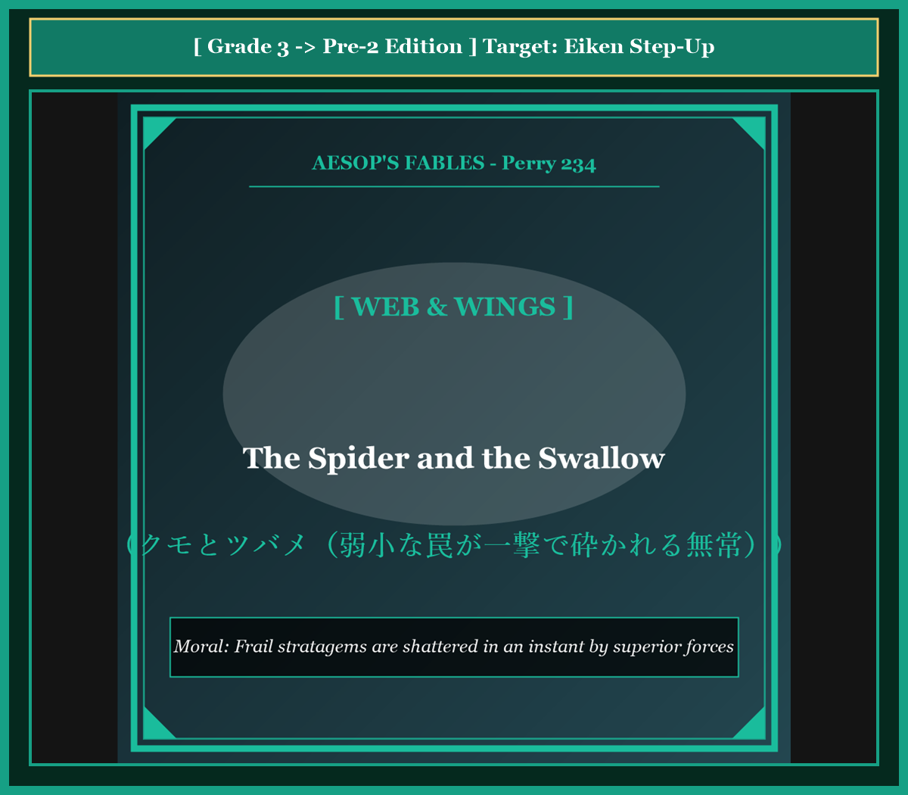
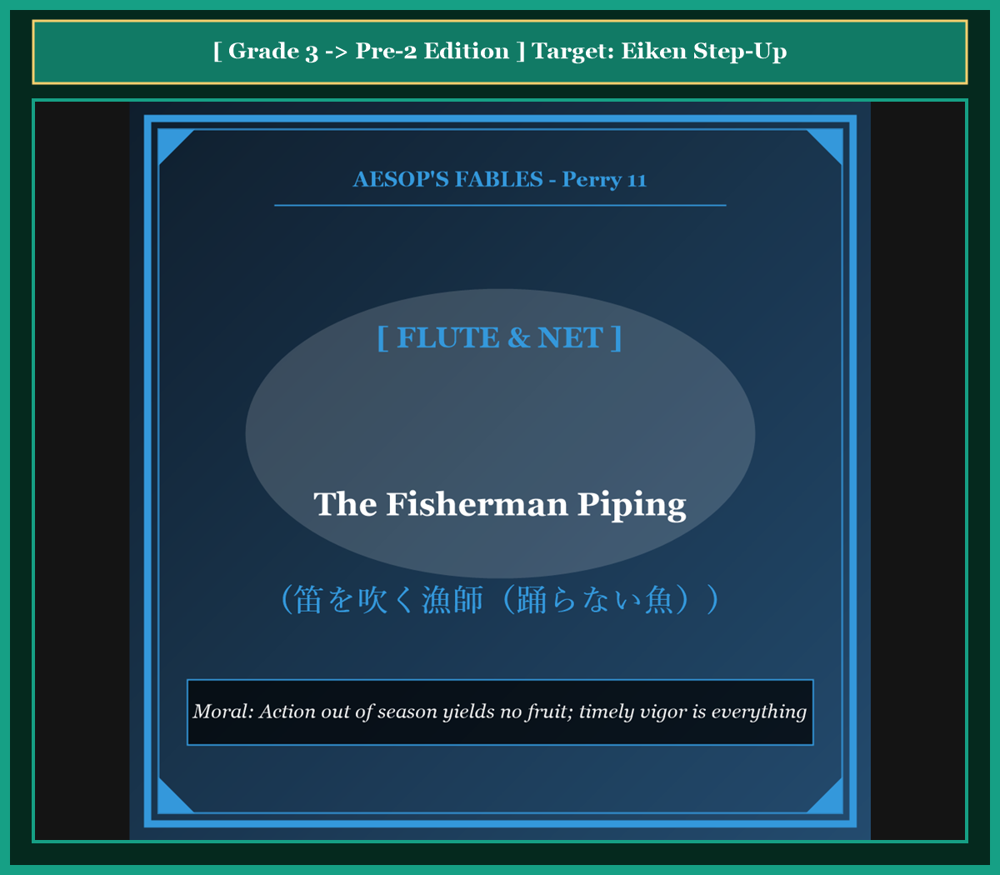
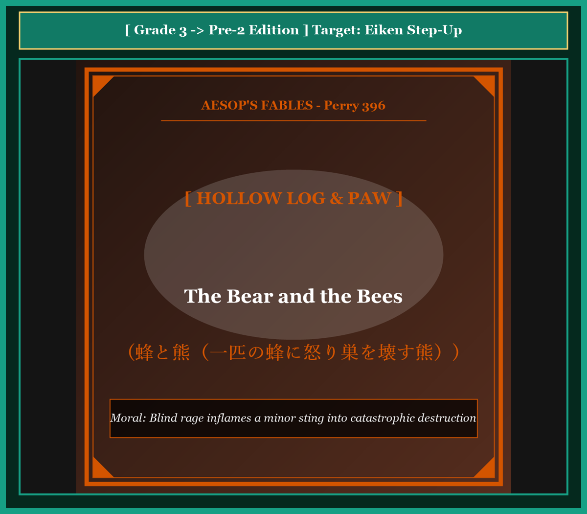
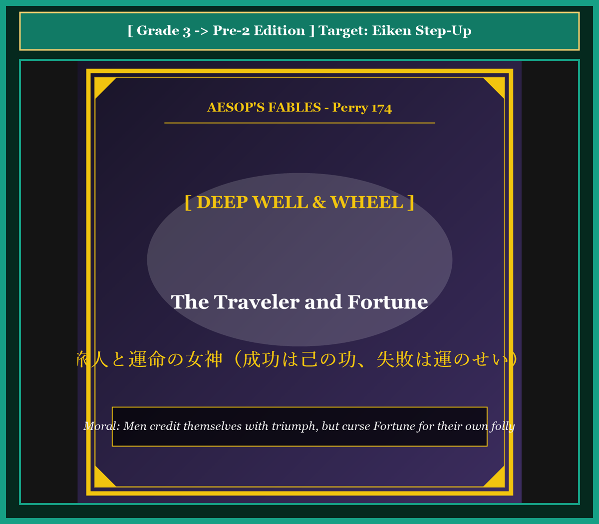

# 『英検ステップアップ多読：イソップ寓話編 第22巻（3級 ➔ 準2級対比学習・第6集・完結巻）』

---

## はじめに：なぜ「対比多読」で英検準2級の壁を突破できるのか？

英検準2級は、中学英語（3級レベル）から高校中級レベルへと大きくステップアップする極めて重要な関門です。長文読解の語数が増加し、扱われるトピックも日常会話から社会的なテーマや論理的な記述へとシフトします。

3級レベルの知識を土台にしつつ、**「関係代名詞」「分詞構文」「仮定法」「助動詞＋完了形」**などの高校レベルの構文をいかに自然に読みこなせるかが合否の分かれ目となります。

本書では、世界中で親しまれてきたイソップ寓話（第6集・10話）を通じて、**「3級レベルの標準英文」** が **「準2級レベルの論理的英文」** へとどのように洗練されるかを一目で対比できる画期的な構成を採用しています。

* **3級英文** でストーリー展開を素早くキャッチ
* **準2級英文** で関係詞節や分詞構文、高校必須の重要語彙を無理なく吸収
* **そらんじたいキーフレーズ対比カード** で、ライティングや二次面接（スピーキング）に直結する表現力を定着

名作の深い教訓を味わいながら、準2級合格への盤石な英語力を身につけましょう！

---

## 本書の収録作品（第6集・全10話 / シリーズ通算51〜60話）

1. **Chapter 51**: 鷲と矢（自分の羽がついた矢） (*The Eagle and the Arrow*) [Perry 276]
2. **Chapter 52**: 猿の裁判長（二匹の猫とチーズ） (*The Monkey as Judge*) [Perry 614]
3. **Chapter 53**: ロバを売る親子（他人の評価に惑わされる話） (*The Miller, His Son and the Donkey*) [Perry 721]
4. **Chapter 54**: 蜜蜂とゼウス（針の代償） (*The Bee and Zeus*) [Perry 29]
5. **Chapter 55**: 豚と羊と山羊（屠殺場へ運ばれる豚） (*The Pig, the Sheep and the Goat*) [Perry 85]
6. **Chapter 56**: 病気のカラスと母（困ったときだけの神頼み） (*The Sick Raven*) [Perry 398]
7. **Chapter 57**: クモとツバメ（弱小な罠が一撃で砕かれる無常） (*The Spider and the Swallow*) [Perry 234]
8. **Chapter 58**: 笛を吹く漁師（踊らない魚） (*The Fisherman Piping*) [Perry 11]
9. **Chapter 59**: 蜂と熊（一匹の蜂に怒り巣を壊す熊） (*The Bear and the Bees*) [Perry 396]
10. **Chapter 60**: 旅人と運命の女神（成功は己の功、失敗は運のせい） (*The Traveler and Fortune*) [Perry 174]

---

## 本書の構成と電子書籍 / Kobo最適化

各章は以下の6部構成で統一されています。

```text
┌─────────────────────────────────────────────────────────────┐
│ 1. Chapter Title & Visual Illustration (章タイトル ＆ 挿絵)   │
│ 2. Benchmark Level: 英検3級レベル英文                         │
│ 3. Target Level: 英検準2級レベル英文                         │
│ 4. Classic Original English Text (イソップ寓話クラシック原文)  │
│ 5. Japanese Translation (日本語訳 ＆ 教訓)                     │
│ 6. Recite & Compare (そらんじたいキーフレーズ対比カード)        │
│ 7. Key Vocabulary & Exam Notes (語彙・文法・試験対策解説)        │
└─────────────────────────────────────────────────────────────┘
```

> **【ポイント】 音声読み上げ（TTS）をご利用の方へ**
> 本文セクション（ステップ1〜3）は英語のみで構成されており、電子書籍やKoboの自動音声読み上げ機能（Text-to-Speech）で日本語が混ざることなく、美しい英語音声で快適にリスニング学習していただけます。


# Chapter 51: The Eagle and the Arrow (鷲と矢)

<!-- 電子書籍 Page Break & Image Header -->
<div style="text-align: center; margin-bottom: 20px;">
  
</div>

<div style="page-break-before: always;"></div>

## 1. Benchmark Level: Eiken Grade 3 (英検3級レベル本文)
*Read in ~2 to 2.5 minutes. Baseline vocabulary and basic syntax.*

A majestic eagle made his home on the highest cliff of a rugged mountain. Every morning, he surveyed the vast valley below because he possessed extraordinary eyesight. From high above the clouds, he could easily spot small animals that were hiding among the green bushes.

One calm afternoon, the eagle descended and perched upon a solitary boulder. He was waiting patiently to catch a hare for his evening meal. While he was concentrating on the grassy fields, an experienced hunter approached silently through the thick forest.

The hunter instantly recognized the great bird and prepared his weapon. Taking a sharp wooden arrow, he fitted it to his bowstring. He pulled the bow with great power and released the arrow toward the cliff.

The arrow soared swiftly through the air and pierced deep into the eagle's body. Overcome by sudden shock and intense pain, the monarch of the skies lost his balance and tumbled down to the rocky earth below.

As he lay dying on the ground, the eagle glanced down at the fatal shaft sticking out of his breast. To his astonishment and horror, he noticed the feathers that guided the arrow through the air. They were unmistakable brown flight feathers that had fallen from his own wings during his last molt.

Tears welled in the dying eagle's eyes as he spoke his final words: "It is a double sorrow to lose my life, but it is far more bitter to know that my own feathers provided the very wings that brought death to my heart."

---
<div style="page-break-before: always;"></div>

## 2. Target Level: Eiken Grade Pre-2 (英検準2級レベル本文)
*Read in ~2 to 2.5 minutes. Richer idioms, participle clauses, and compound sentences.*

Perched majestically upon an alpine promontory, a sovereign eagle surveyed the expansive valleys beneath his domain. Endowed with acute optical perception and formidable predatory instincts, the avian monarch habitually scrutinized the terrain from immense altitudes, readily detecting any vulnerable quarry concealing itself amidst the foliage.

During a tranquil twilight, the predator descended to a prominent granite outcrop, patiently anticipating the emergence of a hare. Wholly absorbed in monitoring the valley floor, the eagle remained entirely oblivious to an experienced archer who was quietly maneuvering through the dense undergrowth below.

Discerning the silhouette of the noble raptor against the horizon, the hunter methodically notched a feathered projectile into his recurve bow. Drawing the cord to its maximum tension with practiced precision, he discharged the missile toward the summit.

The arrow traversed the intervening atmosphere with lethal velocity, penetrating deeply into the eagle's vital organs. Traumatized by the catastrophic impact, the sovereign of the skies experienced instantaneous equilibrium failure, plummeting precipitously to the rocky embankment beneath.

Lying prostrate and hemorrhaging upon the stony earth, the dying predator cast his failing gaze upon the fatal shaft protruding from his chest. With profound shock and existential despair, he identified the stabilizing fletchings fixed to the arrow's tail. They were identical to the magnificent plumage he had naturally shed from his own pinions during the preceding seasonal molt.

Experiencing an acute pang of tragic irony, the mortally wounded raptor gasped his dying lamentation: "While physical extinction is inherently agonizing, it constitutes an infinitely more grievous torment to comprehend that my own shed feathers furnished the aerodynamic instruments that orchestrated my destruction."

---
<div style="page-break-before: always;"></div>

## 3. Classic Original English Text (イソップ寓話クラシック原文)
*Translated by George Fyler Townsend (1867)*

An Eagle sat on a high rock, looking for hares. A hunter shot an arrow at him and hit him. As the Eagle fell dying, he looked at the arrow and saw that its feathers were plucked from an eagle's own wing. "Alas," he cried, "it is a double grief to me that I must die by an arrow feathered with my own plumage!"

---
<div style="page-break-before: always;"></div>

## 4. Japanese Translation & Moral (日本語訳と教訓)

### 【日本語全訳：英検準2級レベル本文】
高山帯の岬の上に威風堂々と止まり、君主たるワシは自らの領土の眼下に広がる広大な谷を見渡していました。鋭敏な視覚的知覚と恐るべき捕食本能を授かっていたこの鳥類の君主は、途方もない高度から地形を日常的に精査し、葉の間に身を隠すいかなる脆弱な獲物をも容易に探知していました。

穏やかな黄昏時、その捕食者は目立つ花崗岩の露出部へと舞い降り、野ウサギの出現を辛抱強く待っていました。谷底の監視に完全に没頭していたため、ワシは下方の密生した下草の間を静かに接近していた熟練の射手（狩人）にまったく気づいていませんでした。

地平線を背景とする高貴な猛禽類のシルエットを認めた狩人は、羽のついた投射体（矢）を規則正しく自らの弓へと番えました。熟練の精密さをもって弦を最大張力まで引き絞ると、彼は山頂に向かって矢を放ちました。

矢は致死的な速度で大気中を横断し、ワシの生命維持器官深くへと貫通しました。壊滅的な衝撃によって外傷を負い、空の主権者は瞬時的な平衡感覚の崩壊を経験し、下方の岩がちの土手へと真っ逆さまに急転落しました。

石だらけの地面の上に平伏し出血しながら、死にゆく捕食者は胸から突き出ている致命的な矢の柄へと衰えゆく視線を投げかけました。深刻な衝撃と実存的な絶望の中で、彼は矢の尾部に固定されている安定用の矢羽を識別しました。それらは、彼が前回の季節の換羽期に自らの翼から自然に脱落させた見事な羽毛と完全に同一のものだったのです。

悲劇的な皮肉の激しい痛痒を経験しながら、致命傷を負った猛禽類は息絶えゆく嘆きの言葉を絞り出しました。「肉体的な死そのものも生来耐え難い苦痛であるが、自らが抜け落とした羽が、自らの破滅を組織した空気力学的道具を提供していたのだと理解することは、無限により痛ましい苦悶である。」

### 【教訓（Moral）】
**We often supply the means of our own destruction.**  
（人間はしばしば、自らが過去に生み落とした技術・情報・人材によって、皮肉にも自らを仕留める最も効率的な武器を敵に提供してしまう。）

---
<div style="page-break-before: always;"></div>

## 5. Recite & Compare: そらんじたいキーフレーズ対比カード

<div class="comparison-card">
  <div class="card-header">フレーズ 1：高山の岬から谷の獲物を精査する</div>
  <div class="card-row-g3-base"><span class="card-badge-g3-base">3級</span>Because he possessed extraordinary eyesight, he surveyed the vast valley below.</div>
  <div class="card-row-pre2"><span class="card-badge-pre2">準2級</span>Endowed with acute optical perception, he scrutinized the terrain from immense altitudes.</div>
  <div class="card-note"><strong>解説：</strong>準2級頻出の分詞構文「Endowed with...（〜を授かって）」とアカデミック動詞「scrutinize（精査する）」の洗練文体です。</div>
</div>

<div class="comparison-card">
  <div class="card-header">フレーズ 2：最大張力まで弓を引き絞り矢を放つ</div>
  <div class="card-row-g3-base"><span class="card-badge-g3-base">3級</span>He pulled the bow with great power and released the arrow.</div>
  <div class="card-row-pre2"><span class="card-badge-pre2">準2級</span>Drawing the cord to its maximum tension with practiced precision, he discharged the missile.</div>
  <div class="card-note"><strong>解説：</strong>分詞構文「Drawing the cord to its maximum tension...」と軍事・物理動詞「discharge（発射する）」の結合です。</div>
</div>

<div class="comparison-card">
  <div class="card-header">フレーズ 3：自らの翼から脱落した羽と同一だと識別する</div>
  <div class="card-row-g3-base"><span class="card-badge-g3-base">3級</span>He noticed the feathers that had fallen from his own wings.</div>
  <div class="card-row-pre2"><span class="card-badge-pre2">準2級</span>He identified the fletchings as identical to the plumage naturally shed from his own pinions.</div>
  <div class="card-note"><strong>解説：</strong>「identical to...（〜と同一の）」と文学的語彙「plumage（羽毛）」「pinions（翼）」を用いた格調高い表現です。</div>
</div>

<div class="comparison-card">
  <div class="card-header">フレーズ 4：自らの羽が自らの破滅を組織した悲劇の皮肉</div>
  <div class="card-row-g3-base"><span class="card-badge-g3-base">3級</span>My own feathers provided the very wings that brought death to my heart.</div>
  <div class="card-row-pre2"><span class="card-badge-pre2">準2級</span>My own shed feathers furnished the aerodynamic instruments that orchestrated my destruction.</div>
  <div class="card-note"><strong>解説：</strong>「furnished aerodynamic instruments（空気力学的道具を提供した）」と「orchestrated my destruction」の圧巻の修辞です。</div>
</div>

---
<div style="page-break-before: always;"></div>

## 6. Key Vocabulary & Exam Notes (英検準2級 重要語彙・文法・面接対策)

### 1. 英検準2級 必須ボキャブラリー
* **promontory** [名] 岬、高台の突き出た岩
* **scrutinize** [動] 〜を綿密に調べる、精査する
* **quarry** [名] 獲物、追求されるもの
* **outcrop** [名] （岩石の）露出部
* **fletching** [名] 矢羽（矢の尾部の羽根）
* **pinion** [名] 鳥の翼、風切羽
* **hemorrhage** [動] 大出血する [名] 出血
* **orchestrate** [動] 〜を組織化する、画策する

### 2. 文法・構文のチェックポイント
* **Endowed with + 名詞, S + V**:
  * 過去分詞による分詞構文。「〜を生まれつき授かって、Sは…する」。
* **furnish + A + with + B / furnish + B**:
  * 「〜に…を供給する、備え付ける」。*provide* の高度な同義表現です。

### 3. スピーキング（面接）＆ライティング活用ヒント
* オープンソース技術の軍事転用や技術流出のリスクについて、*Technological pioneers often discover that their open innovations furnished the precise mechanisms that undermined their security.* と論述できます。


# Chapter 52: The Monkey as Judge (猿の裁判長)

<!-- 電子書籍 Page Break & Image Header -->
<div style="text-align: center; margin-bottom: 20px;">
  
</div>

<div style="page-break-before: always;"></div>

## 1. Benchmark Level: Eiken Grade 3 (英検3級レベル本文)
*Read in ~2 to 2.5 minutes. Baseline vocabulary and basic syntax.*

Two hungry cats were wandering along a quiet village path when they discovered a delicious piece of rich cheese. At first, both animals were delighted by their wonderful good fortune, but a bitter dispute soon arose between them.

Neither cat was willing to share the cheese equally. The black cat insisted that he had spotted the treasure first, while the white cat claimed that his claws had touched it before anyone else. Unable to resolve their disagreement peacefully, they decided to find an impartial judge.

At that moment, a cunning monkey appeared from behind an oak tree. Observing their predicament, the monkey offered his services with a polite bow. "Please do not worry, neighbors. I have served as a judge for many years, and I can ensure that justice is served between you." Relieved by his words, the two naive cats entrusted their cheese to the monkey.

The monkey immediately produced a pair of balance scales. He divided the cheese into two irregular pieces and placed one on each pan. Because the right piece was heavier, the balance tilted downward.

"This will never do," muttered the monkey thoughtfully. "We must make both sides completely equal." He took a generous bite from the larger piece, but now the other side was heavier. Therefore, the monkey took another bite from the second piece.

Back and forth the process continued while the anxious cats watched their treasure dwindle to almost nothing. Realizing their mistake, they begged the arbiter to stop. "Please give us whatever remains! We will settle the dispute ourselves!"

"That is impossible," chuckled the greedy monkey as he placed the remaining morsels into his mouth. "An honorable magistrate must always receive compensation for his professional services." Having consumed the entire cheese, the monkey bounded up into the trees, leaving the two foolish cats hungry and empty-handed.

---
<div style="page-break-before: always;"></div>

## 2. Target Level: Eiken Grade Pre-2 (英検準2級レベル本文)
*Read in ~2 to 2.5 minutes. Richer idioms, participle clauses, and compound sentences.*

While foraging through an agrarian settlement, two feral felines stumbled upon an opulent block of aged dairy cheese. Initially electrified by this fortuitous acquisition, the predators were almost immediately engulfed in contentious litigation regarding proprietary distribution.

Neither party demonstrated the slightest inclination to negotiate an equitable compromise. The dark feline asserted priority of discovery, whereas the white counterpart maintained tangible possession. Recognizing the absolute deadlock of their bilateral negotiations, the naive litigants resolved to submit their conflict to external judicial arbitration.

Materializing opportunistically from the canopy, an unscrupulous simian offered his professional mediation. Projecting an aura of judicial solemnity, the monkey assured them that his objective calibration would guarantee egalitarian equity. Subordinating skepticism to legal desperation, the felines surrendered their prize to the magistrate.

The primate promptly deployed an apparatus of balancing scales. Bisecting the cheese into deliberately unequal proportions, he deposited the fragments upon opposite pans, causing the heavier sector to plunge abruptly.

"An intolerable structural imbalance," observed the magistrate with theatrical gravity. "Equilibrium must be restored through regulatory adjustment." Thereupon, the arbiter consumed a substantial mouthful from the dominant fragment. However, this clumsy subtraction reversed the disparity, necessitating a reciprocal bite from the opposite side.

Iterating this manipulative oscillation, the feline spectators witnessed their asset systematically liquidated before their eyes. Terrified by the rapid vanishing of their property, the litigants implored the court to terminate the proceedings: "Surrender the residual fragments! We dissolve our appeal!"

"Judicial procedure cannot be summarily aborted without the satisfaction of professional stipends," retorted the simian. Devouring the final crumbs with nonchalant satisfaction, the arbiter absconded into the forest, leaving the litigants thoroughly destitute.

---
<div style="page-break-before: always;"></div>

## 3. Classic Original English Text (イソップ寓話クラシック原文)
*Translated by George Fyler Townsend (1867)*

Two Cats found a piece of cheese and could not agree on dividing it. They went to a Monkey to arbitrate. The Monkey brought a balance scale and broke the cheese into two pieces. One was heavier, so he bit a piece off it. Then the other side was heavier, so he bit a piece off that. He kept eating from each side until the Cats pleaded: "Give us what is left!" The Monkey said: "The rest is my fee for judging," and devoured it all.

---
<div style="page-break-before: always;"></div>

## 4. Japanese Translation & Moral (日本語訳と教訓)

### 【日本語全訳：英検準2級レベル本文】
ある農耕集落を採餌中、二匹の野良猫が熟成した乳製品チーズの贅沢な塊を偶然発見しました。最初はこの偶発的な獲得に興奮した捕食者たちでしたが、所有権の分配を巡る論争の的となる口論にほぼ即座に巻き込まれていきました。

どちらの当事者も、公平な妥協案を交渉する微塵の傾向も示しませんでした。黒い猫は発見の優先権を主張し、白い相棒は具体的な占有権を維持しました。自らの二者間交渉の絶対的な行き詰まりを認識した素朴な訴訟当事者たちは、自らの紛争を外部の司法的仲裁に委ねることを決意しました。

樹冠から日和見主義的に姿を現した不謹慎なサルが、自らの専門的な調停を申し出ました。司法の厳粛さのオーラを醸し出しながら、サルは自らの客観的な測定が平等主義的な衡平性を保証すると彼らに断言しました。懐疑心を法的な絶望に従属させ、猫たちは判事に自らの賞品を引き渡してしまいました。

霊長類の調停者は即座に天秤ばかりの装置を展開しました。意図的に不平等な割合へとチーズを二分すると、彼は反対側の皿の上に破片を載せ、重い方のセクターを急激に沈下させました。

「容認しがたい構造的不均衡である」と判事は演劇的な重々しさをもって述べました。「規制調整を通じて均衡を回復せねばならない。」そうして、仲裁者は支配的な破片からかなりの一口を消費しました。しかしながら、この粗野な引き算は格差を逆転させ、反対側からの相互の（新たな）一口を必要とさせたのです。

この巧妙な往復運動を繰り返すことで、猫の傍聴者たちは自らの資産が目の前で組織的に清算（消滅）されていくのを目撃しました。自らの財産が急速に消え去ることに怯えた訴訟当事者たちは、手続きを終了するよう法廷に懇願しました。「残りの破片を引き渡してください！ 私たちは上訴を取り下げます！」

「専門職の手当が満たされることなしに、司法手続きを即決で中止することはできない」とサルは反論しました。平然とした満足感をもって最後のパンくずを平らげると、仲裁者は森林の中へと逃走し、訴訟当事者たちを完全に無一文のまま置き去りにしたのです。

### 【教訓（Moral）】
**In petty disputes, the arbiter consumes the prize.**  
（強欲な私利私欲の争いにおいて第三者の司法仲裁に頼ると、訴訟費用の名目で仲裁者に資産の全てを収奪され、当事者双方が破産する。）

---
<div style="page-break-before: always;"></div>

## 5. Recite & Compare: そらんじたいキーフレーズ対比カード

<div class="comparison-card">
  <div class="card-header">フレーズ 1：二者間交渉の行き詰まりと外部仲裁への委託</div>
  <div class="card-row-g3-base"><span class="card-badge-g3-base">3級</span>Unable to resolve disagreement, they decided to find an impartial judge.</div>
  <div class="card-row-pre2"><span class="card-badge-pre2">準2級</span>Recognizing the absolute deadlock, the litigants resolved to submit conflict to judicial arbitration.</div>
  <div class="card-note"><strong>解説：</strong>法律・ビジネス交渉用語「deadlock（行き詰まり）」「litigants（訴訟当事者）」「judicial arbitration（司法仲裁）」の融合です。</div>
</div>

<div class="comparison-card">
  <div class="card-header">フレーズ 2：意図的に不均等に分割して天秤を傾かせる</div>
  <div class="card-row-g3-base"><span class="card-badge-g3-base">3級</span>He divided the cheese into irregular pieces and placed one on each pan.</div>
  <div class="card-row-pre2"><span class="card-badge-pre2">準2級</span>Bisecting the cheese into deliberately unequal proportions, he caused the heavier sector to plunge.</div>
  <div class="card-note"><strong>解説：</strong>「bisect（二等分する・二分する）」と「deliberately unequal proportions（意図的に不平等な比率）」の表現です。</div>
</div>

<div class="comparison-card">
  <div class="card-header">フレーズ 3：資産が目の前で組織的に清算されていく</div>
  <div class="card-row-g3-base"><span class="card-badge-g3-base">3級</span>The anxious cats watched their treasure dwindle to almost nothing.</div>
  <div class="card-row-pre2"><span class="card-badge-pre2">準2級</span>The feline spectators witnessed their asset systematically liquidated before their eyes.</div>
  <div class="card-note"><strong>解説：</strong>金融・司法用語「asset systematically liquidated（資産が組織的に清算・消滅される）」の卓越した用例です。</div>
</div>

<div class="comparison-card">
  <div class="card-header">フレーズ 4：専門職の手当なしに訴訟を中止できない屁理屈</div>
  <div class="card-row-g3-base"><span class="card-badge-g3-base">3級</span>A magistrate must always receive compensation for his professional services.</div>
  <div class="card-row-pre2"><span class="card-badge-pre2">準2級</span>Judicial procedure cannot be summarily aborted without satisfaction of professional stipends.</div>
  <div class="card-note"><strong>解説：</strong>法廷用語「summarily aborted（即決で打ち切られる）」「professional stipends（職務手当・報酬）」の格調高い文体です。</div>
</div>

---
<div style="page-break-before: always;"></div>

## 6. Key Vocabulary & Exam Notes (英検準2級 重要語彙・文法・面接対策)

### 1. 英検準2級 必須ボキャブラリー
* **contentious** [形] 論争好きな、議論を呼ぶ（*contentious litigation*）
* **litigant** [名] 訴訟当事者、原告・被告
* **arbitration** [名] 仲裁、調停（*binding arbitration*）
* **bisect** [動] 〜を二分する、二等分する
* **disparity** [名] 格差、不均衡、相違
* **liquidate** [動] 〜を清算する、換金する、根絶する
* **stipend** [名] 給与、手当、報酬
* **destitute** [形] 極貧の、すべてを失った（*left destitute*）

### 2. 文法・構文のチェックポイント
* **cannot be + 過去分詞 + without + 名詞**:
  * 二重否定による必要条件の強調。「〜なしには…され得ない」。
* **subordinate + A + to + B**:
  * 「AをBに従属させる、劣後させる」。理性と感情の対立を描く重要動詞句です。

### 3. スピーキング（面接）＆ライティング活用ヒント
* 国際紛争や企業間の泥沼訴訟のリスクについて、*Protracted legal battles often enrich external legal intermediaries while systematically liquidating the disputed assets.* と論証できます。


# Chapter 53: The Miller, His Son and the Donkey (ロバを売る親子)

<!-- 電子書籍 Page Break & Image Header -->
<div style="text-align: center; margin-bottom: 20px;">
  
</div>

<div style="page-break-before: always;"></div>

## 1. Benchmark Level: Eiken Grade 3 (英検3級レベル本文)
*Read in ~2 to 2.5 minutes. Baseline vocabulary and basic syntax.*

An elderly miller and his youthful son set out early one morning to sell their donkey at a busy market town. In order to preserve the animal's strength and keep its coat clean, the father and son chose to walk patiently beside the beast.

As they proceeded along the dusty highway, they passed a group of young girls who were drawing water from a village well. "What preposterous fools those travelers are!" exclaimed one girl with a mocking laugh. "Why should they trudge through the summer heat when their donkey carries no load at all?"

Sensitive to public criticism, the miller instructed his son to mount the donkey while he continued to walk on foot.

Before long, they encountered an assemblage of elders who were engaged in serious conversation. One of the old men frowned severely and criticized the travelers: "Look at the deplorable lack of respect among youth today! That healthy boy lounges lazily on the animal, while his aged father is forced to endure the exhaustion of the road."

Blushing with embarrassment, the boy quickly dismounted and insisted that his father take his place. The miller climbed onto the saddle, feeling satisfied that they had corrected their behavior.

However, their satisfaction was short-lived. A group of women carrying heavy baskets soon crossed their path. "What a callous and selfish parent!" they cried indignantly. "You comfortably ride ahead while your little son struggles to keep pace with your footsteps!"

Desperate to avoid further disapproval, the miller hoisted his son up behind him so that both could ride together.

Yet when they approached the town gates, the citizens shouted in moral outrage: "Have you no mercy for that exhausted creature? You are far better suited to carry the beast than the beast is to carry you!"

Thoroughly bewildered by the conflicting opinions of strangers, the father and son dismounted once more. Finding a stout timber, they tied the donkey's legs securely to the pole and lifted the struggling animal onto their shoulders.

When the townsfolk witnessed this absurd spectacle on the municipal bridge, they erupted in uncontrollable hilarity. Startled by the commotion, the donkey kicked violently, snapped the binding cords, plunged into the deep river, and tragically drowned.

The miller returned home empty-handed, having learned that he who attempts to please everybody pleases nobody.

---
<div style="page-break-before: always;"></div>

## 2. Target Level: Eiken Grade Pre-2 (英検準2級レベル本文)
*Read in ~2 to 2.5 minutes. Richer idioms, participle clauses, and compound sentences.*

An aged miller accompanied by his adolescent son departed their homestead at daybreak, escorting an equine beast of burden toward a commercial market. Prioritizing the preservation of the animal's marketable vigor, the custodians elected to travel pedestrian-style alongside their quadruped.

While traversing a public thoroughfare, they intersected with an assembly of maidens congregating around a communal fountain. "Observe the incomprehensible ineptitude of those wanderers!" ridiculed one spectator. "For what conceivable objective does one maintain a beast if both custodians subject themselves to arduous pedestrian exertion?"

Excessively susceptible to external social judgment, the patriarch instructed his offspring to mount the donkey's dorsal ridge while he persevered on foot.

Inevitably, this configuration attracted swift condemnation from a council of village elders. "Bear witness to the moral degeneration of modern youth!" proclaimed a dogmatic patriarch. "A vigorous youth reclines in ostentatious comfort, compelling his decrepit progenitor to trudge through the dust."

Mortified by this public chastisement, the adolescent vacated the saddle and demanded that his father occupy the mount. Reluctantly acquiescing, the miller assumed the equestrian posture, confident that filial propriety had been restored.

Nevertheless, subsequent observers formulated an antithetical grievance. Encountering agrarian laborers, the pair was violently excoriated: "What reprehensible paternal egoism! An adult male indulges in luxury while an underdeveloped minor pantingly expends his vitality attempting to sustain velocity!"

Paralyzed by anxiety regarding communal perception, the miller hoisted the adolescent onto the saddle, endeavoring to achieve consensus through simultaneous transport.

Yet, upon entering the metropolitan periphery, civic spectators voiced visceral indignation regarding alleged animal cruelty: "Invert the arrangement, you tyrannical oppressors! The physical dimensions of the riders vastly eclipse the carrying capacity of the quadruped!"

Reduced to cognitive paralysis by endless contradictory dictates, the desperate pair bound the animal's hooves to a horizontal timber, hoisting the inverted beast upon their shoulders.

Confronted with this surreal pantomime upon a municipal aqueduct, the populace exploded in derisive pandemonium. Convulsed by sensory panic, the inverted donkey fractured the hemp restraints, plummeted into the torrent, and perished.

The destitute miller returned home having assimilated an immutable sociological verity: he who calibrates his conduct solely to conciliate universal approval inevitably orchestrates his own total ruin.

---
<div style="page-break-before: always;"></div>

## 3. Classic Original English Text (イソップ寓話クラシック原文)
*Translated by George Fyler Townsend (1867)*

A Miller and his Son were leading their Donkey to market. A passerby said: "Why walk when you have a beast to ride?" So the Miller put his Son on the Donkey. Another criticized the boy for riding while his old father walked, so the Miller took his place. A third cried shame that the poor donkey carried the heavy man, so both rode. A fourth called them cruel to overload the animal, so they tied the donkey's feet to a pole and carried him. As they crossed a bridge, the crowd laughed, the donkey kicked, broke loose, fell into the river, and drowned.

---
<div style="page-break-before: always;"></div>

## 4. Japanese Translation & Moral (日本語訳と教訓)

### 【日本語全訳：英検準2級レベル本文】
年老いた粉屋が思春期の息子を伴い、商業市場に向けて役畜のロバを護送しながら、夜明けとともに自らの農家を出発しました。動物の市場価値のある活力を保全することを優先し、管理者（親子）は四足獣の隣を徒歩形式で旅することを選択したのです。

公道を進む途中、彼らは共同の泉の周囲に集まっていた乙女たちの一団と交差しました。「あの放浪者たちの理解不能な不手際を見てごらんなさい！」と一人の観察者が嘲笑しました。「両方の管理者が過酷な徒歩運動に身を晒すくらいなら、いったい何のために獣を飼っているというのかしら？」

外部の社会的判断（世間の目）に対して過敏すぎた家長は、自らは徒歩を続けながら、息子の背骨の突起（ロバの背）に乗るよう指示しました。

必然的に、この配置は村の長老会議からの即座の非難を引き寄せました。「現代の若者の道徳的退廃を目撃せよ！」と独善的な長老が宣言しました。「健康な若者がけばけばしい安楽の中にもたれかかり、老衰した自らの実父に埃の中をとぼとぼ歩くことを強要しているではないか。」

この公の叱責に打ちのめされ、青年は鞍を明け渡し、父親が乗り場を占拠するよう要求しました。不本意ながらも同意し、粉屋は親子の礼儀が回復されたと確信して、騎乗の姿勢を取りました。

それにもかかわらず、その後に遭遇した観察者たちは正反対の不満を表明しました。農耕労働者たちに出くわしたとき、その二人組は激しく罵倒されました。「なんと非難されるべき父親の利己主義だろう！ 発達途上の未成年者が速度を維持しようと息を切らして活力を浪費している間に、成人の男性が贅沢にふけっているではないか！」

共同体の認識に対する不安によって麻痺した粉屋は、同時輸送によって合意を達成しようと試み、少年を鞍の上へと引き上げました。

しかし大都市の周辺部に入ると、市民の傍観者たちは、疑わしい動物虐待に関して本能的な憤りを表明したのです。「その配置を逆にせよ、この専制的な抑圧者どもめ！ 乗り手の物理的寸法は、四足獣の積載能力を遥かに凌駕しているではないか！」

終わりのない矛盾した命令によって認知的麻痺に陥った絶望的な二人組は、動物の蹄を水平の材木に縛り付け、逆さになった獣を自分たちの肩の上へと担ぎ上げました。

市立の高架橋の上でこの超現実的なパントマイムに直面した大衆は、嘲笑の狂乱を爆発させました。感覚的パニックによって痙攣した逆さロバは、麻の拘束具を破壊し、奔流の中へと急落して絶命したのです。

普遍的な承認を調停（迎合）することにのみ自らの行動を校正する者は、必然的に自らの完全な破滅を組織することになるという不変の社会学的真理を骨身に刻み、無一文になった粉屋は帰宅しました。

### 【教訓（Moral）】
**Please all, and you will please none.**  
（世間や群衆の矛盾した意見に迎合して全ての人間に好かれようとする者は、自己の指針を完全に見失い、嘲笑と悲惨な自己破滅を迎える。）

---
<div style="page-break-before: always;"></div>

## 5. Recite & Compare: そらんじたいキーフレーズ対比カード

<div class="comparison-card">
  <div class="card-header">フレーズ 1：外部の社会的評価に過敏すぎる家長</div>
  <div class="card-row-g3-base"><span class="card-badge-g3-base">3級</span>Sensitive to public criticism, the miller instructed his son to mount the donkey.</div>
  <div class="card-row-pre2"><span class="card-badge-pre2">準2級</span>Excessively susceptible to external social judgment, the patriarch instructed his offspring to mount.</div>
  <div class="card-note"><strong>解説：</strong>社会学・心理学用語「susceptible to external social judgment（外部の社会的評価に影響されやすい）」を用いた表現です。</div>
</div>

<div class="comparison-card">
  <div class="card-header">フレーズ 2：観察者たちによる正反対の不満の噴出</div>
  <div class="card-row-g3-base"><span class="card-badge-g3-base">3級</span>However, their satisfaction was short-lived. Women soon crossed their path.</div>
  <div class="card-row-pre2"><span class="card-badge-pre2">準2級</span>Subsequent observers formulated an antithetical grievance, violently excoriating the pair.</div>
  <div class="card-note"><strong>解説：</strong>「antithetical grievance（正反対の苦情・不満）」「excoriate（痛烈に非難する）」のハイレベル語彙です。</div>
</div>

<div class="comparison-card">
  <div class="card-header">フレーズ 3：矛盾する命令による認知的麻痺の末の奇行</div>
  <div class="card-row-g3-base"><span class="card-badge-g3-base">3級</span>Thoroughly bewildered by conflicting opinions, they tied the donkey's legs to a pole.</div>
  <div class="card-row-pre2"><span class="card-badge-pre2">準2級</span>Reduced to cognitive paralysis by contradictory dictates, they bound the hooves to a timber.</div>
  <div class="card-note"><strong>解説：</strong>現代認知科学用語「Reduced to cognitive paralysis（認知的麻痺に陥らされて）」の洗練された論述です。</div>
</div>

<div class="comparison-card">
  <div class="card-header">フレーズ 4：万人への迎合が自らの完全な破滅を招く</div>
  <div class="card-row-g3-base"><span class="card-badge-g3-base">3級</span>He who attempts to please everybody pleases nobody.</div>
  <div class="card-row-pre2"><span class="card-badge-pre2">準2級</span>He who calibrates conduct solely to conciliate universal approval inevitably orchestrates ruin.</div>
  <div class="card-note"><strong>解説：</strong>「calibrates conduct to conciliate universal approval（普遍的承認を宥和するために行動を校正する）」という最高峰の哲学格言です。</div>
</div>

---
<div style="page-break-before: always;"></div>

## 6. Key Vocabulary & Exam Notes (英検準2級 重要語彙・文法・面接対策)

### 1. 英検準2級 必須ボキャブラリー
* **equine** [形] 馬の、ロバの、ウマ科の
* **susceptible** [形] 影響を受けやすい、感染しやすい（*susceptible to*）
* **ostentatious** [形] 見せびらかしの、これ見よがしの
* **excoriate** [動] 〜を激しく非難する、皮を剥ぐ
* **visceral** [形] 直感的な、本能的な、内臓の
* **conciliate** [動] 〜を懐柔する、宥和する、なだめる
* **pandemonium** [名] 大混乱、修羅場、地獄の騒ぎ
* **immutable** [形] 不変の、変わらない（*immutable truth*）

### 2. 文法・構文のチェックポイント
* **Reduced to + 名詞, S + V**:
  * 分詞構文。「〜にまで落ちぶれて、〜の状態に追い込まれて」。
* **calibrate + A + to + 原形動詞**:
  * 「〜するようにAを精密に調整する、校正する」。

### 3. スピーキング（面接）＆ライティング活用ヒント
* ポピュリズム政策や迎合的な企業ブランディングの破綻について、*Organizations that calibrate policy merely to conciliate fragmented public demands inevitably suffer operational paralysis.* と論証できます。


# Chapter 54: The Bee and Zeus (蜜蜂とゼウス)

<!-- 電子書籍 Page Break & Image Header -->
<div style="text-align: center; margin-bottom: 20px;">
  
</div>

<div style="page-break-before: always;"></div>

## 1. Benchmark Level: Eiken Grade 3 (英検3級レベル本文)
*Read in ~2 to 2.5 minutes. Baseline vocabulary and basic syntax.*

A queen bee ruled over a flourishing colony inside a hollow oak tree. Throughout the spring and summer, her industrious workers gathered nectar and produced combs of pure, golden honey. However, because both humans and wild beasts frequently plundered the hive, the queen grew bitter and resentful.

Desiring a lethal weapon to defend her property, the bee undertook a long pilgrimage to Mount Olympus. Upon reaching the celestial palace, she presented a comb of freshly harvested honey to Zeus, the supreme king of the gods.

Delighted by the sweet offering, Zeus praised the bee's craftsmanship and made a solemn vow: "In return for this marvelous gift, I promise to grant whatever request you formulate."

Seizing the opportunity, the bee revealed the dark malice in her heart. "Almighty Zeus," she petitioned, "endow my body with a venomous needle. Whenever an intruder attempts to approach my honeycombs, I wish to inflict a fatal sting so that they will perish on the spot."

Zeus was deeply displeased by this spiteful prayer because he cherished mortal mankind. Nevertheless, because he had sworn a divine oath, he could not revoke his word.

Instead, Zeus pronounced a just condition: "Your request shall be granted, and you shall possess a sharp stinger. However, whenever you discharge your venom into an enemy, your barbed weapon shall remain embedded in the wound. As you attempt to withdraw, your vital organs shall tear away, and you shall forfeit your own life. The very instrument of your malice shall seal your destruction."

---
<div style="page-break-before: always;"></div>

## 2. Target Level: Eiken Grade Pre-2 (英検準2級レベル本文)
*Read in ~2 to 2.5 minutes. Richer idioms, participle clauses, and compound sentences.*

The matriarch of an apiary colony inhabited a fortified arboreal hollow. Throughout the pollen season, her synchronized foragers manufactured dense reserves of amber honey. However, because both human gatherers and woodland quadrupeds perpetually raided the comb, the queen cultivated an obsessive, vindictive paranoia.

Determined to procure an invincible defensive deterrent, the insect embarked on an arduous ascent to the celestial court of Mount Olympus. Penetrating the ethereal halls, she deposited an offering of virgin, aromatic honey before Zeus, the sovereign Olympian ruler.

Captivated by the sublime flavor of the tribute, the deity expressed benevolent patronage and articulated an unconditional covenant: "In remuneration for this ambrosial delicacy, name whatever boon your heart covets, and it shall be granted."

Unmasking the poisonous malevolence underlying her pilgrimage, the bee articulated a draconian petition: "Omnipotent sovereign, equip my anatomy with a lethal venomous spine! Whenever any trespasser presumes to compromise my nectar, empower me to inflict a terminal sting, extinguishing their life instantaneously."

Zeus experienced profound revulsion regarding this ruthless animosity, harboring deep paternal affection for mortal humanity. Nevertheless, constrained by the sacrosanct sanctity of an Olympian pledge, the deity could not annul his dispensation.

Consequently, Zeus tempered the decree with poetic jurisprudence: "Your petition is ratified; a sharp barb shall be bestowed upon your frame. However, whenever you discharge your toxic projectile into an assailant, the serrated stinger shall become permanently anchored in the victim's epidermis. As you attempt to disengage, your internal viscera shall rupture, terminating your own existence. The lethal mechanism engineered to slaughter others shall function as the instrument of your own capital execution."

---
<div style="page-break-before: always;"></div>

## 3. Classic Original English Text (イソップ寓話クラシック原文)
*Translated by George Fyler Townsend (1867)*

A Bee went to Mount Olympus to offer fresh honey to Zeus. Zeus was pleased and promised her whatever she asked. The Bee requested a stinger so that she might kill anyone who tried to take her honey. Zeus was displeased with her malicious wish, yet kept his promise; but he decreed that whenever she stung someone, the stinger should remain in the wound, and she should lose her life.

---
<div style="page-break-before: always;"></div>

## 4. Japanese Translation & Moral (日本語訳と教訓)

### 【日本語全訳：英検準2級レベル本文】
養蜂コロニーの母たる女王蜂が、要塞化された樹木のうろの中に住まっていました。花粉の季節を通じて、彼女の同期した採餌者（働き蜂）たちは琥珀色の蜂蜜の高密度な備蓄を製造しました。しかしながら、人間の採取者も森の四足獣たちも巣を絶え間なく襲撃したため、女王蜂は執拗で復讐心に満ちた偏執病（被害妄想）を育んでいきました。

無敵の防衛的抑止力を調達することを決意したその昆虫は、オリュンポス山の天上の宮廷への過酷な上昇（登山）に乗り出しました。霊妙な大広間に侵入すると、彼女はオリュンポスの主権者たる支配者ゼウスの前に、芳醇な処女蜜（初蜜）の供物を捧げました。

その贈り物の神々しい風味に魅了された神は、慈悲深い後援の意を表明し、無条件の契約を宣言しました。「この神酒のような美味への報酬として、お前の心が熱望するいかなる恩恵をも名指すがよい。必ずや叶えてやろう。」

自らの巡礼の根底にある有毒な悪意の仮面を脱ぎ捨て、蜂は過酷な請願を口にしました。「全能の主権者よ、私の解剖学的構造に致死的な有毒のトゲを備え付けてください！ いかなる侵入者であれ私の蜜を脅かそうと図ったときには、即座にその命を消滅させる、終末的な一刺しを加える力を私にお授けください。」

死すべき人間に対して深い父親のような愛情を抱いていたゼウスは、この無慈悲な敵意に関して深甚な嫌悪を経験しました。それにもかかわらず、オリュンポスの誓約の侵すべからざる神聖さに制約されていたため、神は自らの特赦（約束）を取り消すことができませんでした。

その結果、ゼウスは詩的な法理学（因果応報）をもってその布告を調整しました。「お前の請願は批准された。鋭いトゲがお前の肉体に授けられるであろう。しかしながら、お前が襲撃者の中へと有毒な発射体を放出するときにはいつでも、その鋸歯状の針は犠牲者の表皮の中に永続的に錨を下ろす（固定される）ことになる。お前が離脱を試みるとき、お前の体内臓器は破裂し、お前自身の生存を終わらせるだろう。他者を虐殺するために設計されたその致死の機構は、お前自身を死刑執行する道具として機能するのだ。」

### 【教訓（Moral）】
**Weapons forged in malice exact the ultimate price from the wielder.**  
（他者を害するための報復兵器を求める者は、その兵器自体の構造的代償によって、自らの生命そのものを差し出さねばならない。）

---
<div style="page-break-before: always;"></div>

## 5. Recite & Compare: そらんじたいキーフレーズ対比カード

<div class="comparison-card">
  <div class="card-header">フレーズ 1：無敵の防衛抑止力を手に入れようとする</div>
  <div class="card-row-g3-base"><span class="card-badge-g3-base">3級</span>Desiring a lethal weapon to defend her property, the bee undertook a pilgrimage.</div>
  <div class="card-row-pre2"><span class="card-badge-pre2">準2級</span>Determined to procure an invincible defensive deterrent, the insect embarked on an ascent.</div>
  <div class="card-note"><strong>解説：</strong>軍事・安全保障用語「procure an invincible defensive deterrent（無敵の防衛的抑止力を調達する）」の高度な表現です。</div>
</div>

<div class="comparison-card">
  <div class="card-header">フレーズ 2：神酒のような美味への無条件の契約</div>
  <div class="card-row-g3-base"><span class="card-badge-g3-base">3級</span>Zeus praised the gift and promised to grant whatever request she formulated.</div>
  <div class="card-row-pre2"><span class="card-badge-pre2">準2級</span>In remuneration for this ambrosial delicacy, name whatever boon your heart covets.</div>
  <div class="card-note"><strong>解説：</strong>神話・文学用語「remuneration（報酬）」「ambrosial delicacy（神の美酒・美味）」「covet（熱望する）」の融合です。</div>
</div>

<div class="comparison-card">
  <div class="card-header">フレーズ 3：侵入者の命を瞬時に消滅させる毒針の懇願</div>
  <div class="card-row-g3-base"><span class="card-badge-g3-base">3級</span>Whenever an intruder approaches, I wish to inflict a fatal sting so that they perish.</div>
  <div class="card-row-pre2"><span class="card-badge-pre2">準2級</span>Whenever any trespasser presumes to compromise my nectar, empower me to inflict a terminal sting.</div>
  <div class="card-note"><strong>解説：</strong>「presumes to compromise...（〜を侵害しようと図る）」「inflict a terminal sting」の格調高い文体です。</div>
</div>

<div class="comparison-card">
  <div class="card-header">フレーズ 4：他者を虐殺する機構が己を処刑する道具となる</div>
  <div class="card-row-g3-base"><span class="card-badge-g3-base">3級</span>The very instrument of your malice shall seal your destruction.</div>
  <div class="card-row-pre2"><span class="card-badge-pre2">準2級</span>The lethal mechanism engineered to slaughter others shall function as the instrument of your own execution.</div>
  <div class="card-note"><strong>解説：</strong>工学・法学用語「mechanism engineered to slaughter...（虐殺するよう設計された機構）」と「instrument of execution」の対比です。</div>
</div>

---
<div style="page-break-before: always;"></div>

## 6. Key Vocabulary & Exam Notes (英検準2級 重要語彙・文法・面接対策)

### 1. 英検準2級 必須ボキャブラリー
* **apiary** [名] 養蜂場、ミツバチの巣
* **arboreal** [形] 樹木の、樹木に棲む
* **deterrent** [名] 抑止力、抑止物（*defensive deterrent*）
* **ambrosial** [形] 神酒のような、この上なく美味な
* **boon** [名] 恩恵、恵み、頼み事
* **trespasser** [名] 不法侵入者、侵害者
* **serrated** [形] 鋸歯状の、ギザギザのついた
* **viscera** [名] 内臓、はらわた（複数扱い）

### 2. 文法・構文のチェックポイント
* **name + whatever + 名詞 + S + V**:
  * 「Sが〜するいかなる…でも名指しせよ」。譲歩・包括の表現です。
* **engineered to + 原形動詞**:
  * 「〜するように巧妙に作られた」。

### 3. スピーキング（面接）＆ライティング活用ヒント
* 大量破壊兵器の相互確証破壊（MAD）について、*Weapons engineered for unilateral annihilation inherently mandate the catastrophic destruction of the wielder.* と論述できます。


# Chapter 55: The Pig, the Sheep and the Goat (豚と羊と山羊)

<!-- 電子書籍 Page Break & Image Header -->
<div style="text-align: center; margin-bottom: 20px;">
  
</div>

<div style="page-break-before: always;"></div>

## 1. Benchmark Level: Eiken Grade 3 (英検3級レベル本文)
*Read in ~2 to 2.5 minutes. Baseline vocabulary and basic syntax.*

In a quiet pastoral meadow, a young pig, a gentle sheep, and a horned goat shared the same pasture in apparent harmony. They grazed upon the sweet clover and enjoyed the peaceful life of domestic livestock.

One crisp morning, the shepherd entered the enclosure carrying a sturdy hemp sack. Ignoring the sheep and the goat, he lunged forward and seized the plump pig by his hind leg.

Instantly, the pig erupted in wild terror. He thrashed against the shepherd's grasp, squealing at the top of his lungs with piercing screams that echoed across the surrounding hills.

The shepherd dragged the captive beast firmly toward the butcher's wagon.

Observing this chaotic scene, the sheep and the goat felt irritated by the pig's undignified behavior. They approached the fence and criticized their companion for his lack of composure.

"What a shameful display of cowardice!" bleated the sheep condescendingly. "The shepherd captures us regularly, shearing my heavy fleece every spring, yet I never disturb the peace with hysterical shrieks."

"Indeed," agreed the goat with self-righteous pride. "The master corners me twice daily to milk me, and I submit quietly without resistance. Why can you not endure a routine capture with patient dignity?"

The doomed pig turned his sorrowful gaze toward his naive companions and offered a chilling clarification: "How easy it is for you to preach composure when your lives are never at risk! When the shepherd captures you, he seeks merely your renewable fleece or your morning milk. But when he seizes me, he seeks neither wool nor dairy—he demands my lifeblood! You risk only a haircut, but I face the butcher's knife!"

Hearing these words, the sheep and goat fell into horrified silence, recognizing their moral blindness.

---
<div style="page-break-before: always;"></div>

## 2. Target Level: Eiken Grade Pre-2 (英検準2級レベル本文)
*Read in ~2 to 2.5 minutes. Richer idioms, participle clauses, and compound sentences.*

Within the pastoral perimeter of a rustic paddock, a swine, an ovine sheep, and a caprine goat coexisted in apparent pastoral tranquility. Sharing the same forage and sheltered beneath the same timber lean-to, the animals appeared to enjoy equivalent social status under their human overseer.

However, during a routine inspection, the herdsman suddenly lunged past the ruminants, violently securing the squealing swine by his calcified hock.

Instantly recognizing the existential gravity of the assault, the pig inaugurated a frantic, convulsive struggle. He thrashed against the terrestrial surface, projecting deafening, high-decibel acoustic detonations that reverberated through the agricultural valley.

The herdsman remorselessly dragged the thrashing mammal toward a motorized transport bound for the municipal abattoir.

Observing this undignified resistance, the sheep and the goat exhibited profound moral condescension. Approaching the barrier, the ruminants interrogated the captive regarding his complete abandonment of philosophical composure.

"Why orchestrate such an unseemly hysterical spectacle?" bleated the sheep with aloof disapproval. "The proprietor subjects our flock to periodic physical detention, shearing our woolen coats without provoking such vulgar vocalizations."

"Precisely," reinforced the goat with self-congratulatory pride. "The dairy master confines me daily to extract lactation, yet I submit with stoic passivity. Why can you not assimilate the rudimentary tenets of dignified resignation?"

The condemned swine fixed his terrified eyes upon his sanctimonious peers, articulating a scathing socio-philosophical rebuke: "How grotesquely disingenuous for creatures facing zero existential jeopardy to sermonize about stoic etiquette! When the overseer apprehends your bodies, he extracts merely surplus secondary commodities—renewable fleece or nutritional secretions. But when his talons enclose my flesh, he solicits neither fiber nor dairy; he demands my total biological liquidation! You surrender a superficial haircut, whereas I am conveyed to the butchering block!"

Confronted with the stark disparity of their existential stakes, the sheep and goat lapsed into stunned, sheepish silence.

---
<div style="page-break-before: always;"></div>

## 3. Classic Original English Text (イソップ寓話クラシック原文)
*Translated by George Fyler Townsend (1867)*

A Pig, a Sheep, and a Goat were kept in the same meadow. One day the shepherd seized the Pig, which began to squeal and struggle furiously. The Sheep and Goat rebuked him: "The shepherd takes us constantly, and we never make such an outcry." The Pig replied: "Your capture and mine are very different matters: he wants you for your wool and milk, but he takes me for my life."

---
<div style="page-break-before: always;"></div>

## 4. Japanese Translation & Moral (日本語訳と教訓)

### 【日本語全訳：英検準2級レベル本文】
素朴な放牧場の牧歌的な境界内において、ブタ、ヒツジ、そしてヤギが、外見上は牧歌的な静けさの中で共存していました。同じ飼料を分け合い、同じ木造の差し掛け小屋の下に身を寄せ合い、動物たちは人間の監視者のもとで同等の社会的地位を享受しているかのように見えました。

しかしながら、日常の巡回点検の最中、牧夫は突如として反芻動物（羊と山羊）を通り抜け、金切り声を上げるブタの石灰化した飛節（後ろ足の関節）を力任せに拘束しました。

襲撃の実存的重大性を瞬時に認識したブタは、狂乱の痙攣的抵抗を開始しました。彼は地面に対して激しくもがき、農業の谷間に反響する耳を聾するような高デシベルの音響的爆発（悲鳴）を放ちました。

牧夫は身もだえする哺乳類を、市の屠殺場へと向かう電動輸送車両（トラック）へと容赦なく引きずっていきました。

この威厳のない抵抗を観察した羊と山羊は、深甚な道徳的見下し（上から目線の説教）を示しました。柵に歩み寄り、反芻動物たちは哲学的沈着の完全な放棄について囚人を尋問しました。

「なぜそのような見苦しいヒステリックな見世物を演出するのかね？」と羊は冷淡な不賛成を込めて鳴きました。「所有者は我々の群れを定期的な身体拘束に服従させ、羊毛のコートを刈り取りますが、そのような下品な発声（叫び）を引き起こしたことなどありませんよ。」

「その通りだ」と山羊も自己満足的な誇りをもって補強しました。「酪農の主人は乳を搾取するために毎日私を監禁するが、私はストイックな受動性をもって服従している。なぜ君は尊厳ある諦念の初歩的な教義を同化（理解）できないのかね？」

死刑を宣告されたブタは、自らの独善的な同輩たちに怯えた目を据え、痛烈な社会哲学的叱責を口にしました。「実存的危機（命の危険）にまったく直面していない生き物が、ストイックなエチケットについて説教するなど、なんと奇怪で不誠実なことか！ 監視者があなた方の肉体を拘束するとき、彼が抽出するのは単なる余剰の二次的商品——再生可能な羊毛か、栄養の分泌物（ミルク）に過ぎない。しかし彼の鉤爪が私の肉体を包み込むとき、彼が求めているのは繊維でも乳でもない。彼は私の完全な生物学的清算（屠殺）を要求しているのだ！ あなた方が差し出すのは表面的な散髪に過ぎないが、私が運ばれているのは解体台なのだ！」

自らの実存的利害（失うものの重み）の明白な格差に直面し、羊と山羊は茫然自失の、居心地の悪い沈黙へと沈んでいきました。

### 【教訓（Moral）】
**Empathy falters when stakes of peril are unequal.**  
（直面している危機の重みと利害が決定的に異なる他者に対して、何のリスクも負っていない者が安易に冷静さや諦念を説くことは、最も下劣な道徳的欺瞞である。）

---
<div style="page-break-before: always;"></div>

## 5. Recite & Compare: そらんじたいキーフレーズ対比カード

<div class="comparison-card">
  <div class="card-header">フレーズ 1：外見上は牧歌的な調和の中で共存する</div>
  <div class="card-row-g3-base"><span class="card-badge-g3-base">3級</span>They shared the pasture in apparent harmony, enjoying peaceful life.</div>
  <div class="card-row-pre2"><span class="card-badge-pre2">準2級</span>They coexisted in apparent pastoral tranquility, sharing forage beneath the same shelter.</div>
  <div class="card-note"><strong>解説：</strong>動物学・生態学用語「swine（豚）」「ovine（羊）」「caprine（山羊）」と「pastoral tranquility」の格調高い文体です。</div>
</div>

<div class="comparison-card">
  <div class="card-header">フレーズ 2：哲学的沈着の完全な放棄を非難する</div>
  <div class="card-row-g3-base"><span class="card-badge-g3-base">3級</span>The sheep and goat criticized their companion for his lack of composure.</div>
  <div class="card-row-pre2"><span class="card-badge-pre2">準2級</span>The ruminants interrogated the captive regarding his complete abandonment of philosophical composure.</div>
  <div class="card-note"><strong>解説：</strong>「interrogated the captive（囚人を尋問した）」「abandonment of philosophical composure（哲学的沈着の放棄）」という洗練表現です。</div>
</div>

<div class="comparison-card">
  <div class="card-header">フレーズ 3：実存的危険のない者がエチケットを説く奇怪さ</div>
  <div class="card-row-g3-base"><span class="card-badge-g3-base">3級</span>How easy it is for you to preach composure when your lives are never at risk!</div>
  <div class="card-row-pre2"><span class="card-badge-pre2">準2級</span>How grotesquely disingenuous for creatures facing zero existential jeopardy to sermonize about stoic etiquette!</div>
  <div class="card-note"><strong>解説：</strong>「grotesquely disingenuous（奇怪なほど不誠実な・偽善的な）」「existential jeopardy（実存的危機）」の最高峰の知性表現です。</div>
</div>

<div class="comparison-card">
  <div class="card-header">フレーズ 4：二次的商品と完全な生物学的清算の格差</div>
  <div class="card-row-g3-base"><span class="card-badge-g3-base">3級</span>You risk only a haircut, but I face the butcher's knife!</div>
  <div class="card-row-pre2"><span class="card-badge-pre2">準2級</span>He extracts merely surplus secondary commodities, whereas he demands my total biological liquidation!</div>
  <div class="card-note"><strong>解説：</strong>経済・生物学用語「surplus secondary commodities（余剰二次商品）」と「total biological liquidation（完全な生物学的清算）」の見事な対比です。</div>
</div>

---
<div style="page-break-before: always;"></div>

## 6. Key Vocabulary & Exam Notes (英検準2級 重要語彙・文法・面接対策)

### 1. 英検準2級 必須ボキャブラリー
* **paddock** [名] 放牧場、パドック
* **ruminant** [名] 反芻動物（羊・山羊・牛など）
* **abattoir** [名] 屠殺場（フランス語由来の格調高い語）
* **condescension** [名] 見下すような態度、恩着せがましさ
* **stoic** [形] 禁欲的な、感情を抑えた、ストイックな
* **disingenuous** [形] 不誠実な、偽善的な、腹黒い
* **jeopardy** [名] 危険、危機（*in jeopardy*）
* **liquidation** [名] 清算、全滅、抹殺

### 2. 文法・構文のチェックポイント
* **How + 副詞 + 形容詞 + for 人 + to do**:
  * 強調感嘆文。「〜が…するとはなんと…なことか！」。
* **whereas + S + V**:
  * 対比の接続詞。「〜であるのに対して、…である」。

### 3. スピーキング（面接）＆ライティング活用ヒント
* 利害関係の不均衡と上から目線の安全論について、*Commentators insulated from economic devastation must recognize that sermonizing stoicism to bankrupt citizens is grotesquely disingenuous.* と論評できます。


# Chapter 56: The Sick Raven (病気のカラスと母)

<!-- 電子書籍 Page Break & Image Header -->
<div style="text-align: center; margin-bottom: 20px;">
  
</div>

<div style="page-break-before: always;"></div>

## 1. Benchmark Level: Eiken Grade 3 (英検3級レベル本文)
*Read in ~2 to 2.5 minutes. Baseline vocabulary and basic syntax.*

A wild raven perched upon the gnarled branch of an ancient pine tree, suffering from an acute and debilitating illness. Throughout his youthful days, the reckless scavenger had lived an unprincipled existence. Whenever pious villagers placed roasted meats and honeyed cakes upon the sacred altars of the gods, the raven would swoop down audacity and steal the consecrated offerings.

Now, afflicted by violent fevers and failing strength, the bird lay trembling in his nest. Sensing that his life was rapidly slipping away, he called out to his mother, who was perched beside him in mourning.

"Dearest mother," the stricken bird pleaded in agony, "I implore you to fly immediately to the sacred sanctuaries of Apollo and the Olympian gods! Prostrate yourself before their shrines and petition for my physical restoration. Promise them that if they spare my life, I will dedicate a magnificent sacrifice to honor their names!"

The mother raven gazed down upon her wretched offspring with tears of profound grief. She sighed mournfully and delivered a piercing reality check:

"Alas, my foolish child, upon which deity can you possibly call for salvation? Can you name a single celestial patron whose sacred precinct you have not desecrated, or from whose holy altar you have not purloined consecrated flesh? You systematically mocked the gods throughout your prosperous health. It is preposterous to expect divine compassion now that you face the threshold of mortality."

Stricken by the truth of her indictment, the dying bird remained silent as darkness enveloped his sight.

---
<div style="page-break-before: always;"></div>

## 2. Target Level: Eiken Grade Pre-2 (英検準2級レベル本文)
*Read in ~2 to 2.5 minutes. Richer idioms, participle clauses, and compound sentences.*

Incarcerated by acute pathological delirium within his arboreal roost, a raven languished under the assault of a terminal pestilence. Throughout his arrogant youth, the predatory corvid had conducted an unabashedly profane career: whenever religious supplicants deposited sacred viands and floral tributes upon stone altars, the corvid audaciously pillaged the sanctified offerings.

Now, incapacitated by violent hyperthermia and systemic respiratory collapse, the juvenile scavenger perceived that his vital pulse was irreversibly decelerating. Gathering his residual breath, he petitioned his maternal attendant, who perched beside the deathbed in ritual mourning.

"Revered mother," articulated the stricken corvid between convulsive gasps, "undertake immediate flight to the monumental acropolis of Apollo! Humiliate yourself before the celestial tribunal, imploring therapeutic salvation. Vow that should the gods preserve my biological integrity, I shall consecrate a monumental holocaust of cattle upon their altars!"

The matriarch scrutinized her doomed progeny with an expression of melancholic severity. Exhaling a heavy sigh, she shattered his superstitious delusions with devastating analytical precision:

"Deluded child, upon which celestial sovereign can your appeal possibly register? Enumerate a single temple whose sacred perimeter you have not desecrated, or an isolated sacrificial brazier from which you have not purloined sacred flesh! Throughout your prosperous vitality, you exhibited sovereign contempt for holy jurisprudence. To imagine that celestial deities will extend miraculous clemency to an inveterate thief at the threshold of biological extinction is the nadir of narcissistic absurdity."

Stunned by the unassailable equity of her judgment, the dying corvid collapsed in silent resignation as cognitive darkness extinguished his consciousness.

---
<div style="page-break-before: always;"></div>

## 3. Classic Original English Text (イソップ寓話クラシック原文)
*Translated by George Fyler Townsend (1867)*

A Raven was taken very ill and expected to die. He said to his Mother: "Pray to the gods for my recovery, and promise them a sacrifice." The Mother replied: "Alas, my son, which of the gods will have pity on you? For is there any god from whose altar you have not stolen offerings?"

---
<div style="page-break-before: always;"></div>

## 4. Japanese Translation & Moral (日本語訳と教訓)

### 【日本語全訳：英検準2級レベル本文】
樹木のねぐらの中で急性の病理学的譫妄（せんもう）に幽閉され、あるカラスが末期の疫病の急襲のもとで衰弱していました。自らの傲慢な若年期を通じて、この捕食性のカラス科の鳥は、恥知らずなまでに不敬な経歴を積んできました。宗教的懇願者たちが石の祭壇の上に神聖な食糧や花の捧げ物を供えるたびに、このカラス科の鳥は大胆不敵にも神聖化された捧げ物を略奪していたのです。

今や、激しい高体温症と全身性の呼吸器崩壊によって行動不能となり、この若い清掃動物は自らの生命の脈拍が不可逆的に減速していることを知覚しました。残された息をかき集め、彼は臨終の床の隣に儀礼的喪に服して止まっていた実母に請願しました。

「敬愛なる母よ」と打ちのめされたカラスは痙攣するあえぎの合間に言葉を絞り出しました。「アポロンの記念碑的なアクロポリス（神殿）へと即座の飛行に乗り出してください！ 天上の法廷の前に自らを辱めてひれ伏し、治療的救済を懇願してください。もし神々が私の生物学的完全性（生命）を保存してくださるならば、祭壇の上に牛の記念碑的な全焼の生贄（ホロコースト）を奉献すると誓ってください！」

母鳥は憂鬱な厳しさの表情をもって、破滅を運命づけられた我が子を精査しました。重いため息を吐き出すと、彼女は壊滅的な分析的精密さをもって、息子の迷信的な妄想を粉々に打ち砕きました。

「迷妄の子よ、いったいどの天の主権者にあなたの訴えが届く可能性があるというのですか？ あなたがその神聖な境界を冒涜しなかった神殿を一つでも列挙できるのですか、あるいはあなたが神聖な肉をかすめ取らなかった孤立した生贄の火鉢が一つでもあるのですか！ 繁栄した活力の全期間を通じて、あなたは神聖な法理学に対する絶対的な軽蔑を示してきました。生物学的絶滅の敷居（死の淵）に至った今になって、天の神々が根っからの盗人に奇跡的な寛大さを差し伸べてくれるなどと妄想することは、自己愛的な不条理の極致（どん底）です。」

母親の判断の反論の余地なき公平さに圧倒され、死にゆくカラスは、認識の暗闇が自らの意識を消滅させる中、無言の諦念のうちに崩れ落ちました。

### 【教訓（Moral）】
**Vows made only in mortal crisis win no divine favor.**  
（過去の全生涯において神聖な義務や他者の権利を組織的に蹂躙してきた者が、自らの破滅に直面した土壇場でのみ慌てて捧げる空虚な誓約や祈りは、天にも人にも届かない。）

---
<div style="page-break-before: always;"></div>

## 5. Recite & Compare: そらんじたいキーフレーズ対比カード

<div class="comparison-card">
  <div class="card-header">フレーズ 1：神聖な捧げ物を恥知らずに略奪した過去</div>
  <div class="card-row-g3-base"><span class="card-badge-g3-base">3級</span>The raven would swoop down with audacity and steal the consecrated offerings.</div>
  <div class="card-row-pre2"><span class="card-badge-pre2">準2級</span>The corvid had conducted an unabashedly profane career, audaciously pillaging sanctified offerings.</div>
  <div class="card-note"><strong>解説：</strong>「unabashedly profane（恥知らずなまでに不敬な）」「pillaging sanctified offerings（神聖な捧げ物を略奪する）」の洗練表現です。</div>
</div>

<div class="comparison-card">
  <div class="card-header">フレーズ 2：生命を保全してくれるなら牛の生贄を捧げると誓う</div>
  <div class="card-row-g3-base"><span class="card-badge-g3-base">3級</span>Promise them that if they spare my life, I will dedicate a magnificent sacrifice.</div>
  <div class="card-row-pre2"><span class="card-badge-pre2">準2級</span>Vow that should the gods preserve my integrity, I shall consecrate a monumental holocaust of cattle.</div>
  <div class="card-note"><strong>解説：</strong>仮定法倒置「should the gods preserve...」と宗教学用語「consecrate a holocaust（全焼生贄を奉納する）」の高度な文体です。</div>
</div>

<div class="comparison-card">
  <div class="card-header">フレーズ 3：一度も冒涜しなかった神殿を列挙できるかという追及</div>
  <div class="card-row-g3-base"><span class="card-badge-g3-base">3級</span>Can you name a single celestial patron whose holy altar you have not purloined?</div>
  <div class="card-row-pre2"><span class="card-badge-pre2">準2級</span>Enumerate a single temple whose sacred perimeter you have not desecrated!</div>
  <div class="card-note"><strong>解説：</strong>命令文「Enumerate a single temple...」と関係代名詞「whose」を用いた法廷尋問的表現です。</div>
</div>

<div class="comparison-card">
  <div class="card-header">フレーズ 4：絶滅の淵に至って慈悲を妄想する自己愛的不条理</div>
  <div class="card-row-g3-base"><span class="card-badge-g3-base">3級</span>It is preposterous to expect divine compassion now that you face mortality.</div>
  <div class="card-row-pre2"><span class="card-badge-pre2">準2級</span>To imagine deities will extend clemency to an inveterate thief at extinction is the nadir of absurdity.</div>
  <div class="card-note"><strong>解説：</strong>「extend clemency to an inveterate thief（常習的盗人に恩赦・慈悲を与える）」と「the nadir of absurdity（不条理のどん底）」の白眉の修辞です。</div>
</div>

---
<div style="page-break-before: always;"></div>

## 6. Key Vocabulary & Exam Notes (英検準2級 重要語彙・文法・面接対策)

### 1. 英検準2級 必須ボキャブラリー
* **delirium** [名] 精神錯乱、譫妄
* **profane** [形] 冒涜的な、不敬な、世俗の
* **hyperthermia** [名] 高体温症、異常発熱
* **holocaust** [名] 全焼の生贄、大虐殺、大惨事（ギリシャ語由来の原義）
* **desecrate** [動] 〜を冒涜する、神聖を汚す
* **clemency** [名] 慈悲、寛大な処置、恩赦
* **inveterate** [形] 根深い、常習的な（*inveterate thief*）
* **nadir** [名] どん底、最悪の瞬間（⇔ *zenith* 天頂）

### 2. 文法・構文のチェックポイント
* **Vow that should + S + 原形動詞, S + shall ...**:
  * 条件節の if 省略倒置。「万一〜ならば…すると誓え」。格調高い誓約文です。
* **extend + 名詞 + to ...**:
  * 「〜に…（慈悲・援助・歓迎）を差し向ける、与える」。*extend clemency*。

### 3. スピーキング（面接）＆ライティング活用ヒント
* 日頃の倫理的コンプライアンスを怠った組織の危機における孤立について、*Enterprises that systematically desecrate public trust cannot expect regulatory clemency when confronting systemic crises.* と論証できます。


# Chapter 57: The Spider and the Swallow (クモとツバメ)

<!-- 電子書籍 Page Break & Image Header -->
<div style="text-align: center; margin-bottom: 20px;">
  
</div>

<div style="page-break-before: always;"></div>

## 1. Benchmark Level: Eiken Grade 3 (英検3級レベル本文)
*Read in ~2 to 2.5 minutes. Baseline vocabulary and basic syntax.*

A spider had established her residence beneath the eaves of an ancient courtyard. Possessing an abundant supply of sticky silk, she constructed intricate geometric webs that were exceptionally effective at capturing small insects. Day after day, she gorged herself on gnats and flies, which fostered a dangerous sense of supreme arrogance.

During midsummer, an agile swallow began frequenting the courtyard. Endowed with aerodynamic wings and incredible speed, the migratory bird soared gracefully through the atmosphere, effortlessly capturing insects mid-flight.

Watching this aerial master from her corner, the spider was consumed by bitter envy. "That creature dares to deplete my private hunting grounds," she grumbled indignantly. "Humans praise the swallow, but my engineering skills are superior. I shall construct a net so formidable that it will ensnare the intruder herself."

Driven by megalomaniacal ambition, the spider labored tirelessly for hours, spinning an expansive web across the courtyard gateway where the bird routinely passed. Confident in the tensile strength of her creation, the arachnid stationed herself proudly in the center.

Presently, the swallow returned, diving toward the archway with tremendous velocity.

In a fraction of a second, the collision occurred. Far from arresting the avian raptor, the fragile silk filaments disintegrated instantly upon impact. The swallow did not even register the trivial obstruction. However, the ruptured web, along with the spider herself, adhered to the bird's tail feathers.

Carried miles into the stratosphere by the unstoppable momentum of the swallow, the battered spider acknowledged her fatal delusion: "Woe is me! In my petty vanity over trapping helpless flies, I foolishly imagined my frail apparatus could withstand the sovereign forces of the sky!"

---
<div style="page-break-before: always;"></div>

## 2. Target Level: Eiken Grade Pre-2 (英検準2級レベル本文)
*Read in ~2 to 2.5 minutes. Richer idioms, participle clauses, and compound sentences.*

An enterprising arachnid had established her architectural dominion across the shadowy alcoves of a baronial courtyard. Deploying high-tensile protein filaments, she fabricated elaborate orbicular webs that flawlessly arrested airborne gnats and diptera. Over time, uninterrupted foraging success engendered a fatal delusion regarding the sovereign efficacy of her mechanical contrivance.

During the summer solstice, a swift swallow colonized the courtyard airspace. Endowed with razor-honed aerodynamics and predatory velocity, the avian insectivore executed breathtaking aerial maneuvers, harvesting clouds of prey mid-trajectory.

Watching this kinetic phenomenon from her perimeter, the spider suffered profound narcissistic mortification. "That feathered interloper flagrantly usurps my legitimate territory," the arachnid hissed. "Humanity extols avian grace, but structural engineering is superior. I shall weave a barrier of such unprecedented density that it will immobilize the tyrant mid-flight."

Laboring throughout the diurnal cycle, the megalomaniacal spinner strung an expansive web spanning the central gateway. Stationing herself within the central hub, she anticipated the humiliating capture of her adversary.

Presently, the swallow plummeted through the portal at terminal acceleration.

The anticipated interception never materialized. Far from arresting the speeding avian mass, the microscopic gossamer web ruptured instantaneously, offering zero perceptible aerodynamic resistance. The swallow traversed the perimeter without the slightest deceleration. However, the fractured silk strands, along with their hapless architect, became tenaciously entangled within the bird's dorsal feathers.

Propelled toward the upper troposphere by the bird's relentless kinetics, the crushed arachnid articulated her posthumous epigram: "Alas! In my miniature realm of subjugating helpless gnats, I conflated petty predatory competence with the power to constrain the sovereign kinetic forces of the cosmos!"

---
<div style="page-break-before: always;"></div>

## 3. Classic Original English Text (イソップ寓話クラシック原文)
*Translated by George Fyler Townsend (1867)*

A Spider watched a Swallow catching flies in the air and felt bitter jealousy. Thinking she could trap the bird, the Spider spun a web across a courtyard where the Swallow flew. The Swallow swept past at full speed, tore right through the frail web without feeling it, and carried off the web and the Spider together.

---
<div style="page-break-before: always;"></div>

## 4. Japanese Translation & Moral (日本語訳と教訓)

### 【日本語全訳：英検準2級レベル本文】
ある進取的なクモが、男爵の館の中庭の薄暗い壁窪を横切るように、自らの建築的支配権を確立していました。高張力のタンパク質繊維を展開し、彼女は空中のブヨや双翅目昆虫を寸分の狂いもなく拘束する、精巧な円形の網を製造していました。時が経つにつれ、途切れることのない採餌の成功が、自らの機械的仕掛けの主権的有効性（万能さ）に関する致命的な妄想を生み出していきました。

夏至の間、敏捷なツバメが中庭の空域を植民地化（縄張り化）しました。剃刀のように研ぎ澄まされた空気力学と捕食速度を授けられたこの鳥類の食虫動物は、息をのむような空中機動を実行し、軌道の半ばで獲物の雲を収穫していきました。

自らの縄張りの縁からこの運動現象を観察しながら、クモは深甚な自己愛の屈辱に苦しみました。「あの羽の生えた不法侵入者は、私の正当な領土をあからさまに強奪している」とクモは毒づきました。「人類は鳥類の優雅さを称賛するが、構造工学の方が優れているのだ。あの暴君を飛行の最中に行動不能にするほどの、前例のない密度の防壁を織り上げてやるわ。」

昼の周期の全体を通じて骨折って働き、誇大妄想的な紡ぎ手は中央の門を横切る広大な網を張り巡らせました。中央のハブ（中心）に陣取り、彼女は敵対者の屈辱的な捕獲を心待ちにしていました。

やがてツバメが、終末加速度をもって門を通り抜けて急降下してきました。

予期された迎撃はついに具現化しませんでした。疾走する鳥類の質量を拘束するどころか、微細な薄絹の網は瞬時に破断し、知覚可能な空気力学的抵抗を微塵も提供しませんでした。ツバメは微小な減速すらすることなく境界を横断しました。しかしながら、破断した絹の繊維は、その不運な設計者自身とともに、鳥の背の羽の中に頑固に絡みついてしまったのです。

鳥の容赦ない運動エネルギーによって上部対流圏（超上空）へと推進されながら、押し潰されたクモは自らの死後の警句を口にしました。「ああ！ 無力なブヨを征服する自らのミニチュアの領域において、私は些細な捕食能力と、宇宙の主権的な運動エネルギーの力を拘束する能力とを混同してしまったのだ！」

### 【教訓（Moral）】
**Frail stratagems are shattered in an instant by superior forces.**  
（小手先の技術や局所的成功に酔いしれ、自らの規模を遥かに超える巨大なマクロの力学を制御できると錯覚する者は、自らの仕掛けた罠に絡め取られて吹き飛ばされる。）

---
<div style="page-break-before: always;"></div>

## 5. Recite & Compare: そらんじたいキーフレーズ対比カード

<div class="comparison-card">
  <div class="card-header">フレーズ 1：機械的仕掛けの万能さに対する致命的妄想</div>
  <div class="card-row-g3-base"><span class="card-badge-g3-base">3級</span>Day after day she caught flies, which fostered a dangerous sense of arrogance.</div>
  <div class="card-row-pre2"><span class="card-badge-pre2">準2級</span>Foraging success engendered a fatal delusion regarding the sovereign efficacy of her contrivance.</div>
  <div class="card-note"><strong>解説：</strong>心理学・哲学用語「engendered a fatal delusion（致命的妄想を生み出した）」「sovereign efficacy（主権的有効性）」の格調高い文体です。</div>
</div>

<div class="comparison-card">
  <div class="card-header">フレーズ 2：飛翔する暴君を行動不能にする防壁を織る</div>
  <div class="card-row-g3-base"><span class="card-badge-g3-base">3級</span>I shall construct a net so formidable that it will ensnare the intruder herself.</div>
  <div class="card-row-pre2"><span class="card-badge-pre2">準2級</span>I shall weave a barrier of unprecedented density to immobilize the tyrant mid-flight.</div>
  <div class="card-note"><strong>解説：</strong>「unprecedented density（前例のない密度）」「immobilize the tyrant mid-flight」の力強い表現です。</div>
</div>

<div class="comparison-card">
  <div class="card-header">フレーズ 3：空気抵抗すら与えずに瞬時に破断する網</div>
  <div class="card-row-g3-base"><span class="card-badge-g3-base">3級</span>The fragile silk filaments disintegrated instantly upon impact.</div>
  <div class="card-row-pre2"><span class="card-badge-pre2">準2級</span>The gossamer web ruptured instantaneously, offering zero perceptible aerodynamic resistance.</div>
  <div class="card-note"><strong>解説：</strong>物理学用語「ruptured instantaneously（瞬時に破断した）」「zero perceptible resistance」の精緻な描写です。</div>
</div>

<div class="comparison-card">
  <div class="card-header">フレーズ 4：小手先の能力と宇宙の巨大な力を混同した愚</div>
  <div class="card-row-g3-base"><span class="card-badge-g3-base">3級</span>I foolishly imagined my frail apparatus could withstand the sovereign forces.</div>
  <div class="card-row-pre2"><span class="card-badge-pre2">準2級</span>I conflated petty predatory competence with the power to constrain sovereign kinetic forces!</div>
  <div class="card-note"><strong>解説：</strong>認識論動詞「conflated A with B（AとBを混同した）」と「sovereign kinetic forces（主権的運動力学）」の結実です。</div>
</div>

---
<div style="page-break-before: always;"></div>

## 6. Key Vocabulary & Exam Notes (英検準2級 重要語彙・文法・面接対策)

### 1. 英検準2級 必須ボキャブラリー
* **alcove** [名] 壁窪、小部屋、くぼみ
* **contrivance** [名] 工夫、仕掛け、考案物
* **interloper** [名] 不法侵入者、出しゃばり
* **flagrantly** [副] あからさまに、目にあまるほどに
* **gossamer** [形] 薄絹のような、繊細な、クモの糸の
* **troposphere** [名] 対流圏（大気圏の最下層）
* **epigram** [名] 警句、寸鉄人を刺す短い詩
* **conflate** [動] 〜を混同する、ごたまぜにする

### 2. 文法・構文のチェックポイント
* **conflate + A + with + B**:
  * 「AとBを混同する」。概念の誤謬を指摘する最頻出アカデミック動詞です。
* **offering + 名詞, S + V**:
  * 分詞構文（結果・付帯状況）。「その結果〜を提供した」。

### 3. スピーキング（面接）＆ライティング活用ヒント
* スタートアップが巨大テック企業のプラットフォーム規制に無謀に挑むリスクについて、*Micro-enterprises often conflate niche software agility with the capacity to constrain macro-monopolistic kinetic forces.* と論述できます。


# Chapter 58: The Fisherman Piping (笛を吹く漁師)

<!-- 電子書籍 Page Break & Image Header -->
<div style="text-align: center; margin-bottom: 20px;">
  
</div>

<div style="page-break-before: always;"></div>

## 1. Benchmark Level: Eiken Grade 3 (英検3級レベル本文)
*Read in ~2 to 2.5 minutes. Baseline vocabulary and basic syntax.*

A coastal fisherman who was renowned throughout his village as a talented piper journeyed to the rocky seashore one morning. Carrying both his musical pipe and his fishing gear, he conceived an eccentric experiment.

Having heard ancient myths that marine creatures were charmed by acoustic harmonies, he believed he could entice the fish to beach themselves voluntarily. "Why should I exhaust my strength casting and hauling heavy nets," he mused, "when I can simply charm them into leaping into my basket?"

Perching upon a rocky promontory overlooking the azure tide, the fisherman placed the instrument to his lips. He played lively pastoral melodies, followed by festive dance tunes that echoed across the waves. For hours he performed under the blazing sun, watching the transparent water with eager anticipation.

Yet the ocean remained utterly indifferent. The fish swam languidly through the kelp forests below, completely oblivious to his musical serenades.

Frustrated by his total failure, the piper finally recognized the futility of his approach. Relinquishing his instrument, he gathered his heavy casting net, hurled it into the surf, and hauled it ashore with practiced vigor. The mesh teemed with an abundant harvest of gasping, thrashing fish.

As he emptied the catch onto the dry gravel, the fish flopped frantically beneath the sun, leaping and convulsing in desperate bids for survival.

Observing their chaotic spasms, the fisherman addressed them with sarcastic irony: "What contrary and unreasonable creatures you are! When I piped delightful tunes to invite your merriment, you stubbornly refused to dance. Yet now that the music has ceased, you perform the most energetic dance of your lives!"

---
<div style="page-break-before: always;"></div>

## 2. Target Level: Eiken Grade Pre-2 (英検準2級レベル本文)
*Read in ~2 to 2.5 minutes. Richer idioms, participle clauses, and compound sentences.*

A littoral mariner celebrated among provincial villagers for his virtuoso flute performances traversed a rocky coastline during morning low tide. Equipped with both his acoustic wind instrument and functional marine trawls, the artisan entertained an unorthodox theoretical hypothesis.

Schooled in classical fables professing that marine organisms were innately susceptible to melodic cadence, the piper postulated that harmonious acoustic stimuli could induce the fish to emerge spontaneously upon dry land. "Why endure the grueling biomechanical attrition of manual netting," he reasoned, "when acoustic persuasion can orchestrate voluntary self-harvesting?"

Stationing himself upon a jagged maritime cliff jutting into the cerulean surf, the artisan applied his lips to the flute aperture. He broadcast an elaborate sequence of pastoral cantatas, followed by rhythmic dance orchestrations that resonated across the waves. For hours under intense ultraviolet exposure, he maintained his acoustic recital, peering intently into the translucent depths.

The marine ecosystem exhibited profound indifference. The fish circulated tranquilly within their subterranean kelp forests, utterly anesthetized to his symphonic overtures.

Infuriated by the comprehensive empirical bankruptcy of his hypothesis, the piper terminated the musical performance. Abandoning his instrument upon the rocks, he deployed his weighted casting net, hurling the mesh into the breakers with practiced athletic leverage. Dragging the cordage ashore, he extracted an immense harvest of thrashing, dyspneic marine vertebrates.

Discharging the catch across the desiccated gravel, the fish convulsed frantically in atmospheric asphyxiation, executing violent, erratic bounds across the stones.

Contemplating their agonizing kinetic paroxysms, the fisherman delivered a sarcastic philosophical indictment: "What incorrigibly paradoxical organisms you are! When I deployed melodious cadences specifically to solicit your merry dance, you maintained obstinate immobility. Yet now that my artistic performance has definitively terminated, you execute the most furious choreography of your lives!"

---
<div style="page-break-before: always;"></div>

## 3. Classic Original English Text (イソップ寓話クラシック原文)
*Translated by George Fyler Townsend (1867)*

A Fisherman who was also a flute player took his pipes and nets to the seashore. Standing on a rock, he played beautiful tunes, hoping the fish would be charmed by his music and jump out onto the shore. When not a single fish appeared, he put down his pipe, cast his net, and hauled in a great catch. Throwing the flopping fish onto the sand, he said: "O foolish creatures, you would not dance when I piped, but now that I have stopped, you dance merrily!"

---
<div style="page-break-before: always;"></div>

## 4. Japanese Translation & Moral (日本語訳と教訓)

### 【日本語全訳：英検準2級レベル本文】
名演奏のフルート演技によって地方の村人たちの間で賞賛されていたある沿岸の船乗りが、朝の引き潮の最中に岩だらけの海岸線を横断していました。音響的な管楽器と機能的な海洋投網の両方を備えていたその職人は、正統派から外れた奇妙な理論的仮説を抱いていました。

海洋生物は生来的に旋律のケイデンス（律動）に影響されやすいと公言する古典的な寓話に学んでいたその笛吹きは、調和のとれた音響刺激が魚たちを自発的に乾燥した陸上へと出現させ得ると仮定したのです。「音響的な説得が自発的なセルフ収穫を組織できるというのに、なぜ手動による網引きの過酷な生体力学的消耗に耐えねばならないのか」と彼は推論しました。

青碧の砕波の中に突き出たギザギザの海洋の崖の上に陣取り、職人はフルートの吹き口に唇を当てました。彼は精巧な一連の牧歌的カンタータを発信し、続いて波間に共鳴するリズミカルな舞踊の管弦楽曲を演奏しました。強烈な紫外線の暴露のもとで何時間も、彼は透明な深淵を熱心に覗き込みながら、自らの音響リサイタルを維持しました。

海洋生態系は深甚な無関心を示しました。魚たちは自らの地下の昆布の森の中で穏やかに回遊し、彼の交響的序曲に対して完全に麻酔された（無感覚な）ままでした。

自らの仮説の包括的な実証的破産（完全な失敗）に激怒した笛吹きは、音楽的演奏を終了しました。岩の上に楽器を遺棄すると、彼は加重された投網を展開し、熟練した運動てこの力をもって砕波の中へと網を投げ込みました。ロープを岸へと引き揚げると、彼は暴れあえぐ海洋脊椎動物の巨大な収穫物を抽出しました。

乾燥した砂利の上に獲物を放出すると、魚たちは大気中での窒息の中で狂乱して痙攣し、石の上で暴力的で不規則な跳躍を実行しました。

彼らの苦悶に満ちた運動発作を観察しながら、漁師は皮肉な哲学的告発を述べました。「なんと救いようのないほど逆説的な生物たちだろう！ 私がお前たちの陽気なダンスを懇願するために特別に旋律的なリズムを展開していたときには、お前たちは頑固な不動を維持した。それなのに私の芸術的演奏が決定的に終了した今になって、お前たちは生涯で最も猛烈な振り付け（ダンス）を実行しているではないか！」

### 【教訓（Moral）】
**Action out of season yields no fruit; timely vigor is everything.**  
（時機を完全に逸した行動は喜劇であり悲劇である。要請されている平時に適切な行動を起こさず、すべてが手遅れになった絶体絶命の危機において慌てて跳ね回っても、嘲笑とともに死を迎えるだけである。）

---
<div style="page-break-before: always;"></div>

## 5. Recite & Compare: そらんじたいキーフレーズ対比カード

<div class="comparison-card">
  <div class="card-header">フレーズ 1：音響的説得が自発的収穫を促すという奇妙な仮説</div>
  <div class="card-row-g3-base"><span class="card-badge-g3-base">3級</span>He believed he could entice the fish to beach themselves voluntarily.</div>
  <div class="card-row-pre2"><span class="card-badge-pre2">準2級</span>He postulated that harmonious acoustic stimuli could induce the fish to emerge spontaneously.</div>
  <div class="card-note"><strong>解説：</strong>科学論文用語「postulate that...（〜と仮定・提唱する）」「acoustic stimuli（音響刺激）」の表現です。</div>
</div>

<div class="comparison-card">
  <div class="card-header">フレーズ 2：仮説の実証的破産に怒り網を投げる</div>
  <div class="card-row-g3-base"><span class="card-badge-g3-base">3級</span>Frustrated by his failure, the piper recognized the futility of his approach.</div>
  <div class="card-row-pre2"><span class="card-badge-pre2">準2級</span>Infuriated by the empirical bankruptcy of his hypothesis, the piper deployed his casting net.</div>
  <div class="card-note"><strong>解説：</strong>「empirical bankruptcy of hypothesis（仮説の実証的破綻・破産）」という最高峰のアカデミックな批判文体です。</div>
</div>

<div class="comparison-card">
  <div class="card-header">フレーズ 3：大気中での窒息による狂乱の痙攣</div>
  <div class="card-row-g3-base"><span class="card-badge-g3-base">3級</span>The fish flopped frantically beneath the sun in desperate bids for survival.</div>
  <div class="card-row-pre2"><span class="card-badge-pre2">準2級</span>The fish convulsed frantically in atmospheric asphyxiation, executing erratic bounds.</div>
  <div class="card-note"><strong>解説：</strong>生理学用語「atmospheric asphyxiation（大気中窒息）」「convulsed frantically」の臨床的描写です。</div>
</div>

<div class="comparison-card">
  <div class="card-header">フレーズ 4：音楽が終わった今になって猛烈なダンスを演じる</div>
  <div class="card-row-g3-base"><span class="card-badge-g3-base">3級</span>When I piped, you refused to dance. Yet now that music ceased, you dance!</div>
  <div class="card-row-pre2"><span class="card-badge-pre2">準2級</span>When I deployed cadences to solicit your dance, you refused. Now that it terminated, you execute furious choreography!</div>
  <div class="card-note"><strong>解説：</strong>芸術・演劇の比喩「execute furious choreography（猛烈な振り付け・ダンスを実行する）」による皮肉の極致です。</div>
</div>

---
<div style="page-break-before: always;"></div>

## 6. Key Vocabulary & Exam Notes (英検準2級 重要語彙・文法・面接対策)

### 1. 英検準2級 必須ボキャブラリー
* **virtuoso** [名] （芸術・音楽の）名手、大家 [形] 名演奏の
* **unorthodox** [形] 正統でない、異端の、型破りな
* **postulate** [動] 〜を（自明のこととして）仮定する、前提とする
* **attrition** [名] 消耗、摩耗（*war of attrition* = 消耗戦）
* **cerulean** [形] 濃青色の、青碧の
* **asphyxiation** [名] 窒息、仮死状態
* **incorrigibly** [副] 救いようがないほど、手に負えないほど
* **choreography** [名] 振り付け、舞踊構成

### 2. 文法・構文のチェックポイント
* **induce + O + to do**:
  * 「Oを誘導して〜させる、引き起こす」。*cause* や *lead to* の洗練語です。
* **infuriated by + 名詞, S + V**:
  * 過去分詞による感情の分詞構文。「〜に激怒して、Sは…した」。

### 3. スピーキング（面接）＆ライティング活用ヒント
* 市場の需要期を無視したプロモーションの失敗について、*Marketing campaigns launched out of season represent the piper's flute, eliciting engagement only after profitability has terminated.* と批評できます。


# Chapter 59: The Bear and the Bees (蜂と熊)

<!-- 電子書籍 Page Break & Image Header -->
<div style="text-align: center; margin-bottom: 20px;">
  
</div>

<div style="page-break-before: always;"></div>

## 1. Benchmark Level: Eiken Grade 3 (英検3級レベル本文)
*Read in ~2 to 2.5 minutes. Baseline vocabulary and basic syntax.*

A massive brown bear was foraging for nourishment through a dense pine forest. As he brushed past a fallen, hollow timber, an agitated honeybee emerged from the darkness. Perceiving the colossal mammal as a hostile threat to the hive, the bee darted forward and planted a painful sting directly on the tip of the bear's sensitive nose.

Afflicted by the sharp sting, the bear was seized by an uncontrollable paroxysm of rage. Rather than ignoring the minor inconvenience and continuing his journey, he allowed wounded pride to overpower his rational judgment.

Growling with savage indignation, the bear launched a ferocious assault upon the hollow log. With his formidable claws and immense physical strength, he began tearing the rotting bark to splinters, intent on annihilating the entire nest.

However, his violent vandalism triggered an immediate catastrophe. Aroused by the destruction of their sanctuary, the entire colony—tens of thousands of aggressive defenders—surged out of the shattered log like an ominous storm cloud.

Before the bear could retreat, the furious swarm engulfed his massive head. The insects stung him mercilessly in his nostrils, across his tender eyelids, inside his ears, and upon every unprotected patch of skin.

Howling in excruciating agony, the frantic beast galloped blindly through the forest, crashing through brambles and thrashing against trees. He finally plunged into the freezing waters of a mountain stream, submerging his swollen head beneath the surface to escape total extermination.

Exhausted, battered, and covered in hundreds of throbbing welts, the chastened bear lamented his catastrophic error: "What utter madness! In seeking reckless vengeance for a single insignificant prick, I provoked an entire army and brought overwhelming torment upon myself."

---
<div style="page-break-before: always;"></div>

## 2. Target Level: Eiken Grade Pre-2 (英検準2級レベル本文)
*Read in ~2 to 2.5 minutes. Richer idioms, participle clauses, and compound sentences.*

A colossal grizzly bear navigated a subalpine conifer forest during an exhaustive quest for caloric sustenance. Brushing inadvertently against a desiccated, fallen timber, the mammal disturbed an indigenous apiary colony. Interpreting the vibration as an imminent existential assault, a solitary sentinel bee deployed from the entrance and administered a sharp venomous puncture upon the tender epithelium of the bear's snout.

The instantaneous neurological shock provoked an immediate collapse of the bear's emotional equilibrium. Rather than dismissing the negligible localized pain and continuing his nomadic trajectory, the apex predator allowed injured narcissism to extinguish every trace of rational forbearance.

Vocalizing a ferocious acoustic roar of indignity, the carnivore initiated a violent, retaliatory siege against the wooden redoubt. Deploying curved claws of hardened keratin and exerting kinetic compressive pressure, he pulverized the decayed bark into kindling, fanatically determined to eradicate the entire hive.

However, this unmeasured escalation unleashed an immediate military catastrophe. Galvinized by the physical violation of their sanctum, the mobilized swarm—an overwhelming contingent numbering tens of thousands of venomous combatants—erupted from the subterranean cavity like a billowing cloud of toxic shrapnel.

Before the lumbering quadruped could coordinate a retreat, the airborne legion colonized his cephalic zone. The insects systematically penetrated his ocular margins, inner auricular passages, nasal membranes, and every cutaneous vulnerability across his frame.

Convulsed by agonizing pain, the panic-stricken giant stampeded recklessly through the woodland biome, crashing against obstacles and lacerating his pelt on tangled briars. Ultimately, the battered predator precipitated into a deep alpine torrent, incarcerating his swollen head beneath the icy current to escape absolute biological liquidation.

Shivering in the glacial waters, adorned with hundreds of pulsating dermal inflammations, the chastised carnivore recognized his catastrophic disproportionality: "What unmitigated folly! In executing a disproportionate campaign of vengeance for a single negligible sting, I provoked an entire syndicate and engineered my own near-fatal ruin."

---
<div style="page-break-before: always;"></div>

## 3. Classic Original English Text (イソップ寓話クラシック原文)
*Translated by George Fyler Townsend (1867)*

A Bear was stung by a single bee that flew out of a hollow tree. Enraged by the pain, the Bear attacked the hive with claws and teeth, tearing it apart. Thereupon the whole swarm poured out and attacked him, stinging him mercilessly about the eyes, ears, and nose. The Bear barely escaped with his life, lamenting that a moment's rage over one tiny sting had brought him hundreds of painful wounds.

---
<div style="page-break-before: always;"></div>

## 4. Japanese Translation & Moral (日本語訳と教訓)

### 【日本語全訳：英検準2級レベル本文】
巨大なハイイログマが、カロリー補給（食料）の徹底的な探求の最中に、亜高山帯の針葉樹林を徘徊していました。乾燥して倒れた材木に不注意に体を擦りつけたとき、その哺乳類はそこに自生していた養蜂コロニー（野生の蜂の巣）を刺激してしまいました。その振動を切迫した実存的急襲と解釈した一匹の見張り蜂が入口から展開し、クマの鼻腔の柔らかい上皮の上に鋭い有毒の刺傷を加えました。

瞬間的な神経学的ショックが、クマの感情的平衡の即座の崩壊を引き起こしました。無視できる局所的な痛みを退けて自らの放浪の軌道を継続するどころか、頂点捕食者は傷つけられた自己愛によって、理性的忍耐のあらゆる痕跡を消し去ってしまったのです。

屈辱の獰猛な音響的咆哮を轟かせながら、その肉食獣は木造の拠点に対する暴力的で報復的な包囲攻撃を開始しました。硬化したケラチンの曲がった爪を展開し、運動圧縮圧力を発揮して、彼は腐った樹皮を焚き付けの木屑へと粉砕し、巣全体を根絶やしにしようと狂信的に決意しました。

しかしながら、この節度のないエスカレーションは、即座の軍事的破滅を解き放ちました。聖域の物理的侵害によって刺激された動員軍（数万匹の有毒な戦闘員からなる圧倒的な分遣隊）が、有毒な榴散弾の渦巻く雲のように地下の空洞から噴出したのです。

鈍重な四足獣が退却を組織する暇もなく、空中の軍団はその頭部領域を植民地化（完全包囲）しました。昆虫たちは彼の眼の縁、内耳の通路、鼻の粘膜、そしてその体中のあらゆる保護されていない皮膚の脆弱性を組織的に貫通していきました。

耐え難い苦痛によって痙攣したパニック状態の巨獣は、森林生態系の中を向こう見ずに暴走し、障害物に衝突し、絡み合った野ばらの茂みで自らの毛皮を切り裂きました。最終的に、打ちのめされた捕食者は深い高山急流の中へと身を投げ、完全な生物学的清算（死）から逃れるために、氷のような水流の下へと腫れ上がった頭部を幽閉（潜水）させました。

氷河の水の中で震え、何百もの脈動する皮膚の炎症に覆われながら、懲罰を受けた肉食獣は自らの破滅的な不釣り合い（過剰報復）を認識しました。「なんと純然たる愚行だろう！ たった一つの無視できる一刺しに対する不釣り合いな復讐作戦を実行したばかりに、私は組織全体を挑発し、自らの瀕死の破滅を自ら設計してしまったのだ。」

### 【教訓（Moral）】
**Blind rage inflames a minor sting into catastrophic destruction.**  
（些細な一刺しの痛みに我を忘れて過剰な報復戦争を仕掛ける者は、相手の組織的防衛力を総動員させ、自らを瀕死の重傷と破滅へと追い込む。）

---
<div style="page-break-before: always;"></div>

## 5. Recite & Compare: そらんじたいキーフレーズ対比カード

<div class="comparison-card">
  <div class="card-header">フレーズ 1：感情の平衡崩壊と理性的忍耐の完全消滅</div>
  <div class="card-row-g3-base"><span class="card-badge-g3-base">3級</span>Afflicted by the sting, he allowed wounded pride to overpower his judgment.</div>
  <div class="card-row-pre2"><span class="card-badge-pre2">準2級</span>The neurological shock provoked a collapse of equilibrium, extinguishing rational forbearance.</div>
  <div class="card-note"><strong>解説：</strong>「collapse of emotional equilibrium（感情的平衡の崩壊）」「extinguish rational forbearance（理性的自制・忍耐を消滅させる）」の高度な文体です。</div>
</div>

<div class="comparison-card">
  <div class="card-header">フレーズ 2：不釣り合いな過剰エスカレーションによる軍事的大惨事</div>
  <div class="card-row-g3-base"><span class="card-badge-g3-base">3級</span>His violent vandalism triggered an immediate catastrophe.</div>
  <div class="card-row-pre2"><span class="card-badge-pre2">準2級</span>This unmeasured escalation unleashed an immediate military catastrophe.</div>
  <div class="card-note"><strong>解説：</strong>地政学・軍事用語「unmeasured escalation（節度のない・無制限のエスカレーション）」の卓越した用例です。</div>
</div>

<div class="comparison-card">
  <div class="card-header">フレーズ 3：数万の有毒戦闘員が榴散弾のように噴出する</div>
  <div class="card-row-g3-base"><span class="card-badge-g3-base">3級</span>Tens of thousands of defenders surged out like an ominous storm cloud.</div>
  <div class="card-row-pre2"><span class="card-badge-pre2">準2級</span>An overwhelming contingent of toxic combatants erupted like a billowing cloud of shrapnel.</div>
  <div class="card-note"><strong>解説：</strong>軍事用語「contingent of combatants（戦闘員の分遣隊）」「billowing cloud of shrapnel（渦巻く榴散弾の雲）」の比喩です。</div>
</div>

<div class="comparison-card">
  <div class="card-header">フレーズ 4：些細な一撃への不釣り合いな報復が招いた自滅</div>
  <div class="card-row-g3-base"><span class="card-badge-g3-base">3級</span>In seeking reckless vengeance for a single prick, I provoked an entire army.</div>
  <div class="card-row-pre2"><span class="card-badge-pre2">準2級</span>In executing a disproportionate campaign of vengeance for a negligible sting, I provoked an entire syndicate.</div>
  <div class="card-note"><strong>解説：</strong>安全保障論文の白眉「disproportionate campaign of vengeance（不釣り合いな復讐作戦）」と「provoked an entire syndicate」の結実です。</div>
</div>

---
<div style="page-break-before: always;"></div>

## 6. Key Vocabulary & Exam Notes (英検準2級 重要語彙・文法・面接対策)

### 1. 英検準2級 必須ボキャブラリー
* **subalpine** [形] 亜高山帯の
* **conifer** [名] 針葉樹
* **forbearance** [名] 忍耐、自制、寛容
* **pulverize** [動] 〜を粉砕する、粉にする
* **shrapnel** [名] 榴散弾、爆発の破片
* **cephalic** [形] 頭部の、頭の（解剖学用語）
* **disproportionality** [名] 不均衡、過大性、不釣り合い
* **syndicate** [名] 企業連合、組織、シンジケート

### 2. 文法・構文のチェックポイント
* **extinguish + trace of + 名詞**:
  * 「〜の痕跡を完全に消し去る」。論理的崩壊を語る表現です。
* **In executing + 名詞, S + V**:
  * 「〜を実行するにあたって、〜の過程で」。

### 3. スピーキング（面接）＆ライティング活用ヒント
* 国際安全保障における過剰報復とエスカレーション・スパイラルについて、*Disproportionate military retaliation against isolated border skirmishes frequently galvanizes entire hostile syndicates into total warfare.* と展開できます。


# Chapter 60: The Traveler and Fortune (旅人と運命の女神)

<!-- 電子書籍 Page Break & Image Header -->
<div style="text-align: center; margin-bottom: 20px;">
  
</div>

<div style="page-break-before: always;"></div>

## 1. Benchmark Level: Eiken Grade 3 (英検3級レベル本文)
*Read in ~2 to 2.5 minutes. Baseline vocabulary and basic syntax.*

A weary traveler had journeyed for many exhausting days across an arid and desolate plateau. His provisions were nearly depleted, his garments were stained with road dust, and his limbs trembled with profound fatigue.

Stumbling upon an ancient stone cistern situated beside the road, the exhausted wayfarer sought immediate repose. The well was perilous: its brick rim had partially collapsed, and the dark shaft descended vertically into cold, bottomless water.

Disregarding all rudimentary instincts of self-preservation, the reckless traveler sat down directly on the precipitous ledge and drifted into an unconscious slumber. His torso swayed precarious above the abyss; the slightest inadvertent movement would cause him to plunge headlong to his doom.

At that critical juncture, the personification of Fortune materialized before the sleeping mortal, enveloped in radiant celestial splendor.

Approaching the brink with graceful footsteps, the goddess shook the traveler's shoulder and summoned him back to consciousness: "Awake, heedless mortal, and retreat from this lethal precipice!"

The traveler gasped in horror as he recognized that he had been slumbering inches from absolute catastrophe.

Before the trembling wanderer could utter an apology, Fortune addressed him with piercing philosophical clarity:

"Recognize your deliverance, foolish traveler. Yet reflect upon human hypocrisy: had you plummeted into that aqueous chasm, your acquaintances would never have attributed the disaster to your own gross negligence. Invariably, they would have reviled Fortune, lamenting that ill luck had claimed an innocent victim. Mortals perpetually ascribe their successes to personal genius, yet stubbornly blame Fortune for the inevitable consequences of their own folly."

---
<div style="page-break-before: always;"></div>

## 2. Target Level: Eiken Grade Pre-2 (英検準2級レベル本文)
*Read in ~2 to 2.5 minutes. Richer idioms, participle clauses, and compound sentences.*

A fatigued wayfarer traversed an inhospitable arid wasteland during an extended continental pilgrimage. Deprived of essential hydration, burdened by physical exhaustion, and suffering acute sensory disorientation, the traveler encountered an ancient subterranean cistern situated contiguous to the highway.

Seeking immediate relief from atmospheric exposure, the wanderer collapsed directly upon the crumbling masonry framing the abyss. The architecture was profoundly precarious: decades of structural degradation had eroded the mortar, leaving an unreinforced lip suspended immediately above a fifty-foot vertical drop into freezing subterranean waters.

Completely subordinating self-preservation to physical fatigue, the nomad lapsed into profound, comatose unconsciousness. His cranium hovered perilous inches over the void; an inadvertent nocturnal spasm would inevitably cause his center of gravity to shift, precipitating an irreversible plunge to oblivion.

At that fateful interlude, the divine personification of Fortune materialized upon the desert wind, illuminated by an ethereal celestial luminescence.

Extending a slender hand, the deity agitated the traveler's shoulder, forcibly arresting his dangerous slumber: "Rouse your faculties, reckless mortal, and vacate this lethal ledge!"

Startled into acute wakefulness, the traveler peered into the subterranean chasm and recoiled in visceral horror, perceiving how narrowly he had skirted catastrophic liquidation.

Before the bewildered wanderer could articulate clumsy gratitude, Fortune addressed him with devastating analytical insight:

"Absorb this deliverance, naive nomad, but meditate upon the chronic duplicity of human psychology. Had you shifted in your sleep and plummeted to an aqueous grave, your grieving relatives would never have imputed the catastrophe to your own gross negligence. Uniformly, they would have anathematized Fortune, proclaiming that malevolent destiny had snuffed out an innocent soul. Mankind perpetually monopolizes credit for their triumphs, attributing prosperity to personal virtue, yet ruthlessly scapegoats Fortune for the natural consequences of their unmitigated idiocy."

---
<div style="page-break-before: always;"></div>

## 3. Classic Original English Text (イソップ寓話クラシック原文)
*Translated by George Fyler Townsend (1867)*

A tired Traveler lay down and fell asleep right at the slippery edge of a deep well. Fortune appeared beside him, woke him, and said: "Rise, my friend, and depart. For if you had fallen into the well, men would not have blamed your own reckless carelessness, but would have cursed Fortune for your death!"

---
<div style="page-break-before: always;"></div>

## 4. Japanese Translation & Moral (日本語訳と教訓)

### 【日本語全訳：英検準2級レベル本文】
疲労困憊した旅人が、長期にわたる大陸巡礼の途上、過酷で乾燥した荒野を横断していました。不可欠な水分補給を奪われ、肉体的疲労に圧迫され、急性の感覚喪失に苦しみながら、その旅人は街道に隣接して位置していた古代の地下貯水槽（井戸）に遭遇しました。

大気への暴露（直射日光や熱風）からの即座の救済を求め、放浪者は深淵を縁取る崩れかけた石造りの構造物の上に直接倒れ込みました。その建築構造は深刻なほど不安定でした。何十年もの構造的劣化がモルタルを侵食し、氷のように冷たい地下水の中へと向かう50フィートの垂直落下の真上に、補強されていない縁が宙づりのまま残されていたのです。

自己保存を肉体的疲労へと完全に従属させ、放浪者は昏睡状態のような深い無意識へと沈んでいきました。彼の頭部は虚空のわずか数インチ上を危うく漂っていました。眠りの中でのうっかりした不随意の痙攣一つが、必然的に彼の重心を移動させ、忘却（死）への不可逆的な転落を引き起こす状況だったのです。

その運命的な合間に、運命の女神フォーチュンの神聖な擬人化された姿が、霊妙な天上の光彩に照らされながら、砂漠の風の上に具現化しました。

ほっそりとした手を差し伸べ、女神は旅人の肩を揺すり、その危険な眠りを力強く制止しました。「知性を奮い立たせなさい、無謀な定命の者よ、そしてこの致死的な岩棚から退くのです！」

鋭い覚醒へと叩き起こされた旅人は、地下の裂け目を覗き込み、自らがいかに紙一重で壊滅的な死を免れたかを知覚して、本能的な恐怖のあまり後ずさりしました。

困惑した放浪者が不器用な感謝の言葉を口にする間もなく、運命の女神は壊滅的な分析的洞察をもって彼に語りかけました。

「この救済を受け止めなさい、世間知らずの放浪者よ。しかし人間の心理の慢性的な二面性（自己欺瞞）を深く思索するのです。もしあなたが眠りの中で身じろぎし、水底の墓場へと急落していたなら、あなたの悲嘆に暮れる親族たちは、決してその大惨事をあなた自身の甚だしい過失に帰することはなかったでしょう。判で押したように、彼らは運命の女神を呪詛し、邪悪な運命が無実の魂を奪い去ったと宣言したはずです。人類は常に自らの勝利に対する功績を独占し、繁栄を自らの美徳に帰属させるくせに、自らの純然たる白痴（愚行）の自然な結末については、無慈悲にも運命をスケープゴート（身代わり）にするものなのですから。」

### 【教訓（Moral）】
**Men credit themselves with triumph, but curse Fortune for their own folly.**  
（人間は自らの成功を個人の才能や努力の賜物として独占して誇る一方、自らの怠慢や不注意による過失の破滅については、すべて運命や不運のせいにして責任転嫁する。）

---
<div style="page-break-before: always;"></div>

## 5. Recite & Compare: そらんじたいキーフレーズ対比カード

<div class="comparison-card">
  <div class="card-header">フレーズ 1：自己保存を疲労に従属させて昏睡状態に陥る</div>
  <div class="card-row-g3-base"><span class="card-badge-g3-base">3級</span>Disregarding all instincts of self-preservation, he drifted into slumber.</div>
  <div class="card-row-pre2"><span class="card-badge-pre2">準2級</span>Subordinating self-preservation to fatigue, the nomad lapsed into comatose unconsciousness.</div>
  <div class="card-note"><strong>解説：</strong>分詞構文「Subordinating A to B」と医学用語「comatose unconsciousness（昏睡状態の無意識）」の洗練表現です。</div>
</div>

<div class="comparison-card">
  <div class="card-header">フレーズ 2：わずかな重心移動が不可逆の転落を招く危機</div>
  <div class="card-row-g3-base"><span class="card-badge-g3-base">3級</span>The slightest movement would cause him to plunge to his doom.</div>
  <div class="card-row-pre2"><span class="card-badge-pre2">準2級</span>An inadvertent spasm would cause his center of gravity to shift, precipitating an irreversible plunge.</div>
  <div class="card-note"><strong>解説：</strong>物理学用語「center of gravity to shift（重心の移動）」「precipitating an irreversible plunge」の迫真描写です。</div>
</div>

<div class="comparison-card">
  <div class="card-header">フレーズ 3：過失を顧みず運命を呪詛する親族たちの偽善</div>
  <div class="card-row-g3-base"><span class="card-badge-g3-base">3級</span>Relatives would never have attributed disaster to negligence, but would have reviled Fortune.</div>
  <div class="card-row-pre2"><span class="card-badge-pre2">準2級</span>Relatives would never have imputed catastrophe to negligence, but would have anathematized Fortune.</div>
  <div class="card-note"><strong>解説：</strong>神学・修辞学用語「anathematized Fortune（運命を呪詛した・破門宣告した）」を用いた格調高い文体です。</div>
</div>

<div class="comparison-card">
  <div class="card-header">フレーズ 4：勝利の功績は独占し、愚行は運命に責任転嫁する</div>
  <div class="card-row-g3-base"><span class="card-badge-g3-base">3級</span>Mortals ascribe successes to personal genius, yet blame Fortune for their own folly.</div>
  <div class="card-row-pre2"><span class="card-badge-pre2">準2級</span>Mankind perpetually monopolizes credit for triumphs, yet ruthlessly scapegoats Fortune for idiocy.</div>
  <div class="card-note"><strong>解説：</strong>「monopolizes credit for triumphs（勝利の功績を独占する）」と「scapegoats Fortune for idiocy（愚行を運命に責任転嫁する）」の対比です。</div>
</div>

---
<div style="page-break-before: always;"></div>

## 6. Key Vocabulary & Exam Notes (英検準2級 重要語彙・文法・面接対策)

### 1. 英検準2級 必須ボキャブラリー
* **inhospitable** [形] 過酷な、住むのに適さない、不親切な
* **contiguous** [形] 隣接する、接触している（*contiguous to*）
* **comatose** [形] 昏睡状態の、無感覚な
* **inadvertent** [形] 不注意な、うっかりした、不随意の
* **anathematize** [動] 〜を呪う、破門する、厳しく糾弾する
* **monopolize** [動] 〜を独占する、独り占めにする
* **scapegoat** [動] 〜を身代わり・生贄にする [名] スケープゴート
* **duplicity** [名] 二面性、二枚舌、自己欺瞞

### 2. 文法・構文のチェックポイント
* **scapegoat + A + for + B**:
  * 「B（失敗など）の責任をAに転嫁する、身代わりに仕立てる」。
* **precipitate + 名詞**:
  * 「〜（急落・大惨事）を引き起こす、早める」。

### 3. スピーキング（面接）＆ライティング活用ヒント
* 経営破綻や投資失敗における「運のせい」にする経営者責任について、*Corporate executives often monopolize praise during macro booms yet scapegoat market fortune for insolvency.* と批判できます。


# おわりに：準2級の達成と2級へのステップアップ

お疲れ様でした！『英検ステップアップ多読：イソップ寓話編 第22巻（3級 ➔ 準2級対比学習・第6集・完結巻）』の全10話を読了されたあなたは、高校中級レベルに必要な構文力と語彙力をしっかりと蓄積することができました。

---

## 達成度の振り返り

本書の学習を通じて、以下の重要事項を体得しました：

1. **関係詞・分詞構文による複文の読解**：主節と従属節が複雑に入り組む英文を、左から右へと語順通りにスピーディに理解する直読直解力。
2. **抽象概念を表す語彙の習得**：日常会話レベルを超えた、論理的・社会的な文脈で用いられる重要単語・熟語の定着。
3. **キーフレーズの暗唱と運用力**：対比カードで音読・暗唱したフレーズは、準2級のライティング（意見論述）や面接（質疑応答）でそのまま使える実践的な武器となります。

---

## 次のステップへのご案内

さらなる高み、大学入試やビジネス実務でも通用する「自立した英語使用者」を目指す方には、**『第23巻（準2級 ➔ 2級対比学習・第6集・完結巻）』**への挑戦を強くお勧めします！

* **第23巻（準2級 ➔ 2級対比学習）**: 高校卒業・大学共通テストレベルの本格的な論説・社会系英文を読みこなすマスター巻！

日々の継続的な多読こそが、あなたの英語の可能性を大きく広げます。次巻でまたお会いしましょう！


