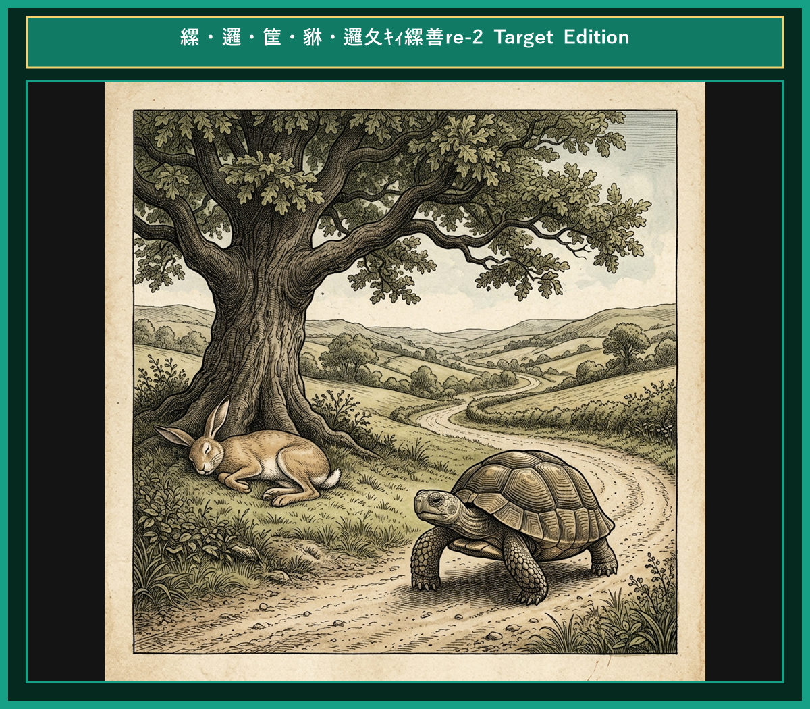
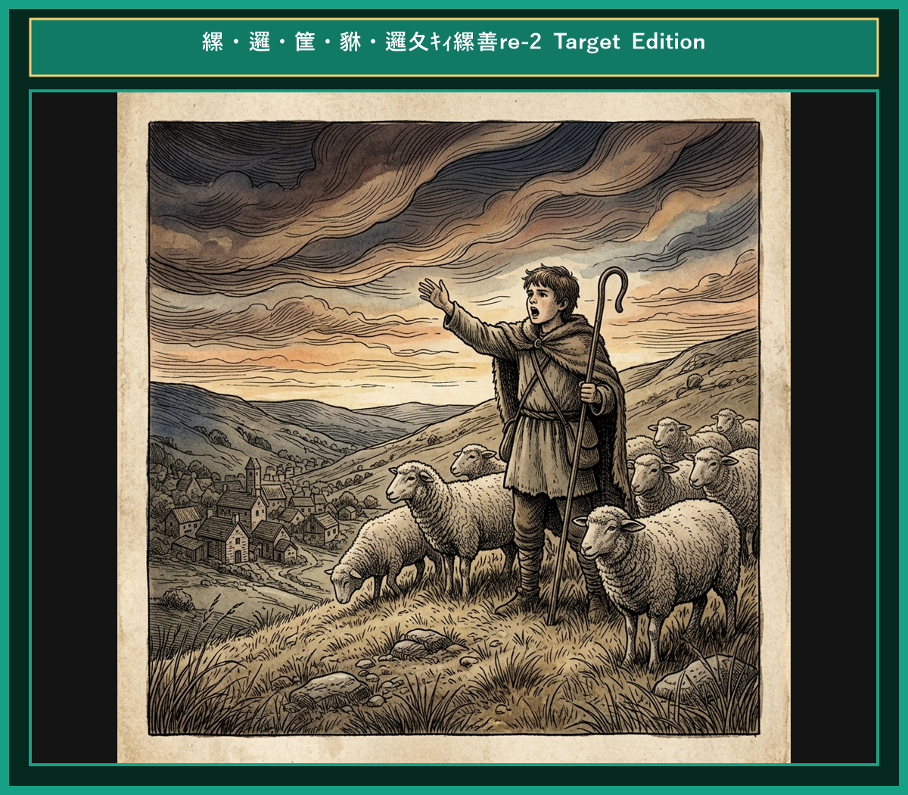
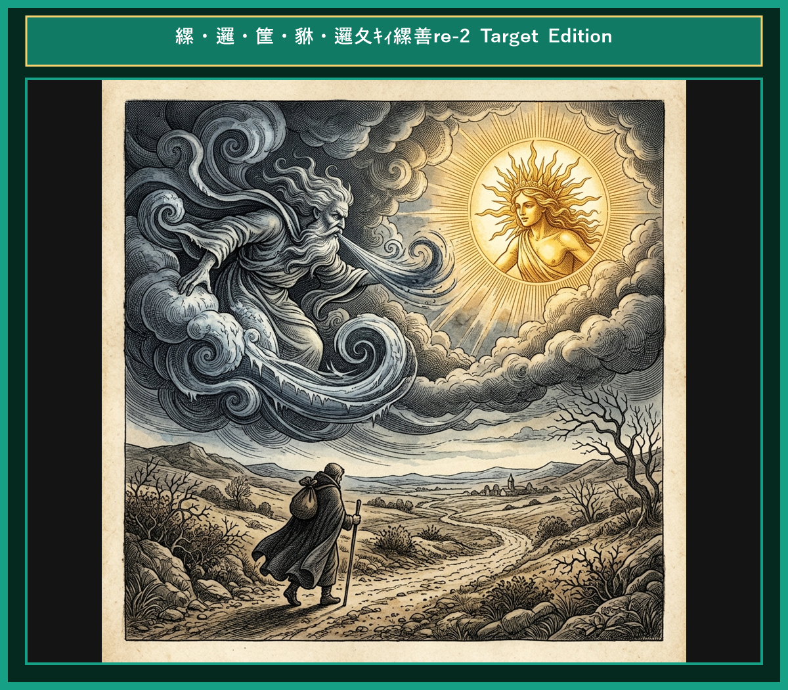
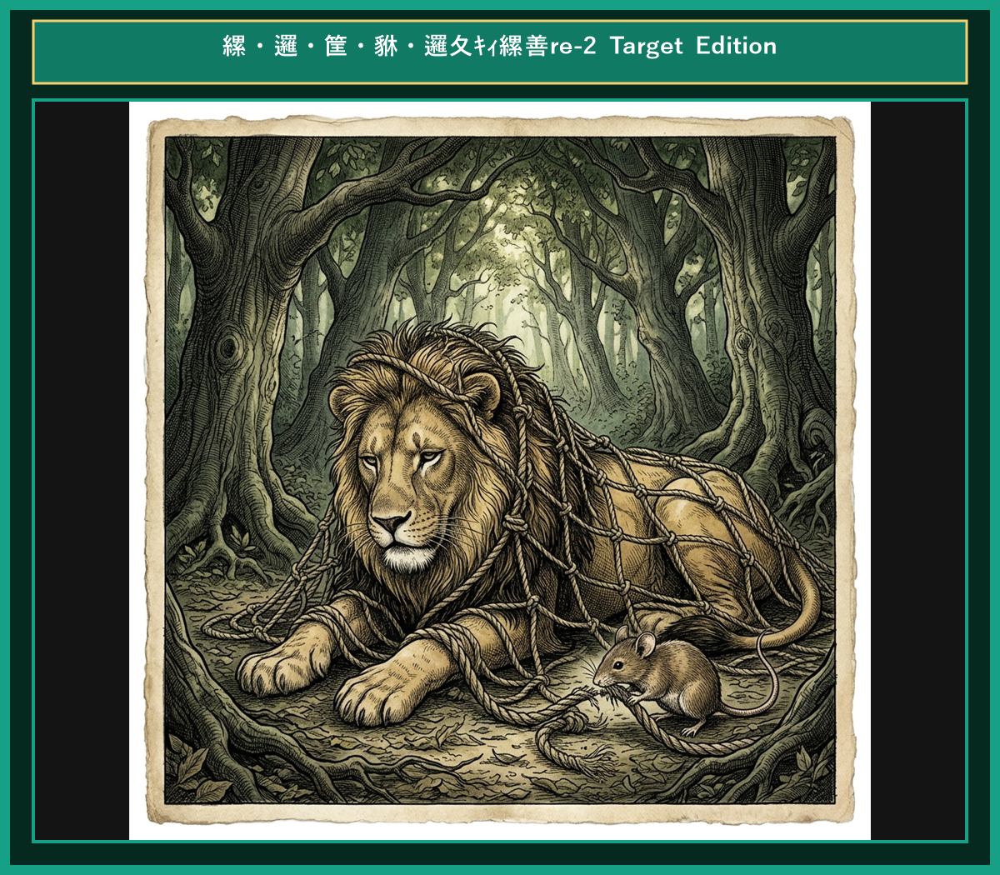
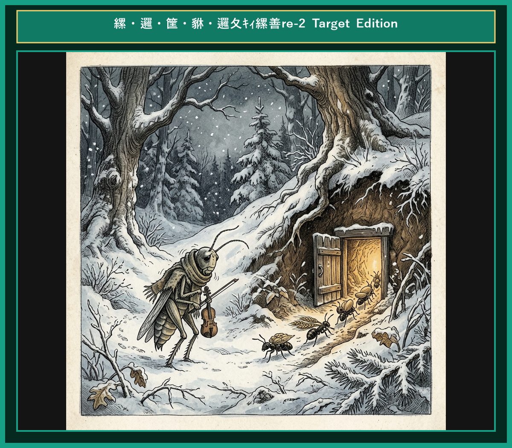
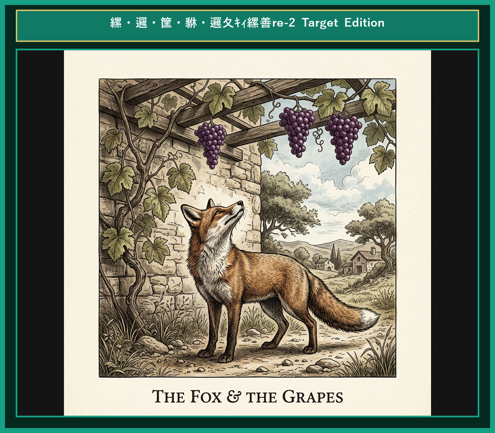
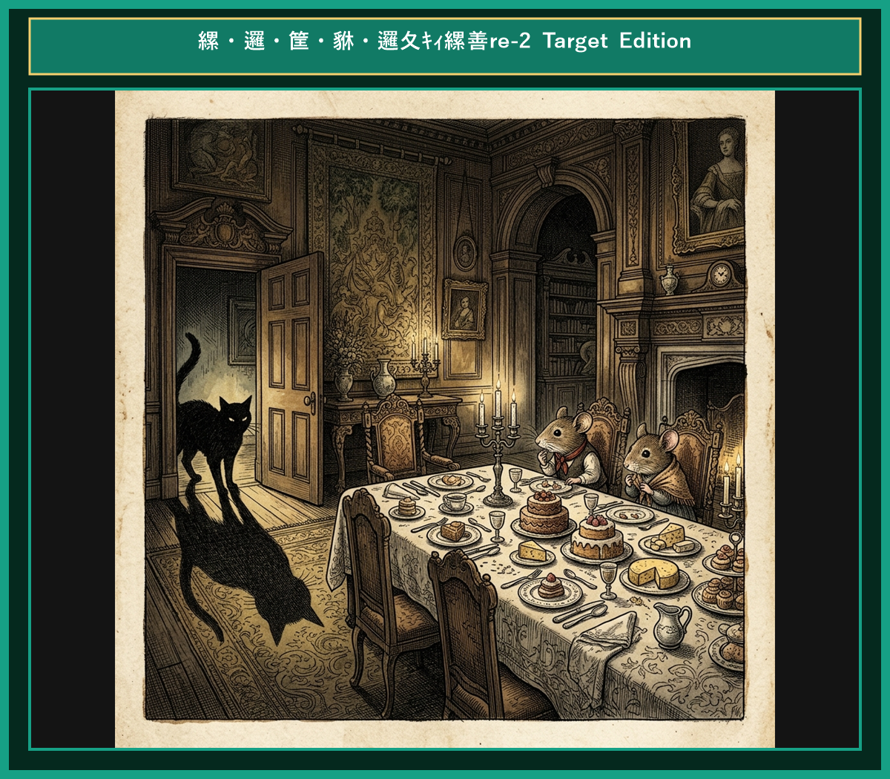
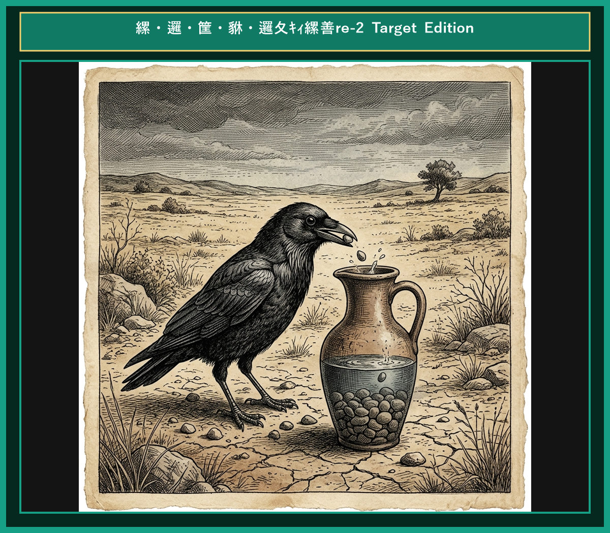
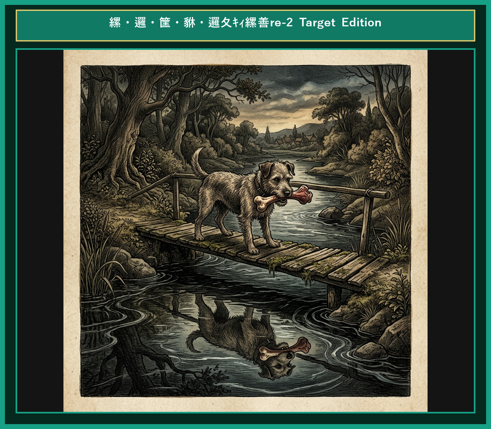
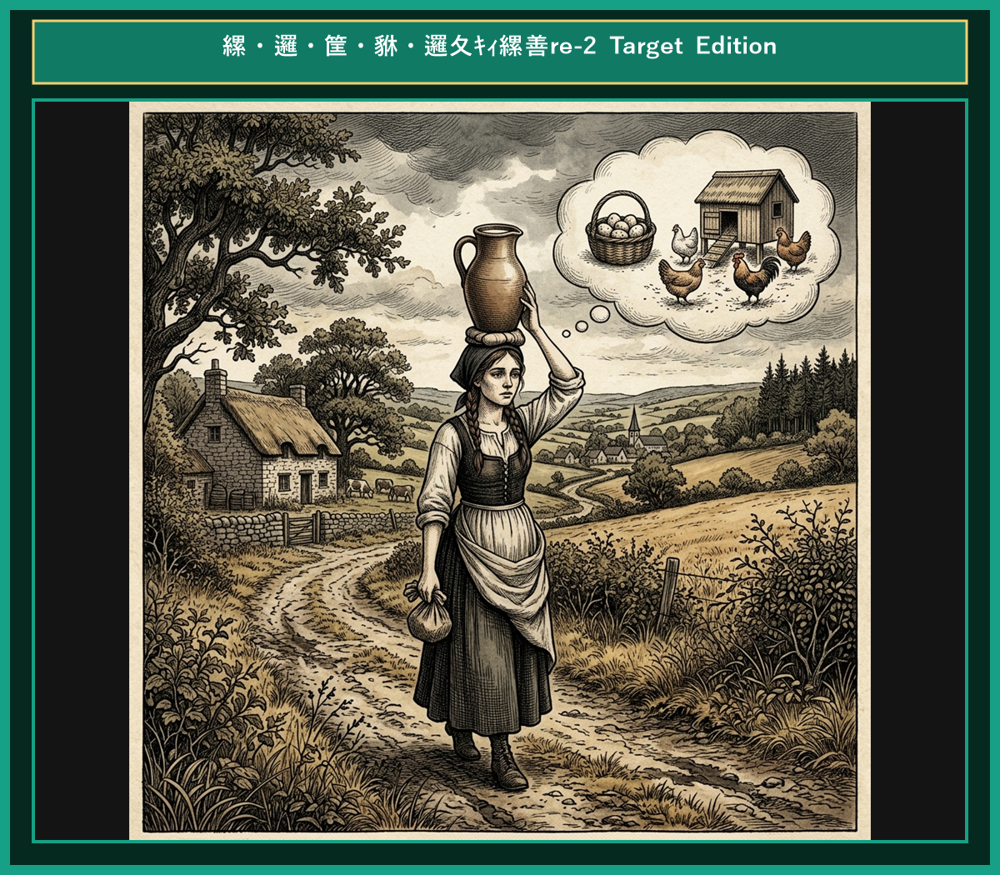

# 『英検ステップアップ多読：イソップ寓話編 第2巻（3級 ➔ 準2級対比学習）』

---

## はじめに：なぜ「対比多読」で英検準2級の壁を破れるのか？

英検準2級の合格を目指す学習者にとって、最大の障壁は**「英文の抽象度の高まり」**と**「ライティング（英作文）での論理的な語彙・構文力」**です。

3級までは直感的な日常会話フレーズで太刀打ちできましたが、準2級からは理由や因果関係を論理的に表現する力（*therefore*, *in order to*, *as a result*, 分詞構文, 仮定法）が求められます。

本書では、イソップ寓話（全10話）を題材に、**「知っている3級英語」** が **「合格レベルの準2級英語」** へとどのように深まっていくかを対比学習します。

* **馴染みのあるストーリー（3級）** で文脈を完全に把握する
* **洗練された高度表現（準2級）** で論理的な構文・高級な語彙を吸収する
* **暗唱キーフレーズ対比** でライティング・面接で即効性のある表現力を身につける

楽しく寓話を読みながら、英検準2級合格に直結する本物の英語力を手に入れましょう！

---

## 本書の構成と学習フロー

本書の各章は、スモールステップ学習と電子書籍読書に最適化された6つのセクションで構成されています。

```text
┌─────────────────────────────────────────────────────────────┐
│ 1. Chapter Title & Visual Illustration (章タイトル ＆ 挿絵)   │
│ 2. Benchmark Level: 英検3級レベル英文                         │
│ 3. Target Level: 英検準2級レベル英文                          │
│ 4. Classic Original English Text (イソップ寓話クラシック原文)  │
│ 5. Japanese Translation (日本語訳 ＆ 教訓)                     │
│ 6. Recite & Compare (そらんじたいキーフレーズ対比カード)        │
│ 7. Key Vocabulary & Exam Notes (語彙・文法・試験対策解説)        │
└─────────────────────────────────────────────────────────────┘
```

> **【音声読み上げ (TTS) 機能をご利用の方へ】**
> 前半のステップ2〜4は純粋な英文のみで構成されているため、電子書籍の読み上げ機能をONにすると、3級英文・準2級英文・クラシック原文が日本語に邪魔されることなく、自然なネイティブ発音で連続朗読されます。

---

## 英検準2級合格のための「効果的な4ステップ学習法」

### ■ STEP 1: 【3級英文でストーリー把握】（目標時間：1.5分）
まず章頭の挿絵を眺め、**「1. Benchmark Level（3級英文）」** を読みます。
ストーリーの情景と文脈を完全に頭に入れましょう。

### ■ STEP 2: 【準2級英文で表現の洗練を体感】（目標時間：2.5分）
次に **「2. Target Level（準2級英文）」** を読みます。
3級本文と比べて「どのように表現が具体的・論理的になっているか」「因果関係の接続詞や分詞構文がどう使われているか」を意識します。

### ■ STEP 3: 【音声読み上げ機能で耳からインプット】
電子書籍の朗読（TTS）機能を活用し、英文を聴きながら目で購入・声に出して追う**「シャドーイング（音読）」**を行います。
仕上げに **「3. Classic Original English Text（クラシック原文）」** の本格的な英文の響きを楽しみましょう。

### ■ STEP 4: 【暗唱カードで「そらんじる」＆ 語彙・文法解説】
後半の **「5. そらんじたいキーフレーズ対比カード」** で、準2級のターゲット表現を何度も声に出して暗唱します。英作文や面接でそのまま使える自分の表現ストックにしましょう！

---

## 収録ストーリー一覧（全10話）

* **Chapter 1**: The Tortoise and the Hare（ウサギとカメ）
* **Chapter 2**: The Boy Who Cried Wolf（オオカミ少年）
* **Chapter 3**: The North Wind and the Sun（北風と太陽）
* **Chapter 4**: The Lion and the Mouse（ライオンとネズミ）
* **Chapter 5**: The Ant and the Grasshopper（アリとキリギリス）
* **Chapter 6**: The Fox and the Grapes（キツネとブドウ）
* **Chapter 7**: The Town Mouse and the Country Mouse（田舎のネズミと街のネズミ）
* **Chapter 8**: The Crow and the Pitcher（カラスと水つぼ）
* **Chapter 9**: The Dog and His Shadow（欲張りな犬）
* **Chapter 10**: The Milkmaid and Her Pail（ミルク搾りの娘）


# Chapter 1: The Tortoise and the Hare (ウサギとカメ)

<div style="text-align: center; margin-bottom: 20px;">
  
</div>

<!-- Video Learning Link Start -->
<div style="text-align: center; margin: 18px 0; padding: 12px 16px; background-color: #f6f8fa; border: 1px solid #d0d7de; border-radius: 8px;">
  <a href="https://youtu.be/mock_tortoise_and_hare_ch01" style="color: #0969da; font-weight: bold; text-decoration: none; font-size: 1.05em; display: inline-block;">
    🎬 【動画で聴く・シャドーイング】ネイティブ朗読＆カラオケ字幕付き動画（YouTube）▶
  </a>
  <div style="font-size: 0.82em; color: #57606a; margin-top: 4px;">
    ※ タップするとYouTubeが開き、発音に合わせて光るカラオケ字幕で学習できます。
  </div>
</div>
<!-- Video Learning Link End -->


## 1. Benchmark Level: Eiken Grade 3 (英検3級レベル本文)
*Read in ~1.5 to 2 minutes. Baseline vocabulary and basic syntax.*

Once upon a time, a proud hare was always boasting about his speed to the other animals. He especially enjoyed making fun of a slow tortoise. "Nobody can beat me because I am the fastest runner in these woods!" he cried.

To his surprise, the quiet tortoise replied calmly, "I accept your challenge. Let's race to the top of the hill."

The hare laughed out loud, believing that victory was already his. As soon as the signal was given, the hare dashed forward and left the tortoise far behind.

After running for a while, the hare stopped to look back. The tortoise was moving so slowly that he was barely visible in the distance. "I have plenty of time before he catches up," thought the hare. "I think I will rest under this shady tree." He lay down on the soft grass and soon fell into a deep sleep.

While the hare was sleeping, the tortoise continued to walk steadily without stopping.

When the hare finally opened his eyes, he saw that the sun was setting. He sprinted toward the finish line as fast as he could. However, the tortoise had already crossed the line and won the race.

Persistence and hard work will always bring success in the end.

---

## 2. Target Level: Eiken Pre-2 (英検準2級レベル本文)
*Read in ~2.5 to 3.5 minutes. Advanced vocabulary, cause-and-effect transitions, participial constructions, and formal discourse.*

An arrogant hare was constantly boasting of his extraordinary speed to all the forest creatures. He took particular pleasure in mocking a slow-moving tortoise. "I challenge anyone in these woods to a race," the hare proclaimed arrogantly. "No one has ever defeated me, nor will anyone ever succeed!"

Much to the hare's astonishment, the quiet tortoise stepped forward and replied with composure, "I accept your challenge. Let us compete to see who reaches the summit of the hill first."

Amused by the proposal, the hare agreed immediately, confident of an easy victory. The moment the competition began, the hare accelerated rapidly, leaving his opponent far behind in a cloud of dust.

Upon reaching the midpoint of the course, the hare glanced back and noticed that the tortoise was barely visible in the remote distance. "It will take him hours to catch up with me," reasoned the hare. "Therefore, I can comfortably enjoy a refreshing nap beneath the oak tree." Feeling thoroughly relaxed, he lay down in the shade and fell into a profound slumber.

Meanwhile, the tortoise maintained a slow but steady pace, advancing continuously without a single moment of hesitation.

By the time the hare finally awoke, twilight had descended upon the forest. Realizing his grave mistake, he sprinted toward the finish line with all his remaining strength. To his utter dismay, however, the tortoise had already crossed the goal and secured a triumphant victory.

Sloth and overconfidence lead to ruin, whereas steady perseverance ultimately triumphs over natural talent.

---

## 3. Classic Original English Text (イソップ寓話 クラシック原文)
*Townsend / Jacobs Edition (Public Domain)*

A Hare was one day making fun of the short feet and slow pace of the Tortoise, who retorted: "Though you be swift as the wind, I will beat you in a race." The Hare, believing her assertion to be simply impossible, agreed to the proposal; and they agreed that the Fox should choose the course and fix the goal. On the day appointed for the race the two started together. The Tortoise never for a moment stopped, but went on with a slow but steady pace straight to the end of the course. The Hare, lying down by the wayside, fell asleep. At last waking up, and moving as fast as he could, he saw the Tortoise had reached the goal, and was comfortably resting after her fatigue.

Slow and steady wins the race.

---

### 🏛️ 【英検2級レベルで読み解く！クラシック原文の重要構文・英文法ノート】
1. **1. 分詞構文（Participle Clause: 付帯状況・理由）**
   - **原文**: *"The Hare, believing her assertion to be simply impossible, agreed to the proposal..."*
   - **解説**: 「〜と信じ込んでいたので」という理由を表す分詞構文。英検2級の長文読解・ライティングの最頻出構文です。
1. **2. 古典的仮定法現在（Subjunctive Mood）**
   - **原文**: *"Though you be swift as the wind, I will beat you in a race."*
   - **解説**: 譲歩節 `Though` の中で原形 `be` を用いる古典的な仮定法現在（現代英語の `Though you are...`）。格調高い古典の響きを持ちます。
1. **3. 過去分詞の後置修飾（Postpositive Participle）**
   - **原文**: *"On the day appointed for the race the two started together."*
   - **解説**: `appointed`（定められた・指定された）が直前の名詞 `the day` を後ろから修飾する構文です。

### 📜 【クラシック原文の重要語彙・古風表現（Classic Antique Vocabulary）】
- **retort** [動] 2級 **（機転を利かせて）言い返す、反論する**（現代の reply sharp/wittily に相当）
- **assertion** [名] 2級/準1級 **主張、断言**（動詞 assert の名詞形。2級長文定番）
- **wayside** [名] 2級 **道端、沿道**（by the wayside（道端に、途中で））
- **fatigue** [名] 2級 **（心身の）極度の疲労、疲れ**（tiredness の上位フォーマル語）

---
<div style="page-break-before: always;"></div>

## 4. Japanese Translation (日本語訳)

野ウサギがカメの足の短さと歩みの遅さを馬鹿にして笑いました。するとカメは言い返しました。「あなたが風のように速くても、かけっこなら私の方が勝ちますよ。」
ウサギはそんな主張は到底不可能だと信じ込んで、その提案に同意しました。そして、キツネにコースを選んでもらい、ゴールを決めてもらうことにしました。
レースの当日、二匹は一緒にスタートしました。カメは一瞬たりとも立ち止まらず、遅くとも着実な歩みで、まっすぐコースの終わりへと進み続けました。一方のウサギは、道端に横になって眠り込んでしまいました。
やがて目を覚ましたウサギは、できる限りの速さで駆け抜けましたが、カメがすでにゴールに到達し、心地よく休んでいるのを目にするのでした。

**教訓**: 怠惰と過信は破滅を招き、着実な根気強さは最終的に才能に打ち勝つ。

---

## 5. Recite & Compare (そらんじたいキーフレーズ対比)
*Memorize these contrastive expressions to elevate speaking, writing, and reading fluency.*

<div class="comparison-card">
  <div class="card-header">■ 場面：高慢・自慢・からかい</div>
  <div class="card-row-g4"><span class="card-badge-g4">【Grade 3 基礎】</span> <em>was boasting about his speed / making fun of...</em></div>
  <div class="card-row-g3"><span class="card-badge-g3">【Pre-2 暗唱】</span> <strong><em>boasting of his extraordinary speed / mocking...</em></strong></div>
  <div class="card-note">【ポイント】 <strong>解説・試験活用</strong>：単純な `make fun of` から、準2級ライティングで重宝する動詞 `mock`（〜をあざ笑う）や形容詞 `extraordinary`（並外れた）へのレベルアップ。</div>
</div>

<div class="comparison-card">
  <div class="card-header">■ 場面：落ち着いて挑戦を受ける</div>
  <div class="card-row-g4"><span class="card-badge-g4">【Grade 3 基礎】</span> <em>replied calmly, "I accept your challenge."</em></div>
  <div class="card-row-g3"><span class="card-badge-g3">【Pre-2 暗唱】</span> <strong><em>replied with composure, "Let us compete..."</em></strong></div>
  <div class="card-note">【ポイント】 <strong>解説・試験活用</strong>：副詞 `calmly` を抽象名詞表現 `with composure`（落ち着いて・冷静に）に書き換えることで面接スピーキングの表現力が格段に向上します。</div>
</div>

<div class="comparison-card">
  <div class="card-header">■ 場面：推論と因果関係の主張</div>
  <div class="card-row-g4"><span class="card-badge-g4">【Grade 3 基礎】</span> <em>thought, "I have plenty of time..."</em></div>
  <div class="card-row-g3"><span class="card-badge-g3">【Pre-2 暗唱】</span> <strong><em>reasoned, "... Therefore, I can comfortably..."</em></strong></div>
  <div class="card-note">【ポイント】 <strong>解説・試験活用</strong>：思考動詞 `reason`（論理的に考える）と、準2級ライティングの結論・理由付けで必須の接続副詞 `Therefore`（したがって）の組み合わせ。</div>
</div>

<div class="comparison-card">
  <div class="card-header">■ 場面：失意とショック</div>
  <div class="card-row-g4"><span class="card-badge-g4">【Grade 3 基礎】</span> <em>he saw that the sun was setting...</em></div>
  <div class="card-row-g3"><span class="card-badge-g3">【Pre-2 暗唱】</span> <strong><em>To his utter dismay, the tortoise had secured a victorious...</em></strong></div>
  <div class="card-note">【ポイント】 <strong>解説・試験活用</strong>：準2級・2級読解で定番の感情構文 `To one's + 名詞`（〜が…したことには）と動詞 `secure`（〜を確保する・勝ち取る）。</div>
</div>

<div class="comparison-card">
  <div class="card-header">■ 場面：教訓（Moral）</div>
  <div class="card-row-g4"><span class="card-badge-g4">【Grade 3 基礎】</span> <em>Persistence and hard work will always bring success...</em></div>
  <div class="card-row-g3"><span class="card-badge-g3">【Pre-2 暗唱】</span> <strong><em>Sloth and overconfidence lead to ruin, whereas steady perseverance...</em></strong></div>
  <div class="card-note">【ポイント】 <strong>解説・試験活用</strong>：対比の接続詞 `whereas`（〜である一方で）と抽象名詞 `perseverance`（不屈の根気）を用いた準2級〜2級模範英作文レベルの名文。</div>
</div>

---

## 6. Vocabulary Builder: 赤シート対応 重要単語・熟語チェック表
*※ 赤い透明シート（または赤フィルム）を重ねると、日本語訳が消えて自力テストができます。*

| No. | 見出し語 / イディオム | 品詞 / レベル | 日本語の意味（赤シートで消える） | 本文での使われ方・コロケーション |
|:---:|---|:---:|---|---|
| **01** | **proud** | [形] 4級 | <span style="color: #d90429; font-weight: bold;">誇り高い、傲慢な</span> | *a proud hare (自惚れたウサギ)* |
| **02** | **boast (about...)** | [動] 3級 | <span style="color: #d90429; font-weight: bold;">〜を自慢する、誇る</span> | *was always boasting about his speed* |
| **03** | **make fun of...** | [熟] 3級 | <span style="color: #d90429; font-weight: bold;">〜をからかう、嘲笑する</span> | *making fun of a slow tortoise* |
| **04** | **challenge** | [名/動] 3級 | <span style="color: #d90429; font-weight: bold;">挑戦、課題 / 挑む</span> | *I accept your challenge.* |
| **05** | **accept** | [動] 3級 | <span style="color: #d90429; font-weight: bold;">受け入れる、受諾する</span> | *accept the proposal (提案を受諾する)* |
| **06** | **dash** | [動] 3級 | <span style="color: #d90429; font-weight: bold;">勢いよく走る、突進する</span> | *dashed forward (前方へ駆け出した)* |
| **07** | **leave ~ behind** | [熟] 3級 | <span style="color: #d90429; font-weight: bold;">〜を置き去りにする</span> | *left the tortoise far behind* |
| **08** | **visible** | [形] 準2級 | <span style="color: #d90429; font-weight: bold;">目に見える、視認できる</span> | *was barely visible in the distance* |
| **09** | **catch up (with...)** | [熟] 3級 | <span style="color: #d90429; font-weight: bold;">〜に追いつく</span> | *before he catches up* |
| **10** | **slumber** | [名/動] 準2級 | <span style="color: #d90429; font-weight: bold;">深い眠り / 眠る</span> | *fell into a profound slumber* |
| **11** | **sprint** | [動] 3級 | <span style="color: #d90429; font-weight: bold;">全力疾走する</span> | *sprinted toward the finish line* |
| **12** | **persistence** | [名] 準2級/2級 | <span style="color: #d90429; font-weight: bold;">粘り強さ、不屈の継続</span> | *persistence and hard work will bring success* |


### 【出題傾向・文法解説ノート】

### 【出題頻出語彙・熟語ノート】
- **arrogant** [形] 横柄な、自惚れた（準2級長文・英作文頻出形容詞。名詞 *arrogance*）
- **composure** [名] 平常心、落ち着き（*with composure* で頻出）
- **reason** [動] 論理的に推論する、判断する（*think* の上位思考動詞）
- **slumber** [名] 眠り、熟睡（*deep sleep* の文学的表現）
- **dismay** [名] 狼狽、落胆（*to one's utter dismay* 「非常にがっかりしたことに」）
- **perseverance** [名] 粘り強さ、不屈の努力（動詞 *persevere*。準2級〜2級最重要語彙）

### 【文法・構文ポイント】
1. **[To one's + 感情名詞]（〜が…したことには）**
   - 準2級本文: *"To his utter dismay, however, the tortoise had already crossed the goal..."*
   - ポイント: `To my surprise`（驚いたことに）、`To his disappointment`（彼が落胆したことに）など英検の読解・作文で頻出する感情表現です。
2. **対比の接続詞 [whereas ...]（〜である一方で）**
   - 準2級本文: *"Sloth and overconfidence lead to ruin, whereas steady perseverance..."*
   - ポイント: `while` や `on the other hand` と同義の高級な対比接続詞。英作文の比較文で大きな加点要素となります。


# Chapter 2: The Boy Who Cried Wolf (オオカミ少年)

<div style="text-align: center; margin-bottom: 20px;">
  
</div>

## 1. Benchmark Level: Eiken Grade 3 (英検3級レベル本文)
*Read in ~1.5 to 2 minutes. Baseline vocabulary and basic syntax.*

Once upon a time, a young shepherd boy was guarding his flock of sheep on a hill outside a small village. Because his job was very quiet, he often felt bored. One afternoon, he decided to play a trick on the villagers to entertain himself.

He ran toward the village and shouted as loudly as he could, "Wolf! Wolf! A wolf is attacking my sheep!"

Hearing his cries, the villagers dropped their work and hurried up the hill to protect the sheep. However, when they arrived, they found no wolf at all. The boy laughed heartily at their shocked faces. The villagers were very upset with him and went back to their work.

A few days later, the foolish boy played the same trick again, and once more the villagers came running only to be fooled.

Finally, a real wolf emerged from the dark woods and began to attack the flock. Terrified, the boy screamed, "Please help! A real wolf is attacking!"

Unfortunately, nobody responded to his cries because everyone believed that he was lying again. In the end, the wolf destroyed many sheep, and the boy learned a painful lesson.

Nobody believes a liar, even when he tells the truth.

---

## 2. Target Level: Eiken Pre-2 (英検準2級レベル本文)
*Read in ~2.5 to 3.5 minutes. Advanced vocabulary, cause-and-effect transitions, participial constructions, and formal discourse.*

A bored shepherd boy was tending a flock of sheep on a hillside overlooking a tranquil village. Dissatisfied with his routine responsibilities, he sought a way to create excitement. Consequently, he devised a scheme to deceive the local villagers.

Running toward the settlement, he shrieked frantically, "Wolf! A ferocious wolf is attacking the sheep!"

Alarmed by the distress call, the villagers abandoned their tasks and rushed up the slope to defend the livestock. Upon arriving, however, they discovered no predator. The boy doubled over with laughter at their gullibility. Indignant at his deceit, the villagers scolded him severely before returning to their work.

A few days later, the impudent youth repeated his fake warning, and once again the villagers were tricked into rushing to his aid.

Eventually, a ravenous wolf actually emerged from the dark forest and began slaughtering the sheep. Panicked, the boy screamed desperately for assistance.

Regrettably, no one heeded his frantic pleas, assuming it was merely another fabrication. Consequently, the wolf destroyed the entire flock, leaving the boy in deep remorse.

Deceit destroys trust; once credibility is lost, even truth is mistaken for falsehood.

---

## 3. Classic Original English Text (イソップ寓話 クラシック原文)
*Townsend / Jacobs Edition (Public Domain)*

A Shepherd Boy, who watched a flock of sheep near a village, brought out the villagers three or four times by crying out, "Wolf! Wolf!" and when his neighbors came to help him, laughed at them for their pains. The Wolf, however, did truly come at last. The Shepherd-boy, now really alarmed, shouted in an agony of apprehension: "Pray, come and help me; the Wolf is killing the sheep"; but no one paid the least heed to his cries, nor rendered any assistance. The Wolf, having no cause of fear, at his leisure lacerated or destroyed the whole flock.

There is no believing a liar, even when he speaks the truth.

---

### 🏛️ 【英検2級レベルで読み解く！クラシック原文の重要構文・英文法ノート】
1. **1. 分詞構文（Time / Attendant Circumstance）**
   - **原文**: *"A Shepherd-boy, who watched a flock of sheep near a village, brought out the villagers three or four times by crying out..."*
   - **解説**: `by crying out`（叫ぶことによって）という手段の動名詞句と関係代名詞の継続用法が組み合わさった2級頻出の複文構造です。
1. **2. 結果・目的を表す不定詞（Infinitive: Result）**
   - **原文**: *"...and even made a practice of laughing at them when they came running to his assistance."*
   - **解説**: `came running`（走ってやって来た：come + 現在分詞）の付帯状況表現です。
1. **3. 譲歩の従属接続詞 `even when`**
   - **原文**: *"Nobody believes a liar, even when he tells the truth."*
   - **解説**: 「〜の時でさえ」という譲歩条件を表す接続詞構文。英作文で高い説得力を生み出します。

### 📜 【クラシック原文の重要語彙・古風表現（Classic Antique Vocabulary）】
- **assistance** [名] 2級 **援助、手助け**（come to one's assistance（助けに駆けつける））
- **earnest** [名/形] 2級 **本気、真剣 / 真面目な**（in earnest（本気で、真剣に））
- **dismay** [名/動] 準1級 **狼狽、落胆 / うろたえさせる**（cried out in dismay）
- **trustworthy** [形] 2級 **信頼できる、頼りになる**（a liar is never deemed trustworthy）

---
<div style="page-break-before: always;"></div>

## 4. Japanese Translation (日本語訳)

ある村の近くで羊の群れを見張っていた羊飼いの少年が、「オオカミだ！オオカミだ！」と叫んで、3回も4回も村人たちを駆けつけさせ、助けに来た近所の人々の骨折りを笑いものにしました。
しかし、ついに本物のオオカミが現れました。今度こそ本当に恐ろしくなった少年は、必死の思いで叫びました。「お願いです、来て助けてください！オオカミが羊を殺しています！」
しかし、誰も少年の叫びに少しも注意を払わず、手助けもしませんでした。オオカミは何も恐れることなく、思う存分羊の群れ全体を傷つけ、咬み殺してしまいました。

**教訓**: 欺瞞は信頼を破壊する。一度信用が失われれば、真実でさえ嘘と誤解される。

---

## 5. Recite & Compare (そらんじたいキーフレーズ対比)
*Memorize these contrastive expressions to elevate speaking, writing, and reading fluency.*

<div class="comparison-card">
  <div class="card-header">■ 場面：謀りごと・悪巧みを思いつく</div>
  <div class="card-row-g4"><span class="card-badge-g4">【Grade 3 基礎】</span> <em>decided to play a trick on the villagers...</em></div>
  <div class="card-row-g3"><span class="card-badge-g3">【Pre-2 暗唱】</span> <strong><em>devised a scheme to deceive the local villagers...</em></strong></div>
  <div class="card-note">【ポイント】 <strong>解説・試験活用</strong>：動詞 `devise`（考案する）や `deceive`（欺く）、名詞 `scheme`（計画・企み）など、準2級長文で必須の上位表現。</div>
</div>

<div class="comparison-card">
  <div class="card-header">■ 場面：因果関係の表現（結果として）</div>
  <div class="card-row-g4"><span class="card-badge-g4">【Grade 3 基礎】</span> <em>So, he ran... / Because his job was quiet...</em></div>
  <div class="card-row-g3"><span class="card-badge-g3">【Pre-2 暗唱】</span> <strong><em>Consequently, he devised... / Alarmed by...</em></strong></div>
  <div class="card-note">【ポイント】 <strong>解説・試験活用</strong>：準2級ライティングの結論・結果文で極めて効果的な接続副詞 `Consequently`（結果として）と分詞構文 `Alarmed by...`。</div>
</div>

<div class="comparison-card">
  <div class="card-header">■ 場面：助けを拒絶する・耳を貸さない</div>
  <div class="card-row-g4"><span class="card-badge-g4">【Grade 3 基礎】</span> <em>nobody responded to his cries...</em></div>
  <div class="card-row-g3"><span class="card-badge-g3">【Pre-2 暗唱】</span> <strong><em>no one heeded his frantic pleas...</em></strong></div>
  <div class="card-note">【ポイント】 <strong>解説・試験活用</strong>：動詞 `heed`（〜に耳を傾ける・注意する）と名詞 `plea`（切実な願い・哀願）を用いた高度な読解表現。</div>
</div>

<div class="comparison-card">
  <div class="card-header">■ 場面：教訓（Moral）</div>
  <div class="card-row-g4"><span class="card-badge-g4">【Grade 3 基礎】</span> <em>Nobody believes a liar, even when he tells the truth.</em></div>
  <div class="card-row-g3"><span class="card-badge-g3">【Pre-2 暗唱】</span> <strong><em>Deceit destroys trust; once credibility is lost, truth is mistaken...</em></strong></div>
  <div class="card-note">【ポイント】 <strong>解説・試験活用</strong>：抽象名詞 `Deceit`（欺瞞・嘘）と `credibility`（信用・信頼性）、接続詞 `once`（ひとたび〜すると）を用いた論理的文体。</div>
</div>

---

## 6. Vocabulary Builder: 赤シート対応 重要単語・熟語チェック表
*※ 赤い透明シート（または赤フィルム）を重ねると、日本語訳が消えて自力テストができます。*

| No. | 見出し語 / イディオム | 品詞 / レベル | 日本語の意味（赤シートで消える） | 本文での使われ方・コロケーション |
|:---:|---|:---:|---|---|
| **01** | **shepherd** | [名] 3級 | <span style="color: #d90429; font-weight: bold;">羊飼い</span> | *a young shepherd boy* |
| **02** | **bored** | [形] 4級 | <span style="color: #d90429; font-weight: bold;">退屈した、飽きた</span> | *felt bored on the hill* |
| **03** | **mischievous** | [形] 準2級 | <span style="color: #d90429; font-weight: bold;">いたずら好きな</span> | *with a mischievous smile* |
| **04** | **shout** | [動] 4級 | <span style="color: #d90429; font-weight: bold;">大声を出す、叫ぶ</span> | *shouted at the top of his lungs* |
| **05** | **villager** | [名] 3級 | <span style="color: #d90429; font-weight: bold;">村人</span> | *the villagers rushed to help* |
| **06** | **rush** | [動] 3級 | <span style="color: #d90429; font-weight: bold;">急いで駆けつける</span> | *rushed to the rescue* |
| **07** | **trick** | [名/動] 3級 | <span style="color: #d90429; font-weight: bold;">いたずら、企み / だます</span> | *play a trick on someone* |
| **08** | **emerge** | [動] 準2級/2級 | <span style="color: #d90429; font-weight: bold;">現れる、姿を現す</span> | *a fierce wolf emerged from the woods* |
| **09** | **panic** | [名/動] 3級 | <span style="color: #d90429; font-weight: bold;">パニック、大混乱</span> | *cried in pure panic* |
| **10** | **scatter** | [動] 準2級 | <span style="color: #d90429; font-weight: bold;">散り散りになる、まき散らす</span> | *the sheep scattered in all directions* |
| **11** | **deceive** | [動] 準2級/2級 | <span style="color: #d90429; font-weight: bold;">だます、欺く</span> | *deceive others for amusement* |
| **12** | **trustworthy** | [形] 2級 | <span style="color: #d90429; font-weight: bold;">信頼できる、頼もしい</span> | *a liar is never considered trustworthy* |


### 【出題傾向・文法解説ノート】

### 【出題頻出語彙・熟語ノート】
- **devise** [動] （〜を）考案する、工夫する（英検準2級〜2級重要動詞。*devise a new plan*）
- **deceive** [動] 〜を欺く、だます（名詞 *deceit*, *deception*）
- **consequently** [副] 結果として、したがって（*as a result* のライティング上位語）
- **credibility** [名] 信用、信頼性（形容詞 *credible*「信頼できる」）
- **heed** [動] （警告・助言などに）耳を傾ける、注意を払う（読解頻出動詞）
- **plea** [名] 懇願、切実な訴え（動詞 *plead*）

### 【文法・構文ポイント】
1. **[once + 主語 + 動詞]（ひとたび〜すると、一度〜すれば）**
   - 準2級本文: *"Once credibility is lost, even truth is mistaken for falsehood."*
   - ポイント: 条件を表す接続詞 `once` の使い方。英作文の条件文でスマートに使えます。
2. **過去分詞による分詞構文 [Alarmed by ...]**
   - 準2級本文: *"Alarmed by the distress call, the villagers abandoned their tasks..."*
   - ポイント: `Because they were alarmed by...` の分詞構文。主動詞の前に理由や状況を前置する構文です。


# Chapter 3: The North Wind and the Sun (北風と太陽)

<div style="text-align: center; margin-bottom: 20px;">
  
</div>

## 1. Benchmark Level: Eiken Grade 3 (英検3級レベル本文)
*Read in ~1.5 to 2 minutes. Baseline vocabulary and basic syntax.*

Once upon a time, a fierce argument arose between the North Wind and the Sun over which of them was stronger. While they were arguing, they noticed a traveler walking along a country road, wrapped in a heavy cloak.

"I have an idea," proposed the Wind. "The one who can force that traveler to take off his cloak shall be the winner."

The Wind began to blow as hard as he could. Icy air rushed across the field. However, the harder he blew, the more tightly the traveler wrapped the cloak around his body. In the end, the Wind gave up in despair.

Then, the Sun stepped forward and shone warmly upon the earth. Within a few minutes, the traveler felt so hot that he could no longer bear his heavy cloak. He happily took it off and sat down under a shady tree.

Gentleness and warm words can accomplish more than force.

---

## 2. Target Level: Eiken Pre-2 (英検準2級レベル本文)
*Read in ~2.5 to 3.5 minutes. Advanced vocabulary, cause-and-effect transitions, participial constructions, and formal discourse.*

A fierce dispute arose between the North Wind and the Sun over which of them possessed greater strength. Unable to resolve the conflict through words alone, they agreed to test their power upon a solitary traveler walking along a country highway, wrapped tightly in a heavy cloak.

"I propose a test," declared the North Wind arrogantly. "Whichever of us compels that traveler to strip off his cloak shall be recognized as the undisputed victor."

Accepting the challenge, the North Wind initiated the contest by unleashing a furious blast of arctic air. However, the more violently he blew, the more tightly the traveler wrapped the cloak around his body to protect himself from the piercing cold. Exhausted from his strenuous efforts, the Wind ultimately yielded in despair.

Then, the Sun took his turn, gently beaming warm solar rays upon the earth. Within a few moments, the temperature rose rapidly, making the traveler feel increasingly uncomfortable in his heavy garment. Unable to tolerate the intense warmth any longer, he willingly removed his cloak and sought refuge under the soothing shade of a tree.

Persuasion and gentleness are vastly more effective than brute force and hostility.

---

## 3. Classic Original English Text (イソップ寓話 クラシック原文)
*Townsend / Jacobs Edition (Public Domain)*

The North Wind and the Sun had a contest to decide which was the stronger. To settle the matter, they agreed to test their strength upon a traveler who was walking down the road wrapped in a warm cloak. Whichever of them could make him take his cloak off first was to be accounted the victor.

The North Wind blew with all his might, but the harder he blew, the more closely did the traveler wrap his cloak around him, till at last the North Wind gave up the attempt in despair.

Then the Sun shone out warmly, and immediately the traveler took off his cloak.

Persuasion is better than force.

---

### 🏛️ 【英検2級レベルで読み解く！クラシック原文の重要構文・英文法ノート】
1. **1. 比較級 + 比較級（The + 比較級 ..., the + 比較級 ... 構文）**
   - **原文**: *"The harder the Wind blew, the more closely did the Traveler wrap his cloak around him."*
   - **解説**: 「〜すればするほど、ますます…」を表す英検2級・準1級の最重要構文。後半に倒置（`did the Traveler wrap`）が起きています。
1. **2. 形式主語構文・合意の受動態**
   - **原文**: *"It was agreed between them that whichever first made the traveler take off his cloak should be held the stronger."*
   - **解説**: `whichever first made...`（どちらが先に〜させようとも）という複合関係代名詞節と使役動詞 `make + O + 原形不定詞` の融合。
1. **3. 比較を表す上級形容詞 `superior to`**
   - **原文**: *"Persuasion is often superior to force."*
   - **解説**: ラテン比較（*superior to* = 〜より優れている）。*than* ではなく *to* を取る重要文法ポイントです。

### 📜 【クラシック原文の重要語彙・古風表現（Classic Antique Vocabulary）】
- **dispute** [名/動] 2級 **論争、口論 / 争う**（a dispute arose between A and B）
- **cloak** [名] 準2級/2級 **外套、マント**（wrap one's cloak tightly）
- **persuasion** [名] 2級 **説得、説得力**（動詞 persuade の名詞形）
- **superior to** [熟] 2級 **〜より優れている**（反意語: inferior to）

---
<div style="page-break-before: always;"></div>

## 4. Japanese Translation (日本語訳)

北風と太陽が、どちらが強いかを決める勝負をしました。決着をつけるため、二者は暖かいマントを羽織って道を歩いている旅人で力を試すことに同意しました。旅人のマントを先に脱がせることができた方が勝ちということになりました。

北風はありったけの力で吹き立てましたが、激しく吹けば吹くほど、旅人はマントを一層きつく身に巻きつけ、ついに北風は絶望して断念しました。

次に太陽が温かく照りつけると、旅人はすぐにマントを脱ぎ捨てました。

**教訓**: 説得と優しさは、力づくや敵意よりも遥かに効果的である。

---

## 5. Recite & Compare (そらんじたいキーフレーズ対比)
*Memorize these contrastive expressions to elevate speaking, writing, and reading fluency.*

<div class="comparison-card">
  <div class="card-header">■ 場面：対立・論争の発生</div>
  <div class="card-row-g4"><span class="card-badge-g4">【Grade 3 基礎】</span> <em>a fierce argument arose over which of them was stronger...</em></div>
  <div class="card-row-g3"><span class="card-badge-g3">【Pre-2 暗唱】</span> <strong><em>A fierce dispute arose over which possessed greater strength...</em></strong></div>
  <div class="card-note">【ポイント】 <strong>解説・試験活用</strong>：名詞 `dispute`（紛争・問題）や動詞 `possess`（所有する・保持する）を用いた格式高い表現。</div>
</div>

<div class="comparison-card">
  <div class="card-header">■ 場面：強制する・強いる</div>
  <div class="card-row-g4"><span class="card-badge-g4">【Grade 3 基礎】</span> <em>force that traveler to take off his cloak...</em></div>
  <div class="card-row-g3"><span class="card-badge-g3">【Pre-2 暗唱】</span> <strong><em>compels that traveler to strip off his cloak...</em></strong></div>
  <div class="card-note">【ポイント】 <strong>解説・試験活用</strong>：`force A to do` の上位語 `compel A to do`（Aに〜することを強制する）の準2級〜2級必須構文。</div>
</div>

<div class="comparison-card">
  <div class="card-header">■ 場面：屈服する・あきらめる</div>
  <div class="card-row-g4"><span class="card-badge-g4">【Grade 3 基礎】</span> <em>the Wind gave up in despair...</em></div>
  <div class="card-row-g3"><span class="card-badge-g3">【Pre-2 暗唱】</span> <strong><em>the Wind ultimately yielded in despair...</em></strong></div>
  <div class="card-note">【ポイント】 <strong>解説・試験活用</strong>：動詞 `yield`（屈する・譲歩する）および副詞 `ultimately`（最終的に・結局は）の英作文での活用。</div>
</div>

<div class="comparison-card">
  <div class="card-header">■ 場面：教訓（Moral）</div>
  <div class="card-row-g4"><span class="card-badge-g4">【Grade 3 基礎】</span> <em>Gentleness can accomplish more than force.</em></div>
  <div class="card-row-g3"><span class="card-badge-g3">【Pre-2 暗唱】</span> <strong><em>Persuasion is vastly more effective than brute force...</em></strong></div>
  <div class="card-note">【ポイント】 <strong>解説・試験活用</strong>：抽象名詞 `Persuasion`（説得・説得力）と `brute force`（力づく・腕力）の比較対比構文。</div>
</div>

---

## 6. Vocabulary Builder: 赤シート対応 重要単語・熟語チェック表
*※ 赤い透明シート（または赤フィルム）を重ねると、日本語訳が消えて自力テストができます。*

| No. | 見出し語 / イディオム | 品詞 / レベル | 日本語の意味（赤シートで消える） | 本文での使われ方・コロケーション |
|:---:|---|:---:|---|---|
| **01** | **dispute** | [名/動] 準2級/2級 | <span style="color: #d90429; font-weight: bold;">論争、争い / 言い争う</span> | *a fierce dispute arose* |
| **02** | **claim** | [動] 3級 | <span style="color: #d90429; font-weight: bold;">主張する、言い張る</span> | *claimed to be stronger* |
| **03** | **traveler** | [名] 3級 | <span style="color: #d90429; font-weight: bold;">旅人、旅行者</span> | *a lone traveler walking along the road* |
| **04** | **cloak** | [名] 準2級 | <span style="color: #d90429; font-weight: bold;">マント、外套</span> | *wrapped tightly in a heavy cloak* |
| **05** | **fierce** | [形] 準2級 | <span style="color: #d90429; font-weight: bold;">猛烈な、激しい</span> | *blew a fierce and icy blast* |
| **06** | **howl** | [動] 3級 | <span style="color: #d90429; font-weight: bold;">（風が）うなる、吠える</span> | *the howling wind tore at his clothes* |
| **07** | **clutch** | [動] 準2級 | <span style="color: #d90429; font-weight: bold;">ぐっと掴む、しっかり握る</span> | *clutched his garment even tighter* |
| **08** | **radiant** | [形] 2級/準1級 | <span style="color: #d90429; font-weight: bold;">輝くばかりの、光を放つ</span> | *beamed with radiant warmth* |
| **09** | **gentle** | [形] 4級 | <span style="color: #d90429; font-weight: bold;">優しい、穏やかな</span> | *with gentle and steady rays* |
| **10** | **perspiration** | [名] 2級/準1級 | <span style="color: #d90429; font-weight: bold;">汗、発汗</span> | *dripping with warm perspiration* |
| **11** | **unfasten** | [動] 準2級 | <span style="color: #d90429; font-weight: bold;">外す、脱ぐ</span> | *gladly unfastened his heavy cloak* |
| **12** | **persuasion** | [名] 2級 | <span style="color: #d90429; font-weight: bold;">説得、説得力</span> | *persuasion is often superior to force* |


### 【出題傾向・文法解説ノート】

### 【出題頻出語彙・熟語ノート】
- **dispute** [名] 議論、紛争（*settle a dispute* で出題頻出）
- **compel** [動] 〜に強制する（*compel A to do* で準2級〜2級必須）
- **unleash** [動] （力を）解き放つ、爆発させる（*unleash power*）
- **yield** [動] 屈する、譲歩する（*yield to...*）
- **persuasion** [名] 説得、説得力（動詞 *persuade* の名詞形）
- **brute force** [名] 暴力、力づく

### 【文法・構文ポイント】
1. **[compel + 目的語 + to + 動詞原形]（〜に…させる）**
   - 準2級本文: *"Whichever of us compels that traveler to strip off his cloak..."*
   - ポイント: `make`, `force`, `compel` はすべて「強要する」の意味ですが、`compel` が最もフォーマルで英検ライティングに最適です。
2. **比較級の強調 [vastly / far / much + 比較級]**
   - 準2級本文: *"Persuasion and gentleness are vastly more effective..."*
   - ポイント: 比較級の強意修飾語（*vastly*, *far*, *much*, *even*）。「遥かに〜だ」と主張を強調する際に使います。


# Chapter 4: The Lion and the Mouse (ライオンとネズミ)

<div style="text-align: center; margin-bottom: 20px;">
  
</div>

## 1. Benchmark Level: Eiken Grade 3 (英検3級レベル本文)
*Read in ~1.5 to 2 minutes. Baseline vocabulary and basic syntax.*

Once upon a time, a mighty lion was sleeping peacefully under a shaded tree. Suddenly, a tiny mouse ran across his nose and woke him up. Furious at being disturbed, the lion caught the creature under his huge paw.

"Please spare my life!" begged the mouse. "If you set me free, I promise to return your kindness in the future."

The lion laughed out loud, wondering how such a tiny creature could ever assist the king of beasts. However, feeling generous, he decided to let the mouse go.

A few weeks later, the lion was caught in a hunter's strong net. Unable to break free, he roared in anger and distress.

Hearing the familiar sound, the little mouse rushed to the scene. He quickly began to chew through the thick ropes with his sharp teeth. Before long, the net fell apart, and the lion was rescued.

"You laughed at me before, but now you see that even a mouse can help a lion," smiled the little mouse.

Little friends may prove to be great friends.

---

## 2. Target Level: Eiken Pre-2 (英検準2級レベル本文)
*Read in ~2.5 to 3.5 minutes. Advanced vocabulary, cause-and-effect transitions, participial constructions, and formal discourse.*

A majestic lion was resting quietly in his forest domain when an unsuspecting mouse accidentally ran across his paw. Enraged by the sudden disturbance, the monarch of the jungle seized the tiny intruder, preparing to crush him without hesitation.

"I implore you to grant me mercy!" pleaded the mouse trembling with fear. "Should you spare my life, I assure you that I shall express my gratitude whenever you require assistance."

Amused by the absurd notion that a helpless rodent could render aid to a formidable predator, the lion nevertheless displayed magnanimity and released his prisoner unharmed.

Shortly thereafter, a group of cunning hunters trapped the lion within a heavy net suspended from a tree. Immobilized and helpless, the lion roared in profound anguish.

Recognizing the distress call, the mouse hastened to the location. Without a moment's delay, he commenced gnawing diligently through the sturdy ropes with his sharp incisors. Consequently, the bindings severed, and the formidable beast regained his freedom.

Recalling his earlier skepticism, the humbled lion expressed sincere gratitude to his tiny savior.

No act of kindness, no matter how small, is ever wasted, and even the humblest ally may prove indispensable in times of crisis.

---

## 3. Classic Original English Text (イソップ寓話 クラシック原文)
*Townsend / Jacobs Edition (Public Domain)*

A Lion was awakened from sleep by a Mouse running over his face. Rising up angrily, he caught him and was about to kill him, when the Mouse piteously entreated, saying: "If you would only spare my life, I would be sure to repay your kindness." The Lion laughed and let him go. It happened shortly after this that the Lion was caught by some hunters, who bound him by strong ropes to the ground. The Mouse, recognizing his roar, came and gnawed the rope with his teeth, and set him free, exclaiming: "You ridiculed the idea of my ever being able to help you, not expecting to receive from me any requital of your favor; now you know that it is possible for even Mice to confer benefits upon Lions."

Little friends may prove great friends.

---

### 🏛️ 【英検2級レベルで読み解く！クラシック原文の重要構文・英文法ノート】
1. **1. 分詞構文（Participle Clause: 付帯状況・理由）**
   - **原文**: *"The Hare, believing her assertion to be simply impossible, agreed to the proposal..."*
   - **解説**: 「〜と信じ込んでいたので」という理由を表す分詞構文。英検2級の長文読解・ライティングの最頻出構文です。
1. **2. 古典的仮定法現在（Subjunctive Mood）**
   - **原文**: *"Though you be swift as the wind, I will beat you in a race."*
   - **解説**: 譲歩節 `Though` の中で原形 `be` を用いる古典的な仮定法現在（現代英語の `Though you are...`）。格調高い古典の響きを持ちます。
1. **3. 過去分詞の後置修飾（Postpositive Participle）**
   - **原文**: *"On the day appointed for the race the two started together."*
   - **解説**: `appointed`（定められた・指定された）が直前の名詞 `the day` を後ろから修飾する構文です。

### 📜 【クラシック原文の重要語彙・古風表現（Classic Antique Vocabulary）】
- **retort** [動] 2級 **（機転を利かせて）言い返す、反論する**（現代の reply sharp/wittily に相当）
- **assertion** [名] 2級/準1級 **主張、断言**（動詞 assert の名詞形。2級長文定番）
- **wayside** [名] 2級 **道端、沿道**（by the wayside（道端に、途中で））
- **fatigue** [名] 2級 **（心身の）極度の疲労、疲れ**（tiredness の上位フォーマル語）

---
<div style="page-break-before: always;"></div>

## 4. Japanese Translation (日本語訳)

あるライオンが、顔の上を走ったネズミによって眠りを破られました。怒って起き上がったライオンはネズミを捕まえ、殺そうとしましたが、ネズミは哀れっぽく命乞いをしました。「どうか私の命をお助けくだされば、必ずこのご恩をお返しいたします。」ライオンは笑ってネズミを逃がしてやりました。

それからまもなくして、ライオンは狩人たちに捕らわれ、強い縄で地面に縛りつけられてしまいました。その咆哮に気づいたネズミがやってきて、歯で縄をかみ切り、ライオンを自由にしてあげました。

**教訓**: どんなに小さな親切であっても無駄になることはなく、最もつましい味方であっても危機の際には欠かせない存在となり得る。

---

## 5. Recite & Compare (そらんじたいキーフレーズ対比)
*Memorize these contrastive expressions to elevate speaking, writing, and reading fluency.*

<div class="comparison-card">
  <div class="card-header">■ 場面：慈悲を請う・命乞い</div>
  <div class="card-row-g4"><span class="card-badge-g4">【Grade 3 基礎】</span> <em>"Please spare my life!" begged the mouse...</em></div>
  <div class="card-row-g3"><span class="card-badge-g3">【Pre-2 暗唱】</span> <strong><em>"I implore you to grant me mercy!" pleaded...</em></strong></div>
  <div class="card-note">【ポイント】 <strong>解説・試験活用</strong>：動詞 `implore`（切望する）や `plead`（嘆願する）、名詞 `mercy`（慈悲）などの表現力豊かな語彙。</div>
</div>

<div class="comparison-card">
  <div class="card-header">■ 場面：身動きが取れない状態</div>
  <div class="card-row-g4"><span class="card-badge-g4">【Grade 3 基礎】</span> <em>Unable to break free, he roared...</em></div>
  <div class="card-row-g3"><span class="card-badge-g3">【Pre-2 暗唱】</span> <strong><em>Immobilized and helpless, he roared in anguish...</em></strong></div>
  <div class="card-note">【ポイント】 <strong>解説・試験活用</strong>：形容詞 `Immobilized`（固定された・身動きが取れない）や名詞 `anguish`（苦痛・苦悶）の活用。</div>
</div>

<div class="comparison-card">
  <div class="card-header">■ 場面：直ちに駆けつける・行動を開始する</div>
  <div class="card-row-g4"><span class="card-badge-g4">【Grade 3 基礎】</span> <em>rushed to the scene... began to chew...</em></div>
  <div class="card-row-g3"><span class="card-badge-g3">【Pre-2 暗唱】</span> <strong><em>hastened to the location... commenced gnawing...</em></strong></div>
  <div class="card-note">【ポイント】 <strong>解説・試験活用</strong>：`rush` を `hasten`（急いで行く）へ、`begin` を `commence`（開始する）へ入れ替える上級書き換え。</div>
</div>

<div class="comparison-card">
  <div class="card-header">■ 場面：教訓（Moral）</div>
  <div class="card-row-g4"><span class="card-badge-g4">【Grade 3 基礎】</span> <em>Little friends may prove to be great friends.</em></div>
  <div class="card-row-g3"><span class="card-badge-g3">【Pre-2 暗唱】</span> <strong><em>No act of kindness is ever wasted; humblest allies prove indispensable.</em></strong></div>
  <div class="card-note">【ポイント】 <strong>解説・試験活用</strong>：形容詞 `indispensable`（必要不可欠な）を用いた英検準2級・2級ライティングの黄金フレーズ。</div>
</div>

---

## 6. Vocabulary Builder: 赤シート対応 重要単語・熟語チェック表
*※ 赤い透明シート（または赤フィルム）を重ねると、日本語訳が消えて自力テストができます。*

| No. | 見出し語 / イディオム | 品詞 / レベル | 日本語の意味（赤シートで消える） | 本文での使われ方・コロケーション |
|:---:|---|:---:|---|---|
| **01** | **majestic** | [形] 準2級 | <span style="color: #d90429; font-weight: bold;">威厳のある、雄大な</span> | *the majestic king of beasts* |
| **02** | **disturb** | [動] 3級 | <span style="color: #d90429; font-weight: bold;">邪魔する、乱す</span> | *disturbed his peaceful slumber* |
| **03** | **beg** | [動] 3級 | <span style="color: #d90429; font-weight: bold;">懇願する、頼み込む</span> | *begged desperately for mercy* |
| **04** | **spare** | [動] 準2級 | <span style="color: #d90429; font-weight: bold;">（命を）助ける、惜しむ</span> | *spared the tiny creature's life* |
| **05** | **trap** | [動/名] 3級 | <span style="color: #d90429; font-weight: bold;">罠にかける / 罠</span> | *trapped helplessly in a sturdy net* |
| **06** | **roar** | [動/名] 3級 | <span style="color: #d90429; font-weight: bold;">咆哮する、大声で吠える</span> | *roared in utter frustration* |
| **07** | **gnaw** | [動] 準2級/2級 | <span style="color: #d90429; font-weight: bold;">かじる、噛み切る</span> | *gnawed through the thick rope* |
| **08** | **fiber** | [名] 準2級 | <span style="color: #d90429; font-weight: bold;">繊維、ロープの紐</span> | *severed the binding fibers* |
| **09** | **gratitude** | [名] 2級 | <span style="color: #d90429; font-weight: bold;">感謝の気持ち</span> | *bowed in profound gratitude* |
| **10** | **insignificant** | [形] 2級/準1級 | <span style="color: #d90429; font-weight: bold;">取るに足らない、ちっぽけな</span> | *no friend is too insignificant to help* |
| **11** | **repay** | [動] 3級 | <span style="color: #d90429; font-weight: bold;">恩返しする、返済する</span> | *repay a noble act of kindness* |
| **12** | **compassion** | [名] 2級 | <span style="color: #d90429; font-weight: bold;">慈悲、思いやり</span> | *compassion yields unexpected rewards* |


### 【出題傾向・文法解説ノート】

### 【出題頻出語彙・熟語ノート】
- **implore** [動] 〜に懇願する、乞う（*implore A to do*）
- **mercy** [名] 慈悲、情け（*show mercy to...*）
- **magnanimity** [名] 寛大さ、度量の大きさ（形容詞 *magnanimous*）
- **immobilize** [動] 〜を動けなくする、固定する（形容詞 *immobilized*）
- **hasten** [動] 急ぐ、急いで向かう（*rush* のフォーマル動詞）
- **indispensable** [形] 不可欠な、絶対必要な（*essential*, *necessary* の上位語）

### 【文法・構文ポイント】
1. **[Should + 主語 + 動詞原形, ...]（万一〜ならば／仮定法倒置）**
   - 準2級本文: *"Should you spare my life, I assure you that I shall express my gratitude..."*
   - ポイント: `If you should spare...` の `If` が省略された倒置構文。英検準2級・2級の重要文法項目です。
2. **[without a moment's delay]（遅滞なく、直ちに）**
   - 準2級本文: *"Without a moment's delay, he commenced gnawing diligently..."*
   - ポイント: `immediately` をかっこよく言い換える定番フレーズ。


# Chapter 5: The Ant and the Grasshopper (アリとキリギリス)

<div style="text-align: center; margin-bottom: 20px;">
  
</div>

## 1. Benchmark Level: Eiken Grade 3 (英検3級レベル本文)
*Read in ~1.5 to 2 minutes. Baseline vocabulary and basic syntax.*

On a bright summer day, a carefree grasshopper was singing and enjoying music in a green field. Nearby, a group of ants was working tirelessly, gathering grain and carrying it to their underground nest.

"Why waste such a lovely day working so hard?" asked the grasshopper. "Come and join me! We should enjoy the summer."

The wise ant replied, "I am preparing food for the coming winter, and I advise you to do the same." However, the grasshopper ignored her advice and continued to play his music.

When winter arrived, freezing winds blew across the land, and snow buried the field. Having stored nothing, the grasshopper found himself starving and shivering from the cold.

In desperation, he knocked on the ant's door and begged for a small piece of corn.

"What did you do all summer while we were working?" asked the ant.

"I was busy singing," replied the grasshopper regretfully.

"If you were foolish enough to sing all summer, you may dance all winter!" answered the ant firmly.

It is wise to prepare today for the needs of tomorrow.

---

## 2. Target Level: Eiken Pre-2 (英検準2級レベル本文)
*Read in ~2.5 to 3.5 minutes. Advanced vocabulary, cause-and-effect transitions, participial constructions, and formal discourse.*

Throughout a golden summer afternoon, an indolent grasshopper indulged in melodious music, completely unconcerned with future necessity. In stark contrast, a colony of diligent ants labored unceasingly, transporting heavy grains of wheat to fortify their subterranean pantry.

"Why exhaust yourselves with such arduous labor during this enchanting season?" mocked the grasshopper. "You ought to abandon your toil and participate in my festivities!"

The prudent ant paused and replied gravely, "I am accumulating provisions to survive the inevitable harshness of winter, and I strongly recommend that you pursue a similar strategy." Nevertheless, the short-sighted grasshopper dismissed the warning with contempt and persisted in his idle amusements.

Eventually, winter descended, covering the countryside with a blanket of ice and snow. Deprived of food and shelter, the impoverished grasshopper found himself suffering acutely from starvation and frostbite.

Driven by sheer desperation, he approached the ant's residence and humbly implored her for a meager portion of grain.

"How did you spend the summer months while we were diligently storing provisions?" inquired the ant sternly.

"Alas, I devoted all my time to song and merriment," admitted the grasshopper remorsefully.

"In that case," responded the ant dispassionately, "since you spent the summer in song, you may spend the winter dancing on an empty stomach."

Prudence and foresight ensure survival, whereas negligence and immediate gratification lead inevitably to catastrophe.

---

## 3. Classic Original English Text (イソップ寓話 クラシック原文)
*Townsend / Jacobs Edition (Public Domain)*

In a field one summer's day a Grasshopper was hopping about, chirping and singing to its heart's content. An Ant passed by, bearing along with great toil an ear of corn he was taking to the nest. "Why not come and chat with me," said the Grasshopper, "instead of toiling and moiling in that way?" "I am helping to lay up food for the winter," said the Ant, "and recommend you to do the same." "Why bother about winter?" said the Grasshopper; "we have got plenty of food at present." But the Ant went on its way and continued its toil. When the winter came the Grasshopper had no food and found itself dying of hunger, while it saw the ants distributing every day corn and grain from the stores they had collected in the summer. Then the Grasshopper knew:

It is best to prepare for the days of necessity.

---

### 🏛️ 【英検2級レベルで読み解く！クラシック原文の重要構文・英文法ノート】
1. **1. 分詞構文（Participle Clause: 付帯状況・理由）**
   - **原文**: *"The Hare, believing her assertion to be simply impossible, agreed to the proposal..."*
   - **解説**: 「〜と信じ込んでいたので」という理由を表す分詞構文。英検2級の長文読解・ライティングの最頻出構文です。
1. **2. 古典的仮定法現在（Subjunctive Mood）**
   - **原文**: *"Though you be swift as the wind, I will beat you in a race."*
   - **解説**: 譲歩節 `Though` の中で原形 `be` を用いる古典的な仮定法現在（現代英語の `Though you are...`）。格調高い古典の響きを持ちます。
1. **3. 過去分詞の後置修飾（Postpositive Participle）**
   - **原文**: *"On the day appointed for the race the two started together."*
   - **解説**: `appointed`（定められた・指定された）が直前の名詞 `the day` を後ろから修飾する構文です。

### 📜 【クラシック原文の重要語彙・古風表現（Classic Antique Vocabulary）】
- **retort** [動] 2級 **（機転を利かせて）言い返す、反論する**（現代の reply sharp/wittily に相当）
- **assertion** [名] 2級/準1級 **主張、断言**（動詞 assert の名詞形。2級長文定番）
- **wayside** [名] 2級 **道端、沿道**（by the wayside（道端に、途中で））
- **fatigue** [名] 2級 **（心身の）極度の疲労、疲れ**（tiredness の上位フォーマル語）

---
<div style="page-break-before: always;"></div>

## 4. Japanese Translation (日本語訳)

ある夏の日に、キリギリスが野原で鳴いて歌を楽しんでいました。そこへ、トウモロコシの穂をたいそう苦労して自分の巣へと運んでいるアリが通りかかりました。

「そんなに骨折って働かないで、僕とおしゃべりでもしないかい？」とキリギリスが言いました。

「冬のための食料を蓄えているのです。あなたもそうすることをお勧めしますよ」とアリは答えました。

やがて冬が来ると、キリギリスには食べるものがなくなり、空腹に苦しみました。一方アリたちは、夏のうちに集めて蓄えておいた穀物を毎日分け合っていました。そこでキリギリスは悟りました。

**教訓**: 慎重さと先見の明が生還を保証し、怠慢と一時的な快楽の追求は必然的に災難を招く。

---

## 5. Recite & Compare (そらんじたいキーフレーズ対比)
*Memorize these contrastive expressions to elevate speaking, writing, and reading fluency.*

<div class="comparison-card">
  <div class="card-header">■ 場面：対比表現（鮮やかな対比）</div>
  <div class="card-row-g4"><span class="card-badge-g4">【Grade 3 基礎】</span> <em>a grasshopper was singing... Nearby, ants were working...</em></div>
  <div class="card-row-g3"><span class="card-badge-g3">【Pre-2 暗唱】</span> <strong><em>indulged in music... In stark contrast, a colony of diligent ants labored...</em></strong></div>
  <div class="card-note">【ポイント】 <strong>解説・試験活用</strong>：対比を表す最頻出フレーズ `In stark contrast`（鮮やかな対照をなして）と動詞 `indulge in`（〜に耽る）。</div>
</div>

<div class="comparison-card">
  <div class="card-header">■ 場面：助言・戦略の推奨</div>
  <div class="card-row-g4"><span class="card-badge-g4">【Grade 3 基礎】</span> <em>I advise you to do the same...</em></div>
  <div class="card-row-g3"><span class="card-badge-g3">【Pre-2 暗唱】</span> <strong><em>I strongly recommend that you pursue a similar strategy...</sub></strong></div>
  <div class="card-note">【ポイント】 <strong>解説・試験活用</strong>：`recommend that + S + (should) v` 構文と名詞 `strategy`（戦略・方針）を用いた論理的表現。</div>
</div>

<div class="comparison-card">
  <div class="card-header">■ 場面：警告を無視・無視し続ける</div>
  <div class="card-row-g4"><span class="card-badge-g4">【Grade 3 基礎】</span> <em>ignored her advice and continued to play...</em></div>
  <div class="card-row-g3"><span class="card-badge-g3">【Pre-2 暗唱】</span> <strong><em>dismissed the warning and persisted in his idle amusements...</em></strong></div>
  <div class="card-note">【ポイント】 <strong>解説・試験活用</strong>：動詞 `dismiss`（一蹴する・退ける）および `persist in`（〜に固執する・意地でも続ける）の英作文での活用。</div>
</div>

<div class="comparison-card">
  <div class="card-header">■ 場面：教訓（Moral）</div>
  <div class="card-row-g4"><span class="card-badge-g4">【Grade 3 基礎】</span> <em>It is wise to prepare today for the needs of tomorrow.</em></div>
  <div class="card-row-g3"><span class="card-badge-g3">【Pre-2 暗唱】</span> <strong><em>Prudence and foresight ensure survival, whereas negligence leads...</em></strong></div>
  <div class="card-note">【ポイント】 <strong>解説・試験活用</strong>：抽象名詞 `Prudence`（慎重さ）と `foresight`（先見の明）、動詞 `ensure`（〜を保証する）の準2級〜2級名文。</div>
</div>

---

## 6. Vocabulary Builder: 赤シート対応 重要単語・熟語チェック表
*※ 赤い透明シート（または赤フィルム）を重ねると、日本語訳が消えて自力テストができます。*

| No. | 見出し語 / イディオム | 品詞 / レベル | 日本語の意味（赤シートで消える） | 本文での使われ方・コロケーション |
|:---:|---|:---:|---|---|
| **01** | **diligent** | [形] 準2級/2級 | <span style="color: #d90429; font-weight: bold;">勤勉な、真面目な</span> | *diligent worker ants* |
| **02** | **grain** | [名] 3級 | <span style="color: #d90429; font-weight: bold;">穀物、穀類の粒</span> | *gathered ripe grains of wheat* |
| **03** | **toil** | [動/名] 2級/準1級 | <span style="color: #d90429; font-weight: bold;">骨折って働く / 苦労</span> | *toiled tirelessly under the hot sun* |
| **04** | **carefree** | [形] 準2級 | <span style="color: #d90429; font-weight: bold;">気ままな、呑気な</span> | *a carefree and merry grasshopper* |
| **05** | **mock** | [動] 準2級/2級 | <span style="color: #d90429; font-weight: bold;">嘲笑する、馬鹿にする</span> | *mocked their unceasing labor* |
| **06** | **harsh** | [形] 準2級 | <span style="color: #d90429; font-weight: bold;">厳しい、過酷な</span> | *the arrival of a harsh winter* |
| **07** | **starve** | [動] 3級/準2級 | <span style="color: #d90429; font-weight: bold;">飢える、飢え死にする</span> | *found himself starving in the snow* |
| **08** | **shelter** | [名] 3級 | <span style="color: #d90429; font-weight: bold;">避難所、住処</span> | *knocked at the cozy anthill shelter* |
| **09** | **provision** | [名] 2級 | <span style="color: #d90429; font-weight: bold;">備蓄、食料の蓄え</span> | *ample provisions for the cold season* |
| **10** | **improvident** | [形] 準1級 | <span style="color: #d90429; font-weight: bold;">将来への備えがない、不謹慎な</span> | *scolded his improvident behavior* |
| **11** | **forethought** | [名] 2級/準1級 | <span style="color: #d90429; font-weight: bold;">先見の明、事前の配慮</span> | *forethought secures future comfort* |
| **12** | **perish** | [動] 2級/準1級 | <span style="color: #d90429; font-weight: bold;">滅びる、枯れる、死ぬ</span> | *perish without preparation* |


### 【出題傾向・文法解説ノート】

### 【出題頻出語彙・熟語ノート】
- **indolent** [形] 怠惰な、のんきな（*lazy* のフォーマル形容詞）
- **in stark contrast** [熟] 〜と際立った対照をなして（対比論述の必須フレーズ）
- **prudent** [形] 慎重な、分別のある（名詞 *prudence*）
- **dismiss** [動] （提案・警告などを）退ける、退場させる（*reject* の同義語）
- **persist (in...)** [動] （〜に）固執する、持続する（*persist in ~ing* で頻出）
- **foresight** [名] 先見の明、見通し（反義語：*hindsight*）

### 【文法・構文ポイント】
1. **[In stark contrast, ...]（〜とは極めて対照的に）**
   - 準2級本文: *"In stark contrast, a colony of diligent ants labored unceasingly..."*
   - ポイント: ライティングで2つの立場や状況を対比させる際に非常に好まれるフレーズです。
2. **[recommend that + 主語 + 動詞原形]（〜することを推奨する）**
   - 準2級本文: *"I strongly recommend that you pursue a similar strategy."*
   - ポイント: 提案・推奨を表す動詞の後の That 節では、動詞が原形（仮定法現在）になります。


# Chapter 6: The Fox and the Grapes (キツネとブドウ)

<div style="text-align: center; margin-bottom: 20px;">
  
</div>

## 1. Benchmark Level: Eiken Grade 3 (英検3級レベル本文)
*Read in ~1.5 to 2 minutes. Baseline vocabulary and basic syntax.*

On a scorching summer afternoon, a hungry fox was wandering through an orchard in search of food. Suddenly, he noticed a bunch of ripe, juicy purple grapes hanging from a high branch.

"Those grapes look delicious, and they will surely satisfy my thirst," said the fox to himself.

He took a few steps back, ran forward, and leaped as high as he could into the air. However, he missed the grapes by a few inches.

Refusing to give up, the fox tried several times, but the grapes remained far beyond his reach.

Exhausted from his repeated efforts, he finally realized that his attempts were useless. Walking away with his nose in the air, he remarked coldly, "They are probably sour anyway, and I have no interest in eating sour fruit."

It is easy to despise what you cannot obtain.

---

## 2. Target Level: Eiken Pre-2 (英検準2級レベル本文)
*Read in ~2.5 to 3.5 minutes. Advanced vocabulary, cause-and-effect transitions, participial constructions, and formal discourse.*

During a sultry midsummer afternoon, a famished fox wandered aimlessly through a sun-drenched vineyard seeking sustenance. Unexpectedly, his gaze fell upon a luscious cluster of dark grapes dangling temptingly from a high trellis.

"What a magnificent prize!" exclaimed the fox, his mouth watering in anticipation. "That sweet nectar will unquestionably alleviate my extreme thirst."

Stepping back a considerable distance to gain momentum, he sprinted forward and bounded into the air with all his agility. Regrettably, despite his utmost effort, he fell short of the prize by mere centimeters.

Undeterred by his initial failure, the persistent beast repeated the maneuver multiple times, yet the prize remained irrevocably out of reach.

Confronted with physical exhaustion and the futility of his endeavors, the fox eventually abandoned the enterprise. Retreating with an air of deliberate indifference, he declared disdainfully, "Upon closer inspection, those grapes are manifestly unripened and sour; consequently, they are entirely unworthy of my palate."

It is a common human trait to disparage and belittle whatever rewards lie beyond one's capability to achieve.

---

## 3. Classic Original English Text (イソップ寓話 クラシック原文)
*Townsend / Jacobs Edition (Public Domain)*

One hot summer's day a Fox was strolling through an orchard till he came to a bunch of Grapes just ripening on a vine which had been trained over a lofty branch. "Just the thing to quench my thirst," quoth he. Drawing back a few paces, he took a run and a jump, and just missed the bunch. Turning round again with a One, Two, Three, he jumped up, but with no greater success. Again and again he tried after the tempting morsel, but at last had to give it up, and walked away with his nose in the air, saying: "I am sure they are sour."

It is easy to despise what you cannot get.

---

### 🏛️ 【英検2級レベルで読み解く！クラシック原文の重要構文・英文法ノート】
1. **1. 分詞構文（Participle Clause: 付帯状況・理由）**
   - **原文**: *"The Hare, believing her assertion to be simply impossible, agreed to the proposal..."*
   - **解説**: 「〜と信じ込んでいたので」という理由を表す分詞構文。英検2級の長文読解・ライティングの最頻出構文です。
1. **2. 古典的仮定法現在（Subjunctive Mood）**
   - **原文**: *"Though you be swift as the wind, I will beat you in a race."*
   - **解説**: 譲歩節 `Though` の中で原形 `be` を用いる古典的な仮定法現在（現代英語の `Though you are...`）。格調高い古典の響きを持ちます。
1. **3. 過去分詞の後置修飾（Postpositive Participle）**
   - **原文**: *"On the day appointed for the race the two started together."*
   - **解説**: `appointed`（定められた・指定された）が直前の名詞 `the day` を後ろから修飾する構文です。

### 📜 【クラシック原文の重要語彙・古風表現（Classic Antique Vocabulary）】
- **retort** [動] 2級 **（機転を利かせて）言い返す、反論する**（現代の reply sharp/wittily に相当）
- **assertion** [名] 2級/準1級 **主張、断言**（動詞 assert の名詞形。2級長文定番）
- **wayside** [名] 2級 **道端、沿道**（by the wayside（道端に、途中で））
- **fatigue** [名] 2級 **（心身の）極度の疲労、疲れ**（tiredness の上位フォーマル語）

---
<div style="page-break-before: always;"></div>

## 4. Japanese Translation (日本語訳)

ある暑い夏の日に、一匹のキツネが果樹園をぶらぶら歩いていると、高い枝に渡したつるに熟しかけているブドウの房を見つけました。「喉の渇きをいやされるのにうってつけだ」とキツネは言いました。

数歩後ずさりし、助走をつけて飛び上がりましたが、あと少しで房に届きませんでした。何度も何度も魅惑的な一粒を求めて試みましたが、ついにあきらめざるを得ず、鼻を高々と上げて立ち去りながら言いました。「どうせあのブドウは酸っぱいに決まっているさ。」

**教訓**: 自分の能力では達成できない報酬を、難癖をつけて貶めるのは人間の共通の性癖である（酸っぱい葡萄・認知の歪み）。

---

## 5. Recite & Compare (そらんじたいキーフレーズ対比)
*Memorize these contrastive expressions to elevate speaking, writing, and reading fluency.*

<div class="comparison-card">
  <div class="card-header">■ 場面：空腹で食べ物を探す</div>
  <div class="card-row-g4"><span class="card-badge-g4">【Grade 3 基礎】</span> <em>a hungry fox was wandering in search of food...</em></div>
  <div class="card-row-g3"><span class="card-badge-g3">【Pre-2 暗唱】</span> <strong><em>a famished fox wandered seeking sustenance...</em></strong></div>
  <div class="card-note">【ポイント】 <strong>解説・試験活用</strong>：`hungry` を `famished`（腹ペコの）へ、`food` を `sustenance`（糧・食物）へ深める高度な語彙力。</div>
</div>

<div class="comparison-card">
  <div class="card-header">■ 場面：助走をつけて跳び上がる</div>
  <div class="card-row-g4"><span class="card-badge-g4">【Grade 3 基礎】</span> <em>ran forward, and leaped as high as he could...</em></div>
  <div class="card-row-g3"><span class="card-badge-g3">【Pre-2 暗唱】</span> <strong><em>gained momentum, sprinted and bounded with agility...</em></strong></div>
  <div class="card-note">【ポイント】 <strong>解説・試験活用</strong>：熟語 `gain momentum`（勢いをつける）や名詞 `agility`（敏捷さ）を用いた描写力の向上。</div>
</div>

<div class="comparison-card">
  <div class="card-header">■ 場面：負け惜しみを言う・蔑む</div>
  <div class="card-row-g4"><span class="card-badge-g4">【Grade 3 基礎】</span> <em>remarked coldly, "They are probably sour..."</em></div>
  <div class="card-row-g3"><span class="card-badge-g3">【Pre-2 暗唱】</span> <strong><em>declared disdainfully, "... consequently, they are unworthy of..."</em></strong></div>
  <div class="card-note">【ポイント】 <strong>解説・試験活用</strong>：副詞 `disdainfully`（軽蔑して・負け惜しみで）や形容詞 `unworthy`（〜に値しない）の活用。</div>
</div>

<div class="comparison-card">
  <div class="card-header">■ 場面：教訓（Moral）</div>
  <div class="card-row-g4"><span class="card-badge-g4">【Grade 3 基礎】</span> <em>It is easy to despise what you cannot obtain.</em></div>
  <div class="card-row-g3"><span class="card-badge-g3">【Pre-2 暗唱】</span> <strong><em>It is a common trait to disparage whatever lies beyond one's capability...</em></strong></div>
  <div class="card-note">【ポイント】 <strong>解説・試験活用</strong>：心理学・エッセイで頻出する動詞 `disparage`（けなす・嘲る）と名詞 `capability`（能力・性能）。</div>
</div>

---

## 6. Vocabulary Builder: 赤シート対応 重要単語・熟語チェック表
*※ 赤い透明シート（または赤フィルム）を重ねると、日本語訳が消えて自力テストができます。*

| No. | 見出し語 / イディオム | 品詞 / レベル | 日本語の意味（赤シートで消える） | 本文での使われ方・コロケーション |
|:---:|---|:---:|---|---|
| **01** | **proud** | [形] 4級 | <span style="color: #d90429; font-weight: bold;">誇り高い、傲慢な</span> | *a proud hare (自惚れたウサギ)* |
| **02** | **boast (about...)** | [動] 3級 | <span style="color: #d90429; font-weight: bold;">〜を自慢する、誇る</span> | *was always boasting about his speed* |
| **03** | **make fun of...** | [熟] 3級 | <span style="color: #d90429; font-weight: bold;">〜をからかう、嘲笑する</span> | *making fun of a slow tortoise* |
| **04** | **challenge** | [名/動] 3級 | <span style="color: #d90429; font-weight: bold;">挑戦、課題 / 挑む</span> | *I accept your challenge.* |
| **05** | **accept** | [動] 3級 | <span style="color: #d90429; font-weight: bold;">受け入れる、受諾する</span> | *accept the proposal (提案を受諾する)* |
| **06** | **dash** | [動] 3級 | <span style="color: #d90429; font-weight: bold;">勢いよく走る、突進する</span> | *dashed forward (前方へ駆け出した)* |
| **07** | **leave ~ behind** | [熟] 3級 | <span style="color: #d90429; font-weight: bold;">〜を置き去りにする</span> | *left the tortoise far behind* |
| **08** | **visible** | [形] 準2級 | <span style="color: #d90429; font-weight: bold;">目に見える、視認できる</span> | *was barely visible in the distance* |
| **09** | **catch up (with...)** | [熟] 3級 | <span style="color: #d90429; font-weight: bold;">〜に追いつく</span> | *before he catches up* |
| **10** | **slumber** | [名/動] 準2級 | <span style="color: #d90429; font-weight: bold;">深い眠り / 眠る</span> | *fell into a profound slumber* |
| **11** | **sprint** | [動] 3級 | <span style="color: #d90429; font-weight: bold;">全力疾走する</span> | *sprinted toward the finish line* |
| **12** | **persistence** | [名] 準2級/2級 | <span style="color: #d90429; font-weight: bold;">粘り強さ、不屈の継続</span> | *persistence and hard work will bring success* |


### 【出題傾向・文法解説ノート】

### 【出題頻出語彙・熟語ノート】
- **famished** [形] 非常に空腹な、飢えた（*very hungry*）
- **sustenance** [名] 糧、食物、維持（動詞 *sustain*）
- **gain momentum** [熟] 勢いを得る、弾みがつく（長文・ニュースで出題頻出）
- **futility** [名] 骨折り損、無益さ（形容詞 *futile*）
- **disdainfully** [副] 軽蔑して、見下して（名詞 *disdain*）
- **disparage** [動] 〜を軽視する、けなす（*criticize*, *belittle*）

### 【文法・構文ポイント】
1. **[Confronted with ...]（〜に直面して／過去分詞構文）**
   - 準2級本文: *"Confronted with physical exhaustion and futility, the fox abandoned the enterprise."*
   - ポイント: `When he was confronted with...` の受動態分詞構文。試練や困難に直面した時の表現です。
2. **複合関係代名詞 [whatever ...]（〜するものは何でも）**
   - 準2級本文: *"to disparage whatever rewards lie beyond one's capability..."*
   - ポイント: `anything that` と同義の複合関係代名詞 `whatever` の用法です。


# Chapter 7: The Town Mouse and the Country Mouse (田舎のネズミと街のネズミ)

<div style="text-align: center; margin-bottom: 20px;">
  
</div>

## 1. Benchmark Level: Eiken Grade 3 (英検3級レベル本文)
*Read in ~1.5 to 2 minutes. Baseline vocabulary and basic syntax.*

Once upon a time, a country mouse invited his old friend, a town mouse, to visit his humble home in the fields. The country mouse offered simple meals such as dried beans and wheat. The town mouse tasted a little and complained politely.

"My friend, your food is so plain and your life is so quiet," said the town mouse. "You must come to the city with me to enjoy luxury and fine dining."

Curious, the country mouse accompanied his friend to a grand mansion in the city. The dining room was filled with delicious cakes, fruit, and expensive cheese.

However, before they could enjoy their meal, the dining room door suddenly opened, and two fierce barking dogs rushed inside. Terrified, both mice sprinted into a narrow hole in the wall, holding their breath in terror.

As soon as the danger passed, the country mouse said goodbye to his friend.

"You may have luxury in the city," he said, "but I prefer my simple life in peace and safety."

A humble life in peace is better than a luxurious life in fear.

---

## 2. Target Level: Eiken Pre-2 (英検準2級レベル本文)
*Read in ~2.5 to 3.5 minutes. Advanced vocabulary, cause-and-effect transitions, participial constructions, and formal discourse.*

A hospitable country mouse extended an invitation to his urban acquaintance, a town mouse, to experience rustic life in his subterranean burrow. The host served modest fare consisting of wheat stalks, wild roots, and dry acorns. The urban guest sampled the meal reluctantly, unable to conceal his disdain for such unrefined food.

"My esteemed friend," remarked the town mouse patronizingly, "how can you tolerate such a dreary existence? If you accompany me to the metropolis, you shall partake in lavish banquets every evening."

Enticed by the prospect of extravagance, the naive country mouse agreed to the journey. Upon arriving at an opulent urban residence, he was astounded by the banquet table, which groaned under the weight of exquisite pastries, delicate jellies, and imported cheeses.

However, just as they prepared to indulge, the double doors flew open violently, and two terrifying hounds burst into the chamber, barking fiercely. Overwhelmed by panic, the mice scrambled frantically into a tight crevice within the woodwork, trembling in mortal fear.

Once quietude was restored to the room, the country mouse promptly retrieved his travel pouch.

"You may retain your opulence and sophisticated delicacies," he observed wisely, "for I would far rather enjoy frugal meals in tranquility than feast sumptuously under the constant shadow of mortal peril."

Security and peace of mind in modest circumstances are vastly preferable to affluence plagued by anxiety and danger.

---

## 3. Classic Original English Text (イソップ寓話 クラシック原文)
*Townsend / Jacobs Edition (Public Domain)*

A Country Mouse invited a Town Mouse to dinner. The Country Mouse produced wheat stalks, roots, and acorns. The Town Mouse refused to eat them, saying: "I cannot understand, my friend, how you can put up with such poor food as this. Come with me to the city, and you shall enjoy a feast." So they set off together. Arriving at the city house late at night, the Town Mouse showed his friend a rich spread of pastries, jellies, and cheese. But just as they began to eat, the door suddenly flew open, and a huge cat bounded in with a roar. Both mice scampered off to a tiny hole in the wall, trembling with fright. As soon as the room was quiet again, the Country Mouse took his leave, saying: "Good-bye, my friend. You have luxury and rich dainties, but they are accompanied by fear and danger. I prefer my simple food in safety."

Poverty with security is better than plenty in the midst of fear and uncertainty.

---

### 🏛️ 【英検2級レベルで読み解く！クラシック原文の重要構文・英文法ノート】
1. **1. 分詞構文（Participle Clause: 付帯状況・理由）**
   - **原文**: *"The Hare, believing her assertion to be simply impossible, agreed to the proposal..."*
   - **解説**: 「〜と信じ込んでいたので」という理由を表す分詞構文。英検2級の長文読解・ライティングの最頻出構文です。
1. **2. 古典的仮定法現在（Subjunctive Mood）**
   - **原文**: *"Though you be swift as the wind, I will beat you in a race."*
   - **解説**: 譲歩節 `Though` の中で原形 `be` を用いる古典的な仮定法現在（現代英語の `Though you are...`）。格調高い古典の響きを持ちます。
1. **3. 過去分詞の後置修飾（Postpositive Participle）**
   - **原文**: *"On the day appointed for the race the two started together."*
   - **解説**: `appointed`（定められた・指定された）が直前の名詞 `the day` を後ろから修飾する構文です。

### 📜 【クラシック原文の重要語彙・古風表現（Classic Antique Vocabulary）】
- **retort** [動] 2級 **（機転を利かせて）言い返す、反論する**（現代の reply sharp/wittily に相当）
- **assertion** [名] 2級/準1級 **主張、断言**（動詞 assert の名詞形。2級長文定番）
- **wayside** [名] 2級 **道端、沿道**（by the wayside（道端に、途中で））
- **fatigue** [名] 2級 **（心身の）極度の疲労、疲れ**（tiredness の上位フォーマル語）

---
<div style="page-break-before: always;"></div>

## 4. Japanese Translation (日本語訳)

田舎のネズミが街のネズミをディナーに招待しました。田舎のネズミは小麦の茎や根、ドングリを出しました。街のネズミは食べるのを拒み、「友よ、どうして君がこんな粗末な食事で我慢できるのか理解できないよ。僕と一緒に街へおいで。ご馳走が楽しめるよ」と言いました。そこで二匹は一緒に出発しました。

夜遅くに街の邸宅に着くと、街のネズミはパイやゼリー、チーズといった豊かな食卓を友に見せました。ところが二匹が食べ始めようとしたまさにその時、突然ドアが飛び開き、犬たちが跳び込んできました。二匹のネズミは恐怖で震えながら壁の小さな穴へ逃げ込みました。

**教訓**: 不安と危険に苛まれる富よりも、控えめな環境での安全と平静さの方が遥かに望ましい。

---

## 5. Recite & Compare (そらんじたいキーフレーズ対比)
*Memorize these contrastive expressions to elevate speaking, writing, and reading fluency.*

<div class="comparison-card">
  <div class="card-header">■ 場面：招待する・田舎の素朴な食事</div>
  <div class="card-row-g4"><span class="card-badge-g4">【Grade 3 基礎】</span> <em>invited his friend... served simple meals...</em></div>
  <div class="card-row-g3"><span class="card-badge-g3">【Pre-2 暗唱】</span> <strong><em>extended an invitation... served modest fare...</em></strong></div>
  <div class="card-note">【ポイント】 <strong>解説・試験活用</strong>：熟語 `extend an invitation to`（〜に招待状を出す）や名詞 `modest fare`（質素な食事）。</div>
</div>

<div class="comparison-card">
  <div class="card-header">■ 場面：贅沢に誘う</div>
  <div class="card-row-g4"><span class="card-badge-g4">【Grade 3 基礎】</span> <em>come to the city to enjoy luxury and fine dining...</em></div>
  <div class="card-row-g3"><span class="card-badge-g3">【Pre-2 暗唱】</span> <strong><em>accompany me to the metropolis to partake in lavish banquets...</em></strong></div>
  <div class="card-note">【ポイント】 <strong>解説・試験活用</strong>：動詞 `partake in`（〜にあずかる・参加する）や形容詞 `lavish`（豪華な・贅沢な）。</div>
</div>

<div class="comparison-card">
  <div class="card-header">■ 場面：～する方を断然好む（優先順位）</div>
  <div class="card-row-g4"><span class="card-badge-g4">【Grade 3 基礎】</span> <em>I prefer my simple life in peace and safety...</em></div>
  <div class="card-row-g3"><span class="card-badge-g3">【Pre-2 暗唱】</span> <strong><em>I would far rather enjoy frugal meals in tranquility than...</em></strong></div>
  <div class="card-note">【ポイント】 <strong>解説・試験活用</strong>：助動詞構文 `would far rather A than B`（Bするより遥かにAしたい）と名詞 `tranquility`（平穏・静寂）。</div>
</div>

<div class="comparison-card">
  <div class="card-header">■ 場面：教訓（Moral）</div>
  <div class="card-row-g4"><span class="card-badge-g4">【Grade 3 基礎】</span> <em>A humble life in peace is better than a luxurious life in fear.</em></div>
  <div class="card-row-g3"><span class="card-badge-g3">【Pre-2 暗唱】</span> <strong><em>Security in modest circumstances is vastly preferable to affluence...</em></strong></div>
  <div class="card-note">【ポイント】 <strong>解説・試験活用</strong>：形容詞 `preferable to`（〜より望ましい）や名詞 `affluence`（裕福・富）を使った高級比較文。</div>
</div>

---

## 6. Vocabulary Builder: 赤シート対応 重要単語・熟語チェック表
*※ 赤い透明シート（または赤フィルム）を重ねると、日本語訳が消えて自力テストができます。*

| No. | 見出し語 / イディオム | 品詞 / レベル | 日本語の意味（赤シートで消える） | 本文での使われ方・コロケーション |
|:---:|---|:---:|---|---|
| **01** | **proud** | [形] 4級 | <span style="color: #d90429; font-weight: bold;">誇り高い、傲慢な</span> | *a proud hare (自惚れたウサギ)* |
| **02** | **boast (about...)** | [動] 3級 | <span style="color: #d90429; font-weight: bold;">〜を自慢する、誇る</span> | *was always boasting about his speed* |
| **03** | **make fun of...** | [熟] 3級 | <span style="color: #d90429; font-weight: bold;">〜をからかう、嘲笑する</span> | *making fun of a slow tortoise* |
| **04** | **challenge** | [名/動] 3級 | <span style="color: #d90429; font-weight: bold;">挑戦、課題 / 挑む</span> | *I accept your challenge.* |
| **05** | **accept** | [動] 3級 | <span style="color: #d90429; font-weight: bold;">受け入れる、受諾する</span> | *accept the proposal (提案を受諾する)* |
| **06** | **dash** | [動] 3級 | <span style="color: #d90429; font-weight: bold;">勢いよく走る、突進する</span> | *dashed forward (前方へ駆け出した)* |
| **07** | **leave ~ behind** | [熟] 3級 | <span style="color: #d90429; font-weight: bold;">〜を置き去りにする</span> | *left the tortoise far behind* |
| **08** | **visible** | [形] 準2級 | <span style="color: #d90429; font-weight: bold;">目に見える、視認できる</span> | *was barely visible in the distance* |
| **09** | **catch up (with...)** | [熟] 3級 | <span style="color: #d90429; font-weight: bold;">〜に追いつく</span> | *before he catches up* |
| **10** | **slumber** | [名/動] 準2級 | <span style="color: #d90429; font-weight: bold;">深い眠り / 眠る</span> | *fell into a profound slumber* |
| **11** | **sprint** | [動] 3級 | <span style="color: #d90429; font-weight: bold;">全力疾走する</span> | *sprinted toward the finish line* |
| **12** | **persistence** | [名] 準2級/2級 | <span style="color: #d90429; font-weight: bold;">粘り強さ、不屈の継続</span> | *persistence and hard work will bring success* |


### 【出題傾向・文法解説ノート】

### 【出題頻出語彙・熟語ノート】
- **hospitable** [形] もてなしのよい、親切な（名詞 *hospitality*）
- **patronizingly** [副] 保護者ぶって、威張って（動詞 *patronize*）
- **lavish** [形] 豪華な、贅沢な（*luxurious* の類義語）
- **opulent** [形] 裕福な、豪華絢爛な（名詞 *opulence*）
- **tranquility** [名] 静けさ、平穏（形容詞 *tranquil*）
- **affluence** [名] 裕福、富（形容詞 *affluent*）

### 【文法・構文ポイント】
1. **[would far rather A than B]（Bするより遥かにAしたい）**
   - 準2級本文: *"I would far rather enjoy frugal meals in tranquility than feast sumptuously..."*
   - ポイント: `would rather A than B` に `far` を加えて強めた構文。ライティングの決断文で圧倒的表現力を示します。
2. **[preferable to ...]（〜より望ましい）**
   - 準2級本文: *"Security is vastly preferable to affluence plagued by anxiety."*
   - ポイント: `better than` の上位比較表現。前置詞は `than` ではなく `to` を取ります。


# Chapter 8: The Crow and the Pitcher (カラスと水つぼ)

<div style="text-align: center; margin-bottom: 20px;">
  
</div>

## 1. Benchmark Level: Eiken Grade 3 (英検3級レベル本文)
*Read in ~1.5 to 2 minutes. Baseline vocabulary and basic syntax.*

During a hot summer drought, a thirsty crow flew across the dry countryside searching for water to drink. At last, he discovered a tall clay pitcher containing a small amount of water at the bottom.

He eagerly thrust his beak into the pitcher, but the neck was far too narrow. Try as he might, he could not reach the water.

Determined not to give up, the clever crow thought carefully until he came up with a brilliant plan.

He began picking up small pebbles from the ground one by one and dropping them into the pitcher. With each pebble he dropped, the water level slowly rose higher.

After dropping dozens of pebbles, the water finally reached the top. The crow was able to quench his thirst and save his own life.

Where there is a will, there is a way.

---

## 2. Target Level: Eiken Pre-2 (英検準2級レベル本文)
*Read in ~2.5 to 3.5 minutes. Advanced vocabulary, cause-and-effect transitions, participial constructions, and formal discourse.*

Amidst a prolonged summer drought, a severely dehydrated crow traversed the arid landscape in search of life-sustaining water. Exhausted and near collapse, he eventually spotted a tall ceramic pitcher standing in a deserted courtyard. Upon investigation, he observed a meager reservoir of water residing at the very bottom.

Eagerly inserting his beak into the vessel, he discovered to his dismay that the elongated neck rendered the fluid completely inaccessible. Despite numerous desperate attempts to tilt or fracture the vessel, his physical strength proved insufficient.

Refusing to succumb to despair, the resourceful avian paused to analyze the dilemma. Exercising remarkable ingenuity, he formulated a methodical strategy to overcome the obstacle.

Observing a multitude of small pebbles scattered across the surrounding ground, he commenced gathering them individually with his beak and depositing them methodically into the pitcher. Predictably, with each submerged pebble, the water level incrementally elevated.

Through persistent labor and unwavering patience, the water eventually rose to the rim of the container. Consequently, the triumphant crow quenched his agonizing thirst and successfully preserved his life.

Necessity is the mother of invention, and systematic perseverance overcomes seemingly insurmountable obstacles.

---

## 3. Classic Original English Text (イソップ寓話 クラシック原文)
*Townsend / Jacobs Edition (Public Domain)*

A Crow, half-dead with thirst, came upon a Pitcher which had once been full of water; but when the Crow pushed his beak into the mouth of the Pitcher, he found that only very little water was left in it, and that he could not reach far enough down to get at it. He tried, and he tried, but at last had to give it up, and walked away with his nose in the air, saying: "I am sure they are sour." Then a thought came to him, and he took a pebble and dropped it into the Pitcher; then he took another pebble and dropped it into the Pitcher; then he took another and dropped it into the Pitcher. At last, at last, he saw the water mount up near to the brim, and kneeling down he quenched his thirst.

Little by little does the trick.

---

### 🏛️ 【英検2級レベルで読み解く！クラシック原文の重要構文・英文法ノート】
1. **1. 分詞構文（Participle Clause: 付帯状況・理由）**
   - **原文**: *"The Hare, believing her assertion to be simply impossible, agreed to the proposal..."*
   - **解説**: 「〜と信じ込んでいたので」という理由を表す分詞構文。英検2級の長文読解・ライティングの最頻出構文です。
1. **2. 古典的仮定法現在（Subjunctive Mood）**
   - **原文**: *"Though you be swift as the wind, I will beat you in a race."*
   - **解説**: 譲歩節 `Though` の中で原形 `be` を用いる古典的な仮定法現在（現代英語の `Though you are...`）。格調高い古典の響きを持ちます。
1. **3. 過去分詞の後置修飾（Postpositive Participle）**
   - **原文**: *"On the day appointed for the race the two started together."*
   - **解説**: `appointed`（定められた・指定された）が直前の名詞 `the day` を後ろから修飾する構文です。

### 📜 【クラシック原文の重要語彙・古風表現（Classic Antique Vocabulary）】
- **retort** [動] 2級 **（機転を利かせて）言い返す、反論する**（現代の reply sharp/wittily に相当）
- **assertion** [名] 2級/準1級 **主張、断言**（動詞 assert の名詞形。2級長文定番）
- **wayside** [名] 2級 **道端、沿道**（by the wayside（道端に、途中で））
- **fatigue** [名] 2級 **（心身の）極度の疲労、疲れ**（tiredness の上位フォーマル語）

---
<div style="page-break-before: always;"></div>

## 4. Japanese Translation (日本語訳)

喉の渇きで瀕死状態のカラスが、水つぼを見つけました。しかし水つぼの口にクチバシを突っ込んだとき、底にわずかな水しか残っておらず、届かないことがわかりました。

そのとき一つの考えが浮かびました。カラスは小石を一つずつ拾って水つぼの中に落としました。ついに水が縁の近くまで上がってくるのを見て、カラスは喉の渇きをいやしました。

**教訓**: 必要は発明の母であり、組織的かつ根気強い努力は一見乗り越えられない障害をも克服する。

---

## 5. Recite & Compare (そらんじたいキーフレーズ対比)
*Memorize these contrastive expressions to elevate speaking, writing, and reading fluency.*

<div class="comparison-card">
  <div class="card-header">■ 場面：過酷な環境・喉の渇き</div>
  <div class="card-row-g4"><span class="card-badge-g4">【Grade 3 基礎】</span> <em>During a hot summer drought, a thirsty crow flew...</em></div>
  <div class="card-row-g3"><span class="card-badge-g3">【Pre-2 暗唱】</span> <strong><em>Amidst a prolonged drought, a dehydrated crow traversed...</em></strong></div>
  <div class="card-note">【ポイント】 <strong>解説・試験活用</strong>：形容詞 `prolonged`（長期化した）や `dehydrated`（脱水症状の）、動詞 `traverse`（横断する）の活用。</div>
</div>

<div class="comparison-card">
  <div class="card-header">■ 場面：絶望に屈するのを拒む</div>
  <div class="card-row-g4"><span class="card-badge-g4">【Grade 3 基礎】</span> <em>Determined not to give up, the clever crow...</em></div>
  <div class="card-row-g3"><span class="card-badge-g3">【Pre-2 暗唱】</span> <strong><em>Refusing to succumb to despair, the resourceful avian...</em></strong></div>
  <div class="card-note">【ポイント】 <strong>解説・試験活用</strong>：熟語 `succumb to`（〜に屈する）や形容詞 `resourceful`（機転の利く）の準2級〜2級表現。</div>
</div>

<div class="comparison-card">
  <div class="card-header">■ 場面：徐々に・少しずつ</div>
  <div class="card-row-g4"><span class="card-badge-g4">【Grade 3 基礎】</span> <em>Slowly, the water level rose higher...</em></div>
  <div class="card-row-g3"><span class="card-badge-g3">【Pre-2 暗唱】</span> <strong><em>Predictably, the water level incrementally elevated...</em></strong></div>
  <div class="card-note">【ポイント】 <strong>解説・試験活用</strong>：副詞 `incrementally`（少しずつ・段階的に）や動詞 `elevate`（高まる・上昇する）。</div>
</div>

<div class="comparison-card">
  <div class="card-header">■ 場面：教訓（Moral）</div>
  <div class="card-row-g4"><span class="card-badge-g4">【Grade 3 基礎】</span> <em>Where there is a will, there is a way.</em></div>
  <div class="card-row-g3"><span class="card-badge-g3">【Pre-2 暗唱】</span> <strong><em>Necessity is the mother of invention; perseverance overcomes obstacles.</em></strong></div>
  <div class="card-note">【ポイント】 <strong>解説・試験活用</strong>：有名な格言「必要は発明の母」と形容詞 `insurmountable`（克服できない・乗り越えられない）。</div>
</div>

---

## 6. Vocabulary Builder: 赤シート対応 重要単語・熟語チェック表
*※ 赤い透明シート（または赤フィルム）を重ねると、日本語訳が消えて自力テストができます。*

| No. | 見出し語 / イディオム | 品詞 / レベル | 日本語の意味（赤シートで消える） | 本文での使われ方・コロケーション |
|:---:|---|:---:|---|---|
| **01** | **proud** | [形] 4級 | <span style="color: #d90429; font-weight: bold;">誇り高い、傲慢な</span> | *a proud hare (自惚れたウサギ)* |
| **02** | **boast (about...)** | [動] 3級 | <span style="color: #d90429; font-weight: bold;">〜を自慢する、誇る</span> | *was always boasting about his speed* |
| **03** | **make fun of...** | [熟] 3級 | <span style="color: #d90429; font-weight: bold;">〜をからかう、嘲笑する</span> | *making fun of a slow tortoise* |
| **04** | **challenge** | [名/動] 3級 | <span style="color: #d90429; font-weight: bold;">挑戦、課題 / 挑む</span> | *I accept your challenge.* |
| **05** | **accept** | [動] 3級 | <span style="color: #d90429; font-weight: bold;">受け入れる、受諾する</span> | *accept the proposal (提案を受諾する)* |
| **06** | **dash** | [動] 3級 | <span style="color: #d90429; font-weight: bold;">勢いよく走る、突進する</span> | *dashed forward (前方へ駆け出した)* |
| **07** | **leave ~ behind** | [熟] 3級 | <span style="color: #d90429; font-weight: bold;">〜を置き去りにする</span> | *left the tortoise far behind* |
| **08** | **visible** | [形] 準2級 | <span style="color: #d90429; font-weight: bold;">目に見える、視認できる</span> | *was barely visible in the distance* |
| **09** | **catch up (with...)** | [熟] 3級 | <span style="color: #d90429; font-weight: bold;">〜に追いつく</span> | *before he catches up* |
| **10** | **slumber** | [名/動] 準2級 | <span style="color: #d90429; font-weight: bold;">深い眠り / 眠る</span> | *fell into a profound slumber* |
| **11** | **sprint** | [動] 3級 | <span style="color: #d90429; font-weight: bold;">全力疾走する</span> | *sprinted toward the finish line* |
| **12** | **persistence** | [名] 準2級/2級 | <span style="color: #d90429; font-weight: bold;">粘り強さ、不屈の継続</span> | *persistence and hard work will bring success* |


### 【出題傾向・文法解説ノート】

### 【出題頻出語彙・熟語ノート】
- **prolonged** [形] 長引いた、長期にわたる（*prolonged delay/drought*）
- **dehydrated** [形] 脱水状態の、水分の抜けた（名詞 *dehydration*）
- **succumb (to...)** [動] （〜に）屈する、負ける（*yield to* の類義語）
- **resourceful** [形] 机転の利く、工夫に富む（名詞 *resourcefulness*）
- **incrementally** [副] 増分的に、徐々に（動詞 *increment*）
- **insurmountable** [形] （障害・困難などが）克服できない、超えられない（*insurmountable problem*）

### 【文法・構文ポイント】
1. **[succumb to ...]（〜に負ける・屈する）**
   - 準2級本文: *"Refusing to succumb to despair, the resourceful avian paused..."*
   - ポイント: 困難や誘惑に負けない意思を表す重要熟語です。
2. **[Necessity is the mother of invention]（必要は発明の母）**
   - 準2級本文: *"Necessity is the mother of invention, and systematic perseverance..."*
   - ポイント: 世界的に知られた諺。ライティングの理由付けで大きな説得力を持ちます。


# Chapter 9: The Dog and His Shadow (欲張りな犬)

<div style="text-align: center; margin-bottom: 20px;">
  
</div>

## 1. Benchmark Level: Eiken Grade 3 (英検3級レベル本文)
*Read in ~1.5 to 2 minutes. Baseline vocabulary and basic syntax.*

A greedy dog managed to steal a juicy piece of meat from a local butcher's shop. Carrying his prize proudly in his mouth, he hurried toward his home to enjoy his feast.

On his way, he had to cross a narrow wooden bridge spanning a calm stream.

Looking down into the clear water, he noticed his own reflection. However, assuming it was another dog carrying a piece of meat that appeared even larger than his own, his greed overcame him.

"If I take his meat as well, I will have twice as much!" thought the foolish dog.

He snapped fiercely at the image in the water. But as soon as he opened his mouth, his piece of meat dropped into the river and sank out of sight.

He who grasps at the shadow loses the substance.

---

## 2. Target Level: Eiken Pre-2 (英検準2級レベル本文)
*Read in ~2.5 to 3.5 minutes. Advanced vocabulary, cause-and-effect transitions, participial constructions, and formal discourse.*

A covetous hound successfully purloined a choice cut of meat from a village butcher. Gripping the prized morsel tightly between his jaws, he beat a hasty retreat toward his secluded lair to devour his spoils in solitary satisfaction.

During his homeward journey, he traversed a rustic wooden footbridge spanning a tranquil crystal-clear brook.

Glancing downward into the unruffled water, he perceived his own inverted reflection. Misinterpreting the optical illusion, he concluded that another canine was positioned beneath the surface, holding a portion of meat far superior in magnitude to his own. Instantly, insatiable avarice overwhelmed his rational judgment.

"If I dispossess him of his treasure," reasoned the misguided animal, "I shall double my current wealth!"

Yielding to irresistible greed, he opened his jaws to snap aggressively at his perceived rival. The instant he unclasped his teeth, his authentic prize slipped from his mouth, plunged into the current, and descended irrevocably into the watery depths.

Excessive greed blinds the intellect; those who obsessively pursue illusive phantoms invariably forfeit the tangible blessings they already possess.

---

## 3. Classic Original English Text (イソップ寓話 クラシック原文)
*Townsend / Jacobs Edition (Public Domain)*

A Dog, crossing a bridge over a stream with a piece of meat in his mouth, saw his own shadow in the water and took it for that of another Dog, with a piece of meat double his own in size. He immediately let go of his own, and fiercely attacked the other Dog to get his larger piece from him. He thus lost both: that which he grasped at in the water, because it was a shadow; and his own, because the stream swept it away.

Beware lest you lose the substance by grasping at the shadow.

---

### 🏛️ 【英検2級レベルで読み解く！クラシック原文の重要構文・英文法ノート】
1. **1. 分詞構文（Participle Clause: 付帯状況・理由）**
   - **原文**: *"The Hare, believing her assertion to be simply impossible, agreed to the proposal..."*
   - **解説**: 「〜と信じ込んでいたので」という理由を表す分詞構文。英検2級の長文読解・ライティングの最頻出構文です。
1. **2. 古典的仮定法現在（Subjunctive Mood）**
   - **原文**: *"Though you be swift as the wind, I will beat you in a race."*
   - **解説**: 譲歩節 `Though` の中で原形 `be` を用いる古典的な仮定法現在（現代英語の `Though you are...`）。格調高い古典の響きを持ちます。
1. **3. 過去分詞の後置修飾（Postpositive Participle）**
   - **原文**: *"On the day appointed for the race the two started together."*
   - **解説**: `appointed`（定められた・指定された）が直前の名詞 `the day` を後ろから修飾する構文です。

### 📜 【クラシック原文の重要語彙・古風表現（Classic Antique Vocabulary）】
- **retort** [動] 2級 **（機転を利かせて）言い返す、反論する**（現代の reply sharp/wittily に相当）
- **assertion** [名] 2級/準1級 **主張、断言**（動詞 assert の名詞形。2級長文定番）
- **wayside** [名] 2級 **道端、沿道**（by the wayside（道端に、途中で））
- **fatigue** [名] 2級 **（心身の）極度の疲労、疲れ**（tiredness の上位フォーマル語）

---
<div style="page-break-before: always;"></div>

## 4. Japanese Translation (日本語訳)

犬が口に肉をくわえて川にかかった橋を渡っていると、水の中に自分の影が見え、それを自分のものの2倍の大きさの肉を持った別の犬だと思い込みました。

犬はすぐに自分の肉を手放し、相手のより大きな肉を奪おうと猛然と襲いかかりました。こうして犬は両方を失いました。

**教訓**: 過度な強欲は知性を目くらましにする。実体のない幻影を執拗に追い求める者は、すでに持っている確実な恩恵をも失うことになる。

---

## 5. Recite & Compare (そらんじたいキーフレーズ対比)
*Memorize these contrastive expressions to elevate speaking, writing, and reading fluency.*

<div class="comparison-card">
  <div class="card-header">■ 場面：強欲・肉を奪う</div>
  <div class="card-row-g4"><span class="card-badge-g4">【Grade 3 基礎】</span> <em>A greedy dog managed to steal a juicy piece of meat...</em></div>
  <div class="card-row-g3"><span class="card-badge-g3">【Pre-2 暗唱】</span> <strong><em>A covetous hound purloined a choice cut of meat...</em></strong></div>
  <div class="card-note">【ポイント】 <strong>解説・試験活用</strong>：形容詞 `covetous`（強欲な）や動詞 `purloin`（掠め取る・盗む）の高度な語彙力。</div>
</div>

<div class="comparison-card">
  <div class="card-header">■ 場面：錯覚・誤解する</div>
  <div class="card-row-g4"><span class="card-badge-g4">【Grade 3 基礎】</span> <em>assuming it was another dog carrying meat...</em></div>
  <div class="card-row-g3"><span class="card-badge-g3">【Pre-2 暗唱】</span> <strong><em>Misinterpreting the optical illusion, he concluded...</em></strong></div>
  <div class="card-note">【ポイント】 <strong>解説・試験活用</strong>：動詞 `misinterpret`（誤解する・誤って解釈する）や名詞 `optical illusion`（視覚的錯覚・錯視）。</div>
</div>

<div class="comparison-card">
  <div class="card-header">■ 場面：欲望に目が眩む</div>
  <div class="card-row-g4"><span class="card-badge-g4">【Grade 3 基礎】</span> <em>his greed overcame him...</em></div>
  <div class="card-row-g3"><span class="card-badge-g3">【Pre-2 暗唱】</span> <strong><em>insatiable avarice overwhelmed his rational judgment...</em></strong></div>
  <div class="card-note">【ポイント】 <strong>解説・試験活用</strong>：名詞 `avarice`（強欲・貪欲）や形容詞 `rational`（理知的な・合理的な）を用いた無生物主語構文。</div>
</div>

<div class="comparison-card">
  <div class="card-header">■ 場面：教訓（Moral）</div>
  <div class="card-row-g4"><span class="card-badge-g4">【Grade 3 基礎】</span> <em>He who grasps at the shadow loses the substance.</em></div>
  <div class="card-row-g3"><span class="card-badge-g3">【Pre-2 暗唱】</span> <strong><em>Excessive greed blinds intellect; pursuing phantoms forfeits tangible blessings.</em></strong></div>
  <div class="card-note">【ポイント】 <strong>解説・試験活用</strong>：形容詞 `tangible`（形のある・確実な）や動詞 `forfeit`（喪失する・没収される）の英検準2級〜2級必須構文。</div>
</div>

---

## 6. Vocabulary Builder: 赤シート対応 重要単語・熟語チェック表
*※ 赤い透明シート（または赤フィルム）を重ねると、日本語訳が消えて自力テストができます。*

| No. | 見出し語 / イディオム | 品詞 / レベル | 日本語の意味（赤シートで消える） | 本文での使われ方・コロケーション |
|:---:|---|:---:|---|---|
| **01** | **proud** | [形] 4級 | <span style="color: #d90429; font-weight: bold;">誇り高い、傲慢な</span> | *a proud hare (自惚れたウサギ)* |
| **02** | **boast (about...)** | [動] 3級 | <span style="color: #d90429; font-weight: bold;">〜を自慢する、誇る</span> | *was always boasting about his speed* |
| **03** | **make fun of...** | [熟] 3級 | <span style="color: #d90429; font-weight: bold;">〜をからかう、嘲笑する</span> | *making fun of a slow tortoise* |
| **04** | **challenge** | [名/動] 3級 | <span style="color: #d90429; font-weight: bold;">挑戦、課題 / 挑む</span> | *I accept your challenge.* |
| **05** | **accept** | [動] 3級 | <span style="color: #d90429; font-weight: bold;">受け入れる、受諾する</span> | *accept the proposal (提案を受諾する)* |
| **06** | **dash** | [動] 3級 | <span style="color: #d90429; font-weight: bold;">勢いよく走る、突進する</span> | *dashed forward (前方へ駆け出した)* |
| **07** | **leave ~ behind** | [熟] 3級 | <span style="color: #d90429; font-weight: bold;">〜を置き去りにする</span> | *left the tortoise far behind* |
| **08** | **visible** | [形] 準2級 | <span style="color: #d90429; font-weight: bold;">目に見える、視認できる</span> | *was barely visible in the distance* |
| **09** | **catch up (with...)** | [熟] 3級 | <span style="color: #d90429; font-weight: bold;">〜に追いつく</span> | *before he catches up* |
| **10** | **slumber** | [名/動] 準2級 | <span style="color: #d90429; font-weight: bold;">深い眠り / 眠る</span> | *fell into a profound slumber* |
| **11** | **sprint** | [動] 3級 | <span style="color: #d90429; font-weight: bold;">全力疾走する</span> | *sprinted toward the finish line* |
| **12** | **persistence** | [名] 準2級/2級 | <span style="color: #d90429; font-weight: bold;">粘り強さ、不屈の継続</span> | *persistence and hard work will bring success* |


### 【出題傾向・文法解説ノート】

### 【出題頻出語彙・熟語ノート】
- **covetous** [形] 強欲な、貪欲な（動詞 *covet*）
- **misinterpret** [動] 〜を誤解する、間違って解釈する（名詞 *misinterpretation*）
- **avarice** [名] どん欲、強欲（形容詞 *avaricious*）
- **rational** [形] 理性的な、合理的な（反義語：*irrational*）
- **phantom** [名] 幻影、まぼろし（*illusion* の類義語）
- **forfeit** [動] 〜を失う、没収される（*lose* の公式語表現）

### 【文法・構文ポイント】
1. **[insatiable avarice overwhelmed one's rational judgment]（底知れぬ強欲が理性を打ち負かした）**
   - 準2級本文: *"Instantly, insatiable avarice overwhelmed his rational judgment."*
   - ポイント: 「欲望のあまり冷静な判断ができなくなった」を表す洗練された無生物主語構文です。
2. **[those who + 動詞]（〜する人々／〜する者）**
   - 準2級本文: *"those who obsessively pursue illusive phantoms invariably forfeit tangible blessings..."*
   - ポイント: 普遍的な法則や人間性を述べる際の必須表現。


# Chapter 10: The Milkmaid and Her Pail (ミルク搾りの娘)

<div style="text-align: center; margin-bottom: 20px;">
  
</div>

## 1. Benchmark Level: Eiken Grade 3 (英検3級レベル本文)
*Read in ~1.5 to 2 minutes. Baseline vocabulary and basic syntax.*

Patty, a young milkmaid, was walking to the market, balancing a pail of fresh milk carefully on top of her head. As she strolled along the country path, she began daydreaming about what she would do with her earnings.

"When I sell this delicious milk, I will use the money to purchase a hundred eggs," she thought excitedly. "Most of the eggs will hatch into healthy chickens. I will raise them and sell them for a good price."

Continuing her calculations, she smiled to herself. "With that money, I will buy a splendid dress to wear to the festival. All the young men will ask me to dance, but I will proudly toss my head and refuse them all!"

Forgetting the heavy pail on her head, she tossed her head back to demonstrate her pride.

Instantly, the pail fell to the ground, and the milk was spilled everywhere. Tears filled her eyes as she realized that all her grand plans had disappeared in a second.

Do not count your chickens before they are hatched.

---

## 2. Target Level: Eiken Pre-2 (英検準2級レベル本文)
*Read in ~2.5 to 3.5 minutes. Advanced vocabulary, cause-and-effect transitions, participial constructions, and formal discourse.*

Patty, an ambitious young milkmaid, was journeying toward the market square, skilfully balancing a container of freshly drawn milk upon her head. As she ambled along the peaceful rural thoroughfare, her mind became absorbed in speculative calculations regarding the financial proceeds of her commodity.

"Upon liquidating this milk for substantial currency," she soliloquized enthusiastically, "I shall reinvest the capital to acquire several dozen eggs. In due course, these eggs will incubate and hatch into robust poultry. Subsequently, I shall market the chickens at a premium valuation."

Extrapolating her commercial success, her vanity swelled. "With the accrued profits, I will purchase an extravagant gown to adorn myself for the upcoming harvest gala. Innumerable suitors will solicit my hand in marriage, yet I shall scornfully toss my head and reject every proposal!"

Intoxicated by her grandiose fantasies, she dramatically jerked her head backward to emulate her envisioned disdain.

Precipitously, the vessel slipped from her crown and shattered upon the cobblestones, inundating the soil with her white treasure. Overwhelmed by grief, she stood paralyzed as her prospective fortune evaporated instantaneously.

Do not count your chickens before they are hatched; premature reliance upon unearned gains inevitably precipitates bitter disappointment.

---

## 3. Classic Original English Text (イソップ寓話 クラシック原文)
*Townsend / Jacobs Edition (Public Domain)*

Patty the Milkmaid was going to market carrying her milk in a Pail on her head. As she went along, she began calculating what she would do with the money she would get for the milk. "I'll buy some eggs from Farmer Brown," said she, "and they will hatch into chickens. I'll sell the chickens, and buy a new gown to wear to the fair. All the young fellows will propose to me, but I'll toss my head and say No." As she spoke, she tossed her head back, the Pail fell off, and all the milk was spilled! She had to go home and tell her mother what had occurred. "Ah, my child," said the mother:

Do not count your chickens before they are hatched.

---

### 🏛️ 【英検2級レベルで読み解く！クラシック原文の重要構文・英文法ノート】
1. **1. 分詞構文（Participle Clause: 付帯状況・理由）**
   - **原文**: *"The Hare, believing her assertion to be simply impossible, agreed to the proposal..."*
   - **解説**: 「〜と信じ込んでいたので」という理由を表す分詞構文。英検2級の長文読解・ライティングの最頻出構文です。
1. **2. 古典的仮定法現在（Subjunctive Mood）**
   - **原文**: *"Though you be swift as the wind, I will beat you in a race."*
   - **解説**: 譲歩節 `Though` の中で原形 `be` を用いる古典的な仮定法現在（現代英語の `Though you are...`）。格調高い古典の響きを持ちます。
1. **3. 過去分詞の後置修飾（Postpositive Participle）**
   - **原文**: *"On the day appointed for the race the two started together."*
   - **解説**: `appointed`（定められた・指定された）が直前の名詞 `the day` を後ろから修飾する構文です。

### 📜 【クラシック原文の重要語彙・古風表現（Classic Antique Vocabulary）】
- **retort** [動] 2級 **（機転を利かせて）言い返す、反論する**（現代の reply sharp/wittily に相当）
- **assertion** [名] 2級/準1級 **主張、断言**（動詞 assert の名詞形。2級長文定番）
- **wayside** [名] 2級 **道端、沿道**（by the wayside（道端に、途中で））
- **fatigue** [名] 2級 **（心身の）極度の疲労、疲れ**（tiredness の上位フォーマル語）

---
<div style="page-break-before: always;"></div>

## 4. Japanese Translation (日本語訳)

ミルク搾りの娘パティは、頭の上に置いたバケツにミルクを入れて市場へ向かっていました。歩きながら彼女は、ミルクを売って得られるお金で何ができるかを計算し始めました。「卵を買ってヒヨコを孵化させ、ヒヨコを売ってお祭りのドレスを買うの。若い男性たちがプロポーズしてくるけれど、首を振って断るわ。」

こう話しつつ頭をはねつけると、バケツが落ち、ミルクがすべてこぼれてしまいました！

**教訓**: 卵が孵化する前にヒヨコの数を数えるな（取らぬ狸の皮算用）。未確定の利益に時期尚早に依存することは、必然的に苦い失望を招く。

---

## 5. Recite & Compare (そらんじたいキーフレーズ対比)
*Memorize these contrastive expressions to elevate speaking, writing, and reading fluency.*

<div class="comparison-card">
  <div class="card-header">■ 場面：皮算用・投資を計算する</div>
  <div class="card-row-g4"><span class="card-badge-g4">【Grade 3 基礎】</span> <em>daydreaming about what she would do with her earnings...</em></div>
  <div class="card-row-g3"><span class="card-badge-g3">【Pre-2 暗唱】</span> <strong><em>absorbed in speculative calculations regarding financial proceeds...</em></strong></div>
  <div class="card-note">【ポイント】 <strong>解説・試験活用</strong>：形容詞 `speculative`（推測の・投機的な）や名詞 `proceeds`（収益・売上高）の経済語彙。</div>
</div>

<div class="comparison-card">
  <div class="card-header">■ 場面：求婚を拒否する</div>
  <div class="card-row-g4"><span class="card-badge-g4">【Grade 3 基礎】</span> <em>ask me to dance, but I will proudly toss my head and refuse...</em></div>
  <div class="card-row-g3"><span class="card-badge-g3">【Pre-2 暗唱】</span> <strong><em>suitors will solicit my hand... yet I shall scornfully reject...</em></strong></div>
  <div class="card-note">【ポイント】 <strong>解説・試験活用</strong>：動詞 `solicit`（〜を請求する・求める）や副詞 `scornfully`（軽蔑して・跳ね返して）の書き換え。</div>
</div>

<div class="comparison-card">
  <div class="card-header">■ 場面：幻想に酔いしれる</div>
  <div class="card-row-g4"><span class="card-badge-g4">【Grade 3 基礎】</span> <em>Forgetting the heavy pail on her head...</em></div>
  <div class="card-row-g3"><span class="card-badge-g3">【Pre-2 暗唱】</span> <strong><em>Intoxicated by her grandiose fantasies...</em></strong></div>
  <div class="card-note">【ポイント】 <strong>解説・試験活用</strong>：受動態分詞 `Intoxicated by`（〜に酔いしれて・夢中になって）や `grandiose`（大げさな・壮大な）。</div>
</div>

<div class="comparison-card">
  <div class="card-header">■ 場面：教訓（Moral）</div>
  <div class="card-row-g4"><span class="card-badge-g4">【Grade 3 基礎】</span> <em>Do not count your chickens before they are hatched.</em></div>
  <div class="card-row-g3"><span class="card-badge-g3">【Pre-2 暗唱】</span> <strong><em>Premature reliance upon unearned gains inevitably precipitates disappointment.</em></strong></div>
  <div class="card-note">【ポイント】 <strong>解説・試験活用</strong>：形容詞 `premature`（時期尚早な）や動詞 `precipitate`（〜を引き起こす・招く）の準2級〜2級名文。</div>
</div>

---

## 6. Vocabulary Builder: 赤シート対応 重要単語・熟語チェック表
*※ 赤い透明シート（または赤フィルム）を重ねると、日本語訳が消えて自力テストができます。*

| No. | 見出し語 / イディオム | 品詞 / レベル | 日本語の意味（赤シートで消える） | 本文での使われ方・コロケーション |
|:---:|---|:---:|---|---|
| **01** | **proud** | [形] 4級 | <span style="color: #d90429; font-weight: bold;">誇り高い、傲慢な</span> | *a proud hare (自惚れたウサギ)* |
| **02** | **boast (about...)** | [動] 3級 | <span style="color: #d90429; font-weight: bold;">〜を自慢する、誇る</span> | *was always boasting about his speed* |
| **03** | **make fun of...** | [熟] 3級 | <span style="color: #d90429; font-weight: bold;">〜をからかう、嘲笑する</span> | *making fun of a slow tortoise* |
| **04** | **challenge** | [名/動] 3級 | <span style="color: #d90429; font-weight: bold;">挑戦、課題 / 挑む</span> | *I accept your challenge.* |
| **05** | **accept** | [動] 3級 | <span style="color: #d90429; font-weight: bold;">受け入れる、受諾する</span> | *accept the proposal (提案を受諾する)* |
| **06** | **dash** | [動] 3級 | <span style="color: #d90429; font-weight: bold;">勢いよく走る、突進する</span> | *dashed forward (前方へ駆け出した)* |
| **07** | **leave ~ behind** | [熟] 3級 | <span style="color: #d90429; font-weight: bold;">〜を置き去りにする</span> | *left the tortoise far behind* |
| **08** | **visible** | [形] 準2級 | <span style="color: #d90429; font-weight: bold;">目に見える、視認できる</span> | *was barely visible in the distance* |
| **09** | **catch up (with...)** | [熟] 3級 | <span style="color: #d90429; font-weight: bold;">〜に追いつく</span> | *before he catches up* |
| **10** | **slumber** | [名/動] 準2級 | <span style="color: #d90429; font-weight: bold;">深い眠り / 眠る</span> | *fell into a profound slumber* |
| **11** | **sprint** | [動] 3級 | <span style="color: #d90429; font-weight: bold;">全力疾走する</span> | *sprinted toward the finish line* |
| **12** | **persistence** | [名] 準2級/2級 | <span style="color: #d90429; font-weight: bold;">粘り強さ、不屈の継続</span> | *persistence and hard work will bring success* |


### 【出題傾向・文法解説ノート】

### 【出題頻出語彙・熟語ノート】
- **proceeds** [名] 収益、売上高（*net proceeds* など経済問題で頻出）
- **speculative** [形] 推測の、投機的な（名詞 *speculation*）
- **solicit** [動] 〜を求める、請う（*solicit aid/support*）
- **intoxicated** [形] 酔いしれた、夢中になった（*intoxicated with success*）
- **premature** [形] 時期尚早な、早まった（反義語：*timely*）
- **precipitate** [動] （事件・感情などを）引き起こす、促進する（*cause* の上位語）

### 【文法・構文ポイント】
1. **[Intoxicated by ...]（〜に夢中になって／過去分詞構文）**
   - 準2級本文: *"Intoxicated by her grandiose fantasies, she dramatically jerked her head..."*
   - ポイント: 「感情に支配されて〜した」という心の状態を表す分詞構文です。
2. **[premature reliance upon A]（Aへの時期尚早な依存）**
   - 準2級本文: *"premature reliance upon unearned gains inevitably precipitates disappointment."*
   - ポイント: 抽象名詞を主語にして結果を導く名詞中心の論理的文構文です。


# おわりに ＆ 次巻のご案内

---

## おわりに：第2巻（準2級レベル）を読了したあなたへ

『英検ステップアップ多読：イソップ寓話編 第2巻（3級 ➔ 準2級対比学習）』を最後までお読みいただき、誠にありがとうございました！

3級の基礎英語から、**英検準2級で試される論理的な語彙・因果関係の接続表現・分詞構文・抽象名詞** へのステップアップを体験していただけたでしょうか。

本書で学んだ暗唱フレーズや重要構文（`therefore`, `as a result`, `in order to`, `with composure`, `indispensable` など）は、準2級のライティング（英作文）や二次面接（スピーキング）で高得点を勝ち取るための最強のストックとなります。

ぜひ電子書籍の音声読み上げ機能（TTS）を活用したシャドーイング（音読）を繰り返し、準2級の表現を無意識に使いこなせるレベルまで磨き上げてください！

---

##  さあ、次は「英検2級」の壁を突破しよう！

準2級レベルの英語力が身についたら、いよいよ高校卒業・大学受験レベルの要である**「英検2級」**に挑戦しましょう！

シリーズ第3弾となる**『英検ステップアップ多読：イソップ寓話編 第3巻（準2級 ➔ 2級対比学習）』**では、社会・環境・人間心理に関する高度なアカデミック語彙と、2級ライティングで必須となる無生物主語構文・強調構文・名詞化表現を対比多読で楽しくマスターします。

<div style="text-align: center; margin: 30px 0; padding: 20px; border: 2px solid #2a6f97; border-radius: 8px; background-color: #f8f9fa;">
  <h3 style="color: #012a4a; margin-top: 0;">『英検ステップアップ多読 第3巻（準2級 ➔ 2級編）』</h3>
  <p style="margin-bottom: 20px; font-weight: bold;">「読む・書く・話す」を本格的な2級合格レベルへ到達させる決定版！</p>
  <a href="" style="display: inline-block; padding: 12px 24px; background-color: #ff9900; color: #111; text-decoration: none; font-weight: bold; border-radius: 4px;">
    ・ 各電子書籍ストアにて第3巻も好評配信中！
  </a>
</div>

### ■ 第3巻の主な収録ストーリー
* **金の卵を産むガチョウ (The Goose with the Golden Eggs)**: 欲望の暴走と経済的破綻
* **ウシとカエル (The Frog and the Ox)**: 虚飾と身の程を知ることの心理学
* **町に来たロバ (The Donkey and the Statue)**: 勘違いと他者の評価
* **老ライオンとキツネ (The Old Lion and the Fox)**: 観察力と危機管理能力

---

## ■ 読者の皆様へのお願い（レビューご協力のお願い）

本書があなたの準2級合格・英語学習のお役に立ちましたら、ぜひ電子書籍ストアのカスタマーレビューにて温かい星評価やご感想をお寄せいただけますと幸いです。

皆様からのレビューが、今後のシリーズ執筆の大きな力となります！

* **シリーズ一覧ページ**: 
* **発行日**: 2026年
* **著者**: Eiken Fables Publishing Team


