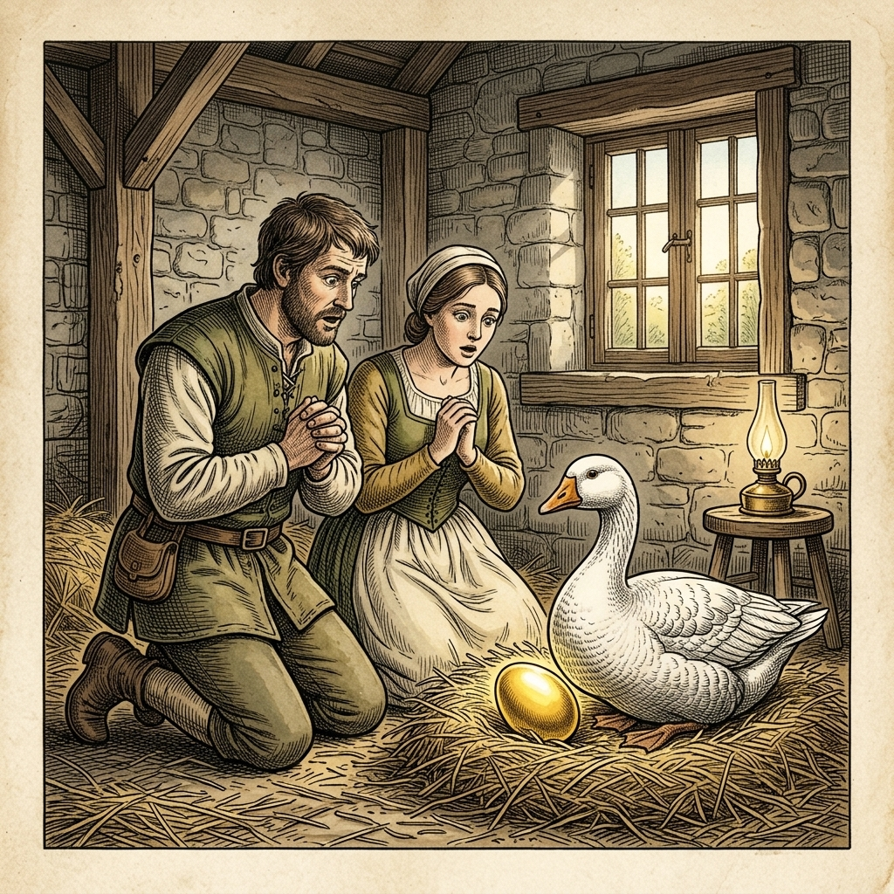

# 『英検ステップアップ多読：イソップ寓話編 第6巻（3級 ➔ 準2級対比学習・第2集）』

---

## はじめに：なぜ「対比多読」で英検準2級の壁を突破できるのか？

英検準2級の合格を目指す学習者にとって、最大の障壁は**「英文の抽象度の高まり」**と**「ライティング（英作文）での論理的な語彙・構文力」**です。

3級までは直感的な日常会話フレーズで太刀打ちできましたが、準2級からは理由や因果関係を論理的に表現する力（*therefore*, *in order to*, *as a result*, 分詞構文, 仮定法）が求められます。

本書では、イソップ寓話（第2集・10話）を題材に、**「知っている3級英語」** が **「合格レベルの準2級英語」** へとどのように深まっていくかを対比学習します。

* **馴染みのあるストーリー（3級）** で文脈を完全に把握する
* **洗練された高度表現（準2級）** で論理的な構文・高級な語彙を吸収する
* **暗唱キーフレーズ対比** でライティング・面接で即効性のある表現力を身につける

楽しく寓話を読みながら、英検準2級合格に直結する本物の英語力を手に入れましょう！

---

## 本書の収録作品（第2集・全10話）

1. **Chapter 11**: 金の斧と銀の斧 (*The Honest Woodcutter*) [Perry 173]
2. **Chapter 12**: 金の卵を産むガチョウ (*The Goose that Laid the Golden Eggs*) [Perry 87]
3. **Chapter 13**: 羊の皮をかぶった狼 (*The Wolf in Sheep's Clothing*) [Perry 451]
4. **Chapter 14**: キツネとツル (*The Fox and the Stork*) [Perry 426]
5. **Chapter 15**: カエルと牛 (*The Frog and the Ox*) [Perry 376]
6. **Chapter 16**: コウモリと鳥と獣 (*The Bat, the Birds, and the Beasts*) [Perry 566]
7. **Chapter 17**: ネズミの会議 (*Belling the Cat*) [Perry 613]
8. **Chapter 18**: 旅人とクマ (*The Bear and the Two Travelers*) [Perry 65]
9. **Chapter 19**: 獅子の分け前 (*The Lion's Share*) [Perry 149]
10. **Chapter 20**: ネズミとカエル (*The Frog and the Mouse*) [Perry 384]

---

## 本書の構成と電子書籍 / Kobo最適化

各章は以下の6段階で構成されています。

```text
┌─────────────────────────────────────────────────────────────┐
│ 1. Chapter Title & Visual Illustration (章タイトル ＆ 挿絵)   │
│ 2. Benchmark Level: 英検3級レベル英文                         │
│ 3. Target Level: 英検準2級レベル英文                          │
│ 4. Classic Original English Text (イソップ寓話クラシック原文)  │
│ 5. Japanese Translation (日本語訳 ＆ 教訓)                     │
│ 6. Recite & Compare (そらんじたいキーフレーズ対比カード)        │
│ 7. Key Vocabulary & Exam Notes (語彙・文法・試験対策解説)        │
└─────────────────────────────────────────────────────────────┘
```

> **【ポイント】 音声読み上げ（TTS）をご利用の方へ**
> 本文セクション（ステップ1〜3）は英語のみで構成されており、電子書籍やKoboの自動音声読み上げ機能（Text-to-Speech）で日本語が混ざることなく、美しい英語音声で快適にリスニング学習していただけます。


# Chapter 11: The Honest Woodcutter (金の斧と銀の斧)

<div style="text-align: center; margin-bottom: 20px;">
  
</div>

## 1. Benchmark Level: Eiken Grade 3 (英検3級レベル本文)
*Read in ~1.5 to 2 minutes. Baseline vocabulary and basic syntax.*

Once upon a time, an honest woodcutter was working near a deep river. By accident, his axe slipped out of his hands and sank to the bottom of the water. Since he was too poor to buy a new one, he sat on the riverbank and wept bitterly.

Suddenly, Hermes, a divine messenger, appeared before him. Learning about the woodcutter's trouble, Hermes decided to help. He dived into the cold river and returned with a brilliant golden axe. "Is this the axe that you lost?" Hermes inquired.

"No, that is not mine," the woodcutter replied truthfully.

Hermes dived a second time and brought up a silver axe. Again, the honest woodcutter shook his head and said, "No, my axe is much older than that."

Finally, Hermes dived a third time and pulled out the old iron axe. The woodcutter cried out with joy, "That is indeed my axe! Thank you so much!"

Impressed by his honesty, Hermes rewarded the man by giving him all three axes.

When a greedy neighbor heard about this fortunate event, he decided to trick the god. He rushed to the river and threw his own axe into the water on purpose. When Hermes appeared with a golden axe, the greedy man shouted eagerly, "Yes, that belongs to me!"

Disgusted by his deception, Hermes vanished instantly, leaving the greedy man with neither the golden axe nor his own.

Greed will bring you nothing, but honesty is always rewarded in the end.

---

## 2. Target Level: Eiken Pre-2 (英検準2級レベル本文)
*Read in ~2.5 to 3.5 minutes. Advanced vocabulary, cause-and-effect transitions, participial constructions, and formal discourse.*

An impoverished yet virtuous woodcutter was diligently laboring on the banks of a swift mountain river. While he was chopping timber, the axe head suddenly detached from its handle, plunging into the deep, turbulent current. Deprived of his sole means of livelihood, the grief-stricken laborer collapsed upon the riverbank and wept uncontrollably.

Moved by the man's genuine distress, Hermes, the divine protector of travelers, materialized before him. Upon discovering the cause of his sorrow, Hermes plunged into the depths of the river and re-emerged with a magnificent axe crafted entirely of pure gold. Presenting the radiant object, the deity inquired whether it was the tool he had misplaced. Without hesitation, the woodcutter declined, stating with humble conviction that such a costly instrument did not belong to him.

Hermes descended beneath the surface once more, this time retrieving an exquisite axe of polished silver. Nevertheless, the woodcutter maintained his integrity, firmly denying ownership. Descending for a third time, Hermes brought forth the humble iron axe. Overwhelmed with profound relief and gratitude, the woodcutter acknowledged it immediately. Immensely impressed by such rare uprightness, Hermes bestowed all three axes upon him as a token of divine favor.

Subsequently, when an envious neighbor learned of this remarkable fortune, he resolved to duplicate the miracle through deliberate deceit. Hurrying to the identical spot, he intentionally hurled his axe into the river and staged a dramatic show of grief. When Hermes appeared and displayed the golden axe, the avaricious impostor reached forward eagerly, falsely claiming ownership.

Infuriated by this blatant dishonesty, Hermes vanished into thin air, utterly refusing to recover either the golden treasure or the man's discarded tool. Consequently, the deceitful laborer was left empty-handed, suffering the harsh penalty of his unbridled cupidity.

Integrity is an enduring virtue that commands universal respect, whereas deceit and shameless greed inevitably precipitate complete ruin.

---

## 3. Classic Original English Text (イソップ寓話 クラシック原文)
*Townsend / Jacobs Edition (Public Domain)*

A Woodman was felling a tree on the bank of a river, and by chance his axe slipped from his hand and dropped into the water. Deeply troubled, he sat down by the river and began to weep. Hermes appeared and, learning the reason for his grief, dived into the river. He brought up a golden axe and asked if it was the one he had lost. The woodman replied that it was not. Hermes dived a second time and brought up a silver axe. Again the woodman denied that it was his. Hermes dived a third time and brought up the wooden axe which had been lost. The woodman recognized it with joy. Hermes, delighted by his honesty, gave him all three axes. The woodman told his friends what had happened. One of them went to the river, dropped his axe on purpose, and sat weeping. Hermes appeared, dived, brought up a golden axe, and asked if it was his. The greedy man cried out with joy, "Yes, that is mine!" Hermes was disgusted by his dishonesty and not only kept the golden axe, but refused to retrieve the wooden one.

Honesty is the best policy.

---

## 4. Japanese Translation (日本語訳)

貧しくも高潔な木こりが、流れの速い山あいの川岸で懸命に働いていました。木を伐採している最中、斧の頭が突然柄から外れ、深くて激しい水流の中に沈んでしまいました。唯一の生計の手段を奪われた木こりは、深い悲しみに暮れて川岸に崩れ落ち、激しく涙を流しました。

男の純粋な苦しみに心を動かされた旅人の守護神ヘルメスが、彼の前に姿を現しました。悲嘆の理由を知ると、ヘルメスは川の深みへと潜り、純金で作られた見事な斧を携えて再び浮上しました。その輝かしい品を差し出し、神はこれがなくした道具であるかを尋ねました。木こりは迷うことなく辞退し、そのような高価な道具は自分のものではないと謙虚な信念をもって述べました。

ヘルメスは再び水面下へと潜り、今度は磨き抜かれた銀の斧を回収してきました。それでもなお木こりは高潔さを保ち、所有権をきっぱりと否定しました。三度目に潜ったヘルメスは、質素な鉄の斧を取り出しました。深い安堵と感謝に満ち溢れた木こりは、即座にそれが自分のものだと認めました。これほど稀有な誠実さに感銘を受けたヘルメスは、神の恩寵の印として3本の斧すべてを彼に授けました。

その後、嫉妬深い隣人がこの並外れた幸運について聞き知ると、故意の欺瞞によって奇跡を再現しようと決意しました。全く同じ場所へ急ぎ、彼は意図的に自分の斧を川へと投げ入れ、大げさに悲しみの芝居を打ちました。ヘルメスが現れて金の斧を差し出すと、欲深い詐欺師は身を乗り出して飛びつき、偽って所有権を主張しました。

この露骨な不誠実さに激怒したヘルメスは煙のように姿を消し、黄金の財宝も、男が捨てた道具も回収することを拒絶しました。その結果、欺瞞に満ちた労働者は手ぶらのまま取り残され、抑制の効かない強欲に対する厳しい罰を受けることになったのです。

**教訓**: 高潔さは普遍的な尊敬を集める不朽の美徳であるが、欺瞞と恥知らずな強欲は不可避的に完全な破滅を招く。

---

## 5. Recite & Compare (そらんじたいキーフレーズ対比)
*Memorize these contrastive expressions to elevate speaking, writing, and reading fluency.*

<div class="comparison-card">
  <div class="card-header">■ 場面：生計の手段を失い、悲嘆に暮れる</div>
  <div class="card-row-g4"><span class="card-badge-g4">【Grade 3 基礎】</span> <em>Since he was too poor... he sat on the riverbank and wept...</em></div>
  <div class="card-row-g3"><span class="card-badge-g3">【Pre-2 暗唱】</span> <strong><em>Deprived of his sole means of livelihood, collapsed upon the riverbank...</em></strong></div>
  <div class="card-note">【ポイント】 <strong>解説・試験活用</strong>：過去分詞構文 `Deprived of...`（〜を奪われて）と抽象表現 `sole means of livelihood`（唯一の生計の手段）。準2級エッセイの格調を高める表現です。</div>
</div>

<div class="comparison-card">
  <div class="card-header">■ 場面：高価な品を謙虚に辞退する</div>
  <div class="card-row-g4"><span class="card-badge-g4">【Grade 3 基礎】</span> <em>No, that is not mine, the woodcutter replied truthfully.</em></div>
  <div class="card-row-g3"><span class="card-badge-g3">【Pre-2 暗唱】</span> <strong><em>declined, stating with humble conviction that such a costly instrument...</em></strong></div>
  <div class="card-note">【ポイント】 <strong>解説・試験活用</strong>：動詞 `decline`（〜を丁重に辞退する）、前置詞句 `with humble conviction`（謙虚な信念をもって）、名詞 `instrument`（器具・道具）。</div>
</div>

<div class="comparison-card">
  <div class="card-header">■ 場面：高潔さを保ち、所有権を否定する</div>
  <div class="card-row-g4"><span class="card-badge-g4">【Grade 3 基礎】</span> <em>Again, the honest woodcutter shook his head...</em></div>
  <div class="card-row-g3"><span class="card-badge-g3">【Pre-2 暗唱】</span> <strong><em>maintained his integrity, firmly denying ownership</em></strong></div>
  <div class="card-note">【ポイント】 <strong>解説・試験活用</strong>：抽象名詞 `integrity`（誠実さ・高潔さ・品位）の維持を表す `maintain one's integrity` と、動名詞 `deny ownership`（所有権を否定する）。</div>
</div>

<div class="comparison-card">
  <div class="card-header">■ 場面：故意の欺瞞・わざと演じる</div>
  <div class="card-row-g4"><span class="card-badge-g4">【Grade 3 基礎】</span> <em>threw his own axe into the water on purpose</em></div>
  <div class="card-row-g3"><span class="card-badge-g3">【Pre-2 暗唱】</span> <strong><em>intentionally hurled his axe... and staged a dramatic show of grief</em></strong></div>
  <div class="card-note">【ポイント】 <strong>解説・試験活用</strong>：副詞 `intentionally`（意図的に・故意に＝*on purpose*）と動詞 `hurl`（力強く投げ込む）、`stage a show`（芝居を打つ）。</div>
</div>

<div class="comparison-card">
  <div class="card-header">■ 場面：教訓（Moral）</div>
  <div class="card-row-g4"><span class="card-badge-g4">【Grade 3 基礎】</span> <em>Greed will bring you nothing, but honesty is always rewarded...</em></div>
  <div class="card-row-g3"><span class="card-badge-g3">【Pre-2 暗唱】</span> <strong><em>Integrity is an enduring virtue..., whereas deceit and shameless greed inevitably precipitate ruin.</em></strong></div>
  <div class="card-note">【ポイント】 <strong>解説・試験活用</strong>：対比の接続詞 `whereas`（〜である一方で）、動詞 `precipitate`（〜を急激に引き起こす）、形容詞 `enduring`（不朽の・永続的な）。</div>
</div>

---

## 6. Key Vocabulary & Exam Notes (語彙・文法・試験対策解説)

### 【出題頻出語彙・熟語ノート】
- **impoverished** [形] 貧困に苦しむ、貧窮した（*poor* の格調高い語彙）
- **deprive A of B** [熟] AからBを奪う（受動態：*be deprived of...*「〜を奪われる」）
- **livelihood** [名] 生計、暮らし（*means of livelihood*「生計の手段」）
- **integrity** [名] 高潔さ、誠実さ、廉恥心（準2級〜2級最重要道徳名詞）
- **intentionally** [副] 意図的に、故意に（＝*deliberately*, *on purpose*）
- **cupidity** [名] 貪欲、強欲（名詞 *greed* の形式張った文学語）
- **precipitate** [動] （破滅・危機など）を急激に引き起こす、招く

### 【文法・構文ポイント】
1. **分詞構文による受動の意味 [Deprived of ...]（〜を奪われて）**
   - 準2級本文: *"Deprived of his sole means of livelihood, the grief-stricken laborer collapsed..."*
   - ポイント: 理由を表す分詞構文 `Being deprived of...` の `Being` が省略された形。原因と主文の行動を滑らかに接続します。
2. **対比を示す従属接続詞 [whereas ...]（〜である一方で、それに引き換え）**
   - 準2級本文: *"Integrity is an enduring virtue..., whereas deceit and shameless greed inevitably precipitate ruin."*
   - ポイント: 二つの対立する概念や結果を鮮やかに際立たせるための準2級〜2級重要接続詞です。


# Chapter 12: The Goose that Laid the Golden Eggs (金の卵を産むガチョウ)

<div style="text-align: center; margin-bottom: 20px;">
  
</div>

## 1. Benchmark Level: Eiken Grade 3 (英検3級レベル本文)
*Read in ~1.5 to 2 minutes. Baseline vocabulary and basic syntax.*

Once upon a time, a humble farmer and his wife were fortunate enough to possess a rare goose. To their delight, every single morning the goose laid a solid golden egg.

By selling these precious eggs at the market, the couple gradually accumulated wealth and enjoyed a comfortable life. 

However, as time passed, the farmer grew impatient and greedy. He thought to himself, "It takes too long to get just one egg a day. If the goose produces gold, her inside must be filled with a vast treasure! If we cut her open, we can acquire all the gold at once."

Hoping to become millionaires overnight, the foolish couple decided to carry out the plan. They killed the goose immediately and examined her inside. 

Much to their disappointment, they discovered that the bird was no different from any normal goose. There was not a single piece of gold inside.

Realizing their terrible mistake, the couple cried in despair. By seeking to gain everything too quickly, they had lost their steady source of wealth forever.

Those who are overly greedy will end up losing even what they already possess.

---

## 2. Target Level: Eiken Pre-2 (英検準2級レベル本文)
*Read in ~2.5 to 3.5 minutes. Advanced vocabulary, cause-and-effect transitions, participial constructions, and formal discourse.*

A modest agrarian couple lived in humble circumstances until fortune smiled upon them through an extraordinary goose. Remarkably, this singular bird produced a solid gold egg at dawn every single day. By regularly converting these precious items into currency, the peasants rapidly elevated their standard of living and accumulated substantial savings without enduring excessive labor.

Notwithstanding this miraculous source of consistent prosperity, the farmer became increasingly dissatisfied with the daily pace of enrichment. Consumed by an insatiable lust for rapid wealth, he began to speculate about the bird's internal anatomy. "Surely," he reasoned impatiently to his spouse, "the creature's interior must contain a massive reservoir of molten gold. If we extract the entirety of the treasure simultaneously, we will instantly achieve unimaginable prosperity."

Persuaded by this seductive fallacy, the couple resolved to slaughter the goose in order to seize the concealed riches. Without pausing to reflect on the potential consequences, they terminated the creature's life and dissected its body.

Much to their utter horror and mortification, however, they discovered that the goose's anatomy differed in no respect from that of any common waterfowl. Not a single particle of precious metal lay hidden within.

Confronted with the irreversible tragedy of their own making, the couple succumbed to bitter remorse. In their rash attempt to obtain instantaneous abundance, they had extinguished the very source of their daily sustenance.

Unchecked avarice blinds judgment and inevitably destroys the sustainable foundations of genuine well-being.

---

## 3. Classic Original English Text (イソップ寓話 クラシック原文)
*Townsend / Jacobs Edition (Public Domain)*

A Cottager and his wife had a Hen which laid a golden egg every day. They supposed that the Hen must contain a great lump of gold in its inside, and in order to get the gold, they killed it. Having done so, they found to their surprise that the Hen differed in no respect from their other hens. The foolish pair, hoping to become rich all at once, thus deprived themselves of the gain of which they were assured day by day.

Thinking to get at once all the gold, they lost even the little they had.

---

## 4. Japanese Translation (日本語訳)

質素な農夫の夫婦が貧しい境遇で暮らしていましたが、一羽の並外れたガチョウを通じて幸運が彼らに微笑みかけました。驚くべきことに、この稀有な鳥は毎朝夜明けとともに純金の卵を1個産み落としました。これらの貴重な品を定期的に通貨へと換金することで、小作農たちは過度な労働に耐えることなく、生活水準を急速に向上させ、かなりの貯蓄を蓄えました。

この奇跡のような継続的繁栄の源泉があったにもかかわらず、農夫は富裕化していく日々のペースに対して次第に不満を抱くようになりました。急速な富への飽くなき渇望に取り憑かれた彼は、鳥の体内構造について推測を始めました。「間違いなく」と彼はしびれを切らして妻に説得しました。「この生き物の体内には、溶けた黄金の莫大な貯蔵庫が収められているに違いない。もし我々が財宝のすべてを同時に抽出すれば、瞬く間に想像を絶する富を達成できるだろう。」

この甘美な誤謬に惑わされた夫婦は、隠された富を強奪するためにガチョウを屠殺することを決意しました。起こりうる結果を熟考するために立ち止まることもなく、彼らはその生き物の命を絶ち、その体を解剖しました。

しかしながら、彼らの完全な恐怖と屈辱感に満ちたことには、そのガチョウの構造は通常の水鳥のものと何ら変わらないことが判明しました。中には貴金属の微粒子一つすら隠されていませんでした。

自らが招いた取り返しのつかない悲劇に直面し、夫婦は苦い悔恨に打ちひしがれました。瞬間的な豊かさを手に入れようとした軽率な試みの中で、彼らは毎日の暮らしの糧泉そのものを消し去ってしまったのです。

**教訓**: 抑制されない強欲は判断力を曇らせ、持続可能な真の幸福の基盤を必然的に破壊する。

---

## 5. Recite & Compare (そらんじたいキーフレーズ対比)
*Memorize these contrastive expressions to elevate speaking, writing, and reading fluency.*

<div class="comparison-card">
  <div class="card-header">■ 場面：着実に富を蓄え、生活水準を上げる</div>
  <div class="card-row-g4"><span class="card-badge-g4">【Grade 3 基礎】</span> <em>gradually accumulated wealth and enjoyed a comfortable life</em></div>
  <div class="card-row-g3"><span class="card-badge-g3">【Pre-2 暗唱】</span> <strong><em>rapidly elevated their standard of living and accumulated substantial savings...</em></strong></div>
  <div class="card-note">【ポイント】 <strong>解説・試験活用</strong>：熟語 `elevate one's standard of living`（生活水準を向上させる）と形容詞 `substantial`（相当な・多大な）。準2級〜2級経済・社会エッセイの基本表現。</div>
</div>

<div class="comparison-card">
  <div class="card-header">■ 場面：飽くなき欲望・推論</div>
  <div class="card-row-g4"><span class="card-badge-g4">【Grade 3 基礎】</span> <em>grew impatient and greedy... her inside must be filled with...</em></div>
  <div class="card-row-g3"><span class="card-badge-g3">【Pre-2 暗唱】</span> <strong><em>Consumed by an insatiable lust for rapid wealth, began to speculate...</em></strong></div>
  <div class="card-note">【ポイント】 <strong>解説・試験活用</strong>：過去分詞構文 `Consumed by...`（〜に取り憑かれて）と形容詞 `insatiable`（飽くことを知らない）、動詞 `speculate`（推測・憶測する）。</div>
</div>

<div class="comparison-card">
  <div class="card-header">■ 場面：同時に一度にすべてを手に入れる</div>
  <div class="card-row-g4"><span class="card-badge-g4">【Grade 3 基礎】</span> <em>acquire all the gold at once</em></div>
  <div class="card-row-g3"><span class="card-badge-g3">【Pre-2 暗唱】</span> <strong><em>extract the entirety of the treasure simultaneously</em></strong></div>
  <div class="card-note">【ポイント】 <strong>解説・試験活用</strong>：動詞 `extract`（〜を抽出・取り出す）、名詞 `entirety`（全体）、副詞 `simultaneously`（同時に＝*at the same time*）。</div>
</div>

<div class="comparison-card">
  <div class="card-header">■ 場面：自らの過ちに直面し、悔恨に沈む</div>
  <div class="card-row-g4"><span class="card-badge-g4">【Grade 3 基礎】</span> <em>Realizing their terrible mistake, the couple cried in despair.</em></div>
  <div class="card-row-g3"><span class="card-badge-g3">【Pre-2 暗唱】</span> <strong><em>Confronted with the irreversible tragedy of their own making, succumbed to bitter remorse.</em></strong></div>
  <div class="card-note">【ポイント】 <strong>解説・試験活用</strong>：過去分詞構文 `Confronted with...`（〜に直面して）、形容詞 `irreversible`（取り返しのつかない）、動詞句 `succumb to remorse`（悔恨に打ちひしがれる）。</div>
</div>

<div class="comparison-card">
  <div class="card-header">■ 場面：教訓（Moral）</div>
  <div class="card-row-g4"><span class="card-badge-g4">【Grade 3 基礎】</span> <em>Those who are overly greedy will end up losing...</em></div>
  <div class="card-row-g3"><span class="card-badge-g3">【Pre-2 暗唱】</span> <strong><em>Unchecked avarice blinds judgment and inevitably destroys sustainable foundations...</em></strong></div>
  <div class="card-note">【ポイント】 <strong>解説・試験活用</strong>：無生物主語構文 `Avarice blinds judgment...`（強欲が判断力を曇らせる）と形容詞 `sustainable`（持続可能な）。準2級ライティングで満点を狙える格調。</div>
</div>

---

## 6. Key Vocabulary & Exam Notes (語彙・文法・試験対策解説)

### 【出題頻出語彙・熟語ノート】
- **notwithstanding** [前] 〜にもかかわらず（*in spite of* / *despite* の堅い表現）
- **insatiable** [形] 貪欲な、飽くことを知らない（*insatiable desire/curiosity*）
- **speculate** [動] 推測する、思索する（名詞 *speculation*）
- **simultaneously** [副] 同時に、一斉に（＝*at the same time*）
- **dissect** [動] （〜を）解剖する、詳しく分析する
- **succumb to...** [熟] （誘惑・感情・病気など）に屈する、負ける
- **avarice** [名] 強欲、貪欲（形容詞 *avaricious*）

### 【文法・構文ポイント】
1. **無生物主語構文 [Unchecked avarice blinds judgment ...]**
   - 準2級本文: *"Unchecked avarice blinds judgment and inevitably destroys the sustainable foundations..."*
   - ポイント: 「強欲によって判断力が曇る」を、強欲（主語）が判断力を曇らせる（動詞＋目的語）として表現する英語固有の明快かつ力強い構文です。
2. **前置詞句による対比 [Notwithstanding ...]（〜にもかかわらず）**
   - 準2級本文: *"Notwithstanding this miraculous source of consistent prosperity..."*
   - ポイント: 文頭に置いて譲歩・対比を導く前置詞句。長文読解の展開転換点で頻出します。


# Chapter 13: The Wolf in Sheep's Clothing (羊の皮をかぶった狼)

<div style="text-align: center; margin-bottom: 20px;">
  
</div>

## 1. Benchmark Level: Eiken Grade 3 (英検3級レベル本文)
*Read in ~1.5 to 2 minutes. Baseline vocabulary and basic syntax.*

Once upon a time, a sly wolf was desperately searching for a way to attack a flock of sheep. However, because the shepherd and his fierce dogs kept a close watch, the wolf failed every time he tried to approach them.

One afternoon, the wolf discovered the fleece of a sheep that had been thrown away in the pasture. A wicked plan entered his mind. "If I disguise myself in this wool," he reasoned, "the shepherd will mistake me for one of his own animals."

After putting on the sheep's skin, the wolf strolled calmly among the flock. As he had expected, neither the shepherd nor the guard dogs noticed his true identity. An innocent lamb even followed him closely. Taking advantage of the opportunity, the wolf led the lamb into the forest and devoured it.

For a while, the wolf succeeded in deceiving everyone and enjoyed effortless feasts every night.

However, justice came unexpectedly. One evening, the shepherd entered the fold in the dark, intending to slaughter a sheep for his family's meal. Mistaking the disguised wolf for a fat sheep, the shepherd seized him instantly and put an end to his life.

Those who try to deceive others through fake appearances will eventually suffer the consequences.

---

## 2. Target Level: Eiken Pre-2 (英検準2級レベル本文)
*Read in ~2.5 to 3.5 minutes. Advanced vocabulary, cause-and-effect transitions, participial constructions, and formal discourse.*

A predatory wolf had long coveted a thriving flock of sheep grazing peacefully on a verdant hillside. Nevertheless, penetrating their defenses proved virtually insurmountable due to the unceasing vigilance maintained by a diligent shepherd and his formidable hounds. Frustrated by numerous thwarted incursions, the carnivore resolved to substitute cunning strategy for brute force.

While prowling along the perimeter of the pasture, the wolf stumbled upon the discarded fleece of a slaughtered sheep. Instantly recognizing the tactical utility of the pelt, he enveloped his lean frame within the woolly disguise. His objective was to fabricate an illusion of harmless docility, thereby circumventing the herdsman's suspicion.

Thus camouflaged, the intruder infiltrated the flock without exciting the slightest apprehension among the animals. Deceived by the superficial exterior, even a vulnerable lamb unhesitatingly trotted alongside the disguised carnivore, accepting him as its maternal guardian. Exploiting this misplaced trust, the wolf gently coaxed the juvenile creature into a secluded thicket and promptly devoured it. Emboldened by this effortless triumph, the predator repeated the heinous subterfuge for several consecutive days, feasting on unsuspecting livestock without detection.

Nevertheless, retribution manifested itself in an ironic and fatal manner. Late one evening, seeking provisions for the forthcoming holiday banquet, the shepherd quietly ventured into the enclosed fold armed with a carving knife. Impaired by the nocturnal gloom, the herdsman instinctively singled out the largest silhouette, erroneously presuming it to be a choice ram. Before the disguised monster could react or shed his false attire, the shepherd seized him firmly and dispatched him on the spot.

Hypocritical pretension and deceptive facades cannot indefinitely shield the wicked; those who exploit innocence under the cloak of virtue will inevitably perish by their own deceit.

---

## 3. Classic Original English Text (イソップ寓話 クラシック原文)
*Townsend / Jacobs Edition (Public Domain)*

A Wolf found great difficulty in getting at the sheep owing to the vigilance of the shepherd and his dogs. But one day it found the skin of a sheep that had been flayed and thrown aside, so it put it on over its own pelt and strolled down among the sheep. The lamb that belonged to the sheep whose skin the Wolf was wearing began to follow the Wolf; so leading the lamb a little away, he soon made a meal off her, and for some time he succeeded in deceiving the sheep, and enjoying hearty meals.

Appearances are deceptive.

---

## 4. Japanese Translation (日本語訳)

捕食者である狼は、緑豊かな丘陵で平和に草を食む繁栄した羊の群れを長年つけ狙っていました。それにもかかわらず、勤勉な羊飼いとその手強い猟犬たちによって維持される不断の警戒のせいで、その防衛を突破することは事実上克服不可能な難題でした。度重なる侵入の試みが阻止され苛立ったこの肉食獣は、粗暴な力ではなく狡猾な戦略を用いることを決意しました。

牧草地の周囲をうろついている際、狼は屠殺された羊の捨てられた毛皮を偶然見つけました。毛皮の戦術的有用性を瞬時に認識した彼は、痩せた自分の身体を羊毛の偽装で包み込みました。彼の目的は無害で従順であるかのような錯覚を作り出し、それによって羊飼いの疑念を回避することでした。

このように擬態した侵入者は、動物たちの間に微塵の不安も抱かせることなく群れの中に潜入しました。表面的な外見に欺かれ、無防備な子羊までもが変装した肉食獣の隣をためらうことなく小走りで寄り添い、彼を自らの母なる保護者として受け入れたのです。この誤った信頼を利用して、狼はその幼い生き物を人里離れた茂みへと優しく誘い込み、即座に貪り食いました。この容易な勝利に気を良くした捕食者は、何日も連続してその凶悪な策略を繰り返し、疑うことを知らない家畜たちを探知されることなく食い荒らしました。

しかしながら、報いは皮肉かつ致命的な形で具現化しました。ある日の遅い夕暮れ時、間近に迫った祝祭の宴のための食糧を求め、羊飼いは解体用のナイフを手に携えて囲いの中に静かに入ってきました。夜の暗闇に視界を遮られ、羊飼いは本能的に最も大きな影を名指しし、極上の雄羊であると誤認しました。変装した怪物が反応することも、偽りの装束を脱ぎ捨てることもできないうちに、羊飼いは彼をしっかりと捕らえ、その場で息の根を止めたのです。

**教訓**: 偽善的な見せかけや欺瞞に満ちた外見が悪人を永久に守ることはできない。美徳のマントの下で無垢を搾取する者は、不可避的に自らの欺瞞によって滅びることになる。

---

## 5. Recite & Compare (そらんじたいキーフレーズ対比)
*Memorize these contrastive expressions to elevate speaking, writing, and reading fluency.*

<div class="comparison-card">
  <div class="card-header">■ 場面：厳しい警戒により突破困難</div>
  <div class="card-row-g4"><span class="card-badge-g4">【Grade 3 基礎】</span> <em>because the shepherd and his fierce dogs kept a close watch...</em></div>
  <div class="card-row-g3"><span class="card-badge-g3">【Pre-2 暗唱】</span> <strong><em>proved virtually insurmountable due to the unceasing vigilance maintained by...</em></strong></div>
  <div class="card-note">【ポイント】 <strong>解説・試験活用</strong>：形容詞 `insurmountable`（克服できない）、前置詞 `due to`、抽象名詞 `unceasing vigilance`（不断の警戒心）。準2級〜2級読解で定番の格調高い構文。</div>
</div>

<div class="comparison-card">
  <div class="card-header">■ 場面：錯覚を捏造し、疑念を回避する</div>
  <div class="card-row-g4"><span class="card-badge-g4">【Grade 3 基礎】</span> <em>disguise myself... the shepherd will mistake me for...</em></div>
  <div class="card-row-g3"><span class="card-badge-g3">【Pre-2 暗唱】</span> <strong><em>fabricate an illusion of docility, thereby circumventing suspicion</em></strong></div>
  <div class="card-note">【ポイント】 <strong>解説・試験活用</strong>：動詞 `fabricate`（〜を捏造する・作り出す）、`circumvent`（〜を回避する）、接続副詞 `thereby`（それによって）を用いた現在分詞構文。</div>
</div>

<div class="comparison-card">
  <div class="card-header">■ 場面：誤った信頼を利用して誘い出す</div>
  <div class="card-row-g4"><span class="card-badge-g4">【Grade 3 基礎】</span> <em>Taking advantage of the opportunity, the wolf led the lamb...</em></div>
  <div class="card-row-g3"><span class="card-badge-g3">【Pre-2 暗唱】</span> <strong><em>Exploiting this misplaced trust, coaxed the juvenile creature into...</em></strong></div>
  <div class="card-note">【ポイント】 <strong>解説・試験活用</strong>：動詞 `exploit`（〜を不当に利用・搾取する）、名詞句 `misplaced trust`（誤った信頼）、動詞 `coax`（〜を甘言で言いくるめて誘導する）。</div>
</div>

<div class="comparison-card">
  <div class="card-header">■ 場面：報いが皮肉な形で訪れる</div>
  <div class="card-row-g4"><span class="card-badge-g4">【Grade 3 基礎】</span> <em>However, justice came unexpectedly.</em></div>
  <div class="card-row-g3"><span class="card-badge-g3">【Pre-2 暗唱】</span> <strong><em>retribution manifested itself in an ironic and fatal manner</em></strong></div>
  <div class="card-note">【ポイント】 <strong>解説・試験活用</strong>：抽象名詞 `retribution`（天罰・報い・応報）、動詞 `manifest oneself`（明白に現れる・具現化する）、形容詞 `ironic`（皮肉な）。</div>
</div>

<div class="comparison-card">
  <div class="card-header">■ 場面：教訓（Moral）</div>
  <div class="card-row-g4"><span class="card-badge-g4">【Grade 3 基礎】</span> <em>Those who try to deceive others... will suffer the consequences.</em></div>
  <div class="card-row-g3"><span class="card-badge-g3">【Pre-2 暗唱】</span> <strong><em>those who exploit innocence under the cloak of virtue will inevitably perish...</em></strong></div>
  <div class="card-note">【ポイント】 <strong>解説・試験活用</strong>：比喩表現 `under the cloak of virtue`（美徳のマント＝仮面の下で）、動詞 `perish`（死ぬ・滅びる）。準2級エッセイの結論として最高峰の表現です。</div>
</div>

---

## 6. Key Vocabulary & Exam Notes (語彙・文法・試験対策解説)

### 【出題頻出語彙・熟語ノート】
- **insurmountable** [形] 克服できない、乗り越えられない（*insurmountable difficulties*）
- **vigilance** [名] 警戒、用心深さ（形容詞 *vigilant*）
- **circumvent** [動] （法律・疑念・困難など）を回避する、抜け道をみつける
- **apprehension** [名] 不安、心配、懸念（動詞 *apprehend*）
- **exploit** [動] （好機・弱点など）を利用する、搾取する
- **subterfuge** [名] 策略、口実、ごまかし（*cunning trick* の高度な語彙）
- **retribution** [名] 応報、天罰、報い（*divine retribution*）

### 【文法・構文ポイント】
1. **接続副詞 + 分詞構文 [thereby + -ing]（それによって〜する）**
   - 準2級本文: *"to fabricate an illusion of harmless docility, thereby circumventing the herdsman's suspicion."*
   - ポイント: 行動の結果や目的を説明する準2級〜2級頻出の構文。文脈を論理的かつ滑らかに繋ぎます。
2. **抽象名詞主語構文 [Retribution manifested itself ...]**
   - 準2級本文: *"retribution manifested itself in an ironic and fatal manner."*
   - ポイント: 再帰代名詞 `manifest oneself`（〜が姿を現す）を用いて「報いが訪れた」を文学的・説得力豊かに描写する構文です。


# Chapter 14: The Fox and the Stork (キツネとツル)

<div style="text-align: center; margin-bottom: 20px;">
  
</div>

## 1. Benchmark Level: Eiken Grade 3 (英検3級レベル本文)
*Read in ~1.5 to 2 minutes. Baseline vocabulary and basic syntax.*

Once upon a time, a sly fox decided to play a trick on his neighbor, a stork. He invited her to his house for dinner, promising a delicious meal.

When the stork arrived, the fox served some hot soup, but he poured it into very shallow dishes. While the fox lapped up the soup effortlessly with his broad tongue, the poor stork could only touch the liquid with the tip of her long beak. As a result, she was unable to eat anything and remained hungry throughout the evening.

"I am afraid that you do not like my soup," the fox said with a mischievous grin.

"On the contrary, it smells wonderful," replied the stork politely. "To show my gratitude, please accept an invitation to dine at my home tomorrow night."

The following evening, the fox visited the stork's residence. To his surprise, the stork served the meal in a tall, narrow jar with a slender neck. The stork easily inserted her long beak into the container and enjoyed her food. However, the fox's snout was far too wide to fit inside, so he could do nothing but lick the outer rim of the jar.

Feeling embarrassed and hungry, the fox returned home, understanding that he had received a fitting punishment for his previous rudeness.

One good turn deserves another, but bad treatment will return to you just the same.

---

## 2. Target Level: Eiken Pre-2 (英検準2級レベル本文)
*Read in ~2.5 to 3.5 minutes. Advanced vocabulary, cause-and-effect transitions, participial constructions, and formal discourse.*

A cunning fox and a dignified stork maintained an outward display of cordial friendship, although the fox harbored a petty desire to humiliate his avian companion. Under the pretense of hospitable generosity, the fox extended an invitation to the stork for an evening banquet at his den.

Upon her arrival, the host presented a fragrant broth served exclusively in remarkably flat, shallow earthenware dishes. While the fox's broad tongue enabled him to consume the liquid with consummate ease, the stork's elongated beak proved entirely unsuited for such wide tableware. Despite repeated attempts, she could merely dip the tip of her bill into the broth, remaining completely famished. Amused by her obvious distress, the fox feigned polite concern, insincerely lamenting her apparent lack of appetite.

Masking her resentment behind impeccable courtesy, the stork gracefully endured the humiliating ordeal. Before departing, she cordially reciprocated the hospitality, extending an invitation for the fox to join her for dinner on the ensuing evening.

Promptly the following sunset, the expectant fox arrived at the stork's dwelling, anticipating a complimentary feast. To his profound chagrin, the meal was presented inside towering, slender flacons characterized by extremely narrow apertures. The stork effortlessly inserted her long bill into the elongated neck, extracting succulent morsels of food with complete satisfaction. Conversely, the fox found it physically impossible to introduce even his snout into the vessel, reducing him to fruitlessly licking the exterior glaze.

Humiliated and famished, the defeated prankster slunk away into the shadows, forced to acknowledge that his malicious scheme had been ingeniously turned against him.

True mutual respect requires considering the unique circumstances of others, whereas those who deliberately subject their peers to embarrassment must expect equivalent retribution.

---

## 3. Classic Original English Text (イソップ寓話 クラシック原文)
*Townsend / Jacobs Edition (Public Domain)*

At one time the Fox and the Stork seemed to be on very good terms and invited each other to dinner. First the Fox invited the Stork, and served nothing but soup in a very shallow dish. The Fox lapped it up with ease, but the Stork could only wet the end of her long bill in it, and left the meal as hungry as when she came. "I am sorry," said the Fox, "that the soup is not to your liking." The Stork thanked him and invited him to dine with her in return. When the Fox arrived, the Stork served the meal in a tall jar with a narrow neck. The Stork easily inserted her long bill and enjoyed the food, while the Fox could only lick the outside of the jar.

One bad turn deserves another.

---

## 4. Japanese Translation (日本語訳)

狡猾なキツネと威厳あるツルは、表向きは心温まる友情の体裁を保っていましたが、キツネは鳥類の友人を辱めたいという卑しい願望を心に秘めていました。もてなしの気前の良さという口実の下、キツネはツルを自分の巣穴での夕べの宴会へと招待しました。

到着すると、主人は驚くほど平らで浅い陶器の皿にのみ盛り付けられた香り高いスープを出しました。キツネの幅広な舌は申し分のない容易さで液体を飲み干すことを可能にしましたが、ツルの長く伸びたクチバシはそのような幅の広い食器にはまったく不向きであることが判明しました。何度試みても、彼女はクチバシの先端をスープに浸すことしかできず、完全に飢えたままでした。彼女の明らかな苦境を面白がり、キツネはうわべだけの礼儀正しい気遣いを装い、彼女の食欲不振を不誠実そうに嘆いてみせました。

完璧な礼儀正しさの背後に憤りを隠し、ツルはその屈辱的な試練を優雅に耐え抜きました。立ち去る前に、彼女は心から歓待に返礼し、翌日の夕方に夕食を共にするようキツネを招待しました。

翌日の日没時、期待に胸を膨らませたキツネは、無料のごちそうを予期してツルの住居に到着しました。彼が大いに無念に思ったことには、食事は非常に狭い開口部を特徴とする背の高い細身の瓶に入れられて出されました。ツルは細長い首の中に長いクチバシを難なく差し入れ、完全な満足感とともに美味しい食べ物の一片を引っ張り出しました。これとは対照的に、キツネは容器の中に鼻先を入れることすら物理的に不可能であると知り、外側の釉薬をむなしく舐めるだけの状態に甘んじることになりました。

屈辱と空腹を味わい、打ち負かされた悪戯者は影の中へとこそこそ立ち去り、自らの悪意に満ちた策略が巧妙に自分自身に向け直されたのだと認めざるを得ませんでした。

**教訓**: 真の相互尊重とは他者の独自の境遇を考慮することを必要とし、他者に意図的な恥をかかせようとする者は、それと同等の報いを受けることを覚悟しなければならない。

---

## 5. Recite & Compare (そらんじたいキーフレーズ対比)
*Memorize these contrastive expressions to elevate speaking, writing, and reading fluency.*

<div class="comparison-card">
  <div class="card-header">■ 場面：もてなしの口実・形式的な招待</div>
  <div class="card-row-g4"><span class="card-badge-g4">【Grade 3 基礎】</span> <em>invited her to his house for dinner, promising a meal</em></div>
  <div class="card-row-g3"><span class="card-badge-g3">【Pre-2 暗唱】</span> <strong><em>Under the pretense of hospitable generosity, extended an invitation...</em></strong></div>
  <div class="card-note">【ポイント】 <strong>解説・試験活用</strong>：前置詞句 `Under the pretense of...`（〜の口実・名目の下で）とフォーマルな動詞句 `extend an invitation`（招待を差し伸べる）。</div>
</div>

<div class="comparison-card">
  <div class="card-header">■ 場面：うわべだけの心配を装う</div>
  <div class="card-row-g4"><span class="card-badge-g4">【Grade 3 基礎】</span> <em>the fox said with a mischievous grin</em></div>
  <div class="card-row-g3"><span class="card-badge-g3">【Pre-2 暗唱】</span> <strong><em>feigned polite concern, insincerely lamenting her apparent lack...</em></strong></div>
  <div class="card-note">【ポイント】 <strong>解説・試験活用</strong>：動詞 `feign`（〜のふりをする・装う＝*pretend*）と分詞構文 `lamenting...`（〜を嘆きながら）。心理の偽善性を暴く構文。</div>
</div>

<div class="comparison-card">
  <div class="card-header">■ 場面：礼儀正しく返礼の招待をする</div>
  <div class="card-row-g4"><span class="card-badge-g4">【Grade 3 基礎】</span> <em>accept an invitation to dine at my home tomorrow night</em></div>
  <div class="card-row-g3"><span class="card-badge-g3">【Pre-2 暗唱】</span> <strong><em>reciprocated the hospitality, extending an invitation for the ensuing evening</em></strong></div>
  <div class="card-note">【ポイント】 <strong>解説・試験活用</strong>：動詞 `reciprocate`（〜に報いる・返礼する）、形容詞 `ensuing`（次の・引き続く＝*following*）。格式の高いビジネス・対人表現。</div>
</div>

<div class="comparison-card">
  <div class="card-header">■ 場面：大いなる無念・失望</div>
  <div class="card-row-g4"><span class="card-badge-g4">【Grade 3 基礎】</span> <em>To his surprise, the stork served the meal in a tall, narrow jar...</em></div>
  <div class="card-row-g3"><span class="card-badge-g3">【Pre-2 暗唱】</span> <strong><em>To his profound chagrin, the meal was presented inside towering flacons...</em></strong></div>
  <div class="card-note">【ポイント】 <strong>解説・試験活用</strong>：感情名詞句 `To one's profound chagrin`（大いに無念・悔しいことには）と名詞 `flacon`（細首の小瓶）。</div>
</div>

<div class="comparison-card">
  <div class="card-header">■ 場面：教訓（Moral）</div>
  <div class="card-row-g4"><span class="card-badge-g4">【Grade 3 基礎】</span> <em>One good turn deserves another, but bad treatment will return...</em></div>
  <div class="card-row-g3"><span class="card-badge-g3">【Pre-2 暗唱】</span> <strong><em>True mutual respect requires considering the unique circumstances of others...</em></strong></div>
  <div class="card-note">【ポイント】 <strong>解説・試験活用</strong>：主語 `mutual respect`（相互尊重）、動詞 `require -ing`（〜することを要求する）、名詞句 `unique circumstances`（独自の境遇・立場）。</div>
</div>

---

## 6. Key Vocabulary & Exam Notes (語彙・文法・試験対策解説)

### 【出題頻出語彙・熟語ノート】
- **pretense** [名] 見せかけ、口実（*under the pretense of...*「〜を口実に」）
- **hospitable** [形] もてなしのよい、親切な（名詞 *hospitality*）
- **elongated** [形] 細長い、引き伸ばされた（動詞 *elongate*）
- **feign** [動] （〜の）ふりをする、装う（*feign illness*「仮病を使う」）
- **reciprocate** [動] 返礼する、報いる（*reciprocate a favor/greeting*）
- **chagrin** [名] 悔しさ、無念、失望（*to one's chagrin*「悔しいことには」）
- **mutual** [形] 相互の、共通の（*mutual respect/understanding*）

### 【文法・構文ポイント】
1. **譲歩を表す接続詞 [although ...] と前置詞句**
   - 準2級本文: *"A cunning fox and a dignified stork maintained an outward display..., although the fox harbored a petty desire..."*
   - ポイント: 表向きの態度と内面の悪意という二面性を対比させるための準2級最頻出の複文構文です。
2. **感情の帰結を表す前置詞句 [To one's + 感情名詞]**
   - 準2級本文: *"To his profound chagrin, the meal was presented inside towering, slender flacons..."*
   - ポイント: `To one's surprise` から発展した `To one's profound chagrin`。出来事に対する強い悔恨や無念さを表現します。


# Chapter 15: The Frog and the Ox (カエルと牛)

<div style="text-align: center; margin-bottom: 20px;">
  
</div>

## 1. Benchmark Level: Eiken Grade 3 (英検3級レベル本文)
*Read in ~1.5 to 2 minutes. Baseline vocabulary and basic syntax.*

An old mother frog, who was famous for her pride, lived near a quiet meadow with her young children. One morning, an enormous ox stepped into the pond to quench his thirst.

After the ox departed, the terrified young frogs hurried back to their mother. "Mother! We just saw the largest creature in the world!" they exclaimed. "His body was truly massive!"

Unwilling to admit that any creature could be far grander than herself, the mother frog replied haughtily, "Nonsense! I can easily make myself just as big as that beast."

She took a deep breath and expanded her body as much as possible. "Was he as large as this?" she inquired.

"No, Mother! He was vastly larger than that!" the children insisted.

Annoyed by their response, the mother frog inhaled even more air, puffing herself out to double her original size. "How about now? Am I not equal to him?"

"If you try to compare yourself to the ox, you will only hurt yourself!" warned her children.

Ignoring their sensible advice, the foolish mother frog inhaled with all her remaining strength. She puffed and stretched until—BOOM! Her skin tore apart, and she burst completely.

Foolish vanity will eventually lead to self-destruction.

---

## 2. Target Level: Eiken Pre-2 (英検準2級レベル本文)
*Read in ~2.5 to 3.5 minutes. Advanced vocabulary, cause-and-effect transitions, participial constructions, and formal discourse.*

A venerable matriarch of a frog colony resided alongside a tranquil marsh, notorious among her peers for an inflated sense of self-importance. One sultry afternoon, a colossal ox strolled down to the water's edge to drink, inadvertently crushing several small plants and shaking the surrounding soil with his ponderous steps.

Witnessing this display of sheer magnitude, the juvenile frogs fled in terror to their mother. "Mother, we have just encountered an incomprehensible behemoth!" they cried in trembling tones. "His limbs were as stout as oak trunks, and his stature rivaled a small mountain!"

Incapable of tolerating the notion that any entity could overshadow her own prestige, the conceited amphibian dismissed their description with contemptuous disdain. "You are merely exaggerating," she scoffed. "With a modest exertion of willpower, I can readily distend my physique to match that ungainly quadrupeds."

Taking a profound inhalation, she stretched her elastic hide, puffing her torso into an awkward sphere. "Behold!" she proclaimed proudly. "Does the intruder surpass this magnitude?"

"By an immense margin, Mother!" her offspring exclaimed candidly. "Your present dimension is negligible in comparison to that monster!"

Infuriated by their contradiction, the obstinate mother redoubled her efforts. Drawing vast quantities of atmosphere into her lungs, she expanded her membranes to a perilous degree, straining her abdominal tissues beyond their natural elasticity. "Surely, I have now achieved parity!" she wheezed through clenched jaws.

"Cease this madness, Mother!" pleaded her terrified offspring. "Even if you were to rupture your own flesh, you could never equal the ox!"

Deaf to their desperate supplications and dominated entirely by irrational narcissism, the delusional creature drew one final, violent breath. Incapable of withstanding the immense internal pressure, her fragile body abruptly exploded with a sickening snap.

Pretentious vanity that refuses to acknowledge natural limitations will inevitably culminate in catastrophic self-annihilation.

---

## 3. Classic Original English Text (イソップ寓話 クラシック原文)
*Townsend / Jacobs Edition (Public Domain)*

An Ox, drinking at a pool, stepped on a family of young frogs and crushed one of them to death. When the mother frog came home, she asked where her little one was. "A huge beast came by," said one of the brothers, "and crushed him under his big foot." "How big was he?" asked the mother frog, puffing herself out. "Was he as big as this?" "Oh, much bigger than that!" replied the young frog. The mother puffed herself out more and more, asking, "Was he this big?" "Cease your puffing, mother," said the son, "for if you burst yourself, you will never equal the beast." But the foolish frog tried once more, blew herself up even bigger, and burst!

Self-conceit may lead to self-destruction.

---

## 4. Japanese Translation (日本語訳)

あるカエルのコロニーの長老である母ガエルが、静かな沼地のそばに住んでいましたが、自尊心の肥大化によって仲間たちの間では悪名高い存在でした。ある蒸し暑い午後、巨大な牛が水を飲むために水辺へと歩み寄り、不注意にもいくつかの小さな植物を踏みつぶし、その重々しい足取りで周囲の地面を揺らしました。

この圧倒的な巨大さの誇示を目撃した幼いカエルたちは、恐怖におののきながら母親の元へと逃げ帰りました。「お母さん、僕たち今、理解不能なほどの巨大怪物に出くわしたよ！」と彼らは震える声で叫びました。「あいつの手足は樫の木の幹のように太く、その背丈は小さな山に匹敵していたんだ！」

いかなる存在であれ自らの威信に影を落とすという考えを容認できなかったうぬぼれの強い両生類は、軽蔑的な冷笑をもって彼らの描写を一蹴しました。「お前たちは大げさに言っているだけですよ」と彼女は嘲笑しました。「少しの気力を奮い起こせば、あのような不格好な四足獣に匹敵するよう、自分の体を容易に膨張させることができます。」

深く息を吸い込み、彼女は弾力性のある皮を伸ばし、自らの胴体を不格好な球体へと膨らませました。「ご覧なさい！」と彼女は誇らしげに宣言しました。「侵入者はこの大きさを超えているかい？」

「とてつもない大差で超えているよ、お母さん！」と子供たちは率直に叫びました。「そのモンスターと比べたら、お母さんの今の大きさなんて取るに足らないよ！」

彼らの反論に激怒した頑固な母親は、努力を倍加させました。膨大な量の大気を肺へと吸い込み、彼女は皮膜を危険な領域まで拡張し、腹部の組織を自然の弾力性の限界を超えて引き絞りました。「間違いなく、これで同等に達したはずだ！」と彼女は食いしばった顎の隙間から喘ぎました。

「この狂気をやめて、お母さん！」と怯えた子供たちは懇願しました。「たとえ自分自身の肉体を引き裂いたとしても、決して牛と同等にはなれないよ！」

彼らの必死の哀願に耳を貸さず、非合理的な自己愛に完全に支配されたこの妄想的な生き物は、最後の一撃となる激しい息を吸い込みました。莫大な体内圧力に耐えることができず、彼女の脆い肉体は嫌な破裂音とともに突然爆発したのです。

**教訓**: 自然の限界を認めることを拒む虚飾に満ちた虚栄心は、必然的に破滅的な自己消滅へと至る。

---

## 5. Recite & Compare (そらんじたいキーフレーズ対比)
*Memorize these contrastive expressions to elevate speaking, writing, and reading fluency.*

<div class="comparison-card">
  <div class="card-header">■ 場面：肥大化した自尊心と他者を軽んじる態度</div>
  <div class="card-row-g4"><span class="card-badge-g4">【Grade 3 基礎】</span> <em>Unwilling to admit that any creature could be far grander...</em></div>
  <div class="card-row-g3"><span class="card-badge-g3">【Pre-2 暗唱】</span> <strong><em>Incapable of tolerating the notion that any entity could overshadow her prestige...</em></strong></div>
  <div class="card-note">【ポイント】 <strong>解説・試験活用</strong>：構文 `Incapable of -ing`（〜することができない）と動詞 `overshadow`（〜の影を薄くする・凌駕する）、名詞 `prestige`（名声・威信）。</div>
</div>

<div class="comparison-card">
  <div class="card-header">■ 場面：不格好に膨張させる</div>
  <div class="card-row-g4"><span class="card-badge-g4">【Grade 3 基礎】</span> <em>expanded her body as much as possible</em></div>
  <div class="card-row-g3"><span class="card-badge-g3">【Pre-2 暗唱】</span> <strong><em>distend my physique... puffing her torso into an awkward sphere</em></strong></div>
  <div class="card-note">【ポイント】 <strong>解説・試験活用</strong>：動詞 `distend`（〜を膨張させる）、名詞 `physique`（体格・肉体）、`torso`（胴体）、`sphere`（球体）。</div>
</div>

<div class="comparison-card">
  <div class="card-header">■ 場面：圧倒的な大差で凌駕する</div>
  <div class="card-row-g4"><span class="card-badge-g4">【Grade 3 基礎】</span> <em>vastly larger than that</em></div>
  <div class="card-row-g3"><span class="card-badge-g3">【Pre-2 暗唱】</span> <strong><em>surpass this magnitude by an immense margin</em></strong></div>
  <div class="card-note">【ポイント】 <strong>解説・試験活用</strong>：動詞 `surpass`（〜を凌駕する・超える）と前置詞句 `by an immense margin`（とてつもない大差で）。データ・比較論評に必須。</div>
</div>

<div class="comparison-card">
  <div class="card-header">■ 場面：対等・同等に達したと主張する</div>
  <div class="card-row-g4"><span class="card-badge-g4">【Grade 3 基礎】</span> <em>Am I not equal to him?</em></div>
  <div class="card-row-g3"><span class="card-badge-g3">【Pre-2 暗唱】</span> <strong><em>achieved parity... straining tissues beyond natural elasticity</em></strong></div>
  <div class="card-note">【ポイント】 <strong>解説・試験活用</strong>：名詞 `parity`（同等・同格・均等）と動詞句 `achieve parity`（同等を達成する）。政治・経済・社会系試験頻出。</div>
</div>

<div class="comparison-card">
  <div class="card-header">■ 場面：教訓（Moral）</div>
  <div class="card-row-g4"><span class="card-badge-g4">【Grade 3 基礎】</span> <em>Foolish vanity will eventually lead to self-destruction.</em></div>
  <div class="card-row-g3"><span class="card-badge-g3">【Pre-2 暗唱】</span> <strong><em>Pretentious vanity that refuses to acknowledge limitations will culminate in...</em></strong></div>
  <div class="card-note">【ポイント】 <strong>解説・試験活用</strong>：動詞 `culminate in...`（最終的に〜に至る・結実する）と名詞 `self-annihilation`（自己消滅・自滅）。最上級のエッセイ表現。</div>
</div>

---

## 6. Key Vocabulary & Exam Notes (語彙・文法・試験対策解説)

### 【出題頻出語彙・熟語ノート】
- **colossal** [形] 巨大な、途方もない（＝*gigantic*, *enormous*）
- **overshadow** [動] （〜の）影を薄くする、凌駕する（*be overshadowed by...*）
- **surpass** [動] （〜を）超える、凌ぐ（*surpass expectations*「予想を上回る」）
- **margin** [名] 差、余白（*by a wide/narrow margin*「大差／僅差で」）
- **parity** [名] 同等、均等、同格（*achieve/reach parity*）
- **culminate in...** [熟] （最終的に）〜に至る、〜で最高潮に達する
- **annihilation** [名] 絶滅、消滅、全滅（動詞 *annihilate*）

### 【文法・構文ポイント】
1. **仮定法過去完了の変形 [Even if you were to + 動詞原形]（たとえ〜するようなことがあっても）**
   - 準2級本文: *"Even if you were to rupture your own flesh, you could never equal the ox!"*
   - ポイント: 「万が一〜だとしても」という非現実的な仮定を提示する仮定法構文。強い警告や不可能性の強調に用いられます。
2. **無生物主語構文 [Pretentious vanity ... will culminate in ...]**
   - 準2級本文: *"Pretentious vanity that refuses to acknowledge natural limitations will inevitably culminate in catastrophic self-annihilation."*
   - ポイント: 主語に抽象名詞を置き、動詞 `culminate in` で不可避的な結末を論理的に結びつける準2級〜2級模範構文です。


# Chapter 16: The Bat, the Birds, and the Beasts (コウモリと鳥と獣)

<div style="text-align: center; margin-bottom: 20px;">
  
</div>

## 1. Benchmark Level: Eiken Grade 3 (英検3級レベル本文)
*Read in ~1.5 to 2 minutes. Baseline vocabulary and basic syntax.*

Once upon a time, a fierce conflict broke out between the birds of the air and the beasts of the field. Being timid and selfish, a bat decided to remain neutral until he was certain which side would emerge victorious.

In the beginning, the birds seemed to have the advantage. Seeing their success, the bat flew over to the birds and declared, "I am clearly one of you! Look at my broad wings." The birds accepted him as a comrade.

However, as the war continued, the beasts gained the upper hand. The sly bat immediately changed his loyalty and joined the beasts. "I am definitely a beast," he claimed. "Look at my sharp teeth and fur! Birds do not have teeth." The beasts welcomed him into their army.

When the long conflict finally came to an end, the birds and beasts signed a peace treaty. As they shared their experiences, they soon uncovered the bat's deceitful behavior.

Disgusted by his dishonesty, both groups rejected the bat completely and banished him from their territories.

Ever since, the bat has been forced to live in dark caves, flying silently only after nightfall to avoid being seen.

Those who try to stand on both sides will eventually find themselves isolated from everyone.

---

## 2. Target Level: Eiken Pre-2 (英検準2級レベル本文)
*Read in ~2.5 to 3.5 minutes. Advanced vocabulary, cause-and-effect transitions, participial constructions, and formal discourse.*

A devastating warfare erupted between the feathered avian populations of the skies and the terrestrial quadrupeds inhabiting the forests. Motivated exclusively by cowardly self-preservation, an opportunistic bat resolved to adopt a stance of ambiguous neutrality, adamantly refusing to commit his allegiance until the final outcome of the hostilities became unmistakable.

During the initial skirmishes, the aerial forces inflicted substantial casualties upon their ground-based adversaries. Observing that the birds had secured a commanding tactical advantage, the bat descended among their ranks, triumphantly exhibiting his membranous pinions. "Behold my magnificent wings!" he proclaimed enthusiastically. "Undoubtedly, my biological lineage aligns me with the feathered kingdom." Welcoming this seemingly loyal recruit, the flock embraced him without skepticism.

Nevertheless, the fortunes of war shifted dramatically when the beasts consolidated their legions and mounted a ferocious counteroffensive. Recognizing that the terrestrial forces were rapidly gaining the upper hand, the unprincipled opportunist defected without the slightest hesitation. Presenting himself before the commanding beasts, he ostentatiously displayed his razor-sharp dentition and furry hide. "Do not be misled by my appendages," he insisted persuasively. "True birds possess neither teeth nor mammalian fur; therefore, I am an unequivocal beast." Readily convinced by his cunning rationalization, the beasts admitted him into their confederation.

Eventually, both factions negotiated a diplomatic reconciliation, signing a comprehensive peace treaty to terminate the protracted hostilities. During the subsequent festivities, delegates from both realms compared intelligence, promptly exposing the bat's duplicitous maneuvers.

Revolted by such shameless perfidy, both communities formally condemned the traitor and permanently stripped him of citizenship within their sovereign borders. Ostracized by all living creatures, the disowned outcast was driven into subterranean caverns, condemned to nocturnal obscurity and eternal solitude.

Unprincipled opportunism may yield temporary advantages, but chronic disloyalty inevitably results in total alienation and universal contempt.

---

## 3. Classic Original English Text (イソップ寓話 クラシック原文)
*Townsend / Jacobs Edition (Public Domain)*

A great battle was about to be fought between the Birds and the Beasts. The Bat, fearing the result, stayed away and waited to see which side would win. When the Birds were winning, the Bat flew among them, claiming to be a bird because he had wings. Later, when the Beasts gained the upper hand, the Bat went over to them, claiming to be a beast because he had teeth and fur. But when peace was declared, both sides recognized his deceit. Ashamed and rejected by all, the Bat was forced to hide in dark caves, flying only at night.

He that is friend to all is friend to none.

---

## 4. Japanese Translation (日本語訳)

空を舞う羽毛ある鳥類の集団と、森林に生息する陸生の四足獣たちとの間で、壊滅的な戦争が勃発しました。卑怯な自己保身のみに動機づけられた日和見主義のコウモリは、戦闘の最終結果が明白になるまで自らの忠誠を誓うことを頑なに拒み、曖昧な中立の立場を採用することを決意しました。

緒戦において、空の軍勢は地上を拠点とする敵勢力に甚大な損害を与えました。鳥たちが圧倒的な戦術的優位を確保したのを目撃すると、コウモリは彼らの隊列の中に舞い降り、誇らしげに膜状の翼を誇示しました。「私の見事な翼をご覧ください！」と彼は熱烈に宣言しました。「間違いなく、私の生物学的血統は私を羽毛の王国へと位置づけています。」この一見忠誠心の高そうな新兵を歓迎し、群れは懐疑の念を抱くことなく彼を受け入れました。

それにもかかわらず、獣たちが軍団を結集して獰猛な反撃を開始すると、戦況は劇的に逆転しました。陸生の軍勢が急速に優位に立っていることを認識すると、この節操のない日和見主義者は、微塵の躊躇もなく寝返りました。指揮を執る獣たちの前に進み出ると、彼は剃刀のように鋭い歯列と毛皮を仰々しく見せつけました。「私の付属器官に惑わされてはなりません」と彼は説得力たっぷりに主張しました。「真の鳥類は歯も哺乳類の毛皮も持っていません。したがって、私は紛れもない獣です。」彼の狡猾な自己正当化に容易に納得し、獣たちは自らの同盟の中に彼を受け入れました。

やがて両陣営は外交的な和解を交渉し、長期にわたる戦闘に終止符を打つ包括的な平和条約に署名しました。その後の祝祭の席で、双方の代表団が情報を突き合わせ、コウモリの二枚舌の策略を瞬時に暴きました。

このような恥知らずな背信行為に憤慨した両共同体は、裏切り者を公式に非難し、自らの主権的領土における市民権を永久に剥奪しました。すべての生き物から追放されたこの見捨てられた落伍者は、地下の洞窟へと追いやられ、夜の暗闇と永遠の孤独の中で生きることを宣告されたのです。

**教訓**: 節操のない日和見主義は一時的な利益をもたらすかもしれないが、度重なる不誠実は必然的に完全な孤立と普遍的な軽蔑という結果をもたらす。

---

## 5. Recite & Compare (そらんじたいキーフレーズ対比)
*Memorize these contrastive expressions to elevate speaking, writing, and reading fluency.*

<div class="comparison-card">
  <div class="card-header">■ 場面：曖昧な中立を保ち、忠誠を保留する</div>
  <div class="card-row-g4"><span class="card-badge-g4">【Grade 3 基礎】</span> <em>decided to remain neutral until he was certain...</em></div>
  <div class="card-row-g3"><span class="card-badge-g3">【Pre-2 暗唱】</span> <strong><em>adopt a stance of ambiguous neutrality, refusing to commit allegiance...</em></strong></div>
  <div class="card-note">【ポイント】 <strong>解説・試験活用</strong>：名詞句 `stance of ambiguous neutrality`（曖昧な中立の立場）と動詞句 `commit one's allegiance`（忠誠を誓う・コミットする）。</div>
</div>

<div class="comparison-card">
  <div class="card-header">■ 場面：躊躇なく寝返る・背信</div>
  <div class="card-row-g4"><span class="card-badge-g4">【Grade 3 基礎】</span> <em>immediately changed his loyalty and joined the beasts</em></div>
  <div class="card-row-g3"><span class="card-badge-g3">【Pre-2 暗唱】</span> <strong><em>unprincipled opportunist defected without the slightest hesitation</em></strong></div>
  <div class="card-note">【ポイント】 <strong>解説・試験活用</strong>：形容詞 `unprincipled`（節操のない・無節操な）、名詞 `opportunist`（日和見主義者）、動詞 `defect`（寝返る・亡命する）。</div>
</div>

<div class="comparison-card">
  <div class="card-header">■ 場面：二枚舌の策略を暴く</div>
  <div class="card-row-g4"><span class="card-badge-g4">【Grade 3 基礎】</span> <em>soon uncovered the bat's deceitful behavior</em></div>
  <div class="card-row-g3"><span class="card-badge-g3">【Pre-2 暗唱】</span> <strong><em>compared intelligence, promptly exposing duplicitous maneuvers</em></strong></div>
  <div class="card-note">【ポイント】 <strong>解説・試験活用</strong>：動詞句 `compare intelligence`（情報を突き合わせる）、`expose`（〜を暴露する）、形容詞 `duplicitous`（二枚舌の・詐欺的な）。</div>
</div>

<div class="comparison-card">
  <div class="card-header">■ 場面：社会から完全に追放・排斥される</div>
  <div class="card-row-g4"><span class="card-badge-g4">【Grade 3 基礎】</span> <em>rejected the bat completely and banished him...</em></div>
  <div class="card-row-g3"><span class="card-badge-g3">【Pre-2 暗唱】</span> <strong><em>Ostracized by all living creatures, disowned outcast was driven into...</em></strong></div>
  <div class="card-note">【ポイント】 <strong>解説・試験活用</strong>：過去分詞構文 `Ostracized by...`（〜によって社会的に追放・村八分にされて）、名詞 `outcast`（追放者・落伍者）。</div>
</div>

<div class="comparison-card">
  <div class="card-header">■ 場面：教訓（Moral）</div>
  <div class="card-row-g4"><span class="card-badge-g4">【Grade 3 基礎】</span> <em>Those who try to stand on both sides will find themselves isolated...</em></div>
  <div class="card-row-g3"><span class="card-badge-g3">【Pre-2 暗唱】</span> <strong><em>Unprincipled opportunism may yield temporary advantages, but chronic disloyalty results in total alienation...</em></strong></div>
  <div class="card-note">【ポイント】 <strong>解説・試験活用</strong>：対比構文 `A may yield B, but C results in D`。抽象名詞 `alienation`（疎外・孤立）と `contempt`（軽蔑）。</div>
</div>

---

## 6. Key Vocabulary & Exam Notes (語彙・文法・試験対策解説)

### 【出題頻出語彙・熟語ノート】
- **allegiance** [名] 忠誠、帰属意識（*pledge/commit allegiance*）
- **defect** [動] （主義・国・味方から）寝返る、離脱する
- **reconciliation** [名] 和解、調停（動詞 *reconcile*）
- **duplicitous** [形] 二枚舌の、不誠実な（名詞 *duplicity*）
- **ostracize** [動] （集団・社会から）追放する、排斥する（名詞 *ostracism*）
- **alienation** [名] 疎外、孤立、離反（動詞 *alienate*）
- **contempt** [名] 軽蔑、侮蔑（形容詞 *contemptuous*）

### 【文法・構文ポイント】
1. **譲歩と対比の構文 [May yield ..., but ...]（〜をもたらすかもしれないが、…である）**
   - 準2級本文: *"Unprincipled opportunism may yield temporary advantages, but chronic disloyalty inevitably results in total alienation..."*
   - ポイント: 助動詞 `may` で一旦譲歩し、等位接続詞 `but` 以下で真の主張・結論を展開するエッセイの黄金パターンです。
2. **過去分詞による理由の分詞構文 [Ostracized by ...]**
   - 準2級本文: *"Ostracized by all living creatures, the disowned outcast was driven into subterranean caverns..."*
   - ポイント: 主語に対する状態や原因を文頭で簡潔に提示し、文全体の劇的な印象を高める高度な分詞構文です。


# Chapter 17: Belling the Cat (ネズミの会議)

<div style="text-align: center; margin-bottom: 20px;">
  
</div>

## 1. Benchmark Level: Eiken Grade 3 (英検3級レベル本文)
*Read in ~1.5 to 2 minutes. Baseline vocabulary and basic syntax.*

The mice living in a large estate were suffering from a severe crisis. A fierce cat was constantly hunting them, creeping so silently that no one could predict her approach. As a result, the mice lived in constant fear and were afraid to leave their holes.

To solve this life-threatening problem, the mice summoned a general council to brainstorm a strategy. 

After several useless proposals had been made, a young mouse stepped forward with great confidence. "I have devised an excellent solution," he announced. "We should attach a small silver bell to a ribbon and fasten it around the cat's neck. Whenever she moves, the bell will jingle, giving us ample warning to escape safely!"

Hearing this clever proposal, the assembly erupted in applause, praising the young mouse for his brilliant mind.

However, an experienced old mouse, who had remained silent until then, stood up slowly. He smiled faintly and said, "The proposal is certainly ingenious. However, I have one simple question: Which one of us is brave enough to bell the cat?"

Upon hearing this question, the cheering stopped instantly. The mice looked at each other in silence, realizing that not a single member was willing to execute the dangerous plan.

It is easy to propose grand ideas, but carrying them out in reality is far more difficult.

---

## 2. Target Level: Eiken Pre-2 (英検準2級レベル本文)
*Read in ~2.5 to 3.5 minutes. Advanced vocabulary, cause-and-effect transitions, participial constructions, and formal discourse.*

The rodent community inhabiting an ancient manor house was confronted with an existential catastrophe. A relentless feline predator terrorized their domain, stalking her quarry with such noiseless precision that her deadly assaults were virtually undetectable until it was too late. Paralyzed by perpetual dread, the mice suffered severe deprivation, restricted to their subterranean crevices and unable to forage for basic sustenance.

Recognizing that collective inaction would inevitably culminate in total extermination, the elder rodents convened an emergency assembly to deliberate upon defensive countermeasures. Numerous proposals were submitted, yet each was sequentially dismissed as impractical or inadequate.

At length, an articulate young mouse ascended the podium, radiating self-assurance. "Distinguished peers," he proclaimed with theatrical eloquence, "I have formulated an infallible remedy for our collective affliction. Let us affix a miniature brass bell to a collar and attach it securely around the neck of our nemesis. The acoustic reverberation generated by her movements will provide infallible advance notice, enabling us to seek refuge long before she enters striking range!"

Electrified by this ostensibly flawless innovation, the assembly erupted in unanimous acclaim. The delegates vociferously lauded the orator, hailing the stratagem as an epoch-making triumph of intellect over brute strength.

Amid the euphoria, however, an aged mouse renowned for prudence rose deliberately to his feet. Raising his paw to solicit silence, he addressed the assembly with measured sobriety. "The conceptual brilliance of this scheme is undeniable," he remarked dryly. "Nevertheless, its practical efficacy hinges upon one critical operational detail: Who among us is prepared to volunteer to attach the bell?"

In an instant, the exuberant jubilation dissipated into an oppressive hush. Glancing anxiously at one another, the mice stood paralyzed by mutual cowardice, painfully forced to acknowledge that an idealistic hypothesis devoid of practical execution remains entirely worthless.

Formulating grand theoretical solutions is deceptively simple, whereas personal willingness to undertake perilous implementation is exceedingly scarce.

---

## 3. Classic Original English Text (イソップ寓話 クラシック原文)
*Townsend / Jacobs Edition (Public Domain)*

The Mice held a general council to consider what measures they could take to outwit their common enemy, the Cat. Many plans were discussed, but none was thought practical. At last a young Mouse got up and proposed that a bell should be hung around the neck of the Cat. "Then," said he, "we shall always have notice when she is coming, and can easily escape." This proposal was received with applause, until an old Mouse got up and said, "That is all very well, but who is to bell the Cat?"

It is easy to propose, but hard to execute.

---

## 4. Japanese Translation (日本語訳)

古い大邸宅に生息するネズミのコミュニティは、存亡の危機に直面していました。容赦ない猫の捕食者が彼らの領域を恐怖に陥れており、音もなく正確に獲物に忍び寄るため、手遅れになるまでその致命的な襲撃を探知することは事実上不可能でした。絶え間ない恐怖に麻痺し、ネズミたちは地下の隙間に閉じ込められ、基本的な食糧を調達することすらできず、深刻な窮乏に苦しんでいました。

集団としての無作為が必然的に全滅に帰結することを認識し、長老のネズミたちは防衛的対抗策を審議するために緊急集会を招集しました。数多くの提案が提出されましたが、いずれも非実用的または不十分であるとして次々と却下されました。

やがて、雄弁な若ネズミが自信に満ち溢れて演壇に登りました。「尊敬する同胞の皆様」と彼は芝居がかった雄弁さで宣言しました。「私は我々全体の苦難に対する絶対に誤りのない治療法を考案いたしました。小さな真鍮の鈴を首輪に取り付け、我々の宿敵の首のまわりにしっかりと固定するのです。彼女の動きによって生じる音の反響が、誤りのない事前通告を提供し、彼女が打撃射程に入るずっと前に私たちが避難することを可能にしてくれます！」

この表面的には完璧な革新に熱狂し、議場は満場一致の歓声に包まれました。代表者たちはその演説者を声高に称賛し、その策略を粗暴な力に対する知性の画期的な勝利として称えました。

しかし、その陶酔の最中、慎重さで名高い一匹の年老いたネズミが意図的に立ち上がりました。静粛を求めるために前足を上げ、彼は落ち着いた真面目さをもって議場に語りかけました。「この計画の概念的な素晴らしさは否定できない」と彼は淡々と述べました。「それにもかかわらず、その実際的な有効性は一つの決定的な運用上の詳細にかかっている。我々のうちの誰が、鈴を取り付けることを志願する覚悟があるのかね？」

一瞬にして、熱狂的な歓喜は息苦しい静寂へと消散しました。お互いを不安そうに見つめ合いながら、ネズミたちはお互いの臆病さによって身動きが取れなくなり、実践的な実行力を欠いた理想主義的な仮説は完全に無価値であるという事実を痛感せざるを得ませんでした。

**教訓**: 壮大な理論的解決策を策定することは見かけ上たやすいが、危険な実行に自ら身を投じる意志は極めて稀である。

---

## 5. Recite & Compare (そらんじたいキーフレーズ対比)
*Memorize these contrastive expressions to elevate speaking, writing, and reading fluency.*

<div class="comparison-card">
  <div class="card-header">■ 場面：存亡の危機・集会を招集する</div>
  <div class="card-row-g4"><span class="card-badge-g4">【Grade 3 基礎】</span> <em>summoned a general council to brainstorm a strategy</em></div>
  <div class="card-row-g3"><span class="card-badge-g3">【Pre-2 暗唱】</span> <strong><em>convened an emergency assembly to deliberate upon defensive countermeasures</em></strong></div>
  <div class="card-note">【ポイント】 <strong>解説・試験活用</strong>：動詞 `convene`（〜を招集する）、`deliberate upon...`（〜について熟議する）、名詞 `countermeasures`（対策・対抗措置）。</div>
</div>

<div class="comparison-card">
  <div class="card-header">■ 場面：絶対の解決策を考案・主張する</div>
  <div class="card-row-g4"><span class="card-badge-g4">【Grade 3 基礎】</span> <em>devised an excellent solution... giving us ample warning</em></div>
  <div class="card-row-g3"><span class="card-badge-g3">【Pre-2 暗唱】</span> <strong><em>formulated an infallible remedy... provide infallible advance notice</em></strong></div>
  <div class="card-note">【ポイント】 <strong>解説・試験活用</strong>：動詞 `formulate`（〜を公式に策定する）、形容詞 `infallible`（絶対に確実な・誤りのない）、名詞句 `advance notice`（事前通告）。</div>
</div>

<div class="comparison-card">
  <div class="card-header">■ 場面：実効性は決定的な詳細にかかっている</div>
  <div class="card-row-g4"><span class="card-badge-g4">【Grade 3 基礎】</span> <em>That is indeed a smart plan. But who will put the bell...?</em></div>
  <div class="card-row-g3"><span class="card-badge-g3">【Pre-2 暗唱】</span> <strong><em>its practical efficacy hinges upon one critical operational detail</em></strong></div>
  <div class="card-note">【ポイント】 <strong>解説・試験活用</strong>：名詞 `efficacy`（有効性・効力）と成句動詞 `hinge upon...`（〜にかかっている・〜次第である）。論文・評論文で最高峰の表現。</div>
</div>

<div class="comparison-card">
  <div class="card-header">■ 場面：熱狂が静寂へと消散する</div>
  <div class="card-row-g4"><span class="card-badge-g4">【Grade 3 基礎】</span> <em>the cheering stopped instantly... looked in silence</em></div>
  <div class="card-row-g3"><span class="card-badge-g3">【Pre-2 暗唱】</span> <strong><em>exuberant jubilation dissipated into an oppressive hush</em></strong></div>
  <div class="card-note">【ポイント】 <strong>解説・試験活用</strong>：名詞 `jubilation`（大歓喜）、動詞 `dissipate`（散る・消散する）、形容詞 `oppressive`（息苦しい・重苦しい）、名詞 `hush`（静寂）。</div>
</div>

<div class="comparison-card">
  <div class="card-header">■ 場面：教訓（Moral）</div>
  <div class="card-row-g4"><span class="card-badge-g4">【Grade 3 基礎】</span> <em>It is easy to propose grand ideas, but carrying them out is difficult.</em></div>
  <div class="card-row-g3"><span class="card-badge-g3">【Pre-2 暗唱】</span> <strong><em>Formulating theoretical solutions is deceptively simple, whereas willingness to undertake implementation is scarce.</em></strong></div>
  <div class="card-note">【ポイント】 <strong>解説・試験活用</strong>：副詞 `deceptively`（見かけによらず・案外）、動詞 `undertake`（〜に着手・引き受ける）、形容詞 `scarce`（乏しい・希少な）。</div>
</div>

---

## 6. Key Vocabulary & Exam Notes (語彙・文法・試験対策解説)

### 【出題頻出語彙・熟語ノート】
- **convene** [動] （会議など）を招集する、集まる（名詞 *convention*）
- **deliberate** [動] 熟考する、審議する（[形] 慎重な、意図的な）
- **infallible** [形] 決して誤らない、絶対に確実な（反義語：*fallible*）
- **reverberation** [名] 反響、残響、波及効果（動詞 *reverberate*）
- **efficacy** [名] （薬・計画などの）効力、有効性（形容詞 *efficacious*）
- **hinge upon...** [熟] 〜次第である、〜にかかっている（＝*depend on*）
- **undertake** [動] （仕事・責任など）を引き受ける、着手する

### 【文法・構文ポイント】
1. **動詞句 [hinge upon ...]（〜にかかっている、〜に左右される）**
   - 準2級本文: *"its practical efficacy hinges upon one critical operational detail..."*
   - ポイント: `depend on` や `rely on` の格調高い同義表現。議論の前提条件を指摘する際の最重要フレーズです。
2. **副詞 [deceptively + 形容詞]（見かけによらず〜な）**
   - 準2級本文: *"Formulating grand theoretical solutions is deceptively simple..."*
   - ポイント: 「一見すると簡単そうに見えるが、実際はそうではない」という含みを持たせる洗練された修飾構造です。


# Chapter 18: The Bear and the Two Travelers (旅人とクマ)

<div style="text-align: center; margin-bottom: 20px;">
  
</div>

## 1. Benchmark Level: Eiken Grade 3 (英検3級レベル本文)
*Read in ~1.5 to 2 minutes. Baseline vocabulary and basic syntax.*

Two companions were traveling together along a lonely forest path. Before setting out, they had made a solemn promise to stand by each other in times of trouble.

Suddenly, a giant bear emerged unexpectedly from the thick bushes, letting out a terrifying roar.

Panicked by the sight, one of the travelers immediately abandoned his friend, sprinted toward a nearby tree, and concealed himself among the high branches.

Left alone on the path, the other traveler realized he had no chance of escaping or fighting the beast. Remembering that bears rarely attack dead creatures, he collapsed onto the ground, closed his eyes, and held his breath, pretending to be deceased.

The bear approached the motionless man, sniffing around his ears, nose, and chest. Believing that the man was already dead, the bear lost interest and quietly ambled back into the woods.

Once the danger had passed, the traveler in the tree climbed down and asked jokingly, "My friend, I noticed the bear put his snout right next to your ear! What secret did he whisper to you?"

The other traveler looked at him coldly and replied, "He offered me a piece of valuable advice. He warned me never to trust a companion who deserts his friend in a crisis."

True friends prove their loyalty when danger arrives.

---

## 2. Target Level: Eiken Pre-2 (英検準2級レベル本文)
*Read in ~2.5 to 3.5 minutes. Advanced vocabulary, cause-and-effect transitions, participial constructions, and formal discourse.*

Two sworn companions were traversing an isolated wilderness trail, having previously pledged mutual loyalty and sworn to defend one another should adversity arise. However, true character remains untested during times of tranquility, revealing its authenticity only under extreme duress.

Without prior warning, an immense brown bear burst through the dense underbrush, blocking their forward progress with menacing fury. Overcome by primal terror and disregarding his solemn oath, the first traveler instantly deserted his associate. With desperate agility, he scaled a robust oak tree, securely concealing himself within the dense foliage where the predator could not reach him.

Bereft of assistance and recognizing the absolute futility of flight, the abandoned traveler evaluated his precarious dilemma with astonishing composure. Recalling the biological curiosity that bears exhibit an instinctive aversion to lifeless corpses, he deliberately cast himself face-downward upon the earth. Suppressing every reflexive impulse, he arrested his respiration and remained utterly rigid, convincingly feigning mortality.

The massive beast lumbered toward the prone figure, nudging his limp limbs with its snout and inspecting his ears and nostrils for signs of breath. Finding neither warmth nor heartbeat, the predator concluded that the creature was devoid of life and subsequently retreated into the wilderness.

When the imminent peril had fully subsided, the coward descended from his arboreal sanctuary, attempting to mask his treachery with jovial familiarity. "My good fellow," he chuckled deceitfully, "I observed that the beast placed its mouth directly against your ear. What confidential counsel did it impart to you?"

Gazing at his companion with unyielding severity, the survivor retorted, "The animal bestowed a profound moral truth upon me: Henceforth, avoid venturing into perilous journeys alongside an associate who abandons you the moment misfortune strikes."

Adversity is the ultimate crucible that distinguishes authentic camaraderie from hollow pretense.

---

## 3. Classic Original English Text (イソップ寓話 クラシック原文)
*Townsend / Jacobs Edition (Public Domain)*

Two friends were traveling on the same road together when a Bear suddenly appeared out of the forest. One of them quickly climbed up into a tree and hid himself among the branches. The other, seeing that he had no chance alone against the Bear, fell flat upon the ground and held his breath, pretending to be a corpse. The Bear came up, smelled his ears and nose, and believing him to be a corpse, walked away. When the danger was past, the friend in the tree came down and asked jokingly, "What did the Bear whisper in your ear?" The other replied, "He gave me this advice: Never travel with a friend who deserts you in the face of danger."

Misfortune tests the sincerity of friends.

---

## 4. Japanese Translation (日本語訳)

固い誓いを交わした2人の連れが、孤立した荒野の小道を横断していました。彼らは事前に相互の忠誠を誓い合い、逆境が生じた際にはお互いを守り抜くことを約束していました。しかしながら、平穏な時代には真の人格は試されることなく、極限の重圧の下でのみその真実性が明らかになるものです。

何の前触れもなく、巨大なヒグマがうっそうとした藪を突き破って現れ、威嚇的な猛威をもって彼らの行く手を阻みました。原始的な恐怖に圧倒され、厳粛な誓いを無視した第一の旅人は、瞬時に相棒を見捨てました。必死の俊敏さで彼は頑丈な樫の木に登り、捕食者が届かない密集した葉の中に身を安全に隠しました。

助けを奪われ、逃亡の絶対的な無益さを悟った見捨てられた旅人は、驚くべき沈着さをもって自らの危ういジレンマを評価しました。クマは命のない死骸に対して本能的な嫌悪を示すという生物学的特性を思い出し、彼は意図的に地面にうつ伏せに身を投げ出しました。あらゆる反射的な衝動を抑え込み、彼は呼吸を停止させ、完全に硬直したままで、迫真の演技で死を偽装しました。

巨大な野獣はうつ伏せに倒れた姿に向かってのそのそと歩み寄り、鼻先で男のぐったりした手足を小突き、呼吸の痕跡がないか耳や鼻孔を調べました。温もりも心拍も感知しなかったため、捕食者はその生き物が生命を宿していないと結論づけ、やがて荒野の奥へと去っていきました。

差し迫った危機が完全に去ると、臆病者は樹上の聖域から降りてきて、陽気な親しさで自らの裏切りをごまかそうとしました。「やあ、友よ」と彼は欺瞞に満ちた笑みを浮かべて言いました。「あの野獣が君の耳に口をぴったり当てているのが見えたよ。一体どんな内緒の助言を君に授けたんだい？」

揺るぎない厳格さをもって仲間を見つめ返し、生き残った旅人はこう言い返しました。「あの動物は私に深遠な道徳的真理を授けてくれたよ。『これからは、逆境が襲いかかった瞬間に自分を見捨てるような相棒と一緒に危険な旅に出るのはやめろ』とな。」

**教訓**: 逆境こそが、本物の友情と虚飾の見せかけとを峻別する究極の試金石である。

---

## 5. Recite & Compare (そらんじたいキーフレーズ対比)
*Memorize these contrastive expressions to elevate speaking, writing, and reading fluency.*

<div class="comparison-card">
  <div class="card-header">■ 場面：誓いを交わすが、平穏時には本性が試されない</div>
  <div class="card-row-g4"><span class="card-badge-g4">【Grade 3 基礎】</span> <em>had made a solemn promise to stand by each other...</em></div>
  <div class="card-row-g3"><span class="card-badge-g3">【Pre-2 暗唱】</span> <strong><em>pledged mutual loyalty... revealing its authenticity only under extreme duress</em></strong></div>
  <div class="card-note">【ポイント】 <strong>解説・試験活用</strong>：動詞 `pledge`（〜を固く誓う）、名詞句 `extreme duress`（極限の重圧・脅迫状態）、`authenticity`（本物であること・真実性）。</div>
</div>

<div class="comparison-card">
  <div class="card-header">■ 場面：誓いを破り、即座に仲間を見捨てる</div>
  <div class="card-row-g4"><span class="card-badge-g4">【Grade 3 基礎】</span> <em>immediately abandoned his friend... sprinted toward a tree</em></div>
  <div class="card-row-g3"><span class="card-badge-g3">【Pre-2 暗唱】</span> <strong><em>disregarding his solemn oath, instantly deserted his associate</em></strong></div>
  <div class="card-note">【ポイント】 <strong>解説・試験活用</strong>：分詞構文 `disregarding...`（〜を無視して）、名詞 `solemn oath`（厳粛な誓い）、`associate`（仲間・同伴者）。</div>
</div>

<div class="comparison-card">
  <div class="card-header">■ 場面：呼吸を止め、死を装う</div>
  <div class="card-row-g4"><span class="card-badge-g4">【Grade 3 基礎】</span> <em>held his breath, pretending to be deceased</em></div>
  <div class="card-row-g3"><span class="card-badge-g3">【Pre-2 暗唱】</span> <strong><em>arrested his respiration... convincingly feigning mortality</em></strong></div>
  <div class="card-note">【ポイント】 <strong>解説・試験活用</strong>：動詞 `arrest`（〜を停止させる）、名詞 `respiration`（呼吸）、副詞 `convincingly`（説得力をもって）、`feign mortality`（死を偽装する）。</div>
</div>

<div class="comparison-card">
  <div class="card-header">■ 場面：裏切りをごまかし、軽口を叩く</div>
  <div class="card-row-g4"><span class="card-badge-g4">【Grade 3 基礎】</span> <em>asked jokingly, "What did the bear whisper...?"</em></div>
  <div class="card-row-g3"><span class="card-badge-g3">【Pre-2 暗唱】</span> <strong><em>attempting to mask his treachery with jovial familiarity</em></strong></div>
  <div class="card-note">【ポイント】 <strong>解説・試験活用</strong>：動詞 `mask`（〜を覆い隠す）、名詞 `treachery`（裏切り・背信）、形容詞 `jovial`（陽気な・愛想の良い）、`familiarity`（親しさ）。</div>
</div>

<div class="comparison-card">
  <div class="card-header">■ 場面：教訓（Moral）</div>
  <div class="card-row-g4"><span class="card-badge-g4">【Grade 3 基礎】</span> <em>True friends prove their loyalty when danger arrives.</em></div>
  <div class="card-row-g3"><span class="card-badge-g3">【Pre-2 暗唱】</span> <strong><em>Adversity is the ultimate crucible that distinguishes authentic camaraderie from hollow pretense.</em></strong></div>
  <div class="card-note">【ポイント】 <strong>解説・試験活用</strong>：名詞 `crucible`（試練の場・坩堝）、熟語 `distinguish A from B`（AとBを区別する）、`authentic camaraderie`（真の仲間意識）。</div>
</div>

---

## 6. Key Vocabulary & Exam Notes (語彙・文法・試験対策解説)

### 【出題頻出語彙・熟語ノート】
- **duress** [名] 強要、拘束、極限の重圧（*under duress*「強迫の下で」）
- **bereft of...** [熟] 〜を奪われた、〜を欠いた（＝*deprived of*）
- **futility** [名] 無益さ、無駄（形容詞 *futile*）
- **respiration** [名] 呼吸、息（動詞 *respire*）
- **treachery** [名] 裏切り、背信行為（形容詞 *treacherous*）
- **distinguish A from B** [熟] AとBを区別する、識別する（英検準2級超頻出）
- **crucible** [名] 坩堝、過酷な試練（比喩的に「試金石」）

### 【文法・構文ポイント】
1. **重要動詞構文 [distinguish A from B]（AとBを区別する）**
   - 準2級本文: *"Adversity is the ultimate crucible that distinguishes authentic camaraderie from hollow pretense."*
   - ポイント: `tell A from B` や `discriminate between A and B` と並び、評論文や英作文で対比概念を整理する最重要構文です。
2. **過去完了の条件節倒置 [should adversity arise]（万が一逆境が生じた場合には）**
   - 準2級本文: *"sworn to defend one another should adversity arise."*
   - ポイント: `if adversity should arise` の `if` が省略され助動詞 `should` が文頭に倒置された仮定法未来表現です。


# Chapter 19: The Lion's Share (獅子の分け前)

<div style="text-align: center; margin-bottom: 20px;">
  
</div>

## 1. Benchmark Level: Eiken Grade 3 (英検3級レベル本文)
*Read in ~1.5 to 2 minutes. Baseline vocabulary and basic syntax.*

Once upon a time, a mighty lion formed an alliance with three smaller beasts—a fox, a jackal, and a wolf. They agreed to hunt together and share their prey into four equal portions.

After working hard all day, they successfully captured a large stag. The wolf carefully divided the meat into four equal shares so that each partner would receive a fair amount.

However, just as they were about to enjoy their meal, the lion stepped forward arrogantly and raised his paw. "Hold on!" he commanded. "I am claiming the first share because I am the supreme ruler of these woods."

He then gestured to the next piece. "The second share belongs to me as well, because I contributed the most strength during the hunt."

Without pausing, the lion took the third share. "I am taking this portion too, because my bravery was far superior to yours."

Finally, the lion glared menacingly at his terrified partners. "As for the fourth and final share," he growled, "anyone who dares to touch it will have to challenge me to a fight to the death!"

Realizing that it was impossible to argue with such a tyrant, the three animals silently surrendered their shares and retreated into the forest, leaving the lion to enjoy the entire prize alone.

Partnerships with the powerful are rarely fair or equal.

---

## 2. Target Level: Eiken Pre-2 (英検準2級レベル本文)
*Read in ~2.5 to 3.5 minutes. Advanced vocabulary, cause-and-effect transitions, participial constructions, and formal discourse.*

A formidable lion entered into a hunting coalition with three subordinate carnivores: a fox, a jackal, and a wolf. Recognizing that their combined capabilities would significantly enhance their hunting efficiency, the quadruple partnership solemnly ratified a covenant stipulating that all captured quarry would be partitioned into four strictly equivalent dividends.

Following an exhaustive pursuit across rugged terrain, the allied predators succeeded in bringing down an enormous stag. In accordance with their prior accord, the conscientious wolf meticulously dissected the carcass into four identical allotments, ensuring complete parity among the participants.

However, just as the lesser carnivores prepared to claim their legitimate shares, the apex predator intervened with imperial arrogance. Planting his massive paw upon the first portion, the monarch declared authoritatively, "This primary dividend is rightfully mine by virtue of royal prerogative, for I am the undisputed sovereign of this realm."

Without waiting for dissent, the lion laid claim to the subsequent partition. "The second allotment likewise reverts to me, acknowledging my decisive physical superiority during the final struggle."

Continuing his systematic expropriation, the tyrant confiscated the third section. "This portion is similarly non-negotiable, serving as just compensation for my peerless courage, which manifestly eclipsed your modest contributions."

Finally, casting an intimidating glare over his trembling cohorts, the despot issued an explicit ultimatum regarding the remaining fragment: "Whoever among you harbors the audacious temerity to touch this final share must be prepared to contend with my lethal fury in mortal combat!"

Acknowledging the utter futility of appealing to abstract principles of justice against overwhelming physical supremacy, the subdued partners forfeited their entitlements without uttering a single complaint. Withdrawing into the forest with empty stomachs, they learned that entering an ostensibly equitable partnership with a powerful autocrat is merely a perilous illusion.

In relationships dominated by radical power imbalances, formal agreements provide no meaningful protection against tyrannical coercion.

---

## 3. Classic Original English Text (イソップ寓話 クラシック原文)
*Townsend / Jacobs Edition (Public Domain)*

A Lion, a Fox, a Jackal, and a Wolf went hunting together in the forest and caught a fine stag. They agreed to divide the prey into four equal parts. The Lion stepped forward and declared, "I take the first portion because I am the King of beasts. I take the second portion because I am the strongest partner. I take the third portion because I fought hardest." Then he glared at the others and added, "As for the fourth portion, if any of you touches it, he will have to fight me!" The three animals silently walked away, leaving the entire stag to the Lion.

Might makes right.

---

## 4. Japanese Translation (日本語訳)

恐るべきライオンが、キツネ、ジャッカル、オオカミという3匹の下位の肉食獣たちと狩猟連合を結成しました。自らの合同能力が狩りの効率を著しく高めることを認識し、この4者のパートナーシップは、捕獲されたすべての獲物が厳密に4つの均等な配当へと分割されることを規定する盟約を厳粛に批准しました。

起伏の多い地形を越えた過酷な追跡の末、同盟した捕食者たちは巨大な雄鹿を仕留めることに成功しました。事前の合意に従い、誠実なオオカミは死骸を細心の注意を払って4つの同一の割り当てに解体し、参加者間の完全な平等を保証しました。

しかしながら、下位の肉食動物たちが自らの正当な分け前を主張しようと準備したまさにその時、頂点捕食者が皇帝のごとき傲慢さで介入してきました。最初の部分にその巨大な前足を置き、君主は威厳をもって宣言しました。「この第一の配当は、王の特権によって当然ながら私のものだ。なぜなら私はこの領域の明白な主権者だからだ。」

異議を待つこともなく、ライオンは続く区画の所有権を主張しました。「第二の割り当てについても同様に私に帰属する。最終局面の格闘における私の決定的な肉体的優位性を認めるものだからだ。」

自らの計画的な収奪を継続し、暴君は第三の部分を没収しました。「この部分も同様に交渉の余地はない。あなた方のささやかな貢献を明白に凌駕した私の比類なき勇気に対する正当な補償として役立つからだ。」

最後に、震え上がる仲間たちの上に威圧的な眼差しを投げかけ、独裁者は残された断片に関して露骨な最後通牒を突きつけました。「お前たちのうち、この最後の分け前に触れるような大胆不敵な無謀さを抱く者は誰であれ、死闘において私の致命的な怒りと争う覚悟がなければならないぞ！」

圧倒的な肉体的優位性に対して正義の抽象的原則に訴えかけることの完全な無益さを悟り、屈服したパートナーたちは一言の不平も口にすることなく自らの権利を放棄しました。空腹のまま森へと引き下がりながら、彼らは強力な専制君主と表面的には公平なパートナーシップを結ぶことなど、単なる危険な幻想にすぎないということを学んだのです。

**教訓**: 根本的な力の不均衡に支配された関係において、公式の合意は専制的な強制力に対して何の意味ある保護も提供しない。

---

## 5. Recite & Compare (そらんじたいキーフレーズ対比)
*Memorize these contrastive expressions to elevate speaking, writing, and reading fluency.*

<div class="comparison-card">
  <div class="card-header">■ 場面：契約を批准し、均等な分配を規定する</div>
  <div class="card-row-g4"><span class="card-badge-g4">【Grade 3 基礎】</span> <em>agreed to hunt together and share into four equal portions</em></div>
  <div class="card-row-g3"><span class="card-badge-g3">【Pre-2 暗唱】</span> <strong><em>ratified a covenant stipulating that all quarry would be partitioned into...</em></strong></div>
  <div class="card-note">【ポイント】 <strong>解説・試験活用</strong>：動詞 `ratify a covenant`（盟約を批准する）、現在分詞 `stipulating...`（〜と規定している）、`partition into...`（〜に分割する）。</div>
</div>

<div class="comparison-card">
  <div class="card-header">■ 場面：王の特権による正当な権利を主張する</div>
  <div class="card-row-g4"><span class="card-badge-g4">【Grade 3 基礎】</span> <em>claiming the first share because I am the supreme ruler</em></div>
  <div class="card-row-g3"><span class="card-badge-g3">【Pre-2 暗唱】</span> <strong><em>rightfully mine by virtue of royal prerogative... undisputed sovereign</em></strong></div>
  <div class="card-note">【ポイント】 <strong>解説・試験活用</strong>：前置詞句 `by virtue of...`（〜の力によって・〜のおかげで）、名詞 `prerogative`（特権）、`undisputed sovereign`（異論なき主権者）。</div>
</div>

<div class="comparison-card">
  <div class="card-header">■ 場面：計画的な収奪・交渉の余地なし</div>
  <div class="card-row-g4"><span class="card-badge-g4">【Grade 3 基礎】</span> <em>taking this portion too, because my bravery was far superior...</em></div>
  <div class="card-row-g3"><span class="card-badge-g3">【Pre-2 暗唱】</span> <strong><em>systematic expropriation... portion is similarly non-negotiable</em></strong></div>
  <div class="card-note">【ポイント】 <strong>解説・試験活用</strong>：名詞 `expropriation`（収奪・接収）、形容詞 `non-negotiable`（交渉の余地のない）、動詞 `eclipse`（〜を凌駕する・影を薄くする）。</div>
</div>

<div class="comparison-card">
  <div class="card-header">■ 場面：最後通牒を突きつける</div>
  <div class="card-row-g4"><span class="card-badge-g4">【Grade 3 基礎】</span> <em>anyone who dares to touch it will have to challenge me...</em></div>
  <div class="card-row-g3"><span class="card-badge-g3">【Pre-2 暗唱】</span> <strong><em>issued an explicit ultimatum... audacious temerity to touch...</em></strong></div>
  <div class="card-note">【ポイント】 <strong>解説・試験活用</strong>：動詞句 `issue an explicit ultimatum`（露骨な最後通牒を突きつける）、名詞 `temerity`（向こう見ず・無謀）。</div>
</div>

<div class="comparison-card">
  <div class="card-header">■ 場面：教訓（Moral）</div>
  <div class="card-row-g4"><span class="card-badge-g4">【Grade 3 基礎】</span> <em>Partnerships with the powerful are rarely fair or equal.</em></div>
  <div class="card-row-g3"><span class="card-badge-g3">【Pre-2 暗唱】</span> <strong><em>In relationships dominated by radical power imbalances, formal agreements provide no protection...</em></strong></div>
  <div class="card-note">【ポイント】 <strong>解説・試験活用</strong>：名詞句 `radical power imbalances`（根本的な力の不均衡）、`tyrannical coercion`（専制的な強制力）。準2級〜2級社会問題エッセイの至高の表現。</div>
</div>

---

## 6. Key Vocabulary & Exam Notes (語彙・文法・試験対策解説)

### 【出題頻出語彙・熟語ノート】
- **ratify** [動] （条約・合意など）を批准する、承認する
- **stipulate** [動] （契約などで条件）を規定する、明記する
- **by virtue of...** [熟] 〜のおかげで、〜の力によって（＝*because of*）
- **prerogative** [名] 特権、大権（*royal prerogative*）
- **expropriation** [名] 収奪、接収（動詞 *expropriate*）
- **ultimatum** [名] 最後通牒（*issue an ultimatum*）
- **coercion** [名] 強制、威圧（動詞 *coerce*）

### 【文法・構文ポイント】
1. **重要前置詞句 [by virtue of ...]（〜の理由によって、〜のおかげで）**
   - 準2級本文: *"This primary dividend is rightfully mine by virtue of royal prerogative..."*
   - ポイント: `because of` や `due to` をより形式的・法的に述べた格調高い表現です。
2. **過去分詞による後置修飾 [relationships dominated by ...]**
   - 準2級本文: *"In relationships dominated by radical power imbalances, formal agreements provide no meaningful protection..."*
   - ポイント: 先行名詞 `relationships` を過去分詞句 `dominated by...` が修飾し、論理的主題を簡潔に定義する構文です。


# Chapter 20: The Frog and the Mouse (ネズミとカエル)

<div style="text-align: center; margin-bottom: 20px;">
  
</div>

## 1. Benchmark Level: Eiken Grade 3 (英検3級レベル本文)
*Read in ~1.5 to 2 minutes. Baseline vocabulary and basic syntax.*

Once upon a time, an innocent mouse befriended a deceitful frog. Although the mouse trusted him completely, the frog harbored a cruel plan to harm his companion.

One morning, the frog tied one of the mouse's feet to his own with a strong string. "Let us travel together across the pond so that I can show you my wonderful aquatic kingdom," the frog suggested.

Although the mouse was hesitant because he could not swim, he was forced to follow. As soon as they reached the middle of the pond, the frog dived beneath the surface, dragging the helpless mouse under the water. The poor mouse struggled desperately, but he soon drowned.

As the mouse's body floated on the surface, a hungry hawk flying high above spotted the easy prey. The hawk swooped down instantly and seized the dead mouse in its sharp talons.

Since the frog was still firmly attached to the mouse by the string, he was pulled out of the water as well! The hawk flew to a high branch and devoured both animals together.

Those who set traps for others will eventually fall into their own destruction.

---

## 2. Target Level: Eiken Pre-2 (英検準2級レベル本文)
*Read in ~2.5 to 3.5 minutes. Advanced vocabulary, cause-and-effect transitions, participial constructions, and formal discourse.*

A trusting terrestrial mouse established an amicable relationship with an amphibious frog, completely oblivious to the malevolent malice festering within his associate's mind. Harboring a perverse hostility toward creatures inhabiting dry land, the treacherous amphibian conceived a premeditated plot to assassinate his companion.

Under the fraudulent pretext of introducing the mouse to the wonders of aquatic life, the frog proposed a joint excursion across a tranquil lagoon. To ensure that they remained united during their journey, the conniving instigator bound one of the mouse's hind limbs securely to his own with a robust reed fiber. Intimidated by the unfamiliar aquatic environment yet reluctant to doubt his friend's sincerity, the apprehensive mouse reluctantly acquiesced to the arrangement.

Initially, the frog swam gently across the surface, disarming any lingering reservations. However, upon reaching the deepest section of the pool, the traitor executed his heinous design. With sudden violence, he submerged abruptly, relentlessly dragging the non-swimming rodent beneath the dark water. Despite thrashing desperately in a futile bid for survival, the suffocated mammal rapidly succumbed to asphyxiation, his lifeless corpse subsequently bobbing to the surface.

Gleeful over the successful consummation of his treachery, the amphibian floated beneath the corpse, savoring his cruelty. However, retributive justice struck from the heavens with terrifying velocity. A soaring kite scanning the water for carrion intercepted the conspicuous silhouette. Plunging like an arrow, the raptor clamped its formidable talons onto the floating carcass and ascended rapidly into the stratosphere.

Because the submerged traitor remained inextricably linked to his victim by the indestructible cord, the frog was involuntarily hauled into the atmosphere alongside the deceased rodent. Realizing his inescapable doom, the shrieking amphibian was carried away to a desolate precipice, where the raptor expeditiously devoured both conspirator and victim in a single feast.

Perfidious cruelty contains the seeds of its own destruction, ensuring that those who orchestrate the annihilation of the innocent inevitably bind themselves to identical ruin.

---

## 3. Classic Original English Text (イソップ寓話 クラシック原文)
*Townsend / Jacobs Edition (Public Domain)*

A Mouse became friends with a Frog, but the Frog harbored wicked intentions. One day, the Frog tied the Mouse's leg to his own with a strong thread, promising to show him the sights of the pond. The Frog swam into the middle of the pond and dived beneath the surface, dragging the helpless Mouse down until he drowned. While the Mouse's body floated on the water, a Hawk flying overhead spotted it. The Hawk swooped down, seized the dead Mouse, and carried him away. Because the Frog was still tied to the Mouse, the Hawk devoured both of them together.

Harm set, harm get.

---

## 4. Japanese Translation (日本語訳)

人を疑うことを知らない陸生のネズミが、両生類のカエルと友好的な関係を築きましたが、相棒の心の中で渦巻く悪意に満ちた敵意にはまったく気づいていませんでした。乾いた大地に住む生き物に対して偏執的な敵意を抱いていたこの不実な両生類は、仲間を暗殺するための計画的な陰謀を企てました。

ネズミに水中生活の驚異を紹介するという偽りの口実の下、カエルは静かなラグーンを横断する合同遠足を持ちかけました。旅の間ずっと一体であり続けることを確実にするため、狡猾な首謀者は強靭な葦の繊維を用いてネズミの後肢の1本を自分の足にしっかりと結びつけました。不慣れな水の世界に怯えつつも、友人の誠意を疑うことをためらった懸念深いネズミは、不本意ながらその取り決めに同意しました。

最初、カエルは水面を穏やかに泳ぎ、残っていた疑念を和らげました。しかし、池の最も深い地点に到達すると、裏切り者は自らの極悪非道な計画を実行に移しました。突然の暴力をもって彼は不意に水中に潜水し、泳ぐことのできないげっ歯類を暗い水の下へと容赦なく引きずり込みました。生存を賭けた無駄な足掻きで必死にもがいたものの、窒息した哺乳類はやがて窒息死に屈し、命を失ったその死骸は続いて水面へと浮かび上がりました。

裏切りの成功した完結に歓喜し、両生類は死骸の真下に浮かび、自らの残酷さに浸っていました。しかしながら、応報の正義が恐るべき速度をもって天空から襲いかかりました。腐肉を求めて水面を走査していた上空のトビが、目立つ影を捕捉したのです。矢のように急降下した猛禽は、その強力な爪を浮かぶ死骸に食い込ませ、成層圏へと急速に上昇しました。

水中にいた裏切り者は破壊不可能な紐によって犠牲者と不可分に結びつけられたままだったため、カエルは死んだげっ歯類とともに大気中へと不本意に引きずり上げられました。自らの逃れられない破滅を悟り、金切り声を上げる両生類は人気のない断崖へと連れ去られ、そこで猛禽は一度の宴で陰謀者と犠牲者の両方を迅速に貪り食ったのです。

**教訓**: 不誠実な残酷さは自滅の種を内包しており、無垢な者を破滅させようと画策する者は、必然的に自らを全く同一の破滅へと縛り付けることになる。

---

## 5. Recite & Compare (そらんじたいキーフレーズ対比)
*Memorize these contrastive expressions to elevate speaking, writing, and reading fluency.*

<div class="comparison-card">
  <div class="card-header">■ 場面：悪意に気づかず、偽りの口実に同意する</div>
  <div class="card-row-g4"><span class="card-badge-g4">【Grade 3 基礎】</span> <em>trusted him completely... mouse was hesitant but forced...</em></div>
  <div class="card-row-g3"><span class="card-badge-g3">【Pre-2 暗唱】</span> <strong><em>Under fraudulent pretext... reluctantly acquiesced to the arrangement</em></strong></div>
  <div class="card-note">【ポイント】 <strong>解説・試験活用</strong>：前置詞句 `Under fraudulent pretext`（詐欺的な口実の下で）と動詞句 `reluctantly acquiesce to...`（〜に不本意ながら同意・服従する）。</div>
</div>

<div class="comparison-card">
  <div class="card-header">■ 場面：暗い水中に引きずり込んで溺死させる</div>
  <div class="card-row-g4"><span class="card-badge-g4">【Grade 3 基礎】</span> <em>dived beneath the surface, dragging the helpless mouse...</em></div>
  <div class="card-row-g3"><span class="card-badge-g3">【Pre-2 暗唱】</span> <strong><em>relentlessly dragging the non-swimming rodent... succumbed to asphyxiation</em></strong></div>
  <div class="card-note">【ポイント】 <strong>解説・試験活用</strong>：副詞 `relentlessly`（容赦なく）、名詞 `asphyxiation`（窒息死）、動詞句 `succumb to asphyxiation`（窒息死する）。</div>
</div>

<div class="comparison-card">
  <div class="card-header">■ 場面：応報の正義が恐るべき速度で襲う</div>
  <div class="card-row-g4"><span class="card-badge-g4">【Grade 3 基礎】</span> <em>a hungry hawk swooped down instantly and seized...</em></div>
  <div class="card-row-g3"><span class="card-badge-g3">【Pre-2 暗唱】</span> <strong><em>retributive justice struck from the heavens with terrifying velocity</em></strong></div>
  <div class="card-note">【ポイント】 <strong>解説・試験活用</strong>：名詞句 `retributive justice`（応報の正義）、`terrifying velocity`（恐るべき速度）。出来事の劇的展開を最高度に描写する表現。</div>
</div>

<div class="comparison-card">
  <div class="card-header">■ 場面：逃れられない破滅・連行</div>
  <div class="card-row-g4"><span class="card-badge-g4">【Grade 3 基礎】</span> <em>Since the frog was still firmly attached... pulled out as well</em></div>
  <div class="card-row-g3"><span class="card-badge-g3">【Pre-2 暗唱】</span> <strong><em>inextricably linked to his victim... involuntarily hauled into atmosphere</em></strong></div>
  <div class="card-note">【ポイント】 <strong>解説・試験活用</strong>：副詞 `inextricably`（不可分に・解けないほどに）、`involuntarily`（不本意に・意に反して）、動詞 `haul`（〜を引っ張り上げる）。</div>
</div>

<div class="comparison-card">
  <div class="card-header">■ 場面：教訓（Moral）</div>
  <div class="card-row-g4"><span class="card-badge-g4">【Grade 3 基礎】</span> <em>Those who set traps for others will fall into their destruction.</em></div>
  <div class="card-row-g3"><span class="card-badge-g3">【Pre-2 暗唱】</span> <strong><em>Perfidious cruelty contains the seeds of its own destruction...</em></strong></div>
  <div class="card-note">【ポイント】 <strong>解説・試験活用</strong>：名詞句 `Perfidious cruelty`（不誠実な残酷さ）、比喩 `contain the seeds of destruction`（自滅の種を宿している）、動詞 `orchestrate`（〜を企てる）。</div>
</div>

---

## 6. Key Vocabulary & Exam Notes (語彙・文法・試験対策解説)

### 【出題頻出語彙・熟語ノート】
- **oblivious to...** [熟] 〜に気づいていない、無頓着な（＝*unaware of*）
- **acquiesce** [動] 黙従する、不本意ながら同意する（*acquiesce in/to*）
- **relentlessly** [副] 容赦なく、絶え間なく（形容詞 *relentless*）
- **asphyxiation** [名] 窒息、仮死状態（動詞 *asphyxiate*）
- **retributive** [形] 応報の、報復の（名詞 *retribution*）
- **inextricably** [副] 解けないほどに、不可分に（*inextricably linked*）
- **perfidious** [形] 不実な、裏切りの（名詞 *perfidy*）

### 【文法・構文ポイント】
1. **コロケーション表現 [inextricably linked to ...]（〜と不可分に結びついた）**
   - 準2級本文: *"Because the submerged traitor remained inextricably linked to his victim..."*
   - ポイント: 二つの要素が密接に絡み合って切り離せない状況を表す準2級・2級の重要イディオムです。
2. **抽象主語による比喩構文 [Cruelty contains the seeds of ...]**
   - 準2級本文: *"Perfidious cruelty contains the seeds of its own destruction..."*
   - ポイント: 「自滅の原因を自ら宿している」を比喩的に述べる英語の定石表現。エッセイの結論部に深みを与えます。


# おわりに：準2級合格から2級へのステップアップ

お疲れ様でした！『英検ステップアップ多読：イソップ寓話編 第6巻（3級 ➔ 準2級対比学習・第2集）』の全10話を読了されたあなたは、日常会話レベルを超えた論理的な構文力・語彙力をしっかりと体得しました。

---

## 達成度の振り返り

本書の学習を通じて、以下の重要事項を体得しました：

1. **論理的な因果関係の表現**：*therefore*, *in order to*, *as a result* などのディスコースマーカーの習得。
2. **複文・分詞構文のスムーズな理解**：関係代名詞や分詞を伴う長文を、返り読みせず語順通りに理解する直読直解力。
3. **キーフレーズ暗唱による発信力**：準2級の英作文・面接で即戦力となる豊かな表現ストックの確立。

---

## 次のステップへのご案内

大学入試・共通テスト・ビジネス英語の基礎となる、さらなる高み**『第7巻（準2級 ➔ 2級対比学習・第2集）』**への挑戦を心より応援します！

* **第7巻（準2級 ➔ 2級対比学習）**: 高校卒業レベルの洗練されたアカデミック・エッセイスタイルを体得する決定版！

読書を習慣にすることで、英語力は一生の財産になります。次巻でまたお会いしましょう！


