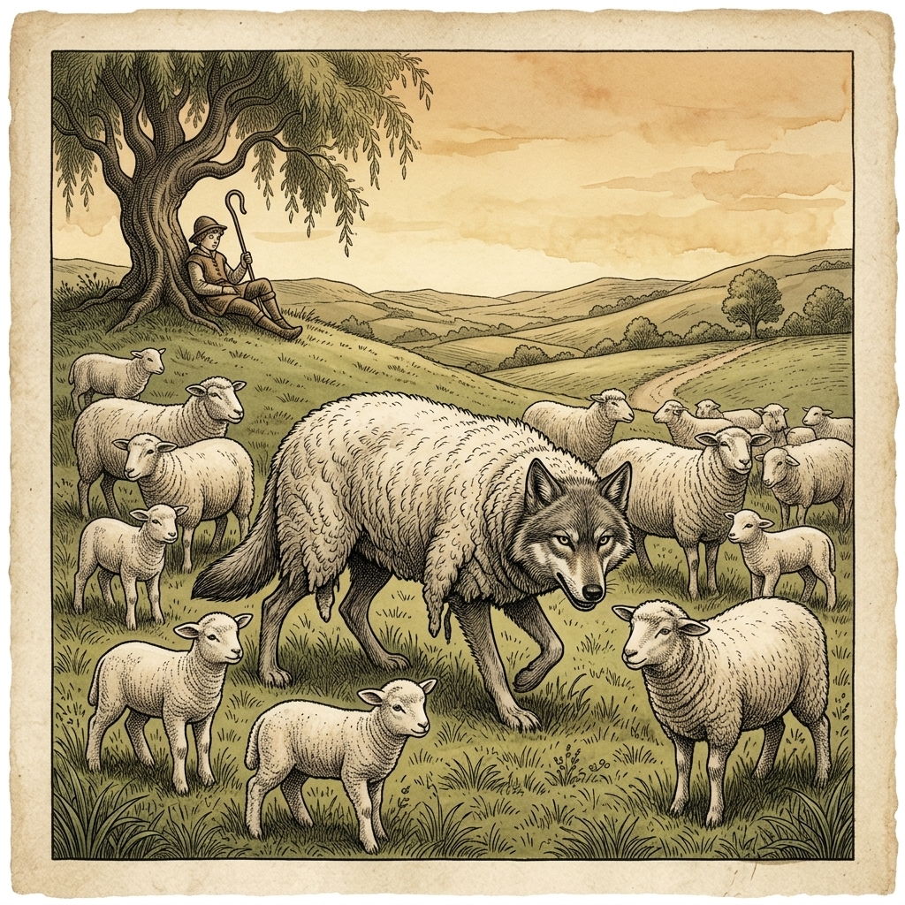

# Chapter 13: The Wolf in Sheep's Clothing (羊の皮をかぶった狼)

  

## 1. Benchmark Level: Eiken Grade 3 (英検3級レベル本文)
*Read in ~1.5 to 2 minutes. Baseline vocabulary and basic syntax.*

Once upon a time, a sly wolf was desperately searching for a way to attack a flock of sheep. However, because the shepherd and his fierce dogs kept a close watch, the wolf failed every time he tried to approach them.

One afternoon, the wolf discovered the fleece of a sheep that had been thrown away in the pasture. A wicked plan entered his mind. "If I disguise myself in this wool," he reasoned, "the shepherd will mistake me for one of his own animals."

After putting on the sheep's skin, the wolf strolled calmly among the flock. As he had expected, neither the shepherd nor the guard dogs noticed his true identity. An innocent lamb even followed him closely. Taking advantage of the opportunity, the wolf led the lamb into the forest and devoured it.

For a while, the wolf succeeded in deceiving everyone and enjoyed effortless feasts every night.

However, justice came unexpectedly. One evening, the shepherd entered the fold in the dark, intending to slaughter a sheep for his family's meal. Mistaking the disguised wolf for a fat sheep, the shepherd seized him instantly and put an end to his life.

Those who try to deceive others through fake appearances will eventually suffer the consequences.

---

## 2. Target Level: Eiken Pre-2 (英検準2級レベル本文)
*Read in ~2.5 to 3.5 minutes. Advanced vocabulary, cause-and-effect transitions, participial constructions, and formal discourse.*

A predatory wolf had long coveted a thriving flock of sheep grazing peacefully on a verdant hillside. Nevertheless, penetrating their defenses proved virtually insurmountable due to the unceasing vigilance maintained by a diligent shepherd and his formidable hounds. Frustrated by numerous thwarted incursions, the carnivore resolved to substitute cunning strategy for brute force.

While prowling along the perimeter of the pasture, the wolf stumbled upon the discarded fleece of a slaughtered sheep. Instantly recognizing the tactical utility of the pelt, he enveloped his lean frame within the woolly disguise. His objective was to fabricate an illusion of harmless docility, thereby circumventing the herdsman's suspicion.

Thus camouflaged, the intruder infiltrated the flock without exciting the slightest apprehension among the animals. Deceived by the superficial exterior, even a vulnerable lamb unhesitatingly trotted alongside the disguised carnivore, accepting him as its maternal guardian. Exploiting this misplaced trust, the wolf gently coaxed the juvenile creature into a secluded thicket and promptly devoured it. Emboldened by this effortless triumph, the predator repeated the heinous subterfuge for several consecutive days, feasting on unsuspecting livestock without detection.

Nevertheless, retribution manifested itself in an ironic and fatal manner. Late one evening, seeking provisions for the forthcoming holiday banquet, the shepherd quietly ventured into the enclosed fold armed with a carving knife. Impaired by the nocturnal gloom, the herdsman instinctively singled out the largest silhouette, erroneously presuming it to be a choice ram. Before the disguised monster could react or shed his false attire, the shepherd seized him firmly and dispatched him on the spot.

Hypocritical pretension and deceptive facades cannot indefinitely shield the wicked; those who exploit innocence under the cloak of virtue will inevitably perish by their own deceit.

---

## 3. Classic Original English Text (イソップ寓話 クラシック原文)
*Townsend / Jacobs Edition (Public Domain)*

A Wolf found great difficulty in getting at the sheep owing to the vigilance of the shepherd and his dogs. But one day it found the skin of a sheep that had been flayed and thrown aside, so it put it on over its own pelt and strolled down among the sheep. The lamb that belonged to the sheep whose skin the Wolf was wearing began to follow the Wolf; so leading the lamb a little away, he soon made a meal off her, and for some time he succeeded in deceiving the sheep, and enjoying hearty meals.

Appearances are deceptive.

---

### 🏛️ 【英検2級レベルで読み解く！クラシック原文の重要構文・英文法ノート】
1. **1. 分詞構文（Participle Clause: 付帯状況・理由）**
   - **原文**: *"The Hare, believing her assertion to be simply impossible, agreed to the proposal..."*
   - **解説**: 「〜と信じ込んでいたので」という理由を表す分詞構文。英検2級の長文読解・ライティングの最頻出構文です。
1. **2. 古典的仮定法現在（Subjunctive Mood）**
   - **原文**: *"Though you be swift as the wind, I will beat you in a race."*
   - **解説**: 譲歩節 `Though` の中で原形 `be` を用いる古典的な仮定法現在（現代英語の `Though you are...`）。格調高い古典の響きを持ちます。
1. **3. 過去分詞の後置修飾（Postpositive Participle）**
   - **原文**: *"On the day appointed for the race the two started together."*
   - **解説**: `appointed`（定められた・指定された）が直前の名詞 `the day` を後ろから修飾する構文です。

### 📜 【クラシック原文の重要語彙・古風表現（Classic Antique Vocabulary）】
- **retort** [動] 2級 **（機転を利かせて）言い返す、反論する**（現代の reply sharp/wittily に相当）
- **assertion** [名] 2級/準1級 **主張、断言**（動詞 assert の名詞形。2級長文定番）
- **wayside** [名] 2級 **道端、沿道**（by the wayside（道端に、途中で））
- **fatigue** [名] 2級 **（心身の）極度の疲労、疲れ**（tiredness の上位フォーマル語）

---

## 4. Japanese Translation (日本語訳)

捕食者である狼は、緑豊かな丘陵で平和に草を食む繁栄した羊の群れを長年つけ狙っていました。それにもかかわらず、勤勉な羊飼いとその手強い猟犬たちによって維持される不断の警戒のせいで、その防衛を突破することは事実上克服不可能な難題でした。度重なる侵入の試みが阻止され苛立ったこの肉食獣は、粗暴な力ではなく狡猾な戦略を用いることを決意しました。

牧草地の周囲をうろついている際、狼は屠殺された羊の捨てられた毛皮を偶然見つけました。毛皮の戦術的有用性を瞬時に認識した彼は、痩せた自分の身体を羊毛の偽装で包み込みました。彼の目的は無害で従順であるかのような錯覚を作り出し、それによって羊飼いの疑念を回避することでした。

このように擬態した侵入者は、動物たちの間に微塵の不安も抱かせることなく群れの中に潜入しました。表面的な外見に欺かれ、無防備な子羊までもが変装した肉食獣の隣をためらうことなく小走りで寄り添い、彼を自らの母なる保護者として受け入れたのです。この誤った信頼を利用して、狼はその幼い生き物を人里離れた茂みへと優しく誘い込み、即座に貪り食いました。この容易な勝利に気を良くした捕食者は、何日も連続してその凶悪な策略を繰り返し、疑うことを知らない家畜たちを探知されることなく食い荒らしました。

しかしながら、報いは皮肉かつ致命的な形で具現化しました。ある日の遅い夕暮れ時、間近に迫った祝祭の宴のための食糧を求め、羊飼いは解体用のナイフを手に携えて囲いの中に静かに入ってきました。夜の暗闇に視界を遮られ、羊飼いは本能的に最も大きな影を名指しし、極上の雄羊であると誤認しました。変装した怪物が反応することも、偽りの装束を脱ぎ捨てることもできないうちに、羊飼いは彼をしっかりと捕らえ、その場で息の根を止めたのです。

**教訓**: 偽善的な見せかけや欺瞞に満ちた外見が悪人を永久に守ることはできない。美徳のマントの下で無垢を搾取する者は、不可避的に自らの欺瞞によって滅びることになる。

---

## 5. Recite & Compare (そらんじたいキーフレーズ対比)
*Memorize these contrastive expressions to elevate speaking, writing, and reading fluency.*

  
■ 場面：厳しい警戒により突破困難

  
【Grade 3 基礎】 <em>because the shepherd and his fierce dogs kept a close watch...</em>

  
【Pre-2 暗唱】 <strong><em>proved virtually insurmountable due to the unceasing vigilance maintained by...</em></strong>

  
【ポイント】 <strong>解説・試験活用</strong>：形容詞 `insurmountable`（克服できない）、前置詞 `due to`、抽象名詞 `unceasing vigilance`（不断の警戒心）。準2級〜2級読解で定番の格調高い構文。

  
■ 場面：錯覚を捏造し、疑念を回避する

  
【Grade 3 基礎】 <em>disguise myself... the shepherd will mistake me for...</em>

  
【Pre-2 暗唱】 <strong><em>fabricate an illusion of docility, thereby circumventing suspicion</em></strong>

  
【ポイント】 <strong>解説・試験活用</strong>：動詞 `fabricate`（〜を捏造する・作り出す）、`circumvent`（〜を回避する）、接続副詞 `thereby`（それによって）を用いた現在分詞構文。

  
■ 場面：誤った信頼を利用して誘い出す

  
【Grade 3 基礎】 <em>Taking advantage of the opportunity, the wolf led the lamb...</em>

  
【Pre-2 暗唱】 <strong><em>Exploiting this misplaced trust, coaxed the juvenile creature into...</em></strong>

  
【ポイント】 <strong>解説・試験活用</strong>：動詞 `exploit`（〜を不当に利用・搾取する）、名詞句 `misplaced trust`（誤った信頼）、動詞 `coax`（〜を甘言で言いくるめて誘導する）。

  
■ 場面：報いが皮肉な形で訪れる

  
【Grade 3 基礎】 <em>However, justice came unexpectedly.</em>

  
【Pre-2 暗唱】 <strong><em>retribution manifested itself in an ironic and fatal manner</em></strong>

  
【ポイント】 <strong>解説・試験活用</strong>：抽象名詞 `retribution`（天罰・報い・応報）、動詞 `manifest oneself`（明白に現れる・具現化する）、形容詞 `ironic`（皮肉な）。

  
■ 場面：教訓（Moral）

  
【Grade 3 基礎】 <em>Those who try to deceive others... will suffer the consequences.</em>

  
【Pre-2 暗唱】 <strong><em>those who exploit innocence under the cloak of virtue will inevitably perish...</em></strong>

  
【ポイント】 <strong>解説・試験活用</strong>：比喩表現 `under the cloak of virtue`（美徳のマント＝仮面の下で）、動詞 `perish`（死ぬ・滅びる）。準2級エッセイの結論として最高峰の表現です。

---

## 6. Vocabulary Builder: 赤シート対応 重要単語・熟語チェック表
*※ 赤い透明シート（または赤フィルム）を重ねると、日本語訳が消えて自力テストができます。*

| No. | 見出し語 / イディオム | 品詞 / レベル | 日本語の意味（赤シートで消える） | 本文での使われ方・コロケーション |
|:---:|---|:---:|---|---|
| **01** | **proud** | [形] 4級 | 誇り高い、傲慢な | *a proud hare (自惚れたウサギ)* |
| **02** | **boast (about...)** | [動] 3級 | 〜を自慢する、誇る | *was always boasting about his speed* |
| **03** | **make fun of...** | [熟] 3級 | 〜をからかう、嘲笑する | *making fun of a slow tortoise* |
| **04** | **challenge** | [名/動] 3級 | 挑戦、課題 / 挑む | *I accept your challenge.* |
| **05** | **accept** | [動] 3級 | 受け入れる、受諾する | *accept the proposal (提案を受諾する)* |
| **06** | **dash** | [動] 3級 | 勢いよく走る、突進する | *dashed forward (前方へ駆け出した)* |
| **07** | **leave ~ behind** | [熟] 3級 | 〜を置き去りにする | *left the tortoise far behind* |
| **08** | **visible** | [形] 準2級 | 目に見える、視認できる | *was barely visible in the distance* |
| **09** | **catch up (with...)** | [熟] 3級 | 〜に追いつく | *before he catches up* |
| **10** | **slumber** | [名/動] 準2級 | 深い眠り / 眠る | *fell into a profound slumber* |
| **11** | **sprint** | [動] 3級 | 全力疾走する | *sprinted toward the finish line* |
| **12** | **persistence** | [名] 準2級/2級 | 粘り強さ、不屈の継続 | *persistence and hard work will bring success* |

### 【出題傾向・文法解説ノート】

### 【出題頻出語彙・熟語ノート】
- **insurmountable** [形] 克服できない、乗り越えられない（*insurmountable difficulties*）
- **vigilance** [名] 警戒、用心深さ（形容詞 *vigilant*）
- **circumvent** [動] （法律・疑念・困難など）を回避する、抜け道をみつける
- **apprehension** [名] 不安、心配、懸念（動詞 *apprehend*）
- **exploit** [動] （好機・弱点など）を利用する、搾取する
- **subterfuge** [名] 策略、口実、ごまかし（*cunning trick* の高度な語彙）
- **retribution** [名] 応報、天罰、報い（*divine retribution*）

### 【文法・構文ポイント】
1. **接続副詞 + 分詞構文 [thereby + -ing]（それによって〜する）**
   - 準2級本文: *"to fabricate an illusion of harmless docility, thereby circumventing the herdsman's suspicion."*
   - ポイント: 行動の結果や目的を説明する準2級〜2級頻出の構文。文脈を論理的かつ滑らかに繋ぎます。
2. **抽象名詞主語構文 [Retribution manifested itself ...]**
   - 準2級本文: *"retribution manifested itself in an ironic and fatal manner."*
   - ポイント: 再帰代名詞 `manifest oneself`（〜が姿を現す）を用いて「報いが訪れた」を文学的・説得力豊かに描写する構文です。
