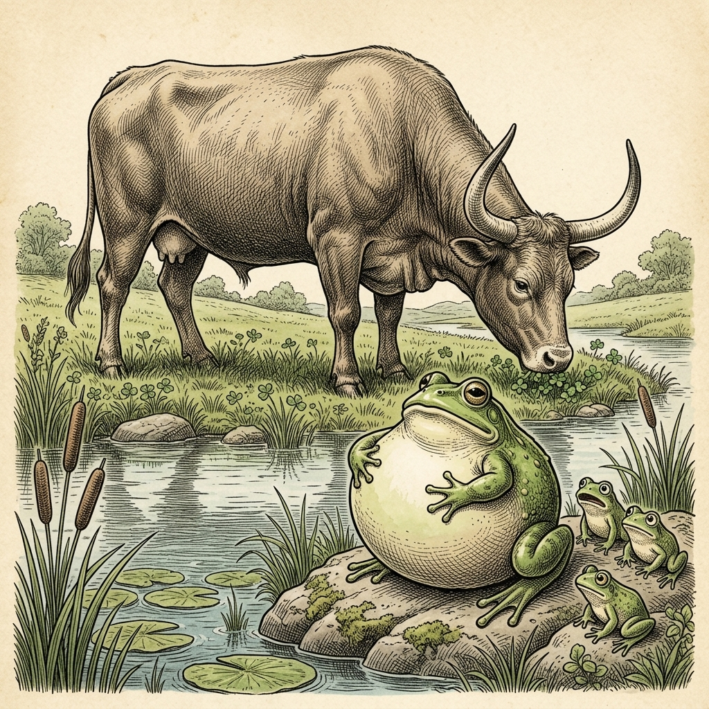

# Chapter 15: The Frog and the Ox (カエルと牛)

  

## 1. Benchmark Level: Eiken Grade 3 (英検3級レベル本文)
*Read in ~1.5 to 2 minutes. Baseline vocabulary and basic syntax.*

An old mother frog, who was famous for her pride, lived near a quiet meadow with her young children. One morning, an enormous ox stepped into the pond to quench his thirst.

After the ox departed, the terrified young frogs hurried back to their mother. "Mother! We just saw the largest creature in the world!" they exclaimed. "His body was truly massive!"

Unwilling to admit that any creature could be far grander than herself, the mother frog replied haughtily, "Nonsense! I can easily make myself just as big as that beast."

She took a deep breath and expanded her body as much as possible. "Was he as large as this?" she inquired.

"No, Mother! He was vastly larger than that!" the children insisted.

Annoyed by their response, the mother frog inhaled even more air, puffing herself out to double her original size. "How about now? Am I not equal to him?"

"If you try to compare yourself to the ox, you will only hurt yourself!" warned her children.

Ignoring their sensible advice, the foolish mother frog inhaled with all her remaining strength. She puffed and stretched until—BOOM! Her skin tore apart, and she burst completely.

Foolish vanity will eventually lead to self-destruction.

---

## 2. Target Level: Eiken Pre-2 (英検準2級レベル本文)
*Read in ~2.5 to 3.5 minutes. Advanced vocabulary, cause-and-effect transitions, participial constructions, and formal discourse.*

A venerable matriarch of a frog colony resided alongside a tranquil marsh, notorious among her peers for an inflated sense of self-importance. One sultry afternoon, a colossal ox strolled down to the water's edge to drink, inadvertently crushing several small plants and shaking the surrounding soil with his ponderous steps.

Witnessing this display of sheer magnitude, the juvenile frogs fled in terror to their mother. "Mother, we have just encountered an incomprehensible behemoth!" they cried in trembling tones. "His limbs were as stout as oak trunks, and his stature rivaled a small mountain!"

Incapable of tolerating the notion that any entity could overshadow her own prestige, the conceited amphibian dismissed their description with contemptuous disdain. "You are merely exaggerating," she scoffed. "With a modest exertion of willpower, I can readily distend my physique to match that ungainly quadrupeds."

Taking a profound inhalation, she stretched her elastic hide, puffing her torso into an awkward sphere. "Behold!" she proclaimed proudly. "Does the intruder surpass this magnitude?"

"By an immense margin, Mother!" her offspring exclaimed candidly. "Your present dimension is negligible in comparison to that monster!"

Infuriated by their contradiction, the obstinate mother redoubled her efforts. Drawing vast quantities of atmosphere into her lungs, she expanded her membranes to a perilous degree, straining her abdominal tissues beyond their natural elasticity. "Surely, I have now achieved parity!" she wheezed through clenched jaws.

"Cease this madness, Mother!" pleaded her terrified offspring. "Even if you were to rupture your own flesh, you could never equal the ox!"

Deaf to their desperate supplications and dominated entirely by irrational narcissism, the delusional creature drew one final, violent breath. Incapable of withstanding the immense internal pressure, her fragile body abruptly exploded with a sickening snap.

Pretentious vanity that refuses to acknowledge natural limitations will inevitably culminate in catastrophic self-annihilation.

---

## 3. Classic Original English Text (イソップ寓話 クラシック原文)
*Townsend / Jacobs Edition (Public Domain)*

An Ox, drinking at a pool, stepped on a family of young frogs and crushed one of them to death. When the mother frog came home, she asked where her little one was. "A huge beast came by," said one of the brothers, "and crushed him under his big foot." "How big was he?" asked the mother frog, puffing herself out. "Was he as big as this?" "Oh, much bigger than that!" replied the young frog. The mother puffed herself out more and more, asking, "Was he this big?" "Cease your puffing, mother," said the son, "for if you burst yourself, you will never equal the beast." But the foolish frog tried once more, blew herself up even bigger, and burst!

Self-conceit may lead to self-destruction.

---

### 🏛️ 【英検2級レベルで読み解く！クラシック原文の重要構文・英文法ノート】
1. **1. 分詞構文（Participle Clause: 付帯状況・理由）**
   - **原文**: *"The Hare, believing her assertion to be simply impossible, agreed to the proposal..."*
   - **解説**: 「〜と信じ込んでいたので」という理由を表す分詞構文。英検2級の長文読解・ライティングの最頻出構文です。
1. **2. 古典的仮定法現在（Subjunctive Mood）**
   - **原文**: *"Though you be swift as the wind, I will beat you in a race."*
   - **解説**: 譲歩節 `Though` の中で原形 `be` を用いる古典的な仮定法現在（現代英語の `Though you are...`）。格調高い古典の響きを持ちます。
1. **3. 過去分詞の後置修飾（Postpositive Participle）**
   - **原文**: *"On the day appointed for the race the two started together."*
   - **解説**: `appointed`（定められた・指定された）が直前の名詞 `the day` を後ろから修飾する構文です。

### 📜 【クラシック原文の重要語彙・古風表現（Classic Antique Vocabulary）】
- **retort** [動] 2級 **（機転を利かせて）言い返す、反論する**（現代の reply sharp/wittily に相当）
- **assertion** [名] 2級/準1級 **主張、断言**（動詞 assert の名詞形。2級長文定番）
- **wayside** [名] 2級 **道端、沿道**（by the wayside（道端に、途中で））
- **fatigue** [名] 2級 **（心身の）極度の疲労、疲れ**（tiredness の上位フォーマル語）

---

## 4. Japanese Translation (日本語訳)

あるカエルのコロニーの長老である母ガエルが、静かな沼地のそばに住んでいましたが、自尊心の肥大化によって仲間たちの間では悪名高い存在でした。ある蒸し暑い午後、巨大な牛が水を飲むために水辺へと歩み寄り、不注意にもいくつかの小さな植物を踏みつぶし、その重々しい足取りで周囲の地面を揺らしました。

この圧倒的な巨大さの誇示を目撃した幼いカエルたちは、恐怖におののきながら母親の元へと逃げ帰りました。「お母さん、僕たち今、理解不能なほどの巨大怪物に出くわしたよ！」と彼らは震える声で叫びました。「あいつの手足は樫の木の幹のように太く、その背丈は小さな山に匹敵していたんだ！」

いかなる存在であれ自らの威信に影を落とすという考えを容認できなかったうぬぼれの強い両生類は、軽蔑的な冷笑をもって彼らの描写を一蹴しました。「お前たちは大げさに言っているだけですよ」と彼女は嘲笑しました。「少しの気力を奮い起こせば、あのような不格好な四足獣に匹敵するよう、自分の体を容易に膨張させることができます。」

深く息を吸い込み、彼女は弾力性のある皮を伸ばし、自らの胴体を不格好な球体へと膨らませました。「ご覧なさい！」と彼女は誇らしげに宣言しました。「侵入者はこの大きさを超えているかい？」

「とてつもない大差で超えているよ、お母さん！」と子供たちは率直に叫びました。「そのモンスターと比べたら、お母さんの今の大きさなんて取るに足らないよ！」

彼らの反論に激怒した頑固な母親は、努力を倍加させました。膨大な量の大気を肺へと吸い込み、彼女は皮膜を危険な領域まで拡張し、腹部の組織を自然の弾力性の限界を超えて引き絞りました。「間違いなく、これで同等に達したはずだ！」と彼女は食いしばった顎の隙間から喘ぎました。

「この狂気をやめて、お母さん！」と怯えた子供たちは懇願しました。「たとえ自分自身の肉体を引き裂いたとしても、決して牛と同等にはなれないよ！」

彼らの必死の哀願に耳を貸さず、非合理的な自己愛に完全に支配されたこの妄想的な生き物は、最後の一撃となる激しい息を吸い込みました。莫大な体内圧力に耐えることができず、彼女の脆い肉体は嫌な破裂音とともに突然爆発したのです。

**教訓**: 自然の限界を認めることを拒む虚飾に満ちた虚栄心は、必然的に破滅的な自己消滅へと至る。

---

## 5. Recite & Compare (そらんじたいキーフレーズ対比)
*Memorize these contrastive expressions to elevate speaking, writing, and reading fluency.*

  
■ 場面：肥大化した自尊心と他者を軽んじる態度

  
【Grade 3 基礎】 <em>Unwilling to admit that any creature could be far grander...</em>

  
【Pre-2 暗唱】 <strong><em>Incapable of tolerating the notion that any entity could overshadow her prestige...</em></strong>

  
【ポイント】 <strong>解説・試験活用</strong>：構文 `Incapable of -ing`（〜することができない）と動詞 `overshadow`（〜の影を薄くする・凌駕する）、名詞 `prestige`（名声・威信）。

  
■ 場面：不格好に膨張させる

  
【Grade 3 基礎】 <em>expanded her body as much as possible</em>

  
【Pre-2 暗唱】 <strong><em>distend my physique... puffing her torso into an awkward sphere</em></strong>

  
【ポイント】 <strong>解説・試験活用</strong>：動詞 `distend`（〜を膨張させる）、名詞 `physique`（体格・肉体）、`torso`（胴体）、`sphere`（球体）。

  
■ 場面：圧倒的な大差で凌駕する

  
【Grade 3 基礎】 <em>vastly larger than that</em>

  
【Pre-2 暗唱】 <strong><em>surpass this magnitude by an immense margin</em></strong>

  
【ポイント】 <strong>解説・試験活用</strong>：動詞 `surpass`（〜を凌駕する・超える）と前置詞句 `by an immense margin`（とてつもない大差で）。データ・比較論評に必須。

  
■ 場面：対等・同等に達したと主張する

  
【Grade 3 基礎】 <em>Am I not equal to him?</em>

  
【Pre-2 暗唱】 <strong><em>achieved parity... straining tissues beyond natural elasticity</em></strong>

  
【ポイント】 <strong>解説・試験活用</strong>：名詞 `parity`（同等・同格・均等）と動詞句 `achieve parity`（同等を達成する）。政治・経済・社会系試験頻出。

  
■ 場面：教訓（Moral）

  
【Grade 3 基礎】 <em>Foolish vanity will eventually lead to self-destruction.</em>

  
【Pre-2 暗唱】 <strong><em>Pretentious vanity that refuses to acknowledge limitations will culminate in...</em></strong>

  
【ポイント】 <strong>解説・試験活用</strong>：動詞 `culminate in...`（最終的に〜に至る・結実する）と名詞 `self-annihilation`（自己消滅・自滅）。最上級のエッセイ表現。

---

## 6. Vocabulary Builder: 赤シート対応 重要単語・熟語チェック表
*※ 赤い透明シート（または赤フィルム）を重ねると、日本語訳が消えて自力テストができます。*

| No. | 見出し語 / イディオム | 品詞 / レベル | 日本語の意味（赤シートで消える） | 本文での使われ方・コロケーション |
|:---:|---|:---:|---|---|
| **01** | **proud** | [形] 4級 | 誇り高い、傲慢な | *a proud hare (自惚れたウサギ)* |
| **02** | **boast (about...)** | [動] 3級 | 〜を自慢する、誇る | *was always boasting about his speed* |
| **03** | **make fun of...** | [熟] 3級 | 〜をからかう、嘲笑する | *making fun of a slow tortoise* |
| **04** | **challenge** | [名/動] 3級 | 挑戦、課題 / 挑む | *I accept your challenge.* |
| **05** | **accept** | [動] 3級 | 受け入れる、受諾する | *accept the proposal (提案を受諾する)* |
| **06** | **dash** | [動] 3級 | 勢いよく走る、突進する | *dashed forward (前方へ駆け出した)* |
| **07** | **leave ~ behind** | [熟] 3級 | 〜を置き去りにする | *left the tortoise far behind* |
| **08** | **visible** | [形] 準2級 | 目に見える、視認できる | *was barely visible in the distance* |
| **09** | **catch up (with...)** | [熟] 3級 | 〜に追いつく | *before he catches up* |
| **10** | **slumber** | [名/動] 準2級 | 深い眠り / 眠る | *fell into a profound slumber* |
| **11** | **sprint** | [動] 3級 | 全力疾走する | *sprinted toward the finish line* |
| **12** | **persistence** | [名] 準2級/2級 | 粘り強さ、不屈の継続 | *persistence and hard work will bring success* |

### 【出題傾向・文法解説ノート】

### 【出題頻出語彙・熟語ノート】
- **colossal** [形] 巨大な、途方もない（＝*gigantic*, *enormous*）
- **overshadow** [動] （〜の）影を薄くする、凌駕する（*be overshadowed by...*）
- **surpass** [動] （〜を）超える、凌ぐ（*surpass expectations*「予想を上回る」）
- **margin** [名] 差、余白（*by a wide/narrow margin*「大差／僅差で」）
- **parity** [名] 同等、均等、同格（*achieve/reach parity*）
- **culminate in...** [熟] （最終的に）〜に至る、〜で最高潮に達する
- **annihilation** [名] 絶滅、消滅、全滅（動詞 *annihilate*）

### 【文法・構文ポイント】
1. **仮定法過去完了の変形 [Even if you were to + 動詞原形]（たとえ〜するようなことがあっても）**
   - 準2級本文: *"Even if you were to rupture your own flesh, you could never equal the ox!"*
   - ポイント: 「万が一〜だとしても」という非現実的な仮定を提示する仮定法構文。強い警告や不可能性の強調に用いられます。
2. **無生物主語構文 [Pretentious vanity ... will culminate in ...]**
   - 準2級本文: *"Pretentious vanity that refuses to acknowledge natural limitations will inevitably culminate in catastrophic self-annihilation."*
   - ポイント: 主語に抽象名詞を置き、動詞 `culminate in` で不可避的な結末を論理的に結びつける準2級〜2級模範構文です。
