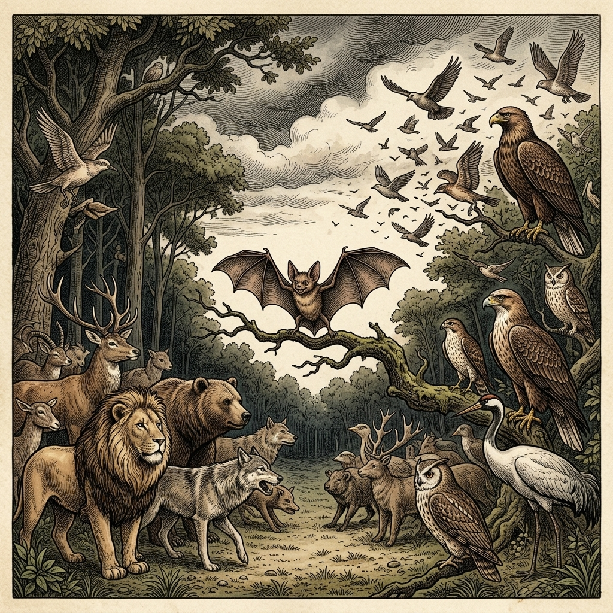

# Chapter 16: The Bat, the Birds, and the Beasts (コウモリと鳥と獣)

  

## 1. Benchmark Level: Eiken Grade 3 (英検3級レベル本文)
*Read in ~1.5 to 2 minutes. Baseline vocabulary and basic syntax.*

Once upon a time, a fierce conflict broke out between the birds of the air and the beasts of the field. Being timid and selfish, a bat decided to remain neutral until he was certain which side would emerge victorious.

In the beginning, the birds seemed to have the advantage. Seeing their success, the bat flew over to the birds and declared, "I am clearly one of you! Look at my broad wings." The birds accepted him as a comrade.

However, as the war continued, the beasts gained the upper hand. The sly bat immediately changed his loyalty and joined the beasts. "I am definitely a beast," he claimed. "Look at my sharp teeth and fur! Birds do not have teeth." The beasts welcomed him into their army.

When the long conflict finally came to an end, the birds and beasts signed a peace treaty. As they shared their experiences, they soon uncovered the bat's deceitful behavior.

Disgusted by his dishonesty, both groups rejected the bat completely and banished him from their territories.

Ever since, the bat has been forced to live in dark caves, flying silently only after nightfall to avoid being seen.

Those who try to stand on both sides will eventually find themselves isolated from everyone.

---

## 2. Target Level: Eiken Pre-2 (英検準2級レベル本文)
*Read in ~2.5 to 3.5 minutes. Advanced vocabulary, cause-and-effect transitions, participial constructions, and formal discourse.*

A devastating warfare erupted between the feathered avian populations of the skies and the terrestrial quadrupeds inhabiting the forests. Motivated exclusively by cowardly self-preservation, an opportunistic bat resolved to adopt a stance of ambiguous neutrality, adamantly refusing to commit his allegiance until the final outcome of the hostilities became unmistakable.

During the initial skirmishes, the aerial forces inflicted substantial casualties upon their ground-based adversaries. Observing that the birds had secured a commanding tactical advantage, the bat descended among their ranks, triumphantly exhibiting his membranous pinions. "Behold my magnificent wings!" he proclaimed enthusiastically. "Undoubtedly, my biological lineage aligns me with the feathered kingdom." Welcoming this seemingly loyal recruit, the flock embraced him without skepticism.

Nevertheless, the fortunes of war shifted dramatically when the beasts consolidated their legions and mounted a ferocious counteroffensive. Recognizing that the terrestrial forces were rapidly gaining the upper hand, the unprincipled opportunist defected without the slightest hesitation. Presenting himself before the commanding beasts, he ostentatiously displayed his razor-sharp dentition and furry hide. "Do not be misled by my appendages," he insisted persuasively. "True birds possess neither teeth nor mammalian fur; therefore, I am an unequivocal beast." Readily convinced by his cunning rationalization, the beasts admitted him into their confederation.

Eventually, both factions negotiated a diplomatic reconciliation, signing a comprehensive peace treaty to terminate the protracted hostilities. During the subsequent festivities, delegates from both realms compared intelligence, promptly exposing the bat's duplicitous maneuvers.

Revolted by such shameless perfidy, both communities formally condemned the traitor and permanently stripped him of citizenship within their sovereign borders. Ostracized by all living creatures, the disowned outcast was driven into subterranean caverns, condemned to nocturnal obscurity and eternal solitude.

Unprincipled opportunism may yield temporary advantages, but chronic disloyalty inevitably results in total alienation and universal contempt.

---

## 3. Classic Original English Text (イソップ寓話 クラシック原文)
*Townsend / Jacobs Edition (Public Domain)*

A great battle was about to be fought between the Birds and the Beasts. The Bat, fearing the result, stayed away and waited to see which side would win. When the Birds were winning, the Bat flew among them, claiming to be a bird because he had wings. Later, when the Beasts gained the upper hand, the Bat went over to them, claiming to be a beast because he had teeth and fur. But when peace was declared, both sides recognized his deceit. Ashamed and rejected by all, the Bat was forced to hide in dark caves, flying only at night.

He that is friend to all is friend to none.

---

### 🏛️ 【英検2級レベルで読み解く！クラシック原文の重要構文・英文法ノート】
1. **1. 分詞構文（Participle Clause: 付帯状況・理由）**
   - **原文**: *"The Hare, believing her assertion to be simply impossible, agreed to the proposal..."*
   - **解説**: 「〜と信じ込んでいたので」という理由を表す分詞構文。英検2級の長文読解・ライティングの最頻出構文です。
1. **2. 古典的仮定法現在（Subjunctive Mood）**
   - **原文**: *"Though you be swift as the wind, I will beat you in a race."*
   - **解説**: 譲歩節 `Though` の中で原形 `be` を用いる古典的な仮定法現在（現代英語の `Though you are...`）。格調高い古典の響きを持ちます。
1. **3. 過去分詞の後置修飾（Postpositive Participle）**
   - **原文**: *"On the day appointed for the race the two started together."*
   - **解説**: `appointed`（定められた・指定された）が直前の名詞 `the day` を後ろから修飾する構文です。

### 📜 【クラシック原文の重要語彙・古風表現（Classic Antique Vocabulary）】
- **retort** [動] 2級 **（機転を利かせて）言い返す、反論する**（現代の reply sharp/wittily に相当）
- **assertion** [名] 2級/準1級 **主張、断言**（動詞 assert の名詞形。2級長文定番）
- **wayside** [名] 2級 **道端、沿道**（by the wayside（道端に、途中で））
- **fatigue** [名] 2級 **（心身の）極度の疲労、疲れ**（tiredness の上位フォーマル語）

---

## 4. Japanese Translation (日本語訳)

空を舞う羽毛ある鳥類の集団と、森林に生息する陸生の四足獣たちとの間で、壊滅的な戦争が勃発しました。卑怯な自己保身のみに動機づけられた日和見主義のコウモリは、戦闘の最終結果が明白になるまで自らの忠誠を誓うことを頑なに拒み、曖昧な中立の立場を採用することを決意しました。

緒戦において、空の軍勢は地上を拠点とする敵勢力に甚大な損害を与えました。鳥たちが圧倒的な戦術的優位を確保したのを目撃すると、コウモリは彼らの隊列の中に舞い降り、誇らしげに膜状の翼を誇示しました。「私の見事な翼をご覧ください！」と彼は熱烈に宣言しました。「間違いなく、私の生物学的血統は私を羽毛の王国へと位置づけています。」この一見忠誠心の高そうな新兵を歓迎し、群れは懐疑の念を抱くことなく彼を受け入れました。

それにもかかわらず、獣たちが軍団を結集して獰猛な反撃を開始すると、戦況は劇的に逆転しました。陸生の軍勢が急速に優位に立っていることを認識すると、この節操のない日和見主義者は、微塵の躊躇もなく寝返りました。指揮を執る獣たちの前に進み出ると、彼は剃刀のように鋭い歯列と毛皮を仰々しく見せつけました。「私の付属器官に惑わされてはなりません」と彼は説得力たっぷりに主張しました。「真の鳥類は歯も哺乳類の毛皮も持っていません。したがって、私は紛れもない獣です。」彼の狡猾な自己正当化に容易に納得し、獣たちは自らの同盟の中に彼を受け入れました。

やがて両陣営は外交的な和解を交渉し、長期にわたる戦闘に終止符を打つ包括的な平和条約に署名しました。その後の祝祭の席で、双方の代表団が情報を突き合わせ、コウモリの二枚舌の策略を瞬時に暴きました。

このような恥知らずな背信行為に憤慨した両共同体は、裏切り者を公式に非難し、自らの主権的領土における市民権を永久に剥奪しました。すべての生き物から追放されたこの見捨てられた落伍者は、地下の洞窟へと追いやられ、夜の暗闇と永遠の孤独の中で生きることを宣告されたのです。

**教訓**: 節操のない日和見主義は一時的な利益をもたらすかもしれないが、度重なる不誠実は必然的に完全な孤立と普遍的な軽蔑という結果をもたらす。

---

## 5. Recite & Compare (そらんじたいキーフレーズ対比)
*Memorize these contrastive expressions to elevate speaking, writing, and reading fluency.*

  
■ 場面：曖昧な中立を保ち、忠誠を保留する

  
【Grade 3 基礎】 <em>decided to remain neutral until he was certain...</em>

  
【Pre-2 暗唱】 <strong><em>adopt a stance of ambiguous neutrality, refusing to commit allegiance...</em></strong>

  
【ポイント】 <strong>解説・試験活用</strong>：名詞句 `stance of ambiguous neutrality`（曖昧な中立の立場）と動詞句 `commit one's allegiance`（忠誠を誓う・コミットする）。

  
■ 場面：躊躇なく寝返る・背信

  
【Grade 3 基礎】 <em>immediately changed his loyalty and joined the beasts</em>

  
【Pre-2 暗唱】 <strong><em>unprincipled opportunist defected without the slightest hesitation</em></strong>

  
【ポイント】 <strong>解説・試験活用</strong>：形容詞 `unprincipled`（節操のない・無節操な）、名詞 `opportunist`（日和見主義者）、動詞 `defect`（寝返る・亡命する）。

  
■ 場面：二枚舌の策略を暴く

  
【Grade 3 基礎】 <em>soon uncovered the bat's deceitful behavior</em>

  
【Pre-2 暗唱】 <strong><em>compared intelligence, promptly exposing duplicitous maneuvers</em></strong>

  
【ポイント】 <strong>解説・試験活用</strong>：動詞句 `compare intelligence`（情報を突き合わせる）、`expose`（〜を暴露する）、形容詞 `duplicitous`（二枚舌の・詐欺的な）。

  
■ 場面：社会から完全に追放・排斥される

  
【Grade 3 基礎】 <em>rejected the bat completely and banished him...</em>

  
【Pre-2 暗唱】 <strong><em>Ostracized by all living creatures, disowned outcast was driven into...</em></strong>

  
【ポイント】 <strong>解説・試験活用</strong>：過去分詞構文 `Ostracized by...`（〜によって社会的に追放・村八分にされて）、名詞 `outcast`（追放者・落伍者）。

  
■ 場面：教訓（Moral）

  
【Grade 3 基礎】 <em>Those who try to stand on both sides will find themselves isolated...</em>

  
【Pre-2 暗唱】 <strong><em>Unprincipled opportunism may yield temporary advantages, but chronic disloyalty results in total alienation...</em></strong>

  
【ポイント】 <strong>解説・試験活用</strong>：対比構文 `A may yield B, but C results in D`。抽象名詞 `alienation`（疎外・孤立）と `contempt`（軽蔑）。

---

## 6. Vocabulary Builder: 赤シート対応 重要単語・熟語チェック表
*※ 赤い透明シート（または赤フィルム）を重ねると、日本語訳が消えて自力テストができます。*

| No. | 見出し語 / イディオム | 品詞 / レベル | 日本語の意味（赤シートで消える） | 本文での使われ方・コロケーション |
|:---:|---|:---:|---|---|
| **01** | **proud** | [形] 4級 | 誇り高い、傲慢な | *a proud hare (自惚れたウサギ)* |
| **02** | **boast (about...)** | [動] 3級 | 〜を自慢する、誇る | *was always boasting about his speed* |
| **03** | **make fun of...** | [熟] 3級 | 〜をからかう、嘲笑する | *making fun of a slow tortoise* |
| **04** | **challenge** | [名/動] 3級 | 挑戦、課題 / 挑む | *I accept your challenge.* |
| **05** | **accept** | [動] 3級 | 受け入れる、受諾する | *accept the proposal (提案を受諾する)* |
| **06** | **dash** | [動] 3級 | 勢いよく走る、突進する | *dashed forward (前方へ駆け出した)* |
| **07** | **leave ~ behind** | [熟] 3級 | 〜を置き去りにする | *left the tortoise far behind* |
| **08** | **visible** | [形] 準2級 | 目に見える、視認できる | *was barely visible in the distance* |
| **09** | **catch up (with...)** | [熟] 3級 | 〜に追いつく | *before he catches up* |
| **10** | **slumber** | [名/動] 準2級 | 深い眠り / 眠る | *fell into a profound slumber* |
| **11** | **sprint** | [動] 3級 | 全力疾走する | *sprinted toward the finish line* |
| **12** | **persistence** | [名] 準2級/2級 | 粘り強さ、不屈の継続 | *persistence and hard work will bring success* |

### 【出題傾向・文法解説ノート】

### 【出題頻出語彙・熟語ノート】
- **allegiance** [名] 忠誠、帰属意識（*pledge/commit allegiance*）
- **defect** [動] （主義・国・味方から）寝返る、離脱する
- **reconciliation** [名] 和解、調停（動詞 *reconcile*）
- **duplicitous** [形] 二枚舌の、不誠実な（名詞 *duplicity*）
- **ostracize** [動] （集団・社会から）追放する、排斥する（名詞 *ostracism*）
- **alienation** [名] 疎外、孤立、離反（動詞 *alienate*）
- **contempt** [名] 軽蔑、侮蔑（形容詞 *contemptuous*）

### 【文法・構文ポイント】
1. **譲歩と対比の構文 [May yield ..., but ...]（〜をもたらすかもしれないが、…である）**
   - 準2級本文: *"Unprincipled opportunism may yield temporary advantages, but chronic disloyalty inevitably results in total alienation..."*
   - ポイント: 助動詞 `may` で一旦譲歩し、等位接続詞 `but` 以下で真の主張・結論を展開するエッセイの黄金パターンです。
2. **過去分詞による理由の分詞構文 [Ostracized by ...]**
   - 準2級本文: *"Ostracized by all living creatures, the disowned outcast was driven into subterranean caverns..."*
   - ポイント: 主語に対する状態や原因を文頭で簡潔に提示し、文全体の劇的な印象を高める高度な分詞構文です。
