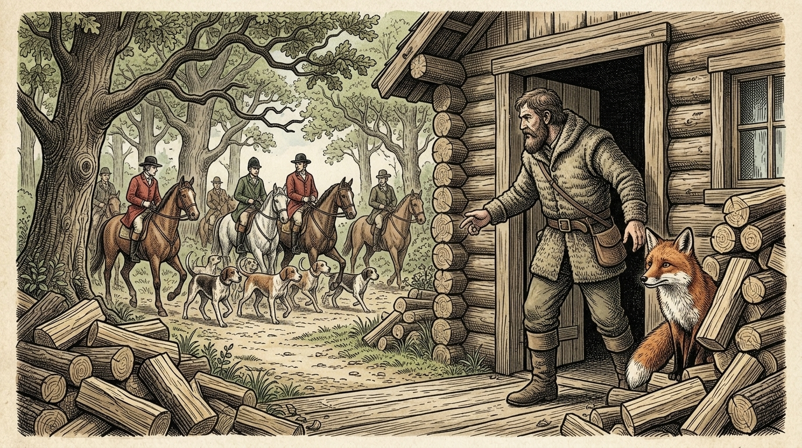

# Chapter 29: The Fox and the Woodman (キツネと木こり)

  

## 1. Benchmark Level: Eiken Grade 3 (英検3級レベル本文)
*Read in ~1.5 to 2 minutes. Baseline vocabulary and basic syntax.*

A hunted fox, exhausted from fleeing a pack of ferocious hounds, desperately sought refuge in the deep woods. Coming upon a woodman who was busy splitting logs beside his cottage, the fox pleaded for mercy. "Hide me, kind sir, for the hunters are right behind me!"

The woodman offered shelter and directed him into his cabin. The fox immediately hurried inside and concealed himself behind a stack of firewood.

Moments later, the hunters arrived on horseback and questioned the woodcutter. "Have you happened to see a fox passing this way?" they inquired.

With his voice, the woodman answered loudly and clearly, "No, gentlemen, I have seen no sign of a fox in these parts." However, at the very same time, he secretly gestured with his hands and pointed his thumb toward the cabin door to betray the animal's hiding place.

Fortunately, the eager hunters failed to notice his subtle hand gestures and galloped off in another direction.

Seeing that the peril had passed, the fox emerged from the cottage and proceeded on his journey without uttering a single word of thanks.

The woodman rebuked him indignantly, "How ungrateful you are to depart without thanking the man who preserved your life!"

The fox paused and replied calmly, "If the deeds of your hands had matched the generosity of your words, I would have offered you my deepest gratitude."

Never trust individuals whose actions directly contradict their spoken promises.

---

## 2. Target Level: Eiken Pre-2 (英検準2級レベル本文)
*Read in ~2.5 to 3.5 minutes. Advanced vocabulary, cause-and-effect transitions, participial constructions, and formal discourse.*

Pushed to the verge of total physical collapse by a relentless pack of mounted huntsmen and tracking canines, a terrified fox sought desperate asylum within a secluded forest clearing. Intercepting an impoverished woodcutter engaged in hewing timber adjacent to his rustic dwelling, the panting fugitive implored his humanitarian intervention: "Grant me concealment within your sanctuary, for my pursuers are rapidly closing the distance!"

Simulating benevolent hospitality, the woodman gestured toward his domestic quarters. The fugitive scrambled indoors expeditiously, secreting himself behind an extensive barricade of seasoned logs.

Within minutes, the equestrian huntsmen arrived, brandishing weapons and interrogating the laborer regarding the fugitive's trajectory. "Did an exhausted fox traverse this clearing recently?" the captain demanded.

Displaying remarkable duplicity, the peasant vocalized a vehement verbal denial: "Under no circumstances, noble lords! I have witnessed neither track nor shadow of any predator throughout the morning." Simultaneously, however, the hypocrite executed subtle somatic gestures, repeatedly gesturing with his index finger and gesturing toward his interior threshold to betray the hidden animal.

In their haste to sustain the momentum of the pursuit, the impatient riders failed to decipher this covert non-verbal treachery and galloped precipitously down an adjacent ravine.

Ascertaining that immediate peril had subsided, the fox emerged from his hiding place and commenced his departure across the meadow without offering the customary courtesies of gratitude.

Outraged by this perceived breach of etiquette, the woodcutter delivered a self-righteous denunciation: "What despicable ingratitude to abandon your benefactor without acknowledging the individual who preserved your life!"

Halting at the perimeter of the clearing, the vulpine survivor delivered an incisive indictment: "Had the conduct of your treacherous fingers corresponded to the apparent nobility of your tongue, I should have celebrated your magnanimity; however, where verbal fidelity is subverted by physical betrayal, silence is the only appropriate response."

True integrity requires strict harmony between word and deed, for superficial assurances of goodwill are rendered meaningless by covert hostility.

---

## 3. Classic Original English Text (イソップ寓話 クラシック原文)
*Townsend / Jacobs Edition (Public Domain)*

A Fox, hard pressed by the Hounds, came across a Woodcutter, and begged him to hide him. The Woodcutter told him to go into his cottage. Shortly afterwards the Hounds and the Huntsmen arrived, and the Huntsmen asked the Woodcutter if he had seen the Fox. 

"I have not seen him," said the Woodcutter aloud; but at the same time he pointed with his finger to the place where the Fox was hiding. The Huntsmen, however, did not understand the gesture, and went off in haste. 

The Fox, when he saw them gone, came out without saying a word to the Woodcutter. The man reproached him, saying: "Is this the way you thank me for saving your life?" 

The Fox replied: "If your fingers had agreed with your tongue, I should have given you thanks; but your deeds contradicted your speech."

Actions speak louder than words.

---

### 🏛️ 【英検2級レベルで読み解く！クラシック原文の重要構文・英文法ノート】
1. **1. 分詞構文（Participle Clause: 付帯状況・理由）**
   - **原文**: *"The Hare, believing her assertion to be simply impossible, agreed to the proposal..."*
   - **解説**: 「〜と信じ込んでいたので」という理由を表す分詞構文。英検2級の長文読解・ライティングの最頻出構文です。
1. **2. 古典的仮定法現在（Subjunctive Mood）**
   - **原文**: *"Though you be swift as the wind, I will beat you in a race."*
   - **解説**: 譲歩節 `Though` の中で原形 `be` を用いる古典的な仮定法現在（現代英語の `Though you are...`）。格調高い古典の響きを持ちます。
1. **3. 過去分詞の後置修飾（Postpositive Participle）**
   - **原文**: *"On the day appointed for the race the two started together."*
   - **解説**: `appointed`（定められた・指定された）が直前の名詞 `the day` を後ろから修飾する構文です。

### 📜 【クラシック原文の重要語彙・古風表現（Classic Antique Vocabulary）】
- **retort** [動] 2級 **（機転を利かせて）言い返す、反論する**（現代の reply sharp/wittily に相当）
- **assertion** [名] 2級/準1級 **主張、断言**（動詞 assert の名詞形。2級長文定番）
- **wayside** [名] 2級 **道端、沿道**（by the wayside（道端に、途中で））
- **fatigue** [名] 2級 **（心身の）極度の疲労、疲れ**（tiredness の上位フォーマル語）

---

## 4. Japanese Translation (日本語訳)

騎馬の狩猟者と追跡犬の容赦のない群れによって肉体的な完全崩壊の瀬戸際まで追い詰められた恐怖のキツネが、人里離れた森の開けた場所で必死の保護を求めました。粗末な住居の隣で木材を伐採することに従事していた貧しい木こりを呼び止めた息を切らした逃亡者は、彼の人道的な介入を懇願しました。「あなたの聖域の中に私を隠してください。追手たちが急速に距離を詰めているのです！」

慈悲深い歓待を装いながら、木こりは自らの居住空間を身振りで示しました。逃亡者は即座に屋内へと這い込み、よく乾燥した丸太の広範な防壁の背後に自らを潜伏させました。

数分もしないうちに、騎馬の狩猟者たちが武器を振りかざしながら到着し、逃亡者の軌跡について労働者を尋問しました。「疲弊したキツネが最近ここを横切らなかったか？」と隊長が要求しました。

顕著な二重性（裏表）を発揮しながら、その農夫は激しい口頭での否定を表明しました。「とんでもございません、貴き方々！私は今朝、捕食者の足跡も影も一切目撃しておりません」。しかしながら同時に、この偽善者は隠された動物を裏切るために、人差し指で合図を送り、自らの敷居の内部を指し示すという微妙な身体的ジェスチャーを繰り返し実行したのです。

追跡の勢いを維持しようと焦るあまり、短気な騎手たちはこの秘密の非言語的裏切りを解読し損ね、隣接する渓谷へと大急ぎで馬を走らせて去っていきました。

差し迫った危機が去ったことを確認したキツネは隠れ場所から現れ、感謝の慣例的な礼儀作法を述べることもなく、草原を横切って立ち去り始めました。

礼儀の侵害と見なした事態に激怒した木こりは、独善的な非難の言葉を浴びせました。「自らの命を救ってくれた人物を認めることもなく、恩人を置き去りにするとは、なんと卑劣な恩知らずだろう！」

広場の境界で立ち止まったキツネの生存者は、鋭利な告発の言葉を返しました。「もしあなたの不実な指の振る舞いが、あなたの舌の見かけの高貴さと一致していたなら、私はあなたの寛大さを称賛していたでしょう。しかしながら、言葉による誠実さが身体的な裏切りによって覆される場所では、沈黙こそが唯一の適切な応答なのです」

**教訓**: 真の誠実さは言葉と行動の厳格な調和を要求するものであり、表面的な親切の保証も、隠された敵意によって無意味なものと化してしまう。

---

## 5. Recite & Compare (そらんじたいキーフレーズ対比)
*Memorize these contrastive expressions to elevate speaking, writing, and reading fluency.*

  
■ 場面：過酷な追跡により崩壊寸前まで追い詰められる

  
【Grade 3 基礎】 <em>exhausted from fleeing a pack of ferocious hounds</em>

  
【Pre-2 暗唱】 <strong><em>Pushed to the verge of total collapse by a relentless pack</em></strong>

  
【ポイント】 <strong>解説・試験活用</strong>：熟語 `on/to the verge of...`（〜の寸前・瀬戸際で）、名詞 `collapse`（崩壊・卒倒）、形容詞 `relentless`（執拗な・容赦ない）。

  
■ 場面：口では激しく否定し、二重性を発揮する

  
【Grade 3 基礎】 <em>answered loudly and clearly, "No, gentlemen..."</em>

  
【Pre-2 暗唱】 <strong><em>Displaying remarkable duplicity, vocalized a vehement verbal denial</em></strong>

  
【ポイント】 <strong>解説・試験活用</strong>：分詞構文 `Displaying...`、名詞 `duplicity`（二重性・裏表・不誠実）、形容詞 `vehement`（激しい・熱烈な）、名詞 `denial`（否定）。

  
■ 場面：非言語的な密告の合図に気づかない

  
【Grade 3 基礎】 <em>hunters failed to notice his subtle hand gestures</em>

  
【Pre-2 暗唱】 <strong><em>impatient riders failed to decipher this covert non-verbal treachery</em></strong>

  
【ポイント】 <strong>解説・試験活用</strong>：動詞 `decipher`（〜を解読する・読み解く）、形容詞 `covert`（隠された・秘密の）、名詞 `treachery`（裏切り・背信）。

  
■ 場面：もし指の行いが言葉の気高さと一致していたなら

  
【Grade 3 基礎】 <em>If the deeds had matched the generosity of your words...</em>

  
【Pre-2 暗唱】 <strong><em>Had conduct of fingers corresponded to apparent nobility of your tongue...</em></strong>

  
【ポイント】 <strong>解説・試験活用</strong>：倒置による仮定法過去完了 `Had + S + 過去分詞`（= If S had + 過去分詞）、動詞 `correspond to...`（〜に一致する・対応する）。

  
■ 場面：教訓（Moral）

  
【Grade 3 基礎】 <em>Never trust individuals whose actions contradict their promises.</em>

  
【Pre-2 暗唱】 <strong><em>Integrity requires harmony between word and deed; assurances rendered meaningless by hostility.</em></strong>

  
【ポイント】 <strong>解説・試験活用</strong>：名詞 `integrity`（高潔・誠実）、名詞句 `word and deed`（言行・言葉と行動）、受動態 `be rendered meaningless`（無意味なものにされる）。

---

## 6. Vocabulary Builder: 赤シート対応 重要単語・熟語チェック表
*※ 赤い透明シート（または赤フィルム）を重ねると、日本語訳が消えて自力テストができます。*

| No. | 見出し語 / イディオム | 品詞 / レベル | 日本語の意味（赤シートで消える） | 本文での使われ方・コロケーション |
|:---:|---|:---:|---|---|
| **01** | **proud** | [形] 4級 | 誇り高い、傲慢な | *a proud hare (自惚れたウサギ)* |
| **02** | **boast (about...)** | [動] 3級 | 〜を自慢する、誇る | *was always boasting about his speed* |
| **03** | **make fun of...** | [熟] 3級 | 〜をからかう、嘲笑する | *making fun of a slow tortoise* |
| **04** | **challenge** | [名/動] 3級 | 挑戦、課題 / 挑む | *I accept your challenge.* |
| **05** | **accept** | [動] 3級 | 受け入れる、受諾する | *accept the proposal (提案を受諾する)* |
| **06** | **dash** | [動] 3級 | 勢いよく走る、突進する | *dashed forward (前方へ駆け出した)* |
| **07** | **leave ~ behind** | [熟] 3級 | 〜を置き去りにする | *left the tortoise far behind* |
| **08** | **visible** | [形] 準2級 | 目に見える、視認できる | *was barely visible in the distance* |
| **09** | **catch up (with...)** | [熟] 3級 | 〜に追いつく | *before he catches up* |
| **10** | **slumber** | [名/動] 準2級 | 深い眠り / 眠る | *fell into a profound slumber* |
| **11** | **sprint** | [動] 3級 | 全力疾走する | *sprinted toward the finish line* |
| **12** | **persistence** | [名] 準2級/2級 | 粘り強さ、不屈の継続 | *persistence and hard work will bring success* |

### 【出題傾向・文法解説ノート】

### 【出題頻出語彙・熟語ノート】
- **verge** [名] 瀬戸際、寸前（*on the verge of collapse*）
- **asylum** [名] 避難所、庇護、亡命（*seek political asylum*）
- **duplicity** [名] 二枚舌、裏表、不誠実
- **vehement** [形] 激しい、強烈な（副詞 *vehemently*）
- **covert** [形] 秘密の、隠された（対義語 *overt*「公然の」）
- **decipher** [動] 〜を解読する、判読する
- **etiquette** [名] 礼儀作法、エチケット
- **denunciation** [名] 公然の非難、告発（動詞 *denounce*）
- **correspond to** [熟] 〜に一致する、〜に相当する
- **magnanimity** [名] 寛大さ、度量の大きさ（形容詞 *magnanimous*）

### 【文法・構文ポイント】
1. **if を省略した仮定法過去完了の倒置 [Had + 主語 + 過去分詞]**
   - 準2級本文: *"Had the conduct of your treacherous fingers corresponded to the apparent nobility of your tongue, I should have celebrated..."*
   - ポイント: `If the conduct ... had corresponded` から `if` が省略され、助動詞 `Had` が文頭に繰り出された倒置構文。格調高い文学・スピーチで極めて好まれる文法項目です。
2. **連語表現 [on/to the verge of ...]（〜の寸前で）**
   - 準2級本文: *"Pushed to the verge of total physical collapse by a relentless pack..."*
   - ポイント: 「崩壊や破滅の直前」を表す定番熟語。準2級・2級の長文読解において極めて高い出現頻度を誇ります。
