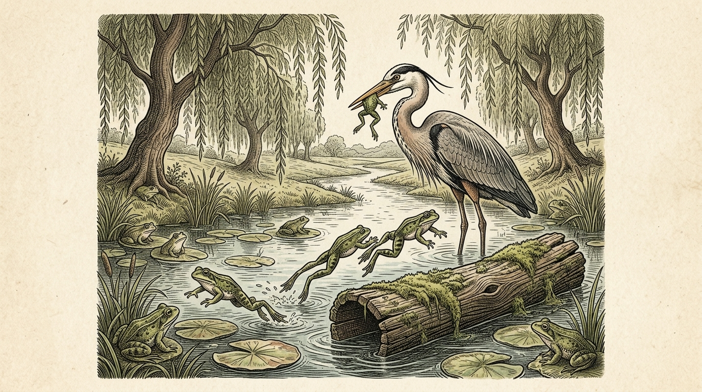

# Chapter 36: The Frogs Desiring a King (カエルたちの王様選び)

<!-- 電子書籍 Page Break & Image Header -->

  

## 1. Benchmark Level: Eiken Grade 3 (英検3級レベル本文)
*Read in ~1.5 to 2 minutes. Baseline vocabulary and basic syntax.*

A community of frogs lived peacefully in a spacious marsh, enjoying an easy and unrestricted existence. They were permitted to leap among the reeds and croak at their leisure, completely unburdened by laws or government.

Nevertheless, the discontented frogs gradually grew weary of their tranquil lifestyle. Believing that their society lacked dignity and discipline, they sent a petition to Jupiter, the sovereign of the gods, pleading for a powerful monarch to reign over them.

Amused by their foolishness, Jupiter tossed an enormous log directly into the center of the pool.

When the massive timber struck the water, it produced a terrifying splash that reverberated across the entire marsh. Panicked by the commotion, the frogs plunged into the murky depths and concealed themselves beneath the slime.

As time elapsed, however, the marsh returned to stillness. A daring frog cautiously surfaced and observed that the new monarch remained motionless. Encouraged by his discovery, the entire colony emerged. Within a few days, having recognized that the log was entirely harmless, the disrespectful frogs began to leap onto the monarch's back and treat him with open mockery.

Dissatisfied with a ruler who lacked authority, they sent another urgent appeal to Jupiter, demanding a vigorous leader who could command respect.

Irritated by their senseless ingratitude, Jupiter resolved to teach them a bitter lesson. He dispatched a long-legged stork to the marsh. Unlike the peaceful log, this savage tyrant immediately seized the terrified frogs with his sharp beak, gobbling them up by the dozens.

In their despair, the surviving frogs sent a messenger to beg for mercy. But Jupiter answered sternly, "You were not content with liberty, nor were you satisfied with a gentle ruler. Bear your punishment, for you brought this calamity upon yourselves."

---

## 2. Target Level: Eiken Grade Pre-2 (英検準2級レベル本文)
*Read in ~2 to 2.5 minutes. Richer idioms, subordinate clauses, and logical transitions.*

Inhabiting an expansive wetland ecosystem, an amphibious populace thrived in an idyllic state of anarchic bliss. Exempt from statutory taxation, administrative bureaucracy, and coercive legislation, they basked upon lily pads and vocalized their contentment without constraint.

Regrettably, perpetual liberty engendered psychological malaise rather than profound gratitude. Misinterpreting their unconstrained autonomy as chaotic backwardness, the frogs succumbed to delusions of grandeur. Convinced that their commonwealth required the pomp of centralized sovereignty to elevate its social prestige, they dispatched an embassy to the celestial realm, imploring Jupiter to install a supreme potentate.

Entertained by their sheer naivety, the supreme deity hurled a colossal baulk of timber straight from the heavens into the heart of the mire.

The descent of the monumental projectile generated a cataclysmic percussion. Giant swells washed over the embankments, accompanied by deafening aquatic echoes that induced hysterical panic throughout the community. Terror-stricken by this dramatic manifestation of divine majesty, the populace dived into the subterranean mud, trembling in reverent awe.

However, as the turbulence dissolved into glassy equilibrium, the perceived monarch exhibited an embarrassing inertia. An audacious scout gingerly protruded his snout above the duckweed and noted that the sovereign had neither shifted position nor uttered a proclamation. Within forty-eight hours, familiarity had bred utter contempt; audacious amphibians clambered upon the inert sovereign, basking insolently upon his damp bark.

Indignant at having been saddled with an impotent idol incapable of enforcing compliance, the faction dispatched a vehement ultimatum to Olympus, insisting upon an energetic sovereign possessing the charisma and muscle to govern rigorously.

Exasperated beyond tolerance by their incurable ingratitude, Jupiter revoked his benevolence and unleashed an authentic predator: a predatory water-stork.

The transformation was horrific. The carnivorous avian monarch stalked through the shallows with murderous efficiency, snapping up fleeing citizens with his spear-like mandible and swallowing whole families without a pause. In a panic of unprecedented magnitude, the decimated populace dispatched a clandestine envoy under cover of darkness to plead for emancipation.

From the heights of Mount Olympus, the deity's condemnation echoed with chilling finality: "When blessed with unconstrained freedom, you demanded governance. When granted a gentle sovereign whose passivity preserved your lives, you mocked him. Endure the ravages of the tyrant you clamored for, for those who disdain peaceful liberty deserve the chains of their own creation."

---

## 3. Classic Original English Text (イソップ寓話クラシック原文)
*Perry 44: Translated by George Fyler Townsend (1867)*

The Frogs, grieved at having no established ruler, sent ambassadors to Jupiter for a King. 

He, perceiving their simplicity, cast down a huge log into the lake. The Frogs were terrified at first by the splash made by it, and hid themselves in the depths of the pool. 

At last, seeing that it continued motionless, they swam down to it, and treated it with such contempt that they leaped upon it, and squatted on it. 

After some time they began to think that a King of this sort was quite beneath them, and sent a second deputation to Jupiter to pray that he would send them another King. 

He, displeased at their complaints, sent a Stork to rule over them, who at once began to catch the Frogs and eat them. 

Then they repented uselessly of their foolishness.

---

### 🏛️ 【英検2級レベルで読み解く！クラシック原文の重要構文・英文法ノート】
1. **1. 分詞構文（Participle Clause: 付帯状況・理由）**
   - **原文**: *"The Hare, believing her assertion to be simply impossible, agreed to the proposal..."*
   - **解説**: 「〜と信じ込んでいたので」という理由を表す分詞構文。英検2級の長文読解・ライティングの最頻出構文です。
1. **2. 古典的仮定法現在（Subjunctive Mood）**
   - **原文**: *"Though you be swift as the wind, I will beat you in a race."*
   - **解説**: 譲歩節 `Though` の中で原形 `be` を用いる古典的な仮定法現在（現代英語の `Though you are...`）。格調高い古典の響きを持ちます。
1. **3. 過去分詞の後置修飾（Postpositive Participle）**
   - **原文**: *"On the day appointed for the race the two started together."*
   - **解説**: `appointed`（定められた・指定された）が直前の名詞 `the day` を後ろから修飾する構文です。

### 📜 【クラシック原文の重要語彙・古風表現（Classic Antique Vocabulary）】
- **retort** [動] 2級 **（機転を利かせて）言い返す、反論する**（現代の reply sharp/wittily に相当）
- **assertion** [名] 2級/準1級 **主張、断言**（動詞 assert の名詞形。2級長文定番）
- **wayside** [名] 2級 **道端、沿道**（by the wayside（道端に、途中で））
- **fatigue** [名] 2級 **（心身の）極度の疲労、疲れ**（tiredness の上位フォーマル語）

---

## 4. Japanese Translation & Moral (日本語訳と教訓)

### 【日本語全訳：英検準2級レベル本文】
広大な湿地生態系に生息する両生類の住人たちは、無政府状態の牧歌的な至福の中で繁栄していました。法定の課税や行政の官僚制、強権的な法規制を免除され、彼らはスイレンの葉の上で日光浴を楽しみ、何の束縛もなく満足の声を響かせていました。

遺憾ながら、永続する自由は深い感謝ではなく、精神的な倦怠感を生み出してしまいました。自らの制約のない自治を無秩序な後退と誤解したカエルたちは、誇大妄想に屈してしまいました。自分たちの共同体がその社会的威信を高めるためには中央集権的な主権の華やかさが必要であると思い込んだ彼らは、天上界に使節を派遣し、至高の君主を任命するようユピテルに嘆願しました。

その純真極まる愚かさを面白がった最高神は、天から泥沼の中心へと、巨大な角材をまっすぐに投げ落としました。

記念碑的な飛翔体の落下は、天地を揺るがすような衝撃音を巻き起こしました。巨大なうねりが土手を洗い、耳をつんざくような水音の反響が群れ全体に狂乱のパニックを引き起こしました。神聖なる威厳のこの劇的な顕現に恐怖で縮み上がった住人たちは地下の泥の中へと潜り込み、敬虔な畏怖のうちに震えていました。

しかしながら、荒波が静まり返った鏡のような均衡へと戻るにつれて、認識されていた君主はきまりの悪いほどの無気力さを露呈しました。大胆な偵察役が一匹、用心深くウキクサの上へと鼻先を突き出し、君主が身動き一つせず、いかなる布告も発していないことに気づきました。48時間のうちに、慣れは完全な軽蔑へと変わりました。図々しい両生類たちは不活発な君主の背によじ登り、その湿った樹皮の上で不敬にも日光浴を始めたのです。

服従を強制することのできない無力な偶像を押し付けられたことに憤慨した派閥は、厳格な統治を行えるカリスマ性と腕力を備えた精力的な君主を要求し、オリンポスへ向けて激しい最後通牒を送りつけました。

その不治の恩知らずに堪忍袋の緒が切れたユピテルは自らの慈悲を取り消し、本物の捕食者である貪欲なコウノトリを解き放ちました。

その変貌は凄惨を極めました。肉食の鳥類君主は殺戮的な効率性をもって浅瀬を大股で闊歩し、槍のような嘴で逃げ惑う住民を捕らえては、間髪入れずに一家まるごと飲み込んでいきました。前例のない規模のパニックの中、激減した住民たちは暗闇に紛れて秘密の使者を送り、解放を懇願しました。

オリンポス山の高みから、神の宣告が冷徹な決定打となって響き渡りました。「無制限の自由に恵まれていたとき、お前たちは統治を求めた。その受動性によってお前たちの命を保ってくれた穏やかな君主を与えられたとき、お前たちは彼を侮辱した。お前たち自身が熱望した暴君の蹂躙に耐えるがよい。平和な自由を蔑む者は、自らが創り出した鎖に繋がれるに値するのだから。」

### 【教訓（Moral）】
**Let well enough alone.**  
（現状の平穏に甘んぜよ。無用な不満からより強力な権力を望む者は、耐えがたい圧政と自滅の鎖を自ら招き寄せることになる。）

---

## 5. Recite & Compare: そらんじたいキーフレーズ対比カード

  
フレーズ 1：自由な無秩序状態の描写

  
3級They lived completely unburdened by laws or government.

  
準2級An amphibious populace thrived in an idyllic state of anarchic bliss, exempt from coercive legislation.

  
<strong>解説：</strong>「idyllic state of anarchic bliss（無政府状態の牧歌的至福）」や「exempt from coercive legislation（強権的立法の免除）」という政治哲学的な語彙で統治なき自由を精密に定義しています。

  
フレーズ 2：慣れが生んだ完全な軽蔑

  
3級They began to treat him with open mockery.

  
準2級Familiarity had bred utter contempt; audacious amphibians clambered upon the inert sovereign.

  
<strong>解説：</strong>英語の古典的格言「Familiarity breeds contempt（親しみすぎると軽蔑を生む）」を巧みに引用し、丸太を侮るカエルたちの増長を鮮やかに描いています。

  
フレーズ 3：本物の捕食者の解き放ち

  
3級Jupiter resolved to teach them a lesson and dispatched a stork.

  
準2級Jupiter revoked his benevolence and unleashed an authentic predator upon the community.

  
<strong>解説：</strong>「revoke benevolence（慈悲を取り消す）」と「unleash an authentic predator（本物の捕食者を解き放つ）」という迫真の対比構文です。

  
フレーズ 4：自ら望んだ暴君の罰を受けよ

  
3級Bear your punishment, for you brought this calamity upon yourselves.

  
準2級Those who disdain peaceful liberty deserve the chains of their own creation.

  
<strong>解説：</strong>「Those who do ~ deserve ...（〜する者は…に値する）」という格調高い主語構文に「the chains of their own creation（自ら創り出した鎖）」という強烈なメタファーを組み込んでいます。

---

## 6. Key Vocabulary & Exam Notes (英検準2級 重要語彙・文法・面接対策)

### 1. 英検準2級 必須ボキャブラリー
* **populace** [名] 大衆、全住民（*people* より公的な語）
* **exempt** [形] 免除された（*exempt from ~*）
* **sovereignty** [名] 主権、統治権
* **inertia** [名] 慣性、無気力、不活発
* **contempt** [名] 軽蔑、侮辱（*look down on* の名詞形）
* **inert** [形] 不活性の、自力で動けない
* **mandible** [名] くちばし、下顎
* **disdain** [動] 軽蔑する、見下す

### 2. 文法・構文のチェックポイント
* **exempt from ~**: 「〜を免除された」
  * 税金、義務、規則などを免れている状態を示す重要形容詞です。
* **Those who + 動詞**: 「〜する人々」
  * 一般論や普遍的真理を述べる際のエッセイの定番構文です。

### 3. スピーキング（面接）＆ライティング活用ヒント
「民主主義の価値」や「平和への感謝」を論述する際に役立ちます：
* *People often take political stability for granted until they lose it.*（人々は政治的安定を失うまで、それを当然のものと考えがちである。）
* *Demanding drastic changes without foresight can result in worse leadership.*（先見の明のない抜本的変化の要求は、より悪い指導者をもたらす結果になりかねない。）
