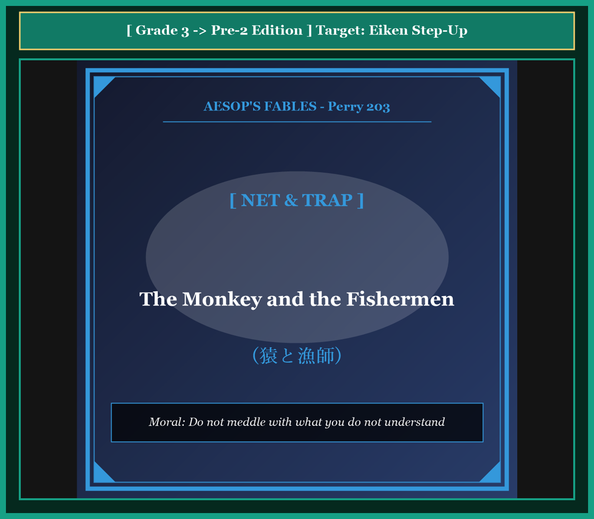

# Chapter 37: The Monkey and the Fishermen (猿と漁師)

<!-- 電子書籍 Page Break & Image Header -->

  

## 1. Benchmark Level: Eiken Grade 3 (英検3級レベル本文)
*Read in ~1.5 to 2 minutes. Baseline vocabulary and basic syntax.*

An inquisitive monkey, who perched upon the high boughs of a tree beside a flowing river, observed several fishermen casting their nets into the water.

He watched with fascinated eyes as the men skillfully flung the broad mesh and retrieved abundant catches of glistening fish. Because monkeys are natural mimics, he foolishly assumed that the art of fishing required no special practice or intelligence. "What an effortless craft," the conceited creature whispered to himself. "I can perform that task with equal skill."

At midday, the fishermen laid their wet nets along the grassy shore and retired to a neighboring cottage to have their meal.

Seizing this favorable opportunity, the monkey descended swiftly from his perch. He approached the equipment and resolved to display his supposed talent. He lifted the heavy cords and attempted to duplicate the exact motions he had observed.

However, lacking experience and coordination, he became completely confused by the intricate cords. As he swung the bulky mesh clumsily, the net enveloped his own head and limbs instead of spreading across the water.

The more violently the monkey struggled to free himself, the more tightly the wet knots bound his body. Stumbling blindly along the slippery bank, he fell into the rushing current.

Weighted down by the heavy mesh, the drowning monkey sighed in bitter remorse. "Alas, I am rightly punished for my absurd conceit! Without possessing the slightest skill, why did I meddle in a craft that belonged entirely to experienced men?"

---

## 2. Target Level: Eiken Grade Pre-2 (英検準2級レベル本文)
*Read in ~2 to 2.5 minutes. Richer idioms, subordinate clauses, and logical transitions.*

Stationed conspicuously upon an elevated branch overlooking a meandering river, an excessively inquisitive primate scrutinized the methodical maneuvers of professional fishermen operating along the shoreline.

With rapt fascination, he tracked the synchronized choreography of the fishermen as they cast their weighted nets across the eddying waters, dragging ashore copious yields of shimmering river-carp. Being innately predisposed toward unthinking mimicry, the ape arrived at the superficial conclusion that technical mastery was merely an illusion. "How trivial an endeavor," mused the self-deluded creature. "If mere humans can execute such operations with routine nonchalance, an animal of my superior agility can duplicate the feat instantaneously."

During the noon intermission, the laborers deposited their damp gear upon the sandy embankment and withdrew to a riverside shelter to partake of refreshment.

Capitalizing promptly upon their absence, the audacious primate descended from his vantage point. Propelled by vanity and reckless curiosity, he resolved to demonstrate his innate genius. He seized the voluminous webbing, gripped the leaden perimeter, and attempted to replicate the expansive, circular trajectory he had witnessed from afar.

Inevitably, deficient in physical momentum and technical comprehension, his execution proved disastrously flawed. Instead of unfolding into a wide parabolic arc across the surface of the river, the cumbersome folds collapsed inward, entirely encasing his torso, skull, and appendages in a suffocating web.

Panicking as his equilibrium disintegrated, the ape thrashed hysterically; yet each frantic convulsion merely tightened the constricting meshes around his throat and limbs. Disoriented and blind, he lost his footing upon the slick clay and plummeted directly into the deep, turbulent river.

Submerged beneath the surface and dragged inexorably toward the riverbed by the waterlogged cordage, the suffocating creature faced the terminal consequence of his presumption. In his final conscious moments, he lamented his fatal folly: "I am the architect of my own doom! Destitute of the most rudimentary competence, what catastrophic arrogance possessed me to trespass upon the specialized domain of trained artisans?"

---

## 3. Classic Original English Text (イソップ寓話クラシック原文)
*Perry 203: Translated by George Fyler Townsend (1867)*

A Monkey, seated on a lofty tree, saw some Fishermen casting their nets into a river, and narrowly watched their proceedings. 

The Fishermen after a while gave up fishing, and on going home to dinner, left their nets upon the bank. 

The Monkey, who is the most imitative of animals, descended from the treetop, and endeavoured to do as they had done. Having handled the net, he threw it from him; but it became entangled around him, and he rolled into the river. 

Being in the act of drowning, he said to himself: "This is a just reward for my foolishness; for what business had I, who knew nothing of the matter, to try and fish with nets?"

---

### 🏛️ 【英検2級レベルで読み解く！クラシック原文の重要構文・英文法ノート】
1. **1. 分詞構文（Participle Clause: 付帯状況・理由）**
   - **原文**: *"The Hare, believing her assertion to be simply impossible, agreed to the proposal..."*
   - **解説**: 「〜と信じ込んでいたので」という理由を表す分詞構文。英検2級の長文読解・ライティングの最頻出構文です。
1. **2. 古典的仮定法現在（Subjunctive Mood）**
   - **原文**: *"Though you be swift as the wind, I will beat you in a race."*
   - **解説**: 譲歩節 `Though` の中で原形 `be` を用いる古典的な仮定法現在（現代英語の `Though you are...`）。格調高い古典の響きを持ちます。
1. **3. 過去分詞の後置修飾（Postpositive Participle）**
   - **原文**: *"On the day appointed for the race the two started together."*
   - **解説**: `appointed`（定められた・指定された）が直前の名詞 `the day` を後ろから修飾する構文です。

### 📜 【クラシック原文の重要語彙・古風表現（Classic Antique Vocabulary）】
- **retort** [動] 2級 **（機転を利かせて）言い返す、反論する**（現代の reply sharp/wittily に相当）
- **assertion** [名] 2級/準1級 **主張、断言**（動詞 assert の名詞形。2級長文定番）
- **wayside** [名] 2級 **道端、沿道**（by the wayside（道端に、途中で））
- **fatigue** [名] 2級 **（心身の）極度の疲労、疲れ**（tiredness の上位フォーマル語）

---

## 4. Japanese Translation & Moral (日本語訳と教訓)

### 【日本語全訳：英検準2級レベル本文】
蛇行する川を見下ろす高い枝の上に目立つように陣取っていたひどく詮索好きな類人猿が、岸辺で作業するプロの漁師たちの几帳面な動きを注視していました。

渦巻く水面を横切って重りのついた網を投げ、きらめく川ゴイの豊潤な獲物を岸へと引き上げる漁師たちの息の合った所作を、猿は奪われた視線で追跡していました。生まれつき無分別な模倣に走りやすい性質であったため、この猿は、技術的な熟練など単なる幻想にすぎないという皮相な結論に達してしまいました。「何とるに足らない仕事だろう」と自惚れた生き物は物思いに耽りました。「単なる人間にあれほど当たり前の無造作さで作業をこなせるのなら、より優れた敏捷性を備えた私のような動物であれば、その離れ業を一瞬にして再現できるはずだ。」

正午の休憩時間中、作業員たちは湿った道具を砂の土手に置き、軽食をとるために川沿いの避難所へと引き上げました。

彼らの不在をすかさず利用して、大胆不敵な類人猿は自らの見晴らし台から降りてきました。虚栄心と無謀な好奇心に突き動かされ、彼は自らの生まれ持った天才性を実証しようと決意しました。彼は膨大な網地を掴み、鉛のついた周囲を握り締め、遠くから目撃していた大きく広がる円形の軌道を再現しようと試みました。

必然的に、物理的な勢いも技術的な理解も欠いていたため、彼の実行は破滅的なまでに欠陥だらけでした。網は川の表面を横切る広い放物線の弧を描いて広がるどころか、その扱いにくい折り目が内側へと崩れ落ち、彼の胴体、頭骨、四肢を息苦しい網の目の中にすっぽりと閉じ込めてしまいました。

体の平衡が崩壊するにつれてパニックに陥った猿は、狂乱してのたうち回りました。しかし、必死の痙攣は、喉や手足に巻きつく拘束性の網目をいっそう強く締めつけるだけでした。方向感覚を失い視界を遮られた彼は、滑りやすい粘土の上で足元をすくわれ、深くて荒れ狂う急流の中へと真っ逆さまに転落しました。

水中に沈み、水を吸った網の重みによって容赦なく川底へと引きずり込まれながら、窒息しゆく生き物は己の思い上がりが招いた致命的な結末に直面しました。意識の最後の瞬間、彼は自らの致命的な愚行を嘆きました。「私は自らの破滅の設計者なのだ！ 最も基本的な能力すら欠如していながら、いかなる破滅的な傲慢さに取り憑かれて、訓練された職人たちの専門領域へと不法侵入してしまったのだろうか。」

### 【教訓（Moral）】
**Do not meddle with what you do not understand.**  
（自らが理解していない職能や専門領域に軽々しく介入してはならない。表面的な模倣によってプロの技術を甘く見る者は、自ら仕掛けた罠によって命を落とす。）

---

## 5. Recite & Compare: そらんじたいキーフレーズ対比カード

  
フレーズ 1：技術の真価を見誤る浅はかさ

  
3級He foolishly assumed that the art of fishing required no special practice.

  
準2級He arrived at the superficial conclusion that technical mastery was merely an illusion.

  
<strong>解説：</strong>「superficial conclusion（皮相な・浅はかな結論）」や「technical mastery was merely an illusion（技術的熟練は単なる幻想にすぎない）」という概念的な論述表現です。

  
フレーズ 2：他者の不在をすかさず利用する

  
3級Seizing this favorable opportunity, the monkey descended swiftly.

  
準2級Capitalizing promptly upon their absence, the audacious primate descended from his vantage point.

  
<strong>解説：</strong>動詞「capitalize upon ~（〜を最大限に利用する）」と、名詞「vantage point（見晴らしの良い場所・有利な地点）」により、狡猾な行動のニュアンスを高めています。

  
フレーズ 3：広がるどころか自分に絡みつく網

  
3級The net enveloped his own head and limbs instead of spreading across the water.

  
準2級Instead of unfolding into a wide parabolic arc, the cumbersome folds collapsed inward, entirely encasing his torso.

  
<strong>解説：</strong>「unfolding into a wide parabolic arc（広い放物線を描いて広がる）」という幾何学的・物理的描写と、「encasing his torso（胴体をすっぽり覆う）」という対照が鮮烈です。

  
フレーズ 4：専門領域への不遜な侵入への自責

  
3級Why did I meddle in a craft that belonged entirely to experienced men?

  
準2級What catastrophic arrogance possessed me to trespass upon the specialized domain of trained artisans?

  
<strong>解説：</strong>「What arrogance possessed me to do?（何の傲慢さに取り憑かれて〜したのか）」という感情豊かな修辞疑問文と、「trespass upon the specialized domain（専門領域に不法侵入する）」という鋭利な批判語法です。

---

## 6. Key Vocabulary & Exam Notes (英検準2級 重要語彙・文法・面接対策)

### 1. 英検準2級 必須ボキャブラリー
* **meandering** [形] 曲がりくねった、蛇行する
* **scrutinize** [動] 綿密に調べる、注視する
* **synchronized** [形] 同期した、息の合った
* **superficial** [形] 表面的な、皮相な、浅薄な
* **capitalize on / upon** [熟語] 〜を利用する、〜に乗じる
* **cumbersome** [形] 厄介な、かさばる、扱いにくい
* **convulsion** [名] 痙攣、激しい動揺
* **trespass** [動] 侵入する、不法侵害する（*trespass upon ~*）

### 2. 文法・構文のチェックポイント
* **capitalize upon ~**: 「〜をうまく利用する」
  * 機会や相手の隙を利用して行動を起こす際の必須句動詞です。
* **predisposed to / toward ~**: 「〜の傾向がある、〜しやすい素質がある」
  * 先天的な性質や傾向を論理的に説明する重要表現です。

### 3. スピーキング（面接）＆ライティング活用ヒント
「専門スキルの習得」や「プロフェッショナリズムへの敬意」を論述する際に役立ちます：
* *Mastering a professional craft requires rigorous discipline that cannot be replicated overnight.*（専門職の技術を極めるには、一朝一夕には模倣できない厳しい修練が必要である。）
* *Amateurs should avoid reckless experimentation in high-risk domains.*（アマチュアは、高リスクな専門分野において無謀な実験を行うことを避けるべきである。）
