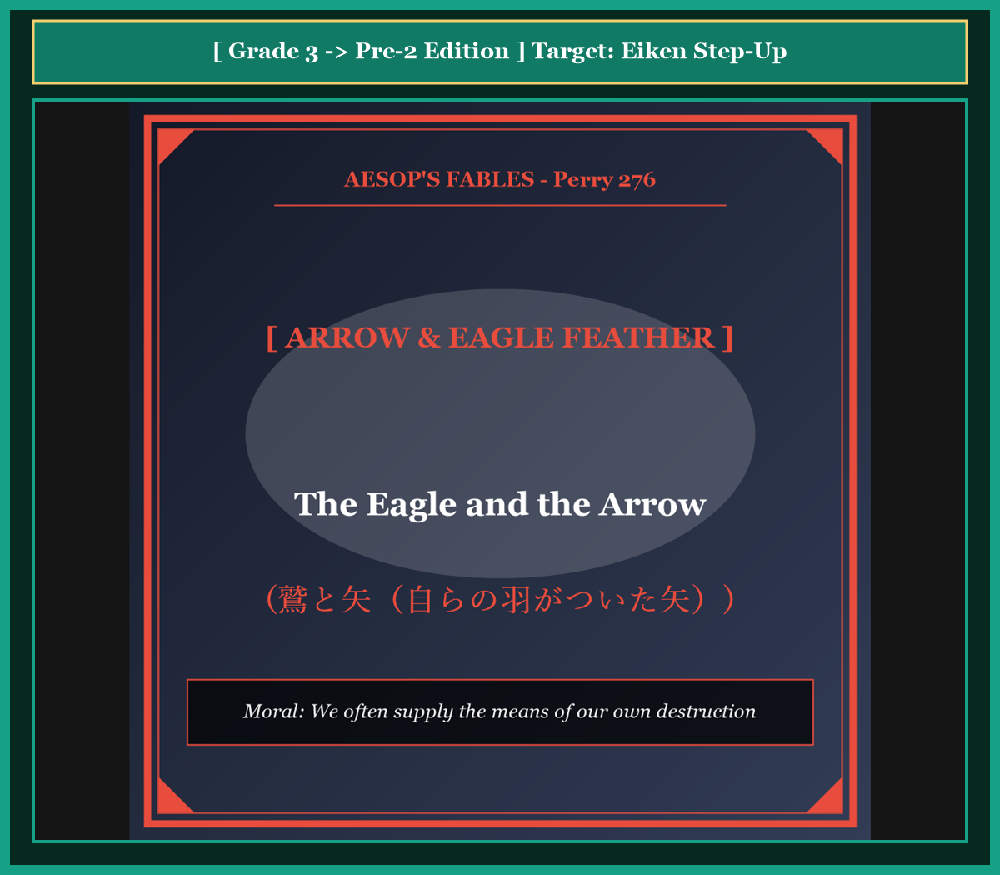

# Chapter 51: The Eagle and the Arrow (鷲と矢)

<!-- 電子書籍 Page Break & Image Header -->

  

## 1. Benchmark Level: Eiken Grade 3 (英検3級レベル本文)
*Read in ~2 to 2.5 minutes. Baseline vocabulary and basic syntax.*

A majestic eagle made his home on the highest cliff of a rugged mountain. Every morning, he surveyed the vast valley below because he possessed extraordinary eyesight. From high above the clouds, he could easily spot small animals that were hiding among the green bushes.

One calm afternoon, the eagle descended and perched upon a solitary boulder. He was waiting patiently to catch a hare for his evening meal. While he was concentrating on the grassy fields, an experienced hunter approached silently through the thick forest.

The hunter instantly recognized the great bird and prepared his weapon. Taking a sharp wooden arrow, he fitted it to his bowstring. He pulled the bow with great power and released the arrow toward the cliff.

The arrow soared swiftly through the air and pierced deep into the eagle's body. Overcome by sudden shock and intense pain, the monarch of the skies lost his balance and tumbled down to the rocky earth below.

As he lay dying on the ground, the eagle glanced down at the fatal shaft sticking out of his breast. To his astonishment and horror, he noticed the feathers that guided the arrow through the air. They were unmistakable brown flight feathers that had fallen from his own wings during his last molt.

Tears welled in the dying eagle's eyes as he spoke his final words: "It is a double sorrow to lose my life, but it is far more bitter to know that my own feathers provided the very wings that brought death to my heart."

---

## 2. Target Level: Eiken Grade Pre-2 (英検準2級レベル本文)
*Read in ~2 to 2.5 minutes. Richer idioms, participle clauses, and compound sentences.*

Perched majestically upon an alpine promontory, a sovereign eagle surveyed the expansive valleys beneath his domain. Endowed with acute optical perception and formidable predatory instincts, the avian monarch habitually scrutinized the terrain from immense altitudes, readily detecting any vulnerable quarry concealing itself amidst the foliage.

During a tranquil twilight, the predator descended to a prominent granite outcrop, patiently anticipating the emergence of a hare. Wholly absorbed in monitoring the valley floor, the eagle remained entirely oblivious to an experienced archer who was quietly maneuvering through the dense undergrowth below.

Discerning the silhouette of the noble raptor against the horizon, the hunter methodically notched a feathered projectile into his recurve bow. Drawing the cord to its maximum tension with practiced precision, he discharged the missile toward the summit.

The arrow traversed the intervening atmosphere with lethal velocity, penetrating deeply into the eagle's vital organs. Traumatized by the catastrophic impact, the sovereign of the skies experienced instantaneous equilibrium failure, plummeting precipitously to the rocky embankment beneath.

Lying prostrate and hemorrhaging upon the stony earth, the dying predator cast his failing gaze upon the fatal shaft protruding from his chest. With profound shock and existential despair, he identified the stabilizing fletchings fixed to the arrow's tail. They were identical to the magnificent plumage he had naturally shed from his own pinions during the preceding seasonal molt.

Experiencing an acute pang of tragic irony, the mortally wounded raptor gasped his dying lamentation: "While physical extinction is inherently agonizing, it constitutes an infinitely more grievous torment to comprehend that my own shed feathers furnished the aerodynamic instruments that orchestrated my destruction."

---

## 3. Classic Original English Text (イソップ寓話クラシック原文)
*Translated by George Fyler Townsend (1867)*

An Eagle sat on a high rock, looking for hares. A hunter shot an arrow at him and hit him. As the Eagle fell dying, he looked at the arrow and saw that its feathers were plucked from an eagle's own wing. "Alas," he cried, "it is a double grief to me that I must die by an arrow feathered with my own plumage!"

---

### 🏛️ 【英検2級レベルで読み解く！クラシック原文の重要構文・英文法ノート】
1. **1. 分詞構文（Participle Clause: 付帯状況・理由）**
   - **原文**: *"The Hare, believing her assertion to be simply impossible, agreed to the proposal..."*
   - **解説**: 「〜と信じ込んでいたので」という理由を表す分詞構文。英検2級の長文読解・ライティングの最頻出構文です。
1. **2. 古典的仮定法現在（Subjunctive Mood）**
   - **原文**: *"Though you be swift as the wind, I will beat you in a race."*
   - **解説**: 譲歩節 `Though` の中で原形 `be` を用いる古典的な仮定法現在（現代英語の `Though you are...`）。格調高い古典の響きを持ちます。
1. **3. 過去分詞の後置修飾（Postpositive Participle）**
   - **原文**: *"On the day appointed for the race the two started together."*
   - **解説**: `appointed`（定められた・指定された）が直前の名詞 `the day` を後ろから修飾する構文です。

### 📜 【クラシック原文の重要語彙・古風表現（Classic Antique Vocabulary）】
- **retort** [動] 2級 **（機転を利かせて）言い返す、反論する**（現代の reply sharp/wittily に相当）
- **assertion** [名] 2級/準1級 **主張、断言**（動詞 assert の名詞形。2級長文定番）
- **wayside** [名] 2級 **道端、沿道**（by the wayside（道端に、途中で））
- **fatigue** [名] 2級 **（心身の）極度の疲労、疲れ**（tiredness の上位フォーマル語）

---

## 4. Japanese Translation & Moral (日本語訳と教訓)

### 【日本語全訳：英検準2級レベル本文】
高山帯の岬の上に威風堂々と止まり、君主たるワシは自らの領土の眼下に広がる広大な谷を見渡していました。鋭敏な視覚的知覚と恐るべき捕食本能を授かっていたこの鳥類の君主は、途方もない高度から地形を日常的に精査し、葉の間に身を隠すいかなる脆弱な獲物をも容易に探知していました。

穏やかな黄昏時、その捕食者は目立つ花崗岩の露出部へと舞い降り、野ウサギの出現を辛抱強く待っていました。谷底の監視に完全に没頭していたため、ワシは下方の密生した下草の間を静かに接近していた熟練の射手（狩人）にまったく気づいていませんでした。

地平線を背景とする高貴な猛禽類のシルエットを認めた狩人は、羽のついた投射体（矢）を規則正しく自らの弓へと番えました。熟練の精密さをもって弦を最大張力まで引き絞ると、彼は山頂に向かって矢を放ちました。

矢は致死的な速度で大気中を横断し、ワシの生命維持器官深くへと貫通しました。壊滅的な衝撃によって外傷を負い、空の主権者は瞬時的な平衡感覚の崩壊を経験し、下方の岩がちの土手へと真っ逆さまに急転落しました。

石だらけの地面の上に平伏し出血しながら、死にゆく捕食者は胸から突き出ている致命的な矢の柄へと衰えゆく視線を投げかけました。深刻な衝撃と実存的な絶望の中で、彼は矢の尾部に固定されている安定用の矢羽を識別しました。それらは、彼が前回の季節の換羽期に自らの翼から自然に脱落させた見事な羽毛と完全に同一のものだったのです。

悲劇的な皮肉の激しい痛痒を経験しながら、致命傷を負った猛禽類は息絶えゆく嘆きの言葉を絞り出しました。「肉体的な死そのものも生来耐え難い苦痛であるが、自らが抜け落とした羽が、自らの破滅を組織した空気力学的道具を提供していたのだと理解することは、無限により痛ましい苦悶である。」

### 【教訓（Moral）】
**We often supply the means of our own destruction.**  
（人間はしばしば、自らが過去に生み落とした技術・情報・人材によって、皮肉にも自らを仕留める最も効率的な武器を敵に提供してしまう。）

---

## 5. Recite & Compare: そらんじたいキーフレーズ対比カード

  
フレーズ 1：高山の岬から谷の獲物を精査する

  
3級Because he possessed extraordinary eyesight, he surveyed the vast valley below.

  
準2級Endowed with acute optical perception, he scrutinized the terrain from immense altitudes.

  
<strong>解説：</strong>準2級頻出の分詞構文「Endowed with...（〜を授かって）」とアカデミック動詞「scrutinize（精査する）」の洗練文体です。

  
フレーズ 2：最大張力まで弓を引き絞り矢を放つ

  
3級He pulled the bow with great power and released the arrow.

  
準2級Drawing the cord to its maximum tension with practiced precision, he discharged the missile.

  
<strong>解説：</strong>分詞構文「Drawing the cord to its maximum tension...」と軍事・物理動詞「discharge（発射する）」の結合です。

  
フレーズ 3：自らの翼から脱落した羽と同一だと識別する

  
3級He noticed the feathers that had fallen from his own wings.

  
準2級He identified the fletchings as identical to the plumage naturally shed from his own pinions.

  
<strong>解説：</strong>「identical to...（〜と同一の）」と文学的語彙「plumage（羽毛）」「pinions（翼）」を用いた格調高い表現です。

  
フレーズ 4：自らの羽が自らの破滅を組織した悲劇の皮肉

  
3級My own feathers provided the very wings that brought death to my heart.

  
準2級My own shed feathers furnished the aerodynamic instruments that orchestrated my destruction.

  
<strong>解説：</strong>「furnished aerodynamic instruments（空気力学的道具を提供した）」と「orchestrated my destruction」の圧巻の修辞です。

---

## 6. Key Vocabulary & Exam Notes (英検準2級 重要語彙・文法・面接対策)

### 1. 英検準2級 必須ボキャブラリー
* **promontory** [名] 岬、高台の突き出た岩
* **scrutinize** [動] 〜を綿密に調べる、精査する
* **quarry** [名] 獲物、追求されるもの
* **outcrop** [名] （岩石の）露出部
* **fletching** [名] 矢羽（矢の尾部の羽根）
* **pinion** [名] 鳥の翼、風切羽
* **hemorrhage** [動] 大出血する [名] 出血
* **orchestrate** [動] 〜を組織化する、画策する

### 2. 文法・構文のチェックポイント
* **Endowed with + 名詞, S + V**:
  * 過去分詞による分詞構文。「〜を生まれつき授かって、Sは…する」。
* **furnish + A + with + B / furnish + B**:
  * 「〜に…を供給する、備え付ける」。*provide* の高度な同義表現です。

### 3. スピーキング（面接）＆ライティング活用ヒント
* オープンソース技術の軍事転用や技術流出のリスクについて、*Technological pioneers often discover that their open innovations furnished the precise mechanisms that undermined their security.* と論述できます。

