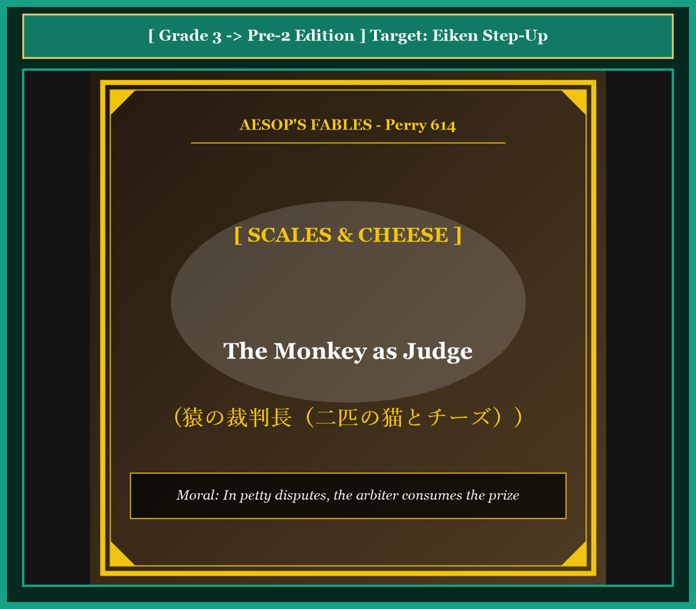

# Chapter 52: The Monkey as Judge (猿の裁判長)

<!-- 電子書籍 Page Break & Image Header -->

  

## 1. Benchmark Level: Eiken Grade 3 (英検3級レベル本文)
*Read in ~2 to 2.5 minutes. Baseline vocabulary and basic syntax.*

Two hungry cats were wandering along a quiet village path when they discovered a delicious piece of rich cheese. At first, both animals were delighted by their wonderful good fortune, but a bitter dispute soon arose between them.

Neither cat was willing to share the cheese equally. The black cat insisted that he had spotted the treasure first, while the white cat claimed that his claws had touched it before anyone else. Unable to resolve their disagreement peacefully, they decided to find an impartial judge.

At that moment, a cunning monkey appeared from behind an oak tree. Observing their predicament, the monkey offered his services with a polite bow. "Please do not worry, neighbors. I have served as a judge for many years, and I can ensure that justice is served between you." Relieved by his words, the two naive cats entrusted their cheese to the monkey.

The monkey immediately produced a pair of balance scales. He divided the cheese into two irregular pieces and placed one on each pan. Because the right piece was heavier, the balance tilted downward.

"This will never do," muttered the monkey thoughtfully. "We must make both sides completely equal." He took a generous bite from the larger piece, but now the other side was heavier. Therefore, the monkey took another bite from the second piece.

Back and forth the process continued while the anxious cats watched their treasure dwindle to almost nothing. Realizing their mistake, they begged the arbiter to stop. "Please give us whatever remains! We will settle the dispute ourselves!"

"That is impossible," chuckled the greedy monkey as he placed the remaining morsels into his mouth. "An honorable magistrate must always receive compensation for his professional services." Having consumed the entire cheese, the monkey bounded up into the trees, leaving the two foolish cats hungry and empty-handed.

---

## 2. Target Level: Eiken Grade Pre-2 (英検準2級レベル本文)
*Read in ~2 to 2.5 minutes. Richer idioms, participle clauses, and compound sentences.*

While foraging through an agrarian settlement, two feral felines stumbled upon an opulent block of aged dairy cheese. Initially electrified by this fortuitous acquisition, the predators were almost immediately engulfed in contentious litigation regarding proprietary distribution.

Neither party demonstrated the slightest inclination to negotiate an equitable compromise. The dark feline asserted priority of discovery, whereas the white counterpart maintained tangible possession. Recognizing the absolute deadlock of their bilateral negotiations, the naive litigants resolved to submit their conflict to external judicial arbitration.

Materializing opportunistically from the canopy, an unscrupulous simian offered his professional mediation. Projecting an aura of judicial solemnity, the monkey assured them that his objective calibration would guarantee egalitarian equity. Subordinating skepticism to legal desperation, the felines surrendered their prize to the magistrate.

The primate promptly deployed an apparatus of balancing scales. Bisecting the cheese into deliberately unequal proportions, he deposited the fragments upon opposite pans, causing the heavier sector to plunge abruptly.

"An intolerable structural imbalance," observed the magistrate with theatrical gravity. "Equilibrium must be restored through regulatory adjustment." Thereupon, the arbiter consumed a substantial mouthful from the dominant fragment. However, this clumsy subtraction reversed the disparity, necessitating a reciprocal bite from the opposite side.

Iterating this manipulative oscillation, the feline spectators witnessed their asset systematically liquidated before their eyes. Terrified by the rapid vanishing of their property, the litigants implored the court to terminate the proceedings: "Surrender the residual fragments! We dissolve our appeal!"

"Judicial procedure cannot be summarily aborted without the satisfaction of professional stipends," retorted the simian. Devouring the final crumbs with nonchalant satisfaction, the arbiter absconded into the forest, leaving the litigants thoroughly destitute.

---

## 3. Classic Original English Text (イソップ寓話クラシック原文)
*Translated by George Fyler Townsend (1867)*

Two Cats found a piece of cheese and could not agree on dividing it. They went to a Monkey to arbitrate. The Monkey brought a balance scale and broke the cheese into two pieces. One was heavier, so he bit a piece off it. Then the other side was heavier, so he bit a piece off that. He kept eating from each side until the Cats pleaded: "Give us what is left!" The Monkey said: "The rest is my fee for judging," and devoured it all.

---

### 🏛️ 【英検2級レベルで読み解く！クラシック原文の重要構文・英文法ノート】
1. **1. 分詞構文（Participle Clause: 付帯状況・理由）**
   - **原文**: *"The Hare, believing her assertion to be simply impossible, agreed to the proposal..."*
   - **解説**: 「〜と信じ込んでいたので」という理由を表す分詞構文。英検2級の長文読解・ライティングの最頻出構文です。
1. **2. 古典的仮定法現在（Subjunctive Mood）**
   - **原文**: *"Though you be swift as the wind, I will beat you in a race."*
   - **解説**: 譲歩節 `Though` の中で原形 `be` を用いる古典的な仮定法現在（現代英語の `Though you are...`）。格調高い古典の響きを持ちます。
1. **3. 過去分詞の後置修飾（Postpositive Participle）**
   - **原文**: *"On the day appointed for the race the two started together."*
   - **解説**: `appointed`（定められた・指定された）が直前の名詞 `the day` を後ろから修飾する構文です。

### 📜 【クラシック原文の重要語彙・古風表現（Classic Antique Vocabulary）】
- **retort** [動] 2級 **（機転を利かせて）言い返す、反論する**（現代の reply sharp/wittily に相当）
- **assertion** [名] 2級/準1級 **主張、断言**（動詞 assert の名詞形。2級長文定番）
- **wayside** [名] 2級 **道端、沿道**（by the wayside（道端に、途中で））
- **fatigue** [名] 2級 **（心身の）極度の疲労、疲れ**（tiredness の上位フォーマル語）

---

## 4. Japanese Translation & Moral (日本語訳と教訓)

### 【日本語全訳：英検準2級レベル本文】
ある農耕集落を採餌中、二匹の野良猫が熟成した乳製品チーズの贅沢な塊を偶然発見しました。最初はこの偶発的な獲得に興奮した捕食者たちでしたが、所有権の分配を巡る論争の的となる口論にほぼ即座に巻き込まれていきました。

どちらの当事者も、公平な妥協案を交渉する微塵の傾向も示しませんでした。黒い猫は発見の優先権を主張し、白い相棒は具体的な占有権を維持しました。自らの二者間交渉の絶対的な行き詰まりを認識した素朴な訴訟当事者たちは、自らの紛争を外部の司法的仲裁に委ねることを決意しました。

樹冠から日和見主義的に姿を現した不謹慎なサルが、自らの専門的な調停を申し出ました。司法の厳粛さのオーラを醸し出しながら、サルは自らの客観的な測定が平等主義的な衡平性を保証すると彼らに断言しました。懐疑心を法的な絶望に従属させ、猫たちは判事に自らの賞品を引き渡してしまいました。

霊長類の調停者は即座に天秤ばかりの装置を展開しました。意図的に不平等な割合へとチーズを二分すると、彼は反対側の皿の上に破片を載せ、重い方のセクターを急激に沈下させました。

「容認しがたい構造的不均衡である」と判事は演劇的な重々しさをもって述べました。「規制調整を通じて均衡を回復せねばならない。」そうして、仲裁者は支配的な破片からかなりの一口を消費しました。しかしながら、この粗野な引き算は格差を逆転させ、反対側からの相互の（新たな）一口を必要とさせたのです。

この巧妙な往復運動を繰り返すことで、猫の傍聴者たちは自らの資産が目の前で組織的に清算（消滅）されていくのを目撃しました。自らの財産が急速に消え去ることに怯えた訴訟当事者たちは、手続きを終了するよう法廷に懇願しました。「残りの破片を引き渡してください！ 私たちは上訴を取り下げます！」

「専門職の手当が満たされることなしに、司法手続きを即決で中止することはできない」とサルは反論しました。平然とした満足感をもって最後のパンくずを平らげると、仲裁者は森林の中へと逃走し、訴訟当事者たちを完全に無一文のまま置き去りにしたのです。

### 【教訓（Moral）】
**In petty disputes, the arbiter consumes the prize.**  
（強欲な私利私欲の争いにおいて第三者の司法仲裁に頼ると、訴訟費用の名目で仲裁者に資産の全てを収奪され、当事者双方が破産する。）

---

## 5. Recite & Compare: そらんじたいキーフレーズ対比カード

  
フレーズ 1：二者間交渉の行き詰まりと外部仲裁への委託

  
3級Unable to resolve disagreement, they decided to find an impartial judge.

  
準2級Recognizing the absolute deadlock, the litigants resolved to submit conflict to judicial arbitration.

  
<strong>解説：</strong>法律・ビジネス交渉用語「deadlock（行き詰まり）」「litigants（訴訟当事者）」「judicial arbitration（司法仲裁）」の融合です。

  
フレーズ 2：意図的に不均等に分割して天秤を傾かせる

  
3級He divided the cheese into irregular pieces and placed one on each pan.

  
準2級Bisecting the cheese into deliberately unequal proportions, he caused the heavier sector to plunge.

  
<strong>解説：</strong>「bisect（二等分する・二分する）」と「deliberately unequal proportions（意図的に不平等な比率）」の表現です。

  
フレーズ 3：資産が目の前で組織的に清算されていく

  
3級The anxious cats watched their treasure dwindle to almost nothing.

  
準2級The feline spectators witnessed their asset systematically liquidated before their eyes.

  
<strong>解説：</strong>金融・司法用語「asset systematically liquidated（資産が組織的に清算・消滅される）」の卓越した用例です。

  
フレーズ 4：専門職の手当なしに訴訟を中止できない屁理屈

  
3級A magistrate must always receive compensation for his professional services.

  
準2級Judicial procedure cannot be summarily aborted without satisfaction of professional stipends.

  
<strong>解説：</strong>法廷用語「summarily aborted（即決で打ち切られる）」「professional stipends（職務手当・報酬）」の格調高い文体です。

---

## 6. Key Vocabulary & Exam Notes (英検準2級 重要語彙・文法・面接対策)

### 1. 英検準2級 必須ボキャブラリー
* **contentious** [形] 論争好きな、議論を呼ぶ（*contentious litigation*）
* **litigant** [名] 訴訟当事者、原告・被告
* **arbitration** [名] 仲裁、調停（*binding arbitration*）
* **bisect** [動] 〜を二分する、二等分する
* **disparity** [名] 格差、不均衡、相違
* **liquidate** [動] 〜を清算する、換金する、根絶する
* **stipend** [名] 給与、手当、報酬
* **destitute** [形] 極貧の、すべてを失った（*left destitute*）

### 2. 文法・構文のチェックポイント
* **cannot be + 過去分詞 + without + 名詞**:
  * 二重否定による必要条件の強調。「〜なしには…され得ない」。
* **subordinate + A + to + B**:
  * 「AをBに従属させる、劣後させる」。理性と感情の対立を描く重要動詞句です。

### 3. スピーキング（面接）＆ライティング活用ヒント
* 国際紛争や企業間の泥沼訴訟のリスクについて、*Protracted legal battles often enrich external legal intermediaries while systematically liquidating the disputed assets.* と論証できます。

