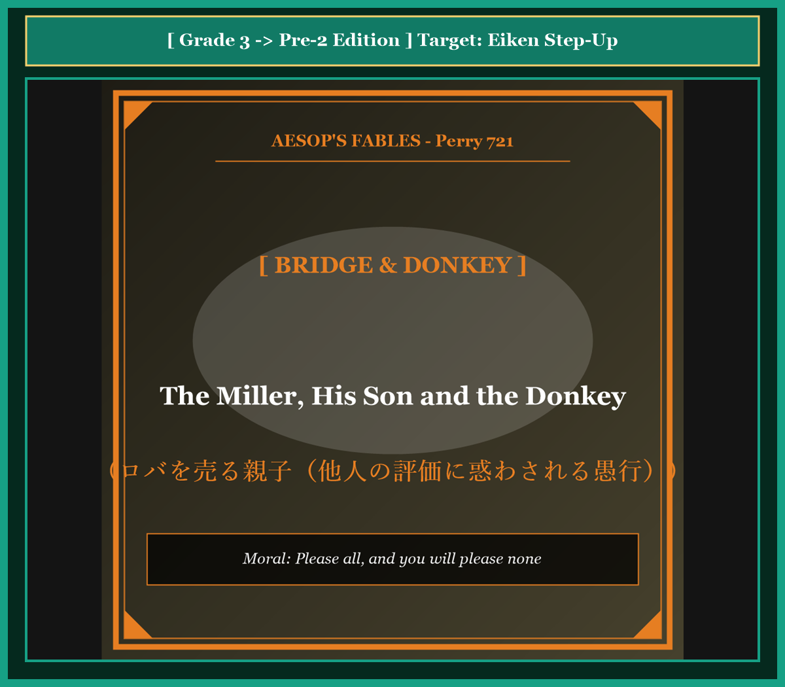

# Chapter 53: The Miller, His Son and the Donkey (ロバを売る親子)

<!-- 電子書籍 Page Break & Image Header -->

  

## 1. Benchmark Level: Eiken Grade 3 (英検3級レベル本文)
*Read in ~2 to 2.5 minutes. Baseline vocabulary and basic syntax.*

An elderly miller and his youthful son set out early one morning to sell their donkey at a busy market town. In order to preserve the animal's strength and keep its coat clean, the father and son chose to walk patiently beside the beast.

As they proceeded along the dusty highway, they passed a group of young girls who were drawing water from a village well. "What preposterous fools those travelers are!" exclaimed one girl with a mocking laugh. "Why should they trudge through the summer heat when their donkey carries no load at all?"

Sensitive to public criticism, the miller instructed his son to mount the donkey while he continued to walk on foot.

Before long, they encountered an assemblage of elders who were engaged in serious conversation. One of the old men frowned severely and criticized the travelers: "Look at the deplorable lack of respect among youth today! That healthy boy lounges lazily on the animal, while his aged father is forced to endure the exhaustion of the road."

Blushing with embarrassment, the boy quickly dismounted and insisted that his father take his place. The miller climbed onto the saddle, feeling satisfied that they had corrected their behavior.

However, their satisfaction was short-lived. A group of women carrying heavy baskets soon crossed their path. "What a callous and selfish parent!" they cried indignantly. "You comfortably ride ahead while your little son struggles to keep pace with your footsteps!"

Desperate to avoid further disapproval, the miller hoisted his son up behind him so that both could ride together.

Yet when they approached the town gates, the citizens shouted in moral outrage: "Have you no mercy for that exhausted creature? You are far better suited to carry the beast than the beast is to carry you!"

Thoroughly bewildered by the conflicting opinions of strangers, the father and son dismounted once more. Finding a stout timber, they tied the donkey's legs securely to the pole and lifted the struggling animal onto their shoulders.

When the townsfolk witnessed this absurd spectacle on the municipal bridge, they erupted in uncontrollable hilarity. Startled by the commotion, the donkey kicked violently, snapped the binding cords, plunged into the deep river, and tragically drowned.

The miller returned home empty-handed, having learned that he who attempts to please everybody pleases nobody.

---

## 2. Target Level: Eiken Grade Pre-2 (英検準2級レベル本文)
*Read in ~2 to 2.5 minutes. Richer idioms, participle clauses, and compound sentences.*

An aged miller accompanied by his adolescent son departed their homestead at daybreak, escorting an equine beast of burden toward a commercial market. Prioritizing the preservation of the animal's marketable vigor, the custodians elected to travel pedestrian-style alongside their quadruped.

While traversing a public thoroughfare, they intersected with an assembly of maidens congregating around a communal fountain. "Observe the incomprehensible ineptitude of those wanderers!" ridiculed one spectator. "For what conceivable objective does one maintain a beast if both custodians subject themselves to arduous pedestrian exertion?"

Excessively susceptible to external social judgment, the patriarch instructed his offspring to mount the donkey's dorsal ridge while he persevered on foot.

Inevitably, this configuration attracted swift condemnation from a council of village elders. "Bear witness to the moral degeneration of modern youth!" proclaimed a dogmatic patriarch. "A vigorous youth reclines in ostentatious comfort, compelling his decrepit progenitor to trudge through the dust."

Mortified by this public chastisement, the adolescent vacated the saddle and demanded that his father occupy the mount. Reluctantly acquiescing, the miller assumed the equestrian posture, confident that filial propriety had been restored.

Nevertheless, subsequent observers formulated an antithetical grievance. Encountering agrarian laborers, the pair was violently excoriated: "What reprehensible paternal egoism! An adult male indulges in luxury while an underdeveloped minor pantingly expends his vitality attempting to sustain velocity!"

Paralyzed by anxiety regarding communal perception, the miller hoisted the adolescent onto the saddle, endeavoring to achieve consensus through simultaneous transport.

Yet, upon entering the metropolitan periphery, civic spectators voiced visceral indignation regarding alleged animal cruelty: "Invert the arrangement, you tyrannical oppressors! The physical dimensions of the riders vastly eclipse the carrying capacity of the quadruped!"

Reduced to cognitive paralysis by endless contradictory dictates, the desperate pair bound the animal's hooves to a horizontal timber, hoisting the inverted beast upon their shoulders.

Confronted with this surreal pantomime upon a municipal aqueduct, the populace exploded in derisive pandemonium. Convulsed by sensory panic, the inverted donkey fractured the hemp restraints, plummeted into the torrent, and perished.

The destitute miller returned home having assimilated an immutable sociological verity: he who calibrates his conduct solely to conciliate universal approval inevitably orchestrates his own total ruin.

---

## 3. Classic Original English Text (イソップ寓話クラシック原文)
*Translated by George Fyler Townsend (1867)*

A Miller and his Son were leading their Donkey to market. A passerby said: "Why walk when you have a beast to ride?" So the Miller put his Son on the Donkey. Another criticized the boy for riding while his old father walked, so the Miller took his place. A third cried shame that the poor donkey carried the heavy man, so both rode. A fourth called them cruel to overload the animal, so they tied the donkey's feet to a pole and carried him. As they crossed a bridge, the crowd laughed, the donkey kicked, broke loose, fell into the river, and drowned.

---

### 🏛️ 【英検2級レベルで読み解く！クラシック原文の重要構文・英文法ノート】
1. **1. 分詞構文（Participle Clause: 付帯状況・理由）**
   - **原文**: *"The Hare, believing her assertion to be simply impossible, agreed to the proposal..."*
   - **解説**: 「〜と信じ込んでいたので」という理由を表す分詞構文。英検2級の長文読解・ライティングの最頻出構文です。
1. **2. 古典的仮定法現在（Subjunctive Mood）**
   - **原文**: *"Though you be swift as the wind, I will beat you in a race."*
   - **解説**: 譲歩節 `Though` の中で原形 `be` を用いる古典的な仮定法現在（現代英語の `Though you are...`）。格調高い古典の響きを持ちます。
1. **3. 過去分詞の後置修飾（Postpositive Participle）**
   - **原文**: *"On the day appointed for the race the two started together."*
   - **解説**: `appointed`（定められた・指定された）が直前の名詞 `the day` を後ろから修飾する構文です。

### 📜 【クラシック原文の重要語彙・古風表現（Classic Antique Vocabulary）】
- **retort** [動] 2級 **（機転を利かせて）言い返す、反論する**（現代の reply sharp/wittily に相当）
- **assertion** [名] 2級/準1級 **主張、断言**（動詞 assert の名詞形。2級長文定番）
- **wayside** [名] 2級 **道端、沿道**（by the wayside（道端に、途中で））
- **fatigue** [名] 2級 **（心身の）極度の疲労、疲れ**（tiredness の上位フォーマル語）

---

## 4. Japanese Translation & Moral (日本語訳と教訓)

### 【日本語全訳：英検準2級レベル本文】
年老いた粉屋が思春期の息子を伴い、商業市場に向けて役畜のロバを護送しながら、夜明けとともに自らの農家を出発しました。動物の市場価値のある活力を保全することを優先し、管理者（親子）は四足獣の隣を徒歩形式で旅することを選択したのです。

公道を進む途中、彼らは共同の泉の周囲に集まっていた乙女たちの一団と交差しました。「あの放浪者たちの理解不能な不手際を見てごらんなさい！」と一人の観察者が嘲笑しました。「両方の管理者が過酷な徒歩運動に身を晒すくらいなら、いったい何のために獣を飼っているというのかしら？」

外部の社会的判断（世間の目）に対して過敏すぎた家長は、自らは徒歩を続けながら、息子の背骨の突起（ロバの背）に乗るよう指示しました。

必然的に、この配置は村の長老会議からの即座の非難を引き寄せました。「現代の若者の道徳的退廃を目撃せよ！」と独善的な長老が宣言しました。「健康な若者がけばけばしい安楽の中にもたれかかり、老衰した自らの実父に埃の中をとぼとぼ歩くことを強要しているではないか。」

この公の叱責に打ちのめされ、青年は鞍を明け渡し、父親が乗り場を占拠するよう要求しました。不本意ながらも同意し、粉屋は親子の礼儀が回復されたと確信して、騎乗の姿勢を取りました。

それにもかかわらず、その後に遭遇した観察者たちは正反対の不満を表明しました。農耕労働者たちに出くわしたとき、その二人組は激しく罵倒されました。「なんと非難されるべき父親の利己主義だろう！ 発達途上の未成年者が速度を維持しようと息を切らして活力を浪費している間に、成人の男性が贅沢にふけっているではないか！」

共同体の認識に対する不安によって麻痺した粉屋は、同時輸送によって合意を達成しようと試み、少年を鞍の上へと引き上げました。

しかし大都市の周辺部に入ると、市民の傍観者たちは、疑わしい動物虐待に関して本能的な憤りを表明したのです。「その配置を逆にせよ、この専制的な抑圧者どもめ！ 乗り手の物理的寸法は、四足獣の積載能力を遥かに凌駕しているではないか！」

終わりのない矛盾した命令によって認知的麻痺に陥った絶望的な二人組は、動物の蹄を水平の材木に縛り付け、逆さになった獣を自分たちの肩の上へと担ぎ上げました。

市立の高架橋の上でこの超現実的なパントマイムに直面した大衆は、嘲笑の狂乱を爆発させました。感覚的パニックによって痙攣した逆さロバは、麻の拘束具を破壊し、奔流の中へと急落して絶命したのです。

普遍的な承認を調停（迎合）することにのみ自らの行動を校正する者は、必然的に自らの完全な破滅を組織することになるという不変の社会学的真理を骨身に刻み、無一文になった粉屋は帰宅しました。

### 【教訓（Moral）】
**Please all, and you will please none.**  
（世間や群衆の矛盾した意見に迎合して全ての人間に好かれようとする者は、自己の指針を完全に見失い、嘲笑と悲惨な自己破滅を迎える。）

---

## 5. Recite & Compare: そらんじたいキーフレーズ対比カード

  
フレーズ 1：外部の社会的評価に過敏すぎる家長

  
3級Sensitive to public criticism, the miller instructed his son to mount the donkey.

  
準2級Excessively susceptible to external social judgment, the patriarch instructed his offspring to mount.

  
<strong>解説：</strong>社会学・心理学用語「susceptible to external social judgment（外部の社会的評価に影響されやすい）」を用いた表現です。

  
フレーズ 2：観察者たちによる正反対の不満の噴出

  
3級However, their satisfaction was short-lived. Women soon crossed their path.

  
準2級Subsequent observers formulated an antithetical grievance, violently excoriating the pair.

  
<strong>解説：</strong>「antithetical grievance（正反対の苦情・不満）」「excoriate（痛烈に非難する）」のハイレベル語彙です。

  
フレーズ 3：矛盾する命令による認知的麻痺の末の奇行

  
3級Thoroughly bewildered by conflicting opinions, they tied the donkey's legs to a pole.

  
準2級Reduced to cognitive paralysis by contradictory dictates, they bound the hooves to a timber.

  
<strong>解説：</strong>現代認知科学用語「Reduced to cognitive paralysis（認知的麻痺に陥らされて）」の洗練された論述です。

  
フレーズ 4：万人への迎合が自らの完全な破滅を招く

  
3級He who attempts to please everybody pleases nobody.

  
準2級He who calibrates conduct solely to conciliate universal approval inevitably orchestrates ruin.

  
<strong>解説：</strong>「calibrates conduct to conciliate universal approval（普遍的承認を宥和するために行動を校正する）」という最高峰の哲学格言です。

---

## 6. Key Vocabulary & Exam Notes (英検準2級 重要語彙・文法・面接対策)

### 1. 英検準2級 必須ボキャブラリー
* **equine** [形] 馬の、ロバの、ウマ科の
* **susceptible** [形] 影響を受けやすい、感染しやすい（*susceptible to*）
* **ostentatious** [形] 見せびらかしの、これ見よがしの
* **excoriate** [動] 〜を激しく非難する、皮を剥ぐ
* **visceral** [形] 直感的な、本能的な、内臓の
* **conciliate** [動] 〜を懐柔する、宥和する、なだめる
* **pandemonium** [名] 大混乱、修羅場、地獄の騒ぎ
* **immutable** [形] 不変の、変わらない（*immutable truth*）

### 2. 文法・構文のチェックポイント
* **Reduced to + 名詞, S + V**:
  * 分詞構文。「〜にまで落ちぶれて、〜の状態に追い込まれて」。
* **calibrate + A + to + 原形動詞**:
  * 「〜するようにAを精密に調整する、校正する」。

### 3. スピーキング（面接）＆ライティング活用ヒント
* ポピュリズム政策や迎合的な企業ブランディングの破綻について、*Organizations that calibrate policy merely to conciliate fragmented public demands inevitably suffer operational paralysis.* と論証できます。

