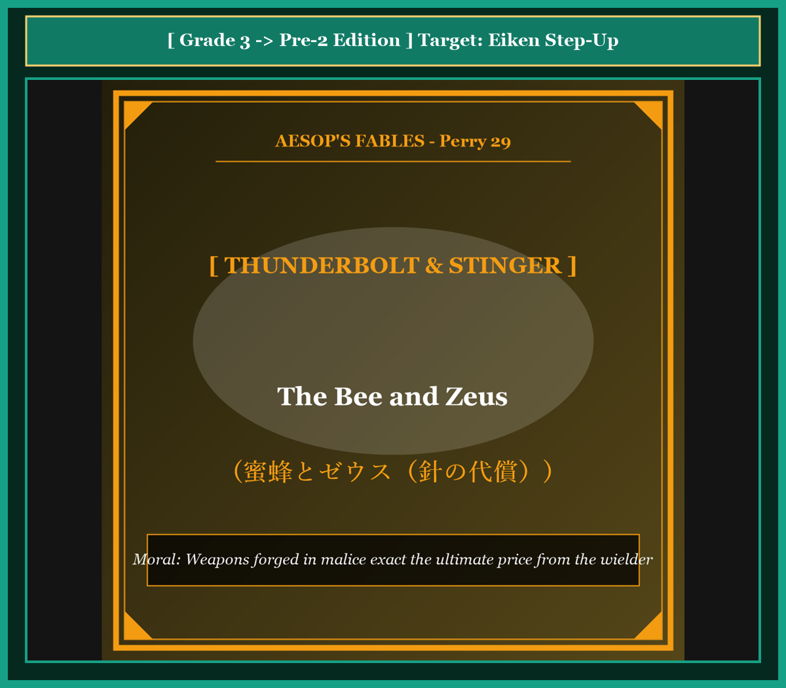

# Chapter 54: The Bee and Zeus (蜜蜂とゼウス)

<!-- 電子書籍 Page Break & Image Header -->

  

## 1. Benchmark Level: Eiken Grade 3 (英検3級レベル本文)
*Read in ~2 to 2.5 minutes. Baseline vocabulary and basic syntax.*

A queen bee ruled over a flourishing colony inside a hollow oak tree. Throughout the spring and summer, her industrious workers gathered nectar and produced combs of pure, golden honey. However, because both humans and wild beasts frequently plundered the hive, the queen grew bitter and resentful.

Desiring a lethal weapon to defend her property, the bee undertook a long pilgrimage to Mount Olympus. Upon reaching the celestial palace, she presented a comb of freshly harvested honey to Zeus, the supreme king of the gods.

Delighted by the sweet offering, Zeus praised the bee's craftsmanship and made a solemn vow: "In return for this marvelous gift, I promise to grant whatever request you formulate."

Seizing the opportunity, the bee revealed the dark malice in her heart. "Almighty Zeus," she petitioned, "endow my body with a venomous needle. Whenever an intruder attempts to approach my honeycombs, I wish to inflict a fatal sting so that they will perish on the spot."

Zeus was deeply displeased by this spiteful prayer because he cherished mortal mankind. Nevertheless, because he had sworn a divine oath, he could not revoke his word.

Instead, Zeus pronounced a just condition: "Your request shall be granted, and you shall possess a sharp stinger. However, whenever you discharge your venom into an enemy, your barbed weapon shall remain embedded in the wound. As you attempt to withdraw, your vital organs shall tear away, and you shall forfeit your own life. The very instrument of your malice shall seal your destruction."

---

## 2. Target Level: Eiken Grade Pre-2 (英検準2級レベル本文)
*Read in ~2 to 2.5 minutes. Richer idioms, participle clauses, and compound sentences.*

The matriarch of an apiary colony inhabited a fortified arboreal hollow. Throughout the pollen season, her synchronized foragers manufactured dense reserves of amber honey. However, because both human gatherers and woodland quadrupeds perpetually raided the comb, the queen cultivated an obsessive, vindictive paranoia.

Determined to procure an invincible defensive deterrent, the insect embarked on an arduous ascent to the celestial court of Mount Olympus. Penetrating the ethereal halls, she deposited an offering of virgin, aromatic honey before Zeus, the sovereign Olympian ruler.

Captivated by the sublime flavor of the tribute, the deity expressed benevolent patronage and articulated an unconditional covenant: "In remuneration for this ambrosial delicacy, name whatever boon your heart covets, and it shall be granted."

Unmasking the poisonous malevolence underlying her pilgrimage, the bee articulated a draconian petition: "Omnipotent sovereign, equip my anatomy with a lethal venomous spine! Whenever any trespasser presumes to compromise my nectar, empower me to inflict a terminal sting, extinguishing their life instantaneously."

Zeus experienced profound revulsion regarding this ruthless animosity, harboring deep paternal affection for mortal humanity. Nevertheless, constrained by the sacrosanct sanctity of an Olympian pledge, the deity could not annul his dispensation.

Consequently, Zeus tempered the decree with poetic jurisprudence: "Your petition is ratified; a sharp barb shall be bestowed upon your frame. However, whenever you discharge your toxic projectile into an assailant, the serrated stinger shall become permanently anchored in the victim's epidermis. As you attempt to disengage, your internal viscera shall rupture, terminating your own existence. The lethal mechanism engineered to slaughter others shall function as the instrument of your own capital execution."

---

## 3. Classic Original English Text (イソップ寓話クラシック原文)
*Translated by George Fyler Townsend (1867)*

A Bee went to Mount Olympus to offer fresh honey to Zeus. Zeus was pleased and promised her whatever she asked. The Bee requested a stinger so that she might kill anyone who tried to take her honey. Zeus was displeased with her malicious wish, yet kept his promise; but he decreed that whenever she stung someone, the stinger should remain in the wound, and she should lose her life.

---

### 🏛️ 【英検2級レベルで読み解く！クラシック原文の重要構文・英文法ノート】
1. **1. 分詞構文（Participle Clause: 付帯状況・理由）**
   - **原文**: *"The Hare, believing her assertion to be simply impossible, agreed to the proposal..."*
   - **解説**: 「〜と信じ込んでいたので」という理由を表す分詞構文。英検2級の長文読解・ライティングの最頻出構文です。
1. **2. 古典的仮定法現在（Subjunctive Mood）**
   - **原文**: *"Though you be swift as the wind, I will beat you in a race."*
   - **解説**: 譲歩節 `Though` の中で原形 `be` を用いる古典的な仮定法現在（現代英語の `Though you are...`）。格調高い古典の響きを持ちます。
1. **3. 過去分詞の後置修飾（Postpositive Participle）**
   - **原文**: *"On the day appointed for the race the two started together."*
   - **解説**: `appointed`（定められた・指定された）が直前の名詞 `the day` を後ろから修飾する構文です。

### 📜 【クラシック原文の重要語彙・古風表現（Classic Antique Vocabulary）】
- **retort** [動] 2級 **（機転を利かせて）言い返す、反論する**（現代の reply sharp/wittily に相当）
- **assertion** [名] 2級/準1級 **主張、断言**（動詞 assert の名詞形。2級長文定番）
- **wayside** [名] 2級 **道端、沿道**（by the wayside（道端に、途中で））
- **fatigue** [名] 2級 **（心身の）極度の疲労、疲れ**（tiredness の上位フォーマル語）

---

## 4. Japanese Translation & Moral (日本語訳と教訓)

### 【日本語全訳：英検準2級レベル本文】
養蜂コロニーの母たる女王蜂が、要塞化された樹木のうろの中に住まっていました。花粉の季節を通じて、彼女の同期した採餌者（働き蜂）たちは琥珀色の蜂蜜の高密度な備蓄を製造しました。しかしながら、人間の採取者も森の四足獣たちも巣を絶え間なく襲撃したため、女王蜂は執拗で復讐心に満ちた偏執病（被害妄想）を育んでいきました。

無敵の防衛的抑止力を調達することを決意したその昆虫は、オリュンポス山の天上の宮廷への過酷な上昇（登山）に乗り出しました。霊妙な大広間に侵入すると、彼女はオリュンポスの主権者たる支配者ゼウスの前に、芳醇な処女蜜（初蜜）の供物を捧げました。

その贈り物の神々しい風味に魅了された神は、慈悲深い後援の意を表明し、無条件の契約を宣言しました。「この神酒のような美味への報酬として、お前の心が熱望するいかなる恩恵をも名指すがよい。必ずや叶えてやろう。」

自らの巡礼の根底にある有毒な悪意の仮面を脱ぎ捨て、蜂は過酷な請願を口にしました。「全能の主権者よ、私の解剖学的構造に致死的な有毒のトゲを備え付けてください！ いかなる侵入者であれ私の蜜を脅かそうと図ったときには、即座にその命を消滅させる、終末的な一刺しを加える力を私にお授けください。」

死すべき人間に対して深い父親のような愛情を抱いていたゼウスは、この無慈悲な敵意に関して深甚な嫌悪を経験しました。それにもかかわらず、オリュンポスの誓約の侵すべからざる神聖さに制約されていたため、神は自らの特赦（約束）を取り消すことができませんでした。

その結果、ゼウスは詩的な法理学（因果応報）をもってその布告を調整しました。「お前の請願は批准された。鋭いトゲがお前の肉体に授けられるであろう。しかしながら、お前が襲撃者の中へと有毒な発射体を放出するときにはいつでも、その鋸歯状の針は犠牲者の表皮の中に永続的に錨を下ろす（固定される）ことになる。お前が離脱を試みるとき、お前の体内臓器は破裂し、お前自身の生存を終わらせるだろう。他者を虐殺するために設計されたその致死の機構は、お前自身を死刑執行する道具として機能するのだ。」

### 【教訓（Moral）】
**Weapons forged in malice exact the ultimate price from the wielder.**  
（他者を害するための報復兵器を求める者は、その兵器自体の構造的代償によって、自らの生命そのものを差し出さねばならない。）

---

## 5. Recite & Compare: そらんじたいキーフレーズ対比カード

  
フレーズ 1：無敵の防衛抑止力を手に入れようとする

  
3級Desiring a lethal weapon to defend her property, the bee undertook a pilgrimage.

  
準2級Determined to procure an invincible defensive deterrent, the insect embarked on an ascent.

  
<strong>解説：</strong>軍事・安全保障用語「procure an invincible defensive deterrent（無敵の防衛的抑止力を調達する）」の高度な表現です。

  
フレーズ 2：神酒のような美味への無条件の契約

  
3級Zeus praised the gift and promised to grant whatever request she formulated.

  
準2級In remuneration for this ambrosial delicacy, name whatever boon your heart covets.

  
<strong>解説：</strong>神話・文学用語「remuneration（報酬）」「ambrosial delicacy（神の美酒・美味）」「covet（熱望する）」の融合です。

  
フレーズ 3：侵入者の命を瞬時に消滅させる毒針の懇願

  
3級Whenever an intruder approaches, I wish to inflict a fatal sting so that they perish.

  
準2級Whenever any trespasser presumes to compromise my nectar, empower me to inflict a terminal sting.

  
<strong>解説：</strong>「presumes to compromise...（〜を侵害しようと図る）」「inflict a terminal sting」の格調高い文体です。

  
フレーズ 4：他者を虐殺する機構が己を処刑する道具となる

  
3級The very instrument of your malice shall seal your destruction.

  
準2級The lethal mechanism engineered to slaughter others shall function as the instrument of your own execution.

  
<strong>解説：</strong>工学・法学用語「mechanism engineered to slaughter...（虐殺するよう設計された機構）」と「instrument of execution」の対比です。

---

## 6. Key Vocabulary & Exam Notes (英検準2級 重要語彙・文法・面接対策)

### 1. 英検準2級 必須ボキャブラリー
* **apiary** [名] 養蜂場、ミツバチの巣
* **arboreal** [形] 樹木の、樹木に棲む
* **deterrent** [名] 抑止力、抑止物（*defensive deterrent*）
* **ambrosial** [形] 神酒のような、この上なく美味な
* **boon** [名] 恩恵、恵み、頼み事
* **trespasser** [名] 不法侵入者、侵害者
* **serrated** [形] 鋸歯状の、ギザギザのついた
* **viscera** [名] 内臓、はらわた（複数扱い）

### 2. 文法・構文のチェックポイント
* **name + whatever + 名詞 + S + V**:
  * 「Sが〜するいかなる…でも名指しせよ」。譲歩・包括の表現です。
* **engineered to + 原形動詞**:
  * 「〜するように巧妙に作られた」。

### 3. スピーキング（面接）＆ライティング活用ヒント
* 大量破壊兵器の相互確証破壊（MAD）について、*Weapons engineered for unilateral annihilation inherently mandate the catastrophic destruction of the wielder.* と論述できます。

