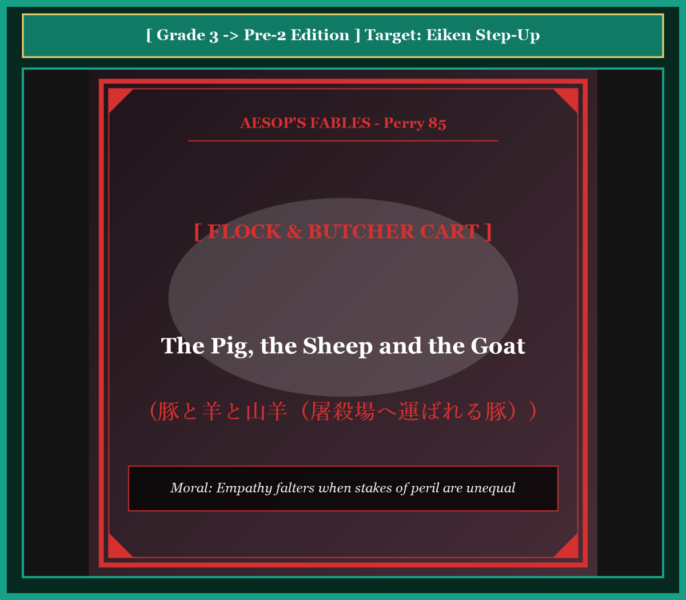

# Chapter 55: The Pig, the Sheep and the Goat (豚と羊と山羊)

<!-- 電子書籍 Page Break & Image Header -->

  

## 1. Benchmark Level: Eiken Grade 3 (英検3級レベル本文)
*Read in ~2 to 2.5 minutes. Baseline vocabulary and basic syntax.*

In a quiet pastoral meadow, a young pig, a gentle sheep, and a horned goat shared the same pasture in apparent harmony. They grazed upon the sweet clover and enjoyed the peaceful life of domestic livestock.

One crisp morning, the shepherd entered the enclosure carrying a sturdy hemp sack. Ignoring the sheep and the goat, he lunged forward and seized the plump pig by his hind leg.

Instantly, the pig erupted in wild terror. He thrashed against the shepherd's grasp, squealing at the top of his lungs with piercing screams that echoed across the surrounding hills.

The shepherd dragged the captive beast firmly toward the butcher's wagon.

Observing this chaotic scene, the sheep and the goat felt irritated by the pig's undignified behavior. They approached the fence and criticized their companion for his lack of composure.

"What a shameful display of cowardice!" bleated the sheep condescendingly. "The shepherd captures us regularly, shearing my heavy fleece every spring, yet I never disturb the peace with hysterical shrieks."

"Indeed," agreed the goat with self-righteous pride. "The master corners me twice daily to milk me, and I submit quietly without resistance. Why can you not endure a routine capture with patient dignity?"

The doomed pig turned his sorrowful gaze toward his naive companions and offered a chilling clarification: "How easy it is for you to preach composure when your lives are never at risk! When the shepherd captures you, he seeks merely your renewable fleece or your morning milk. But when he seizes me, he seeks neither wool nor dairy—he demands my lifeblood! You risk only a haircut, but I face the butcher's knife!"

Hearing these words, the sheep and goat fell into horrified silence, recognizing their moral blindness.

---

## 2. Target Level: Eiken Grade Pre-2 (英検準2級レベル本文)
*Read in ~2 to 2.5 minutes. Richer idioms, participle clauses, and compound sentences.*

Within the pastoral perimeter of a rustic paddock, a swine, an ovine sheep, and a caprine goat coexisted in apparent pastoral tranquility. Sharing the same forage and sheltered beneath the same timber lean-to, the animals appeared to enjoy equivalent social status under their human overseer.

However, during a routine inspection, the herdsman suddenly lunged past the ruminants, violently securing the squealing swine by his calcified hock.

Instantly recognizing the existential gravity of the assault, the pig inaugurated a frantic, convulsive struggle. He thrashed against the terrestrial surface, projecting deafening, high-decibel acoustic detonations that reverberated through the agricultural valley.

The herdsman remorselessly dragged the thrashing mammal toward a motorized transport bound for the municipal abattoir.

Observing this undignified resistance, the sheep and the goat exhibited profound moral condescension. Approaching the barrier, the ruminants interrogated the captive regarding his complete abandonment of philosophical composure.

"Why orchestrate such an unseemly hysterical spectacle?" bleated the sheep with aloof disapproval. "The proprietor subjects our flock to periodic physical detention, shearing our woolen coats without provoking such vulgar vocalizations."

"Precisely," reinforced the goat with self-congratulatory pride. "The dairy master confines me daily to extract lactation, yet I submit with stoic passivity. Why can you not assimilate the rudimentary tenets of dignified resignation?"

The condemned swine fixed his terrified eyes upon his sanctimonious peers, articulating a scathing socio-philosophical rebuke: "How grotesquely disingenuous for creatures facing zero existential jeopardy to sermonize about stoic etiquette! When the overseer apprehends your bodies, he extracts merely surplus secondary commodities—renewable fleece or nutritional secretions. But when his talons enclose my flesh, he solicits neither fiber nor dairy; he demands my total biological liquidation! You surrender a superficial haircut, whereas I am conveyed to the butchering block!"

Confronted with the stark disparity of their existential stakes, the sheep and goat lapsed into stunned, sheepish silence.

---

## 3. Classic Original English Text (イソップ寓話クラシック原文)
*Translated by George Fyler Townsend (1867)*

A Pig, a Sheep, and a Goat were kept in the same meadow. One day the shepherd seized the Pig, which began to squeal and struggle furiously. The Sheep and Goat rebuked him: "The shepherd takes us constantly, and we never make such an outcry." The Pig replied: "Your capture and mine are very different matters: he wants you for your wool and milk, but he takes me for my life."

---

### 🏛️ 【英検2級レベルで読み解く！クラシック原文の重要構文・英文法ノート】
1. **1. 分詞構文（Participle Clause: 付帯状況・理由）**
   - **原文**: *"The Hare, believing her assertion to be simply impossible, agreed to the proposal..."*
   - **解説**: 「〜と信じ込んでいたので」という理由を表す分詞構文。英検2級の長文読解・ライティングの最頻出構文です。
1. **2. 古典的仮定法現在（Subjunctive Mood）**
   - **原文**: *"Though you be swift as the wind, I will beat you in a race."*
   - **解説**: 譲歩節 `Though` の中で原形 `be` を用いる古典的な仮定法現在（現代英語の `Though you are...`）。格調高い古典の響きを持ちます。
1. **3. 過去分詞の後置修飾（Postpositive Participle）**
   - **原文**: *"On the day appointed for the race the two started together."*
   - **解説**: `appointed`（定められた・指定された）が直前の名詞 `the day` を後ろから修飾する構文です。

### 📜 【クラシック原文の重要語彙・古風表現（Classic Antique Vocabulary）】
- **retort** [動] 2級 **（機転を利かせて）言い返す、反論する**（現代の reply sharp/wittily に相当）
- **assertion** [名] 2級/準1級 **主張、断言**（動詞 assert の名詞形。2級長文定番）
- **wayside** [名] 2級 **道端、沿道**（by the wayside（道端に、途中で））
- **fatigue** [名] 2級 **（心身の）極度の疲労、疲れ**（tiredness の上位フォーマル語）

---

## 4. Japanese Translation & Moral (日本語訳と教訓)

### 【日本語全訳：英検準2級レベル本文】
素朴な放牧場の牧歌的な境界内において、ブタ、ヒツジ、そしてヤギが、外見上は牧歌的な静けさの中で共存していました。同じ飼料を分け合い、同じ木造の差し掛け小屋の下に身を寄せ合い、動物たちは人間の監視者のもとで同等の社会的地位を享受しているかのように見えました。

しかしながら、日常の巡回点検の最中、牧夫は突如として反芻動物（羊と山羊）を通り抜け、金切り声を上げるブタの石灰化した飛節（後ろ足の関節）を力任せに拘束しました。

襲撃の実存的重大性を瞬時に認識したブタは、狂乱の痙攣的抵抗を開始しました。彼は地面に対して激しくもがき、農業の谷間に反響する耳を聾するような高デシベルの音響的爆発（悲鳴）を放ちました。

牧夫は身もだえする哺乳類を、市の屠殺場へと向かう電動輸送車両（トラック）へと容赦なく引きずっていきました。

この威厳のない抵抗を観察した羊と山羊は、深甚な道徳的見下し（上から目線の説教）を示しました。柵に歩み寄り、反芻動物たちは哲学的沈着の完全な放棄について囚人を尋問しました。

「なぜそのような見苦しいヒステリックな見世物を演出するのかね？」と羊は冷淡な不賛成を込めて鳴きました。「所有者は我々の群れを定期的な身体拘束に服従させ、羊毛のコートを刈り取りますが、そのような下品な発声（叫び）を引き起こしたことなどありませんよ。」

「その通りだ」と山羊も自己満足的な誇りをもって補強しました。「酪農の主人は乳を搾取するために毎日私を監禁するが、私はストイックな受動性をもって服従している。なぜ君は尊厳ある諦念の初歩的な教義を同化（理解）できないのかね？」

死刑を宣告されたブタは、自らの独善的な同輩たちに怯えた目を据え、痛烈な社会哲学的叱責を口にしました。「実存的危機（命の危険）にまったく直面していない生き物が、ストイックなエチケットについて説教するなど、なんと奇怪で不誠実なことか！ 監視者があなた方の肉体を拘束するとき、彼が抽出するのは単なる余剰の二次的商品——再生可能な羊毛か、栄養の分泌物（ミルク）に過ぎない。しかし彼の鉤爪が私の肉体を包み込むとき、彼が求めているのは繊維でも乳でもない。彼は私の完全な生物学的清算（屠殺）を要求しているのだ！ あなた方が差し出すのは表面的な散髪に過ぎないが、私が運ばれているのは解体台なのだ！」

自らの実存的利害（失うものの重み）の明白な格差に直面し、羊と山羊は茫然自失の、居心地の悪い沈黙へと沈んでいきました。

### 【教訓（Moral）】
**Empathy falters when stakes of peril are unequal.**  
（直面している危機の重みと利害が決定的に異なる他者に対して、何のリスクも負っていない者が安易に冷静さや諦念を説くことは、最も下劣な道徳的欺瞞である。）

---

## 5. Recite & Compare: そらんじたいキーフレーズ対比カード

  
フレーズ 1：外見上は牧歌的な調和の中で共存する

  
3級They shared the pasture in apparent harmony, enjoying peaceful life.

  
準2級They coexisted in apparent pastoral tranquility, sharing forage beneath the same shelter.

  
<strong>解説：</strong>動物学・生態学用語「swine（豚）」「ovine（羊）」「caprine（山羊）」と「pastoral tranquility」の格調高い文体です。

  
フレーズ 2：哲学的沈着の完全な放棄を非難する

  
3級The sheep and goat criticized their companion for his lack of composure.

  
準2級The ruminants interrogated the captive regarding his complete abandonment of philosophical composure.

  
<strong>解説：</strong>「interrogated the captive（囚人を尋問した）」「abandonment of philosophical composure（哲学的沈着の放棄）」という洗練表現です。

  
フレーズ 3：実存的危険のない者がエチケットを説く奇怪さ

  
3級How easy it is for you to preach composure when your lives are never at risk!

  
準2級How grotesquely disingenuous for creatures facing zero existential jeopardy to sermonize about stoic etiquette!

  
<strong>解説：</strong>「grotesquely disingenuous（奇怪なほど不誠実な・偽善的な）」「existential jeopardy（実存的危機）」の最高峰の知性表現です。

  
フレーズ 4：二次的商品と完全な生物学的清算の格差

  
3級You risk only a haircut, but I face the butcher's knife!

  
準2級He extracts merely surplus secondary commodities, whereas he demands my total biological liquidation!

  
<strong>解説：</strong>経済・生物学用語「surplus secondary commodities（余剰二次商品）」と「total biological liquidation（完全な生物学的清算）」の見事な対比です。

---

## 6. Key Vocabulary & Exam Notes (英検準2級 重要語彙・文法・面接対策)

### 1. 英検準2級 必須ボキャブラリー
* **paddock** [名] 放牧場、パドック
* **ruminant** [名] 反芻動物（羊・山羊・牛など）
* **abattoir** [名] 屠殺場（フランス語由来の格調高い語）
* **condescension** [名] 見下すような態度、恩着せがましさ
* **stoic** [形] 禁欲的な、感情を抑えた、ストイックな
* **disingenuous** [形] 不誠実な、偽善的な、腹黒い
* **jeopardy** [名] 危険、危機（*in jeopardy*）
* **liquidation** [名] 清算、全滅、抹殺

### 2. 文法・構文のチェックポイント
* **How + 副詞 + 形容詞 + for 人 + to do**:
  * 強調感嘆文。「〜が…するとはなんと…なことか！」。
* **whereas + S + V**:
  * 対比の接続詞。「〜であるのに対して、…である」。

### 3. スピーキング（面接）＆ライティング活用ヒント
* 利害関係の不均衡と上から目線の安全論について、*Commentators insulated from economic devastation must recognize that sermonizing stoicism to bankrupt citizens is grotesquely disingenuous.* と論評できます。

