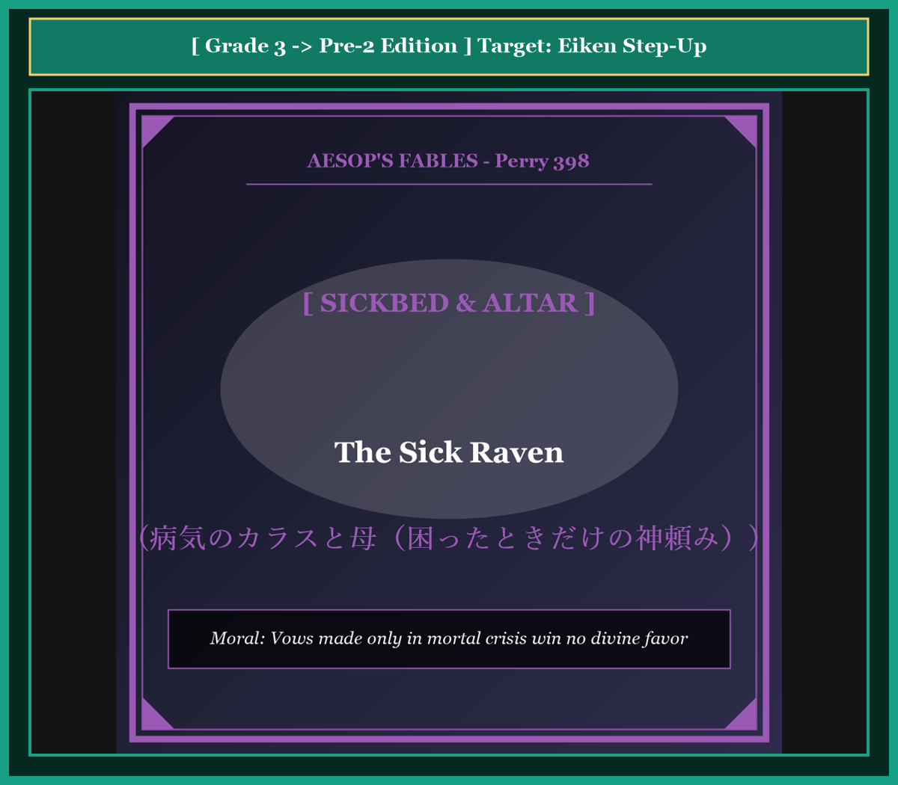

# Chapter 56: The Sick Raven (病気のカラスと母)

<!-- 電子書籍 Page Break & Image Header -->

  

## 1. Benchmark Level: Eiken Grade 3 (英検3級レベル本文)
*Read in ~2 to 2.5 minutes. Baseline vocabulary and basic syntax.*

A wild raven perched upon the gnarled branch of an ancient pine tree, suffering from an acute and debilitating illness. Throughout his youthful days, the reckless scavenger had lived an unprincipled existence. Whenever pious villagers placed roasted meats and honeyed cakes upon the sacred altars of the gods, the raven would swoop down audacity and steal the consecrated offerings.

Now, afflicted by violent fevers and failing strength, the bird lay trembling in his nest. Sensing that his life was rapidly slipping away, he called out to his mother, who was perched beside him in mourning.

"Dearest mother," the stricken bird pleaded in agony, "I implore you to fly immediately to the sacred sanctuaries of Apollo and the Olympian gods! Prostrate yourself before their shrines and petition for my physical restoration. Promise them that if they spare my life, I will dedicate a magnificent sacrifice to honor their names!"

The mother raven gazed down upon her wretched offspring with tears of profound grief. She sighed mournfully and delivered a piercing reality check:

"Alas, my foolish child, upon which deity can you possibly call for salvation? Can you name a single celestial patron whose sacred precinct you have not desecrated, or from whose holy altar you have not purloined consecrated flesh? You systematically mocked the gods throughout your prosperous health. It is preposterous to expect divine compassion now that you face the threshold of mortality."

Stricken by the truth of her indictment, the dying bird remained silent as darkness enveloped his sight.

---

## 2. Target Level: Eiken Grade Pre-2 (英検準2級レベル本文)
*Read in ~2 to 2.5 minutes. Richer idioms, participle clauses, and compound sentences.*

Incarcerated by acute pathological delirium within his arboreal roost, a raven languished under the assault of a terminal pestilence. Throughout his arrogant youth, the predatory corvid had conducted an unabashedly profane career: whenever religious supplicants deposited sacred viands and floral tributes upon stone altars, the corvid audaciously pillaged the sanctified offerings.

Now, incapacitated by violent hyperthermia and systemic respiratory collapse, the juvenile scavenger perceived that his vital pulse was irreversibly decelerating. Gathering his residual breath, he petitioned his maternal attendant, who perched beside the deathbed in ritual mourning.

"Revered mother," articulated the stricken corvid between convulsive gasps, "undertake immediate flight to the monumental acropolis of Apollo! Humiliate yourself before the celestial tribunal, imploring therapeutic salvation. Vow that should the gods preserve my biological integrity, I shall consecrate a monumental holocaust of cattle upon their altars!"

The matriarch scrutinized her doomed progeny with an expression of melancholic severity. Exhaling a heavy sigh, she shattered his superstitious delusions with devastating analytical precision:

"Deluded child, upon which celestial sovereign can your appeal possibly register? Enumerate a single temple whose sacred perimeter you have not desecrated, or an isolated sacrificial brazier from which you have not purloined sacred flesh! Throughout your prosperous vitality, you exhibited sovereign contempt for holy jurisprudence. To imagine that celestial deities will extend miraculous clemency to an inveterate thief at the threshold of biological extinction is the nadir of narcissistic absurdity."

Stunned by the unassailable equity of her judgment, the dying corvid collapsed in silent resignation as cognitive darkness extinguished his consciousness.

---

## 3. Classic Original English Text (イソップ寓話クラシック原文)
*Translated by George Fyler Townsend (1867)*

A Raven was taken very ill and expected to die. He said to his Mother: "Pray to the gods for my recovery, and promise them a sacrifice." The Mother replied: "Alas, my son, which of the gods will have pity on you? For is there any god from whose altar you have not stolen offerings?"

---

### 🏛️ 【英検2級レベルで読み解く！クラシック原文の重要構文・英文法ノート】
1. **1. 分詞構文（Participle Clause: 付帯状況・理由）**
   - **原文**: *"The Hare, believing her assertion to be simply impossible, agreed to the proposal..."*
   - **解説**: 「〜と信じ込んでいたので」という理由を表す分詞構文。英検2級の長文読解・ライティングの最頻出構文です。
1. **2. 古典的仮定法現在（Subjunctive Mood）**
   - **原文**: *"Though you be swift as the wind, I will beat you in a race."*
   - **解説**: 譲歩節 `Though` の中で原形 `be` を用いる古典的な仮定法現在（現代英語の `Though you are...`）。格調高い古典の響きを持ちます。
1. **3. 過去分詞の後置修飾（Postpositive Participle）**
   - **原文**: *"On the day appointed for the race the two started together."*
   - **解説**: `appointed`（定められた・指定された）が直前の名詞 `the day` を後ろから修飾する構文です。

### 📜 【クラシック原文の重要語彙・古風表現（Classic Antique Vocabulary）】
- **retort** [動] 2級 **（機転を利かせて）言い返す、反論する**（現代の reply sharp/wittily に相当）
- **assertion** [名] 2級/準1級 **主張、断言**（動詞 assert の名詞形。2級長文定番）
- **wayside** [名] 2級 **道端、沿道**（by the wayside（道端に、途中で））
- **fatigue** [名] 2級 **（心身の）極度の疲労、疲れ**（tiredness の上位フォーマル語）

---

## 4. Japanese Translation & Moral (日本語訳と教訓)

### 【日本語全訳：英検準2級レベル本文】
樹木のねぐらの中で急性の病理学的譫妄（せんもう）に幽閉され、あるカラスが末期の疫病の急襲のもとで衰弱していました。自らの傲慢な若年期を通じて、この捕食性のカラス科の鳥は、恥知らずなまでに不敬な経歴を積んできました。宗教的懇願者たちが石の祭壇の上に神聖な食糧や花の捧げ物を供えるたびに、このカラス科の鳥は大胆不敵にも神聖化された捧げ物を略奪していたのです。

今や、激しい高体温症と全身性の呼吸器崩壊によって行動不能となり、この若い清掃動物は自らの生命の脈拍が不可逆的に減速していることを知覚しました。残された息をかき集め、彼は臨終の床の隣に儀礼的喪に服して止まっていた実母に請願しました。

「敬愛なる母よ」と打ちのめされたカラスは痙攣するあえぎの合間に言葉を絞り出しました。「アポロンの記念碑的なアクロポリス（神殿）へと即座の飛行に乗り出してください！ 天上の法廷の前に自らを辱めてひれ伏し、治療的救済を懇願してください。もし神々が私の生物学的完全性（生命）を保存してくださるならば、祭壇の上に牛の記念碑的な全焼の生贄（ホロコースト）を奉献すると誓ってください！」

母鳥は憂鬱な厳しさの表情をもって、破滅を運命づけられた我が子を精査しました。重いため息を吐き出すと、彼女は壊滅的な分析的精密さをもって、息子の迷信的な妄想を粉々に打ち砕きました。

「迷妄の子よ、いったいどの天の主権者にあなたの訴えが届く可能性があるというのですか？ あなたがその神聖な境界を冒涜しなかった神殿を一つでも列挙できるのですか、あるいはあなたが神聖な肉をかすめ取らなかった孤立した生贄の火鉢が一つでもあるのですか！ 繁栄した活力の全期間を通じて、あなたは神聖な法理学に対する絶対的な軽蔑を示してきました。生物学的絶滅の敷居（死の淵）に至った今になって、天の神々が根っからの盗人に奇跡的な寛大さを差し伸べてくれるなどと妄想することは、自己愛的な不条理の極致（どん底）です。」

母親の判断の反論の余地なき公平さに圧倒され、死にゆくカラスは、認識の暗闇が自らの意識を消滅させる中、無言の諦念のうちに崩れ落ちました。

### 【教訓（Moral）】
**Vows made only in mortal crisis win no divine favor.**  
（過去の全生涯において神聖な義務や他者の権利を組織的に蹂躙してきた者が、自らの破滅に直面した土壇場でのみ慌てて捧げる空虚な誓約や祈りは、天にも人にも届かない。）

---

## 5. Recite & Compare: そらんじたいキーフレーズ対比カード

  
フレーズ 1：神聖な捧げ物を恥知らずに略奪した過去

  
3級The raven would swoop down with audacity and steal the consecrated offerings.

  
準2級The corvid had conducted an unabashedly profane career, audaciously pillaging sanctified offerings.

  
<strong>解説：</strong>「unabashedly profane（恥知らずなまでに不敬な）」「pillaging sanctified offerings（神聖な捧げ物を略奪する）」の洗練表現です。

  
フレーズ 2：生命を保全してくれるなら牛の生贄を捧げると誓う

  
3級Promise them that if they spare my life, I will dedicate a magnificent sacrifice.

  
準2級Vow that should the gods preserve my integrity, I shall consecrate a monumental holocaust of cattle.

  
<strong>解説：</strong>仮定法倒置「should the gods preserve...」と宗教学用語「consecrate a holocaust（全焼生贄を奉納する）」の高度な文体です。

  
フレーズ 3：一度も冒涜しなかった神殿を列挙できるかという追及

  
3級Can you name a single celestial patron whose holy altar you have not purloined?

  
準2級Enumerate a single temple whose sacred perimeter you have not desecrated!

  
<strong>解説：</strong>命令文「Enumerate a single temple...」と関係代名詞「whose」を用いた法廷尋問的表現です。

  
フレーズ 4：絶滅の淵に至って慈悲を妄想する自己愛的不条理

  
3級It is preposterous to expect divine compassion now that you face mortality.

  
準2級To imagine deities will extend clemency to an inveterate thief at extinction is the nadir of absurdity.

  
<strong>解説：</strong>「extend clemency to an inveterate thief（常習的盗人に恩赦・慈悲を与える）」と「the nadir of absurdity（不条理のどん底）」の白眉の修辞です。

---

## 6. Key Vocabulary & Exam Notes (英検準2級 重要語彙・文法・面接対策)

### 1. 英検準2級 必須ボキャブラリー
* **delirium** [名] 精神錯乱、譫妄
* **profane** [形] 冒涜的な、不敬な、世俗の
* **hyperthermia** [名] 高体温症、異常発熱
* **holocaust** [名] 全焼の生贄、大虐殺、大惨事（ギリシャ語由来の原義）
* **desecrate** [動] 〜を冒涜する、神聖を汚す
* **clemency** [名] 慈悲、寛大な処置、恩赦
* **inveterate** [形] 根深い、常習的な（*inveterate thief*）
* **nadir** [名] どん底、最悪の瞬間（⇔ *zenith* 天頂）

### 2. 文法・構文のチェックポイント
* **Vow that should + S + 原形動詞, S + shall ...**:
  * 条件節の if 省略倒置。「万一〜ならば…すると誓え」。格調高い誓約文です。
* **extend + 名詞 + to ...**:
  * 「〜に…（慈悲・援助・歓迎）を差し向ける、与える」。*extend clemency*。

### 3. スピーキング（面接）＆ライティング活用ヒント
* 日頃の倫理的コンプライアンスを怠った組織の危機における孤立について、*Enterprises that systematically desecrate public trust cannot expect regulatory clemency when confronting systemic crises.* と論証できます。

