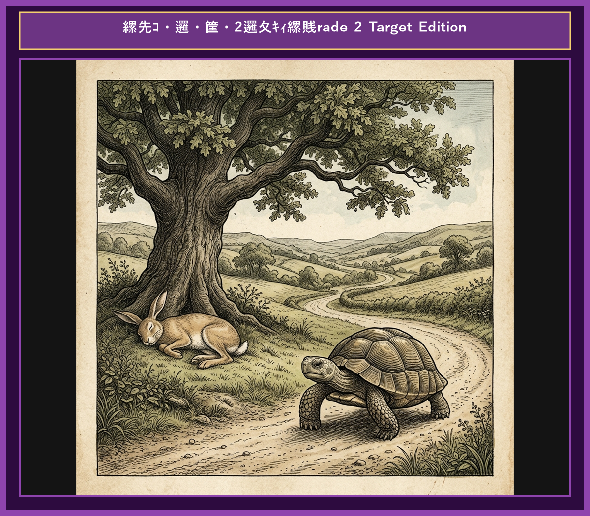

# Chapter 1: The Tortoise and the Hare (ウサギとカメ)

  

<!-- Video Learning Link Start -->

  <a href="https://youtu.be/mock_tortoise_and_hare_ch01" style="color: #0969da; font-weight: bold; text-decoration: none; font-size: 1.05em; display: inline-block;">
    🎬 【動画で聴く・シャドーイング】ネイティブ朗読＆カラオケ字幕付き動画（YouTube）▶
  </a>
  

    ※ タップするとYouTubeが開き、発音に合わせて光るカラオケ字幕で学習できます。
  

<!-- Video Learning Link End -->

## 1. Benchmark Level: Eiken Pre-2 (英検準2級レベル本文)
*Read in ~2 to 2.5 minutes. Advanced vocabulary and structured clauses.*

An arrogant hare was constantly boasting of his extraordinary speed to all the forest creatures. He took particular pleasure in mocking a slow-moving tortoise. "I challenge anyone in these woods to a race," the hare proclaimed arrogantly. "No one has ever defeated me, nor will anyone ever succeed!"

Much to the hare's astonishment, the quiet tortoise stepped forward and replied with composure, "I accept your challenge. Let us compete to see who reaches the summit of the hill first."

Amused by the proposal, the hare agreed immediately, confident of an easy victory. The moment the competition began, the hare accelerated rapidly, leaving his opponent far behind in a cloud of dust.

Upon reaching the midpoint of the course, the hare glanced back and noticed that the tortoise was barely visible in the remote distance. "It will take him hours to catch up with me," reasoned the hare. "Therefore, I can comfortably enjoy a refreshing nap beneath the oak tree." Feeling thoroughly relaxed, he lay down in the shade and fell into a profound slumber.

Meanwhile, the tortoise maintained a slow but steady pace, advancing continuously without a single moment of hesitation.

By the time the hare finally awoke, twilight had descended upon the forest. Realizing his grave mistake, he sprinted toward the finish line with all his remaining strength. To his utter dismay, however, the tortoise had already crossed the goal and secured a triumphant victory.

Sloth and overconfidence lead to ruin, whereas steady perseverance ultimately triumphs over natural talent.

---

## 2. Target Level: Eiken Grade 2 (英検2級レベル本文)
*Read in ~3 to 4 minutes. Academic discourse, complex participial structures, formal vocabulary, and nuanced transitions.*

A notoriously boastful hare perpetually ridiculed the sluggish movement of a tortoise, repeatedly asserting his own unexcelled swiftness before the woodland community. "Regardless of who dares to challenge me," declared the hare with supreme arrogance, "my natural velocity remains entirely insurmountable."

Unfazed by the hare's pompous declaration, the tortoise calmly offered a counter-proposal. "Notwithstanding your remarkable speed, I am prepared to engage in a competitive race to the designated hilltop."

Deeming the challenge absurdly amusing, the hare readily accepted, anticipating an inevitable triumph. At the commencement of the race, the hare burst forward with extraordinary acceleration, swiftly establishing a formidable lead that rendered his competitor virtually invisible.

Having traversed half the distance in mere minutes, the hare paused to assess his progress. Perceiving that the tortoise was lagging far behind, the hare succumbed to complacency. "Inasmuch as the gap between us is immense," he calculated, "a temporary respite will in no way compromise my impending victory." Consequently, he reclined beneath the dense foliage of a venerable oak and lapsed into an unalterable sleep.

In sharp contrast, the tortoise exhibited unwavering determination. Advancing with relentless continuity, he traversed the rugged terrain without succumbing to fatigue or distraction.

When the hare eventually awakened, nightfall was imminently approaching. Panic-stricken upon discovering the tortoise's proximity to the finish line, the hare exerted his maximum capacity in a desperate pursuit. Nevertheless, his delayed effort proved futile; the tortoise had already crossed the boundary, securing an unprecedented triumph.

Indolence and unwarranted self-assurance inevitably culminate in failure, whereas relentless perseverance consistently surpasses raw talent.

---

## 3. Classic Original English Text (イソップ寓話 クラシック原文)
*Townsend / Jacobs Edition (Public Domain)*

A Hare was one day making fun of the short feet and slow pace of the Tortoise, who retorted: "Though you be swift as the wind, I will beat you in a race." The Hare, believing her assertion to be simply impossible, agreed to the proposal; and they agreed that the Fox should choose the course and fix the goal. On the day appointed for the race the two started together. The Tortoise never for a moment stopped, but went on with a slow but steady pace straight to the end of the course. The Hare, lying down by the wayside, fell asleep. At last waking up, and moving as fast as he could, he saw the Tortoise had reached the goal, and was comfortably resting after her fatigue.

Slow and steady wins the race.

---

### 🏛️ 【英検2級レベルで読み解く！クラシック原文の重要構文・英文法ノート】
1. **1. 分詞構文（Participle Clause: 付帯状況・理由）**
   - **原文**: *"The Hare, believing her assertion to be simply impossible, agreed to the proposal..."*
   - **解説**: 「〜と信じ込んでいたので」という理由を表す分詞構文。英検2級の長文読解・ライティングの最頻出構文です。
1. **2. 古典的仮定法現在（Subjunctive Mood）**
   - **原文**: *"Though you be swift as the wind, I will beat you in a race."*
   - **解説**: 譲歩節 `Though` の中で原形 `be` を用いる古典的な仮定法現在（現代英語の `Though you are...`）。格調高い古典の響きを持ちます。
1. **3. 過去分詞の後置修飾（Postpositive Participle）**
   - **原文**: *"On the day appointed for the race the two started together."*
   - **解説**: `appointed`（定められた・指定された）が直前の名詞 `the day` を後ろから修飾する構文です。

### 📜 【クラシック原文の重要語彙・古風表現（Classic Antique Vocabulary）】
- **retort** [動] 2級 **（機転を利かせて）言い返す、反論する**（現代の reply sharp/wittily に相当）
- **assertion** [名] 2級/準1級 **主張、断言**（動詞 assert の名詞形。2級長文定番）
- **wayside** [名] 2級 **道端、沿道**（by the wayside（道端に、途中で））
- **fatigue** [名] 2級 **（心身の）極度の疲労、疲れ**（tiredness の上位フォーマル語）

---

## 4. Japanese Translation (日本語訳)

野ウサギがカメの足の短さと歩みの遅さを馬鹿にして笑いました。するとカメは言い返しました。「あなたが風のように速くても、かけっこなら私の方が勝ちますよ。」
ウサギはそんな主張は到底不可能だと信じ込んで、その提案に同意しました。そして、キツネにコースを選んでもらい、ゴールを決めてもらうことにしました。
レースの当日、二匹は一緒にスタートしました。カメは一瞬たりとも立ち止まらず、遅くとも着実な歩みで、まっすぐコースの終わりへと進み続けました。一方のウサギは、道端に横になって眠り込んでしまいました。
やがて目を覚ましたウサギは、できる限りの速さで駆け抜けましたが、カメがすでにゴールに到達し、心地よく休んでいるのを目にするのでした。

**教訓**: 怠惰と根拠のない過信は不可避的に失敗に帰着するが、弛まぬ不屈の努力は一貫して生来の才能を凌駕する。

---

## 5. Recite & Compare (そらんじたいキーフレーズ対比)
*Memorize these contrastive expressions to elevate speaking, writing, and reading fluency.*

  
■ 場面：過剰な自慢とあざけり

  
【Pre-2 基礎】 <em>boasting of his extraordinary speed / mocking...</em>

  
【Grade 2 暗唱】 <strong><em>perpetually ridiculed... / asserting his unexcelled swiftness...</em></strong>

  
【ポイント】 <strong>解説・試験活用</strong>：動詞 `ridicule`（〜を冷やかして嗤う）や副詞 `perpetually`（絶え間なく）、形容詞 `unexcelled`（卓抜した）は英検2級〜準1級長文の必須表現です。

  
■ 場面：逆説的・公式な挑戦受託

  
【Pre-2 基礎】 <em>replied with composure, "I accept your challenge..."</em>

  
【Grade 2 暗唱】 <strong><em>Notwithstanding your speed, I am prepared to engage in...</em></strong>

  
【ポイント】 <strong>解説・試験活用</strong>：前置詞 `Notwithstanding`（〜にもかかわらず）や動詞句 `engage in`（〜に従事する・〜を試みる）を用いた格式高い譲歩・対比構文。

  
■ 場面：油断・自己過信への油断

  
【Pre-2 基礎】 <em>thought, "I can comfortably enjoy a refreshing nap..."</em>

  
【Grade 2 暗唱】 <strong><em>succumbed to complacency... a temporary respite will in no way compromise...</em></strong>

  
【ポイント】 <strong>解説・試験活用</strong>：`succumb to complacency`（自己満足・油断に屈する）や `respite`（一時的な休息）は、2級ライティングの社会・人間心理課題で加点対象となる名表現。

  
■ 場面：不屈の継続行動

  
【Pre-2 基礎】 <em>maintained a slow but steady pace, advancing continuously...</em>

  
【Grade 2 暗唱】 <strong><em>exhibited unwavering determination, advancing with relentless continuity...</em></strong>

  
【ポイント】 <strong>解説・試験活用</strong>：`unwavering`（揺るぎない）や `relentless`（たゆまぬ・容赦ない）といった2級重要形容詞。英作文の目標達成・努力に関するエッセイで強力に機能します。

  
■ 場面：教訓（Moral）

  
【Pre-2 基礎】 <em>Sloth and overconfidence lead to ruin...</em>

  
【Grade 2 暗唱】 <strong><em>Indolence and unwarranted self-assurance inevitably culminate in failure...</em></strong>

  
【ポイント】 <strong>解説・試験活用</strong>：`culminate in...`（ついに〜に帰着する・〜で終わる）や `indolence`（怠惰）を用いた、2級〜準1級模範解答レベルの格調高き抽象構文。

---

## 6. Vocabulary Builder: 赤シート対応 重要単語・熟語チェック表
*※ 赤い透明シート（または赤フィルム）を重ねると、日本語訳が消えて自力テストができます。*

| No. | 見出し語 / イディオム | 品詞 / レベル | 日本語の意味（赤シートで消える） | 本文での使われ方・コロケーション |
|:---:|---|:---:|---|---|
| **01** | **proud** | [形] 4級 | 誇り高い、傲慢な | *a proud hare (自惚れたウサギ)* |
| **02** | **boast (about...)** | [動] 3級 | 〜を自慢する、誇る | *was always boasting about his speed* |
| **03** | **make fun of...** | [熟] 3級 | 〜をからかう、嘲笑する | *making fun of a slow tortoise* |
| **04** | **challenge** | [名/動] 3級 | 挑戦、課題 / 挑む | *I accept your challenge.* |
| **05** | **accept** | [動] 3級 | 受け入れる、受諾する | *accept the proposal (提案を受諾する)* |
| **06** | **dash** | [動] 3級 | 勢いよく走る、突進する | *dashed forward (前方へ駆け出した)* |
| **07** | **leave ~ behind** | [熟] 3級 | 〜を置き去りにする | *left the tortoise far behind* |
| **08** | **visible** | [形] 準2級 | 目に見える、視認できる | *was barely visible in the distance* |
| **09** | **catch up (with...)** | [熟] 3級 | 〜に追いつく | *before he catches up* |
| **10** | **slumber** | [名/動] 準2級 | 深い眠り / 眠る | *fell into a profound slumber* |
| **11** | **sprint** | [動] 3級 | 全力疾走する | *sprinted toward the finish line* |
| **12** | **persistence** | [名] 準2級/2級 | 粘り強さ、不屈の継続 | *persistence and hard work will bring success* |

### 【出題傾向・文法解説ノート】

### 【出題頻出語彙・熟語ノート】
- **ridicule** [動] 〜をあざ笑う、冷やかす（名詞 *ridicule* 「冷笑」）
- **insurmountable** [形] 打ち勝ち難い、克服できない（*insurmountable obstacle* 「乗り越えられない障害」）
- **complacency** [名] 自己満足、油断（動詞 *succumb to complacency* で2級長文頻出）
- **respite** [名] 一時的な休止、息抜き（*without respite* 「休みなく」）
- **unwavering** [形] 揺るぎない、確固たる（*unwavering determination/support*）
- **relentless** [形] 絶え間ない、厳しい（*relentless pursuit* 「あくなき追求」）
- **culminate in** [熟] 最終的に〜に帰着する、〜で最高潮に達する（2級・準1級要約問題最頻出句動詞）

### 【文法・構文ポイント】
1. **[Notwithstanding + 名詞]（〜にもかかわらず）**
   - 2級本文: *"Notwithstanding your remarkable speed, I am prepared to engage in..."*
   - ポイント: `despite` や `in spite of` と同義の高級なフォーマル前置詞。英検2級の長文読解や要約問題で頻繁に登場します。
2. **[inasmuch as ...]（〜である以上、〜なのだから）**
   - 2級本文: *"Inasmuch as the gap between us is immense..."*
   - ポイント: `since` や `because` の格式の高い接続詞表現。理由・根拠を明確に示す論理文章を作成する際に活用されます。
