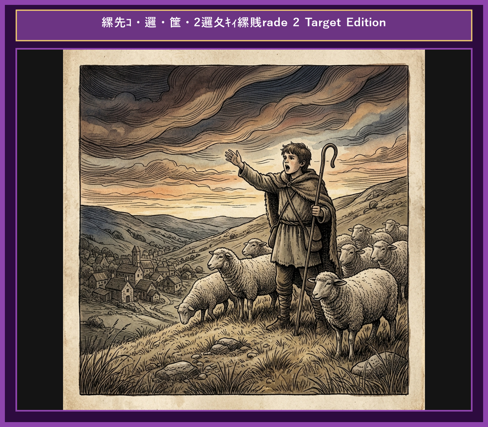

# Chapter 2: The Boy Who Cried Wolf (オオカミ少年)

  

## 1. Benchmark Level: Eiken Pre-2 (英検準2級レベル本文)
*Read in ~2 to 2.5 minutes. Advanced vocabulary and structured clauses.*

A young shepherd boy was assigned to watch over a flock of sheep near a dark forest. Bored with his monotonous routine, he constantly sought ways to entertain himself. One afternoon, he decided to play a mischievous prank on the nearby villagers.

"Wolf! Wolf! A wolf is attacking the sheep!" the boy screamed frantically at the top of his lungs.

Hearing his desperate cries, the villagers immediately dropped their work and rushed up the hill with axes and pitchforks to rescue the flock. However, upon their arrival, they found no wolf, but only the boy laughing hysterically at their gullibility. "I fooled you all!" he shouted in amusement. Disappointed and annoyed by his irresponsible behavior, the villagers warned him severely before returning to their work.

A few days later, the boy repeated the same trick. Once again, the alarmed villagers hurried to his aid, only to be mocked by the boy for a second time. Their frustration grew, and they lost all faith in his honesty.

Eventually, a real wolf emerged from the shadows of the forest and began ravaging the sheep. Terrified, the boy cried out in genuine panic, "Please help! A wolf is truly here!"

Assuming that the boy was attempting another deception, the villagers paid no attention to his shouts. Consequently, the wolf destroyed the entire flock without any interference.

A habitual liar forfeits all credibility; even when telling the truth, no one will believe them.

---

## 2. Target Level: Eiken Grade 2 (英検2級レベル本文)
*Read in ~3 to 4 minutes. Academic discourse, complex participial structures, formal vocabulary, and nuanced transitions.*

A juvenile shepherd tasked with safeguarding a village's livestock was stationed on a solitary hillside adjacent to a dense forest. Growing thoroughly disillusioned with the monotony of his solitary duties, he devised an unethical scheme to alleviate his boredom at the expense of the community.

"Wolf! A fierce predator is devouring the flock!" shouted the youth with simulated hysteria.

Distressed by his urgent alarm, the villagers instantaneously suspended their daily labor and ascended the slope, armed with improvised weapons to repel the perceived threat. Upon reaching the pasture, however, they discovered that the crisis was entirely fabricated. The boy stood amidst the grazing sheep, reveling in the success of his deceit. Indignant at his frivolous disregard for their safety, the villagers reprimanded him sternly, warning that civic trust should never be compromised for entertainment.

Regrettably, the boy failed to internalize their caution. Within a week, he fabricated the identical false alarm, causing another unwarranted disruption. Consequently, the villagers' residual trust dissolved entirely into profound skepticism.

Subsequently, a ravenous wolf actually descended from the timberland and launched a violent assault on the herd. Overwhelmed by genuine terror, the youth shouted desperately for assistance. "I implore you to believe me! A real wolf is slaughtering the livestock!"

Judging his pleas to be yet another manipulative fabrication, the villagers disregarded his distress signals completely. Deprived of external intervention, the boy watched helplessly as the predator decimated the entire flock.

Repeated dishonesty irreparably erodes personal integrity and public trust; hence, a proven deceiver will be met with skepticism even when uttering the absolute truth.

---

## 3. Classic Original English Text (イソップ寓話 クラシック原文)
*Townsend / Jacobs Edition (Public Domain)*

A Shepherd Boy tended his flock near a dark forest, and used to amuse himself by crying out, "Wolf! Wolf!" The villagers would come running to help him, only to find that he had tricked them. He did this several times. But one day a real Wolf came out of the forest and attacked the sheep. The Boy cried out louder than ever, "Wolf! Wolf!" but the villagers, thinking he was fooling them again, paid no attention. The Wolf killed many sheep and destroyed the flock.

There is no believing a liar, even when he speaks the truth.

---

### 🏛️ 【英検2級レベルで読み解く！クラシック原文の重要構文・英文法ノート】
1. **1. 分詞構文（Time / Attendant Circumstance）**
   - **原文**: *"A Shepherd-boy, who watched a flock of sheep near a village, brought out the villagers three or four times by crying out..."*
   - **解説**: `by crying out`（叫ぶことによって）という手段の動名詞句と関係代名詞の継続用法が組み合わさった2級頻出の複文構造です。
1. **2. 結果・目的を表す不定詞（Infinitive: Result）**
   - **原文**: *"...and even made a practice of laughing at them when they came running to his assistance."*
   - **解説**: `came running`（走ってやって来た：come + 現在分詞）の付帯状況表現です。
1. **3. 譲歩の従属接続詞 `even when`**
   - **原文**: *"Nobody believes a liar, even when he tells the truth."*
   - **解説**: 「〜の時でさえ」という譲歩条件を表す接続詞構文。英作文で高い説得力を生み出します。

### 📜 【クラシック原文の重要語彙・古風表現（Classic Antique Vocabulary）】
- **assistance** [名] 2級 **援助、手助け**（come to one's assistance（助けに駆けつける））
- **earnest** [名/形] 2級 **本気、真剣 / 真面目な**（in earnest（本気で、真剣に））
- **dismay** [名/動] 準1級 **狼狽、落胆 / うろたえさせる**（cried out in dismay）
- **trustworthy** [形] 2級 **信頼できる、頼りになる**（a liar is never deemed trustworthy）

---

## 4. Japanese Translation (日本語訳)

羊飼いの少年が暗い森の近くで羊の群れの番をしていました。彼は退屈しのぎに「オオカミだ！オオカミだ！」と叫んで面白がっていました。村人たちは助けようと駆けつけましたが、騙されたと知るだけでした。少年はこれを何度も繰り返しました。しかしある日、本物のオオカミが森から現れて羊を襲いました。少年はこれまで以上に大声で「オオカミだ！オオカミだ！」と叫びましたが、村人たちはまた騙そうとしているのだと思い、誰も注意を払いませんでした。オオカミは多くの羊を殺し、群れを全滅させてしまいました。

**教訓**: 度重なる不誠実さは個人の尊厳と社会的信用を決定的に損なう。故に、虚偽を繰り返した者は真実を語る時でさえ懐疑の目で迎えられる。

---

## 5. Recite & Compare (そらんじたいキーフレーズ対比)
*Memorize these contrastive expressions to elevate speaking, writing, and reading fluency.*

  
■ 場面：退屈しのぎのいたずら・欺瞞

  
【Pre-2 基礎】 <em>bored with his routine... decided to play a mischievous prank...</em>

  
【Grade 2 暗唱】 <strong><em>disillusioned with monotony... devised an unethical scheme to alleviate boredom...</em></strong>

  
【ポイント】 <strong>解説・試験活用</strong>：動詞 `devise`（〜を考案する）、形容詞 `unethical`（倫理に反する）、`alleviate`（〜を軽減・解消する）は英検2級ライティングの社会問題文脈で大活躍します。

  
■ 場面：捏造された危機と住民の憤り

  
【Pre-2 基礎】 <em>found no wolf, but only the boy laughing hysterically...</em>

  
【Grade 2 暗唱】 <strong><em>discovered the crisis was entirely fabricated... Indignant at his frivolous disregard...</em></strong>

  
【ポイント】 <strong>解説・試験活用</strong>：`fabricated`（っちあげられた・でっち上げの）や `Indignant`（憤慨した）、`disregard for...`（〜への軽視・無視）の2級長文頻出表現。

  
■ 場面：信用の完全な失墜

  
【Pre-2 基礎】 <em>their frustration grew, and they lost all faith in his honesty...</em>

  
【Grade 2 暗唱】 <strong><em>residual trust dissolved entirely into profound skepticism...</em></strong>

  
【ポイント】 <strong>解説・試験活用</strong>：抽象名詞 `skepticism`（懐疑心・疑念）や `dissolve into...`（〜へと分解する・溶け去る）。要約問題での心情・態度変化の描写に最適です。

  
■ 場面：切実な懇願と無視

  
【Pre-2 基礎】 <em>cried out in genuine panic, "Please help! A wolf is truly here!"</em>

  
【Grade 2 暗唱】 <strong><em>shouted desperately... "I implore you to believe me! A real wolf is slaughtering..."</em></strong>

  
【ポイント】 <strong>解説・試験活用</strong>：懇願動詞 `implore`（〜に深く嘆願する・ひたすらお願いする）や `slaughter`（〜を惨殺する・打ちのめす）。2級長文の緊張感ある場面で必須。

  
■ 場面：教訓（Moral）

  
【Pre-2 基礎】 <em>A habitual liar forfeits all credibility...</em>

  
【Grade 2 暗唱】 <strong><em>Repeated dishonesty irreparably erodes personal integrity and public trust...</em></strong>

  
【ポイント】 <strong>解説・試験活用</strong>：副詞 `irreparably`（取り返しのつかないほど）や動詞 `erode`（〜を蝕む・浸食する）、名詞 `integrity`（誠実さ）。英検2級の倫理・社会課題エッセイで最高評価を得られる構文。

---

## 6. Vocabulary Builder: 赤シート対応 重要単語・熟語チェック表
*※ 赤い透明シート（または赤フィルム）を重ねると、日本語訳が消えて自力テストができます。*

| No. | 見出し語 / イディオム | 品詞 / レベル | 日本語の意味（赤シートで消える） | 本文での使われ方・コロケーション |
|:---:|---|:---:|---|---|
| **01** | **shepherd** | [名] 3級 | 羊飼い | *a young shepherd boy* |
| **02** | **bored** | [形] 4級 | 退屈した、飽きた | *felt bored on the hill* |
| **03** | **mischievous** | [形] 準2級 | いたずら好きな | *with a mischievous smile* |
| **04** | **shout** | [動] 4級 | 大声を出す、叫ぶ | *shouted at the top of his lungs* |
| **05** | **villager** | [名] 3級 | 村人 | *the villagers rushed to help* |
| **06** | **rush** | [動] 3級 | 急いで駆けつける | *rushed to the rescue* |
| **07** | **trick** | [名/動] 3級 | いたずら、企み / だます | *play a trick on someone* |
| **08** | **emerge** | [動] 準2級/2級 | 現れる、姿を現す | *a fierce wolf emerged from the woods* |
| **09** | **panic** | [名/動] 3級 | パニック、大混乱 | *cried in pure panic* |
| **10** | **scatter** | [動] 準2級 | 散り散りになる、まき散らす | *the sheep scattered in all directions* |
| **11** | **deceive** | [動] 準2級/2級 | だます、欺く | *deceive others for amusement* |
| **12** | **trustworthy** | [形] 2級 | 信頼できる、頼もしい | *a liar is never considered trustworthy* |

### 【出題傾向・文法解説ノート】

### 【出題頻出語彙・熟語ノート】
- **alleviate** [動] （痛み・退屈・貧困など）を軽減する、和らげる（2級要約・ライティング必須動詞）
- **fabricate** [動] （嘘・話など）をでっち上げる、捏造する（名詞 *fabrication* 「捏造」）
- **indignant** [形] （不当な扱いに対して）憤慨した、おこった（*indignant at/about*）
- **skepticism** [名] 懐疑的な態度、疑念（形容詞 *skeptical* 「疑い深い」）
- **implore** [動] 〜に懇願する、切願する（*implore A to do*）
- **erode** [動] 〜を蝕む、徐々に破壊する（*erode trust/confidence* 「信頼を損なう」）
- **integrity** [名] 誠実さ、品格、完全性（*personal/professional integrity*）

### 【文法・構文ポイント】
1. **[at the expense of ...]（〜を犠牲にして、〜の費用で）**
   - 2級本文: *"devised an unethical scheme to alleviate his boredom at the expense of the community."*
   - ポイント: 他者の利益や安全を犠牲にする行動を非難する際、英検2級の作文で頻繁に使われる必須熟語です。
2. **[Deprived of ...]（分詞構文：〜を奪われて）**
   - 2級本文: *"Deprived of external intervention, the boy watched helplessly..."*
   - ポイント: `Being deprived of...` の受動分詞構文。文頭に置くことで事態の切迫感と孤立無援の状況を際立たせます。
