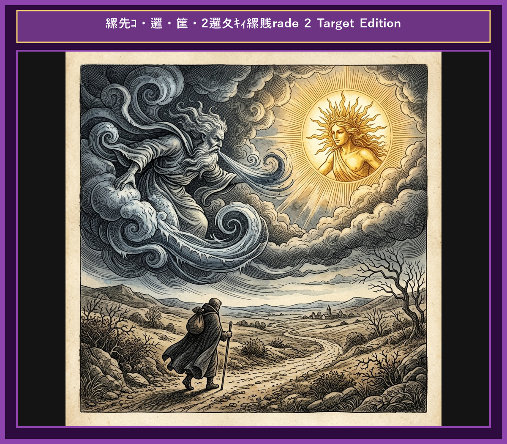

# Chapter 3: The North Wind and the Sun (北風と太陽)

  

## 1. Benchmark Level: Eiken Pre-2 (英検準2級レベル本文)
*Read in ~2 to 2.5 minutes. Advanced vocabulary and structured clauses.*

A heated dispute arose between the North Wind and the Sun concerning who possessed superior strength. Both claimed to be the undisputed ruler of the atmosphere. Unable to reach an agreement, they decided to settle the debate through a practical test.

"Look at that traveler walking along the road wrapped in a thick cloak," declared the North Wind confidence. "Whoever can force him to remove his cloak shall be acknowledged as the stronger."

The Sun agreed to the proposal, allowing the North Wind to take the first attempt. The North Wind blew with fierce intensity, sending icy gusts across the landscape. However, the stronger the wind blew, the more tightly the traveler wrapped his cloak around his body to protect himself from the freezing cold. Exhausted and frustrated, the North Wind finally gave up.

Then, the Sun emerged gently from behind the clouds, shining warm beams upon the earth. As the temperature rose, the traveler began to feel comfortable. Soon, the intense heat made him perspire heavily. Unable to endure the warmth any longer, the traveler willingly took off his cloak and sat beneath a shady tree.

Persuasion and gentleness are far more effective than force and aggression.

---

## 2. Target Level: Eiken Grade 2 (英検2級レベル本文)
*Read in ~3 to 4 minutes. Academic discourse, complex participial structures, formal vocabulary, and nuanced transitions.*

A fierce contest for supremacy erupted between the North Wind and the Sun, each asserting absolute dominance over the natural elements. To resolve their intractable conflict, they agreed to abide by an objective trial of strength.

Spotting a solitary traveler traversing a mountain path enveloped in a heavy winter garment, the North Wind proposed a definitive criterion. "Whichever of us compels that traveler to divest himself of his cloak shall be conceded the title of supreme power."

Concurring with the terms, the Sun yielded the initial attempt. Instantly, the North Wind unleashed a ferocious gale, howling across the terrain with violent velocity. Contrary to his expectations, however, the relentless onslaught merely impelled the traveler to grasp his attire with redoubled firmness to shield himself from the tempestuous climate. Despite exerting his maximum capacity, the Wind's aggressive tactics proved entirely counterproductive.

Thereupon, the Sun emerged, radiating mild and soothing warmth across the atmosphere. Gradually escalating the solar intensity, he transformed the frigid environment into a pleasant climate. Overwhelmed by the mounting heat, the traveler voluntarily unfastened his heavy garment and discarded it beside the pathway.

Coercion and hostility inevitably breed resistance, whereas gentle persuasion and warmth consistently prevail over brute force.

---

## 3. Classic Original English Text (イソップ寓話 クラシック原文)
*Townsend / Jacobs Edition (Public Domain)*

The North Wind and the Sun had a dispute as to which was the stronger, when a traveler came along wrapped in a warm cloak. They agreed that the one who first succeeded in making the traveler take his cloak off should be considered stronger than the other. Then the North Wind blew as hard as he could, but the more he blew the more closely did the traveler fold his cloak around him; and at last the North Wind gave up the attempt. Then the Sun shone out warmly, and immediately the traveler took off his cloak. And so the North Wind was obliged to confess that the Sun was the stronger of the two.

Persuasion is better than force.

---

### 🏛️ 【英検2級レベルで読み解く！クラシック原文の重要構文・英文法ノート】
1. **1. 比較級 + 比較級（The + 比較級 ..., the + 比較級 ... 構文）**
   - **原文**: *"The harder the Wind blew, the more closely did the Traveler wrap his cloak around him."*
   - **解説**: 「〜すればするほど、ますます…」を表す英検2級・準1級の最重要構文。後半に倒置（`did the Traveler wrap`）が起きています。
1. **2. 形式主語構文・合意の受動態**
   - **原文**: *"It was agreed between them that whichever first made the traveler take off his cloak should be held the stronger."*
   - **解説**: `whichever first made...`（どちらが先に〜させようとも）という複合関係代名詞節と使役動詞 `make + O + 原形不定詞` の融合。
1. **3. 比較を表す上級形容詞 `superior to`**
   - **原文**: *"Persuasion is often superior to force."*
   - **解説**: ラテン比較（*superior to* = 〜より優れている）。*than* ではなく *to* を取る重要文法ポイントです。

### 📜 【クラシック原文の重要語彙・古風表現（Classic Antique Vocabulary）】
- **dispute** [名/動] 2級 **論争、口論 / 争う**（a dispute arose between A and B）
- **cloak** [名] 準2級/2級 **外套、マント**（wrap one's cloak tightly）
- **persuasion** [名] 2級 **説得、説得力**（動詞 persuade の名詞形）
- **superior to** [熟] 2級 **〜より優れている**（反意語: inferior to）

---

## 4. Japanese Translation (日本語訳)

北風と太陽が、どちらが強いかで言い争いをしていました。そこへ暖かいマントを羽織った旅人が通りかかりました。二者は、旅人にマントを脱がせることができた方を強いと認めることで合意しました。まず北風ができる限りの力で吹きつけましたが、風が強く吹けば吹くほど、旅人はしっかりとマントを体に巻きつけました。ついに北風はあきらめました。次に太陽が暖かく照らし始めると、旅人はすぐにマントを脱ぎました。こうして北風は、太陽の方が自分より強いことを認めざるを得ませんでした。

**教訓**: 強圧と敵意は不可避的に反発を招くが、温和な説得と優しさは一貫して粗暴な力に勝利する。

---

## 5. Recite & Compare (そらんじたいキーフレーズ対比)
*Memorize these contrastive expressions to elevate speaking, writing, and reading fluency.*

  
■ 場面：主導権を巡る激しい争い

  
【Pre-2 基礎】 <em>A heated dispute arose concerning who possessed superior strength...</em>

  
【Grade 2 暗唱】 <strong><em>A contest for supremacy erupted, asserting absolute dominance...</em></strong>

  
【ポイント】 <strong>解説・試験活用</strong>：`supremacy`（優位性・覇権）や `assert dominance`（主導権・支配を主張する）は英検2級の国際政治・歴史長文で頻出する抽象熟語。

  
■ 場面：剥ぎ取る・脱がせる（要約の高度動詞）

  
【Pre-2 基礎】 <em>Whoever can force him to remove his cloak...</em>

  
【Grade 2 暗唱】 <strong><em>Whichever of us compels that traveler to divest himself of his cloak...</em></strong>

  
【ポイント】 <strong>解説・試験活用</strong>：動詞 `compel`（〜に強制する）と `divest oneself of...`（〜を脱ぐ・放棄する）。2級ライティングの要約表現に深みを与えます。

  
■ 場面：逆効果・予期せぬ反発

  
【Pre-2 基礎】 <em>the stronger the wind blew, the more tightly he wrapped his cloak...</em>

  
【Grade 2 暗唱】 <strong><em>exerting maximum capacity, aggressive tactics proved entirely counterproductive...</em></strong>

  
【ポイント】 <strong>解説・試験活用</strong>：形容詞 `counterproductive`（逆効果の・裏目に出た）。2級の意見論述で「〜の施策は逆効果である」と論理展開する際のキラーフレーズ。

  
■ 場面：自発的な行動変化

  
【Pre-2 基礎】 <em>Unable to endure the warmth... willingly took off his cloak...</em>

  
【Grade 2 暗唱】 <strong><em>Overwhelmed by heat, voluntarily unfastened and discarded...</em></strong>

  
【ポイント】 <strong>解説・試験活用</strong>：`voluntarily`（自発的に）や `discard`（〜を廃棄する・脱ぎ捨てる）。2級長文の人間行動分析文脈でよく登場します。

  
■ 場面：教訓（Moral）

  
【Pre-2 基礎】 <em>Persuasion and gentleness are far more effective than force...</em>

  
【Grade 2 暗唱】 <strong><em>Coercion and hostility breed resistance, whereas gentle persuasion prevails over brute force...</em></strong>

  
【ポイント】 <strong>解説・試験活用</strong>：`Coercion`（強制・圧迫）、`hostility`（敵意）、`prevail over...`（〜に勝利する・打ち勝つ）。2級・準1級の模範エッセイで圧倒的な評価を受ける名文。

---

## 6. Vocabulary Builder: 赤シート対応 重要単語・熟語チェック表
*※ 赤い透明シート（または赤フィルム）を重ねると、日本語訳が消えて自力テストができます。*

| No. | 見出し語 / イディオム | 品詞 / レベル | 日本語の意味（赤シートで消える） | 本文での使われ方・コロケーション |
|:---:|---|:---:|---|---|
| **01** | **dispute** | [名/動] 準2級/2級 | 論争、争い / 言い争う | *a fierce dispute arose* |
| **02** | **claim** | [動] 3級 | 主張する、言い張る | *claimed to be stronger* |
| **03** | **traveler** | [名] 3級 | 旅人、旅行者 | *a lone traveler walking along the road* |
| **04** | **cloak** | [名] 準2級 | マント、外套 | *wrapped tightly in a heavy cloak* |
| **05** | **fierce** | [形] 準2級 | 猛烈な、激しい | *blew a fierce and icy blast* |
| **06** | **howl** | [動] 3級 | （風が）うなる、吠える | *the howling wind tore at his clothes* |
| **07** | **clutch** | [動] 準2級 | ぐっと掴む、しっかり握る | *clutched his garment even tighter* |
| **08** | **radiant** | [形] 2級/準1級 | 輝くばかりの、光を放つ | *beamed with radiant warmth* |
| **09** | **gentle** | [形] 4級 | 優しい、穏やかな | *with gentle and steady rays* |
| **10** | **perspiration** | [名] 2級/準1級 | 汗、発汗 | *dripping with warm perspiration* |
| **11** | **unfasten** | [動] 準2級 | 外す、脱ぐ | *gladly unfastened his heavy cloak* |
| **12** | **persuasion** | [名] 2級 | 説得、説得力 | *persuasion is often superior to force* |

### 【出題傾向・文法解説ノート】

### 【出題頻出語彙・熟語ノート】
- **supremacy** [名] 最高位、覇権（*contest/struggle for supremacy* 「覇権争い」）
- **compel** [動] 〜に（無理やり）…させる（*compel A to do*）
- **divest** [動] （服など）を脱ぐ、〜から剥ぎ取る（*divest oneself of A*）
- **counterproductive** [形] 逆効果の、期待に反する（*prove counterproductive*）
- **voluntarily** [副] 自発的に、進んで（対義語 *involuntarily* 「無意識に・強制的に」）
- **coercion** [名] 強制、威圧（動詞 *coerce* 「強制する」）
- **prevail** [動] （最終的に）勝利する、普及する（*prevail over force/difficulties*）

### 【文法・構文ポイント】
1. **[abide by ...]（〜に従う、〜を遵守する）**
   - 2級本文: *"agreed to abide by an objective trial of strength."*
   - ポイント: 契約・ルール・判決などに従うことを意味する2級頻出の必須熟語。
2. **[Whichever of us ...]（複合関係代名詞：私たちのどちらが〜しようとも）**
   - 2級本文: *"Whichever of us compels that traveler to divest himself..."*
   - ポイント: 選択肢が限られた状況での条件提示構文。ライティングの仮定表現で効果的に機能します。
