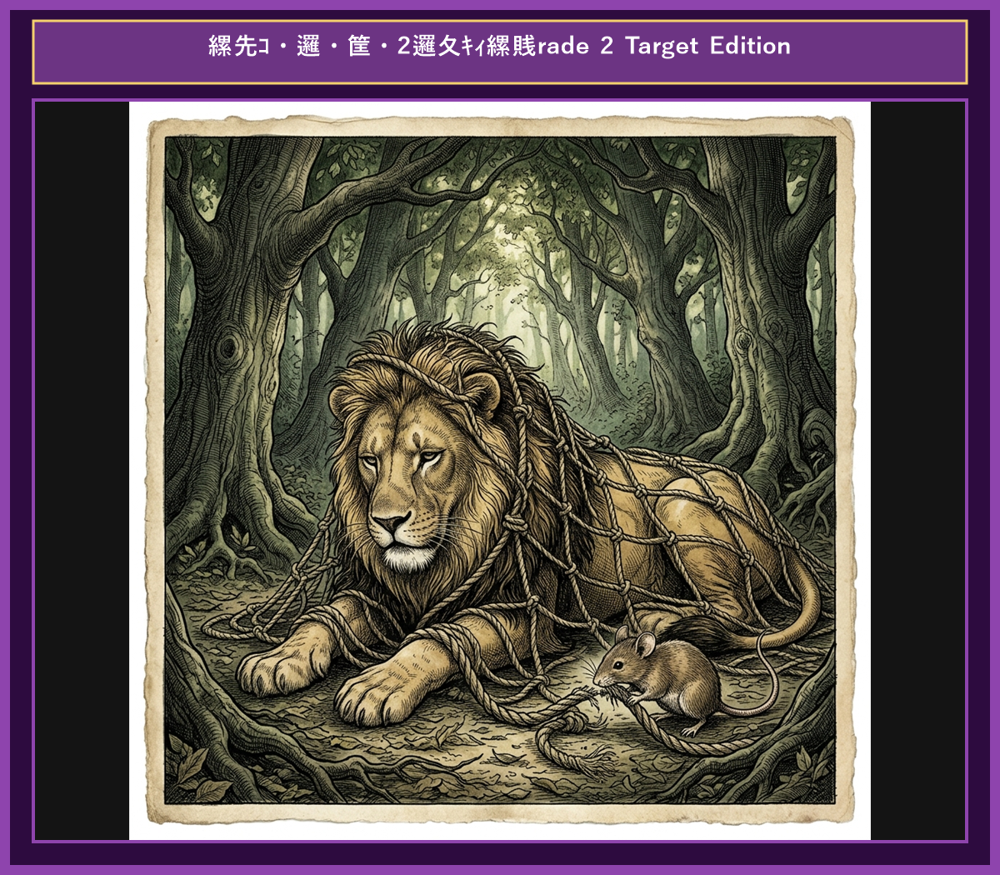

# Chapter 4: The Lion and the Mouse (ライオンとネズミ)

  

## 1. Benchmark Level: Eiken Pre-2 (英検準2級レベル本文)
*Read in ~2 to 2.5 minutes. Advanced vocabulary and structured clauses.*

A mighty lion was sleeping peacefully under the warm afternoon sun. Suddenly, he was awakened by a tiny mouse accidentally scurrying across his nose. Infuriated by the disruption, the lion trapped the fragile creature under his heavy paw and prepared to crush it without hesitation.

"Please spare my life, King of Beasts!" pleaded the trembling mouse. "I did not intend to disrespect you. If you show mercy and grant me my freedom, I promise to repay your kindness someday."

Amused by the notion that such a minuscule creature could ever assist the king of the jungle, the lion roared with laughter. Nevertheless, feeling generous, he released his captive unharmed.

Several weeks later, while hunting in the dense forest, the lion stepped into a hunter's trap. Entangled in strong rope nets, he roared helplessly in anger and despair.

Hearing the lion's familiar roars of distress, the mouse sprinted to the scene. Without wasting a moment, the small creature used its sharp teeth to gnaw through the thick ropes until the lion was completely liberated.

Even the smallest and most modest allies can prove indispensable in times of severe crisis.

---

## 2. Target Level: Eiken Grade 2 (英検2級レベル本文)
*Read in ~3 to 4 minutes. Academic discourse, complex participial structures, formal vocabulary, and nuanced transitions.*

A formidable lion, the undisputed monarch of the wilderness, was slumbering in a shaded sanctuary. His tranquility was abruptly shattered when a diminutive mouse inadvertently traversed his face. Provoked by the intrusion, the apex predator instantly pinned the fragile creature beneath his massive paw, intending to execute it summarily.

"I beseech your Majesty to exercise clemency!" implored the terrified rodent. "My transgression was purely accidental. Should you grant me amnesty, I pledge to render reciprocal assistance whenever you encounter adversity."

Skepticism and amusement swept over the lion at the absurd proposition that an insignificant creature possessed the capacity to aid a sovereign beast. Nonetheless, moved by a rare impulse of magnanimity, he unclasped his paw and granted the rodent its liberty.

Subsequently, while prowling through the woodland, the lion triggered a sophisticated snare constructed by big-game hunters. Bound securely within heavy cordage, his tremendous physical exertion proved futile, leaving him roaring in profound helplessness.

Recognizing the vocalization of distress, the mouse promptly navigated toward the source. Demonstrating remarkable ingenuity and perseverance, the rodent methodically severed the fibrous strands with its sharp incisors, ultimately liberating the trapped monarch.

No creature is so humble as to be devoid of utility; hence, acts of benevolence frequently yield unforeseen dividends in moments of acute crisis.

---

## 3. Classic Original English Text (イソップ寓話 クラシック原文)
*Townsend / Jacobs Edition (Public Domain)*

A Lion was awakened by a Mouse running over his face. Rising up angrily, he caught him and was about to kill him, when the Mouse piteously entreated, saying: "If you would only spare my life, I would be sure to repay your kindness." The Lion laughed and let him go. It happened shortly after this that the Lion was caught by some hunters, who bound him by strong ropes to the ground. The Mouse, recognizing his roar, came and gnawed the rope with his teeth, and set him free, exclaiming: "You ridiculed the idea of my ever being able to help you, not expecting to receive any repayment from me; now you know that it is possible for even a Mouse to confer a benefit on a Lion."

Little friends may prove great friends.

---

### 🏛️ 【英検2級レベルで読み解く！クラシック原文の重要構文・英文法ノート】
1. **1. 分詞構文（Participle Clause: 付帯状況・理由）**
   - **原文**: *"The Hare, believing her assertion to be simply impossible, agreed to the proposal..."*
   - **解説**: 「〜と信じ込んでいたので」という理由を表す分詞構文。英検2級の長文読解・ライティングの最頻出構文です。
1. **2. 古典的仮定法現在（Subjunctive Mood）**
   - **原文**: *"Though you be swift as the wind, I will beat you in a race."*
   - **解説**: 譲歩節 `Though` の中で原形 `be` を用いる古典的な仮定法現在（現代英語の `Though you are...`）。格調高い古典の響きを持ちます。
1. **3. 過去分詞の後置修飾（Postpositive Participle）**
   - **原文**: *"On the day appointed for the race the two started together."*
   - **解説**: `appointed`（定められた・指定された）が直前の名詞 `the day` を後ろから修飾する構文です。

### 📜 【クラシック原文の重要語彙・古風表現（Classic Antique Vocabulary）】
- **retort** [動] 2級 **（機転を利かせて）言い返す、反論する**（現代の reply sharp/wittily に相当）
- **assertion** [名] 2級/準1級 **主張、断言**（動詞 assert の名詞形。2級長文定番）
- **wayside** [名] 2級 **道端、沿道**（by the wayside（道端に、途中で））
- **fatigue** [名] 2級 **（心身の）極度の疲労、疲れ**（tiredness の上位フォーマル語）

---

## 4. Japanese Translation (日本語訳)

ライオンが顔の上を駆け抜けたネズミに起こされました。怒って立ち上がったライオンはネズミを捕らえ、殺そうとしましたが、ネズミは哀れっぽく訴えました。「もし命を助けてくだされば、必ずこのご恩をお返しします。」ライオンは笑ってネズミを放してやりました。それから間もなく、ライオンはハンターに捕まり、頑丈なロープで地面に縛り付けられてしまいました。その咆哮を聞きつけたネズミがやってきて、歯でロープをかみ切り、ライオンを自由にしました。ネズミは叫びました。「私のご恩返しなど期待せず、助けられるはずがないとお笑いになりましたね。でも今や、ネズミでさえライオンに恩恵をもたらすことができるとお分かりでしょう。」

**教訓**: いかなる存在も役に立たないほど微小ではない。故に、慈悲深い善行は過酷な危機において予期せぬ恩恵をもたらす。

---

## 5. Recite & Compare (そらんじたいキーフレーズ対比)
*Memorize these contrastive expressions to elevate speaking, writing, and reading fluency.*

  
■ 場面：慈悲の乞願と赦免

  
【Pre-2 基礎】 <em>Please spare my life! If you show mercy... repay your kindness...</em>

  
【Grade 2 暗唱】 <strong><em>beseech your Majesty to exercise clemency... grant me amnesty... pledge reciprocal assistance...</em></strong>

  
【ポイント】 <strong>解説・試験活用</strong>：`exercise clemency`（寛大さ・慈悲を施す）や `grant amnesty`（恩赦・免罪を与える）、`reciprocal assistance`（相互助力を約束する）。政治・法律関連の2級長文で必修。

  
■ 場面：寛大さによる解放

  
【Pre-2 基礎】 <em>feeling generous, he released his captive unharmed...</em>

  
【Grade 2 暗唱】 <strong><em>moved by an impulse of magnanimity, he granted the rodent its liberty...</em></strong>

  
【ポイント】 <strong>解説・試験活用</strong>：`magnanimity`（気高さ・寛大さ）。2級ライティングでリーダーシップや人徳を表現する際の上位語彙。

  
■ 場面：罠にかかった困窮

  
【Pre-2 基礎】 <em>stepped into a trap, entangled in strong rope nets...</em>

  
【Grade 2 暗唱】 <strong><em>triggered a snare... physical exertion proved futile, bound securely...</em></strong>

  
【ポイント】 <strong>解説・試験活用</strong>：`trigger a snare`（罠を作動させてしまう）や `physical exertion`（肉体的努力・力行）。要約問題での状況解説に非常に有用。

  
■ 場面：解凍・解放の達成

  
【Pre-2 基礎】 <em>gnaw through the thick ropes until the lion was completely liberated...</em>

  
【Grade 2 暗唱】 <strong><em>severed the fibrous strands, ultimately liberating the trapped monarch...</em></strong>

  
【ポイント】 <strong>解説・試験活用</strong>：`sever`（〜を切断する）や `fibrous strands`（繊維状の縄・紐）。2級要約問題における具体動詞の一般化言い換えテクニック。

  
■ 場面：教訓（Moral）

  
【Pre-2 基礎】 <em>smallest allies can prove indispensable in times of crisis...</em>

  
【Grade 2 暗唱】 <strong><em>No creature is devoid of utility; acts of benevolence yield unforeseen dividends...</em></strong>

  
【ポイント】 <strong>解説・試験活用</strong>：`devoid of...`（〜を欠いている）、`benevolence`（善行・慈愛）、`yield dividends`（利益・成果をもたらす）。2級・準1級エッセイで加点対象となる名表現。

---

## 6. Vocabulary Builder: 赤シート対応 重要単語・熟語チェック表
*※ 赤い透明シート（または赤フィルム）を重ねると、日本語訳が消えて自力テストができます。*

| No. | 見出し語 / イディオム | 品詞 / レベル | 日本語の意味（赤シートで消える） | 本文での使われ方・コロケーション |
|:---:|---|:---:|---|---|
| **01** | **majestic** | [形] 準2級 | 威厳のある、雄大な | *the majestic king of beasts* |
| **02** | **disturb** | [動] 3級 | 邪魔する、乱す | *disturbed his peaceful slumber* |
| **03** | **beg** | [動] 3級 | 懇願する、頼み込む | *begged desperately for mercy* |
| **04** | **spare** | [動] 準2級 | （命を）助ける、惜しむ | *spared the tiny creature's life* |
| **05** | **trap** | [動/名] 3級 | 罠にかける / 罠 | *trapped helplessly in a sturdy net* |
| **06** | **roar** | [動/名] 3級 | 咆哮する、大声で吠える | *roared in utter frustration* |
| **07** | **gnaw** | [動] 準2級/2級 | かじる、噛み切る | *gnawed through the thick rope* |
| **08** | **fiber** | [名] 準2級 | 繊維、ロープの紐 | *severed the binding fibers* |
| **09** | **gratitude** | [名] 2級 | 感謝の気持ち | *bowed in profound gratitude* |
| **10** | **insignificant** | [形] 2級/準1級 | 取るに足らない、ちっぽけな | *no friend is too insignificant to help* |
| **11** | **repay** | [動] 3級 | 恩返しする、返済する | *repay a noble act of kindness* |
| **12** | **compassion** | [名] 2級 | 慈悲、思いやり | *compassion yields unexpected rewards* |

### 【出題傾向・文法解説ノート】

### 【出題頻出語彙・熟語ノート】
- **clemency** [名] 寛大さ、慈悲（*exercise clemency* 「慈悲を施す」）
- **reciprocal** [形] 相互の、返報の（*reciprocal benefit/trade* 「相互利益・貿易」）
- **magnanimity** [名] （敵や弱者に対する）寛大さ、大度（形容詞 *magnanimous*）
- **exertion** [名] （力・能力の）行使、骨折り（動詞 *exert*）
- **sever** [動] 〜を切り離す、切断する（*sever ties/connections* 「関係を断つ」）
- **devoid of** [熟] 〜が全くない、欠けている（*devoid of emotion/truth*）
- **benevolence** [名] 善行、慈悲深さ（形容詞 *benevolent* 「親切な」）

### 【文法・構文ポイント】
1. **[So + 形容詞 + as to do]（非常に〜なので…する）**
   - 2級本文: *"No creature is so humble as to be devoid of utility..."*
   - ポイント: `so... as to...` 構文。程度や結果を示す伝統的かつ格調高い構文で、英検2級長文の筆者主張箇所に多用されます。
2. **[moved by ...]（過去分詞構文：〜に心を動かされて）**
   - 2級本文: *"Nonetheless, moved by a rare impulse of magnanimity, he unclasped..."*
   - ポイント: 感情や動機を表す分詞構文。主語の行動の心理的背景を簡潔かつエレガントに説明します。
