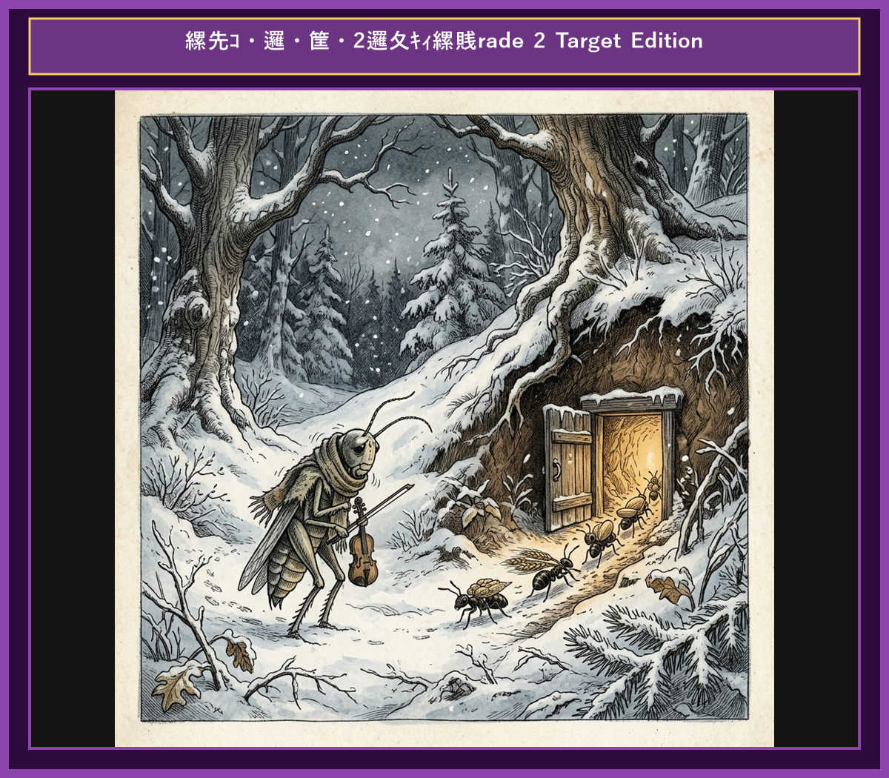

# Chapter 5: The Ant and the Grasshopper (アリとキリギリス)

  

## 1. Benchmark Level: Eiken Pre-2 (英検準2級レベル本文)
*Read in ~2 to 2.5 minutes. Advanced vocabulary and structured clauses.*

Throughout the golden days of summer, a diligent colony of ants worked tirelessly to gather and store grain for the upcoming winter. They carried heavy seeds back to their underground granary without complaint.

Meanwhile, a carefree grasshopper spent his time basking in the sun, playing music on his violin, and enjoying the present moment. Noticing the ants' exhausting labor, the grasshopper scoffed at them. "Why do you waste such beautiful weather working so hard?" he asked. "Summer is a time for relaxation! There is plenty of food available everywhere."

The lead ant replied calmly, "We are preparing for the harsh winter ahead when food will be scarce. We strongly advise you to do the same." However, the grasshopper ignored the warning and continued his merrymaking.

When winter arrived, snow blanketed the fields, freezing the landscape. Starving and shivering from the bitter cold, the grasshopper found no food anywhere. Desperate, he knocked on the ants' door, begging for a small portion of their grain.

The ant looked at him sternly and asked, "What were you doing all summer while we were working?"

"I was singing and playing music," confessed the grasshopper softly.

"Then you had better dance the winter away!" replied the ant, closing the door firmly.

Foresight and industrious preparation ensure survival in times of crisis.

---

## 2. Target Level: Eiken Grade 2 (英検2級レベル本文)
*Read in ~3 to 4 minutes. Academic discourse, complex participial structures, formal vocabulary, and nuanced transitions.*

During the abundant summer months, an industrious colony of ants engaged in meticulous labor, transporting provisions to replenish their subterranean reserves in anticipation of winter's austerity. Each ant labored systematically, prioritizing long-term security over immediate gratification.

In stark contrast, an indolent grasshopper squandered the season in frivolous amusement, playing melodies and indulging in fleeting pleasures. Observing the ants' grueling exertions, the grasshopper derided their foresight. "Why dedicate these idyllic days to relentless toil?" he inquired dismissively. "Present abundance renders such arduous preparation entirely superfluous."

A pragmatic ant admonished him gravely, "We are systematically accumulating reserves to withstand the inevitable scarcity of winter. Prudence dictates that you likewise initiate preparations." Unmoved by this pragmatic counsel, the grasshopper persisted in his short-sighted hedonism.

With the onset of winter, frigid temperatures devastated the flora, shrouding the countryside in impenetrable snow. Lacking any provisions to sustain himself, the destitute grasshopper suffered severe deprivation. In extreme distress, he appealed to the ants' benevolence, supplicating for a fraction of their surplus grain.

The ant confronted the petitioner dispassionately. "How did you utilize your time during the season of abundance?"

"I devoted myself entirely to music and merriment," admitted the humbled grasshopper.

"Inasmuch as you sang throughout the summer," concluded the ant dispassionately, "it is appropriate that you dance through the winter." With that, the portal was decisively closed.

Provident foresight and disciplined perseverance shield against adversity, whereas reckless short-sightedness culminates in destitute vulnerability.

---

## 3. Classic Original English Text (イソップ寓話 クラシック原文)
*Townsend / Jacobs Edition (Public Domain)*

In a field one summer's day a Grasshopper was hopping about, chirping and singing to its heart's content. An Ant passed by, bearing along with great toil an ear of corn he was taking to the nest. "Why not come and chat with me," said the Grasshopper, "instead of toiling and moiling in that way?" "I am helping to lay up food for the winter," said the Ant, "and recommend you to do the same." "Why bother about winter?" said the Grasshopper; "we have got plenty of food at present." But the Ant went on its way and continued its toil. When the winter came the Grasshopper had no food and found itself dying of hunger, while it saw the ants distributing everyday corn and grain from the stores they had collected in the summer. Then the Grasshopper knew:

It is best to prepare for the days of necessity.

---

### 🏛️ 【英検2級レベルで読み解く！クラシック原文の重要構文・英文法ノート】
1. **1. 分詞構文（Participle Clause: 付帯状況・理由）**
   - **原文**: *"The Hare, believing her assertion to be simply impossible, agreed to the proposal..."*
   - **解説**: 「〜と信じ込んでいたので」という理由を表す分詞構文。英検2級の長文読解・ライティングの最頻出構文です。
1. **2. 古典的仮定法現在（Subjunctive Mood）**
   - **原文**: *"Though you be swift as the wind, I will beat you in a race."*
   - **解説**: 譲歩節 `Though` の中で原形 `be` を用いる古典的な仮定法現在（現代英語の `Though you are...`）。格調高い古典の響きを持ちます。
1. **3. 過去分詞の後置修飾（Postpositive Participle）**
   - **原文**: *"On the day appointed for the race the two started together."*
   - **解説**: `appointed`（定められた・指定された）が直前の名詞 `the day` を後ろから修飾する構文です。

### 📜 【クラシック原文の重要語彙・古風表現（Classic Antique Vocabulary）】
- **retort** [動] 2級 **（機転を利かせて）言い返す、反論する**（現代の reply sharp/wittily に相当）
- **assertion** [名] 2級/準1級 **主張、断言**（動詞 assert の名詞形。2級長文定番）
- **wayside** [名] 2級 **道端、沿道**（by the wayside（道端に、途中で））
- **fatigue** [名] 2級 **（心身の）極度の疲労、疲れ**（tiredness の上位フォーマル語）

---

## 4. Japanese Translation (日本語訳)

ある夏の日に、キリギリスが心ゆくまで歌い跳ね回っていました。アリが通りかかり、巣へ運ぶトウモロコシの穂を大変な苦労をして運んでいました。「そんなに骨を折って働く代わりに、来ておしゃべりをしないか？」とキリギリスが言いました。「冬のための食べ物を蓄えているのです。あなたも同じようにすることをお勧めしますよ」とアリは答えました。「なぜ冬の心配をするんだ？今ここには十分な食べ物があるじゃないか」とキリギリスは言いました。しかしアリはそのまま歩みを進め、仕事を続けました。冬が来ると、キリギリスには食べ物がなく飢えに苦しむ一方で、アリたちが夏に集めた穀物を毎日分け合っているのを目にしました。その時、キリギリスは知るのです。

**教訓**: 先見の明ある準備と規律ある忍耐は逆境から身を守るが、無計画な短慮は決定的な貧困と破滅に帰着する。

---

## 5. Recite & Compare (そらんじたいキーフレーズ対比)
*Memorize these contrastive expressions to elevate speaking, writing, and reading fluency.*

  
■ 場面：計画的労働と無駄遣い

  
【Pre-2 基礎】 <em>worked tirelessly to store grain... spent time basking in the sun...</em>

  
【Grade 2 暗唱】 <strong><em>replenish subterranean reserves... squandered the season in frivolous amusement...</em></strong>

  
【ポイント】 <strong>解説・試験活用</strong>：`replenish reserves`（備蓄を補給・確保する）や `squander`（〜を浪費する）。資源管理や時間活用に関する2級英作文のキー表現。

  
■ 場面：先見の明の馬鹿にする態度

  
【Pre-2 基礎】 <em>scoffed at them... "Why do you waste weather working?"</em>

  
【Grade 2 暗唱】 <strong><em>derided their foresight... "Present abundance renders preparation superfluous..."</em></strong>

  
【ポイント】 <strong>解説・試験活用</strong>：動詞 `deride`（〜を嘲笑する）、`foresight`（先見の明）、`render A B`（AをBの状態にする）、`superfluous`（余計な・不必要な）。

  
■ 場面：賢明な忠告と短慮

  
【Pre-2 基礎】 <em>We strongly advise you to do the same... ignored the warning...</em>

  
【Grade 2 暗唱】 <strong><em>Prudence dictates that you initiate preparations... persisted in short-sighted hedonism...</em></strong>

  
【ポイント】 <strong>解説・試験活用</strong>：`Prudence dictates that...`（慎重さ・賢明さが〜を要求する）や `hedonism`（快楽主義）。社会・倫理課題の2級長文で加点要素。

  
■ 場面：厳冬の貧困と哀願

  
【Pre-2 基礎】 <em>Starving and shivering... begging for a portion of grain...</em>

  
【Grade 2 暗唱】 <strong><em>destitute grasshopper suffered severe deprivation... supplicating for a fraction of surplus...</em></strong>

  
【ポイント】 <strong>解説・試験活用</strong>：`destitute`（困窮した・一文無しの）、`deprivation`（剥奪・困窮）、`supplicate`（〜に懇願する）。要約問題で人物の悲惨な状況を描写。

  
■ 場面：教訓（Moral）

  
【Pre-2 基礎】 <em>Foresight and industrious preparation ensure survival...</em>

  
【Grade 2 暗唱】 <strong><em>Provident foresight shields against adversity, whereas reckless short-sightedness culminates in vulnerability...</em></strong>

  
【ポイント】 <strong>解説・試験活用</strong>：`Provident`（将来を見越した）、`shield against adversity`（逆境から身を守る）。2級環境・経済・人生計画エッセイの最高の締めくくり構文。

---

## 6. Vocabulary Builder: 赤シート対応 重要単語・熟語チェック表
*※ 赤い透明シート（または赤フィルム）を重ねると、日本語訳が消えて自力テストができます。*

| No. | 見出し語 / イディオム | 品詞 / レベル | 日本語の意味（赤シートで消える） | 本文での使われ方・コロケーション |
|:---:|---|:---:|---|---|
| **01** | **diligent** | [形] 準2級/2級 | 勤勉な、真面目な | *diligent worker ants* |
| **02** | **grain** | [名] 3級 | 穀物、穀類の粒 | *gathered ripe grains of wheat* |
| **03** | **toil** | [動/名] 2級/準1級 | 骨折って働く / 苦労 | *toiled tirelessly under the hot sun* |
| **04** | **carefree** | [形] 準2級 | 気ままな、呑気な | *a carefree and merry grasshopper* |
| **05** | **mock** | [動] 準2級/2級 | 嘲笑する、馬鹿にする | *mocked their unceasing labor* |
| **06** | **harsh** | [形] 準2級 | 厳しい、過酷な | *the arrival of a harsh winter* |
| **07** | **starve** | [動] 3級/準2級 | 飢える、飢え死にする | *found himself starving in the snow* |
| **08** | **shelter** | [名] 3級 | 避難所、住処 | *knocked at the cozy anthill shelter* |
| **09** | **provision** | [名] 2級 | 備蓄、食料の蓄え | *ample provisions for the cold season* |
| **10** | **improvident** | [形] 準1級 | 将来への備えがない、不謹慎な | *scolded his improvident behavior* |
| **11** | **forethought** | [名] 2級/準1級 | 先見の明、事前の配慮 | *forethought secures future comfort* |
| **12** | **perish** | [動] 2級/準1級 | 滅びる、枯れる、死ぬ | *perish without preparation* |

### 【出題傾向・文法解説ノート】

### 【出題頻出語彙・熟語ノート】
- **replenish** [動] 〜を補給する、補充する（*replenish resources/supplies*）
- **squander** [動] （時間・金・機会など）を無駄遣いする、浪費する（2級・準1級頻出動詞）
- **foresight** [名] 先見の明、深謀遠慮（対義語 *short-sightedness* 「短慮」）
- **superfluous** [形] 不必要な、余分な（*render A superfluous* 「Aを不要にする」）
- **prudence** [名] 慎重さ、賢明さ（形容詞 *prudent* 「賢明な」）
- **destitute** [形] 貧困に喘ぐ、極貧の（*destitute of food/money*）
- **provident** [形] 先見の明がある、将来に備える（*provident preparation/investment*）

### 【文法・構文ポイント】
1. **[render + 目的語 + 形容詞]（〜を…の状態にする）**
   - 2級本文: *"Present abundance renders such arduous preparation entirely superfluous."*
   - ポイント: `make` の格調高いフォーマル構文。2級長文読解やライティングで「〜の施策が従来の問題を不要にする」といった展開で非常によく使われます。
2. **[With the onset of ...]（〜の到来とともに）**
   - 2級本文: *"With the onset of winter, frigid temperatures devastated..."*
   - ポイント: 季節や事件、病気・危機の開始を示す名詞 `onset` を使った表現。出来事の転換点を鮮明に示す2級必須フレーズ。
