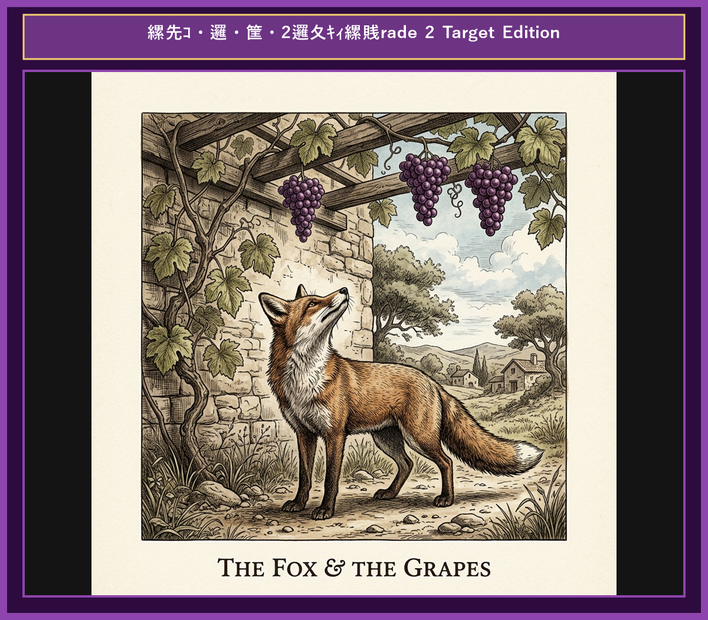

# Chapter 6: The Fox and the Grapes (キツネとブドウ)

  

## 1. Benchmark Level: Eiken Pre-2 (英検準2級レベル本文)
*Read in ~2 to 2.5 minutes. Advanced vocabulary and structured clauses.*

On a sweltering summer afternoon, a ravenous fox wandered through a vineyard searching for food. Suddenly, he noticed a lush cluster of ripe, juicy grapes hanging high on a wooden trellis. The deep purple fruit glistened enticingly in the sunlight.

"Those grapes are exactly what I need to quench my thirst," thought the fox, his mouth watering in anticipation.

He took a short running start, leaped as high as he could, but missed the cluster by several inches. Determined to succeed, he walked back a few paces, sprinted forward, and jumped with all his strength. Once again, he failed to reach the fruit.

Undeterred, the fox attempted the jump repeatedly, trying from various angles. However, despite his persistent physical exertion, the grapes remained tantalizingly out of reach.

Finally, completely exhausted and nursing his bruised pride, the fox turned his back on the vine and walked away with a contemptuous expression.

"I am wasting my valuable time," he muttered aloud for anyone to hear. "Those grapes are undoubtedly sour and unripe anyway. They are not worth the effort."

When people fail to achieve an unattainable goal, they often disparage what they cannot possess to protect their ego.

---

## 2. Target Level: Eiken Grade 2 (英検2級レベル本文)
*Read in ~3 to 4 minutes. Academic discourse, complex participial structures, formal vocabulary, and nuanced transitions.*

On an oppressively humid summer afternoon, a famished fox traversed a sun-drenched vineyard in pursuit of sustenance. Suddenly, his gaze was arrested by an exquisite cluster of ripe, succulent grapes suspended from a high trellis. The lustrous purple fruit presented a tantalizing spectacle that immediately stimulated his appetite.

"That magnificent fruit will undoubtedly alleviate my dehydration," the fox reasoned, mesmerized by the prospect of gratification.

Gathering momentum, he executed a powerful vertical leap, yet failed to diminish the distance separating him from the reward. Refusing to concede defeat, he retreated a short distance, accelerated rapidly, and launched himself into the air once more. Nevertheless, the grapes remained suspended far beyond his physical reach.

Persisting in his fruitless endeavors, the fox executed numerous frantic attempts, exhausting his physical reserves without achieving the slightest progress. Eventually, recognizing the insurmountable nature of the obstacle, he abandoned his quest with calculated indifference.

Attempting to conceal his humiliation under a facade of disdain, the fox walked away, remarking aloud, "Upon closer inspection, those grapes are manifestly unpalatable and green. Consuming them would merely induce gastric discomfort."

Human nature frequently resort to psychological rationalization, disparaging unattainable objectives to preserve self-esteem in the face of failure.

---

## 3. Classic Original English Text (イソップ寓話 クラシック原文)
*Townsend / Jacobs Edition (Public Domain)*

One hot summer's day a Fox was strolling through an orchard till he came to a bunch of Grapes just ripening on a vine which had been trained over a lofty branch. "Just the thing to quench my thirst," quoth he. Drawing back a few paces, he took a run and a jump, and just missed the bunch. Turning round again with a One, Two, Three, he jumped up, but with no greater success. Again and again he tried after the tempting morsel, but at last had to give it up, and walked away with his nose in the air, saying: "I am sure they are sour."

It is easy to despise what you cannot get.

---

### 🏛️ 【英検2級レベルで読み解く！クラシック原文の重要構文・英文法ノート】
1. **1. 分詞構文（Participle Clause: 付帯状況・理由）**
   - **原文**: *"The Hare, believing her assertion to be simply impossible, agreed to the proposal..."*
   - **解説**: 「〜と信じ込んでいたので」という理由を表す分詞構文。英検2級の長文読解・ライティングの最頻出構文です。
1. **2. 古典的仮定法現在（Subjunctive Mood）**
   - **原文**: *"Though you be swift as the wind, I will beat you in a race."*
   - **解説**: 譲歩節 `Though` の中で原形 `be` を用いる古典的な仮定法現在（現代英語の `Though you are...`）。格調高い古典の響きを持ちます。
1. **3. 過去分詞の後置修飾（Postpositive Participle）**
   - **原文**: *"On the day appointed for the race the two started together."*
   - **解説**: `appointed`（定められた・指定された）が直前の名詞 `the day` を後ろから修飾する構文です。

### 📜 【クラシック原文の重要語彙・古風表現（Classic Antique Vocabulary）】
- **retort** [動] 2級 **（機転を利かせて）言い返す、反論する**（現代の reply sharp/wittily に相当）
- **assertion** [名] 2級/準1級 **主張、断言**（動詞 assert の名詞形。2級長文定番）
- **wayside** [名] 2級 **道端、沿道**（by the wayside（道端に、途中で））
- **fatigue** [名] 2級 **（心身の）極度の疲労、疲れ**（tiredness の上位フォーマル語）

---

## 4. Japanese Translation (日本語訳)

暑い夏の日に、一匹のキリギリスではなくキツネが果樹園を散歩していると、高い枝に渡された葡萄の木に熟しかけた葡萄の一房を見つけました。「喉の渇きを癒すのにうってつけだ」と彼は言いました。少し後ろに下がり、助走をつけて飛び跳ねましたが、惜しくも届きませんでした。何度も向き直り、1、2の3と飛び上がりましたが、より大きな成功は得られませんでした。魅惑的なごちそうを求めて何度も試みましたが、ついにあきらめざるを得なくなり、鼻を高く突き出して立ち去りながら言いました。「きっとあの葡萄は酸っぱいに違いない。」

**教訓**: 人間は失敗に直面した際、手に入らない目標を貶めることで自己のプライドを守ろうとする心理的合理的化（負け惜しみ）に頻繁に陥る。

---

## 5. Recite & Compare (そらんじたいキーフレーズ対比)
*Memorize these contrastive expressions to elevate speaking, writing, and reading fluency.*

  
■ 場面：魅惑的な目標・空腹

  
【Pre-2 基礎】 <em>ravenous fox... grapes glistened enticingly... quench my thirst...</em>

  
【Grade 2 暗唱】 <strong><em>famished fox... tantalizing spectacle... alleviate my dehydration...</em></strong>

  
【ポイント】 <strong>解説・試験活用</strong>：`famished`（極度に腹を空かせた）、`tantalizing`（焦れったく魅力的な）、`alleviate dehydration`（脱水を和らげる）は2級〜準1級長文の背景描写で効果的。

  
■ 場面：不屈の跳躍と失敗

  
【Pre-2 基礎】 <em>jumped with all his strength... failed to reach the fruit...</em>

  
【Grade 2 暗唱】 <strong><em>executed a powerful vertical leap... Refusing to concede defeat...</em></strong>

  
【ポイント】 <strong>解説・試験活用</strong>：`execute a leap`（跳躍を実行する）や `concede defeat`（敗北を認める・服罪する）。ビジネス・対立の2級長文で必修。

  
■ 場面：計算された無関心・立ち去り

  
【Pre-2 基礎】 <em>turned his back on the vine and walked away with a contemptuous expression...</em>

  
【Grade 2 暗唱】 <strong><em>abandoned his quest with calculated indifference... facade of disdain...</em></strong>

  
【ポイント】 <strong>解説・試験活用</strong>：`calculated indifference`（計算された無関心）や `facade of disdain`（軽蔑の表面・フリ）。人物心理分析問題の決定打。

  
■ 場面：負け惜しみ・すっぱぶどう（Sour Grapes）

  
【Pre-2 基礎】 <em>Those grapes are sour and unripe... not worth the effort...</em>

  
【Grade 2 暗唱】 <strong><em>grapes are manifestly unpalatable... induce gastric discomfort...</em></strong>

  
【ポイント】 <strong>解説・試験活用</strong>：`manifestly unpalatable`（明らかに不味い・口に合わない）や `induce discomfort`（不快感を誘発する）。2級英作文での論理的言い換え。

  
■ 場面：教訓（Moral）

  
【Pre-2 基礎】 <em>people disparage what they cannot possess to protect their ego...</em>

  
【Grade 2 暗唱】 <strong><em>resort to psychological rationalization, disparaging unattainable objectives to preserve self-esteem...</em></strong>

  
【ポイント】 <strong>解説・試験活用</strong>：`psychological rationalization`（心理的合理化）、`disparage`（〜を貶める）、`unattainable objectives`（達成不可能な目標）、`preserve self-esteem`（自尊心を保つ）。心理学・エッセイ分野の2級神レベル名文。

---

## 6. Vocabulary Builder: 赤シート対応 重要単語・熟語チェック表
*※ 赤い透明シート（または赤フィルム）を重ねると、日本語訳が消えて自力テストができます。*

| No. | 見出し語 / イディオム | 品詞 / レベル | 日本語の意味（赤シートで消える） | 本文での使われ方・コロケーション |
|:---:|---|:---:|---|---|
| **01** | **proud** | [形] 4級 | 誇り高い、傲慢な | *a proud hare (自惚れたウサギ)* |
| **02** | **boast (about...)** | [動] 3級 | 〜を自慢する、誇る | *was always boasting about his speed* |
| **03** | **make fun of...** | [熟] 3級 | 〜をからかう、嘲笑する | *making fun of a slow tortoise* |
| **04** | **challenge** | [名/動] 3級 | 挑戦、課題 / 挑む | *I accept your challenge.* |
| **05** | **accept** | [動] 3級 | 受け入れる、受諾する | *accept the proposal (提案を受諾する)* |
| **06** | **dash** | [動] 3級 | 勢いよく走る、突進する | *dashed forward (前方へ駆け出した)* |
| **07** | **leave ~ behind** | [熟] 3級 | 〜を置き去りにする | *left the tortoise far behind* |
| **08** | **visible** | [形] 準2級 | 目に見える、視認できる | *was barely visible in the distance* |
| **09** | **catch up (with...)** | [熟] 3級 | 〜に追いつく | *before he catches up* |
| **10** | **slumber** | [名/動] 準2級 | 深い眠り / 眠る | *fell into a profound slumber* |
| **11** | **sprint** | [動] 3級 | 全力疾走する | *sprinted toward the finish line* |
| **12** | **persistence** | [名] 準2級/2級 | 粘り強さ、不屈の継続 | *persistence and hard work will bring success* |

### 【出題傾向・文法解説ノート】

### 【出題頻出語彙・熟語ノート】
- **famished** [形] 腹ペコの、飢えた（*hungry* の上位語）
- **tantalizing** [形] じらされるような、手に入りそうで入らない（動詞 *tantalize*）
- **concede** [動] （敗北・事実など）を認める、譲歩する（*concede defeat*）
- **indifference** [名] 無関心、冷淡（形容詞 *indifferent*）
- **disdain** [名] 軽蔑、見下すこと（*facade of disdain*）
- **rationalization** [名] 正当化、合理化（動詞 *rationalize*）
- **disparage** [動] 〜を貶める、見くびる（*disparage others/achievements*）

### 【文法・構文ポイント】
1. **[resort to ...]（（最終手段として）〜に訴える、〜に頼る）**
   - 2級本文: *"Human nature frequently resort to psychological rationalization..."*
   - ポイント: 望ましくない行動や最後の手段に頼ることを意味する2級超最頻出熟語。
2. **[Refusing to do ...]（現在分詞構文：〜することを拒絶して）**
   - 2級本文: *"Refusing to concede defeat, he retreated a short distance..."*
   - ポイント: 意思の固さを示す分詞構文。主文の行動の心理的動機を力強く表現します。
