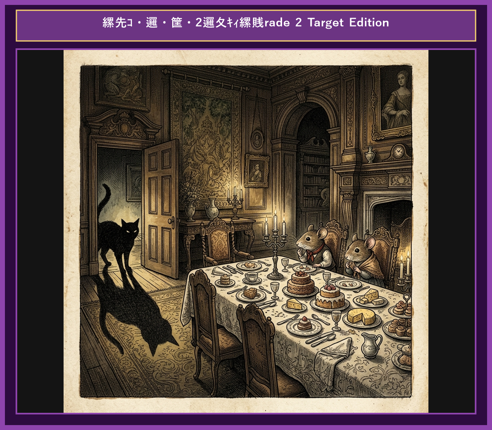

# Chapter 7: The Town Mouse and the Country Mouse (田舎のネズミと街のネズミ)

  

## 1. Benchmark Level: Eiken Pre-2 (英検準2級レベル本文)
*Read in ~2 to 2.5 minutes. Advanced vocabulary and structured clauses.*

A country mouse lived a humble, peaceful life in a quiet rural village. One day, he invited his cousin, a sophisticated town mouse, to visit his humble dwelling. The country mouse proudly served a simple meal consisting of dried roots, wild berries, and wheat stalks.

The town mouse nibbled politely at the coarse food but could not hide his condescending attitude. "My dear cousin," said the town mouse patronizingly, "you are living a miserable existence here. In the city, I feast daily on luxurious delicacies fit for royalty. You must accompany me to the town and experience true luxury."

Persuaded by the town mouse's glowing description, the country mouse agreed to travel to the bustling city. They arrived at a grand mansion late at night. The town mouse led his guest to a lavish banquet table covered with leftover roast meat, fine cheeses, sweet pastries, and exotic fruits.

Just as the country mouse was about to enjoy his first delicious bite, the heavy oak doors burst open. A pair of ferocious guard dogs bounded into the room, barking loudly. Terrified for their lives, the two mice scurried frantically into a narrow hole in the wall, hearts pounding in horror.

When the danger finally passed, the country mouse gathered his belongings and declared his immediate departure. "You may enjoy your magnificent feasts and luxurious lifestyle," he said, "but I prefer my modest, peaceful home where I can eat simple food in safety and peace."

A modest life filled with peace and security is far superior to a life of luxury constant fear.

---

## 2. Target Level: Eiken Grade 2 (英検2級レベル本文)
*Read in ~3 to 4 minutes. Academic discourse, complex participial structures, formal vocabulary, and nuanced transitions.*

A rural rodent maintained a frugal yet tranquil existence within a secluded agrarian habitat. On one occasion, he extended hospitality to his urban cousin, welcoming him to his unpretentious burrow. The host presented a modest fare comprising rustic roots, wild berries, and unrefined grains.

Sampling the coarse sustenance with visible distaste, the urban visitor voiced his disdain. "My esteemed relative," he remarked condescendingly, "your lifestyle is defined by unnecessary austerity. In the metropolis, I habitually partake of opulent banquets. I urge you to accompany me to the urban center to taste genuine affluence."

Enticed by visions of sensory indulgence, the rural rodent acquiesced to the invitation. Upon arriving at an opulent metropolitan mansion under cover of darkness, the host escorted his guest to a dining hall overflowing with gourmet delicacies, including imported cheeses and exquisite confections.

However, precisely as the guest prepared to sample the extravagant feast, the sanctuary was abruptly breached. Two menacing hounds stormed the chamber, their ferocious barking echoing off the marble walls. Panic-stricken, the rodents scrambled into a precarious crevice to evade imminent destruction.

Once tranquility was restored, the rural rodent promptly announced his intention to return to his homeland. "While your environment offers unparalleled luxury, it is inextricably bound to perpetual jeopardy. I firmly elect a modest existence safeguarded by serenity over perilous opulence."

A humble lifestyle accompanied by peace and security is immeasurably superior to luxurious affluence burdened by perpetual anxiety and mortal hazard.

---

## 3. Classic Original English Text (イソップ寓話 クラシック原文)
*Townsend / Jacobs Edition (Public Domain)*

A Country Mouse invited a Town Mouse, an old friend, to pay him a visit, and exercise old hospitality in his country nest. The Town Mouse accepted the invitation; but he soon found that his host had nothing to offer except barley and wheat. "Do you know," said he, "that you live the life of the ants? Now, I have abundance of all things; come with me and you shall share in them." So the two set off for the town. The Town Mouse took his friend to the larder of a rich man's house, where there were sweetmeats and jellies, pastry, delicious cheeses, and fruits. But just as they were beginning to eat, the door opened and someone came in. The two Mice ran off and hid themselves in a narrow corner. When all was quiet again, they ventured out; but someone else came in, and they had to run back again. At this the Country Mouse said: "I am off. You have plenty to eat, but your life is full of dangerous surprises; my food is simple, but I can eat it in peace."

Better beans and bacon in peace than cakes and ale in fear.

---

### 🏛️ 【英検2級レベルで読み解く！クラシック原文の重要構文・英文法ノート】
1. **1. 分詞構文（Participle Clause: 付帯状況・理由）**
   - **原文**: *"The Hare, believing her assertion to be simply impossible, agreed to the proposal..."*
   - **解説**: 「〜と信じ込んでいたので」という理由を表す分詞構文。英検2級の長文読解・ライティングの最頻出構文です。
1. **2. 古典的仮定法現在（Subjunctive Mood）**
   - **原文**: *"Though you be swift as the wind, I will beat you in a race."*
   - **解説**: 譲歩節 `Though` の中で原形 `be` を用いる古典的な仮定法現在（現代英語の `Though you are...`）。格調高い古典の響きを持ちます。
1. **3. 過去分詞の後置修飾（Postpositive Participle）**
   - **原文**: *"On the day appointed for the race the two started together."*
   - **解説**: `appointed`（定められた・指定された）が直前の名詞 `the day` を後ろから修飾する構文です。

### 📜 【クラシック原文の重要語彙・古風表現（Classic Antique Vocabulary）】
- **retort** [動] 2級 **（機転を利かせて）言い返す、反論する**（現代の reply sharp/wittily に相当）
- **assertion** [名] 2級/準1級 **主張、断言**（動詞 assert の名詞形。2級長文定番）
- **wayside** [名] 2級 **道端、沿道**（by the wayside（道端に、途中で））
- **fatigue** [名] 2級 **（心身の）極度の疲労、疲れ**（tiredness の上位フォーマル語）

---

## 4. Japanese Translation (日本語訳)

田舎のネズミが街のネズミの旧友を巣に招き、田舎ならではの格別のおもてなしをしました。街のネズミは招待に応じましたが、主人には大麦と小麦以外に差し出すものがないとすぐに分かりました。「きみはアリのような生活をしているのかい？僕のところにはあらゆるものが豊富にある。一緒に行って分け合おうじゃないか」と彼は言いました。そこで二匹は街へ出発しました。街のネズミは友人を金持ちの家の食料貯蔵室へ案内しました。そこには砂糖菓子やゼリー、パイ、美味しいチーズや果物がありました。しかし二匹が食べ始めようとしたまさにその時、扉が開き誰かが入ってきました。二匹のネズミは逃げ出し、狭い隅に隠れました。静かになると外へ這い出しましたが、また別の人が入ってきて、再び逃げ戻らざるを得ませんでした。これを見て田舎のネズミは言いました。「僕は帰るよ。君にはたくさんの食べ物があるが、危険な驚きに満ちている。僕の食べ物は質素だが、安心して食べられる。」

**教訓**: 平穏と安全を伴う質素な生活は、絶え間ない不安と生命の危険に苛まれる贅沢な富裕生活よりも無量に優れている。

---

## 5. Recite & Compare (そらんじたいキーフレーズ対比)
*Memorize these contrastive expressions to elevate speaking, writing, and reading fluency.*

  
■ 場面：質素な生活と都会の傲慢

  
【Pre-2 基礎】 <em>humble, peaceful life... miserable existence... luxurious delicacies...</em>

  
【Grade 2 暗唱】 <strong><em>frugal yet tranquil existence... defined by unnecessary austerity... partake of opulent banquets...</em></strong>

  
【ポイント】 <strong>解説・試験活用</strong>：`frugal`（質素な・節約志向の）、`tranquil`（平穏な）、`austerity`（厳格・質素さ）、`opulent banquets`（豪華な饗宴）。都市・地方問題を扱う2級長文の背景語彙。

  
■ 場面：魅了と承諾

  
【Pre-2 基礎】 <em>Persuaded by glowing description... agreed to travel...</em>

  
【Grade 2 暗唱】 <strong><em>Enticed by visions of sensory indulgence, acquiesced to the invitation...</em></strong>

  
【ポイント】 <strong>解説・試験活用</strong>：`Enticed by...`（〜に惹きつけられて）、`sensory indulgence`（感性的耽溺・贅沢）、`acquiesce to...`（〜に同意・屈服する）。2級英作文の動詞レベル引き上げ。

  
■ 場面：安全の突如たる破壊

  
【Pre-2 基礎】 <em>heavy oak doors burst open... ferocious guard dogs bounded in...</em>

  
【Grade 2 暗唱】 <strong><em>sanctuary was abruptly breached... menacing hounds stormed the chamber...</em></strong>

  
【ポイント】 <strong>解説・試験活用</strong>：`sanctuary`（聖域・安全な場所）、`breached`（突破された）、`menacing hounds`（脅威的な犬）。2級物語・出来事読解で重要なサスペンス語彙。

  
■ 場面：価値観の宣言（危険な富より平和）

  
【Pre-2 基礎】 <em>prefer my modest, peaceful home where I can eat simple food in safety...</em>

  
【Grade 2 暗唱】 <strong><em>inextricably bound to perpetual jeopardy... elect a modest existence safeguarded by serenity...</em></strong>

  
【ポイント】 <strong>解説・試験活用</strong>：`inextricably bound to...`（〜と切っても切れない関係にある）、`perpetual jeopardy`（絶え間ない危険）、`serenity`（静寂・平穏）。2級・準1級論説文で多用される極上フレーズ。

  
■ 場面：教訓（Moral）

  
【Pre-2 基礎】 <em>modest life filled with peace is far superior to luxury in fear...</em>

  
【Grade 2 暗唱】 <strong><em>humble lifestyle accompanied by security is immeasurably superior to affluence burdened by anxiety...</em></strong>

  
【ポイント】 <strong>解説・試験活用</strong>：`immeasurably superior to...`（〜より測定不能なほど優れている）、`burdened by anxiety`（不安に苛まれて）。2級の価値観比較・生活の質（QOL）エッセイで満点を狙える構文。

---

## 6. Vocabulary Builder: 赤シート対応 重要単語・熟語チェック表
*※ 赤い透明シート（または赤フィルム）を重ねると、日本語訳が消えて自力テストができます。*

| No. | 見出し語 / イディオム | 品詞 / レベル | 日本語の意味（赤シートで消える） | 本文での使われ方・コロケーション |
|:---:|---|:---:|---|---|
| **01** | **proud** | [形] 4級 | 誇り高い、傲慢な | *a proud hare (自惚れたウサギ)* |
| **02** | **boast (about...)** | [動] 3級 | 〜を自慢する、誇る | *was always boasting about his speed* |
| **03** | **make fun of...** | [熟] 3級 | 〜をからかう、嘲笑する | *making fun of a slow tortoise* |
| **04** | **challenge** | [名/動] 3級 | 挑戦、課題 / 挑む | *I accept your challenge.* |
| **05** | **accept** | [動] 3級 | 受け入れる、受諾する | *accept the proposal (提案を受諾する)* |
| **06** | **dash** | [動] 3級 | 勢いよく走る、突進する | *dashed forward (前方へ駆け出した)* |
| **07** | **leave ~ behind** | [熟] 3級 | 〜を置き去りにする | *left the tortoise far behind* |
| **08** | **visible** | [形] 準2級 | 目に見える、視認できる | *was barely visible in the distance* |
| **09** | **catch up (with...)** | [熟] 3級 | 〜に追いつく | *before he catches up* |
| **10** | **slumber** | [名/動] 準2級 | 深い眠り / 眠る | *fell into a profound slumber* |
| **11** | **sprint** | [動] 3級 | 全力疾走する | *sprinted toward the finish line* |
| **12** | **persistence** | [名] 準2級/2級 | 粘り強さ、不屈の継続 | *persistence and hard work will bring success* |

### 【出題傾向・文法解説ノート】

### 【出題頻出語彙・熟語ノート】
- **frugal** [形] 質素な、簡素な（*frugal lifestyle/meal*）
- **tranquil** [形] 静かな、平穏な（名詞 *tranquility*）
- **opulent** [形] 豪華な、富裕な（名詞 *opulence* 「富裕」）
- **acquiesce** [動] （気は進まないが）同意する、従う（*acquiesce in/to A*）
- **breach** [動] （壁・防衛網など）を破る、違反する（*breach security/sanctuary*）
- **jeopardy** [名] 危険、危難（*in jeopardy* 「危険にさらされて」）
- **immeasurably** [副] 測り知れないほど、計り知れなく（*immeasurably superior/better*）

### 【文法・構文ポイント】
1. **[inextricably bound to ...]（〜と密接に結びついている、切っても切れない関係にある）**
   - 2級本文: *"While your environment offers luxury, it is inextricably bound to perpetual jeopardy."*
   - ポイント: 2級〜1級の論文・エッセイで頻出する高度な関係性表現。環境と経済、技術と倫理などの密接不可分なテーマで威力を発揮します。
2. **[elect + 目的語]（〜を選択する、〜を選ぶ）**
   - 2級本文: *"I firmly elect a modest existence safeguarded by serenity..."*
   - ポイント: `choose` や `select` の非常にフォーマルな動詞。自身の明確な意思表明としてライティング結論部分に最適です。
