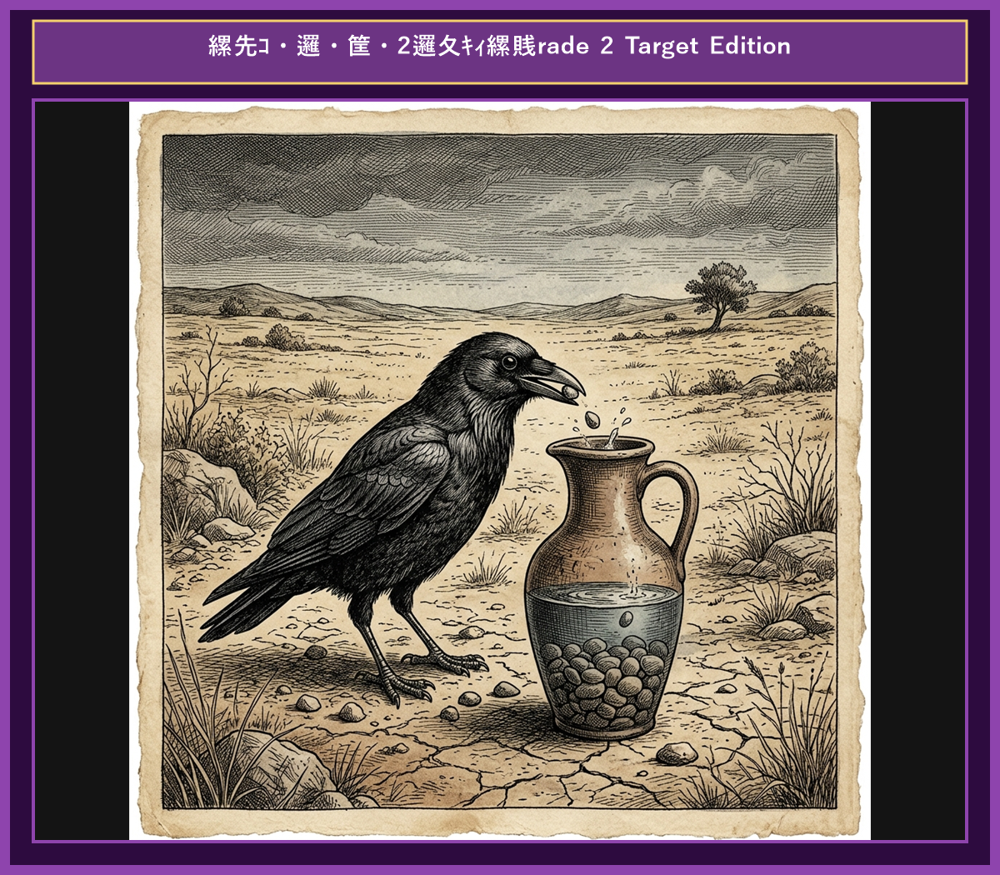

# Chapter 8: The Crow and the Pitcher (カラスと水つぼ)

  

## 1. Benchmark Level: Eiken Pre-2 (英検準2級レベル本文)
*Read in ~2 to 2.5 minutes. Advanced vocabulary and structured clauses.*

During a severe summer drought, a thirsty crow flew endlessly over the parched countryside searching for water. Just as he was on the verge of collapsing from dehydration, he spotted a tall glass pitcher standing on a garden table.

Encouraged by the discovery, the crow swooped down and peered inside. To his delight, the vessel contained a small quantity of clear water. However, when he inserted his beak into the neck of the pitcher, he discovered to his despair that the water level was far too low for him to reach.

The crow attempted to overturn the heavy vessel, but his physical strength was insufficient to push it over. Next, he tried to break the thick glass with his beak, but the material was too durable. For a moment, he contemplated surrendering to his tragic fate.

However, refusing to give up, the clever bird observed a pile of small pebbles scattered on the nearby ground. An ingenious strategy flashed through his mind.

Carefully picking up one pebble at a time with his beak, the crow dropped them systematically into the pitcher. As each stone sank to the bottom, the water level gradually rose higher. After dropping dozens of pebbles into the container, the water finally reached the brim, allowing the crow to quench his thirst completely.

Ingenuity and patient effort can overcome seemingly insurmountable obstacles.

---

## 2. Target Level: Eiken Grade 2 (英検2級レベル本文)
*Read in ~3 to 4 minutes. Academic discourse, complex participial structures, formal vocabulary, and nuanced transitions.*

Amid an extended period of intense drought, a dehydrated crow traversed the arid landscape in a desperate quest for moisture. Approaching the point of total physical exhaustion, his keen vision identified a tall ceramic pitcher situated upon a desolate courtyard.

Impelled by survival instinct, the avian descended to inspect the container. Upon examining the interior, he confirmed the presence of a small liquid reserve. Nevertheless, his initial relief dissolved into profound dismay when he ascertained that the narrow neck of the vessel rendered the water entirely inaccessible to his bill.

Initially, the crow attempted to tip the container to spill its contents, yet the weight of the vessel defied his physical capacity. Subsequently, he attempted to shatter the durable ceramic structure, but his impact proved wholly ineffective. Confronted by this critical dilemma, he paused to evaluate alternative solutions.

Exhibiting extraordinary cognitive problem-solving, the crow observed numerous small pebbles strewn across the surrounding terrain. He conceived a brilliant plan based on the principle of fluid displacement.

Exercising meticulous patience, the bird retrieved the stones individually and deposited them into the vessel. Concurrently with the accumulation of pebbles at the base, the liquid level ascended incrementally. Through persistent execution of this methodical process, the water eventually crested the rim, enabling the crow to fully satisfy his physiological need.

Intellectual ingenuity combined with methodical perseverance routinely surmounts obstacles that defy raw physical force.

---

## 3. Classic Original English Text (イソップ寓話 クラシック原文)
*Townsend / Jacobs Edition (Public Domain)*

A Crow, half-dead with thirst, came upon a Pitcher which had once been full of water; but when the Crow pushed his beak into the mouth of the Pitcher, he found that only very little water was left in it, and that he could not reach far enough down to get at it. He tried, and he tried, but at last had to give up the attempt. Then a thought came to him, and he took a pebble and dropped it into the Pitcher; then he took another pebble and dropped it into the Pitcher; then he took another pebble and dropped that into the Pitcher. At last, seeing the water rise towards the top, he dropped a few more pebbles in, and was able to quench his thirst and save his life.

Little by little does the trick.

---

### 🏛️ 【英検2級レベルで読み解く！クラシック原文の重要構文・英文法ノート】
1. **1. 分詞構文（Participle Clause: 付帯状況・理由）**
   - **原文**: *"The Hare, believing her assertion to be simply impossible, agreed to the proposal..."*
   - **解説**: 「〜と信じ込んでいたので」という理由を表す分詞構文。英検2級の長文読解・ライティングの最頻出構文です。
1. **2. 古典的仮定法現在（Subjunctive Mood）**
   - **原文**: *"Though you be swift as the wind, I will beat you in a race."*
   - **解説**: 譲歩節 `Though` の中で原形 `be` を用いる古典的な仮定法現在（現代英語の `Though you are...`）。格調高い古典の響きを持ちます。
1. **3. 過去分詞の後置修飾（Postpositive Participle）**
   - **原文**: *"On the day appointed for the race the two started together."*
   - **解説**: `appointed`（定められた・指定された）が直前の名詞 `the day` を後ろから修飾する構文です。

### 📜 【クラシック原文の重要語彙・古風表現（Classic Antique Vocabulary）】
- **retort** [動] 2級 **（機転を利かせて）言い返す、反論する**（現代の reply sharp/wittily に相当）
- **assertion** [名] 2級/準1級 **主張、断言**（動詞 assert の名詞形。2級長文定番）
- **wayside** [名] 2級 **道端、沿道**（by the wayside（道端に、途中で））
- **fatigue** [名] 2級 **（心身の）極度の疲労、疲れ**（tiredness の上位フォーマル語）

---

## 4. Japanese Translation (日本語訳)

喉の渇きで死にそうになったカラスが、かつて水でいっぱいだった水つぼを見つけました。しかしカラスがつぼの口にクチバシを突っ込むと、水はごくわずかしか残っておらず、届かないことが分かりました。彼は何度も試みましたが、ついにあきらめざるを得なくなりました。その時、ある考えが浮かびました。彼は小石を一つ拾って水つぼに落とし、また別の小石を拾って落とし、さらに別の小石を落としました。やがて水が上がってくるのを見て、さらに数個の小石を落とし、ついに喉の渇きを癒して命を救うことができました。

**教訓**: 知的思考と段階的・規則的な粘り強さは、単なる腕力や暴力を凌駕し、一見克服不能に見える障害をも切り拓く。

---

## 5. Recite & Compare (そらんじたいキーフレーズ対比)
*Memorize these contrastive expressions to elevate speaking, writing, and reading fluency.*

  
■ 場面：干絶・水分の探索

  
【Pre-2 基礎】 <em>on the verge of collapsing from dehydration... spotted a pitcher...</em>

  
【Grade 2 暗唱】 <strong><em>Approaching total physical exhaustion... desperate quest for moisture...</em></strong>

  
【ポイント】 <strong>解説・試験活用</strong>：`quest for...`（〜の探求・追求）や `physical exhaustion`（身体の極限疲労）。科学・自然文脈の2級長文で必修。

  
■ 場面：障害の認識と限界

  
【Pre-2 基礎】 <em>water level was far too low for him to reach...</em>

  
【Grade 2 暗唱】 <strong><em>ascertained that the narrow neck rendered the water entirely inaccessible...</em></strong>

  
【ポイント】 <strong>解説・試験活用</strong>：動詞 `ascertain`（〜を突き止める・確認する）、`inaccessible`（アクセス不可能な）。2級IT・環境・社会構造課題の最頻出語彙。

  
■ 場面：科学的原理に基づく仮説

  
【Pre-2 基礎】 <em>observed pebbles... an ingenious strategy flashed through his mind...</em>

  
【Grade 2 暗唱】 <strong><em>Exhibiting cognitive problem-solving, conceived a plan based on fluid displacement...</em></strong>

  
【ポイント】 <strong>解説・試験活用</strong>：`cognitive problem-solving`（認知的問題解決能力）、`conceive a plan`（計画を考案する）、`fluid displacement`（流体排除・排水量原理）。2級自然科学文章。

  
■ 場面：段階的な実行と目標達成

  
【Pre-2 基礎】 <em>dropped pebbles systematically... water level gradually rose...</em>

  
【Grade 2 暗唱】 <strong><em>deposited stones... liquid level ascended incrementally... crested the rim...</em></strong>

  
【ポイント】 <strong>解説・試験活用</strong>：`deposit`（〜を配置・投下する）、`ascend incrementally`（漸進的に・段階的に上昇する）、`crest the rim`（縁まで達する）。グラフ描写・実験記述で使える英検2級表現。

  
■ 場面：教訓（Moral）

  
【Pre-2 基礎】 <em>Ingenuity and effort can overcome insurmountable obstacles...</em>

  
【Grade 2 暗唱】 <strong><em>Intellectual ingenuity combined with perseverance routinely surmounts obstacles defying raw force...</em></strong>

  
【ポイント】 <strong>解説・試験活用</strong>：`Intellectual ingenuity`（知的独創性）、`surmount obstacles`（障害を克服する・乗り越える）。2級技術・イノベーション課題エッセイで満点を獲得する模範文。

---

## 6. Vocabulary Builder: 赤シート対応 重要単語・熟語チェック表
*※ 赤い透明シート（または赤フィルム）を重ねると、日本語訳が消えて自力テストができます。*

| No. | 見出し語 / イディオム | 品詞 / レベル | 日本語の意味（赤シートで消える） | 本文での使われ方・コロケーション |
|:---:|---|:---:|---|---|
| **01** | **proud** | [形] 4級 | 誇り高い、傲慢な | *a proud hare (自惚れたウサギ)* |
| **02** | **boast (about...)** | [動] 3級 | 〜を自慢する、誇る | *was always boasting about his speed* |
| **03** | **make fun of...** | [熟] 3級 | 〜をからかう、嘲笑する | *making fun of a slow tortoise* |
| **04** | **challenge** | [名/動] 3級 | 挑戦、課題 / 挑む | *I accept your challenge.* |
| **05** | **accept** | [動] 3級 | 受け入れる、受諾する | *accept the proposal (提案を受諾する)* |
| **06** | **dash** | [動] 3級 | 勢いよく走る、突進する | *dashed forward (前方へ駆け出した)* |
| **07** | **leave ~ behind** | [熟] 3級 | 〜を置き去りにする | *left the tortoise far behind* |
| **08** | **visible** | [形] 準2級 | 目に見える、視認できる | *was barely visible in the distance* |
| **09** | **catch up (with...)** | [熟] 3級 | 〜に追いつく | *before he catches up* |
| **10** | **slumber** | [名/動] 準2級 | 深い眠り / 眠る | *fell into a profound slumber* |
| **11** | **sprint** | [動] 3級 | 全力疾走する | *sprinted toward the finish line* |
| **12** | **persistence** | [名] 準2級/2級 | 粘り強さ、不屈の継続 | *persistence and hard work will bring success* |

### 【出題傾向・文法解説ノート】

### 【出題頻出語彙・熟語ノート】
- **quest** [名] 探求、追求（*in a quest for knowledge/truth*）
- **ascertain** [動] 〜を確める、解明する（*ascertain the facts/causes*）
- **inaccessible** [形] 手の届かない、到達不可能な（名詞 *inaccessibility*）
- **conceive** [動] （考え・計画）を思いつく、案出する（*conceive a new strategy*）
- **incrementally** [副] 漸進的に、少しずつ増加して（形容詞 *incremental*）
- **surmount** [動] （難局・障害）を乗り越える、克服する（*surmount difficulties/barriers*）
- **ingenuity** [名] 独創性、創意工夫（形容詞 *ingenious*）

### 【文法・构文ポイント】
1. **[on the verge of ...]（今にも〜しそうになって、〜の瀬戸際で）**
   - 2級本文: *"Just as he was on the verge of collapsing from dehydration..."*
   - ポイント: 状態の変化や危機の直前を示す必須表現。`on the brink of...` や `on the point of...` と書き換えることができます。
2. **[Concurrently with ...]（〜と同時に）**
   - 2級本文: *"Concurrently with the accumulation of pebbles... the liquid level ascended..."*
   - ポイント: 2つの現象が同時進行で起こることを示すフォーマルな接続表現。グラフ読解や実験報告文章の決定打。
