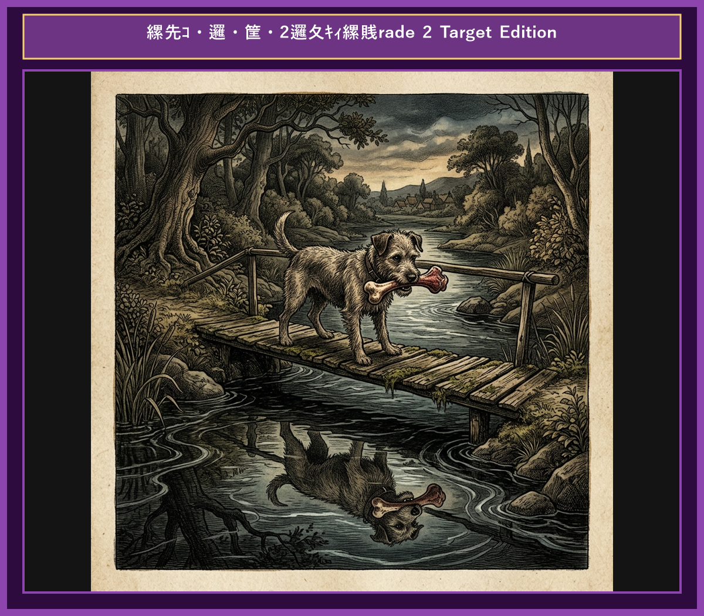

# Chapter 9: The Dog and His Shadow (欲張りな犬)

  

## 1. Benchmark Level: Eiken Pre-2 (英検準2級レベル本文)
*Read in ~2 to 2.5 minutes. Advanced vocabulary and structured clauses.*

A lucky dog was trotting home from the butcher shop carrying a fine, juicy piece of meat in his mouth. Thrilled with his prize, he looked forward to enjoying his delicious meal in peace.

On his way home, he had to cross a narrow wooden footbridge over a crystal-clear stream. As he trotted across, he glanced down into the calm water and saw his own reflection mirrored on the surface. Mistaking his reflection for another dog carrying a piece of meat that appeared far larger and juicier than his own, the greedy dog was consumed by envy.

"I must have that meat as well!" thought the foolish animal. "Then I will have a double feast!"

Unwilling to share or be satisfied with what he already possessed, the dog opened his jaws wide and barked aggressively at his reflection to intimidate the rival.

However, the moment he opened his mouth, his own piece of meat dropped into the stream. It sank quickly to the bottom and was swept away by the swift current. The dog stood on the bridge in utter shock, watching his real treasure disappear forever, leaving him with nothing but his own empty reflection.

Greed for illusory gain often leads to the forfeiture of genuine substance.

---

## 2. Target Level: Eiken Grade 2 (英検2級レベル本文)
*Read in ~3 to 4 minutes. Academic discourse, complex participial structures, formal vocabulary, and nuanced transitions.*

A fortunate canine was returning home, clutching a choice cut of meat acquired from a local butcher. Elated by his good fortune, he anticipated savoring his prize in solitary comfort.

His route mandated traversing a narrow wooden bridge spanning a tranquil stream. Pausing mid-crossing, he peered into the transparent water and observed his own optical reflection. Misinterpreting this aquatic image as a formidable competitor carrying an item of superior magnitude, the covetous canine was instantly overcome by insatiable avarice.

"I shall expropriate that additional prize," the canine resolved foolishly, driven by an unbridled impulse to maximize his acquisition.

Compelled by greed to usurp what he perceived as a rival's asset, the canine snapped his jaws aggressively, emitting a loud bark to intimidate the image.

Inevitably, the instant his mouth unclasped, his actual prize dislodged and plunged into the current below. The swift waters instantly swept the meat beyond recovery. The canine remained stranded on the structure, contemplating the permanent loss of his tangible asset, confronted only by the mockery of his own hollow reflection.

Insatiable greed for illusory phantoms routinely precipitates the forfeiture of tangible reality.

---

## 3. Classic Original English Text (イソップ寓話 クラシック原文)
*Townsend / Jacobs Edition (Public Domain)*

A Dog, crossing a bridge over a stream with a piece of flesh in his mouth, saw his own shadow in the water, and took it for that of another Dog, with a piece of meat double the size of his own. He immediately let go of his own, and fiercely attacked the other Dog to get his larger piece from him. He thus lost both: that which he grasped at in the water, because it was a shadow; and his own, because the stream swept it away.

Beware lest you lose the substance by grasping at the shadow.

---

### 🏛️ 【英検2級レベルで読み解く！クラシック原文の重要構文・英文法ノート】
1. **1. 分詞構文（Participle Clause: 付帯状況・理由）**
   - **原文**: *"The Hare, believing her assertion to be simply impossible, agreed to the proposal..."*
   - **解説**: 「〜と信じ込んでいたので」という理由を表す分詞構文。英検2級の長文読解・ライティングの最頻出構文です。
1. **2. 古典的仮定法現在（Subjunctive Mood）**
   - **原文**: *"Though you be swift as the wind, I will beat you in a race."*
   - **解説**: 譲歩節 `Though` の中で原形 `be` を用いる古典的な仮定法現在（現代英語の `Though you are...`）。格調高い古典の響きを持ちます。
1. **3. 過去分詞の後置修飾（Postpositive Participle）**
   - **原文**: *"On the day appointed for the race the two started together."*
   - **解説**: `appointed`（定められた・指定された）が直前の名詞 `the day` を後ろから修飾する構文です。

### 📜 【クラシック原文の重要語彙・古風表現（Classic Antique Vocabulary）】
- **retort** [動] 2級 **（機転を利かせて）言い返す、反論する**（現代の reply sharp/wittily に相当）
- **assertion** [名] 2級/準1級 **主張、断言**（動詞 assert の名詞形。2級長文定番）
- **wayside** [名] 2級 **道端、沿道**（by the wayside（道端に、途中で））
- **fatigue** [名] 2級 **（心身の）極度の疲労、疲れ**（tiredness の上位フォーマル語）

---

## 4. Japanese Translation (日本語訳)

ある犬が肉の塊を口にくわえて川に架かる橋を渡っていました。水面に自分の影が映っているのを見て、自分の持っている肉の二倍も大きな肉を持った別の犬だと思い込みました。彼はすぐに自分の肉を離し、相手の大きな肉を奪おうと激しく襲いかかりました。こうして彼は両方を失いました。水の中で掴もうとしたものは影だったからであり、自分の肉は川の流れに流されてしまったからです。

**教訓**: 実体のない幻影（幻）を貪欲に追う者は、手の中にあった本物の実体（現実の価値）をも決定的に失うことになる。

---

## 5. Recite & Compare (そらんじたいキーフレーズ対比)
*Memorize these contrastive expressions to elevate speaking, writing, and reading fluency.*

  
■ 場面：獲得と幸福感

  
【Pre-2 基礎】 <em>carrying a fine, juicy piece of meat... Thrilled with his prize...</em>

  
【Grade 2 暗唱】 <strong><em>clutching a choice cut of meat... Elated by his good fortune...</em></strong>

  
【ポイント】 <strong>解説・試験活用</strong>：`clutch`（〜を固く握る・銜える）、`choice cut`（上等の肉・厳選品）、`Elated by...`（〜に大喜びして）。2級物語文の心情描写上位表現。

  
■ 場面：誤解と強欲の発生

  
【Pre-2 基礎】 <em>Mistaking reflection for another dog... consumed by envy...</em>

  
【Grade 2 暗唱】 <strong><em>Misinterpreting optical reflection... overcome by insatiable avarice...</em></strong>

  
【ポイント】 <strong>解説・試験活用</strong>：`optical reflection`（光学的反射・鏡像）、`insatiable avarice`（満たされることのない強欲）。2級長文の人間・動物心理分析で重要。

  
■ 場面：略奪の意図と威嚇

  
【Pre-2 基礎】 <em>barked aggressively at reflection to intimidate...</em>

  
【Grade 2 暗唱】 <strong><em>expropriate additional prize... snapped jaws to intimidate...</em></strong>

  
【ポイント】 <strong>解説・試験活用</strong>：動詞 `expropriate`（〜を収用する・奪取する）や `intimidate`（〜を脅す・威嚇する）。2級社会問題・法律課題。

  
■ 場面：不可逆な喪失

  
【Pre-2 基礎】 <em>swept away by swift current... watching real treasure disappear forever...</em>

  
【Grade 2 暗唱】 <strong><em>plunged into current... contemplating permanent loss of tangible asset...</em></strong>

  
【ポイント】 <strong>解説・試験活用</strong>：`tangible asset`（有形資産・実質的価値）、`contemplate loss`（喪失を熟考する・見つめる）。経済・環境分野の2級エッセイ表現。

  
■ 場面：教訓（Moral）

  
【Pre-2 基礎】 <em>Greed for illusory gain leads to forfeiture of genuine substance...</em>

  
【Grade 2 暗唱】 <strong><em>Insatiable greed for illusory phantoms routinely precipitates forfeiture of tangible reality...</em></strong>

  
【ポイント】 <strong>解説・試験活用</strong>：`illusory phantoms`（実体のない幻影）、`precipitate`（〜を急速に引き起こす）、`tangible reality`（手触りのある現実）。2級・準1級哲学・投機・欲望テーマで満点レベルの文章。

---

## 6. Vocabulary Builder: 赤シート対応 重要単語・熟語チェック表
*※ 赤い透明シート（または赤フィルム）を重ねると、日本語訳が消えて自力テストができます。*

| No. | 見出し語 / イディオム | 品詞 / レベル | 日本語の意味（赤シートで消える） | 本文での使われ方・コロケーション |
|:---:|---|:---:|---|---|
| **01** | **proud** | [形] 4級 | 誇り高い、傲慢な | *a proud hare (自惚れたウサギ)* |
| **02** | **boast (about...)** | [動] 3級 | 〜を自慢する、誇る | *was always boasting about his speed* |
| **03** | **make fun of...** | [熟] 3級 | 〜をからかう、嘲笑する | *making fun of a slow tortoise* |
| **04** | **challenge** | [名/動] 3級 | 挑戦、課題 / 挑む | *I accept your challenge.* |
| **05** | **accept** | [動] 3級 | 受け入れる、受諾する | *accept the proposal (提案を受諾する)* |
| **06** | **dash** | [動] 3級 | 勢いよく走る、突進する | *dashed forward (前方へ駆け出した)* |
| **07** | **leave ~ behind** | [熟] 3級 | 〜を置き去りにする | *left the tortoise far behind* |
| **08** | **visible** | [形] 準2級 | 目に見える、視認できる | *was barely visible in the distance* |
| **09** | **catch up (with...)** | [熟] 3級 | 〜に追いつく | *before he catches up* |
| **10** | **slumber** | [名/動] 準2級 | 深い眠り / 眠る | *fell into a profound slumber* |
| **11** | **sprint** | [動] 3級 | 全力疾走する | *sprinted toward the finish line* |
| **12** | **persistence** | [名] 準2級/2級 | 粘り強さ、不屈の継続 | *persistence and hard work will bring success* |

### 【出題傾向・文法解説ノート】

### 【出題頻出語彙・熟語ノート】
- **elated** [形] 大喜びした、意気揚々とした（*feel elated at the news*）
- **avarice** [名] （金品に対する）強欲、貪欲（形容詞 *avaricious*）
- **expropriate** [動] （財産・権利など）を没収する、奪う（2級法律・経済文章）
- **intimidate** [動] 〜を脅す、威嚇する（名詞 *intimidation*）
- **tangible** [形] 明確な、有形の、実体のある（対義語 *intangible* 「無形の」）
- **illusory** [形] 錯覚の、実体のない（名詞 *illusion*）
- **precipitate** [動] 〜を突如引き起こす、促進する（*precipitate a crisis/downfall*）

### 【文法・構文ポイント】
1. **[mandate + 動名詞/to do]（〜することを義務付ける、要求する）**
   - 2級本文: *"His route mandated traversing a narrow wooden bridge..."*
   - ポイント: 法則や状況が行動を強制することを示すフォーマル動詞。`require` の上位語として英検2級論文で重宝します。
2. **[left stranded]（取り残されて、立ち往生して）**
   - 2級本文: *"The canine remained stranded on the structure..."*
   - ポイント: 孤立無援や解決不能な状態に陥ることを示す表現。災害・交通・心理状態の描写で頻出します。
