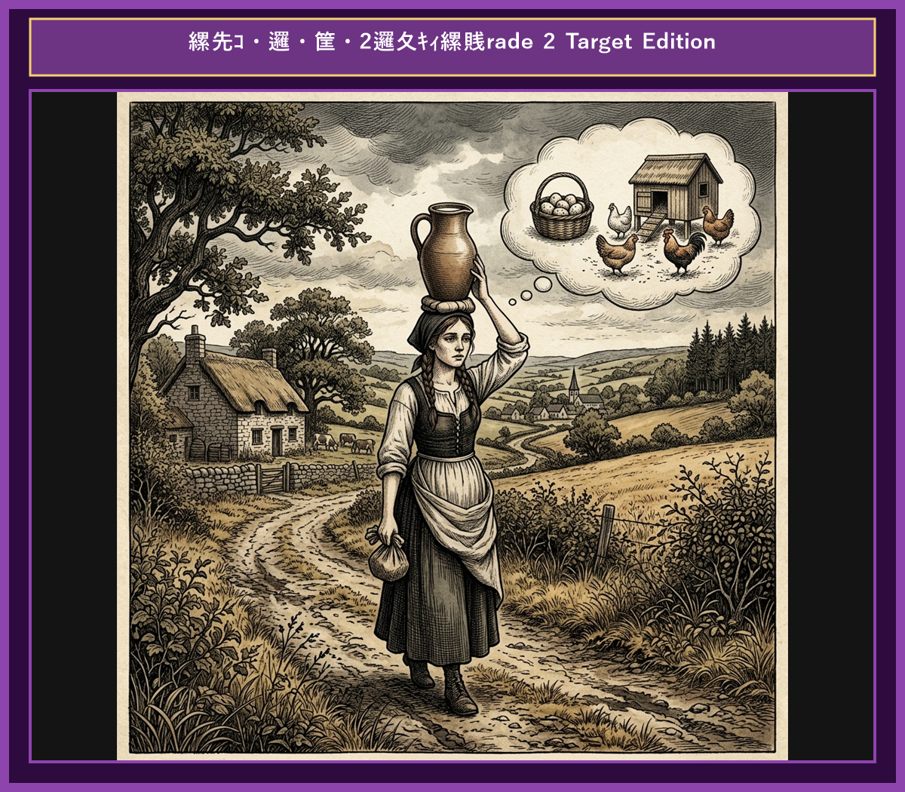

# Chapter 10: The Milkmaid and Her Pail (ミルク搾りの娘)

  

## 1. Benchmark Level: Eiken Pre-2 (英検準2級レベル本文)
*Read in ~2 to 2.5 minutes. Advanced vocabulary and structured clauses.*

A cheerful young milkmaid named Patty was walking gracefully back to the farm carrying a full bucket of fresh milk balanced carefully on her head. As she walked along the quiet country road, her mind began to wander into elaborate daydreams about the future wealth her milk would bring.

"I will sell this delicious milk at the local market," Patty calculated in her mind. "With the money I earn, I will buy at least three hundred eggs. Even if some fail to hatch, I am guaranteed to have at least two hundred healthy chicks."

Her imagination soared as she continued walking. "I will feed the chicks nutritious grain until they grow into fat poultry. When the market price rises during the festival season, I will sell them for a substantial profit. With that money, I will purchase a stunning silk gown and elegant ribbons to wear to the annual village ball."

Patty smiled brightly, visualizing her grand appearance. "All the young men will admire me and ask for a dance, but I will toss my head back proudly and refuse them all with disdain!"

Carried away by her fantasy, Patty tossed her head back in real life. In an instant, the heavy bucket slipped off her head and crashed onto the ground. The fresh milk spilled everywhere, soaking into the dry soil.

"Alas!" cried Patty in tears. "My chickens, my gown, and my grand ball are all gone!"

Do not count your chickens before they are hatched; unrealistic speculation often leads to bitter disappointment.

---

## 2. Target Level: Eiken Grade 2 (英検2級レベル本文)
*Read in ~3 to 4 minutes. Academic discourse, complex participial structures, formal vocabulary, and nuanced transitions.*

A young dairy maid was returning from the pasture, balancing a vessel filled to capacity with fresh milk atop her head. As she traversed the rural pathway, she succumbed to grandiose financial projections, mentally reinvesting the anticipated proceeds of her commodity.

"Disposing of this milk at the regional market will generate substantial capital," she reasoned strategically. "I shall allocate those funds toward the acquisition of hundreds of eggs. Allowing for natural mortality, the venture will yield a formidable flock of poultry."

Her speculative calculations rapidly expanded. "Once these birds reach maturity, I shall liquidate them during peak demand, securing a lucrative return. This capital will enable the purchase of exquisite attire suitable for the forthcoming municipal gala."

Immersed in her vision of social elevation, she imagined herself as the centerpiece of admiration. "Every suitor will vie for my favor, yet I shall haughtily reject their advances with a disdainful gesture of my head."

Enraptured by this imaginary scenario, she impulsively executed the physical movement in reality. Consequently, the vessel lost its equilibrium, plunging to the earth and saturating the soil with her entire liquid asset.

Distraught by the sudden calamity, she wept for her evaporated wealth, recognizing that her elaborate scheme had dissolved into nothingness.

Premature speculation on unverified outcomes frequently precipitates catastrophic disillusionment; never count your chickens before they hatch.

---

## 3. Classic Original English Text (イソップ寓話 クラシック原文)
*Townsend / Jacobs Edition (Public Domain)*

A Patty the Milkmaid was going to the market carrying her milk in a Pail on her head. As she went along she began calculating what she would do with the money she would get for the milk. "I'll buy some fowls from Farmer Brown," said she, "and they will lay eggs each morning, which I will sell to the parson's wife. With the money that I get from the sale of these eggs I'll buy myself a new gown and a new hat; and when I go to the market, won't all the young men come up and speak to me! Polly Shaw will be that jealous, but I don't care. I shall just toss my head and say no to them." As she thought of this, she tossed her head back; the Pail fell off her head, and all the milk was spilt. So she had to go home and tell her mother what had occurred.

"Ah, my child," said the mother, "do not count your chickens before they are hatched."

---

### 🏛️ 【英検2級レベルで読み解く！クラシック原文の重要構文・英文法ノート】
1. **1. 分詞構文（Participle Clause: 付帯状況・理由）**
   - **原文**: *"The Hare, believing her assertion to be simply impossible, agreed to the proposal..."*
   - **解説**: 「〜と信じ込んでいたので」という理由を表す分詞構文。英検2級の長文読解・ライティングの最頻出構文です。
1. **2. 古典的仮定法現在（Subjunctive Mood）**
   - **原文**: *"Though you be swift as the wind, I will beat you in a race."*
   - **解説**: 譲歩節 `Though` の中で原形 `be` を用いる古典的な仮定法現在（現代英語の `Though you are...`）。格調高い古典の響きを持ちます。
1. **3. 過去分詞の後置修飾（Postpositive Participle）**
   - **原文**: *"On the day appointed for the race the two started together."*
   - **解説**: `appointed`（定められた・指定された）が直前の名詞 `the day` を後ろから修飾する構文です。

### 📜 【クラシック原文の重要語彙・古風表現（Classic Antique Vocabulary）】
- **retort** [動] 2級 **（機転を利かせて）言い返す、反論する**（現代の reply sharp/wittily に相当）
- **assertion** [名] 2級/準1級 **主張、断言**（動詞 assert の名詞形。2級長文定番）
- **wayside** [名] 2級 **道端、沿道**（by the wayside（道端に、途中で））
- **fatigue** [名] 2級 **（心身の）極度の疲労、疲れ**（tiredness の上位フォーマル語）

---

## 4. Japanese Translation (日本語訳)

牛乳絞りのパティが頭の上にミルクのバケツをのせて市場へ向かっていました。歩きながら、彼女はミルクで得られるお金で何ができるか計算し始めました。「ブラウンさんから鶏を何羽か買おう」と彼女は言いました。「毎朝卵を産んでくれるから、牧師の奥さんに売るのよ。卵の売り上げで新しいガウンと帽子を買えば、市場に行った時に若者たちがみんな私に話しかけてくるわ！ポリーは嫉妬するでしょうね。でも気にしないわ。頭を後ろに振って断ってやるの」そう考えた瞬間、彼女は本当に頭を後ろに振ってしまいました。バケツは頭から落ち、ミルクはすべてこぼれてしまいました。

**教訓**: 検証されていない結果に対する早まった投機・皮算用は不可避的に決定的な幻滅を引き起こす。卵が孵る前にヒヨコを数えてはならない。

---

## 5. Recite & Compare (そらんじたいキーフレーズ対比)
*Memorize these contrastive expressions to elevate speaking, writing, and reading fluency.*

  
■ 場面：将来の利益計算・投機

  
【Pre-2 基礎】 <em>daydreams about future wealth... sell milk and buy eggs...</em>

  
【Grade 2 暗唱】 <strong><em>grandiose financial projections... mentally reinvesting anticipated proceeds...</em></strong>

  
【ポイント】 <strong>解説・試験活用</strong>：`grandiose financial projections`（壮大な財務予測・捕らぬ狸の皮算用）、`anticipated proceeds`（予想される収益）。2級経済・ビジネス長文の必須単語。

  
■ 場面：資産の清算と高利益の確保

  
【Pre-2 基礎】 <em>sell them for a substantial profit... purchase a stunning gown...</em>

  
【Grade 2 暗唱】 <strong><em>liquidate them during peak demand, securing a lucrative return...</em></strong>

  
【ポイント】 <strong>解説・試験活用</strong>：`liquidate`（資産を売却・清算する）、`peak demand`（需要のピーク）、`lucrative return`（利益の大きいリターン・返り値）。2級英作文でのビジネス表現。

  
■ 場面：妄想への没頭と軽はずみな行動

  
【Pre-2 基礎】 <em>Carried away by her fantasy, Patty tossed her head back...</em>

  
【Grade 2 暗唱】 <strong><em>Enraptured by imaginary scenario, impulsively executed movement...</em></strong>

  
【ポイント】 <strong>解説・試験活用</strong>：`Enraptured by...`（〜に心を奪われて）、`impulsively`（衝動的に）。心理状態と過ちの因果関係を描く2級標準表現。

  
■ 場面：台無し・突然の災難

  
【Pre-2 基礎】 <em>slipped off her head and crashed... milk spilled everywhere...</em>

  
【Grade 2 暗唱】 <strong><em>vessel lost its equilibrium... saturating soil with entire liquid asset...</em></strong>

  
【ポイント】 <strong>解説・試験活用</strong>：`equilibrium`（均衡・バランス）、`saturate`（〜を濡らす・浸透させる）、`liquid asset`（流動資産・液状資産）。しゃれの効いた2級高度表現。

  
■ 場面：教訓（Moral）

  
【Pre-2 基礎】 <em>Do not count your chickens before they are hatched...</em>

  
【Grade 2 暗唱】 <strong><em>Premature speculation on unverified outcomes precipitates catastrophic disillusionment...</em></strong>

  
【ポイント】 <strong>解説・試験活用</strong>：`Premature speculation`（早まった投機・皮算用）、`unverified outcomes`（検証されていない結果）、`catastrophic disillusionment`（壊滅的な幻滅）。2級・準1級経営・個人投資エッセイの神締めくくり文。

---

## 6. Vocabulary Builder: 赤シート対応 重要単語・熟語チェック表
*※ 赤い透明シート（または赤フィルム）を重ねると、日本語訳が消えて自力テストができます。*

| No. | 見出し語 / イディオム | 品詞 / レベル | 日本語の意味（赤シートで消える） | 本文での使われ方・コロケーション |
|:---:|---|:---:|---|---|
| **01** | **proud** | [形] 4級 | 誇り高い、傲慢な | *a proud hare (自惚れたウサギ)* |
| **02** | **boast (about...)** | [動] 3級 | 〜を自慢する、誇る | *was always boasting about his speed* |
| **03** | **make fun of...** | [熟] 3級 | 〜をからかう、嘲笑する | *making fun of a slow tortoise* |
| **04** | **challenge** | [名/動] 3級 | 挑戦、課題 / 挑む | *I accept your challenge.* |
| **05** | **accept** | [動] 3級 | 受け入れる、受諾する | *accept the proposal (提案を受諾する)* |
| **06** | **dash** | [動] 3級 | 勢いよく走る、突進する | *dashed forward (前方へ駆け出した)* |
| **07** | **leave ~ behind** | [熟] 3級 | 〜を置き去りにする | *left the tortoise far behind* |
| **08** | **visible** | [形] 準2級 | 目に見える、視認できる | *was barely visible in the distance* |
| **09** | **catch up (with...)** | [熟] 3級 | 〜に追いつく | *before he catches up* |
| **10** | **slumber** | [名/動] 準2級 | 深い眠り / 眠る | *fell into a profound slumber* |
| **11** | **sprint** | [動] 3級 | 全力疾走する | *sprinted toward the finish line* |
| **12** | **persistence** | [名] 準2級/2級 | 粘り強さ、不屈の継続 | *persistence and hard work will bring success* |

### 【出題傾向・文法解説ノート】

### 【出題頻出語彙・熟語ノート】
- **proceeds** [名] 収益、売上高（*proceeds of sale/event*）
- **liquidate** [動] （資産など）を清算する、現金化する（*liquidate assets/stock*）
- **lucrative** [形] 利益の上がる、儲かる（*lucrative business/deal*）
- **enraptured** [形] うっとりした、夢中になった（*enraptured by music/dreams*）
- **equilibrium** [名] 平衡、均衡（*lose/maintain equilibrium*）
- **speculation** [名] 投機、推測、皮算用（動詞 *speculate*）
- **disillusionment** [名] 幻滅、覚醒（動詞 *disillusion*）

### 【文法・構文ポイント】
1. **[Allowing for ...]（〜を考慮に入れると、〜を勘案すれば）**
   - 2級本文: *"Allowing for natural mortality, the venture will yield..."*
   - ポイント: `taking ... into consideration` と同義の分詞構文。リスク管理や条件設定を提示する際の2級必須構文です。
2. **[Never do ... before ...]（〜する前に決して…するな）**
   - 2級本文: *"never count your chickens before they hatch."*
   - ポイント: 「捕らぬ狸の皮算用」を意味する有名な英語のことわざ。英検の読解・リスニングで頻出する文化・慣用表現です。
