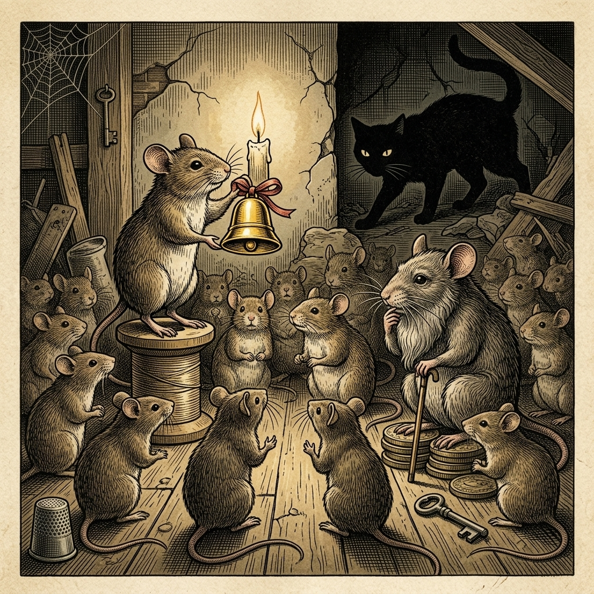

# Chapter 17: Belling the Cat (ネズミの会議)

  

## 1. Benchmark Level: Eiken Pre-2 (英検準2級レベル本文)
*Read in ~2 to 2.5 minutes. Advanced vocabulary and structured clauses.*

The rodent community inhabiting an ancient manor house was confronted with an existential catastrophe. A relentless feline predator terrorized their domain, stalking her quarry with such noiseless precision that her deadly assaults were virtually undetectable until it was too late. Paralyzed by perpetual dread, the mice suffered severe deprivation, restricted to their subterranean crevices and unable to forage for basic sustenance.

Recognizing that collective inaction would inevitably culminate in total extermination, the elder rodents convened an emergency assembly to deliberate upon defensive countermeasures. Numerous proposals were submitted, yet each was sequentially dismissed as impractical or inadequate.

At length, an articulate young mouse ascended the podium, radiating self-assurance. "Distinguished peers," he proclaimed with theatrical eloquence, "I have formulated an infallible remedy for our collective affliction. Let us affix a miniature brass bell to a collar and attach it securely around the neck of our nemesis. The acoustic reverberation generated by her movements will provide infallible advance notice, enabling us to seek refuge long before she enters striking range!"

Electrified by this ostensibly flawless innovation, the assembly erupted in unanimous acclaim. The delegates vociferously lauded the orator, hailing the stratagem as an epoch-making triumph of intellect over brute strength.

Amid the euphoria, however, an aged mouse renowned for prudence rose deliberately to his feet. Raising his paw to solicit silence, he addressed the assembly with measured sobriety. "The conceptual brilliance of this scheme is undeniable," he remarked dryly. "Nevertheless, its practical efficacy hinges upon one critical operational detail: Who among us is prepared to volunteer to attach the bell?"

In an instant, the exuberant jubilation dissipated into an oppressive hush. Glancing anxiously at one another, the mice stood paralyzed by mutual cowardice, painfully forced to acknowledge that an idealistic hypothesis devoid of practical execution remains entirely worthless.

Formulating grand theoretical solutions is deceptively simple, whereas personal willingness to undertake perilous implementation is exceedingly scarce.

---

## 2. Target Level: Eiken Grade 2 (英検2級レベル本文)
*Read in ~3 to 4 minutes. Academic discourse, complex participial structures, formal vocabulary, and nuanced transitions.*

Within the domestic ecosystem of a rural manor, the indigenous rodent population experienced an existential governance crisis triggered by asymmetric feline predation. The apex carnivore operated with acoustic stealth and tactical lethality, inflicting unsustainable attrition upon the colony. Because traditional sensory mechanisms were incapable of detecting the predator's pre-attack maneuvers, the rodent collective succumbed to functional paralysis, enduring acute nutritional deprivation while confined to sub-floor crevices.

To mitigate this systemic catastrophe, the administrative council summoned an extraordinary plenary session, mandating the formulation of comprehensive mitigation strategies. The deliberative process, however, was initially paralyzed by cognitive gridlock, as senior delegates iteratively proposed and subsequently invalidated an array of rudimentary evasion tactics.

Breaking the procedural impasse, an ambitious junior delegate commandeered the rostrum, exuding charismatic authority. "Esteemed colleagues," he declaimed with polished rhetorical sophistry, "the resolution to our strategic vulnerability lies not in passive retreat, but in early-warning sensor deployment. I propose installing an acoustic signaling transducer—specifically, an oscillating bronze chime—affixed directly to the feline cervical perimeter. The kinetic energy generated during predatory locomotion will systematically trigger sound waves, generating early acoustic telemetry that will permit preemptive dispersion before the predator achieves lethal proximity!"

Seduced by the theoretical coherence of this algorithmic paradigm, the assembly descended into uncritical euphoria. The delegates overwhelmingly ratified the initiative, hailing the presenter as a visionary strategist whose intellectual synthesis had rendered physical asymmetry obsolete.

However, the dialectical gap between theoretical architecture and field execution was abruptly illuminated by a veteran technocrat. Rising with solemn gravity, the senior statesman punctured the celebratory delirium with unsparing forensic realism. "The intellectual elegance of this schematic is beyond dispute," he observed with chilling detachment. "Nevertheless, empirical feasibility is fundamentally contingent upon a single operational prerequisite: Which specific individual among this deliberative body possesses the operational readiness to execute the cervical attachment?"

The impact of this interrogation was devastating. The triumphalist rhetoric evaporated instantaneously, replaced by an immobilizing psychological chill. Subdued by collective cowardice, each delegate averted his gaze, confronted with the sobering institutional reality that an immaculate theoretical framework completely disconnected from operational feasibility represents an exercise in cognitive futility.

Designing sophisticated theoretical paradigms is intellectually trivial; executing dangerous operational mandates constitutes the singular metric of authentic viability.

---

## 3. Classic Original English Text (イソップ寓話 クラシック原文)
*Townsend / Jacobs Edition (Public Domain)*

The Mice held a general council to consider what measures they could take to outwit their common enemy, the Cat. Many plans were discussed, but none was thought practical. At last a young Mouse got up and proposed that a bell should be hung around the neck of the Cat. "Then," said he, "we shall always have notice when she is coming, and can easily escape." This proposal was received with applause, until an old Mouse got up and said, "That is all very well, but who is to bell the Cat?"

It is easy to propose, but hard to execute.

---

### 🏛️ 【英検2級レベルで読み解く！クラシック原文の重要構文・英文法ノート】
1. **1. 分詞構文（Participle Clause: 付帯状況・理由）**
   - **原文**: *"The Hare, believing her assertion to be simply impossible, agreed to the proposal..."*
   - **解説**: 「〜と信じ込んでいたので」という理由を表す分詞構文。英検2級の長文読解・ライティングの最頻出構文です。
1. **2. 古典的仮定法現在（Subjunctive Mood）**
   - **原文**: *"Though you be swift as the wind, I will beat you in a race."*
   - **解説**: 譲歩節 `Though` の中で原形 `be` を用いる古典的な仮定法現在（現代英語の `Though you are...`）。格調高い古典の響きを持ちます。
1. **3. 過去分詞の後置修飾（Postpositive Participle）**
   - **原文**: *"On the day appointed for the race the two started together."*
   - **解説**: `appointed`（定められた・指定された）が直前の名詞 `the day` を後ろから修飾する構文です。

### 📜 【クラシック原文の重要語彙・古風表現（Classic Antique Vocabulary）】
- **retort** [動] 2級 **（機転を利かせて）言い返す、反論する**（現代の reply sharp/wittily に相当）
- **assertion** [名] 2級/準1級 **主張、断言**（動詞 assert の名詞形。2級長文定番）
- **wayside** [名] 2級 **道端、沿道**（by the wayside（道端に、途中で））
- **fatigue** [名] 2級 **（心身の）極度の疲労、疲れ**（tiredness の上位フォーマル語）

---

## 4. Japanese Translation (日本語訳)

ある田舎の屋敷の家庭内生態系において、在来のげっ歯類集団は、非対称な猫の捕食によって引き起こされた実存的な統治危機を経験していました。この頂点肉食獣は音響的な隠密性と戦術的な致死性をもって行動し、コロニーに対して持続不可能な消耗をもたらしていました。従来の感覚器官では捕食者の攻撃前行動を探知することが不可能であったため、ネズミの集団は機能的な麻痺状態に陥り、床下の隙間に閉じ込められたまま深刻な栄養的剥奪に耐えていました。

この体系的な破滅を緩和するため、管理評議会は臨時の全体会議を召集し、包括的な緩和戦略の策定を義務付けました。しかしながら、古参の代表者たちが初歩的な回避戦術の数々を繰り返し提案しては無効化していったため、審議プロセスは当初、認識の行き詰まり（グリッドロック）によって麻痺していました。

手続き上の膠着状態を打破すべく、野心的な若手代表が演壇を占拠し、カリスマ的な権威を放ちました。「尊敬する同僚の皆様」と彼は洗練された修辞的詭弁をもって演説しました。「我々の戦略的脆弱性に対する解決策は、受動的な撤退にあるのではなく、早期警告センサーの配備にあります。私は、捕食者の首の周囲に直接固定される音響信号変換器――具体的には、振動する青銅の鈴――を取り付けることを提案します。捕食行動の最中に発生する運動エネルギーが規則的に音波を誘発し、捕食者が致命的な接近距離に達する前に先手を打った分散を可能にする早期音響テレメトリーを生成するのです！」

このアルゴリズム的パラダイムの理論的一貫性に魅了され、議場は無批判な陶酔へと突入しました。代表者たちはその提案を圧倒的多数で批准し、その発案者を、自らの知的分野の統合によって物理的非対称性を時代遅れのものにした先見の明ある戦略家として称賛しました。

しかしながら、理論的構造と現場での実行との間の弁証法的な溝は、一人の熟練した技術官僚によって不意に照射されました。厳粛な重々しさをもって立ち上がったその古参の政治家は、容赦のない科学捜査的リアリズムをもって祝賀の熱狂を打ち破りました。「この設計図の知的優美さは議論の余地がない」と彼は冷徹な超然さをもって指摘しました。「それにもかかわらず、経験的な実現可能性は、単一の運用上の前提条件に根本的に依存している。この審議機関の中で、頸部への取り付けを実行する作戦上の即応性を備えているのは、具体的にどの一体かね？」

この尋問の衝撃は壊滅的でした。勝利主義的な修辞は瞬時に蒸発し、身動きを奪う心理的寒気に取って代わられました。集団的な臆病さに打ちひしがれ、各代表は視線をそらし、運用上の実現可能性から完全に切り離された無垢な理論的枠組みは、知的な無益さの行使にすぎないという冷厳な組織的現実に直面させられたのです。

**教訓**: 洗練された理論的パラダイムを設計することは知的に些細なことである。危険な作戦命令を実行することこそが、真正な生存可能性を測る唯一の指標である。

---

## 5. Recite & Compare (そらんじたいキーフレーズ対比)
*Memorize these contrastive expressions to elevate speaking, writing, and reading fluency.*

  
■ 場面：持続不可能な消耗・機能麻痺

  
【Pre-2 基礎】 <em>suffered severe deprivation, restricted to crevices...</em>

  
【Grade 2 暗唱】 <strong><em>inflicting unsustainable attrition... succumbed to functional paralysis</em></strong>

  
【ポイント】 <strong>解説・試験活用</strong>：軍事・組織論用語 `unsustainable attrition`（持続不可能な消耗）、`succumb to functional paralysis`（機能不全・麻痺に陥る）。

  
■ 場面：早期警告センサーの配備による先手分散

  
【Pre-2 基礎】 <em>acoustic reverberation... enabling us to seek refuge long before...</em>

  
【Grade 2 暗唱】 <strong><em>early-warning sensor deployment... permit preemptive dispersion</em></strong>

  
【ポイント】 <strong>解説・試験活用</strong>：安全保障用語 `early-warning sensor deployment`（早期警報センサー配備）、`permit preemptive dispersion`（先手を打った分散・避難を可能にする）。

  
■ 場面：理論的建築と現場実行との弁証法的な溝

  
【Pre-2 基礎】 <em>The conceptual brilliance is undeniable, but practical efficacy hinges...</em>

  
【Grade 2 暗唱】 <strong><em>dialectical gap between theoretical architecture and field execution</em></strong>

  
【ポイント】 <strong>解説・試験活用</strong>：哲学・政策論用語 `dialectical gap`（弁証法的な溝・乖離）、`theoretical architecture`（理論的アーキテクチャ）、`field execution`（現場での実行）。

  
■ 場面：作戦上の即応性を備えているか

  
【Pre-2 基礎】 <em>Who among us is prepared to volunteer to attach the bell?</em>

  
【Grade 2 暗唱】 <strong><em>Who possesses the operational readiness to execute the attachment?</em></strong>

  
【ポイント】 <strong>解説・試験活用</strong>：防衛・プロジェクト管理用語 `operational readiness`（作戦上の即応性・準備態勢）、動詞句 `execute the attachment`（装着・取り付けを実行する）。

  
■ 場面：教訓（Moral）

  
【Pre-2 基礎】 <em>Formulating solutions is simple, whereas willingness to implement is scarce.</em>

  
【Grade 2 暗唱】 <strong><em>Designing theoretical paradigms is trivial; executing dangerous operational mandates constitutes the metric of viability.</em></strong>

  
【ポイント】 <strong>解説・試験活用</strong>：対比構文 `Designing A is trivial; executing B constitutes the metric of viability`（〜こそが生存性の指標を構成する）。2級・準1級論評の極致。

---

## 6. Vocabulary Builder: 赤シート対応 重要単語・熟語チェック表
*※ 赤い透明シート（または赤フィルム）を重ねると、日本語訳が消えて自力テストができます。*

| No. | 見出し語 / イディオム | 品詞 / レベル | 日本語の意味（赤シートで消える） | 本文での使われ方・コロケーション |
|:---:|---|:---:|---|---|
| **01** | **proud** | [形] 4級 | 誇り高い、傲慢な | *a proud hare (自惚れたウサギ)* |
| **02** | **boast (about...)** | [動] 3級 | 〜を自慢する、誇る | *was always boasting about his speed* |
| **03** | **make fun of...** | [熟] 3級 | 〜をからかう、嘲笑する | *making fun of a slow tortoise* |
| **04** | **challenge** | [名/動] 3級 | 挑戦、課題 / 挑む | *I accept your challenge.* |
| **05** | **accept** | [動] 3級 | 受け入れる、受諾する | *accept the proposal (提案を受諾する)* |
| **06** | **dash** | [動] 3級 | 勢いよく走る、突進する | *dashed forward (前方へ駆け出した)* |
| **07** | **leave ~ behind** | [熟] 3級 | 〜を置き去りにする | *left the tortoise far behind* |
| **08** | **visible** | [形] 準2級 | 目に見える、視認できる | *was barely visible in the distance* |
| **09** | **catch up (with...)** | [熟] 3級 | 〜に追いつく | *before he catches up* |
| **10** | **slumber** | [名/動] 準2級 | 深い眠り / 眠る | *fell into a profound slumber* |
| **11** | **sprint** | [動] 3級 | 全力疾走する | *sprinted toward the finish line* |
| **12** | **persistence** | [名] 準2級/2級 | 粘り強さ、不屈の継続 | *persistence and hard work will bring success* |

### 【出題傾向・文法解説ノート】

### 【出題頻出語彙・熟語ノート】
- **attrition** [名] 摩耗、消耗、人員の自然減（*war of attrition*「消耗戦」）
- **impasse** [名] 行き詰まり、袋小路（＝*deadlock*, *stalemate*）
- **preemptive** [形] 先制の、先手を打った（*preemptive strike/action*）
- **ratify** [動] （提案・協定など）を批准・可決する（名詞 *ratification*）
- **forensic** [形] 科学捜査の、法廷の、極めて綿密な（*forensic analysis*）
- **readiness** [名] 準備態勢、即応性（*combat/operational readiness*）
- **viability** [名] 実現可能性、生存能力（形容詞 *viable*）

### 【文法・構文ポイント】
1. **名詞構文による因果の凝縮 [triggered by asymmetric predation]**
   - 2級本文: *"an existential governance crisis triggered by asymmetric feline predation."*
   - ポイント: 「猫の偏った捕食が危機の引き金となった」を過去分詞 `triggered by` で後置修飾し、学術論文調の密度の高い情報伝達を実現します。
2. **セミコロンを用いた対比的命題文 [A is trivial; B constitutes ...]**
   - 2級本文: *"Designing theoretical paradigms is trivial; executing dangerous operational mandates constitutes the singular metric of authentic viability."*
   - ポイント: 二つの対立する行動の難易度と本質的価値を、接続詞を用いずにセミコロンで対置させる知的修辞法です。
