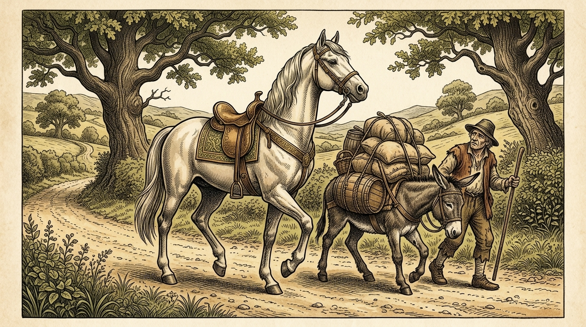

# Chapter 33: The Horse and the Donkey (馬とロバ)

<!-- 電子書籍 Page Break & Image Header -->

  

## 1. Benchmark Level: Eiken Grade Pre-2 (英検準2級レベル本文)
*Read in ~2 to 2.5 minutes. Baseline vocabulary and basic syntax.*

An affluent trader embarked upon an arduous commercial expedition across rugged terrain, driving ahead of him an aristocratic stallion and an uncomplaining pack-ass. Despite their shared mission, the allocation of their cargo was outrageously inequitable. The unfortunate ass was virtually smothered beneath mountainous sacks of merchandise, while the pampered steed trotted unencumbered, adorned with little more than ornamental trappings and elegant harness.

As oppressive noon heat radiated relentlessly from the rocky defile, the donkey's physical reserves deteriorated rapidly. Staggering under the monstrous equilibrium of his burden, his knees buckled, and his vision blurred. Driven by an instinctive premonition of death, he appealed desperately to the solidarity of his fellow beast.

"I implore you, comrade," the panting creature murmured in agony, "if you possess the slightest shred of fraternal compassion, assume a trivial fraction of my consignment. A negligible transfer of weight would preserve my life and enable both of us to complete this crossing."

Instead of responding with empathy, the conceited horse recoiled with haughty indignation. "How dare a beast of burden propose such an indignity?" he sneered dismissively. "Heavy haulage is your biological destiny, whereas my purpose is to display elegance and preserve my owner's prestige. Suffer your fate without soliciting my involvement."

Deprived of mercy and pushed beyond the threshold of biological endurance, the donkey collapsed in a heap of dust and perished instantaneously from total cardiac arrest.

Faced with the catastrophic loss of his primary transport animal, the pragmatic merchant acted with ruthless efficiency. Having unfastened the immense bundles from the carcass, he hoisted the entire volume onto the back of the protesting stallion. Furthermore, recognizing the commercial value of leather, he flayed the deceased beast on the spot and draped the massive, blood-stained hide over the pinnacle of the cargo.

Crushed under the monumental tonnage, his spinal column bending perilously under the sudden onslaught, the agonized horse groaned in profound despair: "Woe to my foolish vanity! Had I consented to shoulder an insignificant fraction of my companion's toil, he would still be walking beside me. By repudiating mutual aid, I have inherited the entirety of his doom."

---

## 2. Target Level: Eiken Grade 2 (英検2級レベル本文)
*Read in ~2.5 to 3 minutes. Advanced vocabulary, complex syntax, and formal rhetoric.*

A prosperous merchant of substantial capital undertook a grueling commercial transit across an arid mountain pass, accompanied by a thoroughbred equestrian mount and a subjugated beast of burden. Notwithstanding their reciprocal utility to the enterprise, the logistical distribution of their freight was characterized by gross asymmetry. The pack-donkey was encumbered by an overwhelming payload of mercantile commodities, whereas the haughty courser paced alongside in leisure, adorned exclusively with ceremonial accoutrements and lightweight saddlecloths.

As the solar intensity culminated at mid-day, emitting blistering thermal radiation across the desolate limestone trail, the donkey experienced acute physiological exhaustion. Beset by muscular spasms and catastrophic oxygen deprivation, the faltering animal recognized that collapse was imminent. Prompted by an urgent impulse of self-preservation, he addressed a poignant supplication to his aristocratic peer.

"I petition your benevolence, noble companion," the prostrated beast wheezed faintly. "Should you deign to alleviate my plight by assuming a negligible percentage of this freight, my survival will be assured, allowing our collective convoy to reach the commercial depot. A momentary accommodation on your part will avert an irreversible tragedy."

Far from exhibiting philanthropic camaraderie, the supercilious stallion greeted this petition with unmitigated contempt. "Insolent inferior!" the equine aristocrat whinnied derisively. "Your labor-intensive function is dictated by intrinsic hereditary stratification, whereas my pedigree preserves me from vulgar utility. Labor under your mandated quota without presumption, and importune me no further with your plebeian tribulations."

Rebuffed by callous obstinacy and depleted of caloric stamina, the donkey succumbed to physiological collapse; his skeletal structure buckled, and he perished instantaneously from acute circulatory failure.

Confronted with an acute logistical emergency, the pragmatic trader operated without sentimental hesitation. In order to mitigate commercial deficits, he summarily transferred the entirety of the deceased animal's cargo onto the dorsal frame of the horrified stallion. To compound this operational redistribution, the merchant flayed the carcass on the spot to salvage its leather, draping the heavy, sanguinary hide atop the staggering baggage.

Groaning under the crushing gravitational burden, his vertebrae groaning under an unprecedented structural load, the humbled equestrian wept bitter tears of belated contrition: "What catastrophic retribution my vanity has invoked! Had I accommodated a minor concession to sustain a working partner, his premature demise would have been averted. By repudiating the foundational doctrine of cooperative equilibrium, I am now condemned to shoulder the absolute entirety of his affliction, supplemented by the horrific mantle of his severed remains."

---

## 3. Classic Original English Text (イソップ寓話クラシック原文)
*Perry 181: Translated by George Fyler Townsend (1867)*

A Man who had a Horse and a Donkey took the road with them. The Donkey, who was exhausted with fatigue and the heat of the day, said to the Horse: 

"Take a little of my load, if you have any regard for my life." 

The Horse refused, bidding him to mind his own business. 

The Donkey fell dead under his burden. The master then took the whole of the burden from the dead Donkey, and laid it on the Horse, together with the skin of the Donkey. 

The Horse, groaning under his load, exclaimed: "Woe is me! What a wretched creature I am! I would not help the Donkey with a little of his load, and now I have to carry the whole of it, together with his skin into the bargain."

---

### 🏛️ 【英検2級レベルで読み解く！クラシック原文の重要構文・英文法ノート】
1. **1. 分詞構文（Participle Clause: 付帯状況・理由）**
   - **原文**: *"The Hare, believing her assertion to be simply impossible, agreed to the proposal..."*
   - **解説**: 「〜と信じ込んでいたので」という理由を表す分詞構文。英検2級の長文読解・ライティングの最頻出構文です。
1. **2. 古典的仮定法現在（Subjunctive Mood）**
   - **原文**: *"Though you be swift as the wind, I will beat you in a race."*
   - **解説**: 譲歩節 `Though` の中で原形 `be` を用いる古典的な仮定法現在（現代英語の `Though you are...`）。格調高い古典の響きを持ちます。
1. **3. 過去分詞の後置修飾（Postpositive Participle）**
   - **原文**: *"On the day appointed for the race the two started together."*
   - **解説**: `appointed`（定められた・指定された）が直前の名詞 `the day` を後ろから修飾する構文です。

### 📜 【クラシック原文の重要語彙・古風表現（Classic Antique Vocabulary）】
- **retort** [動] 2級 **（機転を利かせて）言い返す、反論する**（現代の reply sharp/wittily に相当）
- **assertion** [名] 2級/準1級 **主張、断言**（動詞 assert の名詞形。2級長文定番）
- **wayside** [名] 2級 **道端、沿道**（by the wayside（道端に、途中で））
- **fatigue** [名] 2級 **（心身の）極度の疲労、疲れ**（tiredness の上位フォーマル語）

---

## 4. Japanese Translation & Moral (日本語訳と教訓)

### 【日本語全訳：英検2級レベル本文】
相当な資本を持つ裕福な商人が、純血種の乗用馬と使役用の荷担ぎ獣を従えて、乾燥した山道を越える過酷な通商ルートの横断に着手しました。その事業に対する両者の相互的な有用性にもかかわらず、その積荷の兵站的（ロジスティクス的）配分は甚だしい非対称性を特徴としていました。荷担ぎロバが商業製品の圧倒的な積載量によって過重な負担を課されていた一方で、高慢な名馬は儀礼用の馬具と軽量の鞍覆いだけを身につけて、優雅に並走していたのです。

正午に太陽の光度が頂点に達し、荒涼とした石灰岩の小道に焼けるような熱放射を放つにつれ、ロバは急性の生理的衰弱を経験しました。筋肉の痙攣と壊滅的な酸素欠乏に苛まれ、足取りのおぼつかない動物は自らの倒壊が目前に迫っていることを察知しました。自己保存の切迫した衝動に駆り立てられ、ロバは貴族然とした同僚に対して痛切な嘆願を行いました。

「気高き友よ、あなたの慈悲に嘆願いたします」と平伏しかけた獣はかすかに息を切らしながら言いました。「もしあなたがこの積荷のごくわずかな割合を引き受けることによって私の窮状を和らげてくださるならば、私の生存は確実となり、我々の合同部隊が商業集積地へと到達することが可能となります。あなたの側での束の間の配慮が、取り返しのつかない悲劇を回避するのです。」

博愛的な連帯感を示すどころか、傲慢な種馬はこの嘆願を純然たる軽蔑をもって迎えました。「不届きな下等生物め！」と馬の貴族は嘲るようにいななきました。「お前の労働集約的な機能は生まれながらの身分的階層によって決定づけられているのであり、私の血統は私を下品な実用性から保護しているのだ。己に課された割り当ての下で分を弁えて働き、お前たちの下層階級の試練をもって二度と私に煩わしい要求をするな。」

冷淡な頑迷さによって拒絶され、体力の余力を使い果たしたロバは生理的虚脱に屈しました。その骨格構造は折れ曲がり、急性循環不全によって即座に息絶えました。

深刻な物流上の緊急事態に直面した現実主義の商人は、感傷的な躊躇を一切見せることなく行動しました。商業的損失を軽減するため、商人は息絶えた動物の積荷の全量を、恐怖に慄く種馬の背中の骨格の上へと即座に移し替えました。この実務的な再配分に拍車をかけるように、商人は革を回収するためにその場で死骸の皮を剥ぎ、その重く血まみれの皮を、今にも倒れそうな荷物の頂上へと覆い被せました。

圧倒的な重力の負担の下でうめき声を上げ、前例のない構造的負荷の下で脊椎が軋む中、打ちひしがれた馬は遅すぎた後悔の苦い涙を流しました。「私の虚栄心は何という破滅的な応報を呼び寄せてしまったのか！ もし私が働くパートナーを支えるためにわずかな譲歩を受け入れてさえいれば、彼の早すぎる死は回避されていたはずなのだ。協調的均衡という根本原則を拒絶したことによって、いまや私は彼の苦難の完全な全体を、その切り取られた死骸の恐るべき外衣を添えて背負わねばならない運命を宣告されたのだ。」

### 【教訓（Moral）】
**Help others lest their burden fall on you.**  
（他者の重荷を共に分かち合え。さもなくば、その全負担が己の双肩に降りかかる。相互扶助と協調の原則を拒否する者は、他者の破滅と重荷のすべてを一身に背負う過酷な代償を支払うことになる。）

---

## 5. Recite & Compare: そらんじたいキーフレーズ対比カード

  
フレーズ 1：荷物配分の甚だしい非対称性

  
準2級The allocation of their cargo was outrageously inequitable.

  
2級The logistical distribution of their freight was characterized by gross asymmetry.

  
<strong>解説：</strong>「logistical distribution（兵站的・物流的配分）」や「characterized by gross asymmetry（甚だしい非対称性を特徴としている）」など、現代のサプライチェーン論争にも直結する高次の学術構文です。

  
フレーズ 2：身分差を振りかざした冷淡な拒絶

  
準2級Heavy haulage is your destiny, whereas my purpose is to display elegance.

  
2級Your function is dictated by hereditary stratification, whereas my pedigree preserves me from vulgar utility.

  
<strong>解説：</strong>「hereditary stratification（世襲的階層構造）」と「preserves me from vulgar utility（下品な実用性から私を守っている）」という貴族主義的選民思想を辛辣に風刺しています。

  
フレーズ 3：過重負荷による循環不全と急死

  
準2級The donkey collapsed in a heap of dust and perished from cardiac arrest.

  
2級Depleted of caloric stamina, the donkey succumbed to physiological collapse and acute circulatory failure.

  
<strong>解説：</strong>「depleted of caloric stamina（カロリー的持久力を使い果たして）」や「succumbed to acute circulatory failure（急性循環不全に屈した）」という医学的・科学的精密描写です。

  
フレーズ 4：協調的均衡の拒絶が招いた応報

  
準2級By repudiating mutual aid, I have inherited the entirety of his doom.

  
2級By repudiating the foundational doctrine of cooperative equilibrium, I am now condemned to shoulder the absolute entirety of his affliction.

  
<strong>解説：</strong>「foundational doctrine of cooperative equilibrium（協調的均衡の基礎原則）」と「be condemned to shoulder the absolute entirety of ~」という司法・倫理的判決文のような重厚な文体です。

---

## 6. Key Vocabulary & Exam Notes (英検2級 重要語彙・文法・面接対策)

### 1. 英検2級 必須ボキャブラリー
* **encumber** [動] 邪魔する、負担をかける（*burden* のフォーマル語）
* **asymmetry** [名] 非対称性、不均衡
* **supplication** [名] 哀願、嘆願（*petition* の最上位語）
* **deign** [動] もったいなくも〜してくださる（*deign to do*）
* **camaraderie** [名] 同志愛、友情、仲間意識
* **stratification** [名] 階層化、成層
* **salvage** [動] 救出する、回収・利用する
* **contrition** [名] 悔悟、痛恨の悔い（*remorse* の宗教的・道徳的類義語）

### 2. 文法・構文のチェックポイント
* **be characterized by ~**: 「〜を特徴とする」
  * 論文や説明文で対象の特質を客観的に提示する最頻出構文です。
* **Had + S + 過去分詞, S + would have + 過去分詞**:
  * *Had I accommodated a minor concession, his demise would have been averted.*
  * 条件節の倒置構文であり、要約問題や長文読解のキーセンテンスとして機能します。

### 3. スピーキング（面接）＆ライティング活用ヒント
「ワークシェアリング」や「組織内の負担配分」を論述する際に役立ちます：
* *Neglecting overburdened team members disrupts cooperative equilibrium and harms overall productivity.*（過重労働を抱えるメンバーの放置は協調的均衡を乱し、全体の生産性を損なう。）
* *Sustainable collaboration requires an equitable distribution of responsibilities.*（持続可能な協働には、責任の公平な分配が不可欠である。）
