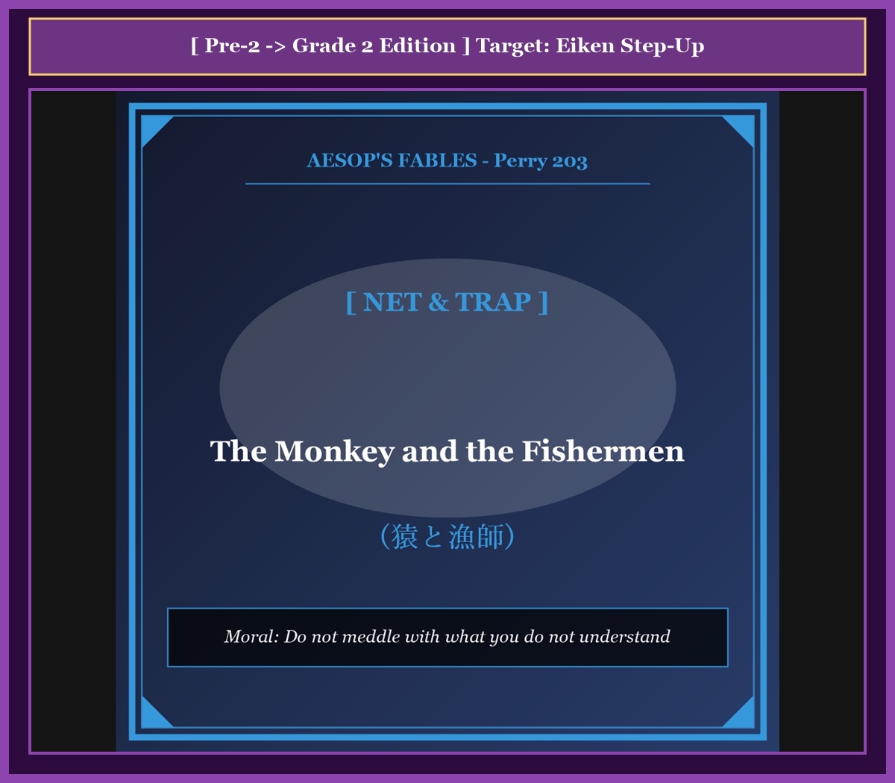

# Chapter 37: The Monkey and the Fishermen (猿と漁師)

<!-- 電子書籍 Page Break & Image Header -->

  

## 1. Benchmark Level: Eiken Grade Pre-2 (英検準2級レベル本文)
*Read in ~2 to 2.5 minutes. Baseline vocabulary and basic syntax.*

Stationed conspicuously upon an elevated branch overlooking a meandering river, an excessively inquisitive primate scrutinized the methodical maneuvers of professional fishermen operating along the shoreline.

With rapt fascination, he tracked the synchronized choreography of the fishermen as they cast their weighted nets across the eddying waters, dragging ashore copious yields of shimmering river-carp. Being innately predisposed toward unthinking mimicry, the ape arrived at the superficial conclusion that technical mastery was merely an illusion. "How trivial an endeavor," mused the self-deluded creature. "If mere humans can execute such operations with routine nonchalance, an animal of my superior agility can duplicate the feat instantaneously."

During the noon intermission, the laborers deposited their damp gear upon the sandy embankment and withdrew to a riverside shelter to partake of refreshment.

Capitalizing promptly upon their absence, the audacious primate descended from his vantage point. Propelled by vanity and reckless curiosity, he resolved to demonstrate his innate genius. He seized the voluminous webbing, gripped the leaden perimeter, and attempted to replicate the expansive, circular trajectory he had witnessed from afar.

Inevitably, deficient in physical momentum and technical comprehension, his execution proved disastrously flawed. Instead of unfolding into a wide parabolic arc across the surface of the river, the cumbersome folds collapsed inward, entirely encasing his torso, skull, and appendages in a suffocating web.

Panicking as his equilibrium disintegrated, the ape thrashed hysterically; yet each frantic convulsion merely tightened the constricting meshes around his throat and limbs. Disoriented and blind, he lost his footing upon the slick clay and plummeted directly into the deep, turbulent river.

Submerged beneath the surface and dragged inexorably toward the riverbed by the waterlogged cordage, the suffocating creature faced the terminal consequence of his presumption. In his final conscious moments, he lamented his fatal folly: "I am the architect of my own doom! Destitute of the most rudimentary competence, what catastrophic arrogance possessed me to trespass upon the specialized domain of trained artisans?"

---

## 2. Target Level: Eiken Grade 2 (英検2級レベル本文)
*Read in ~2.5 to 3 minutes. Advanced vocabulary, complex syntax, and formal rhetoric.*

Perched in observational detachment upon an arboreal vantage point overlooking a riparian corridor, a simian observer conducted an intensive behavioral reconnaissance of veteran commercial fishermen engaged in maritime harvesting.

With unblinking cognitive absorption, the primate monitored the complex kinetic synchronization displayed by the crew. He watched as they deployed expansive circular seines across the laminar flow, manipulating peripheral lead weights with consummate torque to maximize submerged perimeter coverage before hauling back bountiful harvests of freshwater fauna. Influenced by the simian propensity for unreflective behavioral simulation, the observer committed an egregious cognitive error: he conflated the apparent effortless fluidity of expert execution with intrinsic operational simplicity. "A rudimentary manual discipline," the hubristic creature rationalized internally. "If these bipedal artisans navigate such equipment through muscle memory alone, an organism endowed with quadrumanous dexterity can execute the identical protocol with superior efficacy."

When the artisans instituted their statutory mid-day recess, consigning their saturated apparatus to the riparian littoral while retiring to a communal mess, the opportunist perceived an ideal experimental vacuum.

Decanting precipitously from the canopy, the arrogant primate invaded the workspace to validate his unsubstantiated technical hypothesis. Apprehending the heavy perimeter cordage, he mobilized his skeletal levers to simulate the expansive, rotating centrifugal projection he had visually assimilated.

Predictably, the biomechanical execution degenerated into instant catastrophe. Bereft of foundational kinetic intuition, torque modulation, and angular momentum, his spastic release failed to generate aerodynamic expansion. Instead of deploying into an expansive parabolic plane across the water, the chaotic folds imploded gravitationally upon the operator, instantly entangling his cranial, thoracic, and manual appendages within an impenetrable labyrinth of weighted fiber.

Compounding his physiological dilemma, the panicked simian engaged in uncoordinated defensive thrashing; yet pursuant to the physical mechanics of knotted mesh, every convulsive spasm merely amplified tensile constriction against his trachea and carotid arteries. Deprived of equilibrium and blinded by the sodden netting, the immobilized creature slid off the declivity and plunged into the river's vortex.

Weighted down by waterlogged cordage and sucked into the hydraulic abyss, the asphyxiating primate arrived at an agonizing, terminal realization of epistemological humility: "My annihilation is the direct corollary of unchecked intellectual presumption! Entirely uninitiated in the empirical fundamentals of maritime craft, what monumental hubris impelled me to usurp the specialized jurisdictions of lifelong vocational practitioners?"

---

## 3. Classic Original English Text (イソップ寓話クラシック原文)
*Perry 203: Translated by George Fyler Townsend (1867)*

A Monkey, seated on a lofty tree, saw some Fishermen casting their nets into a river, and narrowly watched their proceedings. 

The Fishermen after a while gave up fishing, and on going home to dinner, left their nets upon the bank. 

The Monkey, who is the most imitative of animals, descended from the treetop, and endeavoured to do as they had done. Having handled the net, he threw it from him; but it became entangled around him, and he rolled into the river. 

Being in the act of drowning, he said to himself: "This is a just reward for my foolishness; for what business had I, who knew nothing of the matter, to try and fish with nets?"

---

### 🏛️ 【英検2級レベルで読み解く！クラシック原文の重要構文・英文法ノート】
1. **1. 分詞構文（Participle Clause: 付帯状況・理由）**
   - **原文**: *"The Hare, believing her assertion to be simply impossible, agreed to the proposal..."*
   - **解説**: 「〜と信じ込んでいたので」という理由を表す分詞構文。英検2級の長文読解・ライティングの最頻出構文です。
1. **2. 古典的仮定法現在（Subjunctive Mood）**
   - **原文**: *"Though you be swift as the wind, I will beat you in a race."*
   - **解説**: 譲歩節 `Though` の中で原形 `be` を用いる古典的な仮定法現在（現代英語の `Though you are...`）。格調高い古典の響きを持ちます。
1. **3. 過去分詞の後置修飾（Postpositive Participle）**
   - **原文**: *"On the day appointed for the race the two started together."*
   - **解説**: `appointed`（定められた・指定された）が直前の名詞 `the day` を後ろから修飾する構文です。

### 📜 【クラシック原文の重要語彙・古風表現（Classic Antique Vocabulary）】
- **retort** [動] 2級 **（機転を利かせて）言い返す、反論する**（現代の reply sharp/wittily に相当）
- **assertion** [名] 2級/準1級 **主張、断言**（動詞 assert の名詞形。2級長文定番）
- **wayside** [名] 2級 **道端、沿道**（by the wayside（道端に、途中で））
- **fatigue** [名] 2級 **（心身の）極度の疲労、疲れ**（tiredness の上位フォーマル語）

---

## 4. Japanese Translation & Moral (日本語訳と教訓)

### 【日本語全訳：英検2級レベル本文】
河川回廊を見下ろす樹上の有利な観察地点に陣取っていた一匹の類人猿の観察者が、水産資源の収穫に従事する熟練した商業漁師たちの綿密な行動偵察を行っていました。

まばたき一つしない知的な没頭をもって、その霊長類は乗組員たちによって示された複雑な運動学的同期を監視していました。彼は、彼らが層流を横切って広大な円形引き網を展開し、水中の外周の被覆を最大化するために熟練したトルクで外周の鉛の重りを操り、その後に淡水動物の豊かな収穫を引き上げる様子を見つめていました。無反省な行動模倣へと向かう類人猿特有の性向に影響され、この観察者は極めて重大な認識論的誤謬を犯してしまいました。彼は、熟練者の実行に伴う一見たやすい流動性を、本質的な操作の平易さと混同してしまったのです。「取るに足らない初歩的な手作業だ」と自惚れた生き物は頭の中で独り合点しました。「これらの二足歩行の職人たちが筋肉の記憶だけでそのような器具を操作できるのであれば、四肢の器用さを備えた私のような生物であれば、より優れた効率をもって同じ手順を実行できるはずだ。」

職人たちが法定の正午の休憩を取り、道具を水辺の岸に残して共同食堂へと引き上げたとき、この日和見主義者は理想的な実験の空白を捉えました。

樹冠から素早く降り立つと、傲慢な類人猿は自らの根拠なき技術的仮説を検証するために作業場へと侵入しました。重い外周のロープを掴むと、彼は自らの骨格のレバーを動員し、視覚的に取り込んでいた広範で回転する遠心力の投射を模倣しようと試みました。

予期された通り、その生体力学的実行は瞬時に大惨事へと堕落しました。基礎的な運動感覚、トルクの調整、角運動量を完全に欠いていたため、彼の不規則な放出は空気力学的展開を生み出すことに失敗しました。水面を横切る広大な放物線の平面へと展開するどころか、無秩序な折り目が操作者の上へと重力によって内側に崩れ落ち、彼の頭骨、胸部、手足の器官を、重りのついた繊維の侵入不可能な迷宮の中に瞬時に絡め取ってしまったのです。

彼の生理的ジレンマに追い打ちをかけるように、パニックに陥った猿は統制の取れていない防御的なのたうち回りを展開しました。しかし、結ばれた網目の物理力学に従い、あらゆる痙攣的な発作は、彼の気管と頸動脈に対する引張収縮を増幅させるだけでした。平衡感覚を奪われ、濡れた網によって視界を閉ざされた不動の生き物は、斜面から足を踏み外して川の渦の中へと沈落していきました。

水を吸ったロープによって重く沈められ、水力学的な深淵へと吸い込まれながら、窒息しゆく類人猿は認識論的謙虚さの痛烈で決定的な悟りに達しました。「私の全滅は、制御なき知的高慢の直接の必然的帰結なのだ！ 水産工芸の実証的基礎にまったく手ほどきを受けていないというのに、いかなる記念碑的な傲慢さに駆られて、生涯にわたる職業実践者たちの専門的管轄権を簒奪しようとしてしまったのだろうか。」

### 【教訓（Moral）】
**Do not meddle with what you do not understand.**  
（自らが理解していない職能や専門技術の領域に軽々しく介入してはならない。プロフェッショナルの洗練された技術を安易な模倣で再現できると錯覚する素人は、自らの浅知恵によって致命的な破滅を招く。）

---

## 5. Recite & Compare: そらんじたいキーフレーズ対比カード

  
フレーズ 1：プロの容易さと仕事の平易さの混同

  
準2級He arrived at the conclusion that technical mastery was merely an illusion.

  
2級He conflated the apparent effortless fluidity of expert execution with intrinsic operational simplicity.

  
<strong>解説：</strong>「effortless fluidity of expert execution（熟練者の実行のたやすい流動性）」と「intrinsic operational simplicity（本質的な操作の平易さ）」という、認知心理学・熟達論の高度な概念分析です。

  
フレーズ 2：空気力学的展開の失敗と崩壊

  
準2級Instead of unfolding into a wide arc, the cumbersome folds collapsed inward.

  
2級Instead of deploying into an expansive parabolic plane, the chaotic folds imploded gravitationally upon the operator.

  
<strong>解説：</strong>「deploying into an expansive parabolic plane（広大な放物線の平面へと展開する）」と「imploded gravitationally upon the operator（重力によって操作者の上に内破・崩落した）」という物理学修辞の対比です。

  
フレーズ 3：もがくほど増幅する引張収縮

  
準2級Each frantic convulsion merely tightened the constricting meshes around his throat.

  
2級Pursuant to the mechanics of knotted mesh, every convulsive spasm merely amplified tensile constriction against his trachea.

  
<strong>解説：</strong>法律・規定用語「Pursuant to ~（〜に従って・〜に基づいて）」を物理力学に応用し、「amplified tensile constriction against his trachea（気管に対する引張収縮を増幅させた）」と解剖学的に描いています。

  
フレーズ 4：専門領域の簒奪に対する断罪

  
準2級What arrogance possessed me to trespass upon the domain of trained artisans?

  
2級What monumental hubris impelled me to usurp the specialized jurisdictions of lifelong vocational practitioners?

  
<strong>解説：</strong>ギリシャ悲劇のキー概念「hubris（神をも恐れぬ傲慢・不遜）」と、政治法学用語「usurp specialized jurisdictions（専門的管轄権を簒奪する）」を用いた究極の自省文です。

---

## 6. Key Vocabulary & Exam Notes (英検2級 重要語彙・文法・面接対策)

### 1. 英検2級 必須ボキャブラリー
* **reconnaissance** [名] 偵察、調査、下見
* **conflate** [動] 混同する、一つにまとめる
* **hubristic** [形] 傲慢な、自信過剰の（*hubris* の形容詞形）
* **dexterity** [名] 器用さ、機敏さ
* **implode** [動] 内破する、内側に崩壊する（*explode* の対義語）
* **corollary** [名] 当然の帰結、必然的結果
* **epistemological** [形] 認識論的な、知識の基礎に関する
* **usurp** [動] 簒奪する、不当に奪う

### 2. 文法・構文のチェックポイント
* **pursuant to ~**: 「〜に従って、〜に基づいて」
  * 規則、法律、力学的原理に従って事態が進行することを示すフォーマル成句です。
* **bereft of ~**: 「〜を奪われて、〜を欠いて」
  * *completely deprived of* の格調高い文語表現です。

### 3. スピーキング（面接）＆ライティング活用ヒント
「専門性の尊重」「アマチュアリズムの危険」を論述する際に絶大な威力を発揮します：
* *Complex technologies require specialized vocational competence that cannot be improvised.*（複雑な技術には、即興では代替できない専門的な職業的能力が必要である。）
* *Conflating the visible simplicity of an outcome with the ease of its execution is a dangerous cognitive fallacy.*（結果の目に見える単純さと、その実行の容易さを混同することは、危険な認識論的誤謬である。）
