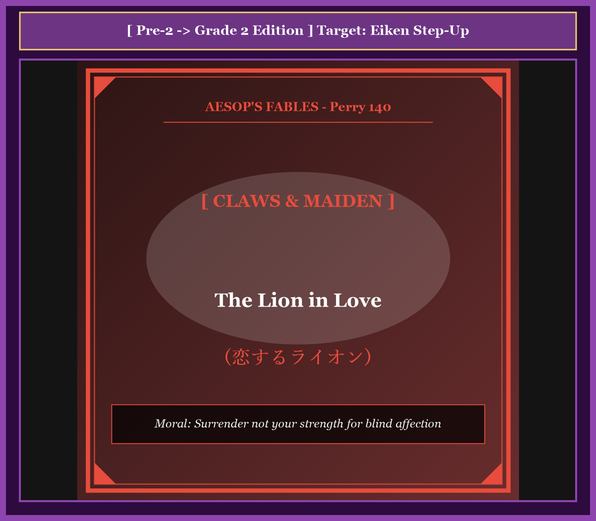

# Chapter 38: The Lion in Love (恋するライオン)

<!-- 電子書籍 Page Break & Image Header -->

  

## 1. Benchmark Level: Eiken Grade Pre-2 (英検準2級レベル本文)
*Read in ~2 to 2.5 minutes. Baseline vocabulary and basic syntax.*

An apex predator whose territorial dominance was universally acknowledged across the wilderness, a majestic lion became hopelessly captivated by the enchanting beauty of a forester's daughter.

Subjugated by an irrational and all-consuming infatuation, the monarch of carnivores compromised his regal dignity. He stalked boldly to the forester's rustic habitation and formally demanded the maiden's hand in matrimonial union. Paralyzed with dread, the humble parent found himself trapped within a lethal dilemma: an overt rejection would inevitably provoke a catastrophic massacre, whereas compliance meant sentencing his adored daughter to a gruesome existence beside a savage carnivore.

Compelled to navigate this existential crisis through sheer intellectual cunning, the pragmatic woodsman devised an ingenious psychological trap.

"Noble sovereign," the father declared with consummate deference, "our modest lineage is profoundly elevated by your magnanimous proposal. Nevertheless, my delicate daughter suffers from profound nervous susceptibility. She experiences debilitating hysteria whenever your lethal fangs are displayed, and the razor-honed contours of your claws plunge her into convulsions of terror. If your majesty aspires to consummate this romantic alliance, you must first eliminate these intimidating impediments: submit to the extraction of your dental weaponry and the amputation of your formidable talons."

So completely had erotic delusion eclipsed the predator's rational faculties that he perceived neither deceit nor strategic hazard in this bizarre ultimatum. Without consulting his survival instincts, he hastened to a veterinary surgeon and willingly submitted to the comprehensive dismemberment of his natural defenses.

Having undergone this radical demilitarization, the mutilated sovereign returned to the cottage, serenely confident that his romantic conquest was imminent.

However, the power dynamics had shifted irrevocably. Recognizing that the once-invincible terror of the forest was now utterly toothless, clawless, and incapable of inflicting harm, the forester shed all pretense of subservience. Brandishing a heavy oak cudgel, the rustic charged the defenseless suitor with furious indignation, administering a merciless thrashing that drove the disgraced, battered ex-tyrant howling into permanent exile.

---

## 2. Target Level: Eiken Grade 2 (英検2級レベル本文)
*Read in ~2.5 to 3 minutes. Advanced vocabulary, complex syntax, and formal rhetoric.*

An unchallenged biological autocrat whose acoustic roar asserted sovereign jurisdiction over the biome, an apex lion experienced a catastrophic collapse of predatory discipline, becoming pathologically infatuated with the daughter of an unpretentious forester.

Enslaved by an overwhelming neurochemical obsession that obliterated all rational instinct, the carnivore compromised his imperial prestige by soliciting a formal matrimonial alliance. Confronted by this terrifying diplomatic envoy, the rustic patriarch was plunged into an acute geopolitical dilemma: categorical repudiation would precipitate immediate lethal retaliation against his settlement, whereas submissive appeasement would consign his cherished progeny to a barbaric, existential nightmare.

Discerning that military confrontation was suicide, the astute woodsman resolved to wage asymmetric psychological warfare, formulating a stratagem of deceptive appeasement designed to systematically dismantle the predator's physiological deterrents.

"Imperial Majesty," the forester proclaimed with simulated obsequiousness, "our plebeian pedigree is incomparably distinguished by your imperial suit. Regrettably, my hypersensitive daughter manifests acute psychosomatic trauma when confronted with manifestations of raw violence. The menacing silhouettes of your dental armaments trigger acute panic attacks, while the razor-honed geometry of your retractable claws induces absolute respiratory distress. If your Highness genuinely desires to consummate this domestic confederation, you must unilaterally demilitarize: consent to the total dental extraction of your predatory fangs and the surgical excision of your retractable talons."

So thoroughly had romantic delusion subverted the beast's cognitive critical faculties that he failed to detect the transparent vulnerability inherent in this preposterous prerequisite. Divorcing himself from millions of years of evolutionary adaptation, the smitten monarch promptly submitted to a draconian veterinary procedure, passively consenting to the systematic ablation of his primary offensive and defensive apparatuses.

Having effected this unilateral disarmament, the mutilated sovereign returned to the homestead, naively anticipating that his matrimonial prize would be delivered without friction.

However, the strategic equilibrium had suffered an absolute inversion. Discerning that the erstwhile tyrant of the ecosystem was now utterly destitute of offensive lethality—bereft of fangs, stripped of claws, and physically incapable of lethal force—the forester discarded all simulated deference. Brandishing a heavy, iron-reinforced bludgeon, the emboldened rustic launched a furious counter-offensive against the defenseless suitor, administering an unmitigated physical thrashing that expelled the disfigured, humiliated sovereign into perpetual ignominy.

---

## 3. Classic Original English Text (イソップ寓話クラシック原文)
*Perry 140: Translated by George Fyler Townsend (1867)*

A Lion demanded the daughter of a woodcutter in marriage. 

The Father, unwilling to grant, and yet afraid to refuse his request, hit upon this expedient to rid himself of his importunities. 

He told the Lion that he was very willing to make him his son-in-law, but that he could not do so unless he would consent to have his teeth drawn and his claws trimmed, as the young girl was terribly afraid of both. 

The Lion was so madly in love that he was easily prevailed upon to consent. 

When he had done this, and came again to the woodman, the latter, no longer having any fear of him, set upon him with a club and drove him away.

---

### 🏛️ 【英検2級レベルで読み解く！クラシック原文の重要構文・英文法ノート】
1. **1. 分詞構文（Participle Clause: 付帯状況・理由）**
   - **原文**: *"The Hare, believing her assertion to be simply impossible, agreed to the proposal..."*
   - **解説**: 「〜と信じ込んでいたので」という理由を表す分詞構文。英検2級の長文読解・ライティングの最頻出構文です。
1. **2. 古典的仮定法現在（Subjunctive Mood）**
   - **原文**: *"Though you be swift as the wind, I will beat you in a race."*
   - **解説**: 譲歩節 `Though` の中で原形 `be` を用いる古典的な仮定法現在（現代英語の `Though you are...`）。格調高い古典の響きを持ちます。
1. **3. 過去分詞の後置修飾（Postpositive Participle）**
   - **原文**: *"On the day appointed for the race the two started together."*
   - **解説**: `appointed`（定められた・指定された）が直前の名詞 `the day` を後ろから修飾する構文です。

### 📜 【クラシック原文の重要語彙・古風表現（Classic Antique Vocabulary）】
- **retort** [動] 2級 **（機転を利かせて）言い返す、反論する**（現代の reply sharp/wittily に相当）
- **assertion** [名] 2級/準1級 **主張、断言**（動詞 assert の名詞形。2級長文定番）
- **wayside** [名] 2級 **道端、沿道**（by the wayside（道端に、途中で））
- **fatigue** [名] 2級 **（心身の）極度の疲労、疲れ**（tiredness の上位フォーマル語）

---

## 4. Japanese Translation & Moral (日本語訳と教訓)

### 【日本語全訳：英検2級レベル本文】
その咆哮によって生物圏全体に対する主権的管轄権を主張していた異論の余地なき生物学的専制君主である頂点捕食者のライオンが、捕食規律の壊滅的な崩壊を経験し、質素な森林官の娘に対して病的なまでに熱狂的な恋に落ちてしまいました。

あらゆる合理的本能を抹殺する圧倒的な神経化学的執着の奴隷となったその肉食獣は、公式の婚姻同盟を懇願することによって、その帝国の威信を自ら失墜させました。この恐るべき外交使節に直面した素朴な家長は、深刻な地政学的ジレンマへと突き落とされました。断固とした拒絶は自らの居留地に対する即座の致死的な報復を促進する一方で、従順な宥和は自らの最愛の子孫を野蛮で実存的な悪夢へと引き渡すことを意味していたからです。

武力衝突が自殺行為であることを看破した機敏な木こりは、非対称な心理戦争を挑むことを決意し、捕食者の生理学的抑止力を組織的に解体するよう設計された、欺瞞的な宥和政策の計略を策定しました。

「皇帝陛下」と森林官は装った卑屈さをもって宣言しました。「私たちの平民の家系は、陛下の求婚によって比類なき名誉を授かります。残念なことに、私の過敏な娘は生の暴力の顕現に直面すると、深刻な心身症的トラウマを発症いたします。威圧的な牙の輪郭は急性パニック発作を引き起こし、カミソリで研ぎ澄まされた伸縮性の爪の幾何学は絶対的な呼吸不全を誘発いたします。もし陛下が真にこの家庭的協調の成就を望まれるのであれば、陛下は一方的な非武装化を断行しなければなりません。捕食用の牙の完全な抜歯と、伸縮性の鉤爪の外科的切除にご同意いただくことでございます。」

恋愛の妄想が獣の認識的批判能力を徹底的に覆滅していたため、ライオンはこの荒唐無稽な前提条件に内在する明白な脆弱性を探知することに失敗しました。数百万年に及ぶ進化的適応の歴史から自らを切り離し、恋に狂った君主は過酷な獣医学的手術に速やかに服従し、自らの主要な攻撃・防御器官の組織的切除を無抵抗に受け入れたのです。

この一方的軍縮を実行した後、身体を削がれた君主は自らの婚姻の獲物が何ら摩擦なく引き渡されるものと純真に信じ込んで屋敷へと戻ってきました。

しかしながら、戦略的均衡は絶対的な反転を被っていました。かつての生態系の暴君がいまや攻撃的致死性を完全に奪われ、牙を失い、爪を剥がれ、致死的な物理力をまったく発揮できなくなっていることを見抜いた森林官は、うわべだけの従順さをすべて投げ捨てました。鉄で補強された重い棍棒を振りかざし、勇気づけられた農夫は無防備な求婚者に対して猛烈な反撃を開始し、傷つき辱められた君主を永久の汚名のうちへと追放するまで、容赦のない肉体的打撃を浴びせかけたのでした。

### 【教訓（Moral）】
**Surrender not your strength for blind affection.**  
（盲目的な情熱のために己の防壁と抑止力を一方的に放棄してはならない。自らの強みを捨て去った者は、かつて恐れられた威厳を完全に失い、最弱の敵からすら容赦のない蹂躙と永久の追放を被ることになる。）

---

## 5. Recite & Compare: そらんじたいキーフレーズ対比カード

  
フレーズ 1：拒絶も服従も破滅を招くジレンマ

  
準2級An overt rejection would provoke a massacre, whereas compliance meant a gruesome existence.

  
2級Repudiation would precipitate lethal retaliation, whereas submissive appeasement would consign his progeny to an existential nightmare.

  
<strong>解説：</strong>国際政治学の基本用語「categorical repudiation（断固たる拒絶）」と「submissive appeasement（従順な宥和政策）」を主語に対比させ、国家存亡の危機と同等の葛藤を描いています。

  
フレーズ 2：抑止力を解体する非対称心理戦

  
準2級The woodsman formulated a cunning scheme to neutralize the threat.

  
2級He resolved to wage asymmetric psychological warfare, formulating a stratagem to dismantle the predator's physiological deterrents.

  
<strong>解説：</strong>軍事・安全保障理論の「asymmetric warfare（非対称戦争）」や「dismantle physiological deterrents（肉体的抑止力を解体する）」という高度な学術用語を用いています。

  
フレーズ 3：愛の妄想による一方的武装解除

  
準2級He willingly submitted to the comprehensive dismemberment of his natural defenses.

  
2級Divorcing himself from evolutionary adaptation, the smitten monarch passively consented to the systematic ablation of his apparatuses.

  
<strong>解説：</strong>「Divorcing himself from evolutionary adaptation（進化的適応から自らを切り離して）」と「systematic ablation（組織的切除・融解）」という生物学・進化学用語の結晶です。

  
フレーズ 4：戦略的均衡の逆転と容赦なき反撃

  
準2級The power dynamics had shifted irrevocably; the forester shed all pretense of subservience.

  
2級The strategic equilibrium had suffered an absolute inversion; bereft of lethality, the forester discarded all simulated deference.

  
<strong>解説：</strong>「The strategic equilibrium had suffered an absolute inversion（戦略的均衡は絶対的反転を被っていた）」という、国家間の力関係の逆転を表す最高峰の表現です。

---

## 6. Key Vocabulary & Exam Notes (英検2級 重要語彙・文法・面接対策)

### 1. 英検2級 必須ボキャブラリー
* **autocrat** [名] 独裁者、専制君主
* **appeasement** [名] 宥和政策、譲歩、鎮静
* **asymmetric** [形] 非対称の、不均衡な（*asymmetric warfare* で「非対称戦争」）
* **deterrent** [名] 抑止力 / [形] 引き止める
* **obsequiousness** [名] 卑屈、こびへつらい
* **ablation** [名] 除去、切除（手術）
* **inversion** [名] 反転、逆転、倒置
* **ignominy** [名] 屈辱、不名誉、汚名

### 2. 文法・構文のチェックポイント
* **wage asymmetric warfare**: 「非対称な戦争を仕掛ける」
  * 弱者が強者の弱点を突いて勝利する戦略を記述する際の必須コロケーションです。
* **suffer an inversion**: 「逆転・反転を被る」
  * 力関係、立場、情勢の劇的な変化を客観的に報告する論文表現です。

### 3. スピーキング（面接）＆ライティング活用ヒント
「国家安全保障における抑止力」や「過度な譲歩の危険」を論述する際に絶大な説得力を持ちます：
* *Unilateral disarmament in the hope of appeasing aggressive competitors invariably leads to strategic subjugation.*（侵略的な競争相手を宥和することを期待した一方的な武装解除は、決まって戦略的従属を招く。）
* *Compromising core defensive capabilities leaves an organization vulnerable to hostile takeovers.*（中核的な防御能力を妥協することは、組織を敵対的買収に対して無防備な状態に放置することになる。）
