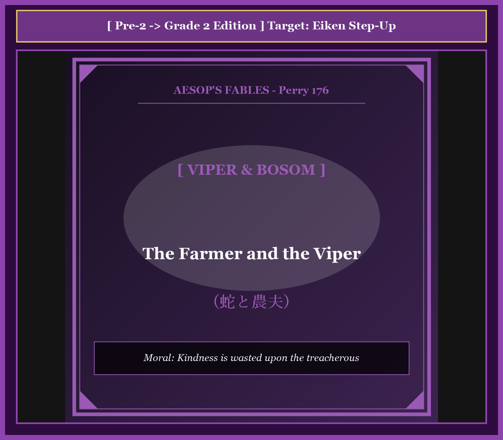

# Chapter 39: The Farmer and the Viper (蛇と農夫)

<!-- 電子書籍 Page Break & Image Header -->

  

## 1. Benchmark Level: Eiken Grade Pre-2 (英検準2級レベル本文)
*Read in ~2 to 2.5 minutes. Baseline vocabulary and basic syntax.*

Amidst the bleak desolation of a sub-zero winter dawn, a philanthropic husbandman was navigating his snow-draped acreage, wrapped securely against the piercing arctic winds.

While inspecting a boundary hedgerow, his attention was arrested by the sight of an adult viper, whose coiled silhouette lay petrified and encrusted in frost upon the frozen soil. The organism's vital functions were suspended in profound hypothermia; it hovered imperceptibly upon the razor's edge dividing suspended animation from biological expiration.

Governed by uncritical altruism rather than pragmatic discretion, the tender-hearted laborer felt an overwhelming pang of sorrow. "To abandon even the most loathsome creature to such a merciless frost violates my moral conscience," he reasoned naively.

Reaching down with bare palms, he cradled the stiffened reptile and deposited it securely within the innermost recesses of his woolen tunic, pressing its frigid scales directly against the subcutaneous warmth of his own chest.

As the pedestrian plodded homeward, the thermal transference took effect. The benevolent heat emitted by the man's cardiovascular system gradually thawed the viper's coagulated blood. Dormant neural pathways reconnected, its muscular elasticity was reconstituted, and the concentrated neurotoxin stored within its venom glands regained its lethal fluid potency.

Tragically, physical resuscitation did not inspire moral reformation; rather, it merely resurrected the animal's primordial malice. No sooner had its sensory organs registered full consciousness than its reflexive predatory hostility engaged. Oblivious to ethical indebtedness, the serpent struck with lightning velocity, sinking its hypodermic fangs deep into the pulmonary tissue of the very chest that had harbored it.

Injected with a massive dose of hemotoxin, the stricken savior experienced instantaneous respiratory paralysis and dropped convulsively into the snowdrift.

Watching the unrepentant serpent slither unconcernedly away into the briars, the expiring martyr gasped his final epiphany: "I suffer the inescapable retribution of reckless sentimentality. He who resurrects a deadly foe out of misguided benevolence signs his own death warrant, foolishly expecting nobility from a creature biologically programmed for treachery."

---

## 2. Target Level: Eiken Grade 2 (英検2級レベル本文)
*Read in ~2.5 to 3 minutes. Advanced vocabulary, complex syntax, and formal rhetoric.*

Traversing the bleak expanses of an agrarian estate during the depths of an arctic winter, a compassionate yeoman observed an adult horned viper immobilized amidst the sub-zero permafrost. Afflicted by catastrophic physiological hypothermia, the poikilothermic reptile was suspended in absolute metabolic stasis, hovering precariously on the metaphysical frontier between reversible hibernation and biological cessation.

Subordinating empirical caution to an unreflective humanitarian impulse, the yeoman fell victim to misplaced ethical sentimentalism. "To permit even an inherently venomous organism to succumb to ambient refrigeration violates my categorical duty to preserve life," he rationalized sanctimoniously.

Disregarding the elementary imperatives of self-preservation, he elevated the petrified serpent with unprotected hands and deposited it within the interior recesses of his wool garments, pressing its refrigerated epidermal scales directly against his pectoral musculature to facilitate instantaneous caloric transference.

As the pedestrian completed his circuit, thermodynamic conduction restored the reptile's biological viability. The caloric emission radiating from the host's vascular circulation dissolved the crystallization within the viper's hematological pathways. Synaptic neurotransmission resumed, neuromuscular tone was systematically reconstituted, and the latent neurotoxins sequestered within its maxillary glands were liquefied to peak potency.

However, cellular resuscitation exerted zero ameliorating influence upon the organism's intrinsic behavioral pathology. Devoid of ethical cognition or reciprocal gratitude, the resurrected predator defaulted instantaneously to its primordial programming of indiscriminate lethality. No sooner had cognitive consciousness resumed than its coiled musculature contracted with explosive acceleration, propelling its hypodermic fangs directly into the coronary artery of its unsuspecting benefactor.

Inoculated with a catastrophic dosage of necrotic toxin, the philanthropist succumbed to fulminant cardiac arrest and pulmonary collapse, plunging prostrate into the snowdrifts.

As systemic paralysis extinguished his somatic consciousness, the dying martyr whispered a profound philosophical testament: "My demise constitutes the inexorable consequence of pathological sentimentality divorced from prudent discrimination. He who rehabilitates an incorrigible adversary out of ideological benevolence executes his own judicial condemnation, naively projecting humanistic virtues onto a predatory entity irrevocably engineered for treachery."

---

## 3. Classic Original English Text (イソップ寓話クラシック原文)
*Perry 176: Translated by George Fyler Townsend (1867)*

A Farmer found in the winter time a Viper stiff and frozen with cold. He had compassion on it, and taking it up, placed it in his bosom. 

The Viper was revived by the warmth, and having recovered its natural instincts, bit its benefactor, inflicting on him a mortal wound. 

The Farmer, as he was dying, exclaimed: "I have only got what I deserved, for taking compassion on an evil beast."

---

### 🏛️ 【英検2級レベルで読み解く！クラシック原文の重要構文・英文法ノート】
1. **1. 分詞構文（Participle Clause: 付帯状況・理由）**
   - **原文**: *"The Hare, believing her assertion to be simply impossible, agreed to the proposal..."*
   - **解説**: 「〜と信じ込んでいたので」という理由を表す分詞構文。英検2級の長文読解・ライティングの最頻出構文です。
1. **2. 古典的仮定法現在（Subjunctive Mood）**
   - **原文**: *"Though you be swift as the wind, I will beat you in a race."*
   - **解説**: 譲歩節 `Though` の中で原形 `be` を用いる古典的な仮定法現在（現代英語の `Though you are...`）。格調高い古典の響きを持ちます。
1. **3. 過去分詞の後置修飾（Postpositive Participle）**
   - **原文**: *"On the day appointed for the race the two started together."*
   - **解説**: `appointed`（定められた・指定された）が直前の名詞 `the day` を後ろから修飾する構文です。

### 📜 【クラシック原文の重要語彙・古風表現（Classic Antique Vocabulary）】
- **retort** [動] 2級 **（機転を利かせて）言い返す、反論する**（現代の reply sharp/wittily に相当）
- **assertion** [名] 2級/準1級 **主張、断言**（動詞 assert の名詞形。2級長文定番）
- **wayside** [名] 2級 **道端、沿道**（by the wayside（道端に、途中で））
- **fatigue** [名] 2級 **（心身の）極度の疲労、疲れ**（tiredness の上位フォーマル語）

---

## 4. Japanese Translation & Moral (日本語訳と教訓)

### 【日本語全訳：英検2級レベル本文】
極北の冬の深淵において農地領地の荒涼たる広がりを横切っていた、ある慈悲深い自作農が、氷点下の永久凍土の中に身動きできなくなっている成体のツノクサリヘビを発見しました。壊滅的な生理学的低体温症に苛まれたこの変温性の爬虫類は絶対的な代謝停止状態に置かれており、可逆的な冬眠と生物学的終末との間の形而上学的な境界線の上に危うく漂っていました。

実証的な警戒心を無反省な人道主義的衝動に従属させてしまったこの農夫は、見当違いの倫理的感傷主義の犠牲者となってしまいました。「たとえ生来有毒な生物であっても、環境の冷却に屈することを許すことは、生命を保存するという私の至上命令の義務に反する」と彼は独善的に自己弁護したのです。

自己保存の初歩的な至上命令を無視し、彼は無防備な両手で硬直した蛇を持ち上げ、ウールの衣服の内部の奥深くへと納め、その冷え切った表皮の鱗を自らの胸筋に直接押し当てて、即座の熱移動を促進させました。

歩行者がその行程を終える頃には、熱力学的な伝導が爬虫類の生物学的生存能力を回復させていました。宿主の血管循環から放射される熱放出が、毒蛇の血液の経路内の結晶化を溶解させたのです。シナプス神経伝達が再開され、神経筋の緊張が組織的に再構成され、上顎腺の中に隔離されていた潜在的神経毒は最大の効力へと液化されました。

しかしながら、細胞の蘇生は、その生物の生来の行動病理に対して改善的な影響を一切及ぼしませんでした。倫理的認識も相互的な感謝もまったく欠如していたこの蘇生した捕食者は、無差別の致死性という己の原初のプログラミングへと瞬時にデフォルト（初期値復帰）しました。認知的意識が再開するやいなや、そのとぐろを巻いた筋肉組織は爆発的な加速をもって収縮し、皮下注射器のような牙を、自らの疑うことを知らない恩人の冠動脈へと直接突き刺したのです。

壊死性毒素の壊滅的な投与量を接種されたこの博愛主義者は、劇症性の心停止と肺虚脱に屈し、雪だまりの中にうつ伏せに倒れ込みました。

全身性の麻痺が自らの肉体的意識を消滅させゆく中、息絶えゆく殉教者は深遠な哲学的遺言をささやきました。「私の死は、慎重な分別から切り離された病的な感傷主義の必然的な結果を構成しているのだ。教条的な善意から救いようのない敵対者を社会復帰させる者は、自らの司法宣告を自ら執行しているに等しい。裏切りのために取り消しようもなく設計された捕食的存在に対して、人間的な美徳を無邪気に投影してしまったのだから。」

### 【教訓（Moral）】
**Kindness is wasted upon the treacherous.**  
（邪悪なる本性を持つ者への慈悲は、自らの命を刈り取る凶器となる。悪の本質は救済によって改心することはなく、生来の敵対者に無防備な同情を寄せる者は、自らの破滅を自ら執行する報いを受ける。）

---

## 5. Recite & Compare: そらんじたいキーフレーズ対比カード

  
フレーズ 1：冬眠と死の境界線上の停止状態

  
準2級It hovered upon the razor's edge dividing animation from expiration.

  
2級Suspended in metabolic stasis, hovering precariously on the frontier between reversible hibernation and biological cessation.

  
<strong>解説：</strong>「metabolic stasis（代謝停止）」や「frontier between reversible hibernation and biological cessation（可逆的冬眠と生物学的終末の境界）」という生物物理学的表現の極致です。

  
フレーズ 2：分別なき感傷主義と独善的正当化

  
準2級Governed by uncritical altruism, he felt an overwhelming sorrow.

  
2級Subordinating empirical caution to humanitarian impulse, he fell victim to misplaced ethical sentimentalism.

  
<strong>解説：</strong>動名詞構文「Subordinating A to B（AをBに従属させて）」と「misplaced ethical sentimentalism（見当違いの倫理的感傷主義）」により、心理的誤謬を論理的に解剖しています。

  
フレーズ 3：細胞の蘇生が更生をもたらさない必然

  
準2級Physical resuscitation did not inspire moral reformation; rather, it resurrected malice.

  
2級Cellular resuscitation exerted zero ameliorating influence upon the organism's intrinsic behavioral pathology.

  
<strong>解説：</strong>「ameliorating influence（改善的影響）」や「intrinsic behavioral pathology（生来の行動病理）」という学術論文の筆致で、善意が無効化されるメカニズムを描いています。

  
フレーズ 4：悪敵の救済は自らの死刑執行令状

  
準2級He who resurrects a deadly foe out of misguided benevolence signs his own death warrant.

  
2級He who rehabilitates an incorrigible adversary out of ideological benevolence executes his own judicial condemnation.

  
<strong>解説：</strong>「rehabilitate an incorrigible adversary（矯正不能の敵を社会復帰・更生させる）」と「executes his own judicial condemnation（自らの司法的断罪を自ら執行する）」という司法哲学の峻厳な言葉です。

---

## 6. Key Vocabulary & Exam Notes (英検2級 重要語彙・文法・面接対策)

### 1. 英検2級 必須ボキャブラリー
* **permafrost** [名] 永久凍土
* **stasis** [名] 静止、停滞、均衡状態
* **subordinate** [動] 従属させる、軽視する
* **ameliorate** [動] 改善する、改良する
* **pathology** [名] 病理、病状、異常現象
* **necrotic** [形] 壊死性の、組織死をもたらす
* **fulminant** [形] 劇症性の、急激に発症する
* **incorrigible** [形] 矯正できない、救いようのない

### 2. 文法・構文のチェックポイント
* **subordinate A to B**: 「AをBの下位に置く、AをBに従属させる」
  * 優先順位の誤りや葛藤を説明する際の最頻出動詞句です。
* **devoid of ~**: 「〜を欠いている、〜がまったくない」
  * 倫理観、感情、道徳の欠如を断定する際のアカデミック修辞です。

### 3. スピーキング（面接）＆ライティング活用ヒント
「慈善活動の限界」「刑事政策や更生保護のリアリズム」を論じる際に最適です：
* *Rehabilitation programs must be combined with realistic risk assessments to prevent recidivism.*（再犯を防ぐため、更生プログラムは現実的なリスク評価と組み合わされなければならない。）
* *Uncritical generosity toward incorrigible actors undermines the security of the entire community.*（矯正不能なアクターに対する無批判な寛容は、コミュニティ全体の安全を損なう。）
