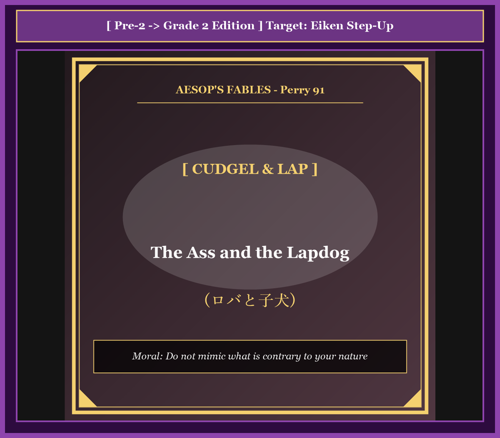

# Chapter 40: The Ass and the Lapdog (ロバと子犬)

<!-- 電子書籍 Page Break & Image Header -->

  

## 1. Benchmark Level: Eiken Grade Pre-2 (英検準2級レベル本文)
*Read in ~2 to 2.5 minutes. Baseline vocabulary and basic syntax.*

A prosperous landed proprietor maintained two distinct domestic animals within his rural manor: a robust, hardworking ass and an exquisitely pampered Maltese lapdog.

The beast of burden was subjected to an unrelenting regime of rigorous manual labor. Day after day, he trudged back and forth transporting agricultural produce, grinding corn at the rotary mill, and dragging felled timber across steep inclines. Upon completing his arduous schedule, he was unceremoniously relegated to a drafty stall, subsisting upon coarse forage and stagnant water.

Conversely, the canine companion occupied a privileged domestic niche characterized by decadent luxury and unconditional indulgence. Whenever the proprietor concluded his administrative duties, the diminutive creature would gambol vivaciously across the parquet floor, wagging his tail with frantic adoration and leaping effortlessly onto his patron's lap. Charmed by these demonstrative flatteries, the master would fondle the pet's silken coat and bestow succulent delicacies directly from the banquet table.

Brooding upon this blatant disparity from the confines of his enclosure, the donkey succumbed to acute professional jealousy. "By what perverse standard of equity does this discrepancy exist?" he rationalized bitterly. "While I perform exhausting functional labor indispensable to this estate, I am treated with cold neglect. Meanwhile, that parasitical quadraped earns adoration solely through theatrical displays of servile affection. If adulation and pampering are distributed merely on the basis of demonstrative enthusiasm, I shall systematically duplicate his repertoire and claim my rightful portion of domestic luxury."

Operating under this preposterous premise, the misguided beast managed to unlatch his enclosure gate the following evening and navigated stealthily toward the manor's illuminated drawing room.

Bursting through the double doors, the massive creature emitted an ear-splitting cacophony of triumphant brays. Perceiving his owner reclining comfortably beside the hearth, the mammoth intruder galloped across the Persian rug with terrifying momentum. Rearing up on his hind legs with catastrophic benevolence, he deposited both gigantic, manure-encrusted fore-hooves squarely upon the patriarch's clavicles, attempting to lavish the gentleman's horrified visage with affectionate rasps of his sandpaper-coarse tongue.

Trapped beneath three hundred kilograms of uncoordinated livestock, the suffocating master emitted frantic shrieks of mortal terror. Side tables were violently smashed, antique chandeliers trembled from the vibrations, and priceless porcelain dinnerware was pulverized into dust.

Galvanized by the homeowner's desperate screams, the estate laborers stormed the drawing room wielded formidable bludgeons and pitchforks. Recognizing an apparent assassination attempt by an insubordinate animal, they mercilessly assaulted the bewildered creature, raining a torrential barrage of blows upon his flanks until the crippled trespasser was dragged back into his stable.

Nursing his shattered ribs amidst the straw, the disillusioned ass contemplated the catastrophic flaw in his behavioral mimicry: "I have brought this merciless retribution upon my own head. Providence engineered my anatomy to endure rigorous toil with Stoic resignation; attempting to counterfeit the effeminate servility of a favored lapdog is a grotesque perversion that courts instant destruction."

---

## 2. Target Level: Eiken Grade 2 (英検2級レベル本文)
*Read in ~2.5 to 3 minutes. Advanced vocabulary, complex syntax, and formal rhetoric.*

An opulent agrarian plutocrat maintained within his baronial demesne two domestic quadrupeds occupying antipodal sociological strata: a utilitarian pack-ass conditioning to unremitting industrial toil, and an aristocratic canine sycophant pampered in sybaritic luxury.

The equine laborer was subordinated to an institutionalized regime of unrelenting manual exploitation. His diurnal schedule encompassed hauling mountainous payloads of agricultural produce, operating rotational grain millstones, and navigating steep logging trails. Upon the cessation of his functional duties, he was peremptorily banished to an austere paddock, condemned to subsist upon desiccated chaff and brackish water, entirely unacknowledged by the proprietor.

Conversely, the diminutive lapdog occupied a lucrative domestic niche predicated upon demonstrative obsequiousness and theatrical adulation. Consequent to the master's return from administrative jurisdictions, the pampered pet would execute choreographed exhibitions of exuberant subservience—frisking vivaciously across marble mosaics, vibrating his caudal extremity with synthetic delirium, and ascending into the sovereign lap. Enchanted by these choreographed displays of adoration, the proprietor would caress the animal's groomed pelt, rewarding his calculated flatteries with epicurean delicacies harvested directly from the banquet sideboard.

Ruminating upon this grotesque socioeconomic asymmetry from the squalor of his confinement, the alienated donkey developed an acute sense of systemic grievance. "Under what rational ethical calculus is this invidious stratification justified?" he hypothesized with mounting indignation. "I deliver foundational infrastructural value indispensable to the economic solvency of this enterprise, yet remain relegated to marginal neglect. Concurrently, an unproductive parasite extracts lavish social dividends exclusively through superficial pantomimes of affection. If institutional remuneration in this household is allocated according to demonstrative exuberance rather than productive output, I shall systematically appropriate the canine behavioral matrix and demand my proportional entitlement to domestic luxury."

Mobilizing under this fatally flawed operational paradigm, the deluded creature manipulated the latch of his enclosure the subsequent dusk, infiltrating the illuminated precincts of the manor's salon.

Breaching the threshold, the massive quadruped reverberated an ear-shattering cacophony of celebratory braying throughout the vaulted interior. Sighting his sovereign reclined before the fireplace, the colossal intruder propelled his three-hundred-kilogram bulk across priceless Aubusson tapestries with uninhibited kinetic momentum. Rearing into an unnatural bipedal elevation with catastrophic goodwill, he slammed both gargantuan, mud-calcified hooves squarely into the patriarch's pectoral girdle, simultaneously attempting to coat the magnate's paralyzed countenance with vigorous lacerations of his fibrous tongue.

Pinioned beneath the overwhelming compressive mass of livestock, the asphyxiating patrician articulated shrill vociferations of mortal panic. Mahogany furnishings disintegrated into kindling, ornate candelabra collapsed, and invaluable porcelain heirlooms were pulverized beneath thrashing hooves.

Electrified by the auditory signatures of crisis, the estate's security personnel breached the chamber armed with reinforced clubs and agricultural bludgeons. Extrapolating that an unprovoked homicidal insurrection was in progress, the retainers subjected the immobilized beast to an unrelenting barrage of concussive force, battering his skeletal frame until the hemorrhaging intruder was dragged back into his equestrian exile.

Nursing his fractured ribs amidst the filth of his stall, the enlightened quadruped formulated his definitive epistemological synthesis: "I have incurred an entirely equitable penalty for violating categorical boundaries. Evolution calibrated my physiology to sustain monumental burdens with austere stoicism; attempting to counterfeit the effeminate servilities of an indulged sycophant represents a grotesque operational distortion that inevitably invites catastrophic annihilation."

---

## 3. Classic Original English Text (イソップ寓話クラシック原文)
*Perry 91: Translated by George Fyler Townsend (1867)*

A Man had a Donkey and a Maltese Lapdog, a very great beauty. The Donkey was conditioned only to carry burdens, but the Dog had every advantage. 

The Donkey, seeing how much the Dog was petted, determined to try if he could not win his Master's favor by imitating him. 

One day, having broken his halter, he ran into his Master's house, and began to gambol about in the room, breaking the furniture. 

He then ran up to his Master, and put his fore-feet upon his shoulders, and licked his face with his tongue, just as he had seen the Dog do. 

The Master cried out with fear, and the servants running in with sticks, beat the Donkey till he was nearly dead, and then turned him out into his stable. 

The Donkey, groaning with his bruises, said: "What a fool I was to imitate a Lapdog, when I was only born to carry burdens!"

---

### 🏛️ 【英検2級レベルで読み解く！クラシック原文の重要構文・英文法ノート】
1. **1. 分詞構文（Participle Clause: 付帯状況・理由）**
   - **原文**: *"The Hare, believing her assertion to be simply impossible, agreed to the proposal..."*
   - **解説**: 「〜と信じ込んでいたので」という理由を表す分詞構文。英検2級の長文読解・ライティングの最頻出構文です。
1. **2. 古典的仮定法現在（Subjunctive Mood）**
   - **原文**: *"Though you be swift as the wind, I will beat you in a race."*
   - **解説**: 譲歩節 `Though` の中で原形 `be` を用いる古典的な仮定法現在（現代英語の `Though you are...`）。格調高い古典の響きを持ちます。
1. **3. 過去分詞の後置修飾（Postpositive Participle）**
   - **原文**: *"On the day appointed for the race the two started together."*
   - **解説**: `appointed`（定められた・指定された）が直前の名詞 `the day` を後ろから修飾する構文です。

### 📜 【クラシック原文の重要語彙・古風表現（Classic Antique Vocabulary）】
- **retort** [動] 2級 **（機転を利かせて）言い返す、反論する**（現代の reply sharp/wittily に相当）
- **assertion** [名] 2級/準1級 **主張、断言**（動詞 assert の名詞形。2級長文定番）
- **wayside** [名] 2級 **道端、沿道**（by the wayside（道端に、途中で））
- **fatigue** [名] 2級 **（心身の）極度の疲労、疲れ**（tiredness の上位フォーマル語）

---

## 4. Japanese Translation & Moral (日本語訳と教訓)

### 【日本語全訳：英検2級レベル本文】
ある裕福な農業財閥が、その男爵風の私有地の中に、正反対の社会学的階層を占める2頭の使役・愛玩動物を飼育していました。絶え間ない過酷な産業的労苦に服従させられた実用的な荷担ぎロバと、贅沢三昧の快楽の中に甘やかされた貴族的な犬の追従者（おべっか使い）です。

この馬科の労働者は、容赦のない肉体的搾取の制度化された体制に従属させられていました。彼の日課は、山積みの農作物の運搬、回転式穀物製粉機の操作、険しい伐採小道の踏破を網羅していました。自らの実務的職務が終了すると、彼は厳格な放牧場へと一方的に追放され、乾燥したわらと濁った水だけで生き延びることを宣告され、農場主からは一切の認知も与えられませんでした。

これとは対照的に、小さな愛玩犬は、あからさまな卑屈さと芝居がかった賛美を前提とする、極めて有利な家庭内の地位を占めていました。主人が行政管轄業務から帰還するやいなや、甘やかされたペットは溢れんばかりの服従の振り付けられた展示を実行しました。大理石のモザイクの上を活発に跳ね回り、作られた熱狂をもって尾の先端を激しく震わせ、主権者の膝の上へと跳び乗るのです。この計算された愛情の展示に魅了された主人は、ペットの手入れされた毛並みを撫で、食卓のサイドボードから直接採取された美食の珍味をもって、その計算されたへつらいに報いるのでした。

自らの監禁の惨めさの中からこの奇怪な社会経済的不均衡について思い巡らしていた、疎外されたロバは、強烈な構造的不満感を募らせました。「いかなる合理的な倫理的計算の下で、この不当な階層化が正当化されるというのか」とロバは増大する憤りとともに仮説を立てました。「私はこの事業の経済的支払能力に不可欠な基礎的インフラ価値を提供しているというのに、周縁的な放置へと追いやられている。その一方で、生産性のない寄生虫が、表面的な愛嬌のパントマイムを通じてのみ贅沢な社会的配当を引き出している。もしこの家庭における制度的報酬が、生産的成果ではなくあからさまな熱狂の誇示に従って配分されるのであれば、私は組織的に犬の行動マトリックスを自らのものとし、家庭内の贅沢における私の比例的権利を要求してみせよう。」

この致命的な欠陥を抱えた運用パラダイムの下で行動を起こし、この迷走した生き物は翌夕、囲いの掛け金を外し、屋敷のサロンの明るく照らされた区域へと潜入しました。

境界の敷居を突破すると、巨大な四足獣は丸天井の内部全体に、祝賀のいななきの耳をつんざくような不協和音を反響させました。暖炉の前に横たわる主権者の姿を見止めた巨大な侵入者は、計り知れない運動エネルギーをもって、高価なオービュッソンのタペストリーの敷かれた床を駆け抜けました。破滅的な善意を抱いて不自然な二足歩行の直立へと立ち上がり、巨大で泥の固まった蹄の双方を主人の胸郭の帯へとまともに叩きつけ、同時に、繊維質の舌の猛烈な摩擦をもって、麻痺した貴族の顔面を覆い尽くそうと試みたのです。

家畜の圧倒的な圧縮重量の下で身動きが取れなくなった窒息寸前の貴族は、死のパニックの鋭い絶叫を上げました。マホガニーの家具は薪のように粉々に砕け散り、華麗な枝付き燭台は崩落し、かけがえのない家宝の磁器は暴れる蹄の下で粉砕されました。

危機の音響的兆候に刺激された農園の警備要員たちは、強化された棍棒や農業用棍棒を手にして部屋を急襲しました。引き金のない凶悪な反乱が進行中であると判断した従者たちは、動けなくなった獣に容赦のない衝撃力の連打を浴びせ、出血する侵入者が馬小屋の追放地へと引きずり戻されるまで、その骨格のフレームを叩きのめしたのでした。

馬小屋の汚物の中で骨折した肋骨をさすりながら、真実に目覚めた四足獣は、自らの決定的な認識論的総括を公式化しました。「私はカテゴリーの境界を侵害したことに対して、完全に正当な懲罰を被ったのだ。進化は禁欲的な忍耐をもって記念碑的な重荷に耐えるよう私の生理機能を調整したのであり、甘やかされたへつらい屋の軟弱な追従を偽造しようと試みることは、必然的に壊滅的な全滅を招き寄せる奇怪な運用の歪曲にほかならないのだ。」

### 【教訓（Moral）】
**Do not mimic what is contrary to your nature.**  
（己の生来の適性やカテゴリー的本分に反する他者の追従を軽率に偽造してはならない。自己の存在基盤を見失った不器用なへつらいと役割逸脱は、称賛を得るどころか手酷い制裁と破滅を招く。）

---

## 5. Recite & Compare: そらんじたいキーフレーズ対比カード

  
フレーズ 1：正反対の社会層に属する2頭

  
準2級He maintained two distinct domestic animals: a robust ass and a pampered lapdog.

  
2級He maintained two domestic quadrupeds occupying antipodal sociological strata: a utilitarian laborer and a sycophant pampered in sybaritic luxury.

  
<strong>解説：</strong>「antipodal sociological strata（正反対の社会学的階層）」や「sybaritic luxury（贅沢三昧の快楽）」という極めて高度な社会階層論の学術語彙です。

  
フレーズ 2：不公平な評価体系への論理的異議

  
準2級By what perverse standard does this discrepancy exist? I perform labor, yet receive neglect.

  
2級Under what rational ethical calculus is this invidious stratification justified? I deliver infrastructural value, yet remain relegated to neglect.

  
<strong>解説：</strong>「Under what rational ethical calculus is ~ justified?（いかなる合理的倫理計算の下で〜が正当化されるのか）」という司法・倫理学の高度な反語論述です。

  
フレーズ 3：親愛のつもりの致命的突進

  
準2級Rearing up with catastrophic benevolence, he deposited both hooves upon the patriarch's clavicles.

  
2級Rearing into an unnatural bipedal elevation, he slammed both hooves squarely into the pectoral girdle, coating his visage with vigorous lacerations.

  
<strong>解説：</strong>「unnatural bipedal elevation（不自然な二足歩行の直立）」、「pectoral girdle（胸帯・肩帯骨格）」など、解剖学・物理学的厳密さを備えたブラックユーモアの最高峰です。

  
フレーズ 4：進化の適性とカテゴリー境界の遵守

  
準2級Providence engineered my anatomy to endure toil; attempting to counterfeit servility courts destruction.

  
2級Evolution calibrated my physiology to sustain burdens; attempting to counterfeit the servilities of a sycophant is a grotesque distortion that invites annihilation.

  
<strong>解説：</strong>「Evolution calibrated my physiology（進化が私の生理機能を調整した）」と「grotesque operational distortion that invites annihilation（全滅を招く奇怪な運用の歪曲）」という、壮大な進化論的総括です。

---

## 6. Key Vocabulary & Exam Notes (英検2級 重要語彙・文法・面接対策)

### 1. 英検2級 必須ボキャブラリー
* **antipodal** [形] 対蹠的な、正反対の
* **sycophant** [名] おべっか使い、へつらい者
* **sybaritic** [形] 贅沢に溺れた、快楽主義の
* **peremptorily** [副] 断固として、一方的に、命令的に
* **invidious** [形] 不当な、不公平な、反感を買うような
* **pinion** [動] 縛り上げる、身動きできなくする
* **epistemological** [形] 認識論の、知識論的な
* **stoicism** [名] 禁欲主義、ストイックさ、冷静な忍耐

### 2. 文法・構文のチェックポイント
* **Under what ethical calculus is ~ justified?**:
  * 論文・エッセイで不当な社会構造や制度的矛盾を痛烈に批判する際の最高峰の修辞疑問文です。
* **occupying antipodal strata**: 「正反対の階層を占める」
  * 二極化した階層格差や対照的な事象を分析する際の学術的表現です。

### 3. スピーキング（面接）＆ライティング活用ヒント
「自己理解とキャリア形成」「組織における役割分担」を論述する際に最適です：
* *Attempting to mimic behaviors unsuited to our inherent strengths inevitably damages professional credibility.*（自らの生来の強みに適さない振る舞いを模倣しようとすることは、必然的に職業的信用を損なう。）
* *Organizational evaluation systems should reward real productive output rather than superficial flattery.*（組織の評価システムは、表面的なお世辞ではなく、真の生産的成果に報いるべきである。）
