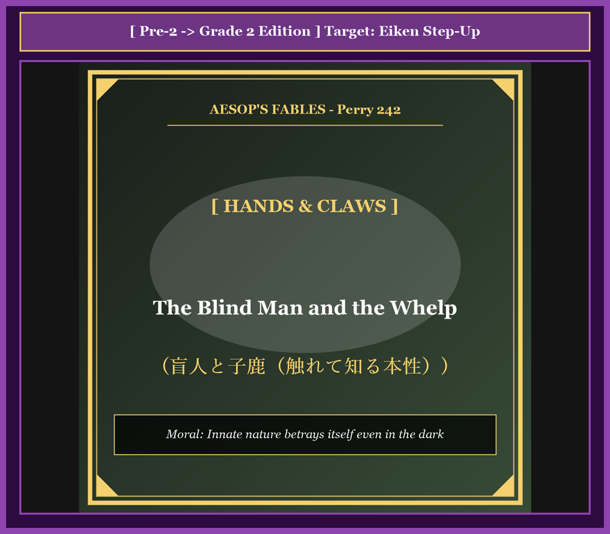

# Chapter 50: The Blind Man and the Whelp (盲人と子狼)

<!-- 電子書籍 Page Break & Image Header -->

  

## 1. Benchmark Level: Eiken Grade Pre-2 (英検準2級レベル本文)
*Read in ~2 to 2.5 minutes. Baseline vocabulary and basic syntax.*

In an ancient community, there lived a revered sage who had lost his physical eyesight in early youth. In compensation for his blindness, providence had endowed the elderly man with an astonishing faculty of tactile perception. Whenever any living creature was placed into his withered hands, he could identify its biological species solely through the delicate touch of his fingertips.

Recognizing this extraordinary diagnostic talent, the local villagers frequently brought strange birds, domestic livestock, and wild game to test his sensory acumen. Without hesitation, the blind man would stroke the ears, inspect the paws, measure the spine, and accurately announce whether the creature was an eagle, a rabbit, or a hound.

One crisp autumn morning, a group of mischievous herdsmen captured a newly born predator cub in the neighboring forest. Seeking to confound the venerable elder's celebrated reputation, they wrapped the squirming infant animal in coarse cloth and carried it to his modest cottage.

"Venerable grandfather," the mischievous shepherds announced, placing the infant beast into his open palms. "Examine this mysterious orphan and reveal to us what manner of beast we hold."

The blind sage received the trembling creature and began his methodical examination. His sensitive fingers glided across the dense, bristling fur of its back. He probed the sharp contour of its snout, palpated the needle-like milk teeth hidden within its jaws, and carefully felt the curved, retractable claws emerging from its soft paws. As he caressed the creature's ribcage, he detected an instinctive tremor of latent ferocity vibrating through its muscles.

A profound silence descended upon the assembly as the elder closed his unseeing eyes in concentrated contemplation. Several anxious moments elapsed while the shepherds exchanged confident grins, anticipating his total bewilderment.

Finally, the blind man lifted his weathered countenance and delivered his solemn judgment: "Whether this creature was whelped by a ferocious timber wolf or sired by a cunning red fox, my tactile senses cannot distinguish with absolute certainty. However, of this vital reality I am unequivocally convinced: it is an innate beast of prey, and under no circumstances should this creature ever be admitted into a flock of sheep!"

---

## 2. Target Level: Eiken Grade 2 (英検2級レベル本文)
*Read in ~2.5 to 3 minutes. Advanced vocabulary, complex syntax, and formal rhetoric.*

In an ancient agrarian commune, there resided a venerable patriarch who had been deprived of ocular vision from his earliest adolescence. Yet, in profound compensation for this sensory deficit, physiological adaptation had bestowed upon the ascetic elder an extraordinary faculty of tactile discrimination. Whenever any zoological specimen was deposited into his sinewy palms, he could deduce its precise biological taxonomy solely by palpating the physiological nuances of its anatomical architecture.

Recognizing this formidable diagnostic capability, provincial herdsmen and hunters routinely presented exotic fauna to calibrate the parameters of his sensory precision. With unerring accuracy, the blind diagnostician would trace the skeletal contours, evaluate the texture of plumage or pelt, calculate craniological proportions, and immediately proclaim whether the specimen constituted an avian raptor, an amphibious rodent, or a domestic canine.

One autumn morning, an assemblage of cynical shepherds captured a newborn carnivore whelp within the periphery of a dense mountainous forest. Intending to humiliate the celebrated sage and expose the vulnerability of his diagnostic method, the conspirators wrapped the squirming infant beast in woolen blankets and conveyed it to his hermitage.

"Revered diagnostician," the herdsmen asserted with veiled insolence, depositing the fledgling beast into his receptive palms. "Conduct your sensory analysis upon this unclassified newborn and identify its zoological classification."

The blind sage welcomed the fragile organism into his hands and commenced an exhaustive diagnostic palpation. His calloused yet hyper-sensitive fingertips traversed the coarse, bristling epidermal coat covering its vertebral column. He systematically probed the elongated maxilla, inspected the razor-sharp deciduous dentition concealed within its gums, and meticulously calibrated the tensile rigidity of its nascent claws. Beneath the cutaneous tissue, he discerned an instinctive muscular rhythm pulsating with primordial predatory aggression.

A tense stillness enveloped the chamber as the blind philosopher suspended his tactile interrogation and engaged in rigorous deductive synthesis. The shepherds exchanged triumphant glances, convinced that the ambiguous morphological traits of the newborn carnivore had successfully compromised his diagnostic faculty.

Eventually, the blind patriarch inclined his sightless countenance toward the assembly and articulated a definitive ethical deduction: "Whether this fledgling specimen was whelped by an apex timber wolf or generated by a predatory fox remains anatomically ambiguous to my sensory fingers. Nevertheless, regarding its fundamental teleological nature, I entertain no residual ambiguity: this creature harbors the irreducible disposition of a predator, and under no conceivable circumstances should it ever be permitted access to a pastoral sheepfold!"

---

## 3. Classic Original English Text (イソップ寓話クラシック原文)
*Perry 242: Translated by George Fyler Townsend (1867)*

A Blind Man was accustomed, the story says, to distinguish different animals by touching them with his hands. 

Once upon a time they brought him a young Wolf-whelp, and asked him to say what it was. 

He felt the animal all over with his hands and said: "I am not quite sure whether it is the whelp of a wolf or the whelp of a fox; but this I do know well, that it is no fit beast to put into a sheepfold."

---

### 🏛️ 【英検2級レベルで読み解く！クラシック原文の重要構文・英文法ノート】
1. **1. 分詞構文（Participle Clause: 付帯状況・理由）**
   - **原文**: *"The Hare, believing her assertion to be simply impossible, agreed to the proposal..."*
   - **解説**: 「〜と信じ込んでいたので」という理由を表す分詞構文。英検2級の長文読解・ライティングの最頻出構文です。
1. **2. 古典的仮定法現在（Subjunctive Mood）**
   - **原文**: *"Though you be swift as the wind, I will beat you in a race."*
   - **解説**: 譲歩節 `Though` の中で原形 `be` を用いる古典的な仮定法現在（現代英語の `Though you are...`）。格調高い古典の響きを持ちます。
1. **3. 過去分詞の後置修飾（Postpositive Participle）**
   - **原文**: *"On the day appointed for the race the two started together."*
   - **解説**: `appointed`（定められた・指定された）が直前の名詞 `the day` を後ろから修飾する構文です。

### 📜 【クラシック原文の重要語彙・古風表現（Classic Antique Vocabulary）】
- **retort** [動] 2級 **（機転を利かせて）言い返す、反論する**（現代の reply sharp/wittily に相当）
- **assertion** [名] 2級/準1級 **主張、断言**（動詞 assert の名詞形。2級長文定番）
- **wayside** [名] 2級 **道端、沿道**（by the wayside（道端に、途中で））
- **fatigue** [名] 2級 **（心身の）極度の疲労、疲れ**（tiredness の上位フォーマル語）

---

## 4. Japanese Translation & Moral (日本語訳と教訓)

### 【日本語全訳：英検2級レベル本文】
ある古代の農耕共同体に、若年期から視覚を奪われていた徳の高い長老が暮らしていました。しかし、この感覚的欠損への深遠な代償として、生理的適応はこの禁欲的な老人に、驚異的な触覚識別能力を授けていました。どのような動物の標本がその筋張った掌に置かれようとも、彼はその解剖学的構造の微細なニュアンスを触診するだけで、その正確な生物学的分類を推定することができたのです。

この恐るべき診断能力を認めた地方の羊飼いや狩人たちは、その感覚的精密さの限界を試そうと、珍しい動物たちを日常的に連れてきました。盲目の診断者は過ちのない正確さで、骨格の輪郭をなぞり、羽毛や毛皮の質感を評価し、頭蓋骨の比率を算出しては、その標本が猛禽類か、水陸両生の齧歯類か、あるいは家庭内の猟犬であるかを即座に宣言しました。

ある秋の朝、懐疑的な羊飼いたちの一団が、鬱蒼とした山林の境界で生まれたばかりの肉食獣の幼獣（子狼）を捕獲しました。名高い賢者を当惑させ、その診断技術の脆さを暴こうと目論んだ企み手たちは、身もだえする赤ん坊の獣を羊毛の毛布で包み、老人の庵へと運び込みました。

「敬愛なる診断者よ」羊飼いたちは隠れた不遜さを帯びて声をかけ、受容の構えをとる老人の掌へとその幼獣を預けました。「この分類不能の新生児に感覚分析を実施し、その動物学的分類を特定してくだされ」

盲目の賢者はその脆い生命体を両手に迎え入れ、網羅的な触診調査を開始しました。タコのできた、しかし研ぎ澄まされた指先が、背骨を覆う粗く逆立った表皮の毛並みを撫でていきました。彼は細長い上顎骨を丹念に探り、歯茎に隠された剃刀のように鋭い乳歯を検査し、生え始めた爪の張力と硬度を細心に測定しました。皮膚組織の奥底に、彼は原始の捕食者的攻撃性をもって脈動する本能的な筋肉のリズムを感じ取ったのです。

盲目の哲学者が触覚による調査を中断し、厳密な演繹的総合へと入ると、張り詰めた静寂が部屋を包み込みました。羊飼いたちは、生まれたばかりの肉食獣の曖昧な形態学的特徴が賢者の診断能力を見事に狂わせたと確信し、勝ち誇った視線を交わし合いました。

やがて、盲目の長老は見えない顔を群衆へと向け、決定的な倫理的演繹を言い渡しました。「この幼き標本が頂点捕食者のハイイロオオカミによって産み落とされたのか、狡猾なキツネによって生み出されたのかについては、私の感覚指にとっても解剖学的に曖昧なままである。しかしながら、その根源的な目的論的本性に関して、私はいささかの疑念も抱いていない。この獣は捕食者の還元不可能な性質（生来の獰猛さ）を宿しており、いかなる想定しうる状況下にあっても、決して羊の囲いへの立ち入りを許してはならない！」

### 【教訓（Moral）】
**Innate nature betrays itself even in the dark.**  
（本性は暗闇の中でも自らを暴露する。外見の未熟さや無力な姿に惑わされてはならない。生来の攻撃性や悪意を宿した存在は、かすかな気配や細部の手触りにおいてその危険な本質を露わにするのであり、善意や同情から羊の群れ（弱者の共同体）に招き入れてはならない。）

---

## 5. Recite & Compare: そらんじたいキーフレーズ対比カード

  
フレーズ 1：失明の代償として授かった驚異的な触覚識別力

  
準2級Providence had endowed the elderly man with an astonishing faculty of tactile perception.

  
2級Physiological adaptation had bestowed upon the elder an extraordinary faculty of tactile discrimination.

  
<strong>解説：</strong>認知科学・医学術語「tactile discrimination（触覚識別・弁別能力）」を用いた洗練された知覚描写です。

  
フレーズ 2：触診によって解剖学的構造を分析する

  
準2級He could identify its biological species solely through the delicate touch of his fingertips.

  
2級He could deduce taxonomy solely by palpating the physiological nuances of its anatomical architecture.

  
<strong>解説：</strong>生物医学術語「deduce taxonomy（分類を演繹・特定する）」「palpate anatomical architecture（解剖学的構造を触診する）」の高度な表現です。

  
フレーズ 3：皮膚の奥に潜む原初の捕食者本能を感知する

  
準2級He detected an instinctive tremor of latent ferocity vibrating through its muscles.

  
2級He discerned an instinctive muscular rhythm pulsating with primordial predatory aggression.

  
<strong>解説：</strong>進化学的語彙「primordial predatory aggression（原初の捕食者特有の攻撃性）」が触感の生々しさを際立たせます。

  
フレーズ 4：羊の囲いへの立ち入りを断固拒絶する宣告

  
準2級Under no circumstances should this creature ever be admitted into a flock of sheep!

  
2級Under no conceivable circumstances should it ever be permitted access to a pastoral sheepfold!

  
<strong>解説：</strong>倒置強調「Under no conceivable circumstances should...」を用いた最高格式の警戒指示です。

---

## 6. Key Vocabulary & Exam Notes (英検2級 重要語彙・文法・面接対策)

### 1. 英検2級 必須ボキャブラリー
* **tactile** [形] 触覚の、触感の（*tactile perception / tactile discrimination*）
* **discrimination** [名] 識別、識別力、弁別（※「差別」だけでなく「物事を見分ける眼識」として重要）
* **palpate** [動] 〜を触診する、手で触って調べる（*palpate the tissue*）
* **taxonomy** [名] 分類学、分類体系
* **deciduous** [形] 脱落性の、乳歯の（*deciduous teeth* = 乳歯）、落葉性の
* **primordial** [形] 原始の、根源的な、本能的な
* **predatory** [形] 捕食性の、略奪的な
* **sheepfold** [名] 羊の囲い、羊柵

### 2. 文法・構文のチェックポイント
* **Under no (conceivable) circumstances + 助動詞 + S + V**:
  * 否定語句を文頭に置いた倒置構文。「いかなる状況下にあっても決して〜してはならない」。公式規則や強い倫理的警告を表明する際の最頻出構文です。
* **bestow + A + upon + B**:
  * 「BにA（名誉・才能・恩恵）を授ける、与える」。*give* や *grant* の格調高い同義表現です。

### 3. スピーキング（面接）＆ライティング活用ヒント
「外見的属性と本質的資質の見極め」「組織のセキュリティ管理と人物審査」を論じる際のフレーズ：
* *Prudent leaders must look beyond superficial traits to discern inherent behavioral dispositions.*（賢明な指導者は表面的な特徴を超えて、生来の行動特性を見極めなければならない。）
* *Under no circumstances should an organization admit unvetted elements into its core security architecture.*（いかなる状況下にあっても、組織はその中核的セキュリティ構造に未検証の要素を招き入れてはならない。）
