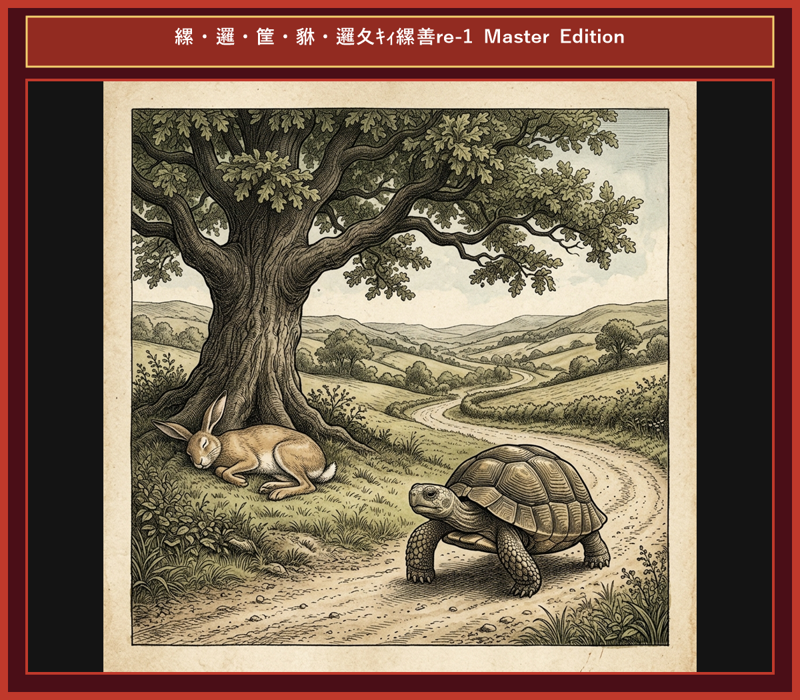

# Chapter 1: The Tortoise and the Hare (ウサギとカメ)

  

<!-- Video Learning Link Start -->

  <a href="https://youtu.be/mock_tortoise_and_hare_ch01" style="color: #0969da; font-weight: bold; text-decoration: none; font-size: 1.05em; display: inline-block;">
    🎬 【動画で聴く・シャドーイング】ネイティブ朗読＆カラオケ字幕付き動画（YouTube）▶
  </a>
  

    ※ タップするとYouTubeが開き、発音に合わせて光るカラオケ字幕で学習できます。
  

<!-- Video Learning Link End -->

## 1. Benchmark Level: Eiken Grade 2 (英検2級レベル本文)
*Read in ~2.5 to 3 minutes. Academic discourse and formal vocabulary.*

A notoriously boastful hare perpetually ridiculed the sluggish movement of a tortoise, repeatedly asserting his own unexcelled swiftness before the woodland community. "Regardless of who dares to challenge me," declared the hare with supreme arrogance, "my natural velocity remains entirely insurmountable."

Unfazed by the hare's pompous declaration, the tortoise calmly offered a counter-proposal. "Notwithstanding your remarkable speed, I am prepared to engage in a competitive race to the designated hilltop."

Deeming the challenge absurdly amusing, the hare readily accepted, anticipating an inevitable triumph. At the commencement of the race, the hare burst forward with extraordinary acceleration, swiftly establishing a formidable lead that rendered his competitor virtually invisible.

Having traversed half the distance in mere minutes, the hare paused to assess his progress. Perceiving that the tortoise was lagging far behind, the hare succumbed to complacency. "Inasmuch as the gap between us is immense," he calculated, "a temporary respite will in no way compromise my impending victory." Consequently, he reclined beneath the dense foliage of a venerable oak and lapsed into an unalterable sleep.

In sharp contrast, the tortoise exhibited unwavering determination. Advancing with relentless continuity, he traversed the rugged terrain without succumbing to fatigue or distraction.

When the hare eventually awakened, nightfall was imminently approaching. Panic-stricken upon discovering the tortoise's proximity to the finish line, the hare exerted his maximum capacity in a desperate pursuit. Nevertheless, his delayed effort proved futile; the tortoise had already crossed the boundary, securing an unprecedented triumph.

Indolence and unwarranted self-assurance inevitably culminate in failure, whereas relentless perseverance consistently surpasses raw talent.

---

## 2. Target Level: Eiken Grade Pre-1 (英検準1級レベル本文)
*Read in ~3.5 to 4.5 minutes. Highly sophisticated literary and academic prose, complex inversion, advanced vocabulary, and nuanced rhetoric.*

An ostentatious hare habitually demeaned the sluggish gait of a tortoise, relentlessly proclaiming his own athletic preeminence to the forest fauna. "Should any creature presume to contest my velocity," the hare boasted with pompous disdain, "such an endeavor is preordained to fail, for my swiftness is fundamentally unassailable."

Impervious to the hare's supercilious bravado, the tortoise articulated a measured proposition. "Notwithstanding your heralded agility, I hereby challenge you to a footrace terminating at the mountain summit."

Deriding the proposal as a preposterous delusion, the hare acquiesced with patronizing enthusiasm. Upon the signal, the hare bounded forth with phenomenal momentum, establishing a colossal chasm between himself and his adversary within seconds.

Having covered half the course, the hare paused to survey the distance. Observing the tortoise far in the rear, the hare succumbed to fatalistic complacency. "Given the insurmountable magnitude of my lead," he rationalized, "a brief interlude of slumber shall not jeopardize my triumph." Whereupon, he sought refuge beneath a canopy of leaves and lapsed into a profound coma.

Conversely, the tortoise displayed unyielding tenacity. Maintaining an unhurried yet unrelenting cadence, he negotiated the treacherous incline without a single moment of hesitation.

By the time the hare emerged from his torpor, twilight had enveloped the horizon. Espying his rival adjacent to the finish line, the hare sprinted with frenecy; nevertheless, his belated surge proved entirely ineffectual. The tortoise had already crossed the threshold, achieving an historic victory.

Haughty indolence and premature triumph subvert inherent superiority, whereas steadfast tenacity inexorably eclipses uncultivated genius.

---

## 3. Classic Original English Text (イソップ寓話 クラシック原文)
*Townsend / Jacobs Edition (Public Domain)*

A Hare was one day making fun of the short feet and slow pace of the Tortoise, who retorted: "Though you be swift as the wind, I will beat you in a race." The Hare, believing her assertion to be simply impossible, agreed to the proposal; and they agreed that the Fox should choose the course and fix the goal. On the day appointed for the race the two started together. The Tortoise never for a moment stopped, but went on with a slow but steady pace straight to the end of the course. The Hare, lying down by the wayside, fell asleep. At last waking up, and moving as fast as he could, he saw the Tortoise had reached the goal, and was comfortably resting after her fatigue.

Slow and steady wins the race.

---

### 🏛️ 【英検2級レベルで読み解く！クラシック原文の重要構文・英文法ノート】
1. **1. 分詞構文（Participle Clause: 付帯状況・理由）**
   - **原文**: *"The Hare, believing her assertion to be simply impossible, agreed to the proposal..."*
   - **解説**: 「〜と信じ込んでいたので」という理由を表す分詞構文。英検2級の長文読解・ライティングの最頻出構文です。
1. **2. 古典的仮定法現在（Subjunctive Mood）**
   - **原文**: *"Though you be swift as the wind, I will beat you in a race."*
   - **解説**: 譲歩節 `Though` の中で原形 `be` を用いる古典的な仮定法現在（現代英語の `Though you are...`）。格調高い古典の響きを持ちます。
1. **3. 過去分詞の後置修飾（Postpositive Participle）**
   - **原文**: *"On the day appointed for the race the two started together."*
   - **解説**: `appointed`（定められた・指定された）が直前の名詞 `the day` を後ろから修飾する構文です。

### 📜 【クラシック原文の重要語彙・古風表現（Classic Antique Vocabulary）】
- **retort** [動] 2級 **（機転を利かせて）言い返す、反論する**（現代の reply sharp/wittily に相当）
- **assertion** [名] 2級/準1級 **主張、断言**（動詞 assert の名詞形。2級長文定番）
- **wayside** [名] 2級 **道端、沿道**（by the wayside（道端に、途中で））
- **fatigue** [名] 2級 **（心身の）極度の疲労、疲れ**（tiredness の上位フォーマル語）

---

## 4. Japanese Translation (日本語訳)

ある高慢な野ウサギがカメの足の遅さを絶えず馬鹿にし、森の動物たちに向かって自らの並外れた速さを大威張りで主張していました。カメは動じることなく「あなたがどれほど速くとも、山頂までの駆けっこなら私が勝ちますよ」と言い返しました。ウサギはその挑戦をバカげた戯言と笑い飛ばして同意し、スタートと同時に猛烈な加速でカメをはるか後方に置き去りにしました。しかし途中で十分な差がついたと油断したウサギは木陰で深い眠りに落ちてしまいました。一方のカメは一瞬たりとも立ち止まることなく、不屈の粘り強さで歩み続けました。ウサギが目を覚ました時、カメはすでにゴールラインを越えて歴史的な勝利を収めていました。

**教訓**: 傲慢な怠惰と油断は本来の優位性を根底から覆すが、不屈の粘り強さは生来の天才をも不可避的に凌駕する。

---

## 5. Recite & Compare (そらんじたいキーフレーズ対比)
*Memorize these contrastive expressions to elevate speaking, writing, and reading fluency.*

  
■ 場面：過剰な自慢と相手への蔑視

  
【Grade 2 基礎】 <em>boastful hare ridiculed sluggish movement... asserted unexcelled swiftness...</em>

  
【Pre-1 暗唱】 <strong><em>ostentatious hare demeaned sluggish gait... proclaimed athletic preeminence...</em></strong>

  
【ポイント】 <strong>解説・試験活用</strong>：`ostentatious`（見せびらかす・誇示する）、`demean`（〜を貶める）、`gait`（歩調・足取り）、`preeminence`（卓越・至高）。準1級語彙問題の定番。

  
■ 場面：挑発に対する冷静な対応

  
【Grade 2 基礎】 <em>Unfazed by pompous declaration, calmly offered counter-proposal...</em>

  
【Pre-1 暗唱】 <strong><em>Impervious to supercilious bravado, articulated a measured proposition...</em></strong>

  
【ポイント】 <strong>解説・試験活用</strong>：`Impervious to...`（〜に動じない・影響されない）、`supercilious`（横柄な・見下す）、`bravado`（強がり・ハッタリ）。準1級・1級長文の人物描写。

  
■ 場面：膨大な差と油断

  
【Grade 2 基礎】 <em>succumbed to complacency... temporary respite will not compromise...</em>

  
【Pre-1 暗唱】 <strong><em>succumbed to fatalistic complacency... brief interlude shall not jeopardize...</em></strong>

  
【ポイント】 <strong>解説・試験活用</strong>：`interlude`（合間・インターバル）、`jeopardize`（〜を危険に晒す）。英検準1級英作文（要約・意見論述）で絶対的に必要な動詞。

  
■ 場面：不屈の粘り強さ

  
【Grade 2 基礎】 <em>exhibited unwavering determination, advancing with relentless continuity...</em>

  
【Pre-1 暗唱】 <strong><em>displayed unyielding tenacity, maintaining an unrelenting cadence...</em></strong>

  
【ポイント】 <strong>解説・試験活用</strong>：`unyielding tenacity`（屈しない粘り強さ・不撓不屈）、`cadence`（歩調・リズム）。準1級ライティングの努力・事業成功エッセイで圧倒的な加点。

  
■ 場面：教訓（Moral）

  
【Grade 2 基礎】 <em>Indolence culminates in failure, whereas perseverance surpasses talent...</em>

  
【Pre-1 暗唱】 <strong><em>Haughty indolence subverts superiority, whereas tenacity inexorably eclipses genius...</em></strong>

  
【ポイント】 <strong>解説・試験活用</strong>：`subvert`（〜を根底から覆す・打倒する）、`inexorably`（不可避的に・容赦なく）、`eclipse`（〜の存在感を薄れさせる・凌駕する）。準1級・1級論文の神フレーズ。

---

## 6. Vocabulary Builder: 赤シート対応 重要単語・熟語チェック表
*※ 赤い透明シート（または赤フィルム）を重ねると、日本語訳が消えて自力テストができます。*

| No. | 見出し語 / イディオム | 品詞 / レベル | 日本語の意味（赤シートで消える） | 本文での使われ方・コロケーション |
|:---:|---|:---:|---|---|
| **01** | **proud** | [形] 4級 | 誇り高い、傲慢な | *a proud hare (自惚れたウサギ)* |
| **02** | **boast (about...)** | [動] 3級 | 〜を自慢する、誇る | *was always boasting about his speed* |
| **03** | **make fun of...** | [熟] 3級 | 〜をからかう、嘲笑する | *making fun of a slow tortoise* |
| **04** | **challenge** | [名/動] 3級 | 挑戦、課題 / 挑む | *I accept your challenge.* |
| **05** | **accept** | [動] 3級 | 受け入れる、受諾する | *accept the proposal (提案を受諾する)* |
| **06** | **dash** | [動] 3級 | 勢いよく走る、突進する | *dashed forward (前方へ駆け出した)* |
| **07** | **leave ~ behind** | [熟] 3級 | 〜を置き去りにする | *left the tortoise far behind* |
| **08** | **visible** | [形] 準2級 | 目に見える、視認できる | *was barely visible in the distance* |
| **09** | **catch up (with...)** | [熟] 3級 | 〜に追いつく | *before he catches up* |
| **10** | **slumber** | [名/動] 準2級 | 深い眠り / 眠る | *fell into a profound slumber* |
| **11** | **sprint** | [動] 3級 | 全力疾走する | *sprinted toward the finish line* |
| **12** | **persistence** | [名] 準2級/2級 | 粘り強さ、不屈の継続 | *persistence and hard work will bring success* |

### 【出題傾向・文法解説ノート】

### 【出題頻出語彙・熟語ノート】
- **ostentatious** [形] これよがしの、自慢げな（*ostentatious display/lifestyle*）
- **preeminence** [名] 卓越、至高の地位（形容詞 *preeminent* 「卓越した」）
- **impervious** [形] （批判・感情などに）動じない、影響されない（*impervious to criticism*）
- **supercilious** [形] 横柄な、見下すような（*supercilious attitude/smile*）
- **jeopardize** [動] 〜を危険に晒す、台無しにする（準1級最頻出動詞 *jeopardize safety/success*）
- **tenacity** [名] 粘り強さ、不撓不屈（形容詞 *tenacious* 「粘り強い」）
- **eclipse** [動] 〜を凌駕する、陰らせる（*eclipse rivals/achievements*）

### 【文法・構文ポイント】
1. **[Should + 主語 + 動詞の原形...]（仮定法倒置：万一〜ならば）**
   - 準1級本文: *"Should any creature presume to contest my velocity..."*
   - ポイント: `If any creature should presume...` の `if` が省略された仮定法倒置構文。準1級ライティングや長文読解で格調高い仮定を表現する際に必須です。
2. **[Impervious to ...]（形容詞句の文頭前置構文）**
   - 準1級本文: *"Impervious to the hare's supercilious bravado, the tortoise articulated..."*
   - ポイント: 形容詞句を文頭に置く補語前置構文。主語の状態や心理特性を冒頭で鮮やかに際立たせる上級テクニックです。
