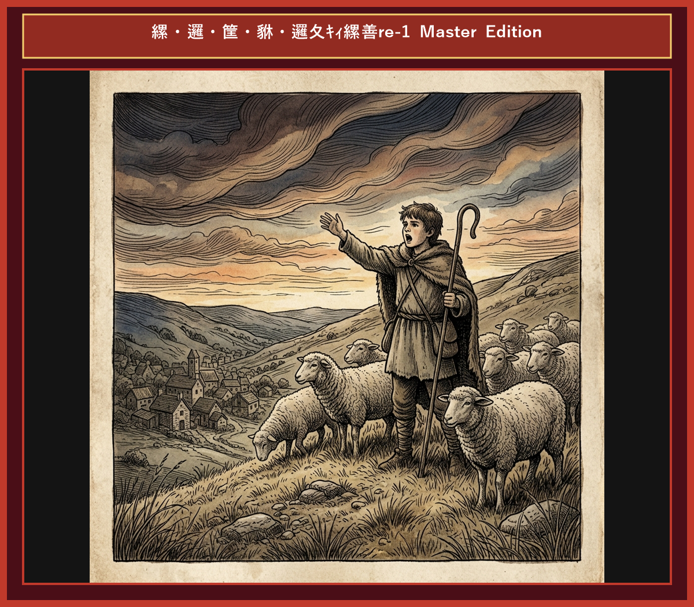

# Chapter 2: The Boy Who Cried Wolf (オオカミ少年)

  

## 1. Benchmark Level: Eiken Grade 2 (英検2級レベル本文)
*Read in ~2.5 to 3 minutes. Academic discourse and formal vocabulary.*

A juvenile shepherd tasked with safeguarding a village's livestock was stationed on a solitary hillside adjacent to a dense forest. Growing thoroughly disillusioned with the monotony of his solitary duties, he devised an unethical scheme to alleviate his boredom at the expense of the community.

"Wolf! A fierce predator is devouring the flock!" shouted the youth with simulated hysteria.

Distressed by his urgent alarm, the villagers instantaneously suspended their daily labor and ascended the slope, armed with improvised weapons to repel the perceived threat. Upon reaching the pasture, however, they discovered that the crisis was entirely fabricated. The boy stood amidst the grazing sheep, reveling in the success of his deceit. Indignant at his frivolous disregard for their safety, the villagers reprimanded him sternly, warning that civic trust should never be compromised for entertainment.

Regrettably, the boy failed to internalize their caution. Within a week, he fabricated the identical false alarm, causing another unwarranted disruption. Consequently, the villagers' residual trust dissolved entirely into profound skepticism.

Subsequently, a ravenous wolf actually descended from the timberland and launched a violent assault on the herd. Overwhelmed by genuine terror, the youth shouted desperately for assistance. "I implore you to believe me! A real wolf is slaughtering the livestock!"

Judging his pleas to be yet another manipulative fabrication, the villagers disregarded his distress signals completely. Deprived of external intervention, the boy watched helplessly as the predator decimated the entire flock.

Repeated dishonesty irreparably erodes personal integrity and public trust; hence, a proven deceiver will be met with skepticism even when uttering the absolute truth.

---

## 2. Target Level: Eiken Grade Pre-1 (英検準1級レベル本文)
*Read in ~3.5 to 4.5 minutes. Highly sophisticated literary and academic prose, complex inversion, advanced vocabulary, and nuanced rhetoric.*

An impetuous young shepherd, commissioned to tend a communal flock on a secluded ridge, succumbed to intense ennui induced by the tedious isolation of his assignment. To break the oppressive monotony, he conceived a malevolent deception, recklessly exploiting the villagers' protective instincts for his own perverse amusement.

"Wolf! A predatory beast is decimating our livestock!" he ejaculated with simulated panic.

Galvanized by this alarming outcry, the villagers immediately abandoned their vocations and rushed up the steep terrain, equipped with agricultural implements to neutralize the menace. Upon their arrival, however, the alleged emergency evaporated into a malicious hoax. The youth exulted in his successful manipulation, openly deriding their gullibility. Incensed by his callous breach of communal trust, the elders sternly admonished him, warning that veracity is the indispensable foundation of social cohesion.

Notwithstanding their solemn reproof, the incorrigible youth reiterated the identical subterfuge a fortnight later. This second instance of frivolous duplicity completely eroded whatever vestige of credibility he retained, solidifying a consensus of profound cynicism among the populace.

Inevitably, a formidable wolf emerged from the forest and commenced a catastrophic slaughter of the helpless flock. Paralyzed by authentic dread, the youth shrieked frantic appeals for succor. "I beseech your intervention! This is no fabrication!"

Surmising his frantic supplications to be merely another manifestation of his inveterate deceit, the villagers maintained absolute indifference. Bereft of succor, the youth witnessed the total annihilation of the flock.

Perpetual deceit irreparably subverts personal veracity and communal solidarity; consequently, even authentic testimony from a confirmed impostor will be rejected with unyielding skepticism.

---

## 3. Classic Original English Text (イソップ寓話 クラシック原文)
*Townsend / Jacobs Edition (Public Domain)*

A Shepherd Boy tended his flock near a dark forest, and used to amuse himself by crying out, "Wolf! Wolf!" The villagers would come running to help him, only to find that he had tricked them. He did this several times. But one day a real Wolf came out of the forest and attacked the sheep. The Boy cried out louder than ever, "Wolf! Wolf!" but the villagers, thinking he was fooling them again, paid no attention. The Wolf killed many sheep and destroyed the flock.

There is no believing a liar, even when he speaks the truth.

---

### 🏛️ 【英検2級レベルで読み解く！クラシック原文の重要構文・英文法ノート】
1. **1. 分詞構文（Time / Attendant Circumstance）**
   - **原文**: *"A Shepherd-boy, who watched a flock of sheep near a village, brought out the villagers three or four times by crying out..."*
   - **解説**: `by crying out`（叫ぶことによって）という手段の動名詞句と関係代名詞の継続用法が組み合わさった2級頻出の複文構造です。
1. **2. 結果・目的を表す不定詞（Infinitive: Result）**
   - **原文**: *"...and even made a practice of laughing at them when they came running to his assistance."*
   - **解説**: `came running`（走ってやって来た：come + 現在分詞）の付帯状況表現です。
1. **3. 譲歩の従属接続詞 `even when`**
   - **原文**: *"Nobody believes a liar, even when he tells the truth."*
   - **解説**: 「〜の時でさえ」という譲歩条件を表す接続詞構文。英作文で高い説得力を生み出します。

### 📜 【クラシック原文の重要語彙・古風表現（Classic Antique Vocabulary）】
- **assistance** [名] 2級 **援助、手助け**（come to one's assistance（助けに駆けつける））
- **earnest** [名/形] 2級 **本気、真剣 / 真面目な**（in earnest（本気で、真剣に））
- **dismay** [名/動] 準1級 **狼狽、落胆 / うろたえさせる**（cried out in dismay）
- **trustworthy** [形] 2級 **信頼できる、頼りになる**（a liar is never deemed trustworthy）

---

## 4. Japanese Translation (日本語訳)

羊飼いの少年が村の羊の群れを一人で守る任に就いていましたが、仕事の過酷な孤独感と退屈に耐えかね、村人の防衛本能を悪用する悪質な悪戯を考案しました。「オオカミだ！家畜が全滅させられる！」と偽りのパニックで叫び、村人たちが仕事を放り出して駆けつけると、少年は騙された彼らを嘲笑しました。村人たちは社会的信頼の重要性を厳しく訓戒しましたが、懲りない少年は二度目の狂言を行いました。これにより彼の信頼性は完全に崩壊しました。やがて本物のオオカミが現れて羊を惨殺し始めた時、少年が悲痛な助けを求めて叫んだものの、村人はこれを虚言と断定して完全に無視しました。助けを得られず、羊の群れは全滅してしまいました。

**教訓**: 絶え間ない欺瞞は個人の誠実さと共同体の連帯を根底から打ち砕く。故に、一度虚偽の烙印を押された者の言葉は、たとえ真実であっても容赦ない懐疑によって退けられる。

---

## 5. Recite & Compare (そらんじたいキーフレーズ対比)
*Memorize these contrastive expressions to elevate speaking, writing, and reading fluency.*

  
■ 場面：退屈と悪意ある騙しの発案

  
【Grade 2 基礎】 <em>disillusioned with monotony... devised an unethical scheme...</em>

  
【Pre-1 暗唱】 <strong><em>succumbed to intense ennui... conceived a malevolent deception...</em></strong>

  
【ポイント】 <strong>解説・試験活用</strong>：`ennui`（倦怠感・退屈）、`malevolent`（悪意のある・害を及ぼす）。準1級・1級心理学・小説問題の必須上位語彙。

  
■ 場面：社会の怒りと信頼の軽視

  
【Grade 2 基礎】 <em>Indignant at disregard... trust should never be compromised...</em>

  
【Pre-1 暗唱】 <strong><em>Incensed by callous breach... veracity is the foundation of social cohesion...</em></strong>

  
【ポイント】 <strong>解説・試験活用</strong>：`callous`（冷酷な・無感覚な）、`veracity`（真実性・誠実さ）、`social cohesion`（社会的結束）。準1級社会・政治エッセイの決まり文句。

  
■ 場面：二度目の二重性と信用の喪失

  
【Grade 2 基礎】 <em>same false alarm... residual trust dissolved into skepticism...</em>

  
【Pre-1 暗唱】 <strong><em>identical subterfuge... frivolous duplicity eroded whatever vestige of credibility...</em></strong>

  
【ポイント】 <strong>解説・試験活用</strong>：`subterfuge`（口実・詐術）、`duplicity`（二重性・不誠実）、`vestige`（面影・痕跡）。準1級長文の核心概念。

  
■ 場面：切迫した援助の要請と冷絶

  
【Grade 2 基礎】 <em>shouted desperately... implore you to believe... disregarded signals...</em>

  
【Pre-1 暗唱】 <strong><em>shrieked frantic appeals for succor... beseech intervention... absolute indifference...</em></strong>

  
【ポイント】 <strong>解説・試験活用</strong>：`succor`（援助・救済）、`beseech`（〜を深く懇願する）。古典・歴史問題における最上級のレスキュー単語。

  
■ 場面：教訓（Moral）

  
【Grade 2 基礎】 <em>Repeated dishonesty erodes integrity... deceiver met with skepticism...</em>

  
【Pre-1 暗唱】 <strong><em>Perpetual deceit subverts veracity; authentic testimony from impostor rejected...</em></strong>

  
【ポイント】 <strong>解説・試験活用</strong>：`subvert`（〜を失墜させる・覆す）、`veracity`（誠実さ）、`testimony`（証言）、`impostor`（詐欺師・騙し屋）。準1級・1級論文の満点締結構文。

---

## 6. Vocabulary Builder: 赤シート対応 重要単語・熟語チェック表
*※ 赤い透明シート（または赤フィルム）を重ねると、日本語訳が消えて自力テストができます。*

| No. | 見出し語 / イディオム | 品詞 / レベル | 日本語の意味（赤シートで消える） | 本文での使われ方・コロケーション |
|:---:|---|:---:|---|---|
| **01** | **shepherd** | [名] 3級 | 羊飼い | *a young shepherd boy* |
| **02** | **bored** | [形] 4級 | 退屈した、飽きた | *felt bored on the hill* |
| **03** | **mischievous** | [形] 準2級 | いたずら好きな | *with a mischievous smile* |
| **04** | **shout** | [動] 4級 | 大声を出す、叫ぶ | *shouted at the top of his lungs* |
| **05** | **villager** | [名] 3級 | 村人 | *the villagers rushed to help* |
| **06** | **rush** | [動] 3級 | 急いで駆けつける | *rushed to the rescue* |
| **07** | **trick** | [名/動] 3級 | いたずら、企み / だます | *play a trick on someone* |
| **08** | **emerge** | [動] 準2級/2級 | 現れる、姿を現す | *a fierce wolf emerged from the woods* |
| **09** | **panic** | [名/動] 3級 | パニック、大混乱 | *cried in pure panic* |
| **10** | **scatter** | [動] 準2級 | 散り散りになる、まき散らす | *the sheep scattered in all directions* |
| **11** | **deceive** | [動] 準2級/2級 | だます、欺く | *deceive others for amusement* |
| **12** | **trustworthy** | [形] 2級 | 信頼できる、頼もしい | *a liar is never considered trustworthy* |

### 【出題傾向・文法解説ノート】

### 【出題頻出語彙・熟語ノート】
- **ennui** [名] 倦怠感、退屈（*succumb to ennui*）
- **malevolent** [形] 悪意のある、邪悪な（*malevolent intention/hoax*）
- **veracity** [名] 真実性、誠実さ（*question the veracity of statement*）
- **subterfuge** [名] 策略、ごまかし、口実（*resort to subterfuge*）
- **duplicity** [名] 二枚舌、表裏のあること（形容詞 *duplicitous*）
- **succor** [名] 援助、救助（動詞 *bring succor to refugees*）
- **impostor** [名] 詐欺師、偽物（*unmask the impostor*）

### 【文法・構文ポイント】
1. **[Bereft of ...]（形容詞句前置構文：〜を完全に奪われて）**
   - 準1級本文: *"Bereft of succor, the youth witnessed the total annihilation..."*
   - ポイント: `Bereft of money/hope/succor` は完全な喪失を示す格調高い表現。準1級長文の悲劇的・破滅的状況で使用されます。
2. **[whatever + 名詞 + 主語 + 動詞]（どれほどの〜であろうと）**
   - 準1級本文: *"eroded whatever vestige of credibility he retained..."*
   - ポイント: 譲歩・限定の複合関係限定詞構文。わずかに残った信用を強調して描写する際に非常に有効です。
