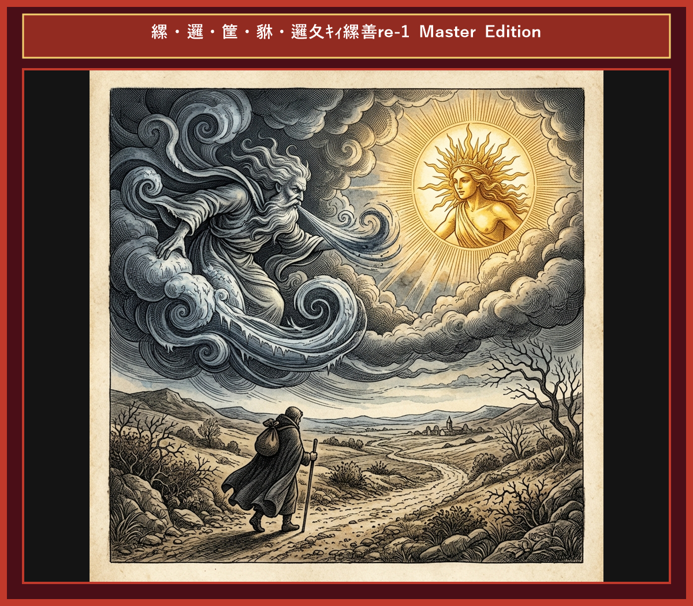

# Chapter 3: The North Wind and the Sun (北風と太陽)

  

## 1. Benchmark Level: Eiken Grade 2 (英検2級レベル本文)
*Read in ~2.5 to 3 minutes. Academic discourse and formal vocabulary.*

A fierce contest for supremacy erupted between the North Wind and the Sun, each asserting absolute dominance over the natural elements. To resolve their intractable conflict, they agreed to abide by an objective trial of strength.

Spotting a solitary traveler traversing a mountain path enveloped in a heavy winter garment, the North Wind proposed a definitive criterion. "Whichever of us compels that traveler to divest himself of his cloak shall be conceded the title of supreme power."

Concurring with the terms, the Sun yielded the initial attempt. Instantly, the North Wind unleashed a ferocious gale, howling across the terrain with violent velocity. Contrary to his expectations, however, the relentless onslaught merely impelled the traveler to grasp his attire with redoubled firmness to shield himself from the tempestuous climate. Despite exerting his maximum capacity, the Wind's aggressive tactics proved entirely counterproductive.

Thereupon, the Sun emerged, radiating mild and soothing warmth across the atmosphere. Gradually escalating the solar intensity, he transformed the frigid environment into a pleasant climate. Overwhelmed by the mounting heat, the traveler voluntarily unfastened his heavy garment and discarded it beside the pathway.

Coercion and hostility inevitably breed resistance, whereas gentle persuasion and warmth consistently prevail over brute force.

---

## 2. Target Level: Eiken Grade Pre-1 (英検準1級レベル本文)
*Read in ~3.5 to 4.5 minutes. Highly sophisticated literary and academic prose, complex inversion, advanced vocabulary, and nuanced rhetoric.*

An unyielding hegemony dispute materialized between the North Wind and the Sun, both claiming absolute sovereignty over the atmospheric realm. To adjudicate their intractable rivalry, they pledged to submit to an empirical test of efficacy.

Observing a solitary wayfarer negotiating an exposed ridge wrapped in a heavy mantle, the North Wind stipulated the precise challenge. "Whichever entity forces that traveler to strip off his garment shall be acknowledged as possessing paramount potency."

Assenting to the protocol, the Sun granted priority to his adversary. Instantly, the North Wind generated a tempestuous blizzard, unleashing furious gusts designed to tear the cloak away. Contrary to his calculation, the belligerent assault merely impelled the wayfarer to clutch his garment with desperate tenacity to ward off the hypothermic peril. Notwithstanding his maximum expenditure of force, the Wind's coercive methodology produced an entirely antithetical outcome.

Whereupon, the Sun stepped forth, diffusing benevolent warmth throughout the biosphere. Incrementally augmenting the thermal emission, he ameliorated the hostile atmosphere. Incapable of enduring the mounting solar radiance, the traveler voluntarily shed his burdensome attire and rested in the shade.

Brutal coercion and aggressive hostility inexorably provoke intransigent resistance, whereas subtle benevolence and persuasive warmth invariably vanquish raw force.

---

## 3. Classic Original English Text (イソップ寓話 クラシック原文)
*Townsend / Jacobs Edition (Public Domain)*

The North Wind and the Sun had a dispute as to which was the stronger, when a traveler came along wrapped in a warm cloak. They agreed that the one who first succeeded in making the traveler take his cloak off should be considered stronger than the other. Then the North Wind blew as hard as he could, but the more he blew the more closely did the traveler fold his cloak around him; and at last the North Wind gave up the attempt. Then the Sun shone out warmly, and immediately the traveler took off his cloak. And so the North Wind was obliged to confess that the Sun was the stronger of the two.

Persuasion is better than force.

---

### 🏛️ 【英検2級レベルで読み解く！クラシック原文の重要構文・英文法ノート】
1. **1. 比較級 + 比較級（The + 比較級 ..., the + 比較級 ... 構文）**
   - **原文**: *"The harder the Wind blew, the more closely did the Traveler wrap his cloak around him."*
   - **解説**: 「〜すればするほど、ますます…」を表す英検2級・準1級の最重要構文。後半に倒置（`did the Traveler wrap`）が起きています。
1. **2. 形式主語構文・合意の受動態**
   - **原文**: *"It was agreed between them that whichever first made the traveler take off his cloak should be held the stronger."*
   - **解説**: `whichever first made...`（どちらが先に〜させようとも）という複合関係代名詞節と使役動詞 `make + O + 原形不定詞` の融合。
1. **3. 比較を表す上級形容詞 `superior to`**
   - **原文**: *"Persuasion is often superior to force."*
   - **解説**: ラテン比較（*superior to* = 〜より優れている）。*than* ではなく *to* を取る重要文法ポイントです。

### 📜 【クラシック原文の重要語彙・古風表現（Classic Antique Vocabulary）】
- **dispute** [名/動] 2級 **論争、口論 / 争う**（a dispute arose between A and B）
- **cloak** [名] 準2級/2級 **外套、マント**（wrap one's cloak tightly）
- **persuasion** [名] 2級 **説得、説得力**（動詞 persuade の名詞形）
- **superior to** [熟] 2級 **〜より優れている**（反意語: inferior to）

---

## 4. Japanese Translation (日本語訳)

気象圏における絶対的な覇権を巡り、北風と太陽の間で妥協のない主導権争いが発生しました。この解決不能な対立を決定するため、二者は実験的な検証実験を行うことに合意しました。分厚い外套を着た旅人を見つけた北風は「相手に外套を剥ぎ取らせた方を、より強大な力を持つ者と認める」という条件を提示しました。太陽がこれを承諾すると、北風は猛烈な吹雪を放ちましたが、その侵略的な猛威は旅人に自己防衛の固い握りを強いるだけであり、高圧的な手法は完全に逆効果となりました。続いて太陽が穏やかな暖かさを放ち、徐々に熱量を高めると、旅人は自ら外套を脱ぎ捨てました。

**教訓**: 粗暴な威圧と敵意は不可避的に妥協のない反発を誘発するが、繊細な慈愛と説得力ある温和さは常に野蛮な力に勝利する。

---

## 5. Recite & Compare (そらんじたいキーフレーズ対比)
*Memorize these contrastive expressions to elevate speaking, writing, and reading fluency.*

  
■ 場面：覇権争いと客観的試練

  
【Grade 2 基礎】 <em>contest for supremacy erupted... abide by objective trial...</em>

  
【Pre-1 暗唱】 <strong><em>hegemony dispute materialized... submit to an empirical test of efficacy...</em></strong>

  
【ポイント】 <strong>解説・試験活用</strong>：`hegemony`（覇権・主導権）、`empirical test`（経験的・実験的検証）、`efficacy`（効能・効力）。準1級政治・科学長文のキー概念。

  
■ 場面：最高の権力の提示

  
【Grade 2 基礎】 <em>compels traveler to divest... conceded supreme power...</em>

  
【Pre-1 暗唱】 <strong><em>forces wayfarer to strip off... acknowledged as possessing paramount potency...</em></strong>

  
【ポイント】 <strong>解説・試験活用</strong>：`wayfarer`（旅人・歩行者）、`paramount`（最高の・最重要な）、`potency`（効力・権力）。準1級・1級文章における上位語。

  
■ 場面：攻撃的行動の正反対の結果

  
【Grade 2 基礎】 <em>relentless onslaught impelled... proved counterproductive...</em>

  
【Pre-1 暗唱】 <strong><em>belligerent assault impelled... produced an antithetical outcome...</em></strong>

  
【ポイント】 <strong>解説・試験活用</strong>：`belligerent`（好戦的な・攻撃的な）、`antithetical`（正反対の・対立する）。要約問題で展開の逆転をまとめる神語彙。

  
■ 場面：気候の改善と自発的放棄

  
【Grade 2 基礎】 <em>radiating soothing warmth... voluntarily unfastened...</em>

  
【Pre-1 暗唱】 <strong><em>diffusing benevolent warmth... ameliorated atmosphere... shed burdensome attire...</em></strong>

  
【ポイント】 <strong>解説・試験活用</strong>：`diffuse`（〜を拡散・放射する）、`ameliorate`（状況・環境を改善する）。準1級環境・社会課題の最最重要動詞。

  
■ 場面：教訓（Moral）

  
【Grade 2 基礎】 <em>Coercion breeds resistance, warmth prevails over brute force...</em>

  
【Pre-1 暗唱】 <strong><em>Brutal coercion provokes intransigent resistance, subtle benevolence vanquishes raw force...</em></strong>

  
【ポイント】 <strong>解説・試験活用</strong>：`intransigent`（非妥協的な・難硬な）、`vanquish`（〜を打ち破る・征服する）。準1級・1級論説・外交エッセイの最高の締め。

---

## 6. Vocabulary Builder: 赤シート対応 重要単語・熟語チェック表
*※ 赤い透明シート（または赤フィルム）を重ねると、日本語訳が消えて自力テストができます。*

| No. | 見出し語 / イディオム | 品詞 / レベル | 日本語の意味（赤シートで消える） | 本文での使われ方・コロケーション |
|:---:|---|:---:|---|---|
| **01** | **dispute** | [名/動] 準2級/2級 | 論争、争い / 言い争う | *a fierce dispute arose* |
| **02** | **claim** | [動] 3級 | 主張する、言い張る | *claimed to be stronger* |
| **03** | **traveler** | [名] 3級 | 旅人、旅行者 | *a lone traveler walking along the road* |
| **04** | **cloak** | [名] 準2級 | マント、外套 | *wrapped tightly in a heavy cloak* |
| **05** | **fierce** | [形] 準2級 | 猛烈な、激しい | *blew a fierce and icy blast* |
| **06** | **howl** | [動] 3級 | （風が）うなる、吠える | *the howling wind tore at his clothes* |
| **07** | **clutch** | [動] 準2級 | ぐっと掴む、しっかり握る | *clutched his garment even tighter* |
| **08** | **radiant** | [形] 2級/準1級 | 輝くばかりの、光を放つ | *beamed with radiant warmth* |
| **09** | **gentle** | [形] 4級 | 優しい、穏やかな | *with gentle and steady rays* |
| **10** | **perspiration** | [名] 2級/準1級 | 汗、発汗 | *dripping with warm perspiration* |
| **11** | **unfasten** | [動] 準2級 | 外す、脱ぐ | *gladly unfastened his heavy cloak* |
| **12** | **persuasion** | [名] 2級 | 説得、説得力 | *persuasion is often superior to force* |

### 【出題傾向・文法解説ノート】

### 【出題頻出語彙・熟語ノート】
- **hegemony** [名] 覇権、主導権（*economic/political hegemony*）
- **empirical** [形] 実験に基づいた、経験的な（*empirical evidence/test*）
- **paramount** [形] 最重要の、最高の（*paramount importance/potency*）
- **belligerent** [形] 好戦的な、攻撃的な（*belligerent nation/attitude*）
- **antithetical** [形] 正反対の、対照的な（*antithetical to progress*）
- **ameliorate** [動] （悪化した状況）を改善する、向上させる（*ameliorate poverty/environment*）
- **vanquish** [動] 〜を完全になぎ倒す、打ち破る（*vanquish enemies/obstacles*）

### 【文法・構文ポイント】
1. **[Whereupon, ...]（接続副詞：そこで、それを受けて）**
   - 準1級本文: *"Whereupon, the Sun stepped forth, diffusing benevolent warmth..."*
   - ポイント: 前言の文脈を受けて次の行動・事態へ展開する格調高いフォーマル接続副詞。準1級・1級長文の転換点で使用されます。
2. **[Notwithstanding + 名詞句]（〜にもかかわらず）**
   - 準1級本文: *"Notwithstanding his maximum expenditure of force, the Wind's..."*
   - ポイント: `despite` の文語表現。長い名詞句を伴って文頭に置くことで、強い対比関係を明示します。
