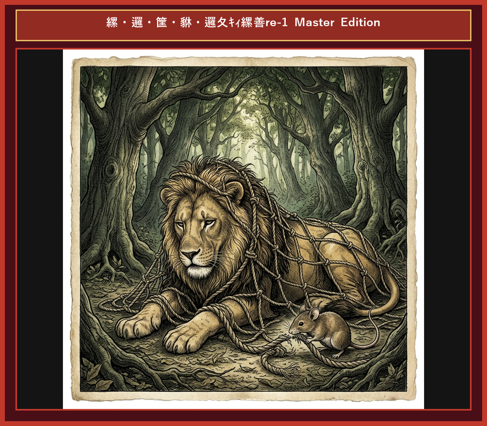

# Chapter 4: The Lion and the Mouse (ライオンとネズミ)

  

## 1. Benchmark Level: Eiken Grade 2 (英検2級レベル本文)
*Read in ~2.5 to 3 minutes. Academic discourse and formal vocabulary.*

A formidable lion, the undisputed monarch of the wilderness, was slumbering in a shaded sanctuary. His tranquility was abruptly shattered when a diminutive mouse inadvertently traversed his face. Provoked by the intrusion, the apex predator instantly pinned the fragile creature beneath his massive paw, intending to execute it summarily.

"I beseech your Majesty to exercise clemency!" implored the terrified rodent. "My transgression was purely accidental. Should you grant me amnesty, I pledge to render reciprocal assistance whenever you encounter adversity."

Skepticism and amusement swept over the lion at the absurd proposition that an insignificant creature possessed the capacity to aid a sovereign beast. Nonetheless, moved by a rare impulse of magnanimity, he unclasped his paw and granted the rodent its liberty.

Subsequently, while prowling through the woodland, the lion triggered a sophisticated snare constructed by big-game hunters. Bound securely within heavy cordage, his tremendous physical exertion proved futile, leaving him roaring in profound helplessness.

Recognizing the vocalization of distress, the mouse promptly navigated toward the source. Demonstrating remarkable ingenuity and perseverance, the rodent methodically severed the fibrous strands with its sharp incisors, ultimately liberating the trapped monarch.

No creature is so humble as to be devoid of utility; hence, acts of benevolence frequently yield unforeseen dividends in moments of acute crisis.

---

## 2. Target Level: Eiken Grade Pre-1 (英検準1級レベル本文)
*Read in ~3.5 to 4.5 minutes. Highly sophisticated literary and academic prose, complex inversion, advanced vocabulary, and nuanced rhetoric.*

A colossal lion, the unchallenged sovereign of the veldt, reposed within a secluded copse. This serene repose was rudely disrupted when an infinitesimal rodent inadvertently scurried across the apex predator's countenance. Incensed by this inadvertent sacrilege, the monarch immobilized the helpless organism beneath his formidable claw, poised to exterminate it without compunction.

"I implore your Sovereign Highness to extend magnanimous clemency!" supplicated the quaking rodent. "My inadvertent trespass bore no malice. Were you to accord me amnesty, I solemnize a vow to reciprocate with commensurate assistance in your hour of peril."

Derision and incredulity seized the monarch upon contemplating the preposterous thesis that a paltry rodent could ever succor an omnipotent carnivore. Nevertheless, impelled by a transient whim of regal magnanimity, he disengaged his grip and emancipated the captive.

In the fullness of time, while negotiating a dense thicket, the lion unwittingly activated an insidious trap devised by big-game poachers. Enmeshed within unyielding netting, his frantic physical exertion produced no mitigation, reducing the sovereign to vocalizing impotent fury.

Discerning the unmistakable reverberation of anguish, the rodent expeditiously gravitated to the site. Exercising astounding tenacity, the diminutive creature meticulously gnawed through the resilient cordage with razor-sharp incisors, thereby restoring the sovereign's autonomy.

No entity, regardless of its apparent insignificance, is wholly destitute of efficacy; consequently, altruistic benevolence routinely yields incalculable dividends during times of catastrophic vulnerability.

---

## 3. Classic Original English Text (イソップ寓話 クラシック原文)
*Townsend / Jacobs Edition (Public Domain)*

A Lion was awakened by a Mouse running over his face. Rising up angrily, he caught him and was about to kill him, when the Mouse piteously entreated, saying: "If you would only spare my life, I would be sure to repay your kindness." The Lion laughed and let him go. It happened shortly after this that the Lion was caught by some hunters, who bound him by strong ropes to the ground. The Mouse, recognizing his roar, came and gnawed the rope with his teeth, and set him free, exclaiming: "You ridiculed the idea of my ever being able to help you, not expecting to receive any repayment from me; now you know that it is possible for even a Mouse to confer a benefit on a Lion."

Little friends may prove great friends.

---

### 🏛️ 【英検2級レベルで読み解く！クラシック原文の重要構文・英文法ノート】
1. **1. 分詞構文（Participle Clause: 付帯状況・理由）**
   - **原文**: *"The Hare, believing her assertion to be simply impossible, agreed to the proposal..."*
   - **解説**: 「〜と信じ込んでいたので」という理由を表す分詞構文。英検2級の長文読解・ライティングの最頻出構文です。
1. **2. 古典的仮定法現在（Subjunctive Mood）**
   - **原文**: *"Though you be swift as the wind, I will beat you in a race."*
   - **解説**: 譲歩節 `Though` の中で原形 `be` を用いる古典的な仮定法現在（現代英語の `Though you are...`）。格調高い古典の響きを持ちます。
1. **3. 過去分詞の後置修飾（Postpositive Participle）**
   - **原文**: *"On the day appointed for the race the two started together."*
   - **解説**: `appointed`（定められた・指定された）が直前の名詞 `the day` を後ろから修飾する構文です。

### 📜 【クラシック原文の重要語彙・古風表現（Classic Antique Vocabulary）】
- **retort** [動] 2級 **（機転を利かせて）言い返す、反論する**（現代の reply sharp/wittily に相当）
- **assertion** [名] 2級/準1級 **主張、断言**（動詞 assert の名詞形。2級長文定番）
- **wayside** [名] 2級 **道端、沿道**（by the wayside（道端に、途中で））
- **fatigue** [名] 2級 **（心身の）極度の疲労、疲れ**（tiredness の上位フォーマル語）

---

## 4. Japanese Translation (日本語訳)

草原の絶対的支配者であるライオンが密林で休んでいたところ、極小のネズミが誤って顔の上を走り抜けたことで平穏が破られました。不敬に怒ったライオンは即座にネズミを捕らえ、容赦なく処分しようとしました。ネズミは「どうか寛大なる慈悲を！もし免罪を賜るなら、貴下が危急の折には必ず相応の助力でお報いします」と平伏しました。ライオンはネズミが自分を助けるというバカげた仮説に失笑しましたが、気まぐれな寛大さでネズミを解放しました。時が流れ、ライオンは密猟者の罠にかかり縄網に拘束されて絶望の咆哮を上げました。ネズミはその悲痛な響きを聞きつけ、鋭い前歯で縄を切断して王の自由を奪還しました。

**教訓**: いかなる存在も、その見た目の微小さに関わらず効力を完全に欠いてはいない。故に、利他的な善行は破滅的な危機において測り知れない恩恵を不可避的にもたらす。

---

## 5. Recite & Compare (そらんじたいキーフレーズ対比)
*Memorize these contrastive expressions to elevate speaking, writing, and reading fluency.*

  
■ 場面：絶対的王者の怒りと処分

  
【Grade 2 基礎】 <em>apex predator pinned fragile creature... execute summarily...</em>

  
【Pre-1 暗唱】 <strong><em>apex predator immobilized organism... poised to exterminate without compunction...</em></strong>

  
【ポイント】 <strong>解説・試験活用</strong>：`immobilize`（〜を動けなくする）、`exterminate`（〜を全滅・処分する）、`compunction`（罪悪感・躊躇）。準1級社会・生態系問題。

  
■ 場面：最高の慈悲の要求と返報の誓い

  
【Grade 2 基礎】 <em>exercise clemency... grant amnesty... pledge reciprocal assistance...</em>

  
【Pre-1 暗唱】 <strong><em>extend magnanimous clemency... accord amnesty... solemnize a vow to reciprocate...</em></strong>

  
【ポイント】 <strong>解説・試験活用</strong>：`magnanimous`（寛大な）、`solemnize a vow`（誓いを厳かに立てる）、`reciprocate`（報いる・報復/返礼する）。準1級・1級必須動詞。

  
■ 場面：罠による無力化

  
【Grade 2 基礎】 <em>triggered a snare... physical exertion proved futile...</em>

  
【Pre-1 暗唱】 <strong><em>unwittingly activated an insidious trap... produced no mitigation...</em></strong>

  
【ポイント】 <strong>解説・試験活用</strong>：`unwittingly`（知らず知らずのうちに）、`insidious`（潜行性の・狡猾な）、`mitigation`（軽減・緩和）。環境・医療・軍事の準1級語彙。

  
■ 場面：主権の奪還・自由の復元

  
【Grade 2 基礎】 <em>severed fibrous strands... liberating trapped monarch...</em>

  
【Pre-1 暗唱】 <strong><em>meticulously gnawed cordage... restoring sovereign's autonomy...</em></strong>

  
【ポイント】 <strong>解説・試験活用</strong>：`meticulously`（細心に・周到に）、`autonomy`（自治権・主主体性/自由）。準1級・1級政治・個人主義エッセイの決まり文句。

  
■ 場面：教訓（Moral）

  
【Grade 2 基礎】 <em>No creature is devoid of utility; benevolence yields dividends...</em>

  
【Pre-1 暗唱】 <strong><em>No entity is destitute of efficacy; altruistic benevolence yields incalculable dividends...</em></strong>

  
【ポイント】 <strong>解説・試験活用</strong>：`destitute of...`（〜に欠けている）、`efficacy`（有効性・効能）、`altruistic`（利他的な）、`incalculable`（推し量れない）。準1級・1級神表現。

---

## 6. Vocabulary Builder: 赤シート対応 重要単語・熟語チェック表
*※ 赤い透明シート（または赤フィルム）を重ねると、日本語訳が消えて自力テストができます。*

| No. | 見出し語 / イディオム | 品詞 / レベル | 日本語の意味（赤シートで消える） | 本文での使われ方・コロケーション |
|:---:|---|:---:|---|---|
| **01** | **majestic** | [形] 準2級 | 威厳のある、雄大な | *the majestic king of beasts* |
| **02** | **disturb** | [動] 3級 | 邪魔する、乱す | *disturbed his peaceful slumber* |
| **03** | **beg** | [動] 3級 | 懇願する、頼み込む | *begged desperately for mercy* |
| **04** | **spare** | [動] 準2級 | （命を）助ける、惜しむ | *spared the tiny creature's life* |
| **05** | **trap** | [動/名] 3級 | 罠にかける / 罠 | *trapped helplessly in a sturdy net* |
| **06** | **roar** | [動/名] 3級 | 咆哮する、大声で吠える | *roared in utter frustration* |
| **07** | **gnaw** | [動] 準2級/2級 | かじる、噛み切る | *gnawed through the thick rope* |
| **08** | **fiber** | [名] 準2級 | 繊維、ロープの紐 | *severed the binding fibers* |
| **09** | **gratitude** | [名] 2級 | 感謝の気持ち | *bowed in profound gratitude* |
| **10** | **insignificant** | [形] 2級/準1級 | 取るに足らない、ちっぽけな | *no friend is too insignificant to help* |
| **11** | **repay** | [動] 3級 | 恩返しする、返済する | *repay a noble act of kindness* |
| **12** | **compassion** | [名] 2級 | 慈悲、思いやり | *compassion yields unexpected rewards* |

### 【出題傾向・文法解説ノート】

### 【出題頻出語彙・熟語ノート】
- **compunction** [名] 罪悪感、悔恨（*without compunction* 「平気で・躊躇なく」）
- **magnanimous** [形] （敗者・弱者に対して）寛大な、気高い（名詞 *magnanimity*）
- **reciprocate** [動] 〜に報いる、返礼する（*reciprocate kindness/favors*）
- **insidious** [形] 陰湿な、知らぬ間に進行する（*insidious effect/disease*）
- **autonomy** [名] 自主性、自治権（*individual/regional autonomy*）
- **altruistic** [形] 利他的な、無私無欲の（対義語 *egoistic* 「利己的な」）
- **incalculable** [形] 計り知れない、無数の（*incalculable harm/benefit*）

### 【文法・構文ポイント】
1. **[Were you to + 動詞の原形...]（仮定法過去倒置：万一〜していただけるなら）**
   - 準1級本文: *"Were you to accord me amnesty, I solemnize a vow..."*
   - ポイント: `If you were to accord...` の `if` 省略倒置。条件交渉やビジネス上の丁寧な仮定を提示する際の最高級構文です。
2. **[No entity, regardless of ..., is wholly ...]（全否定と条件挿入構文）**
   - 準1級本文: *"No entity, regardless of its apparent insignificance, is wholly destitute of efficacy..."*
   - ポイント: 否定主語に `regardless of` を挿入した一般化構文。論文・エッセイで普遍的真理を断言する際に強烈な説得力を発揮します。
