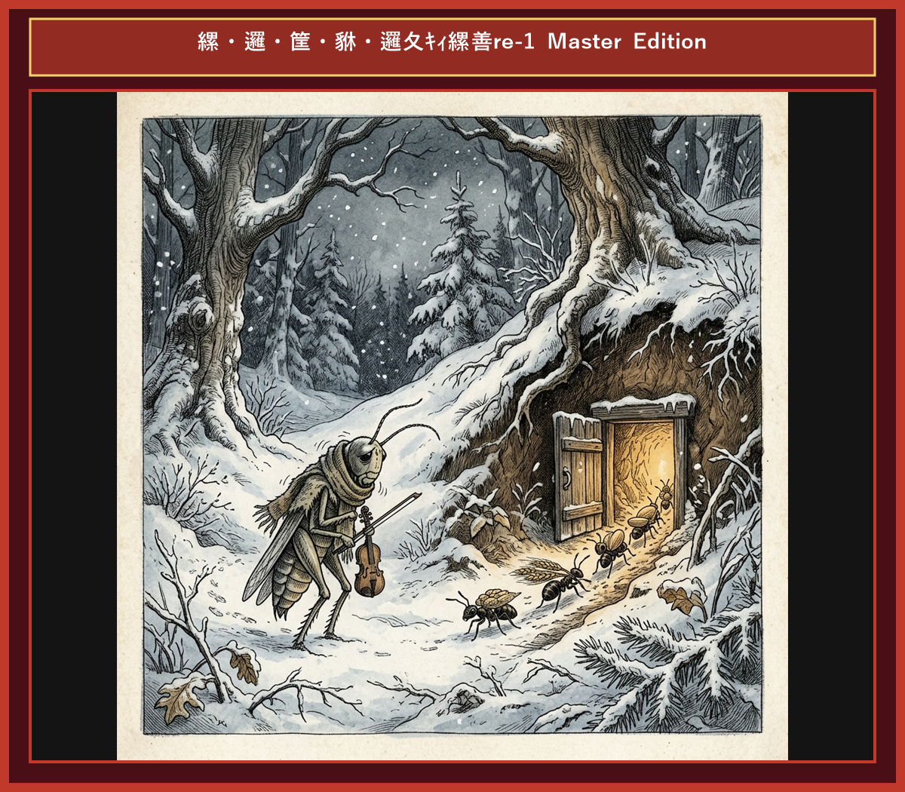

# Chapter 5: The Ant and the Grasshopper (アリとキリギリス)

  

## 1. Benchmark Level: Eiken Grade 2 (英検2級レベル本文)
*Read in ~2.5 to 3 minutes. Academic discourse and formal vocabulary.*

During the abundant summer months, an industrious colony of ants engaged in meticulous labor, transporting provisions to replenish their subterranean reserves in anticipation of winter's austerity. Each ant labored systematically, prioritizing long-term security over immediate gratification.

In stark contrast, an indolent grasshopper squandered the season in frivolous amusement, playing melodies and indulging in fleeting pleasures. Observing the ants' grueling exertions, the grasshopper derided their foresight. "Why dedicate these idyllic days to relentless toil?" he inquired dismissively. "Present abundance renders such arduous preparation entirely superfluous."

A pragmatic ant admonished him gravely, "We are systematically accumulating reserves to withstand the inevitable scarcity of winter. Prudence dictates that you likewise initiate preparations." Unmoved by this pragmatic counsel, the grasshopper persisted in his short-sighted hedonism.

With the onset of winter, frigid temperatures devastated the flora, shrouding the countryside in impenetrable snow. Lacking any provisions to sustain himself, the destitute grasshopper suffered severe deprivation. In extreme distress, he appealed to the ants' benevolence, supplicating for a fraction of their surplus grain.

The ant confronted the petitioner dispassionately. "How did you utilize your time during the season of abundance?"

"I devoted myself entirely to music and merriment," admitted the humbled grasshopper.

"Inasmuch as you sang throughout the summer," concluded the ant dispassionately, "it is appropriate that you dance through the winter." With that, the portal was decisively closed.

Provident foresight and disciplined perseverance shield against adversity, whereas reckless short-sightedness culminates in destitute vulnerability.

---

## 2. Target Level: Eiken Grade Pre-1 (英検準1級レベル本文)
*Read in ~3.5 to 4.5 minutes. Highly sophisticated literary and academic prose, complex inversion, advanced vocabulary, and nuanced rhetoric.*

Throughout the vernal season of bounty, an extraordinarily industrious ant commune executed systematic labor, stockpiling agrarian commodities to fortify their subterranean granaries against impending winter privations. Each individual operated with unremitting discipline, subordinating immediate sensory pleasure to long-term institutional survival.

Conversely, a hedonistic grasshopper dissipated the temperate months in ostentatious frivolity, orchestrating ephemeral harmonies while indulging in unbridled gratification. Surveying the ants' relentless endeavors, the grasshopper disparaged their strategic foresight. "Wherefore surrender these pristine days to excruciating labor?" he postulated derisively. "Existing plenitude obviates the necessity for such paranoid accumulation."

A sagacious ant proffered stern counsel: "We are methodically amassing sustenance to insulate ourselves against the inevitable ecological austerity of winter. Rational prudence mandates that you promptly emulate our methodology." Unswayed by this imperative admonition, the grasshopper persisted in his myopic extravagance.

Upon the inevitable arrival of winter, arctic blizzards decimated the vegetation, paralyzing the ecosystem under a blanket of frost. Bereft of reserves, the impoverished grasshopper experienced acute physiological collapse. Reduced to absolute destitution, he petitioned the ants' altruism, imploring a subsistence ration from their bountiful repository.

The ant scrutinized the mendicant with icy detachment. "Wherein lay your endeavors while abundance prevailed?"

"I consecrated my existence to artistic expression and melody," confessed the chastened grasshopper.

"Inasmuch as your summer was squandered in vocalization," decreed the ant with inexorable logic, "it is fitting that your winter be consumed in choreographic desperation." Whereupon, the barrier was immutably sealed.

Provident stewardship and disciplined frugality constitute an inviolable defense against catastrophe, whereas unbridled short-sightedness inevitably precipitates irreversible vulnerability.

---

## 3. Classic Original English Text (イソップ寓話 クラシック原文)
*Townsend / Jacobs Edition (Public Domain)*

In a field one summer's day a Grasshopper was hopping about, chirping and singing to its heart's content. An Ant passed by, bearing along with great toil an ear of corn he was taking to the nest. "Why not come and chat with me," said the Grasshopper, "instead of toiling and moiling in that way?" "I am helping to lay up food for the winter," said the Ant, "and recommend you to do the same." "Why bother about winter?" said the Grasshopper; "we have got plenty of food at present." But the Ant went on its way and continued its toil. When the winter came the Grasshopper had no food and found itself dying of hunger, while it saw the ants distributing everyday corn and grain from the stores they had collected in the summer. Then the Grasshopper knew:

It is best to prepare for the days of necessity.

---

### 🏛️ 【英検2級レベルで読み解く！クラシック原文の重要構文・英文法ノート】
1. **1. 分詞構文（Participle Clause: 付帯状況・理由）**
   - **原文**: *"The Hare, believing her assertion to be simply impossible, agreed to the proposal..."*
   - **解説**: 「〜と信じ込んでいたので」という理由を表す分詞構文。英検2級の長文読解・ライティングの最頻出構文です。
1. **2. 古典的仮定法現在（Subjunctive Mood）**
   - **原文**: *"Though you be swift as the wind, I will beat you in a race."*
   - **解説**: 譲歩節 `Though` の中で原形 `be` を用いる古典的な仮定法現在（現代英語の `Though you are...`）。格調高い古典の響きを持ちます。
1. **3. 過去分詞の後置修飾（Postpositive Participle）**
   - **原文**: *"On the day appointed for the race the two started together."*
   - **解説**: `appointed`（定められた・指定された）が直前の名詞 `the day` を後ろから修飾する構文です。

### 📜 【クラシック原文の重要語彙・古風表現（Classic Antique Vocabulary）】
- **retort** [動] 2級 **（機転を利かせて）言い返す、反論する**（現代の reply sharp/wittily に相当）
- **assertion** [名] 2級/準1級 **主張、断言**（動詞 assert の名詞形。2級長文定番）
- **wayside** [名] 2級 **道端、沿道**（by the wayside（道端に、途中で））
- **fatigue** [名] 2級 **（心身の）極度の疲労、疲れ**（tiredness の上位フォーマル語）

---

## 4. Japanese Translation (日本語訳)

豊穣の夏の期間中、勤勉なアリの集団は冬の窮乏に備えて地下の倉庫に穀物を蓄える規則正しい労働に従事していました。各々が目先の快楽を組織の長期的生存のために犠牲にしていました。一方、享楽的なキリギリスは過度な娯楽に季節を浪費し、アリの戦略的先見の明を「現在の豊富さは備蓄の必要性を排除する」と馬鹿にしました。賢明なアリは「合理的な慎重さは直ちに備蓄することを要求する」と告げましたが、キリギリスは近視眼的な贅沢に固執しました。厳冬が訪れ生態系が麻痺すると、蓄えのないキリギリスは極度の困窮に陥り、アリの利他主義に分け前を哀願しました。アリは「夏を歌に浪費したのなら、冬は舞踏で過ごすがよい」と断絶しました。

**教訓**: 先見の明ある管理と規律ある節倹は災厄に対する不可侵の防御を構築するが、抑えの効かない近視眼性は不可逆的な破滅を招く。

---

## 5. Recite & Compare (そらんじたいキーフレーズ対比)
*Memorize these contrastive expressions to elevate speaking, writing, and reading fluency.*

  
■ 場面：計画的蓄えと即時快楽の犠牲

  
【Grade 2 基礎】 <em>stockpiling provisions... prioritizing long-term security over immediate gratification...</em>

  
【Pre-1 暗唱】 <strong><em>subordinating immediate sensory pleasure to long-term institutional survival...</em></strong>

  
【ポイント】 <strong>解説・試験活用</strong>：`subordinate A to B`（AをBに従属させる・後回しにする）、`institutional survival`（組織的生存）。準1級・1級の経営・政治・環境論文構文。

  
■ 場面：準備の不要論の主張

  
【Grade 2 基礎】 <em>abundance renders arduous preparation superfluous...</em>

  
【Pre-1 暗唱】 <strong><em>Existing plenitude obviates the necessity for such paranoid accumulation...</em></strong>

  
【ポイント】 <strong>解説・試験活用</strong>：`plenitude`（豊富・充足）、`obviate`（〜の必要性を排除する・不要にする）。準1級要約・長文読解最頻出の高度動詞。

  
■ 場面：賢明な忠告と近視眼的浪費

  
【Grade 2 基礎】 <em>Prudence dictates preparations... persisted in short-sighted hedonism...</em>

  
【Pre-1 暗唱】 <strong><em>Rational prudence mandates emulation... persisted in myopic extravagance...</em></strong>

  
【ポイント】 <strong>解説・試験活用</strong>：`rational prudence`（合理的慎重さ）、`emulate`（〜を見習う・真似る）、`myopic`（近視眼的な・短慮な）。準1級・1級社会批評語彙。

  
■ 場面：絶対的困窮と乞願

  
【Grade 2 基礎】 <em>destitute grasshopper suffered... supplicating for surplus grain...</em>

  
【Pre-1 暗唱】 <strong><em>Reduced to absolute destitution, petitioned altruism, imploring subsistence ration...</em></strong>

  
【ポイント】 <strong>解説・試験活用</strong>：`destitution`（極貧・困窮）、`subsistence ration`（生存に必要な最低限の糧食）。経済・難民問題の準1級重要語。

  
■ 場面：教訓（Moral）

  
【Grade 2 基礎】 <em>Provident foresight shields against adversity... short-sightedness culminates in vulnerability...</em>

  
【Pre-1 暗唱】 <strong><em>Provident stewardship constitutes an inviolable defense; short-sightedness precipitates irreversible vulnerability...</em></strong>

  
【ポイント】 <strong>解説・試験活用</strong>：`stewardship`（先見的管理・執事職）、`inviolable`（不可侵の・破られない）、`precipitate`（〜を引き起こす）、`irreversible`（不可逆な）。準1級神構文。

---

## 6. Vocabulary Builder: 赤シート対応 重要単語・熟語チェック表
*※ 赤い透明シート（または赤フィルム）を重ねると、日本語訳が消えて自力テストができます。*

| No. | 見出し語 / イディオム | 品詞 / レベル | 日本語の意味（赤シートで消える） | 本文での使われ方・コロケーション |
|:---:|---|:---:|---|---|
| **01** | **diligent** | [形] 準2級/2級 | 勤勉な、真面目な | *diligent worker ants* |
| **02** | **grain** | [名] 3級 | 穀物、穀類の粒 | *gathered ripe grains of wheat* |
| **03** | **toil** | [動/名] 2級/準1級 | 骨折って働く / 苦労 | *toiled tirelessly under the hot sun* |
| **04** | **carefree** | [形] 準2級 | 気ままな、呑気な | *a carefree and merry grasshopper* |
| **05** | **mock** | [動] 準2級/2級 | 嘲笑する、馬鹿にする | *mocked their unceasing labor* |
| **06** | **harsh** | [形] 準2級 | 厳しい、過酷な | *the arrival of a harsh winter* |
| **07** | **starve** | [動] 3級/準2級 | 飢える、飢え死にする | *found himself starving in the snow* |
| **08** | **shelter** | [名] 3級 | 避難所、住処 | *knocked at the cozy anthill shelter* |
| **09** | **provision** | [名] 2級 | 備蓄、食料の蓄え | *ample provisions for the cold season* |
| **10** | **improvident** | [形] 準1級 | 将来への備えがない、不謹慎な | *scolded his improvident behavior* |
| **11** | **forethought** | [名] 2級/準1級 | 先見の明、事前の配慮 | *forethought secures future comfort* |
| **12** | **perish** | [動] 2級/準1級 | 滅びる、枯れる、死ぬ | *perish without preparation* |

### 【出題傾向・文法解説ノート】

### 【出題頻出語彙・熟語ノート】
- **subordinate** [動] 〜を後回しにする、従属させる（*subordinate personal desires to duty*）
- **obviate** [動] （リスク・必要性など）を排除する、不要にする（*obviate the need for A*）
- **emulate** [動] 〜を見習う、模範にして競う（*emulate success/leaders*）
- **myopic** [形] 近視眼的な、先の見えない（名詞 *myopia*）
- **subsistence** [名] 自給自足、最低限の生存（*subsistence level/farming*）
- **stewardship** [名] 責任ある管理、保護（*environmental stewardship*）
- **inviolable** [形] 冒してはならない、不可侵の（*inviolable rights/defense*）

### 【文法・構文ポイント】
1. **[Wherefore + 動詞 + 主語...]（疑問副詞：何故〜するのか）**
   - 準1級本文: *"Wherefore surrender these pristine days to excruciating labor?"*
   - ポイント: `Why` の格調高い古典・文語表現。論文や演説の問いかけ（修辞的疑問句）で鮮烈な印象を与えます。
2. **[Constitutes an inviolable defense against ...]（〜に対する堅固な防御を構築する）**
   - 準1級本文: *"Provident stewardship and disciplined frugality constitute an inviolable defense..."*
   - ポイント: `is a good defense` の圧倒的にフォーマルな書き換え。英検準1級・1級の環境保護・個人資産防衛エッセイにそのまま活用可能です。
