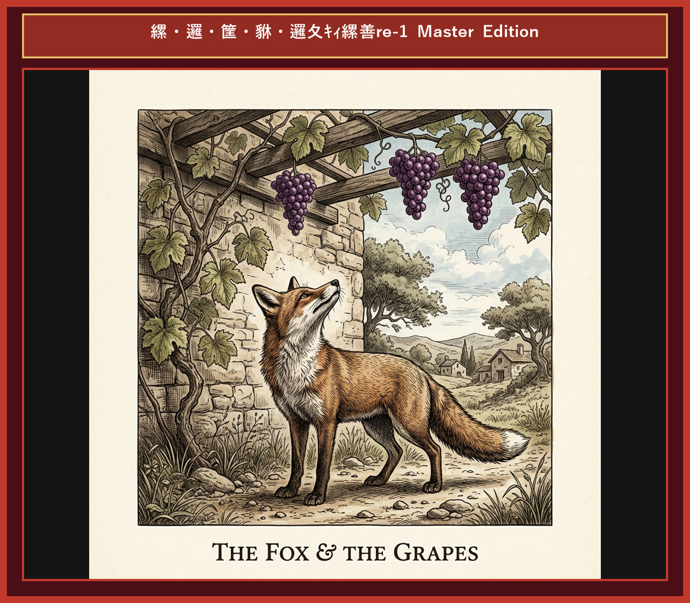

# Chapter 6: The Fox and the Grapes (キツネとブドウ)

  

## 1. Benchmark Level: Eiken Grade 2 (英検2級レベル本文)
*Read in ~2.5 to 3 minutes. Academic discourse and formal vocabulary.*

On an oppressively humid summer afternoon, a famished fox traversed a sun-drenched vineyard in pursuit of sustenance. Suddenly, his gaze was arrested by an exquisite cluster of ripe, succulent grapes suspended from a high trellis. The lustrous purple fruit presented a tantalizing spectacle that immediately stimulated his appetite.

"That magnificent fruit will undoubtedly alleviate my dehydration," the fox reasoned, mesmerized by the prospect of gratification.

Gathering momentum, he executed a powerful vertical leap, yet failed to diminish the distance separating him from the reward. Refusing to concede defeat, he retreated a short distance, accelerated rapidly, and launched himself into the air once more. Nevertheless, the grapes remained suspended far beyond his physical reach.

Persisting in his fruitless endeavors, the fox executed numerous frantic attempts, exhausting his physical reserves without achieving the slightest progress. Eventually, recognizing the insurmountable nature of the obstacle, he abandoned his quest with calculated indifference.

Attempting to conceal his humiliation under a facade of disdain, the fox walked away, remarking aloud, "Upon closer inspection, those grapes are manifestly unpalatable and green. Consuming them would merely induce gastric discomfort."

Human nature frequently resort to psychological rationalization, disparaging unattainable objectives to preserve self-esteem in the face of failure.

---

## 2. Target Level: Eiken Grade Pre-1 (英検準1級レベル本文)
*Read in ~3.5 to 4.5 minutes. Highly sophisticated literary and academic prose, complex inversion, advanced vocabulary, and nuanced rhetoric.*

Amid the torrid intensity of a midsummer afternoon, a ravenous vulpine prowled through an opulent vineyard seeking caloric sustenance. Without warning, his optic focus converged upon an opulent cluster of translucent grapes suspended from an elevated arbor. The luminescent purple spheres presented a tantalizing aesthetic that instantly ignited his carnivorous desire.

"That celestial nectar shall forthwith extinguish my acute dehydration," the vulpine postulated, spellbound by the illusion of imminent satiety.

Generating kinetic momentum, he executed an athletic leap, yet failed to bridge the spatial interval partitioning him from the prize. Repudiating instantaneous failure, he withdrew several paces, accelerated with maximum velocity, and vaulted skyward anew. Notwithstanding his strenuous exertion, the fruit remained tantalizingly beyond his anatomical reach.

Perspervering in these redundant exertions, the vulpine conducted repeated futile ascents, completely depleting his muscular energy without mitigating the spatial disparity. Ultimately comprehending the absolute impossibility of the endeavor, he relinquished the enterprise with an air of artificial disdain.

Endeavoring to obfuscate his profound humiliation beneath a veneer of aristocratic contempt, the vulpine departed, pronouncing loudly: "A rigorous scrutiny reveals that those berries are palpably astringent and unripe. Their ingestion would inevitably precipitate severe gastrointestinal distress."

Confronted by insurmountable defeat, human cognition compulsively invokes psychological rationalization, denigrating unachievable imperatives to safeguard vulnerable ego-integrity.

---

## 3. Classic Original English Text (イソップ寓話 クラシック原文)
*Townsend / Jacobs Edition (Public Domain)*

One hot summer's day a Fox was strolling through an orchard till he came to a bunch of Grapes just ripening on a vine which had been trained over a lofty branch. "Just the thing to quench my thirst," quoth he. Drawing back a few paces, he took a run and a jump, and just missed the bunch. Turning round again with a One, Two, Three, he jumped up, but with no greater success. Again and again he tried after the tempting morsel, but at last had to give it up, and walked away with his nose in the air, saying: "I am sure they are sour."

It is easy to despise what you cannot get.

---

### 🏛️ 【英検2級レベルで読み解く！クラシック原文の重要構文・英文法ノート】
1. **1. 分詞構文（Participle Clause: 付帯状況・理由）**
   - **原文**: *"The Hare, believing her assertion to be simply impossible, agreed to the proposal..."*
   - **解説**: 「〜と信じ込んでいたので」という理由を表す分詞構文。英検2級の長文読解・ライティングの最頻出構文です。
1. **2. 古典的仮定法現在（Subjunctive Mood）**
   - **原文**: *"Though you be swift as the wind, I will beat you in a race."*
   - **解説**: 譲歩節 `Though` の中で原形 `be` を用いる古典的な仮定法現在（現代英語の `Though you are...`）。格調高い古典の響きを持ちます。
1. **3. 過去分詞の後置修飾（Postpositive Participle）**
   - **原文**: *"On the day appointed for the race the two started together."*
   - **解説**: `appointed`（定められた・指定された）が直前の名詞 `the day` を後ろから修飾する構文です。

### 📜 【クラシック原文の重要語彙・古風表現（Classic Antique Vocabulary）】
- **retort** [動] 2級 **（機転を利かせて）言い返す、反論する**（現代の reply sharp/wittily に相当）
- **assertion** [名] 2級/準1級 **主張、断言**（動詞 assert の名詞形。2級長文定番）
- **wayside** [名] 2級 **道端、沿道**（by the wayside（道端に、途中で））
- **fatigue** [名] 2級 **（心身の）極度の疲労、疲れ**（tiredness の上位フォーマル語）

---

## 4. Japanese Translation (日本語訳)

真夏の猛暑の中、極度に空腹なキツネがブドウ園を彷徨っていたところ、高い棚に吊るされた見事なブドウの房に目を奪われました。キツネは喉の渇きを癒そうと跳躍を繰り返しましたが、距離を詰めることはできませんでした。過酷な全力を尽くしたものの目標が到達不可能であると悟ると、キツネは計算された軽蔑のフリをして「よく見ればあのブドウは酸っぱくて不味い。食べれば腹痛を起こすだけだ」と強がりを言って立ち去りました。

**教訓**: 不可避の失敗に直面した際、人間の認知は心理的合理化を強制的に呼び起こし、達成不能な目標を貶める（負け惜しみを言う）ことで傷つきやすい自己の自尊心を防衛する。

---

## 5. Recite & Compare (そらんじたいキーフレーズ対比)
*Memorize these contrastive expressions to elevate speaking, writing, and reading fluency.*

  
■ 場面：酷暑と食糧の探索

  
【Grade 2 基礎】 <em>famished fox traversed sun-drenched vineyard...</em>

  
【Pre-1 暗唱】 <strong><em>ravenous vulpine prowled through an opulent vineyard...</em></strong>

  
【ポイント】 <strong>解説・試験活用</strong>：`vulpine`（キツネの・狡猾な人物）、`prowl`（〜を徘徊する・探しまわる）。準1級・1級小説・生物学文章。

  
■ 場面：助走と空しい跳躍

  
【Grade 2 基礎】 <em>Gathering momentum, executed vertical leap... failed to diminish distance...</em>

  
【Pre-1 暗唱】 <strong><em>Generating kinetic momentum, vaulted skyward... failed to bridge spatial interval...</em></strong>

  
【ポイント】 <strong>解説・試験活用</strong>：`kinetic momentum`（運動学的運動量）、`vault`（跳躍する）、`bridge spatial interval`（空間的隔たりを埋める）。準1級科学物理文章。

  
■ 場面：恥の覆い隠しと軽蔑のフリ

  
【Grade 2 基礎】 <em>conceal humiliation under a facade of disdain...</em>

  
【Pre-1 暗唱】 <strong><em>obfuscate profound humiliation beneath a veneer of contempt...</em></strong>

  
【ポイント】 <strong>解説・試験活用</strong>：`obfuscate`（〜を難解にする・覆い隠す）、`veneer`（表面の飾り・フリ）。準1級・1級心理学・政治学最最重要動詞。

  
■ 場面：酸っぱい葡萄の言い訳

  
【Grade 2 基礎】 <em>manifestly unpalatable... induce gastric discomfort...</em>

  
【Pre-1 暗唱】 <strong><em>palpably astringent... precipitate gastrointestinal distress...</em></strong>

  
【ポイント】 <strong>解説・試験活用</strong>：`palpably`（明白に・触れるほど）、`astringent`（渋い・過酷な）、`gastrointestinal`（胃腸の）。準1級医療・自然科学。

  
■ 場面：教訓（Moral）

  
【Grade 2 基礎】 <em>resort to psychological rationalization, disparaging unattainable objectives...</em>

  
【Pre-1 暗唱】 <strong><em>cognition compulsively invokes rationalization, denigrating unachievable imperatives...</em></strong>

  
【ポイント】 <strong>解説・試験活用</strong>：`cognition`（認知機能）、`compulsively`（強制的に・強迫観念から）、`invoke`（〜を発動する）、`denigrate`（〜を誹謗中傷する・貶める）。準1級・1級心理学エッセイの神フレーズ。

---

## 6. Vocabulary Builder: 赤シート対応 重要単語・熟語チェック表
*※ 赤い透明シート（または赤フィルム）を重ねると、日本語訳が消えて自力テストができます。*

| No. | 見出し語 / イディオム | 品詞 / レベル | 日本語の意味（赤シートで消える） | 本文での使われ方・コロケーション |
|:---:|---|:---:|---|---|
| **01** | **proud** | [形] 4級 | 誇り高い、傲慢な | *a proud hare (自惚れたウサギ)* |
| **02** | **boast (about...)** | [動] 3級 | 〜を自慢する、誇る | *was always boasting about his speed* |
| **03** | **make fun of...** | [熟] 3級 | 〜をからかう、嘲笑する | *making fun of a slow tortoise* |
| **04** | **challenge** | [名/動] 3級 | 挑戦、課題 / 挑む | *I accept your challenge.* |
| **05** | **accept** | [動] 3級 | 受け入れる、受諾する | *accept the proposal (提案を受諾する)* |
| **06** | **dash** | [動] 3級 | 勢いよく走る、突進する | *dashed forward (前方へ駆け出した)* |
| **07** | **leave ~ behind** | [熟] 3級 | 〜を置き去りにする | *left the tortoise far behind* |
| **08** | **visible** | [形] 準2級 | 目に見える、視認できる | *was barely visible in the distance* |
| **09** | **catch up (with...)** | [熟] 3級 | 〜に追いつく | *before he catches up* |
| **10** | **slumber** | [名/動] 準2級 | 深い眠り / 眠る | *fell into a profound slumber* |
| **11** | **sprint** | [動] 3級 | 全力疾走する | *sprinted toward the finish line* |
| **12** | **persistence** | [名] 準2級/2級 | 粘り強さ、不屈の継続 | *persistence and hard work will bring success* |

### 【出題傾向・文法解説ノート】

### 【出題頻出語彙・熟語ノート】
- **vulpine** [形/名] キツネの、狐のような、狡猾な者
- **obfuscate** [動] 〜を不鮮明にする、複雑化して隠す（*obfuscate the truth/facts*）
- **veneer** [名] 表面の飾り、虚飾、うわべ（*veneer of politeness/contempt*）
- **palpably** [副] 手に取るように明白に、露骨に（形容詞 *palpable*）
- **astringent** [形] （味が）渋い、味のきつい（*astringent taste/criticism*）
- **cognition** [名] 認知、認識能力（形容詞 *cognitive* 「認知の」）
- **denigrate** [動] 〜を貶める、不当に悪く言う（*denigrate others' achievements*）

### 【文法・構文ポイント】
1. **[Endeavoring to ...]（現在分詞構文：〜しようと試みて）**
   - 準1級本文: *"Endeavoring to obfuscate his profound humiliation beneath a veneer..."*
   - ポイント: `Trying to...` の極めてフォーマルな文語表現。行為の目的や内面的動機を文頭で提示する洗練された構文です。
2. **[Confronted by ..., human cognition compulsively ...]（受動分詞構文）**
   - 準1級本文: *"Confronted by insurmountable defeat, human cognition compulsively..."*
   - ポイント: 人間心理や一般行動パターンを説明する学術論文の典型フレーズ。英検準1級要約や自由英作文で非常に高い評価を獲得します。
