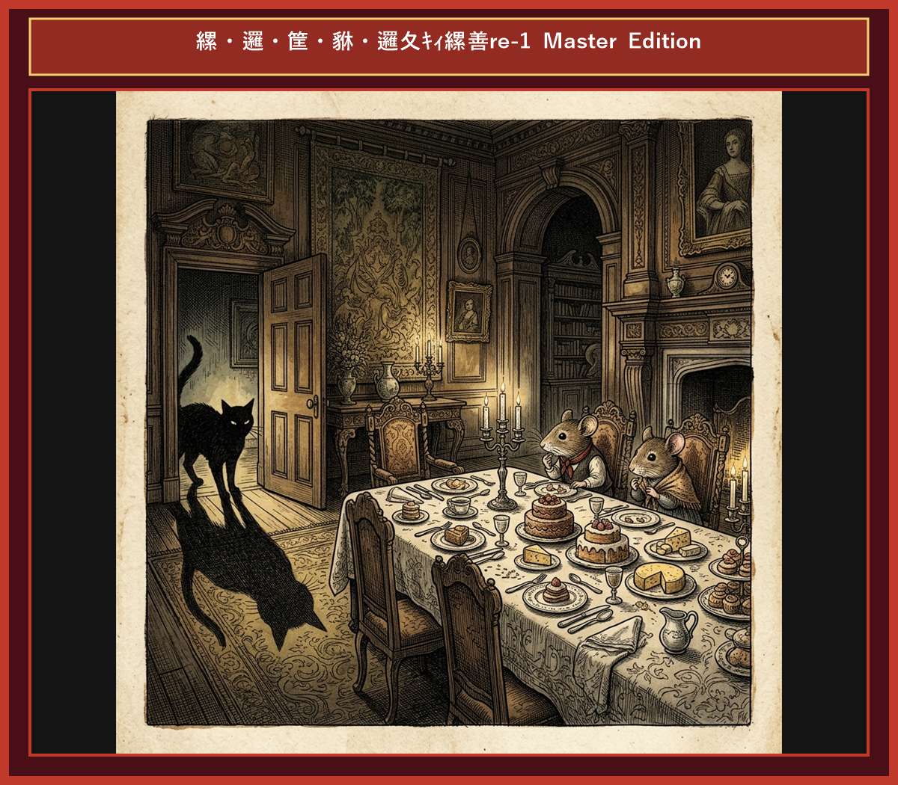

# Chapter 7: The Town Mouse and the Country Mouse (田舎のネズミと街のネズミ)

  

## 1. Benchmark Level: Eiken Grade 2 (英検2級レベル本文)
*Read in ~2.5 to 3 minutes. Academic discourse and formal vocabulary.*

A rural rodent maintained a frugal yet tranquil existence within a secluded agrarian habitat. On one occasion, he extended hospitality to his urban cousin, welcoming him to his unpretentious burrow. The host presented a modest fare comprising rustic roots, wild berries, and unrefined grains.

Sampling the coarse sustenance with visible distaste, the urban visitor voiced his disdain. "My esteemed relative," he remarked condescendingly, "your lifestyle is defined by unnecessary austerity. In the metropolis, I habitually partake of opulent banquets. I urge you to accompany me to the urban center to taste genuine affluence."

Enticed by visions of sensory indulgence, the rural rodent acquiesced to the invitation. Upon arriving at an opulent metropolitan mansion under cover of darkness, the host escorted his guest to a dining hall overflowing with gourmet delicacies, including imported cheeses and exquisite confections.

However, precisely as the guest prepared to sample the extravagant feast, the sanctuary was abruptly breached. Two menacing hounds stormed the chamber, their ferocious barking echoing off the marble walls. Panic-stricken, the rodents scrambled into a precarious crevice to evade imminent destruction.

Once tranquility was restored, the rural rodent promptly announced his intention to return to his homeland. "While your environment offers unparalleled luxury, it is inextricably bound to perpetual jeopardy. I firmly elect a modest existence safeguarded by serenity over perilous opulence."

A humble lifestyle accompanied by peace and security is immeasurably superior to luxurious affluence burdened by perpetual anxiety and mortal hazard.

---

## 2. Target Level: Eiken Grade Pre-1 (英検準1級レベル本文)
*Read in ~3.5 to 4.5 minutes. Highly sophisticated literary and academic prose, complex inversion, advanced vocabulary, and nuanced rhetoric.*

A pastoral rodent maintained an austere yet serene existence within a sequestered agricultural sanctuary. On a particular occasion, he proffered hospitality to his cosmopolitan kinsman, receiving him into his unostentatious subterranean domicile. The host proffered a rudimentary repast consisting of uncultivated tubers, indigenous berries, and unprocessed cereals.

Partaking of this primitive nourishment with unabashed aversion, the cosmopolitan guest articulated profound condescension. "My cherished kinsman," he declared patronizingly, "your existence is characterized by unmitigated deprivation. Within the metropolis, I habitually revel in opulent culinary extravaganzas. I implore you to migrate with me to the urban epicenter to experience authentic prosperity."

Beguiled by prospects of hedonistic gratification, the pastoral rodent acceded to the proposition. Under the cloak of nocturnal obscurity, they penetrated a lavish metropolitan estate, where the host conducted his guest to a banqueting hall laden with epicurean delicacies.

Nevertheless, at the exact juncture when the visitor prepared to partake of the sumptuous banquet, the domestic sanctuary was violently compromised. Two formidable canine predators invaded the precinct, their guttural growls reverberating throughout the marble rotunda. Terror-stricken, the rodents executed a chaotic retreat into a subterranean fissure to avert impending annihilation.

Upon the restoration of equilibrium, the pastoral rodent unequivocally declared his immediate repatriation. "Notwithstanding the undeniable grandeur of your urban paradise, it is inextricably tethered to chronic peril. I unhesitatingly prioritize an unpretentious existence anchored in tranquility over a perilous affluence fraught with mortality."

An unpretentious lifestyle fortified by tranquility and physical security is infinitely preferable to ostentatious affluence inextricably encumbered by perpetual trepidation and existential threat.

---

## 3. Classic Original English Text (イソップ寓話 クラシック原文)
*Townsend / Jacobs Edition (Public Domain)*

A Country Mouse invited a Town Mouse, an old friend, to pay him a visit, and exercise old hospitality in his country nest. The Town Mouse accepted the invitation; but he soon found that his host had nothing to offer except barley and wheat. "Do you know," said he, "that you live the life of the ants? Now, I have abundance of all things; come with me and you shall share in them." So the two set off for the town. The Town Mouse took his friend to the larder of a rich man's house, where there were sweetmeats and jellies, pastry, delicious cheeses, and fruits. But just as they were beginning to eat, the door opened and someone came in. The two Mice ran off and hid themselves in a narrow corner. When all was quiet again, they ventured out; but someone else came in, and they had to run back again. At this the Country Mouse said: "I am off. You have plenty to eat, but your life is full of dangerous surprises; my food is simple, but I can eat it in peace."

Better beans and bacon in peace than cakes and ale in fear.

---

### 🏛️ 【英検2級レベルで読み解く！クラシック原文の重要構文・英文法ノート】
1. **1. 分詞構文（Participle Clause: 付帯状況・理由）**
   - **原文**: *"The Hare, believing her assertion to be simply impossible, agreed to the proposal..."*
   - **解説**: 「〜と信じ込んでいたので」という理由を表す分詞構文。英検2級の長文読解・ライティングの最頻出構文です。
1. **2. 古典的仮定法現在（Subjunctive Mood）**
   - **原文**: *"Though you be swift as the wind, I will beat you in a race."*
   - **解説**: 譲歩節 `Though` の中で原形 `be` を用いる古典的な仮定法現在（現代英語の `Though you are...`）。格調高い古典の響きを持ちます。
1. **3. 過去分詞の後置修飾（Postpositive Participle）**
   - **原文**: *"On the day appointed for the race the two started together."*
   - **解説**: `appointed`（定められた・指定された）が直前の名詞 `the day` を後ろから修飾する構文です。

### 📜 【クラシック原文の重要語彙・古風表現（Classic Antique Vocabulary）】
- **retort** [動] 2級 **（機転を利かせて）言い返す、反論する**（現代の reply sharp/wittily に相当）
- **assertion** [名] 2級/準1級 **主張、断言**（動詞 assert の名詞形。2級長文定番）
- **wayside** [名] 2級 **道端、沿道**（by the wayside（道端に、途中で））
- **fatigue** [名] 2級 **（心身の）極度の疲労、疲れ**（tiredness の上位フォーマル語）

---

## 4. Japanese Translation (日本語訳)

田舎のネズミが静かな農村の穴拠で質素ながら平穏な生活を送っていました。ある時、都会の親戚を招いて木の実や穀物をもてなしましたが、都会の客は「君の生活は貧困そのものだ。都会の豪華な饗宴に来なさい」と見下しました。贅沢の魅力に惹かれて都会の邸宅へ同行した田舎のネズミでしたが、豪華なごちそうを食べようとした瞬間、恐ろしい猛犬が乱入して全滅の危機に直面しました。危機が去ると田舎のネズミは帰郷を宣言しました。「どんなに豪華でも絶え間ない危険と隣り合わせの生活は拒否する。私は平和に守られた質素な生活を選ぶ」

**教訓**: 静寂と身の安全によって強固に守られた質素な生活スタイルは、絶え間ない恐怖と存在論的脅威に不可避的に苛まれる誇示的な富裕よりも、無限に望ましい。

---

## 5. Recite & Compare (そらんじたいキーフレーズ対比)
*Memorize these contrastive expressions to elevate speaking, writing, and reading fluency.*

  
■ 場面：質素な田舎の住まいとおもてなし

  
【Grade 2 基礎】 <em>frugal yet tranquil existence... unpretentious burrow...</em>

  
【Pre-1 暗唱】 <strong><em>austere yet serene existence... unostentatious subterranean domicile...</em></strong>

  
【ポイント】 <strong>解説・試験活用</strong>：`austere`（厳格な・質素な）、`domicile`（住居・本拠地）。準1級社会・住環境課題の語彙。

  
■ 場面：都会の贅沢への勧誘

  
【Grade 2 基礎】 <em>Enticed by sensory indulgence, acquiesced to the invitation...</em>

  
【Pre-1 暗唱】 <strong><em>Beguiled by prospects of hedonistic gratification, acceded to proposition...</em></strong>

  
【ポイント】 <strong>解説・試験活用</strong>：`beguile`（〜を惑わす・手玉に取る）、`accede to`（〜に同意する・受諾する）。準1級歴史・外交文章。

  
■ 場面：平穏の暴力的な破壊

  
【Grade 2 基礎】 <em>sanctuary was abruptly breached... menacing hounds...</em>

  
【Pre-1 暗唱】 <strong><em>sanctuary was violently compromised... guttural growls reverberating...</em></strong>

  
【ポイント】 <strong>解説・試験活用</strong>：`compromise`（〜を損なう・脅かす）、`guttural`（喉の奥からの・ダミ声の）。準1級小説・国際情勢。

  
■ 場面：絶え間ない危険との結合

  
【Grade 2 基礎】 <em>inextricably bound to perpetual jeopardy... elect modest existence...</em>

  
【Pre-1 暗唱】 <strong><em>inextricably tethered to chronic peril... prioritize unpretentious existence...</em></strong>

  
【ポイント】 <strong>解説・試験活用</strong>：`tethered to...`（〜につながれている・拘束されている）、`chronic peril`（慢性的な危険）。環境・都市問題エッセイ。

  
■ 場面：教訓（Moral）

  
【Grade 2 基礎】 <em>humble lifestyle accompanied by security is immeasurably superior to affluence...</em>

  
【Pre-1 暗唱】 <strong><em>unpretentious lifestyle fortified by tranquility is infinitely preferable to ostentatious affluence...</em></strong>

  
【ポイント】 <strong>解説・試験活用</strong>：`fortify`（〜を強化する・守る）、`infinitely preferable to...`（〜より無限に好ましい）、`encumber`（〜に負担をかける）。準1級・1級神フレーズ。

---

## 6. Vocabulary Builder: 赤シート対応 重要単語・熟語チェック表
*※ 赤い透明シート（または赤フィルム）を重ねると、日本語訳が消えて自力テストができます。*

| No. | 見出し語 / イディオム | 品詞 / レベル | 日本語の意味（赤シートで消える） | 本文での使われ方・コロケーション |
|:---:|---|:---:|---|---|
| **01** | **proud** | [形] 4級 | 誇り高い、傲慢な | *a proud hare (自惚れたウサギ)* |
| **02** | **boast (about...)** | [動] 3級 | 〜を自慢する、誇る | *was always boasting about his speed* |
| **03** | **make fun of...** | [熟] 3級 | 〜をからかう、嘲笑する | *making fun of a slow tortoise* |
| **04** | **challenge** | [名/動] 3級 | 挑戦、課題 / 挑む | *I accept your challenge.* |
| **05** | **accept** | [動] 3級 | 受け入れる、受諾する | *accept the proposal (提案を受諾する)* |
| **06** | **dash** | [動] 3級 | 勢いよく走る、突進する | *dashed forward (前方へ駆け出した)* |
| **07** | **leave ~ behind** | [熟] 3級 | 〜を置き去りにする | *left the tortoise far behind* |
| **08** | **visible** | [形] 準2級 | 目に見える、視認できる | *was barely visible in the distance* |
| **09** | **catch up (with...)** | [熟] 3級 | 〜に追いつく | *before he catches up* |
| **10** | **slumber** | [名/動] 準2級 | 深い眠り / 眠る | *fell into a profound slumber* |
| **11** | **sprint** | [動] 3級 | 全力疾走する | *sprinted toward the finish line* |
| **12** | **persistence** | [名] 準2級/2級 | 粘り強さ、不屈の継続 | *persistence and hard work will bring success* |

### 【出題傾向・文法解説ノート】

### 【出題頻出語彙・熟語ノート】
- **austere** [形] 厳格な、質素な（名詞 *austerity*）
- **domicile** [名] 住居、本拠地（*establish a domicile*）
- **beguile** [動] 〜を惑わす、騙す（*beguiled by sweet words*）
- **accede** [動] （要求・提案に）応じる、同意する（*accede to a request*）
- **tether** [動] 〜を繋ぎ止める、拘束する（*tethered to traditional rules*）
- **infinitely** [副] 無限に、遥かに（*infinitely superior/better*）
- **encumber** [動] 〜に邪魔・負担をかける（*encumbered by heavy debt*）

### 【文法・构文ポイント】
1. **[Under the cloak of nocturnal obscurity]（夜陰に乗じて）**
   - 準1級本文: *"Under the cloak of nocturnal obscurity, they penetrated a lavish estate..."*
   - ポイント: 秘密裏に・夜間に移動することを示す文学的かつ格式の高い前置句。物語や歴史問題の背景描写で効果的です。
2. **[infinitely preferable to ...]（〜よりも無限に望ましい）**
   - 準1級本文: *"unpretentious lifestyle is infinitely preferable to ostentatious affluence..."*
   - ポイント: `far better than` の最高級アカデミック表現。英検準1級・1級の比較エッセイの結論部分で強力な論理的裏付けとなります。
