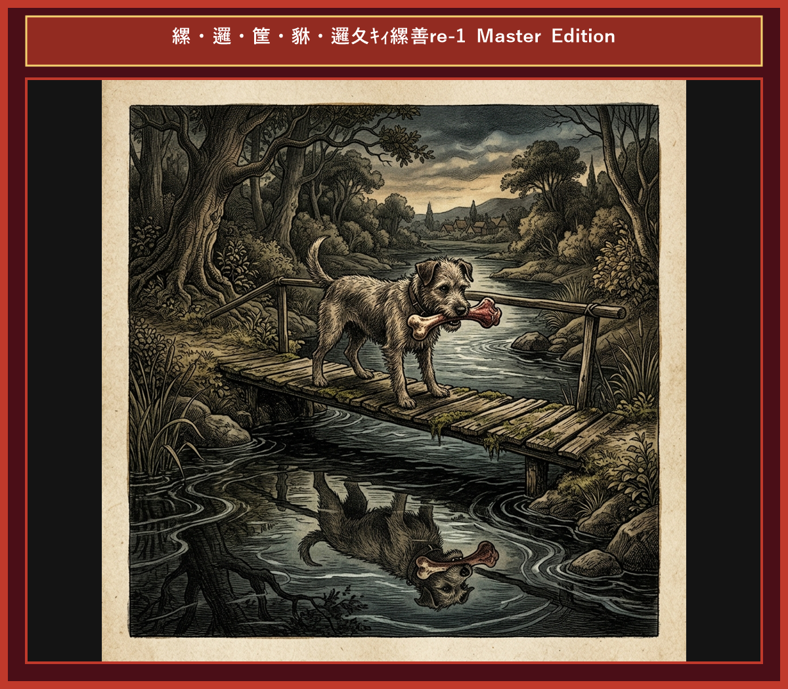

# Chapter 9: The Dog and His Shadow (欲張りな犬)

  

## 1. Benchmark Level: Eiken Grade 2 (英検2級レベル本文)
*Read in ~2.5 to 3 minutes. Academic discourse and formal vocabulary.*

A fortunate canine was returning home, clutching a choice cut of meat acquired from a local butcher. Elated by his good fortune, he anticipated savoring his prize in solitary comfort.

His route mandated traversing a narrow wooden bridge spanning a tranquil stream. Pausing mid-crossing, he peered into the transparent water and observed his own optical reflection. Misinterpreting this aquatic image as a formidable competitor carrying an item of superior magnitude, the covetous canine was instantly overcome by insatiable avarice.

"I shall expropriate that additional prize," the canine resolved foolishly, driven by an unbridled impulse to maximize his acquisition.

Compelled by greed to usurp what he perceived as a rival's asset, the canine snapped his jaws aggressively, emitting a loud bark to intimidate the image.

Inevitably, the instant his mouth unclasped, his actual prize dislodged and plunged into the current below. The swift waters instantly swept the meat beyond recovery. The canine remained stranded on the structure, contemplating the permanent loss of his tangible asset, confronted only by the mockery of his own hollow reflection.

Insatiable greed for illusory phantoms routinely precipitates the forfeiture of tangible reality.

---

## 2. Target Level: Eiken Grade Pre-1 (英検準1級レベル本文)
*Read in ~3.5 to 4.5 minutes. Highly sophisticated literary and academic prose, complex inversion, advanced vocabulary, and nuanced rhetoric.*

A privileged canine was journeying homeward, carrying a prime portion of meat procured from a purveyor. Transported by euphoric self-congratulation, he envisioned consuming his prize in unmolested solitude.

His itinerary necessitated negotiating a precarious footbridge bridging a pristine rivulet. Halting midway, his gaze penetrated the crystalline mirror of the water, discerning his own optical manifestation. Confounding this aquatic mirage with an antagonist possessing a prize of far greater dimension, the rapacious canine was compulsively overwhelmed by unappeasable cupidity.

"I am impelled to appropriate that superior commodity," the canine postulated foolishly, capitulating to an irrational obsession with maximum accumulation.

Dictated by predatory instincts to usurp what he erroneously designated as a competitor's possession, he unclasped his mandibles to unleash a menacing growl intended to subjugate the phantom.

Predictably, the moment his jaws opened, his authentic treasure disengaged and plummeted into the torrential current beneath. The turbulent waters irrevocably swept the asset into oblivion. The canine lingered upon the structure, mournfully meditating upon the absolute forfeiture of his concrete asset, mocked solely by the empty insubstantiality of his own image.

Unbridled cupidity for intangible mirages inexorably precipitates the total devastation of verifiable substance.

---

## 3. Classic Original English Text (イソップ寓話 クラシック原文)
*Townsend / Jacobs Edition (Public Domain)*

A Dog, crossing a bridge over a stream with a piece of flesh in his mouth, saw his own shadow in the water, and took it for that of another Dog, with a piece of meat double the size of his own. He immediately let go of his own, and fiercely attacked the other Dog to get his larger piece from him. He thus lost both: that which he grasped at in the water, because it was a shadow; and his own, because the stream swept it away.

Beware lest you lose the substance by grasping at the shadow.

---

### 🏛️ 【英検2級レベルで読み解く！クラシック原文の重要構文・英文法ノート】
1. **1. 分詞構文（Participle Clause: 付帯状況・理由）**
   - **原文**: *"The Hare, believing her assertion to be simply impossible, agreed to the proposal..."*
   - **解説**: 「〜と信じ込んでいたので」という理由を表す分詞構文。英検2級の長文読解・ライティングの最頻出構文です。
1. **2. 古典的仮定法現在（Subjunctive Mood）**
   - **原文**: *"Though you be swift as the wind, I will beat you in a race."*
   - **解説**: 譲歩節 `Though` の中で原形 `be` を用いる古典的な仮定法現在（現代英語の `Though you are...`）。格調高い古典の響きを持ちます。
1. **3. 過去分詞の後置修飾（Postpositive Participle）**
   - **原文**: *"On the day appointed for the race the two started together."*
   - **解説**: `appointed`（定められた・指定された）が直前の名詞 `the day` を後ろから修飾する構文です。

### 📜 【クラシック原文の重要語彙・古風表現（Classic Antique Vocabulary）】
- **retort** [動] 2級 **（機転を利かせて）言い返す、反論する**（現代の reply sharp/wittily に相当）
- **assertion** [名] 2級/準1級 **主張、断言**（動詞 assert の名詞形。2級長文定番）
- **wayside** [名] 2級 **道端、沿道**（by the wayside（道端に、途中で））
- **fatigue** [名] 2級 **（心身の）極度の疲労、疲れ**（tiredness の上位フォーマル語）

---

## 4. Japanese Translation (日本語訳)

幸運な犬が極上の肉を銜えて川の橋を渡っていたところ、水面に映る自分の鏡像を目にしました。それを自分より大きな獲物を持つライバルと誤認した強欲な犬は、抑えがたい貪欲さに支配され、相手の肉を強奪しようと口を開けて威嚇しました。しかし口を開けた瞬間、本物の肉は水底へと沈み、流れに呑み込まれました。虚無の影を追うことで、犬は自らの実質的な有形資産を不可逆的に喪失することとなったのです。

**教訓**: 実体のない幻影（幻）に対する制御不能な強欲は、手の中にあった検証可能な現実の実体（確実な価値）を不可避的に破滅させる。

---

## 5. Recite & Compare (そらんじたいキーフレーズ対比)
*Memorize these contrastive expressions to elevate speaking, writing, and reading fluency.*

  
■ 場面：入手した価値ある肉と幸福感

  
【Grade 2 基礎】 <em>choice cut of meat... Elated by good fortune...</em>

  
【Pre-1 暗唱】 <strong><em>prime portion of meat procured... Transported by euphoric self-congratulation...</em></strong>

  
【ポイント】 <strong>解説・試験活用</strong>：`procure`（〜を調達する・入手する）、`euphoric`（幸福感に溢れた）。準1級・1級問題語彙。

  
■ 場面：強欲と幻想への執着

  
【Grade 2 基礎】 <em>overcome by insatiable avarice... expropriate additional prize...</em>

  
【Pre-1 暗唱】 <strong><em>overwhelmed by unappeasable cupidity... impelled to appropriate...</em></strong>

  
【ポイント】 <strong>解説・試験活用</strong>：`unappeasable`（満たされない・なだめられない）、`cupidity`（強欲・どん欲）、`appropriate`（〜を私有・領置する）。準1級・1級上位語。

  
■ 場面：相手の服従を狙う威嚇

  
【Grade 2 基礎】 <em>snapped jaws aggressively to intimidate...</em>

  
【Pre-1 暗唱】 <strong><em>unclasped mandibles to unleash growl intended to subjugate phantom...</em></strong>

  
【ポイント】 <strong>解説・試験活用</strong>：`mandibles`（顎・くちばし）、`subjugate`（〜を服従させる・征服する）。準1級歴史・政治文章。

  
■ 場面：不可逆な喪失と忘却

  
【Grade 2 基礎】 <em>plunged into current... permanent loss of tangible asset...</em>

  
【Pre-1 暗唱】 <strong><em>plummeted into current... asset swept into oblivion...</em></strong>

  
【ポイント】 <strong>解説・試験活用</strong>：`plummet`（急落する・没落する）、`oblivion`（忘却・虚無）。準1級要約・長文頻出。

  
■ 場面：教訓（Moral）

  
【Grade 2 基礎】 <em>Greed for illusory phantoms precipitates forfeiture of tangible reality...</em>

  
【Pre-1 暗唱】 <strong><em>Unbridled cupidity for intangible mirages inexorably precipitates devastation of verifiable substance...</em></strong>

  
【ポイント】 <strong>解説・試験活用</strong>：`mirage`（蜃気楼・幻影）、`verifiable substance`（検証可能な実体）。準1級・1級金融・バブル経済・人間心理エッセイ最高構文。

---

## 6. Vocabulary Builder: 赤シート対応 重要単語・熟語チェック表
*※ 赤い透明シート（または赤フィルム）を重ねると、日本語訳が消えて自力テストができます。*

| No. | 見出し語 / イディオム | 品詞 / レベル | 日本語の意味（赤シートで消える） | 本文での使われ方・コロケーション |
|:---:|---|:---:|---|---|
| **01** | **proud** | [形] 4級 | 誇り高い、傲慢な | *a proud hare (自惚れたウサギ)* |
| **02** | **boast (about...)** | [動] 3級 | 〜を自慢する、誇る | *was always boasting about his speed* |
| **03** | **make fun of...** | [熟] 3級 | 〜をからかう、嘲笑する | *making fun of a slow tortoise* |
| **04** | **challenge** | [名/動] 3級 | 挑戦、課題 / 挑む | *I accept your challenge.* |
| **05** | **accept** | [動] 3級 | 受け入れる、受諾する | *accept the proposal (提案を受諾する)* |
| **06** | **dash** | [動] 3級 | 勢いよく走る、突進する | *dashed forward (前方へ駆け出した)* |
| **07** | **leave ~ behind** | [熟] 3級 | 〜を置き去りにする | *left the tortoise far behind* |
| **08** | **visible** | [形] 準2級 | 目に見える、視認できる | *was barely visible in the distance* |
| **09** | **catch up (with...)** | [熟] 3級 | 〜に追いつく | *before he catches up* |
| **10** | **slumber** | [名/動] 準2級 | 深い眠り / 眠る | *fell into a profound slumber* |
| **11** | **sprint** | [動] 3級 | 全力疾走する | *sprinted toward the finish line* |
| **12** | **persistence** | [名] 準2級/2級 | 粘り強さ、不屈の継続 | *persistence and hard work will bring success* |

### 【出題傾向・文法解説ノート】

### 【出題頻出語彙・熟語ノート】
- **procure** [動] 〜を努力して調達する、手に入れる（*procure materials/funds*）
- **euphoric** [形] 幸福感に満ちた、絶頂の（名詞 *euphoria*）
- **cupidity** [名] 強欲、金銭欲（*unappeasable cupidity*）
- **appropriate** [動] 〜を不正に自分のものにする、領置する（名詞 *appropriation*）
- **subjugate** [動] 〜を服従させる、鎮圧する（*subjugate nations/peoples*）
- **oblivion** [名] 忘却、消滅状態（*fall into oblivion* 「忘れ去られる」）
- **mirage** [名] 蜃気楼、幻影、はかない望み（*chase a mirage*）

### 【文法・構文ポイント】
1. **[Transported by ...]（過去分詞構文：〜に感情を奪われて）**
   - 準1級本文: *"Transported by euphoric self-congratulation, he envisioned..."*
   - ポイント: 強い感情（歓喜・怒り・恐怖など）に捉われた人物状態を表現するアカデミックな分詞構文です。
2. **[swept into oblivion]（忘却・消滅の彼方へ押し流される）**
   - 準1級本文: *"The turbulent waters irrevocably swept the asset into oblivion."*
   - ポイント: 価値ある物や記憶が完全に消滅することを表す決まり文句。準1級読解の歴史・文化消滅文脈で頻出します。
