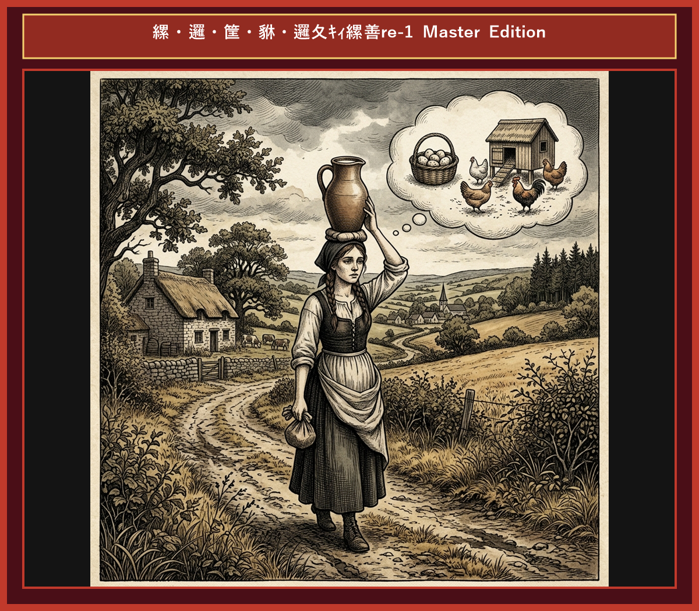

# Chapter 10: The Milkmaid and Her Pail (ミルク搾りの娘)

  

## 1. Benchmark Level: Eiken Grade 2 (英検2級レベル本文)
*Read in ~2.5 to 3 minutes. Academic discourse and formal vocabulary.*

A young dairy maid was returning from the pasture, balancing a vessel filled to capacity with fresh milk atop her head. As she traversed the rural pathway, she succumbed to grandiose financial projections, mentally reinvesting the anticipated proceeds of her commodity.

"Disposing of this milk at the regional market will generate substantial capital," she reasoned strategically. "I shall allocate those funds toward the acquisition of hundreds of eggs. Allowing for natural mortality, the venture will yield a formidable flock of poultry."

Her speculative calculations rapidly expanded. "Once these birds reach maturity, I shall liquidate them during peak demand, securing a lucrative return. This capital will enable the purchase of exquisite attire suitable for the forthcoming municipal gala."

Immersed in her vision of social elevation, she imagined herself as the centerpiece of admiration. "Every suitor will vie for my favor, yet I shall haughtily reject their advances with a disdainful gesture of my head."

Enraptured by this imaginary scenario, she impulsively executed the physical movement in reality. Consequently, the vessel lost its equilibrium, plunging to the earth and saturating the soil with her entire liquid asset.

Distraught by the sudden calamity, she wept for her evaporated wealth, recognizing that her elaborate scheme had dissolved into nothingness.

Premature speculation on unverified outcomes frequently precipitates catastrophic disillusionment; never count your chickens before they hatch.

---

## 2. Target Level: Eiken Grade Pre-1 (英検準1級レベル本文)
*Read in ~3.5 to 4.5 minutes. Highly sophisticated literary and academic prose, complex inversion, advanced vocabulary, and nuanced rhetoric.*

An ambitious agrarian maiden was navigating a rural thoroughfare, bearing a receptacle filled to the brim with unpasteurized milk upon her crown. During her solitary transit, she succumbed to extravagant financial extrapolations, pre-emptively allocating the hypothetical revenue generated by her agricultural asset.

"Monetizing this dairy volume at the central emporium will yield significant liquid capital," she calculated meticulously. "I propose to invest these funds in the procurement of avian ova. Factorizing expected attrition, the enterprise will materialize in a substantial avian flock."

Her speculative projections proliferated exponentially. "Subsequent to their maturation, I shall liquidate the livestock during a period of peak market demand, capturing a exorbitant dividend. This capital shall facilitate the acquisition of haute couture for the upcoming aristocratic assembly."

Obsessed with this mirage of socio-economic ascendance, she pictured herself the cynosure of all eyes. "Numrous suitors will vie for my patronage, yet I shall contemptuously spurn their overtures with a supercilious toss of my head."

Engulfed by this vivid hallucination, she unwittingly mimicked the physical motion in actuality. Whereupon, the receptacle forfeited its equilibrium, descending precipitously to saturate the terrain with her entire liquid capital.

Profoundly traumatized by this instantaneous debacle, she lamented the annihilation of her illusory fortune, acknowledging that her elaborate construct had collapsed into absolute nullity.

Premature speculation predicated upon unverified hypotheses inevitably induces catastrophic disillusionment; never count your chickens prior to their incubation.

---

## 3. Classic Original English Text (イソップ寓話 クラシック原文)
*Townsend / Jacobs Edition (Public Domain)*

A Patty the Milkmaid was going to the market carrying her milk in a Pail on her head. As she went along she began calculating what she would do with the money she would get for the milk. "I'll buy some fowls from Farmer Brown," said she, "and they will lay eggs each morning, which I will sell to the parson's wife. With the money that I get from the sale of these eggs I'll buy myself a new gown and a new hat; and when I go to the market, won't all the young men come up and speak to me! Polly Shaw will be that jealous, but I don't care. I shall just toss my head and say no to them." As she thought of this, she tossed her head back; the Pail fell off her head, and all the milk was spilt. So she had to go home and tell her mother what had occurred.

"Ah, my child," said the mother, "do not count your chickens before they are hatched."

---

### 🏛️ 【英検2級レベルで読み解く！クラシック原文の重要構文・英文法ノート】
1. **1. 分詞構文（Participle Clause: 付帯状況・理由）**
   - **原文**: *"The Hare, believing her assertion to be simply impossible, agreed to the proposal..."*
   - **解説**: 「〜と信じ込んでいたので」という理由を表す分詞構文。英検2級の長文読解・ライティングの最頻出構文です。
1. **2. 古典的仮定法現在（Subjunctive Mood）**
   - **原文**: *"Though you be swift as the wind, I will beat you in a race."*
   - **解説**: 譲歩節 `Though` の中で原形 `be` を用いる古典的な仮定法現在（現代英語の `Though you are...`）。格調高い古典の響きを持ちます。
1. **3. 過去分詞の後置修飾（Postpositive Participle）**
   - **原文**: *"On the day appointed for the race the two started together."*
   - **解説**: `appointed`（定められた・指定された）が直前の名詞 `the day` を後ろから修飾する構文です。

### 📜 【クラシック原文の重要語彙・古風表現（Classic Antique Vocabulary）】
- **retort** [動] 2級 **（機転を利かせて）言い返す、反論する**（現代の reply sharp/wittily に相当）
- **assertion** [名] 2級/準1級 **主張、断言**（動詞 assert の名詞形。2級長文定番）
- **wayside** [名] 2級 **道端、沿道**（by the wayside（道端に、途中で））
- **fatigue** [名] 2級 **（心身の）極度の疲労、疲れ**（tiredness の上位フォーマル語）

---

## 4. Japanese Translation (日本語訳)

牛乳絞りの娘が頭にミルクの入ったバケツを載せて歩きながら、仮定の売上を投資して卵や家畜を購入し、ピーク時に売却して高級ドレスを手に入れるという膨大な財務の皮算用に没頭していました。自身の社会的地位向上を妄想し、言い寄る男たちを頭を振って拒絶する仕草をうっかり現実で行ってしまった瞬間、バケツは落ちて割れ、全資産が地面にこぼれ落ちました。彼女は仮初めの富の消滅を涙して嘆きました。

**教訓**: 未検証の仮説に基づく早まった投機（皮算用）は、不可避的に壊滅的な幻滅を引き起こす。孵化（検証）の前にヒヨコを数えてはならない。

---

## 5. Recite & Compare (そらんじたいキーフレーズ対比)
*Memorize these contrastive expressions to elevate speaking, writing, and reading fluency.*

  
■ 場面：不確定な将来収益の計算・投機

  
【Grade 2 基礎】 <em>grandiose financial projections... mentally reinvesting proceeds...</em>

  
【Pre-1 暗唱】 <strong><em>extravagant financial extrapolations... pre-emptively allocating hypothetical revenue...</em></strong>

  
【ポイント】 <strong>解説・試験活用</strong>：`extrapolation`（外挿・推測）、`pre-emptively`（先回りして・事前に）、`hypothetical revenue`（仮定の収益）。準1級・1級金融・株式課題。

  
■ 場面：資産の清算と莫大な利益

  
【Grade 2 基礎】 <em>liquidate them during peak demand, securing lucrative return...</em>

  
【Pre-1 暗唱】 <strong><em>liquidate livestock during peak demand, capturing an exorbitant dividend...</em></strong>

  
【ポイント】 <strong>解説・試験活用</strong>：`exorbitant`（法外な・莫大な）、`dividend`（配当金・配当利益）。準1級経済文章。

  
■ 場面：求婚者の拒絶と社会的傲慢

  
【Grade 2 基礎】 <em>suitors vie for favor... reject with disdainful gesture...</em>

  
【Pre-1 暗唱】 <strong><em>suitors vie for patronage... spurn overtures with supercilious toss...</em></strong>

  
【ポイント】 <strong>解説・試験活用</strong>：`spurn`（〜を冷酷に拒絶する・一蹴する）、`overture`（申し出・打診）。準1級・1級小説・歴史。

  
■ 場面：一瞬での壊滅と崩壊

  
【Grade 2 基礎】 <em>distraught by calamity... scheme dissolved into nothingness...</em>

  
【Pre-1 暗唱】 <strong><em>traumatized by debacle... construct collapsed into absolute nullity...</em></strong>

  
【ポイント】 <strong>解説・試験活用</strong>：`debacle`（壊滅・大敗）、`nullity`（無効・無）。準1級・1級政治・事業失敗の描写。

  
■ 場面：教訓（Moral）

  
【Grade 2 基礎】 <em>Premature speculation on unverified outcomes precipitates disillusionment...</em>

  
【Pre-1 暗唱】 <strong><em>Premature speculation predicated upon unverified hypotheses induces catastrophic disillusionment...</em></strong>

  
【ポイント】 <strong>解説・試験活用</strong>：`predicated upon...`（〜に根拠を置いた）、`unverified hypotheses`（未検証の仮説）、`catastrophic disillusionment`（壊滅的幻滅）。準1級・1級論文の真骨頂。

---

## 6. Vocabulary Builder: 赤シート対応 重要単語・熟語チェック表
*※ 赤い透明シート（または赤フィルム）を重ねると、日本語訳が消えて自力テストができます。*

| No. | 見出し語 / イディオム | 品詞 / レベル | 日本語の意味（赤シートで消える） | 本文での使われ方・コロケーション |
|:---:|---|:---:|---|---|
| **01** | **proud** | [形] 4級 | 誇り高い、傲慢な | *a proud hare (自惚れたウサギ)* |
| **02** | **boast (about...)** | [動] 3級 | 〜を自慢する、誇る | *was always boasting about his speed* |
| **03** | **make fun of...** | [熟] 3級 | 〜をからかう、嘲笑する | *making fun of a slow tortoise* |
| **04** | **challenge** | [名/動] 3級 | 挑戦、課題 / 挑む | *I accept your challenge.* |
| **05** | **accept** | [動] 3級 | 受け入れる、受諾する | *accept the proposal (提案を受諾する)* |
| **06** | **dash** | [動] 3級 | 勢いよく走る、突進する | *dashed forward (前方へ駆け出した)* |
| **07** | **leave ~ behind** | [熟] 3級 | 〜を置き去りにする | *left the tortoise far behind* |
| **08** | **visible** | [形] 準2級 | 目に見える、視認できる | *was barely visible in the distance* |
| **09** | **catch up (with...)** | [熟] 3級 | 〜に追いつく | *before he catches up* |
| **10** | **slumber** | [名/動] 準2級 | 深い眠り / 眠る | *fell into a profound slumber* |
| **11** | **sprint** | [動] 3級 | 全力疾走する | *sprinted toward the finish line* |
| **12** | **persistence** | [名] 準2級/2級 | 粘り強さ、不屈の継続 | *persistence and hard work will bring success* |

### 【出題傾向・文法解説ノート】

### 【出題頻出語彙・熟語ノート】
- **extrapolation** [名] 外挿、推測（*extrapolation from data*）
- **exorbitant** [形] （価格・利益が）法外な、桁外れの（*exorbitant price/dividend*）
- **spurn** [動] 〜を冷たく拒絶する、蹴飛ばす（*spurn an offer/overture*）
- **overture** [名] 提案、交渉の打診（*make peace overtures*）
- **debacle** [名] 潰走、大失敗、壊滅（*financial/political debacle*）
- **nullity** [名] 無効、無、価値のないもの（*collapsed into nullity*）
- **predicated** [形] 〜に基づいた、〜を前提とした（*predicated on fact*）

### 【文法・構文ポイント】
1. **[Subsequent to ...]（〜に続いて、〜の後に）**
   - 準1級本文: *"Subsequent to their maturation, I shall liquidate the livestock..."*
   - ポイント: `after` の最もフォーマルなビジネス・学術接続表現。英検準1級・1級の順序説明で多用されます。
2. **[Predicated upon unverified hypotheses]（未検証の仮説に基づく）**
   - 準1級本文: *"Premature speculation predicated upon unverified hypotheses..."*
   - ポイント: 科学的・論理的根拠の欠如を指摘する際の最高級フレーズ。英検ライティングで批評的思考を展開する際の最強の武器になります。
