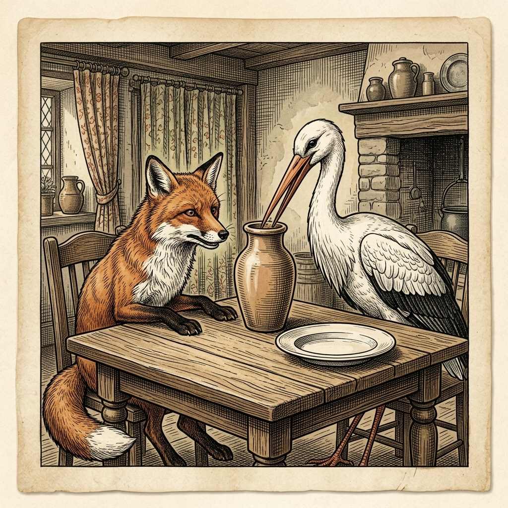

# Chapter 14: The Fox and the Stork (キツネとツル)

  

## 1. Benchmark Level: Eiken Grade 2 (英検2級レベル本文)
*Read in ~2.5 to 3 minutes. Academic discourse, complex participial structures, and formal vocabulary.*

In the realm of animal diplomacy, a notoriously manipulative fox engaged in a superficial alliance with an austere stork, preserving a facade of social harmony that concealed deep-seated psychological antagonism. Seeking to assert intellectual superiority through interpersonal humiliation, the vulpine host orchestrated a banquet at his subterranean domicile, framing the event as a celebration of mutual rapport.

Upon the guest's punctual arrival, the host unveiled an aromatic gastronomic concoction decanted exclusively across broad, low-rimmed ceramic salvers. This deliberate aesthetic configuration was calibrated to exploit anatomical divergence: while the host's expansive oral anatomy facilitated effortless ingestion, the stork's rigid, elongated rostrum proved structurally incompatible with horizontal liquid planes. Repeated attempts to harvest the broth merely wetted the avian bill, leaving the visitor in a state of acute caloric deprivation. Masking sadistic amusement behind disingenuous hospitality, the fox articulated mock sympathy, attributing her involuntary abstinence to culinary fastidiousness.

Repressing instinctive indignation in favor of strategic retaliation, the stork preserved an attitude of unblemished equanimity. Prior to concluding the visitation, she formally reciprocated the gesture, extending an invitation for an evening banquet at her arboreal residence on the subsequent evening.

Drawn by the prospect of unearned indulgence, the expectant fox arrived at the designated hour, anticipating lavish culinary hospitality. To his acute discomfiture, the meal had been decanted into towering, narrow-necked amphorae characterized by constricted apertures. With elegant mechanical precision, the avian hostess introduced her slender beak deep into the vessel's vertical interior, extracting succulent provisions with total autonomy. In stark contrast, the fox's cranial anatomy presented an insurmountable geometric impediment; unable to penetrate the aperture, the guest was reduced to fruitlessly licking microscopic residue from the external ceramic perimeter.

Thoroughly discomfited and physically depleted, the schemer executed a humiliating retreat, compelled to recognize that his pedagogical humiliation had been reciprocated with mathematical symmetry.

Authentic interpersonal ethics necessitate empathetic accommodation of diverse physiological and contextual realities, whereas institutionalizing malicious exclusion invites retaliatory retribution of identical proportion.

---

## 2. Target Level: Eiken Grade Pre-1 (英検準1級レベル本文)
*Read in ~3.5 to 4.5 minutes. Highly sophisticated literary and academic prose, complex inversion, advanced vocabulary, and nuanced rhetoric.*

In the realm of interspecies social interaction, an inveterately devious vulpine maintained a hollow diplomatic entente with a dignified wading bird. Concealing profound intellectual hubris behind an exterior of ceremonial civility, the fox orchestrated a banquet at his burrow, conceiving the gathering not as an authentic communion of hospitality, but as a calculated staging ground for subtle psychological subjugation.

Upon the guest's arrival, the host presented a delicately infused broth decanted exclusively across flat, horizontal earthenware platters. This deliberate presentation was maliciously engineered to leverage anatomical disparity: whereas the fox's wide oral cavity facilitated rapid, uninhibited consumption via lateral lingual motion, the stork's elongated, narrow rostrum proved structurally unsuited for shallow, planar surfaces. Every effort to harvest the liquid resulted in futile clicks of her beak against the ceramic surface, condemning the dignitary to involuntary starvation. Masking malevolent satisfaction behind a facade of solicitous etiquette, the vulpine host lamented her apparent lack of appetite, disingenuously attributing her abstinence to overrefined culinary fastidiousness.

Subordinating spontaneous resentment to strategic forbearance, the stork exhibited impenetrable composure. Before concluding the diplomatic protocol, she reciprocated the engagement, formally inviting the fox to an evening repast at her lakeside sanctuary the following day.

Seduced by the anticipation of gratuitous culinary pleasure, the fox presented himself with punctual self-satisfaction. To his profound chagrin, the meal was served within towering, cylindrical vessels possessing constricted apertures and elongated necks. With effortless mechanical precision, the avian hostess lowered her slender bill into the vertical conduit, savoring the rich sustenance contained within. Conversely, the fox's broader facial anatomy encountered an impenetrable physical barrier; incapable of inserting even his snout beyond the aperture, the famished schemer was relegated to licking minuscule traces of condensation from the external glaze.

Physically depleted and socially humiliated, the defeated prankster slunk away into the shadows, forced to acknowledge that his calculated exclusion had been neutralized and reflected back upon him with rigorous mathematical symmetry.

Authentic ethical reciprocity demands an empathetic accommodation of divergent perspectives and physical constraints; those who deliberately engineer mechanisms of discriminatory humiliation will inevitably find themselves ensnared by the precise structural barriers they pioneered.

---

## 3. Classic Original English Text (イソップ寓話 クラシック原文)
*Townsend / Jacobs Edition (Public Domain)*

At one time the Fox and the Stork seemed to be on very good terms and invited each other to dinner. First the Fox invited the Stork, and served nothing but soup in a very shallow dish. The Fox lapped it up with ease, but the Stork could only wet the end of her long bill in it, and left the meal as hungry as when she came. "I am sorry," said the Fox, "that the soup is not to your liking." The Stork thanked him and invited him to dine with her in return. When the Fox arrived, the Stork served the meal in a tall jar with a narrow neck. The Stork easily inserted her long bill and enjoyed the food, while the Fox could only lick the outside of the jar.

One bad turn deserves another.

---

### 🏛️ 【英検2級レベルで読み解く！クラシック原文の重要構文・英文法ノート】
1. **1. 分詞構文（Participle Clause: 付帯状況・理由）**
   - **原文**: *"The Hare, believing her assertion to be simply impossible, agreed to the proposal..."*
   - **解説**: 「〜と信じ込んでいたので」という理由を表す分詞構文。英検2級の長文読解・ライティングの最頻出構文です。
1. **2. 古典的仮定法現在（Subjunctive Mood）**
   - **原文**: *"Though you be swift as the wind, I will beat you in a race."*
   - **解説**: 譲歩節 `Though` の中で原形 `be` を用いる古典的な仮定法現在（現代英語の `Though you are...`）。格調高い古典の響きを持ちます。
1. **3. 過去分詞の後置修飾（Postpositive Participle）**
   - **原文**: *"On the day appointed for the race the two started together."*
   - **解説**: `appointed`（定められた・指定された）が直前の名詞 `the day` を後ろから修飾する構文です。

### 📜 【クラシック原文の重要語彙・古風表現（Classic Antique Vocabulary）】
- **retort** [動] 2級 **（機転を利かせて）言い返す、反論する**（現代の reply sharp/wittily に相当）
- **assertion** [名] 2級/準1級 **主張、断言**（動詞 assert の名詞形。2級長文定番）
- **wayside** [名] 2級 **道端、沿道**（by the wayside（道端に、途中で））
- **fatigue** [名] 2級 **（心身の）極度の疲労、疲れ**（tiredness の上位フォーマル語）

---

## 4. Japanese Translation (日本語訳)

異種間の社会交流において、根っからの策略家であるキツネが、威厳ある渉禽類（ツル）と空虚な外交的協調関係を維持していました。儀礼的な礼儀正しさの背後に深い知的な傲慢さを隠し、キツネは自らの巣穴で宴会を演出しました。その集まりを純粋なもてなしの交感としてではなく、巧妙な心理的服従を強いるための計算された演出の場として構想したのです。

客が到着すると、主人は平らで水平な陶器の大皿の上にのみ注がれた繊細なスープを披露しました。この計算された配膳は、解剖学的格差を悪用するよう悪意を持って設計されていました。キツネの広い口腔が側方の舌の動きによって迅速かつ自由な摂取を可能にしたのに対し、ツルの細長く伸びたクチバシは浅い平面とは構造的に不適合であることが判明したのです。液体を採取しようとするあらゆる試みは、陶器の表面に対するクチバシの空しい接触音に終わり、高貴な客人を不本意な飢餓へと宣告しました。悪意ある満足感を甲斐甲斐しい礼儀作法の仮面の下に覆い隠し、キツネの主人は彼女の食欲不振を嘆き、その断食を過剰に洗練された料理の気難しさのせいにしてみせました。

自発的な憤りを戦略的な忍耐に従属させ、ツルは難攻不落の沈着さを発揮しました。外交儀礼を終了する前に、彼女はその関与に返礼し、翌日自らの湖畔の聖域で行われる夕食会へとキツネを正式に招待しました。

無償の美食の喜びに惹かれ、キツネは時間に正確な自己満足をもって現れました。彼が大いに無念に思ったことには、食事は狭い開口部と細長い首を持つ背の高い円筒形の容器に入れられて供されました。優雅な機械的正確さをもって、鳥類の女主人は自らの細いクチバシを垂直の管へと下ろし、内部に収められた豊かな滋養を堪能しました。これとは対照的に、キツネのより広い顔面解剖構造は進入不可能な物理的障壁に直面しました。開口部の奥へ鼻先を入れることすらできず、飢えた謀略家は外側の釉薬から微小な水滴の痕跡を舐めることへと零落させられたのです。

肉体的に消耗し社会的に辱めを受けた敗北の悪戯者は、影の中へとこそこそ立ち去り、自らの計算された排除が、厳格な数学的対称性をもって無力化され、自らに跳ね返ってきたのだと認めざるを得ませんでした。

**教訓**: 真正な倫理的相互主義は、多様な視点や物理的制約に対する共感的な配慮を要求する。他者を差別的に屈辱へと追い込む機構を意図的に設計する者は、不可避的に自らが開発したその構造的障壁によって自らを罠にかけることになる。

---

## 5. Recite & Compare (そらんじたいキーフレーズ対比)
*Memorize these contrastive expressions to elevate speaking, writing, and reading fluency.*

  
■ 場面：空虚な外交協調と心理的服従の演出

  
【Grade 2 基礎】 <em>superficial alliance... celebrating mutual rapport</em>

  
【Pre-1 暗唱】 <strong><em>hollow diplomatic entente... staging ground for psychological subjugation</em></strong>

  
【ポイント】 <strong>解説・試験活用</strong>：外交用語 `diplomatic entente`（外交的協商・合意）、名詞句 `staging ground`（足がかり・出撃拠点）、`psychological subjugation`（心理的屈服・征服）。

  
■ 場面：過剰に洗練された気難しさのせいにする

  
【Grade 2 基礎】 <em>attributing her involuntary abstinence to culinary fastidiousness</em>

  
【Pre-1 暗唱】 <strong><em>disingenuously attributing abstinence to overrefined fastidiousness</em></strong>

  
【ポイント】 <strong>解説・試験活用</strong>：副詞 `disingenuously`（不誠実に・心にもなく）、形容詞 `overrefined`（洗練されすぎた・過度に上品ぶった）、名詞 `fastidiousness`（気難しさ・潔癖さ）。

  
■ 場面：感情を戦略的忍耐に従属させる

  
【Grade 2 基礎】 <em>Repressing instinctive indignation in favor of strategic retaliation</em>

  
【Pre-1 暗唱】 <strong><em>Subordinating spontaneous resentment to strategic forbearance</em></strong>

  
【ポイント】 <strong>解説・試験活用</strong>：動詞構文 `subordinate A to B`（AをBに従属・後回しにする）、名詞 `forbearance`（自制・忍耐・寛容）。指導者・外交官の資質論述必須。

  
■ 場面：自らが開発した障壁によって自縄自縛に陥る

  
【Grade 2 基礎】 <em>his pedagogical humiliation had been reciprocated with symmetry</em>

  
【Pre-1 暗唱】 <strong><em>ensnared by the precise structural barriers they pioneered</em></strong>

  
【ポイント】 <strong>解説・試験活用</strong>：動詞 `ensnare`（〜を罠にかける）、名詞句 `structural barriers`（構造的障壁）、動詞 `pioneer`（〜を開拓・開発する）。制度批判の最高級表現。

  
■ 場面：教訓（Moral）

  
【Grade 2 基礎】 <em>ethics necessitate empathetic accommodation of diverse realities...</em>

  
【Pre-1 暗唱】 <strong><em>Authentic ethical reciprocity demands empathetic accommodation of divergent perspectives and physical constraints...</em></strong>

  
【ポイント】 <strong>解説・試験活用</strong>：社会倫理学用語 `ethical reciprocity`（倫理的相互主義・互恵性）、`divergent perspectives`（分岐する視点・多様な価値観）。準1級・1級の普遍的模範命題。

---

## 6. Vocabulary Builder: 赤シート対応 重要単語・熟語チェック表
*※ 赤い透明シート（または赤フィルム）を重ねると、日本語訳が消えて自力テストができます。*

| No. | 見出し語 / イディオム | 品詞 / レベル | 日本語の意味（赤シートで消える） | 本文での使われ方・コロケーション |
|:---:|---|:---:|---|---|
| **01** | **proud** | [形] 4級 | 誇り高い、傲慢な | *a proud hare (自惚れたウサギ)* |
| **02** | **boast (about...)** | [動] 3級 | 〜を自慢する、誇る | *was always boasting about his speed* |
| **03** | **make fun of...** | [熟] 3級 | 〜をからかう、嘲笑する | *making fun of a slow tortoise* |
| **04** | **challenge** | [名/動] 3級 | 挑戦、課題 / 挑む | *I accept your challenge.* |
| **05** | **accept** | [動] 3級 | 受け入れる、受諾する | *accept the proposal (提案を受諾する)* |
| **06** | **dash** | [動] 3級 | 勢いよく走る、突進する | *dashed forward (前方へ駆け出した)* |
| **07** | **leave ~ behind** | [熟] 3級 | 〜を置き去りにする | *left the tortoise far behind* |
| **08** | **visible** | [形] 準2級 | 目に見える、視認できる | *was barely visible in the distance* |
| **09** | **catch up (with...)** | [熟] 3級 | 〜に追いつく | *before he catches up* |
| **10** | **slumber** | [名/動] 準2級 | 深い眠り / 眠る | *fell into a profound slumber* |
| **11** | **sprint** | [動] 3級 | 全力疾走する | *sprinted toward the finish line* |
| **12** | **persistence** | [名] 準2級/2級 | 粘り強さ、不屈の継続 | *persistence and hard work will bring success* |

### 【出題傾向・文法解説ノート】

### 【出題頻出語彙・熟語ノート】
- **entente** [名] （国家間の）協商、友好協定（フランス語由来の外交用語）
- **subjugation** [名] 征服、屈服、隷属（動詞 *subjugate*）
- **fastidiousness** [名] 気難しさ、過度のこだわり（形容詞 *fastidious*）
- **forbearance** [名] 忍耐、自制、寛容（動詞 *forbear*）
- **gratuitous** [形] 無料の、無償の、正当な理由のない（*gratuitous pleasure/violence*）
- **ensnare** [動] （〜を）罠にかける、陥れる（＝*trap*, *entangle*）
- **reciprocity** [名] 相互性、互恵関係（形容詞 *reciprocal*）

### 【文法・構文ポイント】
1. **動詞構文 [subordinate A to B]（AをBに従属させる、劣後させる）**
   - 準1級本文: *"Subordinating spontaneous resentment to strategic forbearance, the stork exhibited..."*
   - ポイント: 短期的な感情（A）をより高度な長期的目的（B）に従わせる理性的自制を描写する最重要構文です。
2. **動詞の受動的強調 [ensnared by the precise barriers they pioneered]**
   - 準1級本文: *"find themselves ensnared by the precise structural barriers they pioneered."*
   - ポイント: 「自分が他者を縛るために作ったルールや制度によって自ら身動きが取れなくなる」という自縄自縛のパラドックスを鮮やかに表現します。
