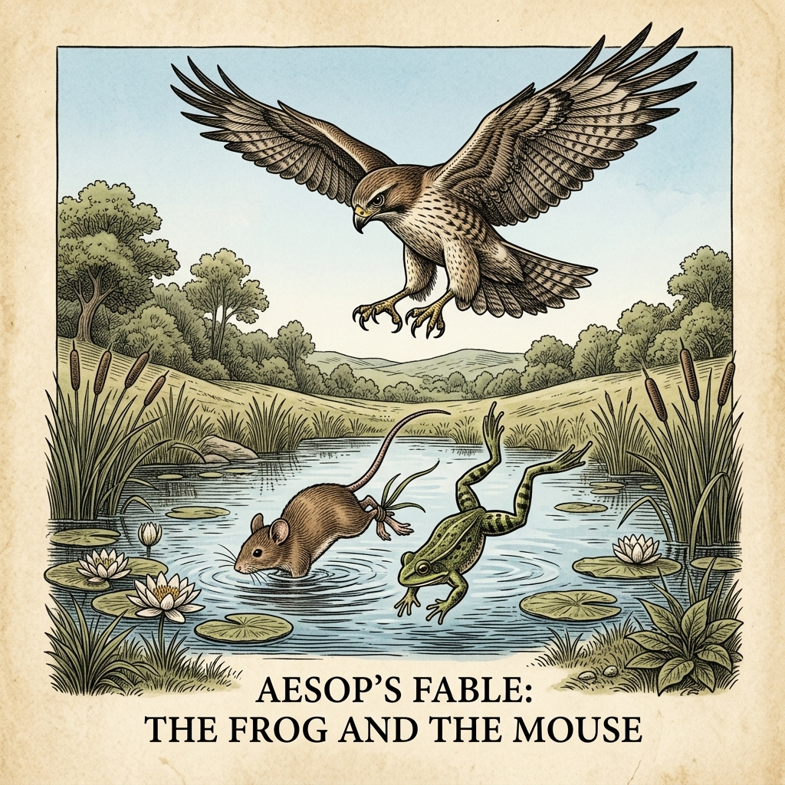

# Chapter 20: The Frog and the Mouse (ネズミとカエル)

  

## 1. Benchmark Level: Eiken Grade 2 (英検2級レベル本文)
*Read in ~2.5 to 3 minutes. Academic discourse, complex participial structures, and formal vocabulary.*

In an ecological interface bridging aquatic and terrestrial habitats, a naive terrestrial rodent initiated an interspecies association with an amphibious anuran. Psychologically predisposed to goodwill, the mammalian partner remained entirely oblivious to the sociopathic malice harbored by his counterpart. Resenting terrestrial sovereignty and harboring a morbid compulsion to demonstrate aquatic supremacy, the duplicitous frog formulated a premeditated conspiracy designed to liquidate his associate under the guise of pastoral camaraderie.

To operationalize his homicidal design, the amphibian fabricated an enticing narrative of botanical tourism, inviting the unsuspecting rodent to inspect submerged benthic ecosystems. Overcoming the mammal's instinctive hydrophobia, the instigator proposed a binding ligature—a durable botanical cord fashioned from fibrous reeds—affixed securely between their respective limbs, disingenuously framing the apparatus as a precautionary safety tether. Paralyzed by the dread of appearing ungrateful and subverting his rational anxieties to social compliance, the gullible rodent capitulated to the lethal entanglement.

Upon navigating beyond the littoral shallows into pelagic depths, the conspirator initiated the terminal phase of his scheme. Abruptly diving toward the benthic sediment, the frog mobilized his specialized propulsion to drag the buoyant, non-adapted mammal beneath the water line. The rodent's desperate physiological convulsions proved utterly futile against fluid dynamics; within minutes, acute hypoxia induced respiratory collapse, resulting in terminal drowning. As cellular respiration ceased, the buoyant corpse bobbed inertly upon the liquid surface, anchored invisibly to the lurking perpetrator beneath.

While the perfidious anuran lingered beneath the floating cadaver, indulging in premature self-congratulation, apex aerial surveillance altered the trajectory of the encounter. An opportunistic raptor—a red kite surveying the lagoon for biomass—detected the conspicuous horizontal displacement of the buoyant mammal. Executing a steep parabolic dive, the bird of prey embedded its razor-sharp talons into the floating mammalian flesh, immediately initiating high-velocity vertical ascension.

Crucially, the physical ligature that had functioned as an instrument of deliberate murder now transformed into an inescapable conduit of retributive doom. Inextricably anchored to the ascending carcass, the submerged amphibian was violently yanked across the surface tension and catapulted into the atmosphere. Incapable of severing the synthetic bond, the screaming anuran was transported to a precipitous cliffside redoubt, where the raptor systematically dismembered and devoured both the innocent casualty and the treacherous architect of the catastrophe.

Malicious conspiracies engineered against the vulnerable contain an intrinsic boomerang dynamic; those who bind others to unjustified destruction inadvertently construct the precise mechanisms that guarantee their own catastrophic demise.

---

## 2. Target Level: Eiken Grade Pre-1 (英検準1級レベル本文)
*Read in ~3.5 to 4.5 minutes. Highly sophisticated literary and academic prose, complex inversion, advanced vocabulary, and nuanced rhetoric.*

In the liminal ecological boundary separating terrestrial scrubland from a lacustrine marsh, an unsuspecting terrestrial rodent entered into a perilous interspecies entente with an amphibious anuran. Governed by a psychological disposition toward uncritical sociability, the naive mammal was fundamentally incapable of deciphering the sociopathic malice festering within his companion’s psyche. Animated by a profound, pathological resentment of terrestrial creatures and harboring a perverse compulsion to demonstrate aquatic hegemony, the duplicitous amphibian synthesized a premeditated conspiracy designed to liquidate his companion under the disingenuous guise of recreational tourism.

To execute this homicidal stratagem, the amphibian fabricated an enticing narrative of botanical tourism, inviting the impressionable rodent to inspect subterranean aquatic wonders. Countering the mammal’s instinctive, evolutionarily justified hydrophobia, the instigator engineered a synthetic ligature—a tensile cord woven from fibrous marsh reed—affixed securely between their adjacent hind limbs. He duplicitously framed this fatal mechanism as an indispensable safety harness designed to guarantee mutual security during the aquatic voyage. Overcome by normative social pressure and dreading the social stigma of seeming discourteous, the gullible victim subordinated rational self-preservation, capitulating unconditionally to the lethal constraint.

Upon transitioning from the littoral perimeter into the abyssal depths of the marsh, the conspirator executed the terminal phase of his betrayal. Diving with calculated, sudden violence, the amphibian deployed his specialized hydrodynamic propulsion to plunge his buoyant, non-swimming associate beneath the surface. The rodent’s frantic muscular convulsions proved pathetically inconsequential against fluid dynamic resistance; within moments, acute pulmonary asphyxiation induced catastrophic systemic collapse, resulting in biological cessation. As vital signs extinguished, the buoyant carcass floated upon the surface film, bound invisibly to the perfidious conspirator lurking in the depths.

While the anuran lingered beneath the floating corpse, indulging in euphoric self-congratulation, apex aerial surveillance irrevocably reconfigured the outcome. A soaring raptor—a predatory kite conducting systematic reconnaissance for carrion—intercepted the distinctive visual signature of the floating mammalian carcass. Executing a steep parabolic dive, the raptor embedded its talons into the cadaver with concussive velocity, immediately commencing high-speed vertical ascension.

Whereupon, the synthetic tether that had functioned as an instrument of premeditated murder converted inexorably into a conduit of poetic retribution. Bound irrevocably to the ascending carcass, the submerged conspirator was violently wrenched through the surface tension, catapulted upward into the open sky. Incapable of severing the ligature, the shrieking amphibian was borne aloft to a desolate cliffside precipice, where the raptor systematically dismembered and devoured both the innocent casualty and the perfidious architect of the catastrophe.

Conspiracies engineered to victimize the defenseless possess an immutable, self-cannibalizing momentum; those who bind others to unjust doom inadvertently fashion the precise operational instruments of their own catastrophic immolation.

---

## 3. Classic Original English Text (イソップ寓話 クラシック原文)
*Townsend / Jacobs Edition (Public Domain)*

A Mouse became friends with a Frog, but the Frog harbored wicked intentions. One day, the Frog tied the Mouse's leg to his own with a strong thread, promising to show him the sights of the pond. The Frog swam into the middle of the pond and dived beneath the surface, dragging the helpless Mouse down until he drowned. While the Mouse's body floated on the water, a Hawk flying overhead spotted it. The Hawk swooped down, seized the dead Mouse, and carried him away. Because the Frog was still tied to the Mouse, the Hawk devoured both of them together.

Harm set, harm get.

---

### 🏛️ 【英検2級レベルで読み解く！クラシック原文の重要構文・英文法ノート】
1. **1. 分詞構文（Participle Clause: 付帯状況・理由）**
   - **原文**: *"The Hare, believing her assertion to be simply impossible, agreed to the proposal..."*
   - **解説**: 「〜と信じ込んでいたので」という理由を表す分詞構文。英検2級の長文読解・ライティングの最頻出構文です。
1. **2. 古典的仮定法現在（Subjunctive Mood）**
   - **原文**: *"Though you be swift as the wind, I will beat you in a race."*
   - **解説**: 譲歩節 `Though` の中で原形 `be` を用いる古典的な仮定法現在（現代英語の `Though you are...`）。格調高い古典の響きを持ちます。
1. **3. 過去分詞の後置修飾（Postpositive Participle）**
   - **原文**: *"On the day appointed for the race the two started together."*
   - **解説**: `appointed`（定められた・指定された）が直前の名詞 `the day` を後ろから修飾する構文です。

### 📜 【クラシック原文の重要語彙・古風表現（Classic Antique Vocabulary）】
- **retort** [動] 2級 **（機転を利かせて）言い返す、反論する**（現代の reply sharp/wittily に相当）
- **assertion** [名] 2級/準1級 **主張、断言**（動詞 assert の名詞形。2級長文定番）
- **wayside** [名] 2級 **道端、沿道**（by the wayside（道端に、途中で））
- **fatigue** [名] 2級 **（心身の）極度の疲労、疲れ**（tiredness の上位フォーマル語）

---

## 4. Japanese Translation (日本語訳)

陸生の低木林と湖沼の湿地を隔てる境界の生態的境界域において、疑うことを知らない陸生げっ歯類が、両生類の無尾目（カエル）と危険な異種間協調関係を結びました。無批判な社交性へと向かう心理的傾向に支配されていたこの世間知らずな哺乳類は、相棒の精神の中で渦巻く反社会的な悪意を解読することが根本的に不可能でした。陸生生物に対する根深く病理学的な恨みに動かされ、水中の覇権を証明したいという倒錯した強迫観念を抱いていたこの不実な両生類は、余暇の観光という不誠実な見せかけの下で相棒を抹殺するよう設計された計画的陰謀を合成したのです。

この殺害の策略を実行するため、両生類は植物学的観光という魅力的な物語をでっち上げ、感化されやすいげっ歯類を水中の驚異を視察するよう招待しました。哺乳類の本能的で進化論的に正当化された水恐怖症に対抗するため、首謀者は隣接する後肢の間にしっかりと固定された人工の結束――繊維質の湿地の葦から織られた引張ロープ――を考案しました。彼はこの致命的な機構を、水上航海中の相互の安全を保証するよう設計された不可欠な安全ハーネスであると二枚舌で位置づけました。規範的な同調圧力に圧倒され、無礼と思われることの社会的スティグマ（不名誉）を恐れた騙されやすい犠牲者は、理性的な自己保身を従属させ、その致命的な拘束へと無条件に降伏したのです。

沿岸の周縁部から湿地の深淵の深みへと移行するやいなや、共謀者は自らの裏切りの最終段階を実行しました。計算された突発的な暴力をもって潜水し、両生類は自らの特殊な流体力学的推進力を配備して、浮力があり泳ぐことのできない相棒を水面下へと急落させました。げっ歯類の必死の筋肉痙攣は、流体力学的抵抗の前には痛ましいほど無力でした。瞬く間に、急性肺窒息が破滅的な全身崩壊を誘発し、生物学的停止をもたらしました。生命兆候が消滅すると、浮かぶ死骸は水面の薄膜の上に漂い、深みに潜む不実な共謀者へと目に見えない形で縛られていました。

浮かぶ死体の下に留まり、陶酔的な自画自賛に浸っている最中、上空の頂点監視が結末を不可逆的に再構成しました。腐肉を求めて体系的な偵察を行っていた急上昇する猛禽――捕食性のトビ――が、浮かぶ哺乳類の死骸の独特の視覚的シグネチャー（特徴）を捕捉したのです。急峻な放物線を描く急降下を実行し、猛禽は衝撃的な速度をもって死骸へとその爪を食い込ませ、即座に高速度の垂直上昇を開始しました。

その結果、計画的殺人の道具として機能していた人工の命綱は、詩的報復の導管へと容赦なく変貌しました。上昇する死骸へと決定的に縛られた水中の共謀者は、表面張力を突き破って激しく引きずり出され、吹きさらしの天空へと投げ上げられました。結束を切断することができず、金切り声を上げる両生類は人気のない崖の断崖へと高々と運ばれ、そこで猛禽は、無実の犠牲者とその大惨事の不実な設計者の両方を体系的に解体し、貪り食ったのです。

**教訓**: 無防備な者を餌食にするよう設計された陰謀は、不変の自己共食い的な（自滅的な）運動量を宿している。他者を不当な破滅へと縛り付ける者は、意図せずして自らの破滅的な生贄の炎の作戦器具そのものを造り上げることになる。

---

## 5. Recite & Compare (そらんじたいキーフレーズ対比)
*Memorize these contrastive expressions to elevate speaking, writing, and reading fluency.*

  
■ 場面：同調圧力により理性的な警戒を従属させる

  
【Grade 2 基礎】 <em>subverting his rational anxieties to social compliance, capitulated...</em>

  
【Pre-1 暗唱】 <strong><em>Overcome by normative pressure, subordinated self-preservation, capitulating to constraint</em></strong>

  
【ポイント】 <strong>解説・試験活用</strong>：社会心理学用語 `normative social pressure`（規範的社会的圧力・同調圧力）、`subordinated self-preservation`（自己保身を後回し・劣後させた）。

  
■ 場面：流体力学的抵抗の前に痙攣するも無力

  
【Grade 2 基礎】 <em>physiological convulsions proved utterly futile against fluid dynamics</em>

  
【Pre-1 暗唱】 <strong><em>muscular convulsions proved pathetically inconsequential against fluid dynamic resistance</em></strong>

  
【ポイント】 <strong>解説・試験活用</strong>：副詞 `pathetically`（痛ましいほどに）、形容詞 `inconsequential`（重要でない・まったく効果のない）、`fluid dynamic resistance`（流体力学的抵抗）。

  
■ 場面：殺人の道具が詩的報復の導管へと変貌

  
【Grade 2 基礎】 <em>instrument of murder transformed into an inescapable conduit of doom</em>

  
【Pre-1 暗唱】 <strong><em>instrument of murder converted inexorably into a conduit of poetic retribution</em></strong>

  
【ポイント】 <strong>解説・試験活用</strong>：文学・修辞学概念 `poetic retribution`（詩的正義・詩的応報＝悪人が自ら仕掛けた手段で自滅すること）、副詞 `inexorably`（不可避的に・容赦なく）。

  
■ 場面：犠牲者と惨事の設計者を体系的に解体・捕食

  
【Grade 2 基礎】 <em>dismembered both innocent casualty and architect of catastrophe</em>

  
【Pre-1 暗唱】 <strong><em>systematically dismembered and devoured both innocent casualty and perfidious architect...</em></strong>

  
【ポイント】 <strong>解説・試験活用</strong>：形容詞 `perfidious`（不実な・背信の）、名詞句 `perfidious architect of the catastrophe`（大惨事の不実な設計者）。

  
■ 場面：教訓（Moral）

  
【Grade 2 基礎】 <em>Conspiracies contain a boomerang dynamic; binding others constructs mechanisms of demise.</em>

  
【Pre-1 暗唱】 <strong><em>Conspiracies possess an immutable, self-cannibalizing momentum; binding others inadvertently fashions the instruments of catastrophic immolation.</em></strong>

  
【ポイント】 <strong>解説・試験活用</strong>：形容詞 `self-cannibalizing`（自己共食い的な・自滅的な）、動詞 `fashion`（〜を工作・製作する）、名詞 `catastrophic immolation`（破滅的生贄・全滅）。準1級・1級の金字塔的結論。

---

## 6. Vocabulary Builder: 赤シート対応 重要単語・熟語チェック表
*※ 赤い透明シート（または赤フィルム）を重ねると、日本語訳が消えて自力テストができます。*

| No. | 見出し語 / イディオム | 品詞 / レベル | 日本語の意味（赤シートで消える） | 本文での使われ方・コロケーション |
|:---:|---|:---:|---|---|
| **01** | **proud** | [形] 4級 | 誇り高い、傲慢な | *a proud hare (自惚れたウサギ)* |
| **02** | **boast (about...)** | [動] 3級 | 〜を自慢する、誇る | *was always boasting about his speed* |
| **03** | **make fun of...** | [熟] 3級 | 〜をからかう、嘲笑する | *making fun of a slow tortoise* |
| **04** | **challenge** | [名/動] 3級 | 挑戦、課題 / 挑む | *I accept your challenge.* |
| **05** | **accept** | [動] 3級 | 受け入れる、受諾する | *accept the proposal (提案を受諾する)* |
| **06** | **dash** | [動] 3級 | 勢いよく走る、突進する | *dashed forward (前方へ駆け出した)* |
| **07** | **leave ~ behind** | [熟] 3級 | 〜を置き去りにする | *left the tortoise far behind* |
| **08** | **visible** | [形] 準2級 | 目に見える、視認できる | *was barely visible in the distance* |
| **09** | **catch up (with...)** | [熟] 3級 | 〜に追いつく | *before he catches up* |
| **10** | **slumber** | [名/動] 準2級 | 深い眠り / 眠る | *fell into a profound slumber* |
| **11** | **sprint** | [動] 3級 | 全力疾走する | *sprinted toward the finish line* |
| **12** | **persistence** | [名] 準2級/2級 | 粘り強さ、不屈の継続 | *persistence and hard work will bring success* |

### 【出題傾向・文法解説ノート】

### 【出題頻出語彙・熟語ノート】
- **liminal** [形] 境界の、過渡期の、閾値の（人類学・心理学最重要語）
- **inconsequential** [形] 取るに足らない、効果のない（反義語：*consequential*）
- **entente** [名] 協商、友好的合意（*perilous entente*「危険な協商」）
- **hydrophobia** [名] 狂犬病、水恐怖症（形容詞 *hydrophobic*）
- **poetic retribution** [熟] 詩的報復、因果応報（悪事の手段そのもので自滅すること）
- **fashion** [動] （〜を）形作る、工作する（*fashion A out of B*）
- **cannibalize** [動] 共食いする、部品を流用する（形容詞 *self-cannibalizing*）

### 【文法・構文ポイント】
1. **形容詞の重層的配置 [an immutable, self-cannibalizing momentum]**
   - 準1級本文: *"Conspiracies engineered to victimize the defenseless possess an immutable, self-cannibalizing momentum..."*
   - ポイント: 「変えられない（immutable）」と「自滅的な（self-cannibalizing）」という二つの高度な修飾語を重ねることで、悪の自滅性を哲学的必然として位置づけます。
2. **副詞 [inadvertently] と動詞 [fashion]（意図せずして作り上げる）**
   - 準1級本文: *"those who bind others to unjust doom inadvertently fashion the precise operational instruments..."*
   - ポイント: 「他人を罠にはめようとする行為そのものが、意図せずして自分自身の処刑台を作っている」という皮肉な逆説を鮮やかに叙述します。
