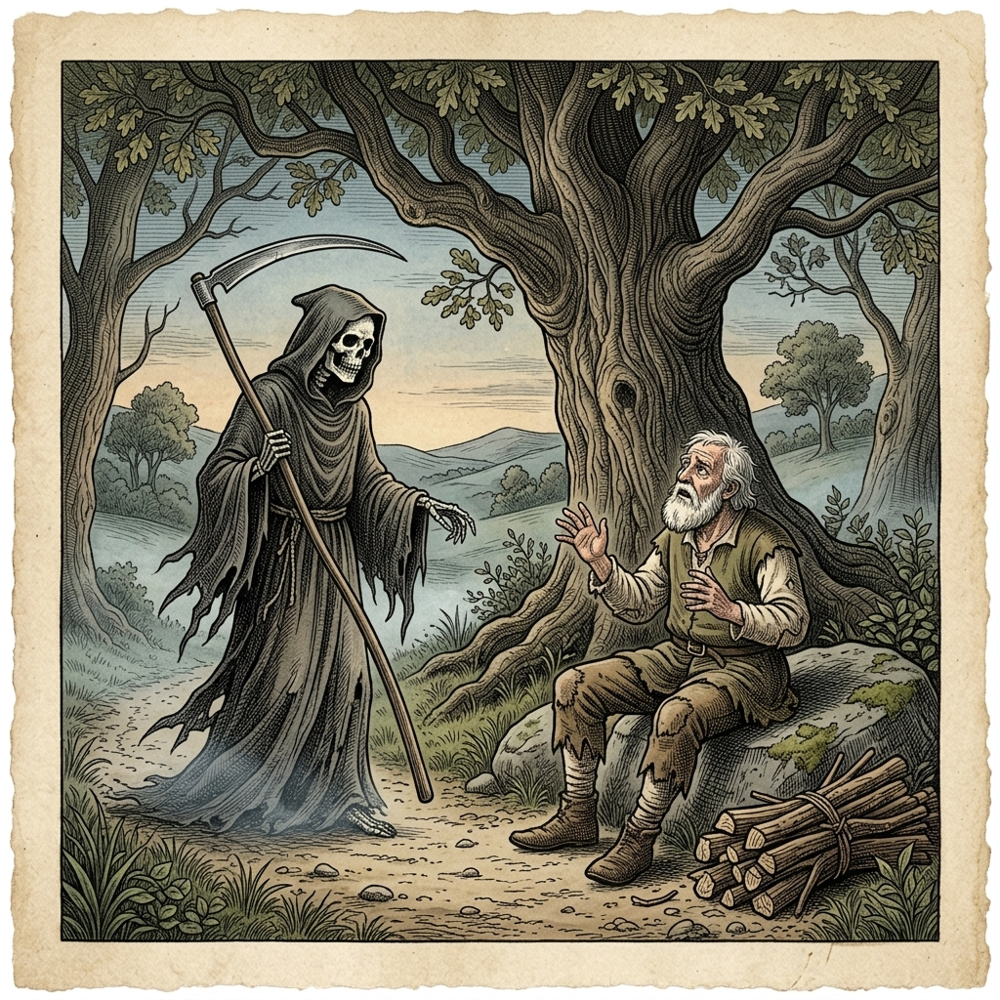

# Chapter 23: The Old Man and Death (木こりと死神)

  

## 1. Benchmark Level: Eiken Grade 2 (英検2級レベル本文)
*Read in ~2.5 to 3 minutes. Academic discourse, complex participial structures, and formal vocabulary.*

Exhausted by continuous decades of agrarian hardship, a destitute woodcutter was laboriously negotiating a steep mountainous incline under the relentless thermal radiation of the midday sun, staggering beneath an immense load of harvested timber that compromised his skeletal equilibrium. Bereft of nutritional sustenance and having surpassed the absolute boundaries of neuromuscular stamina, the senescent laborer experienced acute physiological decompensation.

Incapacitated by excruciating spinal strain, the laborer precipitated his cargo onto the gravel and collapsed into the trailside dust, overwhelmed by acute psychological dejection. Yielding to an impulsive surge of nihilistic despair, the demoralized individual verbalized an explicit invocation directed toward the metaphysical void: "This mortal existence constitutes nothing more than an unbroken sequence of economic deprivation and biological torment! Having exhausted all emotional justification for prolonging this misery, I formally summon the entity of Death to extinguish my consciousness and consign my physical vessel to the grave."

To his profound psychological shock, the ontological barrier between abstract metaphor and objective reality instantaneously disintegrated. From the encroaching gloom materialized the anthropomorphic manifestation of mortality—the Grim Reaper, wielding his harvest scythe and radiating an aura of subterranean chill. "Pursuant to your categorical petition, mortal petitioner, I have breached the threshold of eternity to accommodate your departure," the apparition intoned in a chilling baritone. "Declare the execution of your ultimate mandate."

Confronted with the immediate, visceral reality of his own terminal extinguishment, the woodcutter's theoretical death wish underwent an instantaneous psychological inversion. The existential lamentations that had characterized his despair vanished, completely eclipsed by the deep-seated neurological impulse of self-preservation. Mobilizing extraordinary presence of mind amidst intense somatic tremor, the aging laborer dissembled his panic, feigned deferential composure, and fabricated a spontaneous rationalization: "Most venerable sovereign, observing that this unwieldy parcel of timber had inadvertently decoupled from my frame, I merely solicited your immense strength to assist me in re-hoisting the burden onto my shoulders so that I might resume my domestic transit."

When subjected to acute socioeconomic stress, human beings are prone to vocalizing superficial flirtations with mortality; nevertheless, when confronted by the actual abyss of non-existence, the biological imperative for self-preservation unequivocally supersedes all theoretical grievances.

---

## 2. Target Level: Eiken Grade Pre-1 (英検準1級レベル本文)
*Read in ~3.5 to 4.5 minutes. Highly sophisticated literary and academic prose, complex inversion, advanced vocabulary, and nuanced rhetoric.*

Emaciated by a lifetime of merciless agrarian exploitation, an impoverished woodcutter navigated a treacherous alpine trajectory beneath the oppressive thermal onslaught of the summer solstice, bearing an immense payload of harvested timber that severely distorted his musculoskeletal architecture. Bereft of physiological nourishment and having long exceeded the adaptive boundaries of cellular homeostasis, the senescent laborer experienced a catastrophic neuromuscular collapse, his staggering gait terminating in a sudden, involuntary kinetic failure.

Overpowered by excruciating spinal trauma and systemic exhaustion, the laborer violently dislodged his burdensome cargo onto the calcified scree and sank into the dust, completely unmoored by existential dejection. Succumbing to an impulsive paroxysm of theoretical nihilism, the desperate mortal verbalized an irrevocable invocation directed at the metaphysical cosmos: "This corporeal existence represents an intolerable continuum of penury, degradation, and inescapable suffering! Having liquidated all biological justification for perpetuating this agonizing somatic tenancy, I explicitly summon Thanatos—the absolute sovereign of the terminal threshold—to extinguish my vital spark and dissolve my consciousness into eternal nothingness!"

In terrifying refutation of the assumption that metaphysical cries remain unanswered, the veil separating linguistic abstraction from ontological reality instantaneously disintegrated. Coalescing from the shifting twilight materialized the chilling, anthropomorphic avatar of absolute mortality—the Grim Reaper, wielding his archaic harvesting scythe and radiating an atmospheric temperature approaching absolute zero. "In strict adherence to your categorical summons, ephemeral mortal, I have manifested within your spatio-temporal coordinates," the apparition resonated with subterranean resonance. "Enunciate your final commission, that I may execute the terminal severing of your mortal coil."

Confronted with the unmediated, visceral horror of his imminent biological annihilation, the woodcutter’s romanticized flirtation with mortality suffered an instantaneous ontological rupture. The theatrical melancholy that had animated his theatrical plea vanished without a trace, entirely subordinated to the primal, non-negotiable neurological mandate of self-preservation. Mobilizing an astounding reserve of cognitive equilibrium amidst violent somatic tremors, the terrified peasant masked his psychological disintegration, manufactured an attitude of deferential obsequiousness, and improvised a brilliant tactical rationalization: "Sublime sovereign of the abyss, perceiving that this cumbersome parcel of cordwood had inadvertently decoupled from my spine, I merely solicited your omnipotent musculature to assist me in elevating the burden back onto my shoulders, that I might complete my homeward transit."

Under conditions of transient socioeconomic despair, human beings routinely indulge in rhetorical posturing regarding the desirability of non-existence; nevertheless, when confronted by the actual, yawning precipice of finality, the primordial imperative of biological survival unequivocally dismantles all philosophical affectations of world-weariness.

---

## 3. Classic Original English Text (イソップ寓話 クラシック原文)
*Townsend / Jacobs Edition (Public Domain)*

An Old Man that had travelled a long way with a huge bundle of sticks, found himself so weary that he cast it down, and called upon Death to deliver him from his troubles. 

Death appeared immediately in answer to his summons, and asked him what he wanted with him. 

The Old Man, terrified, replied: "Only that you would please to lift that load of sticks upon my shoulders again."

We would often die when our troubles are heavy, but when Death draws near, we cling to life.

---

### 🏛️ 【英検2級レベルで読み解く！クラシック原文の重要構文・英文法ノート】
1. **1. 分詞構文（Participle Clause: 付帯状況・理由）**
   - **原文**: *"The Hare, believing her assertion to be simply impossible, agreed to the proposal..."*
   - **解説**: 「〜と信じ込んでいたので」という理由を表す分詞構文。英検2級の長文読解・ライティングの最頻出構文です。
1. **2. 古典的仮定法現在（Subjunctive Mood）**
   - **原文**: *"Though you be swift as the wind, I will beat you in a race."*
   - **解説**: 譲歩節 `Though` の中で原形 `be` を用いる古典的な仮定法現在（現代英語の `Though you are...`）。格調高い古典の響きを持ちます。
1. **3. 過去分詞の後置修飾（Postpositive Participle）**
   - **原文**: *"On the day appointed for the race the two started together."*
   - **解説**: `appointed`（定められた・指定された）が直前の名詞 `the day` を後ろから修飾する構文です。

### 📜 【クラシック原文の重要語彙・古風表現（Classic Antique Vocabulary）】
- **retort** [動] 2級 **（機転を利かせて）言い返す、反論する**（現代の reply sharp/wittily に相当）
- **assertion** [名] 2級/準1級 **主張、断言**（動詞 assert の名詞形。2級長文定番）
- **wayside** [名] 2級 **道端、沿道**（by the wayside（道端に、途中で））
- **fatigue** [名] 2級 **（心身の）極度の疲労、疲れ**（tiredness の上位フォーマル語）

---

## 4. Japanese Translation (日本語訳)

無慈悲な農業的搾取の生涯によって衰弱しきった貧しい木こりが、夏至の抑圧的な熱攻撃の下、筋骨格の構造を著しく歪める伐採木材の巨大な荷重を背負い、危険な高山の軌道を歩いていました。生理的栄養補給も奪われ、細胞の恒常性（ホメオスタシス）の適応限界をとうに超過していたこの高齢の労働者は、壊滅的な神経筋の機能崩壊に見舞われ、そのよろめく歩行は突然の不随意な運動不全によって終焉を迎えました。

耐えがたい脊椎の外傷と全身の疲弊に圧倒された労働者は、重苦しい荷物を石灰化した瓦礫の上に激しく投げ落とし、実存的な意気消沈に完全に漂流させられながら埃の中に沈み込みました。観念的ニヒリズムの発作的な発作に屈したこの絶望的な定命の人間は、形而上学的な宇宙に向けて取り消しのつかない召喚の言葉を発しました。「この肉体的な実存は、貧困、屈辱、そして逃れられない苦難の耐え難い連続体を表している！この苦痛に満ちた肉体的占有（身体の維持）を永続させるための生物学的正当性をすべて清算した今、私はタナトス――終末の閾値の絶対的主権者――を明確に呼び出し、我が生命の火花を消滅させ、自らの意識を永遠の虚無へと溶解させることを要求する！」

形而上学的な叫びは無応答のままであるという前提に対する恐るべき反駁として、言語的抽象と存在論的現実を隔てる幕が瞬時に崩壊しました。移ろう薄明の中から凝結して具現化したのは、絶対的死の身の毛もよだつ擬人化されたアバター――古風な収穫の大鎌を振りかざし、絶対零度に近づく大気温度を放射する死神――でした。「お前の絶対的な召喚に対する厳格な遵守において、泡沫の人間よ、私はお前の時空間座標の中に具現化した」とその亡霊は地下の共鳴をもって響き渡りました。「お前が死すべき定めの糸の決定的な切断を私が執行できるよう、お前の最後の命令を言明せよ」

自らの差し迫った生物学的消滅という直接的で生々しい恐怖に直面した木こりの、死に対するロマン主義的な弄びは、瞬時の存在論的破綻を被りました。彼の演劇的な嘆願を活気づけていた芝居がかった憂鬱は跡形もなく消え去り、原初の、妥協不可能な自己保存の神経学的至上命令へと完全に屈服したのです。激しい身体の震えの中で驚異的な認知的平衡の予備力を動員した怯える農夫は、自らの心理的崩壊を仮面で隠し、恭順な卑屈さの態度を捏造し、見事な戦術的弁明を即興で編み出しました。「深淵の崇高なる主権者様、この厄介な薪の束が私の背骨から不意に外れてしまったことを認め、私が家路への移動を完了できるよう、その重荷を再び私の肩へと持ち上げるのを手伝っていただくため、あなたの全能の筋力を請い願ったに過ぎないのです」

**教訓**: 一過性の社会経済的絶望の状況下において、人間は非存在の望ましさに関する修辞的なポーズを日常的に気取るものである。しかしながら、最後の実際のあくびをする断崖（死の深淵）に直面したとき、生物学的生存の原初の至上命令は、世を儚むあらゆる哲学的気取りを明白に解体するのである。

---

## 5. Recite & Compare (そらんじたいキーフレーズ対比)
*Memorize these contrastive expressions to elevate speaking, writing, and reading fluency.*

  
■ 場面：言語的抽象と存在論的現実を隔てる幕が崩壊する

  
【Grade 2 基礎】 <em>ontological barrier between metaphor and reality disintegrated</em>

  
【Pre-1 暗唱】 <strong><em>veil separating linguistic abstraction from ontological reality disintegrated</em></strong>

  
【ポイント】 <strong>解説・試験活用</strong>：認識論的比喩 `veil separating linguistic abstraction from ontological reality`（言語的抽象と存在論的現実を隔てる幕）、動詞 `disintegrate`（崩壊する）。

  
■ 場面：厳格な遵守の下、時空間座標に具現化する

  
【Grade 2 基礎】 <em>Pursuant to petition, I breached threshold of eternity</em>

  
【Pre-1 暗唱】 <strong><em>In strict adherence to summons, manifested within spatio-temporal coordinates</em></strong>

  
【ポイント】 <strong>解説・試験活用</strong>：成句 `In strict adherence to...`（〜の厳格な遵守において）、物理・哲学用語 `spatio-temporal coordinates`（時空間座標）。

  
■ 場面：死へのロマン主義的弄びが瞬時の存在論的破綻を被る

  
【Grade 2 基礎】 <em>theoretical death wish underwent psychological inversion</em>

  
【Pre-1 暗唱】 <strong><em>romanticized flirtation with mortality suffered instantaneous ontological rupture</em></strong>

  
【ポイント】 <strong>解説・試験活用</strong>：名詞句 `romanticized flirtation with mortality`（死に対するロマン化された戯れ・弄び）、`ontological rupture`（存在論的破綻・断絶）。

  
■ 場面：心理的崩壊を隠し、即興の戦術的弁明を編み出す

  
【Grade 2 基礎】 <em>dissembled panic, feigned composure, fabricated a rationalization</em>

  
【Pre-1 暗唱】 <strong><em>masked psychological disintegration and improvised a brilliant tactical rationalization</em></strong>

  
【ポイント】 <strong>解説・試験活用</strong>：名詞句 `psychological disintegration`（心理的崩壊・精神の解体）、動詞 `improvise`（即興で作る）、名詞句 `tactical rationalization`（戦術的正当化・言い訳）。

  
■ 場面：教訓（Moral）

  
【Grade 2 基礎】 <em>confronted by abyss of non-existence, biological imperative supersedes grievances</em>

  
【Pre-1 暗唱】 <strong><em>Confronted by finality, primordial imperative of survival dismantles philosophical affectations.</em></strong>

  
【ポイント】 <strong>解説・試験活用</strong>：名詞句 `primordial imperative of biological survival`（生物学的生存の原初の至上命令）、`philosophical affectations of world-weariness`（世を儚む哲学的気取り）。実存主義文学の極限表現。

---

## 6. Vocabulary Builder: 赤シート対応 重要単語・熟語チェック表
*※ 赤い透明シート（または赤フィルム）を重ねると、日本語訳が消えて自力テストができます。*

| No. | 見出し語 / イディオム | 品詞 / レベル | 日本語の意味（赤シートで消える） | 本文での使われ方・コロケーション |
|:---:|---|:---:|---|---|
| **01** | **proud** | [形] 4級 | 誇り高い、傲慢な | *a proud hare (自惚れたウサギ)* |
| **02** | **boast (about...)** | [動] 3級 | 〜を自慢する、誇る | *was always boasting about his speed* |
| **03** | **make fun of...** | [熟] 3級 | 〜をからかう、嘲笑する | *making fun of a slow tortoise* |
| **04** | **challenge** | [名/動] 3級 | 挑戦、課題 / 挑む | *I accept your challenge.* |
| **05** | **accept** | [動] 3級 | 受け入れる、受諾する | *accept the proposal (提案を受諾する)* |
| **06** | **dash** | [動] 3級 | 勢いよく走る、突進する | *dashed forward (前方へ駆け出した)* |
| **07** | **leave ~ behind** | [熟] 3級 | 〜を置き去りにする | *left the tortoise far behind* |
| **08** | **visible** | [形] 準2級 | 目に見える、視認できる | *was barely visible in the distance* |
| **09** | **catch up (with...)** | [熟] 3級 | 〜に追いつく | *before he catches up* |
| **10** | **slumber** | [名/動] 準2級 | 深い眠り / 眠る | *fell into a profound slumber* |
| **11** | **sprint** | [動] 3級 | 全力疾走する | *sprinted toward the finish line* |
| **12** | **persistence** | [名] 準2級/2級 | 粘り強さ、不屈の継続 | *persistence and hard work will bring success* |

### 【出題傾向・文法解説ノート】

### 【出題頻出語彙・熟語ノート】
- **emaciated** [形] やつれた、衰弱した（名詞 *emaciation*）
- **paroxysm** [名] （感情・病気などの）発作、激発
- **nihilism** [名] 虚無主義、ニヒリズム（形容詞 *nihilistic*）
- **Thanatos** [名] タナトス、死の神、死への本能（精神分析用語）
- **ephemeral** [形] つかの間の、儚い、短命な（*transient / fleeting*）
- **rupture** [名] 破裂、断絶、決裂（動詞としても使用）
- **obsequiousness** [名] こびへつらい、卑屈（形容詞 *obsequious*）
- **affectation** [名] 気取り、見せかけ、不自然な態度（動詞 *affect*）

### 【文法・構文ポイント】
1. **[suffer + 抽象名詞（破綻・損害）] による劇的叙述**
   - 準1級本文: *"...the woodcutter’s romanticized flirtation with mortality suffered an instantaneous ontological rupture."*
   - ポイント: `suffer` は病気にかかるだけでなく、「抽象的な論理や構想が破綻・崩壊を被る」という文脈で極めて格調高い表現として機能します。
2. **名詞 [affectation]（気取り）の批判的用法**
   - 準1級本文: *"...dismantles all philosophical affectations of world-weariness."*
   - ポイント: 「真実味のないポーズや気取り」を告発する重要単語。エッセイで人間の偽善や欺瞞を論駁する際の決め手となる語彙です。
