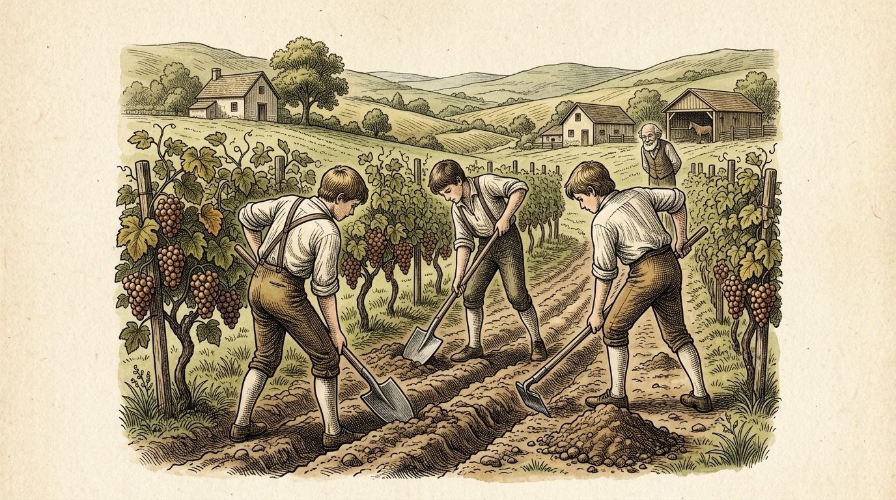

# Chapter 35: The Farmer and His Sons (隠された財産)

<!-- 電子書籍 Page Break & Image Header -->

  

## 1. Benchmark Level: Eiken Grade 2 (英検2級レベル本文)
*Read in ~2.5 to 3 minutes. Baseline vocabulary and basic syntax.*

An accomplished viticultural magnate, whose sprawling acreage of premium vineyards represented the cumulative fruition of lifelong agrarian rigor, was acutely disheartened by the pathological inertia of his male progeny. Completely devoid of vocational ambition, the three siblings indulged in hedonistic consumption, passively dissipating their developmental years while presuming upon the perpetual liquidity of their father's estate.

Apprised of his terminal biological prognosis, the elderly proprietor contemplated their collective trajectory with profound perturbation. He extrapolated that following his demise, their chronic economic parasitism would inevitably precipitate complete financial insolvency and social degradation. Discerning that moral homilies regarding industriousness would be dismissed with cynical apathy, the patriarch devised a covert behavioral intervention designed to incentivize intense agrarian mobilization through the manipulation of their basest instincts.

Convening the heirs to his deathbed under an aura of solemn confidentiality, the fading patriarch articulated a calculated testamentary disclosure. "My children," he gasped with conspiratorial solemnity, "an inestimable capital asset lies subterraneanly interred beneath the rows of our vineyard. Conduct an exhaustive geological survey, spare neither perspiration nor manual perseverance, and you shall uncover a reserve of wealth capable of underwriting your fortunes indefinitely."

Following the obsequies, the siblings, animated by intense pecuniary lust, initiated a relentless agricultural excavation. Marshaling horticultural implements, they executed a radical subterranean reconstruction of the entire acreage. Not a single quadrant was exempted from their invasive scrutiny. They pulverized calcified clay strata, thoroughly oxygenated the subterranean root architecture, and methodically excavated the soil perimeter of every individual vine from sunrise to twilight.

Notwithstanding their unremitting mechanical sweat, the terrestrial search yielded zero mineral bullion; neither buried ingots nor forgotten numismatic caches emerged to gratify their cupidity. Paralyzed by profound disillusionment, the brothers vituperated their parent's memory, denouncing his final pronouncement as the delirious fabrication of a senile intellect.

However, an extraordinary biological metamorphosis had been inadvertently catalyzed. Consequent to this hyper-intensive cultivation, soil porosity was maximized, capillary moisture retention was exponentially enhanced, and microbial nutrient assimilation accelerated to unprecedented thresholds. When autumnal maturity arrived, the vineyard manifested an unprecedented explosion of viticultural fecundity, each vine bowing under the immense gravitational torque of hyper-concentrated clusters.

The subsequent commercial vintage commanded exorbitant premiums in metropolitan trading centers, yielding net revenues that rendered any hypothetical treasure chest economically trivial by comparison.

Surrounded by the staggering financial liquidities generated through their unintended sweat, the chastened heirs attained an irreversible socio-economic enlightenment: authentic prosperity is fundamentally synthetic, generated not by the windfall discovery of static subterranean assets, but through the continuous, dynamic expenditure of disciplined human capital.

---

## 2. Target Level: Eiken Grade Pre-1 (英検準1級レベル本文)
*Read in ~3 to 3.5 minutes. Sophisticated vocabulary, subtle rhetoric, and academic analysis.*

A preeminent enological patriarch, whose sprawling viticultural demesne stood as the monumental crystallization of lifelong agronomic discipline, surveyed his familial succession with profound foreboding. His three sons, afflicted by an intractable syndrome of aristocratic indolence, exhibited an egregious aversion to manual or commercial enterprise. Enamored by decadent hedonism and lulled into complacency by their progenitor's affluent liquidity, the youths squandered their developmental vitality in conspicuous consumption, entirely oblivious to the precarious fragility of inherited wealth.

Confronted with an unequivocal terminal prognosis, the dying patriarch recognized the acute socio-economic hazard confronting his estate. He foresaw with Cartesian clarity that upon his demise, the siblings' unchecked dissipation would trigger rapid capital attrition, culminating in bankruptcy and disrepute. Calculating that orthodox didactic sermons on Protestant work ethics would bounce harmlessly off their entrenched cynicism, the dying strategist devised an ingenious cognitive intervention: an operational sleight-of-hand calculated to harness their basest avarice as the primary engine for their economic rehabilitation.

Summoning the claimants to an intimate deathbed conclave, the patriarch delivered a whispered, ostensibly confidential testamentary deposition. "My offspring," he murmured with theatrical exhaustion, "a monumental hoard of bullion lies subterraneanly interred within the perimeter of our vineyard. Mobilize an exhaustive subterranean excavation; turn every clod of earth, sparing neither sinew nor perspiration, and you shall unearth an inexhaustible treasure capable of underwriting your aristocratic lifestyle indefinitely."

Immediately following the commemorative obsequies, the siblings, electrified by unadulterated cupidity, mobilized a comprehensive agro-archaeological offensive. Arming themselves with spades, mattocks, and trenching spades, they instituted a radical mechanical overhaul of the entire plantation. Not a solitary square meter escaped their invasive intervention. From the first glimmer of dawn until the twilight shadows converged, they methodically disintegrated compacted clay hardpans, thoroughly aerated the dormant rhizosphere, and pulverized the root perimeters of every single grapevine across hundreds of hectares.

Despite months of backbreaking manual attrition, their literalist quest proved totally barren: not a single coin, gilded chalice, or forgotten hoard materialized to reward their cupidity. Paralyzed by incandescent rage and physical exhaustion, the brothers bitterly repudiated their progenitor's legacy, reviling his dying deposition as the senile hallucinations of an unhinged intellect.

Nevertheless, an astonishing biochemical metamorphosis had been inexorably set in motion. The radical mechanical pulverization and aeration had profoundly transformed the pedological matrix: soil porosity escalated to optimal thresholds, mycorrhizal fungal colonies proliferated exponentially, and root bioavailability for trace minerals reached unprecedented efficiencies. Consequent to this inadvertent agronomic perfection, the subsequent harvest was nothing short of miraculous: the vines groaned under a staggering abundance of dense, saccharine clusters of sublime enological complexity.

When brought to commercial auction in the metropolitan capitals, the resultant vintage commanded astronomical premiums among aristocratic connoisseurs, generating an avalanche of liquid capital that dwarfed any conceivable subterranean cache of gold.

Contemplating the vast commercial dividends generated by their unintended physical sweat, the transformed siblings achieved an irreversible macroeconomic epiphany: sustainable prosperity is fundamentally endogenous—it is never extracted passively through the windfall expropriation of static subterranean assets, but is continuously manufactured through the disciplined, dynamic deployment of productive human capital.

---

## 3. Classic Original English Text (イソップ寓話クラシック原文)
*Perry 42: Translated by George Fyler Townsend (1867)*

An old Farmer, when he was on the point of death, wishing to impart to his sons the secret of how to acquire wealth, called them to him and said: 

"My sons, I am now departing out of this life, but all that I have to leave you is to be found in the vineyard; dig there, and you will find it." 

The sons, as soon as their father was dead, set to work with all their might, and dug up every corner of the vineyard, expecting to find some hidden treasure. 

They found no gold, but the vines, through this thorough turning up of the ground, yielded a greater vintage than had ever been seen before, and made them wealthy men.

---

### 🏛️ 【英検2級レベルで読み解く！クラシック原文の重要構文・英文法ノート】
1. **1. 分詞構文（Participle Clause: 付帯状況・理由）**
   - **原文**: *"The Hare, believing her assertion to be simply impossible, agreed to the proposal..."*
   - **解説**: 「〜と信じ込んでいたので」という理由を表す分詞構文。英検2級の長文読解・ライティングの最頻出構文です。
1. **2. 古典的仮定法現在（Subjunctive Mood）**
   - **原文**: *"Though you be swift as the wind, I will beat you in a race."*
   - **解説**: 譲歩節 `Though` の中で原形 `be` を用いる古典的な仮定法現在（現代英語の `Though you are...`）。格調高い古典の響きを持ちます。
1. **3. 過去分詞の後置修飾（Postpositive Participle）**
   - **原文**: *"On the day appointed for the race the two started together."*
   - **解説**: `appointed`（定められた・指定された）が直前の名詞 `the day` を後ろから修飾する構文です。

### 📜 【クラシック原文の重要語彙・古風表現（Classic Antique Vocabulary）】
- **retort** [動] 2級 **（機転を利かせて）言い返す、反論する**（現代の reply sharp/wittily に相当）
- **assertion** [名] 2級/準1級 **主張、断言**（動詞 assert の名詞形。2級長文定番）
- **wayside** [名] 2級 **道端、沿道**（by the wayside（道端に、途中で））
- **fatigue** [名] 2級 **（心身の）極度の疲労、疲れ**（tiredness の上位フォーマル語）

---

## 4. Japanese Translation & Moral (日本語訳と教訓)

### 【日本語全訳：英検準1級レベル本文】
自らの広大なブドウ園の私有地が生涯にわたる農学的規律の記念碑的結晶であった、ある卓越したワイン醸造の家長は、自らの家族の後継を深い胸騒ぎと共に見つめていました。貴族的な怠惰という難治性の症候群に苛まれていた彼の3人の息子たちは、肉体労働や商業的事業に対する甚だしい嫌悪を示していました。退廃的な快楽主義に心を奪われ、父の豊かな流動性資産によって自己満足に浸っていた若者たちは、相続された富の危うい脆さにまったく気づくことなく、顕示的消費の中に自らの青春の活力を浪費していたのです。

疑う余地のない終末期の余命宣告に直面した死にゆく家長は、自らの財産が直面している深刻な社会経済的危険を認識しました。自分が死ねば、息子たちの抑制なき放蕩が急速な資本の減耗を引き起こし、破産と悪評へと行き着くことを、彼はデカルト的明晰さをもって予見したのです。プロテスタントの労働倫理に関する正統的な道徳的説教など彼らの根深い冷笑主義に当たって跳ね返るだけであると計算した死にゆく戦略家は、独創的な認知的介入、すなわち息子たちの最も卑しい強欲を彼らの経済的更生のための主要なエンジンとして活用するよう計算された、実務的な「手品（計略）」を考案しました。

親密な臨終の密議に後継者たちを召集すると、家長はささやき声で、表面上は秘密の遺言陳述を行いました。「我が子孫たちよ」と彼は演劇的な疲弊を装いながらつぶやきました。「莫大な地金の財宝が、我らのブドウ園の敷地内に地下深く埋設されている。徹底的な地下発掘を展開せよ。筋肉も汗も惜しむことなくあらゆる土塊をひっくり返すならば、お前たちは自らの貴族的なライフスタイルを無期限に保証し得る、尽きることのない富を掘り当てるだろう。」

追悼の葬儀が終了するやいなや、純度100パーセントの強欲に電撃を受けた兄弟たちは、包括的な農業考古学的攻勢を動員しました。シャベル、つるはし、溝掘り鋤で武装し、彼らは農園全体の急進的な機械的大改造に着手しました。彼らの侵入的介入を免れた土地は1平方メートルたりともありませんでした。夜明けの最初の微光から夕暮れの影が収束するまで、彼らは何百ヘクタールにも及ぶ広大な土地で、固く引き締まった粘土の不透水層を組織的に破砕し、休眠していた根圏（こんけん）に徹底的に空気を通し、一本一本のブドウの木の根の周囲を細かく粉砕しました。

何ヶ月にも及ぶ骨の折れる肉体的損耗にもかかわらず、彼らの文字通りの探索は完全に不毛に終わりました。コイン一枚、金メッキの杯一つ、忘れられた隠し財産一つとして、彼らの強欲に報いるものはありませんでした。白熱する怒りと肉体的疲弊に麻痺した兄弟たちは、父の遺言を激しく罵倒し、その最期の陳述を狂った知性の老耄（ろうもう）した幻覚であるとして糾弾しました。

それにもかかわらず、驚くべき生化学的変容が不可逆的に動き出していました。急進的な機械的粉砕と通気は、土壌マトリックスを根底から変革したのです。土壌の空隙率は最適閾値へと跳ね上がり、菌根菌のコロニーは指数関数的に増殖し、微量ミネラルに対する根の生体利用効率は前例のない効率に達しました。この意図せざる農学的完璧さの結果として、その後の収穫は奇跡以外の何物でもありませんでした。ブドウの木々は、極上のワイン醸造学的複雑性を備えた、高密度で糖度の高い果実の圧倒的な豊作の下でうめき声を上げたのです。

大都市圏の首都で商業オークションに出品されたとき、その結果としてのヴィンテージワインは貴族の目利きたちの間で天文学的なプレミアム価格を呼び、想像し得るいかなる地下の黄金の隠し場所をも小さく見せるほどの、流動性資本の雪崩を生み出しました。

意図せざる肉体の汗によって生み出された莫大な商業的配当を熟考しながら、生まれ変わった兄弟たちは、不可逆的なマクロ経済的悟りに到達しました。持続可能な繁栄とは根本的に内生的な（自ら生み出す）ものであり、静的な地下資産の棚ぼた的収奪によって受動的に抽出されるものでは決してなく、規律ある生産的人的資本の動的かつ継続的な投下を通じてこそ絶え間なく製造されるものなのだと。

### 【教訓（Moral）】
**Diligent labor is the truest treasure.**  
（勤勉な労働こそが真の財産である。繁栄は外的な幸運や静的資産の発見にあるのではなく、自らの人的資本を能動的・生産的に投下し続けるプロセスそのものにこそ、無尽蔵の富を生み出す真の源泉が存在する。）

---

## 5. Recite & Compare: そらんじたいキーフレーズ対比カード

  
フレーズ 1：強欲を更生のエンジンとする逆転の発想

  
2級He devised an intervention designed to incentivize mobilization through manipulating basest instincts.

  
準1級He devised an operational sleight-of-hand calculated to harness their basest avarice as the primary engine for their economic rehabilitation.

  
<strong>解説：</strong>「operational sleight-of-hand（巧妙な実務的マジック・手品）」や「harness their basest avarice as the engine for rehabilitation（強欲を更生のエンジンとして利用する）」という、冷徹な統御の知恵です。

  
フレーズ 2：根圏の通気と菌根菌の指数関数的増殖

  
2級Soil porosity was maximized, and nutrient assimilation accelerated.

  
準1級Soil porosity escalated to optimal thresholds, mycorrhizal fungal colonies proliferated, and root bioavailability reached unprecedented efficiencies.

  
<strong>解説：</strong>現代土壌生物学の専門用語「mycorrhizal fungal colonies（菌根菌コロニー）」、「bioavailability（生体利用率）」を文学的物語に見事に調和させています。

  
フレーズ 3：ワイン醸造の至高の複雑性と天文学的価格

  
2級The vintage commanded exorbitant premiums, yielding net revenues that rendered gold chests trivial.

  
準1級Clusters of sublime enological complexity commanded astronomical premiums, generating an avalanche of capital that dwarfed any subterranean cache.

  
<strong>解説：</strong>「sublime enological complexity（崇高なワイン醸造学的複雑性）」、「avalanche of liquid capital（流動性資本の雪崩）」など、フィナンシャル・タイムズ等の経済紙を想起させる華麗な表現です。

  
フレーズ 4：繁栄とは内生的に製造される人的資本の産物

  
2級Prosperity is generated through the continuous expenditure of disciplined human capital.

  
準1級Sustainable prosperity is fundamentally endogenous—it is manufactured through the disciplined, dynamic deployment of productive human capital.

  
<strong>解説：</strong>近代マクロ経済学の内生的成長理論（Endogenous Growth Theory）を援用した「prosperity is fundamentally endogenous（繁栄は本質的に内生的である）」という、究極の至言です。

---

## 6. Key Vocabulary & Exam Notes (英検準1級 重要語彙・文法・面接対策)

### 1. 英検準1級 必須ボキャブラリー
* **enological** [形] ワイン醸造学の
* **indolence** [名] 怠惰、無精（*sloth* より形式張った語）
* **progenitor** [名] 先祖、始祖、親
* **sleight-of-hand** [名] 手先の早業、ごまかし、巧妙な計略
* **rhizosphere** [名] 根圏（植物の根の周囲の土壌領域）
* **bioavailability** [名] 生体利用率、生体利用効率
* **connoisseur** [名] （美術・食・ワインなどの）鑑定家、目利き
* **endogenous** [形] 内生的な、内部から発生する（*exogenous* の対義語）

### 2. 文法・構文のチェックポイント
* **dwarf + 目的語**: 「〜を小さく見せる、影を薄くさせる」
  * 規模や収益の圧倒的な差を対比するビジネス英語の頻出動詞です。
* **It is not A, but B**:
  * *It is never extracted passively..., but is continuously manufactured through...*
  * 主張を強調し、通説を覆すエッセイの最重要レトリックです。

### 3. スピーキング（面接）＆ライティング活用ヒント
「資源依存型経済からの脱却」「人的資源への投資」を論じる際に絶大な威力を発揮します：
* *Resource-rich economies often suffer stagnation unless they invest in endogenous human capital.*（天然資源に富む経済は、内生的な人的資本に投資しない限り、しばしば停滞に苦しむ。）
* *Sustainable corporate wealth is generated not by passive asset holdings, but by dynamic innovation and labor productivity.*（企業の持続可能な富は受動的な資産保有によってではなく、動的なイノベーションと労働生産性によって生み出される。）
