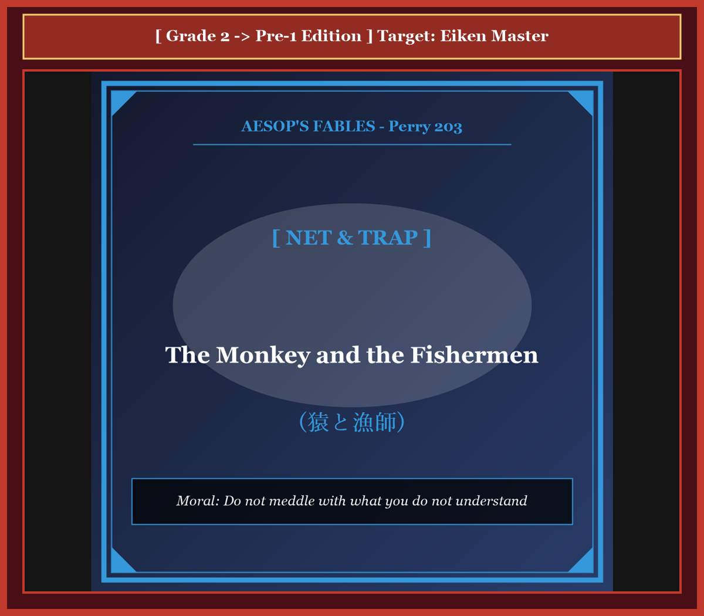

# Chapter 37: The Monkey and the Fishermen (猿と漁師)

<!-- 電子書籍 Page Break & Image Header -->

  

## 1. Benchmark Level: Eiken Grade 2 (英検2級レベル本文)
*Read in ~2.5 to 3 minutes. Baseline vocabulary and basic syntax.*

Perched in observational detachment upon an arboreal vantage point overlooking a riparian corridor, a simian observer conducted an intensive behavioral reconnaissance of veteran commercial fishermen engaged in maritime harvesting.

With unblinking cognitive absorption, the primate monitored the complex kinetic synchronization displayed by the crew. He watched as they deployed expansive circular seines across the laminar flow, manipulating peripheral lead weights with consummate torque to maximize submerged perimeter coverage before hauling back bountiful harvests of freshwater fauna. Influenced by the simian propensity for unreflective behavioral simulation, the observer committed an egregious cognitive error: he conflated the apparent effortless fluidity of expert execution with intrinsic operational simplicity. "A rudimentary manual discipline," the hubristic creature rationalized internally. "If these bipedal artisans navigate such equipment through muscle memory alone, an organism endowed with quadrumanous dexterity can execute the identical protocol with superior efficacy."

When the artisans instituted their statutory mid-day recess, consigning their saturated apparatus to the riparian littoral while retiring to a communal mess, the opportunist perceived an ideal experimental vacuum.

Decanting precipitously from the canopy, the arrogant primate invaded the workspace to validate his unsubstantiated technical hypothesis. Apprehending the heavy perimeter cordage, he mobilized his skeletal levers to simulate the expansive, rotating centrifugal projection he had visually assimilated.

Predictably, the biomechanical execution degenerated into instant catastrophe. Bereft of foundational kinetic intuition, torque modulation, and angular momentum, his spastic release failed to generate aerodynamic expansion. Instead of deploying into an expansive parabolic plane across the water, the chaotic folds imploded gravitationally upon the operator, instantly entangling his cranial, thoracic, and manual appendages within an impenetrable labyrinth of weighted fiber.

Compounding his physiological dilemma, the panicked simian engaged in uncoordinated defensive thrashing; yet pursuant to the physical mechanics of knotted mesh, every convulsive spasm merely amplified tensile constriction against his trachea and carotid arteries. Deprived of equilibrium and blinded by the sodden netting, the immobilized creature slid off the declivity and plunged into the river's vortex.

Weighted down by waterlogged cordage and sucked into the hydraulic abyss, the asphyxiating primate arrived at an agonizing, terminal realization of epistemological humility: "My annihilation is the direct corollary of unchecked intellectual presumption! Entirely uninitiated in the empirical fundamentals of maritime craft, what monumental hubris impelled me to usurp the specialized jurisdictions of lifelong vocational practitioners?"

---

## 2. Target Level: Eiken Grade Pre-1 (英検準1級レベル本文)
*Read in ~3 to 3.5 minutes. Sophisticated vocabulary, subtle rhetoric, and academic analysis.*

Occupying an elevated arboreal observatory overlooking a meandering lotic ecosystem, an anthropoid spectator executed an exhaustive empirical reconnaissance of professional piscatorial operatives engaged in hydraulic harvesting.

With acute cognitive fascination, the simian tracked the fluid, algorithmic synchronization of the crew as they cast their weighted circumferential seines across the laminar currents, leveraging centrifugal inertia with sublime mechanical efficiency to harvest teeming shoals of freshwater teleosts. Governed by the primate's congenital predisposition toward superficial memetic replication, the observer fell into an intellectual snare: he succumbed to the classic Dunning-Kruger cognitive fallacy, conflating the effortless kinesthetic grace of long-acquired mastery with intrinsic operational simplicity. "A trivial biomechanical routine," the vainglorious creature deduced with self-congratulatory conceit. "If clumsy bipedal mammals can execute this protocol with habitual nonchalance, an organism possessing prehensile appendages and superior agility can replicate the maneuver with incomparably greater finesse."

When the laborers enacted their customary meridian recess, leaving their saturated gear dormant upon the alluvial shoreline while retiring to a nearby pavilion, the opportunist identified an irresistible vacuum for amateur intervention.

Descending precipitously from his leafy redoubt, the hubristic primate infiltrated the deserted workstation to operationalize his untested methodology. Apprehending the cumbersome perimeter rigging, he coiled his muscular sinews to execute the wide-radius, centrifugal ballistic launch he had visually assimilated from the canopy.

Inevitably, the kinetic execution proved calamitous. Entirely destitute of neuromuscular calibration, angular momentum modulation, and aerodynamic intuition, his violent thrust generated zero horizontal expansion. Instead of billowing into an expansive planar circle across the water's surface, the lead-weighted folds collapsed centripetally upon the operator, instantly encasing his skull, torso, and extremities within an impenetrable, constrictive web of wet cordage.

Compounding his catastrophic predicament, the panicked animal engaged in hysterical, uncoordinated thrashing; yet pursuant to the geometric properties of knotted twine, every frantic convulsion merely tightened the asphyxiating tourniquet around his windpipe and jugular veins. Disoriented, blinded, and stripped of motor equilibrium, the tangled mass tumbled down the muddy escarpment and plunged into the turbulent hydraulic undertow.

Dragged irrevocably toward the subterranean riverbed by the waterlogged ballast of the net, the drowning ape attained a final, agonizing epiphany of epistemic humility: "I suffer the absolute penalty for catastrophic intellectual presumption! Wholly uninitiated in the arduous apprenticeships of specialized crafts, what suicidal arrogance impelled me to trespass upon the exclusive vocational domain of seasoned artisans?"

---

## 3. Classic Original English Text (イソップ寓話クラシック原文)
*Perry 203: Translated by George Fyler Townsend (1867)*

A Monkey, seated on a lofty tree, saw some Fishermen casting their nets into a river, and narrowly watched their proceedings. 

The Fishermen after a while gave up fishing, and on going home to dinner, left their nets upon the bank. 

The Monkey, who is the most imitative of animals, descended from the treetop, and endeavoured to do as they had done. Having handled the net, he threw it from him; but it became entangled around him, and he rolled into the river. 

Being in the act of drowning, he said to himself: "This is a just reward for my foolishness; for what business had I, who knew nothing of the matter, to try and fish with nets?"

---

### 🏛️ 【英検2級レベルで読み解く！クラシック原文の重要構文・英文法ノート】
1. **1. 分詞構文（Participle Clause: 付帯状況・理由）**
   - **原文**: *"The Hare, believing her assertion to be simply impossible, agreed to the proposal..."*
   - **解説**: 「〜と信じ込んでいたので」という理由を表す分詞構文。英検2級の長文読解・ライティングの最頻出構文です。
1. **2. 古典的仮定法現在（Subjunctive Mood）**
   - **原文**: *"Though you be swift as the wind, I will beat you in a race."*
   - **解説**: 譲歩節 `Though` の中で原形 `be` を用いる古典的な仮定法現在（現代英語の `Though you are...`）。格調高い古典の響きを持ちます。
1. **3. 過去分詞の後置修飾（Postpositive Participle）**
   - **原文**: *"On the day appointed for the race the two started together."*
   - **解説**: `appointed`（定められた・指定された）が直前の名詞 `the day` を後ろから修飾する構文です。

### 📜 【クラシック原文の重要語彙・古風表現（Classic Antique Vocabulary）】
- **retort** [動] 2級 **（機転を利かせて）言い返す、反論する**（現代の reply sharp/wittily に相当）
- **assertion** [名] 2級/準1級 **主張、断言**（動詞 assert の名詞形。2級長文定番）
- **wayside** [名] 2級 **道端、沿道**（by the wayside（道端に、途中で））
- **fatigue** [名] 2級 **（心身の）極度の疲労、疲れ**（tiredness の上位フォーマル語）

---

## 4. Japanese Translation & Moral (日本語訳と教訓)

### 【日本語全訳：英検準1級レベル本文】
蛇行する河川生態系を見下ろす高い樹上の観測所に陣取っていた類人猿の傍観者が、水域での収穫に従事するプロの漁撈（ぎょろう）作業員たちの徹底的な実証的偵察を実施していました。

鋭い知的好奇心をもって、その類人猿は、乗組員たちが層流を横切って重りのついた円形引き網を投じ、真骨魚類の群れを捕獲するために崇高な機械的効率をもって遠心慣性を活用する流暢でアルゴリズム的な同期を追跡していました。表面的なミーム的（模倣的）複製へと向かう霊長類特有の先天的性質に支配されたこの観察者は、典型的な知的罠に陥ってしまいました。彼はクラシックな「ダニング＝クルーガー効果（無知ゆえの過剰な自信）」という認知的誤謬に屈し、長い修練によって獲得された熟達のたやすい運動感覚的優雅さを、本質的な操作の単純さと混同してしまったのです。「取るに足らない初歩的な生体力学的ルーチンにすぎない」と自惚れた生き物は自画自賛の傲慢さをもって結論づけました。「不器用な二足歩行の哺乳類があれほど当たり前の平然さをもってこの手順を実行できるのであれば、物を掴むことのできる四肢と優れた敏捷性を備えた私のような生物であれば、比較にならないほど洗練された手際でその機動を再現できるはずだ。」

労働者たちが慣例の正午の休憩を取り、湿った道具を沖積岸辺に残して近くの東屋へと引き上げたとき、この日和見主義者は素人の介入のための抗いがたい空白を特定しました。

葉の茂る砦から急降下した傲慢な類人猿は、未検証の自説を実行に移すために無人の作業場へと侵入しました。扱いにくい外周のロープを握り締めると、彼は樹冠から視覚的に取り込んでいた広範な回転遠心弾道投射を実行するために、筋肉の腱を緊張させました。

必然的に、その運動学的実行は破滅的な結果となりました。神経筋のキャリブレーション、角運動量の調整、空気力学的直感を完全に欠いていたため、彼の乱暴な推進力は水平方向の展開をまったく生み出しませんでした。水面を横切る広大な平面的円形へと広がるどころか、鉛の重りがついた折り目は操作者の上へと求心的に崩落し、濡れたロープの貫通不可能な拘束性の網の中に、彼の頭骨、胴体、四肢を瞬時に閉じ込めてしまったのです。

彼の破滅的な苦境に拍車をかけるように、パニックに陥った動物は狂乱した統制のないのたうち回りを展開しました。しかし、結ばれた麻ひもの幾何学的特性に従い、あらゆる必死の痙攣は、彼の気管と頸静脈に対する窒息性の止血帯を締め上げるだけでした。方向感覚を失い、視界を遮られ、運動の平衡を剥奪された絡まった塊は、泥だらけの急斜面を転がり落ち、荒れ狂う水力学的底流の中へと沈落していきました。

網の水を吸ったバラスト（重り）によって不可逆的に川底へと引きずり込まれながら、溺れゆく類人猿は認識論的謙虚さの最終的で痛切な悟りに達しました。「私は破滅的な知的過信に対する絶対的な懲罰を被っているのだ！ 専門職の過酷な徒弟修業に何ら手ほどきを受けていないというのに、いかなる自殺的な傲慢さに駆られて、熟練した職人たちの排他的な職業領域へと不法侵入してしまったのだろうか。」

### 【教訓（Moral）】
**Do not meddle with what you do not understand.**  
（自らが理解していない専門技術や高度な領域に軽々しく介入してはならない。プロの洗練された容易さを安易な作業と錯覚し、無知な過信（ダニング＝クルーガー効果）から専門領域に侵入する素人は、自らが投じた網によって自らを窒息させ破滅する。）

---

## 5. Recite & Compare: そらんじたいキーフレーズ対比カード

  
フレーズ 1：ダニング＝クルーガー効果による熟達の誤認

  
2級He conflated the apparent effortless fluidity of expert execution with intrinsic operational simplicity.

  
準1級Succumbing to the Dunning-Kruger cognitive fallacy, he conflated the kinesthetic grace of mastery with intrinsic simplicity.

  
<strong>解説：</strong>現代認知科学の最重要ターム「Dunning-Kruger cognitive fallacy（ダニング＝クルーガー認知的誤謬）」をズバリ導入し、素人の身の程知らずを学術的に喝破しています。

  
フレーズ 2：遠心弾道投射の失敗と求心的崩壊

  
2級Instead of deploying into an expansive parabolic plane, the chaotic folds imploded upon the operator.

  
準1級Instead of billowing into an expansive planar circle, the lead-weighted folds collapsed centripetally upon the operator.

  
<strong>解説：</strong>「billowing into an expansive planar circle（広大な平面的円形へと波打って広がる）」と「collapsed centripetally upon the operator（操作者の上へと求心的に崩落した）」という物理幾何学の対句です。

  
フレーズ 3：もがくほど頸動脈を締める止血帯

  
2級Every convulsive spasm merely amplified tensile constriction against his trachea and carotid arteries.

  
準1級Pursuant to geometric properties of knotted twine, every frantic convulsion tightened the asphyxiating tourniquet around his windpipe.

  
<strong>解説：</strong>「asphyxiating tourniquet（窒息性の止血帯）」という強烈な医学的メタファーを用い、網が自らを絞殺する凶器へと変貌した瞬間を活写しています。

  
フレーズ 4：過酷な徒弟修業を経ていない者の自滅

  
2級What monumental hubris impelled me to usurp the jurisdictions of lifelong practitioners?

  
準1級Wholly uninitiated in the arduous apprenticeships of crafts, what suicidal arrogance impelled me to trespass upon the exclusive domain?

  
<strong>解説：</strong>「arduous apprenticeships（過酷な徒弟制度・修行期間）」や「suicidal arrogance impelled me to trespass（いかなる自殺的な傲慢さに駆られて不法侵入したのか）」という反語的告発です。

---

## 6. Key Vocabulary & Exam Notes (英検準1級 重要語彙・文法・面接対策)

### 1. 英検準1級 必須ボキャブラリー
* **lotic** [形] 流水（性）の（川や渓流に関する生態学用語）
* **piscatorial** [形] 漁業の、釣りの（*fishing* の学術的表現）
* **kinesthetic** [形] 運動感覚の、筋肉運動感覚の
* **vainglorious** [形] うぬぼれの強い、虚栄心の強い
* **finesse** [名] 巧妙な処理、手腕、技巧
* **centripetally** [副] 求心的に（*centrifugally*「遠心的に」の対義語）
* **tourniquet** [名] 止血帯、圧迫器具
* **apprenticeship** [名] 見習い期間、徒弟修業

### 2. 文法・構文のチェックポイント
* **The Dunning-Kruger effect / fallacy**:
  * 能力の低い人ほど自分の能力を過大評価するという認知バイアスを指す学術用語であり、論説文の強力な論拠となります。
* **pursuant to ~**: 「〜に従って、〜の特性に起因して」
  * 物理法則や幾何学的制約によって不可避に事態が進行する因果関係を述べる文語です。

### 3. スピーキング（面接）＆ライティング活用ヒント
「専門教育の必須性」「アマチュアによる無謀な投資・参入の危険」を論述する際に最適です：
* *Novices entering complex financial markets often fall into the Dunning-Kruger fallacy with catastrophic results.*（複雑な金融市場に参入する素人は、しばしばダニング＝クルーガーの誤謬に陥り、壊滅的な結果を招く。）
* *Superficial observation can never substitute for the kinesthetic intuition acquired through rigorous professional apprenticeships.*（表面的な観察は、厳格な専門的徒弟修業を通じて獲得された運動感覚的直感を決して代替することはできない。）
