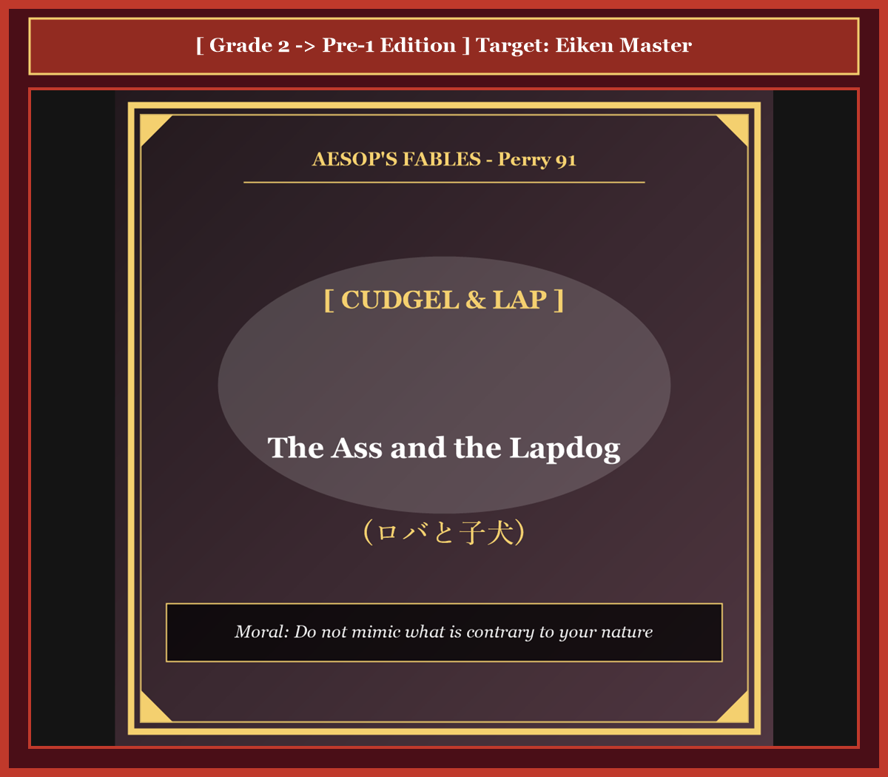

# Chapter 40: The Ass and the Lapdog (ロバと子犬)

<!-- 電子書籍 Page Break & Image Header -->

  

## 1. Benchmark Level: Eiken Grade 2 (英検2級レベル本文)
*Read in ~2.5 to 3 minutes. Baseline vocabulary and basic syntax.*

An opulent agrarian plutocrat maintained within his baronial demesne two domestic quadrupeds occupying antipodal sociological strata: a utilitarian pack-ass conditioned to unremitting industrial toil, and an aristocratic canine sycophant pampered in sybaritic luxury.

The equine laborer was subordinated to an institutionalized regime of unrelenting manual exploitation. His diurnal schedule encompassed hauling mountainous payloads of agricultural produce, operating rotational grain millstones, and navigating steep logging trails. Upon the cessation of his functional duties, he was peremptorily banished to an austere paddock, condemned to subsist upon desiccated chaff and brackish water, entirely unacknowledged by the proprietor.

Conversely, the diminutive lapdog occupied a lucrative domestic niche predicated upon demonstrative obsequiousness and theatrical adulation. Consequent to the master's return from administrative jurisdictions, the pampered pet would execute choreographed exhibitions of exuberant subservience—frisking vivaciously across marble mosaics, vibrating his caudal extremity with synthetic delirium, and ascending into the sovereign lap. Enchanted by these choreographed displays of adoration, the proprietor would caress the animal's groomed pelt, rewarding his calculated flatteries with epicurean delicacies harvested directly from the banquet sideboard.

Ruminating upon this grotesque socioeconomic asymmetry from the squalor of his confinement, the alienated donkey developed an acute sense of systemic grievance. "Under what rational ethical calculus is this invidious stratification justified?" he hypothesized with mounting indignation. "I deliver foundational infrastructural value indispensable to the economic solvency of this enterprise, yet remain relegated to marginal neglect. Concurrently, an unproductive parasite extracts lavish social dividends exclusively through superficial pantomimes of affection. If institutional remuneration in this household is allocated according to demonstrative exuberance rather than productive output, I shall systematically appropriate the canine behavioral matrix and demand my proportional entitlement to domestic luxury."

Mobilizing under this fatally flawed operational paradigm, the deluded creature manipulated the latch of his enclosure the subsequent dusk, infiltrating the illuminated precincts of the manor's salon.

Breaching the threshold, the massive quadruped reverberated an ear-shattering cacophony of celebratory braying throughout the vaulted interior. Sighting his sovereign reclined before the fireplace, the colossal intruder propelled his three-hundred-kilogram bulk across priceless Aubusson tapestries with uninhibited kinetic momentum. Rearing into an unnatural bipedal elevation with catastrophic goodwill, he slammed both gargantuan, mud-calcified hooves squarely into the patriarch's pectoral girdle, simultaneously attempting to coat the magnate's paralyzed countenance with vigorous lacerations of his fibrous tongue.

Pinioned beneath the overwhelming compressive mass of livestock, the asphyxiating patrician articulated shrill vociferations of mortal panic. Mahogany furnishings disintegrated into kindling, ornate candelabra collapsed, and invaluable porcelain heirlooms were pulverized beneath thrashing hooves.

Electrified by the auditory signatures of crisis, the estate's security personnel breached the chamber armed with reinforced clubs and agricultural bludgeons. Extrapolating that an unprovoked homicidal insurrection was in progress, the retainers subjected the immobilized beast to an unrelenting barrage of concussive force, battering his skeletal frame until the hemorrhaging intruder was dragged back into his equestrian exile.

Nursing his fractured ribs amidst the filth of his stall, the enlightened quadruped formulated his definitive epistemological synthesis: "I have incurred an entirely equitable penalty for violating categorical boundaries. Evolution calibrated my physiology to sustain monumental burdens with austere stoicism; attempting to counterfeit the effeminate servilities of an indulged sycophant represents a grotesque operational distortion that inevitably invites catastrophic annihilation."

---

## 2. Target Level: Eiken Grade Pre-1 (英検準1級レベル本文)
*Read in ~3 to 3.5 minutes. Sophisticated vocabulary, subtle rhetoric, and academic analysis.*

Within the baronial demesne of an aristocratic agrarian magnate, two domestic quadrupeds occupied antipodal poles of institutional prestige: an unheralded pack-ass habituated to brutal infrastructural drudgery, and an effete Maltese lapdog immersed in sybaritic decadence.

The utilitarian beast of burden was permanently subjugated to an exhausting regime of macroeconomic extraction. His diurnal itinerary comprised hauling monumental tonnages of harvested grain, rotating ponderous millstones through grinding friction, and traversing hazardous mountain inclines under oppressive atmospheric conditions. Upon the termination of his functional shifts, he was summarily ostracized to an uninsulated paddock, forced to subsist upon desiccated straw and brackish effluents, receiving zero emotional or material affirmation from his master.

In stark contrast, the diminutive canine courtesan occupied an enviable sinecure predicated wholly upon choreographed obsequiousness and manufactured adoration. Whenever the patriarch concluded his administrative excursions, the favored parasite would execute dazzling exhibitions of fawning adulation: prancing hysterically across parquet floors, oscillating his caudal appendage in simulated ecstasy, and vaulting into the master's lap with practiced spontaneity. Bewitched by these theatrical demonstrations of loyalty, the proprietor would stroke the creature's groomed fleece, rewarding this parasitic pantomime with choice culinary delicacies carved directly from the banqueting table.

Brooding upon this grotesque sociological dichotomy from the squalor of his stable, the disenfranchised donkey succumbed to a profound epistemological delusion. "By what coherent meritocratic metric is this systemic inequity legitimized?" he rationalized with escalating resentment. "I generate the fundamental kinetic energy that underpins the fiscal viability of this entire feudal enterprise, yet I am treated as a dispensable biological machine. Concurrently, a non-productive courtier extracts lavish emotional rents through frivolous buffoonery. If status and resource allocation in this hierarchy are governed not by tangible productivity but by theatrical servility, I shall systematically appropriate the lapdog's behavioral protocols and seize my equitable dividend of sovereign indulgence."

Precipitated by this catastrophic miscalculation of comparative advantage, the deluded ass unlatched his stall at dusk and infiltrated the illuminated precincts of the manor's grand salon.

Erupting through the mahogany portals, the colossal beast unleashed an ear-splitting cacophony of celebratory braying that shattered the domestic serenity. Observing the patriarch reclining before the hearth, the mammoth quadruped galloped across Persian heirlooms with terrifying momentum. Rearing into an unnatural bipedal stance with catastrophic benevolence, he slammed both massive, manure-crusted hooves directly into the nobleman's clavicles, simultaneously subjecting the gentleman's horrified countenance to affectionate, abrasive lacerations with his sandpaper-coarse tongue.

Immobilized beneath three hundred kilograms of uncoordinated livestock, the asphyxiating aristocrat emitted piercing shrieks of mortal terror. Antique mahogany chiffoniers splintered into kindling, Venetian crystal chandeliers swayed violently from the concussive tremors, and priceless Meissen porcelain was pulverized into ceramic powder.

Galvanized by the homeowner's desperate alarm, the estate's retainers stormed the drawing room wielding iron-shod staves and agricultural bludgeons. Hypothesizing that a lethal, unprovoked assault was underway, the guards subjected the bewildered beast to a merciless barrage of blunt-force trauma, shattering his ribs and fracturing his limbs until the bleeding trespasser was dragged back into his equestrian dungeon.

Languishing upon the damp straw while nursing his pulverized anatomy, the battered quadruped articulated his definitive philosophical catharsis: "I have earned this brutal retribution through an unpardonable defiance of ontological boundaries. Nature calibrated my muscular physiology to endure austere toil with stoic dignity; attempting to ape the effeminate flattery of a coddled lapdog constitutes a grotesque behavioral aberration that invites instantaneous, lethal humiliation."

---

## 3. Classic Original English Text (イソップ寓話クラシック原文)
*Perry 91: Translated by George Fyler Townsend (1867)*

A Man had a Donkey and a Maltese Lapdog, a very great beauty. The Donkey was conditioned only to carry burdens, but the Dog had every advantage. 

The Donkey, seeing how much the Dog was petted, determined to try if he could not win his Master's favor by imitating him. 

One day, having broken his halter, he ran into his Master's house, and began to gambol about in the room, breaking the furniture. 

He then ran up to his Master, and put his fore-feet upon his shoulders, and licked his face with his tongue, just as he had seen the Dog do. 

The Master cried out with fear, and the servants running in with sticks, beat the Donkey till he was nearly dead, and then turned him out into his stable. 

The Donkey, groaning with his bruises, said: "What a fool I was to imitate a Lapdog, when I was only born to carry burdens!"

---

### 🏛️ 【英検2級レベルで読み解く！クラシック原文の重要構文・英文法ノート】
1. **1. 分詞構文（Participle Clause: 付帯状況・理由）**
   - **原文**: *"The Hare, believing her assertion to be simply impossible, agreed to the proposal..."*
   - **解説**: 「〜と信じ込んでいたので」という理由を表す分詞構文。英検2級の長文読解・ライティングの最頻出構文です。
1. **2. 古典的仮定法現在（Subjunctive Mood）**
   - **原文**: *"Though you be swift as the wind, I will beat you in a race."*
   - **解説**: 譲歩節 `Though` の中で原形 `be` を用いる古典的な仮定法現在（現代英語の `Though you are...`）。格調高い古典の響きを持ちます。
1. **3. 過去分詞の後置修飾（Postpositive Participle）**
   - **原文**: *"On the day appointed for the race the two started together."*
   - **解説**: `appointed`（定められた・指定された）が直前の名詞 `the day` を後ろから修飾する構文です。

### 📜 【クラシック原文の重要語彙・古風表現（Classic Antique Vocabulary）】
- **retort** [動] 2級 **（機転を利かせて）言い返す、反論する**（現代の reply sharp/wittily に相当）
- **assertion** [名] 2級/準1級 **主張、断言**（動詞 assert の名詞形。2級長文定番）
- **wayside** [名] 2級 **道端、沿道**（by the wayside（道端に、途中で））
- **fatigue** [名] 2級 **（心身の）極度の疲労、疲れ**（tiredness の上位フォーマル語）

---

## 4. Japanese Translation & Moral (日本語訳と教訓)

### 【日本語全訳：英検準1級レベル本文】
ある貴族的な大農園領主の荘園領地において、2頭の家畜が制度的威信の正反対の極を占めていました。過酷なインフラ維持の重労働に慣らされた無名の荷役ロバと、贅沢三昧の快楽に浸る優雅なマルチーズの子犬（愛玩犬）です。

実用的な荷役獣であるロバは、過酷なマクロ経済的搾取の体制に永久に従属させられていました。彼の日課は、収穫された穀物の莫大な重量を牽引し、猛烈な摩擦抵抗の中で重い石臼を回転させ、過酷な天候下で危険な山岳の傾斜地を行き来することから成り立っていました。機能的な勤務シフトが終わると、彼は断熱もされていない囲い地へと問答無用に追放され、乾燥した藁と濁った排水をすすって生き延びることを余儀なくされ、主人からの精神的・物質的肯定を一切受けることはありませんでした。

それとは際立った対照をなして、小柄な犬の廷臣（愛玩犬）は、計算し尽くされた卑屈さと演出された賛美の上に完全に築かれた、羨望の的となる閑職を享受していました。領主が管理の巡回から戻ってくるたびに、この寵愛された寄生者は熱烈なへつらいの見事な展示を披露しました。寄木張りの床の上を熱狂的に跳ね回り、見せかけの有頂天さで尾の付属肢を小刻みに振り、練習通りの自発性をもって主人の膝へと飛び乗ったのです。この忠誠の劇的な実演に魅了された主人は、その手入れの行き届いた毛並みを撫で、宴席のテーブルから直接切り分けられた選りすぐりの料理のご馳走で、この寄生的なパントマイムに報いていました。

自らの厩舎の不潔さの中からこの奇怪な社会学的二分法（格差）を熟考していた権利を奪われたロバは、深刻な認識論的妄想に屈服してしまいました。「いかなる首尾一貫した実力主義の指標によって、この制度的不平等が正当化されているというのだ？」と彼は憤りを募らせながら自己正当化しました。「私はこの封建的事業全体の財政的存続可能性を支える根本的な運動エネルギーを生み出しているにもかかわらず、使い捨ての生物機械として扱われている。それと同時に、非生産的な廷臣が浅薄なおどけによって法外な感情的利得（レント）を吸い上げている。もしこの序列における地位と資源配分が、有形の実質的生産性ではなく劇的な卑屈さによって支配されているのなら、私も子犬の行動プロトコルを組織的に借用し、主権者の寵愛の公平な分配金を奪い取ってやるまでだ。」

比較優位に対するこの破滅的な誤算に突き動かされ、妄想にとらわれたロバは夕暮れ時に自らの馬房の掛け金を外し、邸宅の壮麗なサロンの照らし出された区画へと潜入しました。

マホガニーの扉を突破して乱入したこの巨大な野獣は、家庭内の静けさを粉砕するような勝利のいななきの耳をつんざく不協和音を響き渡らせました。暖炉の前でくつろいでいる主君を見つけるやいなや、この巨体の四足獣は恐るべき運動量でペルシャ絨毯の上を突進しました。破滅的な親愛の情をもって不自然な二足直立姿勢へと立ち上がると、泥と糞で固まった巨大な両前蹄を貴族の鎖骨へと直接叩きつけ、同時にその恐怖に凍りついた顔面を、紙やすりのように粗い舌で愛情を込めてヤスリがけするように激しく舐め回したのです。

300キログラムのまとまりのない家畜の重圧の下で身動きが取れなくなった、窒息しかけた貴族は、死の恐怖の甲高い悲鳴を上げました。アンティークのマホガニー製タンスは粉微塵に砕けて焚き付けとなり、ヴェネツィアン・クリスタルのシャンデリアは衝撃的な振動で激しく揺れ、貴重なマイセン陶磁器は暴れる蹄の下で陶器の粉へと粉砕されました。

家主の必死の警報によって奮起された邸宅の護衛使役人たちは、鉄で補強された杖や農具のこん棒を振りかざして客間へと突入しました。理由なき致死的な襲撃が進行中であると推論した護衛たちは、この困惑した野獣に容赦のない鈍器による打撃の嵐を浴びせ、肋骨を砕き四肢を骨折させ、血を流す侵入者を馬の地下牢へと引きずり戻すまで殴り続けました。

湿った藁の上に横たわり、粉砕された身体の手当てをしながら、打ちのめされたロバは自らの決定的な哲学的カタルシスを口にしました。「私は存在論的境界に対する許されざる反逆を通じて、この残酷な報いを自ら招いたのだ。自然は、私の筋肉質な生理機能を、禁欲的な尊厳をもって過酷な労苦に耐えるよう較正した。甘やかされた愛玩犬の軟弱な追従を猿真似しようと試みることは、瞬時の致死的な屈辱を招く奇怪な行動異常にほかならない。」

### 【教訓（Moral）】
**To ape the favored sycophant is ruin for the honest laborer.**  
（天分と役割を弁えず、寵愛される追従者の軟弱な猿真似をすることは、誠実な働き手にとって自滅の道である。各人には固有の領域と天性があり、己の領分を忘れて他者の虚飾を真似る者は、自らの尊厳を失うだけでなく、破滅的な惨劇を招き寄せることになる。）

---

## 5. Recite & Compare: そらんじたいキーフレーズ対比カード

  
フレーズ 1：過酷な重労働ロバと贅沢三昧の子犬の身分格差

  
2級A pack-ass conditioned to industrial toil, and an aristocratic canine sycophant pampered in sybaritic luxury.

  
準1級An unheralded pack-ass habituated to brutal drudgery, and an effete Maltese lapdog immersed in sybaritic decadence.

  
<strong>解説：</strong>「effete（軟弱化した、気力を失った）」や「sybaritic decadence（過度の快楽に溺れた退廃）」を用い、労働と特権の不条理なコントラストを鮮明に浮き彫りにしています。

  
フレーズ 2：へつらいを演じることで不労所得を得る愛玩犬

  
2級The lapdog occupied a lucrative domestic niche predicated upon demonstrative obsequiousness and adulation.

  
準1級The canine courtesan occupied an enviable sinecure predicated wholly upon choreographed obsequiousness.

  
<strong>解説：</strong>政治・組織論用語の「sinecure（名誉職、実務のない高給閑職）」を用いて、無生産な寵愛関係を鋭く風刺しています。

  
フレーズ 3：実力主義への疑念と猿真似の決意

  
2級Under what rational ethical calculus is this invidious stratification justified?

  
準1級By what coherent meritocratic metric is this systemic inequity legitimized? I shall appropriate the canine behavioral protocols.

  
<strong>解説：</strong>社会科学・政策論争で用いられる「meritocratic metric（能力主義的評価基準）」、「systemic inequity（構造的不平等）」を用いた知性あふれる独白です。

  
フレーズ 4：天性の領分を越境したことへの猛省

  
2級I have incurred an entirely equitable penalty for violating categorical boundaries.

  
準1級I have earned this brutal retribution through an unpardonable defiance of ontological boundaries.

  
<strong>解説：</strong>哲学用語「ontological boundaries（存在論的境界＝存在としての本質的な領分・分限）」を用いた最高峰の格調高い反省の弁です。

---

## 6. Key Vocabulary & Exam Notes (英検準1級 重要語彙・文法・面接対策)

### 1. 英検準1級 必須ボキャブラリー
* **demesne** [名] 荘園、所領、直轄地
* **effete** [形] （贅沢などで）気力を失った、軟弱な、衰えた
* **sinecure** [名] 閑職、名誉職（給与は良いが仕事が少ない職）
* **obsequiousness** [名] 追従、こびへつらい
* **meritocratic** [形] 実力主義の、能力主義の
* **ontological** [形] 存在論的な、本質的な
* **ape** [動] （軽蔑的に）〜の猿真似をする、模倣する
* **catharsis** [名] カタルシス、感情の浄化、精神的解放

### 2. 文法・構文のチェックポイント
* **predicate A upon [on] B**: 「Aの根拠をBに置く、AをBに基づくものとする」
  * 学術論文や知的な論評で受動態 *be predicated on...* として極めて高頻度で登場します。
* **To ape A is ruin for B**:
  * 不定詞の名詞的用法が主語となり、格言的・普遍的な命題を提示する緊迫感ある構文です。

### 3. スピーキング（面接）＆ライティング活用ヒント
「適材適所の人事」「組織における役割分担」を論じる際に応用できます：
* *Attempting to ape models from unrelated industries without understanding core competencies invites systemic failure.*（自らのコアコンピタンスを理解せず無関係な業界のモデルを猿真似することは、組織的破綻を招く。）
* *Compensation metrics should be predicated on tangible societal value rather than superficial self-promotion.*（評価・報酬の基準は、表面的な自己アピールではなく、実体的な社会的価値に基づかなければならない。）
