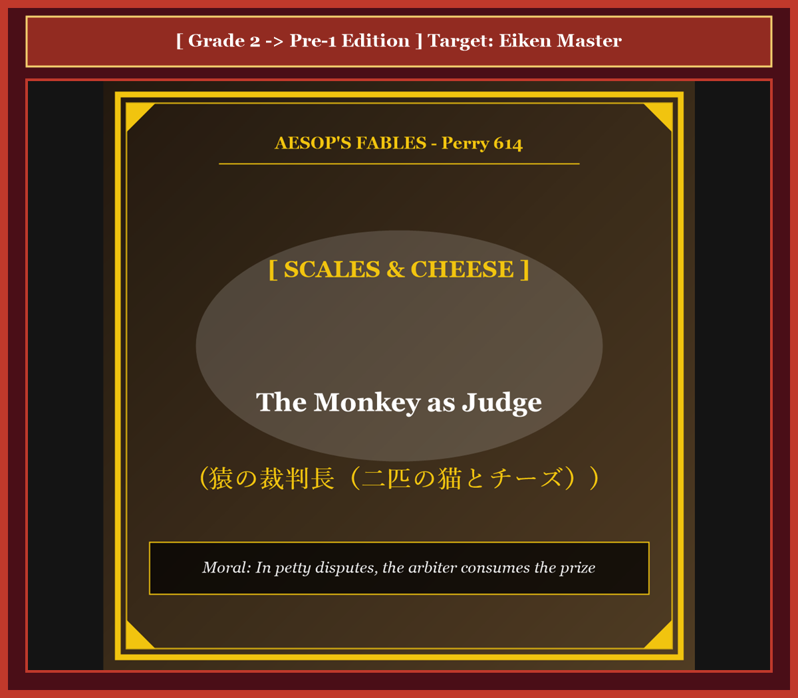

# Chapter 52: The Monkey as Judge (猿の裁判長)

<!-- 電子書籍 Page Break & Image Header -->

  

## 1. Benchmark Level: Eiken Grade 2 (英検2級レベル本文)
*Read in ~2.5 to 3 minutes. Baseline vocabulary and basic syntax.*

Within an agrarian settlement, two feral domestic felines discovered a substantial block of seasoned cheese. Initially exhilarated by this unexpected acquisition, the predators quickly descended into contentious litigation regarding the equitable distribution of their communal property.

Neither party demonstrated the slightest inclination to achieve a diplomatic compromise. The black cat asserted chronological priority of visual discovery, whereas the white adversary maintained physical possession. Recognizing the total paralysis of their bilateral negotiations, the naive litigants resolved to submit their conflict to formal external arbitration.

Appearing opportunistically from an adjacent oak tree, an unscrupulous primate offered his professional mediation. Projecting an aura of judicial solemnity, the monkey assured them that his objective calibration would guarantee egalitarian justice. Subordinating prudence to procedural desperation, the felines surrendered their contested asset to the magistrate.

The primate immediately deployed an apparatus of balancing scales. Bisecting the cheese into deliberately disproportionate segments, he deposited them upon opposite pans, causing the heavier sector to plunge abruptly toward the ground.

"An intolerable structural discrepancy," proclaimed the judge with theatrical gravity. "Equilibrium must be restored through regulatory reduction." Thereupon, the arbiter consumed an enormous portion from the dominant fragment. However, this clumsy subtraction reversed the disparity, necessitating a reciprocal reduction from the opposing side.

Iterating this manipulative oscillation, the anxious felines witnessed their prized commodity systematically liquidated before their eyes. Terrified by the rapid evaporation of their property, the litigants implored the court to suspend proceedings: "Surrender the residual fragments! We formally dissolve our dispute!"

"Judicial procedure cannot be summarily terminated without the full liquidation of professional administrative fees," retorted the primate. Consuming the final crumbs with nonchalant satisfaction, the arbiter absconded into the forest canopy, leaving the litigants thoroughly destitute.

---

## 2. Target Level: Eiken Grade Pre-1 (英検準1級レベル本文)
*Read in ~3 to 3.5 minutes. Sophisticated vocabulary, subtle rhetoric, and academic analysis.*

Within the rural perimeter of an agrarian commune, two feral felines made the accidental acquisition of a prime segment of coagulated dairy curd. Initially electrified by this fortuitous windfall, the predators swiftly deteriorated into acrimonious litigation concerning the proportional allocation of their unearned asset.

Neither disputant exhibited the slightest disposition toward amicable compromise. The melanistic feline asserted chronological precedence of optical detection, whereas the albino counterpart claimed tangible physical possession. Confronting the absolute paralysis of bilateral conciliation, the naive litigants resolved to submit their conflict to professional external adjudication.

Intervening opportunistically from the arboreal canopy, an unprincipled simian proffered his judicial services. Projecting a synthetic facade of jurisdictional impartiality, the primate assured the disputants that his calibrating apparatus would enforce egalitarian equity. Subordinating baseline skepticism to procedural desperation, the felines surrendered the contested cheese to the magistrate.

The primate promptly deployed a dual-pan balancing mechanism. Cleaving the commodity into deliberately asymmetrical sectors, he deposited the fragments upon opposing pans, causing the dominant mass to plunge precipitously.

"A grotesque structural discrepancy," declaimed the judge with histrionic gravity. "Regulatory equilibrium must be restored through surgical subtraction." Thereupon, the arbiter consumed a massive bolus from the heavier sector. However, this heavy-handed reduction inverted the gravimetric disparity, compelling an immediate reciprocal mastication from the opposing pan.

Iterating this manipulative oscillation, the feline spectators witnessed their prized equity systematically liquidated through regulatory expropriation. Horrified by the rapid vaporization of their asset, the litigants petitioned for summary dismissal: "Surrender the residual morsels! We unilaterally dissolve our claim!"

"Judicial procedure cannot be arbitrarily terminated without the complete satisfaction of compensatory administrative stipends," retorted the simian. Ingesting the terminal crumbs with cynical nonchalance, the arbiter vaulted into the canopy, abandoning the litigants in absolute destitution.

---

## 3. Classic Original English Text (イソップ寓話クラシック原文)
*Translated by George Fyler Townsend (1867)*

Two Cats found a piece of cheese and could not agree on dividing it. They went to a Monkey to arbitrate. The Monkey brought a balance scale and broke the cheese into two pieces. One was heavier, so he bit a piece off it. Then the other side was heavier, so he bit a piece off that. He kept eating from each side until the Cats pleaded: "Give us what is left!" The Monkey said: "The rest is my fee for judging," and devoured it all.

---

### 🏛️ 【英検2級レベルで読み解く！クラシック原文の重要構文・英文法ノート】
1. **1. 分詞構文（Participle Clause: 付帯状況・理由）**
   - **原文**: *"The Hare, believing her assertion to be simply impossible, agreed to the proposal..."*
   - **解説**: 「〜と信じ込んでいたので」という理由を表す分詞構文。英検2級の長文読解・ライティングの最頻出構文です。
1. **2. 古典的仮定法現在（Subjunctive Mood）**
   - **原文**: *"Though you be swift as the wind, I will beat you in a race."*
   - **解説**: 譲歩節 `Though` の中で原形 `be` を用いる古典的な仮定法現在（現代英語の `Though you are...`）。格調高い古典の響きを持ちます。
1. **3. 過去分詞の後置修飾（Postpositive Participle）**
   - **原文**: *"On the day appointed for the race the two started together."*
   - **解説**: `appointed`（定められた・指定された）が直前の名詞 `the day` を後ろから修飾する構文です。

### 📜 【クラシック原文の重要語彙・古風表現（Classic Antique Vocabulary）】
- **retort** [動] 2級 **（機転を利かせて）言い返す、反論する**（現代の reply sharp/wittily に相当）
- **assertion** [名] 2級/準1級 **主張、断言**（動詞 assert の名詞形。2級長文定番）
- **wayside** [名] 2級 **道端、沿道**（by the wayside（道端に、途中で））
- **fatigue** [名] 2級 **（心身の）極度の疲労、疲れ**（tiredness の上位フォーマル語）

---

## 4. Japanese Translation & Moral (日本語訳と教訓)

### 【日本語全訳：英検準1級レベル本文】
ある農耕共同体の地方の境界内において、二匹の野良猫が、凝固した乳製品（チーズ）の極上の塊を偶発的に獲得しました。最初はこの偶発的なタナボタの幸運に興奮した捕食者たちでしたが、不労資産の比例配分を巡る険悪な訴訟（口論）へと急速に劣化していきました。

どちらの係争者も、友好的な妥協へ向けた微塵の性向も示しませんでした。黒い毛並みの猫は光学的探知（目視）の時系列的な先行権を主張し、白い相棒は具体的な物理的占有を主張しました。二者間調停の絶対的な麻痺に直面した素朴な訴訟当事者たちは、自らの紛争を専門的な外部の司法的裁定に委ねることを決意しました。

樹冠から日和見主義的に介入した不謹慎なサルが、自らの司法サービスを申し出ました。裁判管轄の公平性という人工的な外見（ファサード）を投影しながら、その霊長類は自らの測定装置が平等主義的衡平性を強制すると係争者たちに断言しました。基本的な懐疑心を手続き的絶望に従属させ、猫たちは係争中のチーズを判事へと引き渡してしまいました。

霊長類は即座に両皿の天秤ばかりの機構を展開しました。意図的に非対称なセクターへとその商品を切り裂くと、彼は反対側の皿の上に破片を載せ、支配的な質量を急激に沈下させました。

「奇怪な構造的不一致である」と判事は大げさな重々しさをもって宣言しました。「外科的削減を通じて規制の均衡を回復せねばならない。」そうして、仲裁者は重い方のセクターから巨大な塊を消費しました。しかしながら、この強引な削減は重量測定の格差を逆転させ、反対側の皿からの即座の相互の咀嚼（かじり取り）を強要させたのです。

この巧妙な往復運動を繰り返すことで、猫の傍聴者たちは、自らの貴重な資産が規制上の収奪を通じて組織的に清算（消滅）されていくのを目撃しました。自らの資産の急速な蒸発に恐怖した訴訟当事者たちは、略式棄却（訴訟取り下げ）を請願しました。「残りの小片を引き渡してください！ 私たちは一方的に自らの権利主張を取り下げます！」

「代償的な行政手当の完全な満足なしに、司法手続きを恣意的に終了させることはできない」とサルは反論しました。冷笑的な無頓着さをもって最後のパンくずを飲み込むと、仲裁者は樹冠の中へと跳躍し、訴訟当事者たちを絶対的な極貧の中に遺棄したのです。

### 【教訓（Moral）】
**In petty disputes, the arbiter consumes the prize.**  
（私利私欲に狂った愚劣な当事者たちが外部の利権仲裁者に解決を委託すると、規制手続きや手数料の名目で資産全体が合法的に収奪され、当事者双方が無一文となる。）

---

## 5. Recite & Compare: そらんじたいキーフレーズ対比カード

  
フレーズ 1：不労資産の比例配分を巡る険悪な訴訟

  
2級The predators descended into contentious litigation regarding equitable distribution of property.

  
準1級The predators deteriorated into acrimonious litigation concerning proportional allocation of unearned asset.

  
<strong>解説：</strong>経済・法律用語「acrimonious litigation（険悪な訴訟）」「proportional allocation of unearned asset（不労資産の比例配分）」の高度な表現です。

  
フレーズ 2：管轄の公平性という人工的外見を投影するサル

  
2級Projecting an aura of judicial solemnity, the monkey assured them of egalitarian justice.

  
準1級Projecting a synthetic facade of jurisdictional impartiality, the primate assured egalitarian equity.

  
<strong>解説：</strong>社会学・法学用語「synthetic facade（作られた外見）」「jurisdictional impartiality（管轄権の公平性）」の洗練表現です。

  
フレーズ 3：規制上の収奪を通じて資産が組織的に清算される

  
2級The felines witnessed their prized commodity systematically liquidated before their eyes.

  
準1級The feline spectators witnessed their equity systematically liquidated through regulatory expropriation.

  
<strong>解説：</strong>マルクス経済学・行政法用語「regulatory expropriation（規制による収奪）」を用いた白眉の洞察です。

  
フレーズ 4：行政手当の満足なしに手続きを終了できない屁理屈

  
2級Procedure cannot be terminated without full liquidation of administrative fees.

  
準1級Procedure cannot be arbitrarily terminated without satisfaction of compensatory administrative stipends.

  
<strong>解説：</strong>官僚制批判の極致「compensatory administrative stipends（代償的行政手当・手数料）」の語彙です。

---

## 6. Key Vocabulary & Exam Notes (英検準1級 重要語彙・文法・面接対策)

### 1. 英検準1級 必須ボキャブラリー
* **acrimonious** [形] 険悪な、辛辣な、とげとげしい
* **adjudication** [名] 判決、裁定、宣告
* **impartiality** [名] 公平、偏らないこと
* **asymmetrical** [形] 非対称の、不揃いな
* **expropriation** [名] 収用、没収、収奪
* **arbitrarily** [副] 恣意的に、専断的に、気まぐれに
* **compensatory** [形] 補償の、代償の、埋め合わせの
* **destitution** [名] 極貧、困窮、欠乏

### 2. 文法・構文のチェックポイント
* **cannot be + arbitrarily + 過去分詞 + without + 名詞**:
  * 「〜なしには恣意的に…され得ない」。法的な絶対条件を主張する構文です。
* **Iterating + 名詞, S + V**:
  * 分詞構文。「〜を反復しながら、Sは…した」。

### 3. スピーキング（面接）＆ライティング活用ヒント
* 国際貿易紛争における第三者機関の調停長期化と弁護士費用の肥大化を批評する際に最適です。

