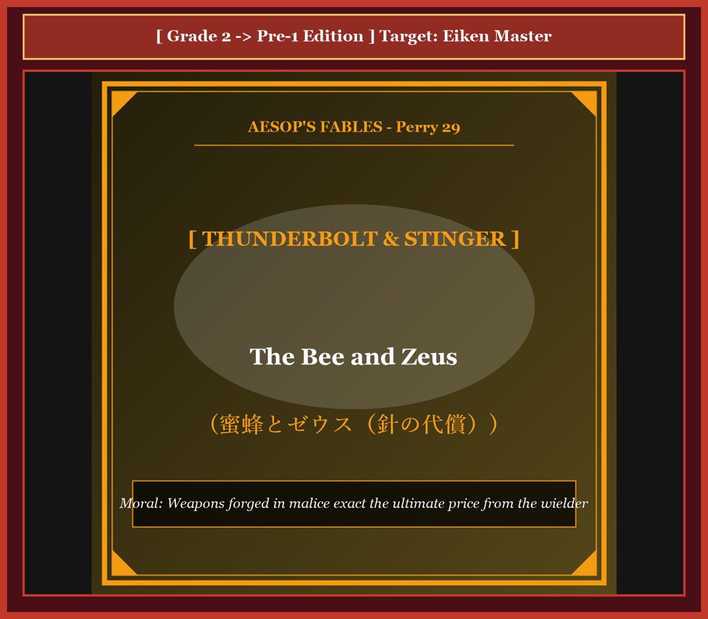

# Chapter 54: The Bee and Zeus (蜜蜂とゼウス)

<!-- 電子書籍 Page Break & Image Header -->

  

## 1. Benchmark Level: Eiken Grade 2 (英検2級レベル本文)
*Read in ~2.5 to 3 minutes. Baseline vocabulary and basic syntax.*

The matriarch of an apiary colony inhabited a fortified arboreal hollow. Throughout the pollen season, her synchronized foragers manufactured dense reserves of pure amber honey. However, because both human collectors and forest quadrupeds perpetually raided the comb, the queen cultivated an obsessive, vindictive paranoia.

Determined to procure an invincible defensive deterrent, the insect undertook an arduous pilgrimage to Mount Olympus. Penetrating the ethereal halls, she deposited an offering of freshly harvested honey before Zeus, the supreme ruler of the gods.

Captivated by the sublime flavor of the tribute, the deity expressed benevolent patronage and established an unconditional covenant: "In recognition of this magnificent offering, name whatever boon your heart desires, and it shall be granted."

Revealing the malicious hostility underlying her journey, the bee articulated a draconian petition: "Almighty sovereign, equip my physical frame with a lethal venomous spine! Whenever an intruder presumes to compromise my honeycombs, empower me to inflict a terminal sting, extinguishing their life instantaneously."

Zeus experienced profound revulsion regarding this ruthless animosity, harboring deep affection for mortal humanity. Nevertheless, constrained by the sacred sanctity of an Olympian oath, the deity could not revoke his dispensation.

Consequently, Zeus tempered the decree with poetic justice: "Your petition is ratified; a sharp weapon shall be bestowed upon your frame. However, whenever you discharge your toxic projectile into an assailant, the serrated stinger shall become permanently anchored in the victim's flesh. As you attempt to withdraw, your internal organs shall rupture, terminating your own life. The lethal instrument engineered to slaughter others shall function as the mechanism of your own destruction."

---

## 2. Target Level: Eiken Grade Pre-1 (英検準1級レベル本文)
*Read in ~3 to 3.5 minutes. Sophisticated vocabulary, subtle rhetoric, and academic analysis.*

The matriarch of an apiary colony exercised sovereign dominion within an arboreal redoubt. Throughout the pollination cycle, her synchronized workers synthesized dense reservoirs of amber nectar. However, because opportunistic foraging fauna and pastoral humans routinely plundered the comb, the queen cultivated an obsessive, vindictive paranoia regarding perimeter security.

Determined to procure an asymmetric defensive deterrent, the insect undertook an arduous pilgrimage to the celestial acropolis of Mount Olympus. Penetrating the ethereal halls, she deposited a tribute of virgin, unadulterated honey before Zeus, the supreme sovereign of the pantheon.

Captivated by the sublime viscosity and flavor of the tribute, the deity expressed benevolent patronage, ratifying an unconditional covenant: "In remuneration for this nectarous ambrosia, formulate whatever boon your heart covets, and it shall be unequivocally granted."

Unmasking the virulent malevolence underlying her pilgrimage, the bee articulated a draconian petition: "Omnipotent sovereign, equip my anatomy with a lethal venomous spine! Whenever any trespasser presumes to compromise my honeycombs, empower me to inflict a terminal puncture, extinguishing their biological life instantaneously."

Zeus experienced profound visceral revulsion regarding this ruthless animosity, harboring deep paternal affection for mortal humanity. Nevertheless, constrained by the sacrosanct inviolability of an Olympian oath, the supreme deity could not annul his dispensation.

Consequently, Zeus tempered the decree with poetic jurisprudence: "Your petition is ratified; a sharp projectile shall be bestowed upon your frame. However, whenever you discharge your toxic needle into an assailant, the serrated stinger shall become permanently anchored in the victim's dermal tissue. As you attempt to disengage, your internal viscera shall rupture, terminating your own biological existence. The lethal mechanism engineered to slaughter others shall function as the inevitable instrument of your own capital execution."

---

## 3. Classic Original English Text (イソップ寓話クラシック原文)
*Translated by George Fyler Townsend (1867)*

A Bee went to Mount Olympus to offer fresh honey to Zeus. Zeus was pleased and promised her whatever she asked. The Bee requested a stinger so that she might kill anyone who tried to take her honey. Zeus was displeased with her malicious wish, yet kept his promise; but he decreed that whenever she stung someone, the stinger should remain in the wound, and she should lose her life.

---

### 🏛️ 【英検2級レベルで読み解く！クラシック原文の重要構文・英文法ノート】
1. **1. 分詞構文（Participle Clause: 付帯状況・理由）**
   - **原文**: *"The Hare, believing her assertion to be simply impossible, agreed to the proposal..."*
   - **解説**: 「〜と信じ込んでいたので」という理由を表す分詞構文。英検2級の長文読解・ライティングの最頻出構文です。
1. **2. 古典的仮定法現在（Subjunctive Mood）**
   - **原文**: *"Though you be swift as the wind, I will beat you in a race."*
   - **解説**: 譲歩節 `Though` の中で原形 `be` を用いる古典的な仮定法現在（現代英語の `Though you are...`）。格調高い古典の響きを持ちます。
1. **3. 過去分詞の後置修飾（Postpositive Participle）**
   - **原文**: *"On the day appointed for the race the two started together."*
   - **解説**: `appointed`（定められた・指定された）が直前の名詞 `the day` を後ろから修飾する構文です。

### 📜 【クラシック原文の重要語彙・古風表現（Classic Antique Vocabulary）】
- **retort** [動] 2級 **（機転を利かせて）言い返す、反論する**（現代の reply sharp/wittily に相当）
- **assertion** [名] 2級/準1級 **主張、断言**（動詞 assert の名詞形。2級長文定番）
- **wayside** [名] 2級 **道端、沿道**（by the wayside（道端に、途中で））
- **fatigue** [名] 2級 **（心身の）極度の疲労、疲れ**（tiredness の上位フォーマル語）

---

## 4. Japanese Translation & Moral (日本語訳と教訓)

### 【日本語全訳：英検準1級レベル本文】
養蜂コロニーの母たる女王蜂が、樹木の拠点内において主権的支配を行使していました。受粉の周期を通じて、彼女の同期した働き蜂たちは琥珀色の蜜の高密度な備蓄を合成しました。しかしながら、日和見的な採餌動物や牧民たちが巣を日常的に略奪したため、女王蜂は境界のセキュリティに関して、執拗で復讐心に満ちた偏執病を育んでいきました。

非対称な防衛的抑止力を調達することを決意したその昆虫は、オリュンポス山の天上のアクロポリスへの過酷な巡礼に乗り出しました。霊妙な大広間に侵入すると、彼女はパンテオン（神々）の最高主権者ゼウスの前に、混じりけのない処女蜜の貢物を捧げました。

その貢物の神々しい粘度と風味に魅了された神は、慈悲深い後援の意を表明し、無条件の誓約を批准しました。「この蜜のような神酒への報酬として、お前の心が熱望するいかなる恩恵でも公式に表明するがよい。明白に叶えてやろう。」

自らの巡礼の根底にある有毒な悪意の仮面を脱ぎ捨て、蜂は過酷な請願を口にしました。「全能の主権者よ、私の解剖学的構造に致死的な有毒のトゲを備え付けてください！ いかなる侵入者であれ私の巣房を侵害しようと図ったときには、即座にその生物学的生命を消滅させる、終末的な一刺しを加える権能を私にお授けください。」

死すべき人間に対して深い父親のような愛情を抱いていたゼウスは、この無慈悲な敵意に関して深甚な本能的嫌悪を経験しました。それにもかかわらず、オリュンポスの誓約の侵すべからざる神聖さに制約されていたため、最高神は自らの特赦を取り消すことができませんでした。

その結果、ゼウスは詩的な法理学（因果応報）をもってその布告を調整しました。「お前の請願は批准された。鋭い投射体がお前の肉体に授けられるであろう。しかしながら、お前が襲撃者の中へと有毒な針を放出するときにはいつでも、その鋸歯状のトゲは犠牲者の真皮組織の中に永続的に固定されることになる。お前が離脱を試みるとき、お前の体内臓器は破裂し、お前自身の生物学的生存を終わらせるだろう。他者を虐殺するために設計されたその致死の機構は、お前自身を死刑執行する不可避の道具として機能するのだ。」

### 【教訓（Moral）】
**Weapons forged in malice exact the ultimate price from the wielder.**  
（他者を虐殺・害殺するために設計された悪意の兵器は、因果の構造的必然として、必ずその行使者自身に死の代償を強制する。）

---

## 5. Recite & Compare: そらんじたいキーフレーズ対比カード

  
フレーズ 1：非対称な防衛的抑止力を調達する決意

  
2級Determined to procure an invincible defensive deterrent, the insect undertook a pilgrimage.

  
準1級Determined to procure an asymmetric defensive deterrent, the insect undertook an arduous pilgrimage.

  
<strong>解説：</strong>現代軍事戦略用語「asymmetric defensive deterrent（非対称な防衛的抑止力）」の卓越した用例です。

  
フレーズ 2：神酒への報酬としての無条件の誓約批准

  
2級In recognition of this magnificent offering, name whatever boon your heart desires.

  
準1級In remuneration for this ambrosia, formulate whatever boon your heart covets, and it shall be granted.

  
<strong>解説：</strong>格調高い外交用語「remuneration（報酬）」「covenant（誓約・盟約）」の結合です。

  
フレーズ 3：生物学的生命を瞬時に消滅させる権能の請願

  
2級Empower me to inflict a terminal sting, extinguishing their life instantaneously.

  
準1級Empower me to inflict a terminal puncture, extinguishing their biological life instantaneously.

  
<strong>解説：</strong>「inflict a terminal puncture（終末的な刺傷を加える）」「extinguishing biological life」の厳密な記述です。

  
フレーズ 4：他者を虐殺する機構が己を処刑する不可避の道具となる

  
2級The lethal instrument engineered to slaughter others shall function as the mechanism of destruction.

  
準1級The lethal mechanism engineered to slaughter others shall function as the inevitable instrument of execution.

  
<strong>解説：</strong>刑法・倫理学用語「mechanism engineered to slaughter...」と「instrument of execution」の完成された修辞です。

---

## 6. Key Vocabulary & Exam Notes (英検準1級 重要語彙・文法・面接対策)

### 1. 英検準1級 必須ボキャブラリー
* **asymmetric** [形] 非対称の（*asymmetric warfare/deterrent*）
* **unadulterated** [形] 純粋な、混じりけのない
* **pantheon** [名] 万神殿、神々全体
* **viscosity** [名] 粘度、粘性（流体力学用語）
* **virulent** [形] 猛毒の、悪意に満ちた、極めて有害な
* **inviolability** [名] 不可侵性、神聖さ
* **viscera** [名] 内臓、はらわた
* **jurisprudence** [名] 法理学、法律体制、裁判体系

### 2. 文法・構文のチェックポイント
* **tempered + A + with + B**:
  * 「BをもってAを加減する、和らげる、調整する」。*temper justice with mercy*。
* **formulate whatever + 名詞 + S + V**:
  * 「Sが〜するいかなる…でも公式に表現せよ」。

### 3. スピーキング（面接）＆ライティング活用ヒント
* 生物化学兵器や自律型致死兵器システム（LAWS）がもたらす開発国自身へのブーメラン的壊滅リスクを論じる際に最適です。

