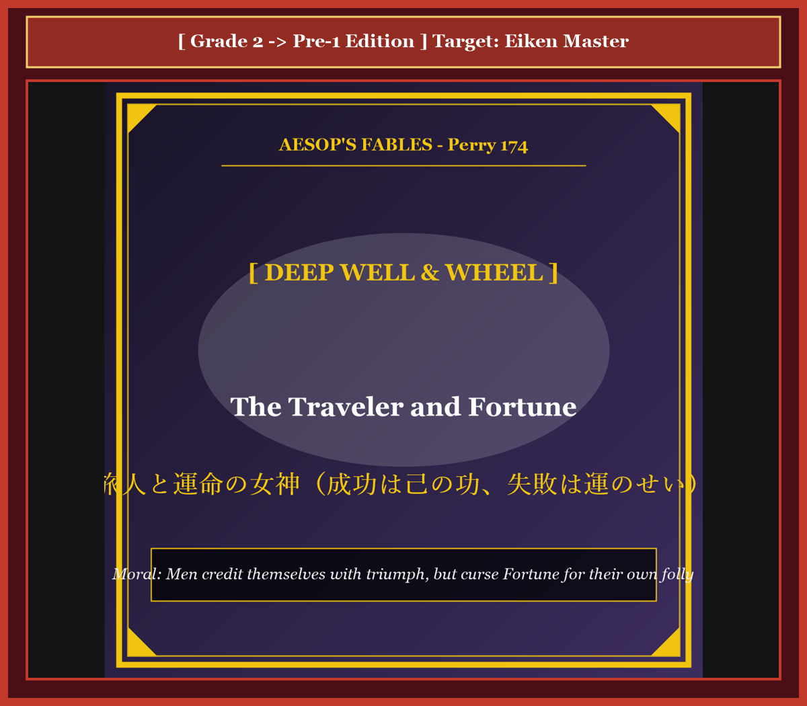

# Chapter 60: The Traveler and Fortune (旅人と運命の女神)

<!-- 電子書籍 Page Break & Image Header -->

  

## 1. Benchmark Level: Eiken Grade 2 (英検2級レベル本文)
*Read in ~2.5 to 3 minutes. Baseline vocabulary and basic syntax.*

A fatigued wayfarer traversed an inhospitable arid wasteland during an extended continental journey. Deprived of essential hydration, burdened by physical exhaustion, and suffering acute sensory fatigue, the traveler encountered an ancient subterranean cistern situated beside the road.

Seeking immediate relief from atmospheric exposure, the wanderer collapsed directly upon the crumbling masonry framing the abyss. The architecture was profoundly precarious: decades of structural degradation had eroded the mortar, leaving an unreinforced ledge suspended immediately above a vertical drop into freezing subterranean waters.

Completely subordinating self-preservation to physical fatigue, the nomad lapsed into profound, comatose unconsciousness. His head hovered perilous inches over the void; an inadvertent nocturnal spasm would inevitably cause his center of gravity to shift, precipitating an irreversible plunge to his death.

At that critical juncture, the divine personification of Fortune materialized upon the desert wind, illuminated by celestial luminescence.

Extending a slender hand, the deity shook the traveler's shoulder, forcibly arresting his dangerous slumber: "Rouse your faculties, reckless mortal, and vacate this lethal ledge!"

Startled into acute wakefulness, the traveler peered into the subterranean chasm and recoiled in visceral horror, perceiving how narrowly he had skirted catastrophic destruction.

Before the bewildered wanderer could articulate clumsy gratitude, Fortune addressed him with devastating analytical insight:

"Absorb this deliverance, naive nomad, but meditate upon the chronic duplicity of human psychology. Had you shifted in your sleep and plummeted to an aqueous grave, your grieving relatives would never have imputed the catastrophe to your own gross negligence. Invariably, they would have cursed Fortune, proclaiming that malevolent destiny had claimed an innocent victim. Mankind perpetually monopolizes credit for their triumphs, attributing prosperity to personal virtue, yet ruthlessly scapegoats Fortune for the natural consequences of their own folly."

---

## 2. Target Level: Eiken Grade Pre-1 (英検準1級レベル本文)
*Read in ~3 to 3.5 minutes. Sophisticated vocabulary, subtle rhetoric, and academic analysis.*

A fatigued wayfarer traversed an inhospitable arid wasteland during an extended continental pilgrimage. Deprived of essential hydration, burdened by physical exhaustion, and suffering acute sensory disorientation, the traveler encountered an ancient subterranean cistern situated contiguous to the highway.

Seeking immediate relief from atmospheric exposure, the wanderer collapsed directly upon the crumbling masonry framing the abyss. The architecture was profoundly precarious: decades of structural degradation had eroded the mortar, leaving an unreinforced lip suspended immediately above a fifty-foot vertical drop into freezing subterranean waters.

Completely subordinating self-preservation to physical fatigue, the nomad lapsed into profound, comatose unconsciousness. His cranium hovered perilous inches over the void; an inadvertent nocturnal spasm would inevitably cause his center of gravity to shift, precipitating an irreversible plunge to oblivion.

At that fateful interlude, the divine personification of Fortune materialized upon the desert wind, illuminated by an ethereal celestial luminescence.

Extending a slender hand, the deity agitated the traveler's shoulder, forcibly arresting his dangerous slumber: "Rouse your faculties, reckless mortal, and vacate this lethal ledge!"

Startled into acute wakefulness, the traveler peered into the subterranean chasm and recoiled in visceral horror, perceiving how narrowly he had skirted catastrophic liquidation.

Before the bewildered wanderer could articulate clumsy gratitude, Fortune addressed him with devastating analytical insight:

"Absorb this deliverance, naive nomad, but meditate upon the chronic duplicity of human psychology. Had you shifted in your sleep and plummeted to an aqueous grave, your grieving relatives would never have imputed the catastrophe to your own gross negligence. Uniformly, they would have anathematized Fortune, proclaiming that malevolent destiny had snuffed out an innocent soul. Mankind perpetually monopolizes credit for their triumphs, attributing prosperity to personal virtue, yet ruthlessly scapegoats Fortune for the natural consequences of their unmitigated idiocy."

---

## 3. Classic Original English Text (イソップ寓話クラシック原文)
*Translated by George Fyler Townsend (1867)*

A tired Traveler lay down and fell asleep right at the slippery edge of a deep well. Fortune appeared beside him, woke him, and said: "Rise, my friend, and depart. For if you had fallen into the well, men would not have blamed your own reckless carelessness, but would have cursed Fortune for your death!"

---

### 🏛️ 【英検2級レベルで読み解く！クラシック原文の重要構文・英文法ノート】
1. **1. 分詞構文（Participle Clause: 付帯状況・理由）**
   - **原文**: *"The Hare, believing her assertion to be simply impossible, agreed to the proposal..."*
   - **解説**: 「〜と信じ込んでいたので」という理由を表す分詞構文。英検2級の長文読解・ライティングの最頻出構文です。
1. **2. 古典的仮定法現在（Subjunctive Mood）**
   - **原文**: *"Though you be swift as the wind, I will beat you in a race."*
   - **解説**: 譲歩節 `Though` の中で原形 `be` を用いる古典的な仮定法現在（現代英語の `Though you are...`）。格調高い古典の響きを持ちます。
1. **3. 過去分詞の後置修飾（Postpositive Participle）**
   - **原文**: *"On the day appointed for the race the two started together."*
   - **解説**: `appointed`（定められた・指定された）が直前の名詞 `the day` を後ろから修飾する構文です。

### 📜 【クラシック原文の重要語彙・古風表現（Classic Antique Vocabulary）】
- **retort** [動] 2級 **（機転を利かせて）言い返す、反論する**（現代の reply sharp/wittily に相当）
- **assertion** [名] 2級/準1級 **主張、断言**（動詞 assert の名詞形。2級長文定番）
- **wayside** [名] 2級 **道端、沿道**（by the wayside（道端に、途中で））
- **fatigue** [名] 2級 **（心身の）極度の疲労、疲れ**（tiredness の上位フォーマル語）

---

## 4. Japanese Translation & Moral (日本語訳と教訓)

### 【日本語全訳：英検準1級レベル本文】
疲労困憊した旅人が、長期にわたる大陸巡礼の途上、過酷で乾燥した荒野を横断していました。不可欠な水分補給を奪われ、肉体的疲労に圧迫され、急性の感覚喪失に苦しみながら、その旅人は街道に隣接して位置していた古代の地下貯水槽に遭遇しました。

大気への暴露からの即座の救済を求め、放浪者は深淵を縁取る崩れかけた石造りの構造物の上に直接倒れ込みました。その建築構造は深刻なほど不安定でした。何十年もの構造的劣化がモルタルを侵食し、氷のように冷たい地下水の中へと向かう50フィートの垂直落下の真上に、補強されていない縁が宙づりのまま残されていたのです。

自己保存を肉体的疲労へと完全に従属させ、放浪者は昏睡状態のような深い無意識へと沈んでいきました。彼の頭部は虚空のわずか数インチ上を危うく漂っていました。眠りの中でのうっかりした不随意の痙攣一つが、必然的に彼の重心を移動させ、忘却（死）への不可逆的な転落を引き起こす状況だったのです。

その運命的な合間に、運命の女神フォーチュンの神聖な擬人化された姿が、霊妙な天上の光彩に照らされながら、砂漠の風の上に具現化しました。

ほっそりとした手を差し伸べ、女神は旅人の肩を揺すり、その危険な眠りを力強く制止しました。「知性を奮い立たせなさい、無謀な定命の者よ、そしてこの致死的な岩棚から退くのです！」

鋭い覚醒へと叩き起こされた旅人は、地下の裂け目を覗き込み、自らがいかに紙一重で壊滅的な死を免れたかを知覚して、本能的な恐怖のあまり後ずさりしました。

困惑した放浪者が不器用な感謝の言葉を口にする間もなく、運命の女神は壊滅的な分析的洞察をもって彼に語りかけました。

「この救済を受け止めなさい、世間知らずの放浪者よ。しかし人間の心理の慢性的な二面性を深く思索するのです。もしあなたが眠りの中で身じろぎし、水底の墓場へと急落していたなら、あなたの悲嘆に暮れる親族たちは、決してその大惨事をあなた自身の甚だしい過失に帰することはなかったでしょう。判で押したように、彼らは運命の女神を呪詛し、邪悪な運命が無実の魂を奪い去ったと宣言したはずです。人類は常に自らの勝利に対する功績を独占し、繁栄を自らの美徳に帰属させるくせに、自らの純然たる白痴（愚行）の自然な結末については、無慈悲にも運命をスケープゴートにするものなのですから。」

### 【教訓（Moral）】
**Men credit themselves with triumph, but curse Fortune for their own folly.**  
（人間は自らの成功を個人の才能や努力の賜物として独占して誇る一方、自らの怠慢や不注意による過失の破滅については、すべて運命や不運のせいにして責任転嫁する。）

---

## 5. Recite & Compare: そらんじたいキーフレーズ対比カード

  
フレーズ 1：自己保存を疲労に従属させて昏睡状態に陥る

  
2級Subordinating self-preservation to physical fatigue, the nomad lapsed into profound comatose unconsciousness.

  
準1級Subordinating self-preservation to physical fatigue, the nomad lapsed into profound, comatose unconsciousness.

  
<strong>解説：</strong>分詞構文「Subordinating self-preservation to fatigue」の表現です。

  
フレーズ 2：わずかな重心移動が不可逆の転落を招く危機

  
2級An inadvertent spasm would inevitably cause his center of gravity to shift, precipitating an irreversible plunge.

  
準1級An inadvertent nocturnal spasm would inevitably cause center of gravity to shift, precipitating an irreversible plunge.

  
<strong>解説：</strong>物理学用語「center of gravity to shift」「precipitating an irreversible plunge」です。

  
フレーズ 3：過失を顧みず運命を呪詛する親族たちの偽善

  
2級Relatives would never have imputed the catastrophe to negligence, but would have cursed Fortune.

  
準1級Relatives would never have imputed catastrophe to gross negligence, but would have anathematized Fortune.

  
<strong>解説：</strong>神学用語「anathematized Fortune（運命を呪詛した・破門した）」の格調高い文体です。

  
フレーズ 4：勝利の功績は独占し、愚行は運命に責任転嫁する

  
2級Mankind perpetually monopolizes credit for triumphs, attributing prosperity to virtue, yet scapegoats Fortune for folly.

  
準1級Mankind perpetually monopolizes credit for triumphs, yet ruthlessly scapegoats Fortune for unmitigated idiocy.

  
<strong>解説：</strong>「monopolizes credit for triumphs」「ruthlessly scapegoats Fortune for unmitigated idiocy」の結実です。

---

## 6. Key Vocabulary & Exam Notes (英検準1級 重要語彙・文法・面接対策)

### 1. 英検準1級 必須ボキャブラリー
* **inhospitable** [形] 過酷な、住むのに適さない
* **contiguous** [形] 隣接する、接触している
* **comatose** [形] 昏睡状態の
* **anathematize** [動] 〜を呪う、破門する、厳しく糾弾する
* **monopolize** [動] 〜を独占する
* **scapegoat** [動] 〜のせいにする、身代わりにする
* **duplicity** [名] 二面性、二枚舌、自己欺瞞
* **idiocy** [名] 白痴、極端な愚行

### 2. 文法・構文のチェックポイント
* **anathematize + 名詞**:
  * 「〜を呪う、強く非難する」。格調高い宗教・哲学用語です。
* **monopolize + credit + for ...**:
  * 「〜の功績を独占する」。

### 3. スピーキング（面接）＆ライティング活用ヒント
* 自己帰属バイアス（成功は内因、失敗は外因に帰する心理）について論述する際に最適です。

